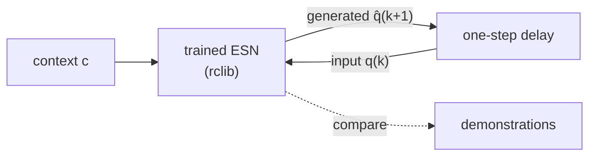
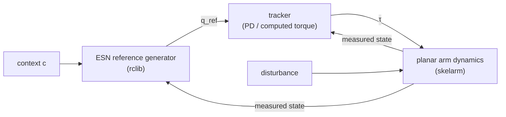

# arm-esn-ctrl

Echo state network (ESN) reference generators for robot-arm control,
learned from demonstration.

An ESN is trained on a few demonstrated joint-angle trajectories so that
it replicates the dynamical system underlying the demonstrations. At run
time, the ESN receives the robot's measured joint angles and a
task-specific context signal, and generates the next joint-angle
reference. A conventional trajectory tracker converts this reference
into joint torques, which drive a simulated planar arm subject to
disturbances. We study whether this state-driven ESN reference generator
makes the arm more robust than the standard approach of tracking a
time-indexed reference trajectory.

> **Status:** Stages 1 and 2 have first results, in reports 001 and 002 (eight
> demonstrations) and 003 (one demonstration).

## Motivation

A time-indexed reference $q^\mathrm{ref}(t)$ ignores what the robot is
actually doing. When the arm is pushed or blocked, the reference keeps
moving on schedule, the tracking error grows, and the tracker responds
with large corrective torques that drag the arm toward where the
schedule says it should be, not necessarily along a sensible path.

Dynamical-systems approaches to learning from demonstration, such as
dynamical movement primitives and stable estimators of dynamical
systems, avoid this by learning a state-dependent motion policy: the
reference is a function of the current state, so after a disturbance
the motion resumes from where the robot actually is. These methods
usually impose a hand-designed model structure to make the learned
system behave well.

Reservoir computing offers a complementary route. An ESN driven by a
time series can learn to replicate the dynamical system that generated
it, including its attractors, and studies have reported ESNs that
reproduce parts of the dynamics never visited during training. We ask
whether this capability carries over to learning from demonstration,
where

- the demonstrator's underlying dynamical system is unknown;
- only a few of its trajectories, the demonstrations, are observed, so
  the system is only *partially observed*; and
- the robot inevitably leaves the observed trajectories, for example
  when it is disturbed, so the learned system must also behave sensibly
  outside them.

If it does, the learned ESN is a reference generator that takes the
current robot state and context into account, and it should keep the
arm robust to disturbances without being told explicitly how to recover.

## Research questions

1. **Replication.** Trained on a few demonstrations, does the ESN
   reproduce the demonstrated trajectories and settle at the
   demonstrated goal?
2. **Partial observation.** Does the ESN replicate the underlying
   dynamical system outside the observed trajectories, for example when
   it starts from a posture that was never demonstrated? How many
   trajectories, and how much variety among them, are needed to
   replicate the system reliably?
3. **Context.** Can a context signal select or modulate the generated
   motion? Candidate contexts are a motion label, the size of an
   obstacle, and the timing to start the motion.
4. **Robustness.** Connected to the robot and disturbed (pushes,
   temporary blocking, initial-posture offsets), does the ESN reference
   let the arm complete the task more reliably, or with smaller
   corrective torques, than time-indexed reference tracking with the
   same tracker?

A negative answer is also a result, and the reports record it as one.

## Approach

The ESN is studied in two stages. It is first run **autonomously**,
without the robot, to understand what it has learned and how its
hyperparameters affect it. Only after it reproduces the demonstrations
well is it connected **to the robot** and compared with baselines.

### ESN formulation

At step $k$, the ESN input $u_k$ stacks the joint angles $q_k$ and the
context $c_k$. A leaky reservoir with state $x_k$ is updated, and a
linear readout produces the next joint angles:

$$
u_k = \begin{bmatrix} q_k \\ c_k \end{bmatrix}, \qquad
x_{k+1} = (1-\alpha)\,x_k + \alpha \tanh\left(W_\mathrm{res}\,x_k + W_\mathrm{in}\begin{bmatrix} 1 \\ u_k \end{bmatrix}\right), \qquad
\hat q_{k+1} = W_\mathrm{out}\begin{bmatrix} 1 \\ x_{k+1} \end{bmatrix}.
$$

- $W_\mathrm{res}$ and $W_\mathrm{in}$ are random and fixed. Only
  $W_\mathrm{out}$ is trained, by ridge regression.
- The ESN works only with the observed quantity, the joint angles, in
  both its input and its output. It is not expected to generate
  unobserved states such as joint velocities. If joint angles alone
  turn out to be insufficient, the input may be extended with joint
  velocities; in the autonomous stage, these would then be computed by
  finite differences of the generated angles.
- **Training (teacher forcing).** The inputs are the demonstrated joint
  angles and the target is the next demonstrated joint angle
  $q^\mathrm{demo}_{k+1}$. Each demonstration starts from a reset
  reservoir, and an initial washout period is excluded from the fit.
- **Hyperparameters.** These are the reservoir size, spectral radius,
  leak rate $\alpha$, input scaling, connection density, ridge
  coefficient, washout length, and random seed. All of them are set in
  the configuration file (see *Configuration and reproducibility*
  below).

### Stage 1: autonomous ESN (without the robot)

After a warm-up driven by the demonstration, the ESN's output is fed
back as its own input at the next step, $q_{k+1} := \hat q_{k+1}$. The
trained ESN then runs as an autonomous dynamical system, and the
trajectory it generates is compared with the demonstrations.



This stage needs no robot simulator and runs fast. It serves two
purposes:

- **Building intuition.** We sweep the ESN hyperparameters by hand to
  get a feeling for how each one affects the generated trajectories,
  and to find a parameter set with which the trained ESN performs well
  (RQ1).
- **Probing the learned system.** We start the ESN from postures that
  were never demonstrated, or perturb the fed-back angles, to see
  whether it behaves sensibly outside the observed trajectories (RQ2).
  We also vary the context (RQ3).

### Stage 2: ESN connected to the robot



The ESN input is now the *measured* joint angles of the robot, never the
ESN's own prediction. The reservoir warms up while the arm holds its
initial posture, before the task starts at t = 0. Every ESN period Δ,
the ESN turns the measured posture $q(t_k)$ into the posture the arm
should have next, $\hat q_{k+1}$; between those instants, the reference
$q^\mathrm{ref}$ moves in a straight line from $\hat q_k$ to
$\hat q_{k+1}$. The tracker's desired velocity is that line's slope, and
its desired acceleration is the change of the slope, smoothed by a causal
low-pass filter.

The **baseline** replaces the ESN block with the demonstration replayed
against time, $q^\mathrm{ref}(t) = q^\mathrm{demo}(t)$. Everything else
is shared: the robot model, the tracker and its gains, the disturbances,
and the metrics. Differences in outcome can then be attributed to the
reference generator alone.

Nothing in this construction guarantees that the autonomous ESN, or the
coupled ESN–robot system, is stable. At this stage, we observe stability
empirically and report it.

### Disturbance scenarios *(initial set)*

| Scenario | What happens |
| --- | --- |
| nominal | No disturbance. |
| push | A short external force acts on the arm during the motion. |
| block | The arm is held in place for a while, then released. |
| initial offset | The motion starts from a posture away from the demonstrated start. |

### Metrics

Metrics depend on the task, and each report defines the ones it uses.
Typical examples are:

- **Autonomous ESN:** each run is split at its **arrival time** t_a, the
  first time the hand comes within the goal radius r of the target (the
  target tolerance of the task). The **reach** [0, t_a] is compared with
  the demonstrator's reach from the same start posture: the hand
  displacement in the first step (a jump shows the ESN snapping back to a
  learned trajectory), the deviation from the demonstrated path regardless
  of timing, the joint-angle error over time, and the arrival delay. The
  **hold** window [t_a, t_a + T_h], with the hold duration T_h set by
  `hold` in `[evaluation]`, needs no reference: a run succeeds if it
  arrives and does not leave the goal radius during the window, and the
  hold error is the distance to the target at the window's end. A window
  that would run past the end of the run is cut there, and the observed
  hold length is recorded.
- **ESN with the robot:** the goal error, the deviation from the
  demonstrated path, the joint torques (or accelerations) generated to
  recover after a disturbance, and the smoothness of the reference,
  including any jump right after a disturbance.

## Guiding principles

- **Concept first.** Demonstrate the idea in a small, clear setup, such
  as a two-link arm and one reaching motion, before scaling up.
  Understand the ESN autonomously before connecting it to the robot.
  Explore hyperparameters by hand to build intuition; automated
  hyperparameter optimization waits until the concept is established.
- **Simple code.** Use plain functions on NumPy arrays and few layers
  of abstraction. Add a new abstraction only when a second real use
  appears. A researcher should be able to read any script from top to
  bottom.
- **Human-readable reports.** Each study is a short Markdown report
  written for people: a question, the setup, figures, observations, and
  next steps.
- **Everything in configuration files.** Every parameter that affects a
  result is set in a configuration file, not hidden in a script.
- **Libraries own their domain.** ESN numerics belong to rclib and arm
  simulation belongs to skelarm. Fix issues upstream first, then advance
  the submodule pin in a separate commit.

## Repository layout

```text
arm-esn-ctrl/
├── src/arm_esn_ctrl/   # small library: demonstrations, ESN, autonomous and robot runs, tracking, metrics
├── experiments/        # the runner scripts, and one directory per experiment: its README and configurations
├── tools/              # interactive apps that run a trained ESN or the robot live
├── reports/            # one directory per study (see Reports)
├── tests/              # sanity tests of the core pieces
└── third_party/        # rclib and skelarm (Git submodules)
```

## Experiments

Each experiment is a directory under [`experiments/`](experiments/README.md),
with a README that describes it and its configuration files; the runner scripts
that run them are shared:

| Experiment | What it studies | Report |
| --- | --- | --- |
| [demonstrations](experiments/demonstrations/README.md) | scripted reaching demonstrations of a two-link arm | |
| [single_demonstration_autonomous_reaching](experiments/single_demonstration_autonomous_reaching/README.md) | an ESN trained on one demonstration, run on its own (Stage 1) | [003](reports/003-single-demonstration/README.md) |
| [single_demonstration_robot_tracking](experiments/single_demonstration_robot_tracking/README.md) | that ESN as the reference generator of the simulated robot (Stage 2) | [003](reports/003-single-demonstration/README.md) |
| [multi_demonstration_autonomous_reaching](experiments/multi_demonstration_autonomous_reaching/README.md) | an ESN trained on eight demonstrations, run on its own (Stage 1) | [001](reports/001-autonomous-reaching/README.md) |
| [multi_demonstration_robot_tracking](experiments/multi_demonstration_robot_tracking/README.md) | that ESN as the reference generator of the simulated robot (Stage 2) | [002](reports/002-esn-reference-on-the-robot/README.md) |
| [manual_demonstration_autonomous_reaching](experiments/manual_demonstration_autonomous_reaching/README.md) | an ESN trained on one take taught by hand, run on its own (Stage 1) | [004](reports/004-manual-demonstration/README.md) |
| [manual_demonstration_robot_tracking](experiments/manual_demonstration_robot_tracking/README.md) | that ESN as the reference generator of the simulated robot (Stage 2) | [004](reports/004-manual-demonstration/README.md) |
| [manual_demonstration_v2_autonomous_reaching](experiments/manual_demonstration_v2_autonomous_reaching/README.md) | the same on a remade arm, with a new take (Stage 1) | [005](reports/005-tuned-on-the-robot/README.md) |
| [manual_demonstration_v2_robot_tracking](experiments/manual_demonstration_v2_robot_tracking/README.md) | ESNs tuned on the robot, by how it follows the taught path (Stage 2) | [005](reports/005-tuned-on-the-robot/README.md) |
| [manual_demonstration_v2_robot_search](experiments/manual_demonstration_v2_robot_search/README.md) | a wider search on the robot, with ten random reservoirs per setting (Stage 2) | [006](reports/006-wider-search-on-the-robot/README.md) |
| [manual_demonstration_v2_robot_ringing](experiments/manual_demonstration_v2_robot_ringing/README.md) | the ringing after a block or a push, with joint PD, and an ESN search scored by it (Stage 2) | [007](reports/007-ringing-with-joint-pd/README.md) |
| [manual_demonstration_v2_robot_damping](experiments/manual_demonstration_v2_robot_damping/README.md) | that ESN with joint PD better damped, and given the reference velocity (Stage 2) | [008](reports/008-damping-and-reference-velocity/README.md) |
| [manual_demonstration_v2_robot_damped_search](experiments/manual_demonstration_v2_robot_damped_search/README.md) | an ESN search with that better-damped tracker, its torque computed every 10 ms, then with white, pink, and brown teacher noise, scored by the ringing and the return (Stage 2) | [009](reports/009-noisy-training-for-a-faster-return/README.md) |
| [manual_demonstration_v2_robot_noisy_search](experiments/manual_demonstration_v2_robot_noisy_search/README.md) | blue and violet teacher noise against white, then the search trained with the best noise (Stage 2) | [010](reports/010-noisy-search-a-negative-result/README.md) |
| [manual_demonstration_v2_robot_following_search](experiments/manual_demonstration_v2_robot_following_search/README.md) | an ESN search scored by how much its reference follows the arm, waiting under the block and yielding to a push, then compared with the replay across joint PD trackers (Stage 2) | [011](reports/011-following-the-arm/README.md) |
| [manual_demonstration_v2_robot_recorded_pushes](experiments/manual_demonstration_v2_robot_recorded_pushes/README.md) | the two ESNs of the following search and the replay under pushes given by hand, recorded once and replayed by time across joint PD trackers (Stage 2) | [012](reports/012-pushes-by-hand/README.md) |
| [manual_demonstration_v2_robot_equal_gains](experiments/manual_demonstration_v2_robot_equal_gains/README.md) | every scenario of the following search and the recorded pushes with joint PD at the same gains for both joints (Stage 2) | [013](reports/013-equal-gains/README.md) |
| [manual_demonstration_v2_robot_stable_equal_gains](experiments/manual_demonstration_v2_robot_stable_equal_gains/README.md) | every scenario of the following search and the recorded pushes with the same gains for both joints, estimated to keep the torque held for 10 ms stable (Stage 2) | [013](reports/013-equal-gains/README.md) |
| [manual_demonstration_v2_robot_progress_replay](experiments/manual_demonstration_v2_robot_progress_replay/README.md) | every scenario of the following search and the recorded pushes with a third arm, the take replayed by the arm's progress along the taught path (Stage 2) | [014](reports/014-progress-replay/README.md) |
| [manual_demonstration_v2_esn_dynamics](experiments/manual_demonstration_v2_esn_dynamics/README.md) | what the following search's two ESNs learned as dynamical systems: run on their own from rest anywhere in the joint space, with other warm-ups, pushed by short pulses along the reach on the robot, and read as the map of their reservoir state for its fixed points (Stages 1 and 2) | [015](reports/015-what-the-esns-learned/README.md) |
| [manual_demonstration_v2_esn_screening](experiments/manual_demonstration_v2_esn_screening/README.md) | the following search's 1,050 ESNs screened without the robot, by their fixed points, their lead over a held posture, and their rates, against its robot outcomes; the passing ESNs held still on the robot; and 1,050 held-out ESNs alike (Stages 1 and 2) | [016](reports/016-screening-esns/README.md) |
| [manual_demonstration_v2_consistent_search](experiments/manual_demonstration_v2_consistent_search/README.md) | the main results run again under one protocol fixed before any run: an ESN search over a wider grid with one tracker, every ESN from 49 offset starts, chosen by a rule in code and checked on held-out seeds and, afterwards, on the bias's scale (Stage 2); its README holds the protocol of reports 017 to 019 | [017](reports/017-search-under-one-protocol/README.md) |
| [manual_demonstration_v2_consistent_trackers](experiments/manual_demonstration_v2_consistent_trackers/README.md) | the consistent search's two ESNs, the replay, and the progress replay with nine trackers, joint PD with and without the reference velocity and computed torque, in every scenario of the search and under the pushes given by hand (Stage 2) | [018](reports/018-trackers-under-one-protocol/README.md) |
| [manual_demonstration_v2_consistent_dynamics](experiments/manual_demonstration_v2_consistent_dynamics/README.md) | the consistent search's two ESNs read as report 015 read report 011's, and all its 10,080 ESNs screened as report 016 screened report 011's, set against their outcomes with the offset starts counted; the passing ESNs released at their unstable fixed points and blocked along the reach on the robot (Stages 1 and 2) | 019, to be written |

Every parameter that affects a result is in a TOML configuration file, and every
run records its configuration, the command, and the commit that produced it, so
that running the same configuration again on the same machine reproduces the same
result. Runs go into a storage root outside the repository, filed by experiment:
`<storage root>/results/<experiment>/<date>-<time>-<configuration name>/`.
[`experiments/README.md`](experiments/README.md) describes the configurations, the
run records, reproducibility, and the storage. The interactive apps that run a
trained ESN or the robot live are described in [`tools/README.md`](tools/README.md).

## Getting started

Prerequisites:

- Python 3.12 or newer and [uv](https://docs.astral.sh/uv/)
- A C++17 compiler, CMake 3.15 or newer, and OpenMP, all needed to
  build rclib (on Ubuntu: `sudo apt install libomp-dev`)

```bash
git clone --recursive <repository-url> arm-esn-ctrl
cd arm-esn-ctrl
uv sync        # builds rclib from the submodule and installs skelarm
uv run pytest  # quick sanity check

# Optional: keep data and results outside the repository
echo 'storage_root = "/path/to/storage"' > storage.toml
```

If you cloned without `--recursive`, run
`git submodule update --init --recursive`.

### Advancing a submodule pin

Fix issues in rclib or skelarm upstream first. Once the fix is on the
library's `main` branch, advance the pin here in a commit of its own
(rclib shown; skelarm is the same):

```bash
git -C third_party/rclib fetch origin
git -C third_party/rclib checkout <commit>                  # the new pin
git -C third_party/rclib submodule update --init --recursive  # the library's own submodules
git add third_party/rclib
uv sync --reinstall-package rclib
uv run pytest
```

Do not run `git submodule update` in this repository between checking
out the new commit and `git add`: it resets the submodule to the old pin.
uv installs the libraries from the submodules but does not notice when
their source changes, so reinstall them with `--reinstall-package`. After
committing the new pin, rerun the experiments whose results depend on
the library.

## Development

```bash
uv run pytest                                # tests
uv run ruff format . && uv run ruff check .  # formatting and linting
uv run basedpyright && uv run mypy           # type checking
```

Type annotations are encouraged but not required. The type checkers run
in their standard (non-strict) modes. Their settings in `pyproject.toml`
also apply when your editor runs its own pyright, basedpyright, or mypy,
so imports resolve against the project's `.venv`.

## Reports

`reports/` holds one directory per study:

```text
reports/001-autonomous-reaching/
├── README.md   # the report
├── data/       # the demonstrations this report uses
└── results/    # the runs behind its figures: configurations, outputs, figures
```

The reports so far:

- [001 Autonomous reaching with an echo state network](reports/001-autonomous-reaching/README.md)
  (Stage 1): the ESN trained on eight demonstrations, run on its own.
- [002 The ESN as the reference generator of a robot arm](reports/002-esn-reference-on-the-robot/README.md)
  (Stage 2): the ESN against the replayed demonstrations, with and without
  disturbances.
- [003 One demonstration: what the ESN learns, and how it drives a robot arm](reports/003-single-demonstration/README.md)
  (Stages 1 and 2): an ESN trained on a single demonstration learns a clock or a
  path; on the robot, the path-type ESN's reference waits for a blocked arm.
- [004 A demonstration taught by hand: from a pause and pixel steps to a mild return](reports/004-manual-demonstration/README.md)
  (Stages 1 and 2): an ESN trained on one take taught by hand returns mildly to the
  taught path from offset starts, and on the robot adapts to blocks and pushes.
- [005 A remade arm, and an ESN tuned on the robot](reports/005-tuned-on-the-robot/README.md)
  (Stage 2): on a remade arm, an ESN tuned by how the robot follows the taught path
  with it follows it within about 1 mm; the more compliant of two candidates was
  chosen, at a cost in robustness from offset starts. Its reservoir states,
  recomputed from the runs' logs, wait with a held arm.
- [006 A wider search on the robot, under disturbances](reports/006-wider-search-on-the-robot/README.md)
  (Stage 2): ten random reservoirs per setting; a spectral radius over 1 helps at a
  slow leak rate, and pushes, not undisturbed runs, separate the settings around
  the one chosen by hand. With joint PD, the ESN chosen by a rule over ten seeds
  arrives from all 49 offset starts, and its arm rings a seventh to two-thirds as
  much as the replay's after a block or a push, though it strays farther and comes
  back more slowly.
- [007 Less ringing with joint PD](reports/007-ringing-with-joint-pd/README.md)
  (Stage 2): with pushes long enough for the ESN to follow the arm, an ESN searched
  with joint PD by the ringing after a block or a push makes the arm ring a fifth to
  two-thirds as much as the replay, with joint PD or computed torque, at the cost of
  slower swings back onto the path.
- [008 Damping and the reference velocity](reports/008-damping-and-reference-velocity/README.md)
  (Stage 2): with joint PD damped at 0.4 or 0.8, the replay rings nearly as little
  as report 007's ESN after a push and returns to the path within 0.5 s, where the
  ESN still takes 2.4 to 4.5 s; under the block, the ESN presses with a twelfth of
  the replay's torque. Given the reference velocity, the ESN follows the taught path
  within 0.6 mm at any damping, at the cost of torque spikes at offset starts. With
  the torque computed every 10 ms, the lightly damped replay rings a third more and
  the ESN only a little more.
- [009 Noisy training for a faster return](reports/009-noisy-training-for-a-faster-return/README.md)
  (Stage 2): with joint PD at 0.4, given the reference velocity, no reservoir
  setting returns faster than report 007's, but training it with white noise of 1°
  on the input brings its return from 2.7 s to 0.8 s. Its reference then holds to
  the taught path during a push, as the replay's does, while under the block it
  still yields, pressing with an eighth of the replay's torque. Brown noise spoils
  the reach, and with ζ = 0.1 the noisy ESN rings much as the replay does.
- [010 The noisy search: a negative result](reports/010-noisy-search-a-negative-result/README.md)
  (Stage 2): blue and violet noise do no better than white, and with white noise of
  1° nearly every setting of report 009's grid qualifies, the best returning about
  as fast as the replay. But in the robot app no ESN trained with noise did better
  than report 007's: after a push, its reference holds the taught path and the arm
  is snapped back, as with the replay, where a reference that adapts to the arm's
  actual state is wanted. The fastest reservoirs also settle on a resting posture
  off the taught motion from many offset starts.
- [011 Following the arm](reports/011-following-the-arm/README.md) (Stage 2): a
  following gain, how much of a disturbed arm's displacement the reference shares,
  scores a new search: faster leak rates follow more but lose the reach, and the two
  ESNs chosen, at leak rate 0.03, follow by 0.73 and 0.79 against report 007's ESN's
  0.69. Across joint PD at damping ratios 0.2 to 0.8, with or without the reference
  velocity, both complete every run and follow alike; they ring half as much as the
  replay after a push when lightly damped and about as much at 0.8, wait under the
  block with a sixth of its torque, and return to the taught path more slowly.
- [012 Pushes by hand](reports/012-pushes-by-hand/README.md) (Stage 2): the arm
  pushed by hand in the robot app, three times, and the recorded force replayed by
  time for report 011's two ESNs and the replay across six joint PD trackers. The ESNs
  follow the ten pushes by about 0.7, as the scripted ones, and every run reaches the
  target. A strong push backward, given a zero reference velocity, takes ESN #1's
  reference back toward the start, and the arm reaches again. After a push at the
  target, the ESNs ring less than the replay when lightly damped, but over all ten
  pushes their edge is smaller than under the scripted pushes, and they come back to
  the taught path in seconds where the replay's arm does within 1.2 s.
- [013 Equal gains for both joints](reports/013-equal-gains/README.md) (Stage 2):
  joint PD with the same gains for both joints, its torque held for 10 ms. With the
  same gains, the error splits along the mass matrix's eigenvectors, and a mode grows,
  flipping sign every period, unless kd < 2 μ / T − kp T / 10, μ its inertia: kd = 3
  chatters until joint 2 passes 71.5°, kd = 1.7 until 36°, as predicted. Inside the
  bound, kp = 80 and kd = 1.2, run in every scenario of reports 011 and 012, track
  undisturbed as report 011's gains do, and under the pushes keep the hand a quarter
  as far from the taught path, the ESNs back in about a second instead of three; but
  joint 1 is lightly damped, and five runs under the logs fail to hold. kp = 16 and
  kd = 1.4 give way as report 011's gains do.
- [014 A replay that waits: the progress-based baseline](reports/014-progress-replay/README.md)
  (Stage 2): a third arm, the take replayed by time but never more than 2.5° along its
  joint path past the arm's progress, falling back by at most a sample a period, in
  every scenario of reports 011 and 012. Under the block it waits as the ESNs do, with
  less torque, and comes back to the path at once after the release: the ESNs' waiting
  is what any progress-based reference gives. What the ESNs keep is half the replays'
  torque from an offset start, and giving way across the path, which costs them a
  slower return.
- [015 What the ESNs learned: a path into the target, joined from anywhere](reports/015-what-the-esns-learned/README.md)
  (Stages 1 and 2): report 011's two ESNs as dynamical systems. Run on their own from
  rest at 1,296 postures over both joints' whole range, every run ends at the target,
  their one attracting fixed point; the first output jumps toward the take's region,
  and the run joins the take's path within a second or two and follows it, in posture
  and in reservoir state, at a phase of its own. Pushed along the reach on the robot,
  they arrive later or sooner by the time the push cost or gave them, where the replay
  keeps its time; only when to set off still depends on the warm-up, which leaves the
  reservoir drifting. The path attracts slowly, after a transient: changes across it
  decay only over windows of 4 s, and the ESNs' hands come back in 2 to 3 s. ESN #2
  has two unstable fixed points near the path, where it lingers.
- [016 Screening ESNs without the robot: within a leak rate, not across](reports/016-screening-esns/README.md)
  (Stages 1 and 2): report 011's 1,050 ESNs screened on their own, in under two minutes
  each, by where they can rest, how far their output leads a held posture, and how
  changes along their run decay, against its robot outcomes, and checked on 1,050
  held-out ESNs. Across the grid no rule tells failing ESNs apart better than the leak
  rate does (an area under the ROC curve of 0.75 to 0.77); within a leak rate, an
  attracting fixed point off the target and an unstable one near the path do, and how
  much the ESN's own run scales a deviation of its output ranks how much it follows
  the arm (rank correlation about 0.6). Unstable fixed points near the path are in
  three ESNs of four and harmless under blocks; but released at one after 4 s, a fifth
  of the passing ESNs that have one never reach the target, as the ESN on its own
  predicts to within a quarter of a second.
- [017 The search under one protocol: report 011's ESNs again, by rule](reports/017-search-under-one-protocol/README.md)
  (Stage 2): the search run again under one protocol fixed before any run, over a grid
  of 504 settings with ten seeds each, every ESN tried undisturbed, under the block and
  the pushes, and from all 49 offset starts, and chosen by report 011's rule in code.
  The rule gives report 011's 11 qualifying settings and chooses the two ESNs report
  011 chose by hand; the wider grid adds none. The offset starts reject most ESNs,
  those with the elbow nearer straight the most. With 5,040 held-out ESNs, the
  following keeps its order (rank correlation 0.99), but which settings pass with every
  seed changes: ESN #1's setting passes 19 of 20 seeds, ESN #2's 20. Only 400 neurons
  and a ridge of 10⁻² pass every seed at ESN #1's setting. Checked after the grid,
  the bias is needed: without it no setting qualifies; at half or twice its scale,
  other settings qualify, and none follows more. The ESNs' motors work a quarter as
  hard as the replay's undisturbed and under the block.
- [018 The trackers under one protocol: the chosen ESNs and both replays with nine trackers](reports/018-trackers-under-one-protocol/README.md)
  (Stage 2): report 017's two ESNs, the replay, and the progress replay with joint PD at
  damping ratios 0.2, 0.4, and 0.8, given a zero or the reference's velocity, and with
  computed torque, in the search's scenarios and under report 012's pushes by hand.
  Every arm completes the task with every tracker. The ESNs follow the arm by 0.7 to
  0.8 with every tracker, wait under the block, and ring about a quarter of the
  replay's after its release; after a push they ring less only with light damping, and
  come back to the path over 3 to 4 s against the replays' 1 s at most. Undisturbed,
  their smoother reference needs an eighth to under half of the replays' accumulated
  torque, and under the block a quarter or less of the replay's extra torque. The
  replay with computed torque tracks the take closest and works the motors hardest.

Each report has five parts:

1. **Question:** what we want to know, and why.
2. **Setup:** the robot, demonstrations, ESN settings, and scenarios,
   with links to the configuration files in `results/` and the command
   that regenerates the results.
3. **Results:** figures and a small table.
4. **Observations:** what the results show, including what did not work.
5. **Next steps.**

## Roadmap

- [x] **Scaffold.** Add the submodules, the uv environment,
      configuration loading, and the storage root. Build a minimal
      pipeline: demonstration → ESN training → autonomous run → plot.
- [ ] **Autonomous ESN.** Replicate one reaching motion of a two-link
      arm. Sweep the hyperparameters by hand and settle on a set that
      works (RQ1).
- [ ] **Partial observation.** Vary the number and variety of
      demonstrations, and start the ESN from postures that were never
      demonstrated (RQ2).
- [ ] **Context.** Condition the ESN on a motion label, an obstacle
      size, or the timing to start the motion (RQ3).
- [ ] **ESN with the robot.** Connect the ESN to the simulated arm
      through a tracker, and compare it with the time-indexed baseline
      in the nominal, push, block, and initial-offset scenarios (RQ4).
- [ ] **Systematic evaluation.** Use more demonstrations, disturbances,
      and seeds. Automated hyperparameter optimization is considered
      only at this stage.

Out of scope for now: model mismatch between the tracker and the robot,
3-D and 7-DOF arms, and physical hardware.

## Dependencies

The following libraries are pinned as Git submodules, so every result
can be traced to exact library versions:

| Library | Role | Path | License |
| --- | --- | --- | --- |
| [rclib](https://github.com/hrshtst/rclib) | ESN reservoirs and readouts (C++ core, Python bindings) | `third_party/rclib` | Apache-2.0 |
| [skelarm](https://github.com/hrshtst/skelarm) | Planar arm kinematics/dynamics simulation, tracking controllers, and teaching logs | `third_party/skelarm` | GPL-3.0-only |

## Key references

Reservoir computing and the replication of dynamical systems:

- H. Jaeger, "The 'echo state' approach to analysing and training
  recurrent neural networks," GMD Report 148, 2001.
- M. Lukoševičius and H. Jaeger, "Reservoir computing approaches to
  recurrent neural network training," *Computer Science Review*,
  3(3):127–149, 2009.
- J. Pathak, Z. Lu, B. R. Hunt, M. Girvan, and E. Ott, "Using machine
  learning to replicate chaotic attractors and calculate Lyapunov
  exponents from data," *Chaos*, 27:121102, 2017.
- Z. Lu, B. R. Hunt, and E. Ott, "Attractor reconstruction by machine
  learning," *Chaos*, 28:061104, 2018.
- A. Flynn, V. A. Tsachouridis, and A. Amann, "Multifunctionality in a
  reservoir computer," *Chaos*, 31:013125, 2021.
- J. Z. Kim, Z. Lu, E. Nozari, G. J. Pappas, and D. S. Bassett,
  "Teaching recurrent neural networks to infer global temporal structure
  from local examples," *Nature Machine Intelligence*, 3:316–323, 2021.
- A. Röhm, D. J. Gauthier, and I. Fischer, "Model-free inference of
  unseen attractors: Reconstructing phase space features from a single
  noisy trajectory using reservoir computing," *Chaos*, 31:103127, 2021.

Dynamical systems for learning from demonstration:

- S. M. Khansari-Zadeh and A. Billard, "Learning stable nonlinear
  dynamical systems with Gaussian mixture models," *IEEE Transactions on
  Robotics*, 27(5):943–957, 2011.
- A. J. Ijspeert, J. Nakanishi, H. Hoffmann, P. Pastor, and S. Schaal,
  "Dynamical movement primitives: Learning attractor models for motor
  behaviors," *Neural Computation*, 25(2):328–373, 2013.
- A. Billard, S. S. Mirrazavi, and N. Figueroa, *Learning for Adaptive
  and Reactive Robot Control: A Dynamical Systems Approach*, MIT Press,
  2022.

## License

This project is licensed under the GNU General Public License v3.0 only
(GPL-3.0-only). See [LICENSE](LICENSE). The submodules keep their own
licenses, listed under [Dependencies](#dependencies).

## AI assistance

This project is developed with the assistance of AI coding agents. The
maintainer ([@hrshtst](https://github.com/hrshtst)) sets the research
direction, and reviews, tests, and revises every change. All
responsibility for the code and reports in this repository lies with
the maintainer.
