# 006 A wider search on the robot, under disturbances

**Summary.** Report 005's search was widened, with ten random reservoirs (seeds) for
every setting, and then narrowed around a setting chosen by hand for how it yields,
with the pushes and the block of report 005's validation run for every setting and
seed.

- **A spectral radius over 1 helps** at leak rate 0.03: spectral radius 1.5 beats
  0.99 for 8 to 10 of the 10 seeds at every input scaling. **Input scaling 1.5 does
  as well as 2,** and **faster leak rates do worse:** none of 0.07 to 0.3 does as well
  as 0.03, and none holds at 0.3.
- **Seven candidates were tried in the apps;** candidate #2 (leak rate 0.03,
  spectral radius 1.35, input scaling 2) felt the most balanced against
  disturbances. In report 005's scenarios, the candidates at leak rate 0.03 arrive
  from all 49 offset starts, where report 005's ESN arrived from 30, but one, with
  spectral radius 1.5, settles 23 to 27 mm from the target after the push at the
  target, outside the goal.
- **Around #2, every setting holds undisturbed and under the block;** the pushes
  separate them. Spectral radius 1.2 to 1.75, leak rate 0.015 to 0.03, and input
  scaling 1.5 to 2 lose no seed; at the edges (spectral radius 0.99 and 1.1, leak
  rate 0.04 and 0.05, input scaling 2.25), some seeds lose the target after the
  push at the target, their hand mostly sliding back along the taught path toward
  the start. A slower leak rate or a larger spectral radius keeps the target, but
  lets the reference run further ahead of a held arm.
- **The chosen ESN** (leak rate 0.03, spectral radius 1.35, input scaling 1.5, seed
  8) is the typical seed of the one setting that, by a rule fixed before a small
  grid around #2, came back onto the path after the push at the target sooner than
  #2's setting: for 8 of the 10 seeds, by 0.41 s in the median. In the apps, it felt
  no different from its neighbors.
- **With joint PD, against the replay of the take,** the chosen ESN follows the
  taught path within 0.92 mm undisturbed (the replay 0.85 mm, and 0.13 mm with
  computed torque), and arrives and holds from all 49 offset starts, as the replay
  does. Its arm rings a seventh as much as the replay's after the block, and a half
  to two-thirds as much after every push, whether the replay is tracked with joint
  PD or computed torque: 4.9 mm against 33 to 34 mm after the release, 15 to 18 mm
  against 26 to 32 mm after a push. Its
  reference goes with the arm, so the tracker starts from a smaller gap. But the
  hand strays farther, in slower swings, and is back on the path later, except
  after the push at the target; held in mid-reach, the ESN waits only in part, its
  reference 36 mm ahead of the held hand at the release (the replay's 155 mm).
- **Its reservoir states,** recomputed from the runs' logs, follow the take's
  undisturbed, hold still while the tip is held, swing off and back after each
  push, and, from both offset starts shown, join the take's course, ahead of it or
  behind.

## 1. Question

Report 005 kept the spectral radius below 1, chose input scaling 2 with one random
reservoir, found the spread over reservoirs as large as the differences between
settings, and met the disturbances only after choosing its ESN. Here:

1. **A spectral radius over 1:** does it do better?
2. **Input scaling:** was 2 needed, or does 1.5 or 1 do as well?
3. **Leak rates above 0.05:** how do they do?
4. **Disturbances in the search:** with the pushes and the block run for every
   setting and seed, which settings keep the hand on the path and at the target,
   and how does an ESN chosen that way compare with the replay of the take? In
   particular, since its reference follows the measured arm, does the tracker ring
   less after a disturbance than with the replay?

## 2. Setup

### The arm, the take, the ESN, and the tracker

As in report 005 ([Section 2](../005-tuned-on-the-robot/README.md#2-setup)): the
remade arm, the take filtered at 2 Hz, an ESN of 400 neurons with sparsity 0.05,
ridge 1e-2, and a 1 s warm-up, driven by the arm's measured joint angles, and the
tracker, computed torque and joint PD at ω = 20 rad/s with damping ratio 0.1, given
a zero reference velocity. Every robot run lasts 22 s, from the demonstrated start
unless stated. The search judged every setting by the worse of the two trackers;
the validation (Section 3.6 on) compares the chosen ESN and the replay with joint PD,
and the replay with computed torque, the model-based tracker, with the chosen ESN
with computed torque as a note.

Every setting is tried with ten seeds, 0 to 9. A seed draws the reservoir, its
input weights, and its biases, which the spectral radius and the input scaling only
rescale, so the settings compare seed by seed (`arm_esn_ctrl.sweeps`).

### Measures

- **Path RMSE** (`taught_path_rmse_m`): as in report 005, the RMS distance between
  the robot's hand path and the taught one, regardless of timing.
- **Holds:** the hand arrives within the goal (20 mm) and stays there for the 2 s
  hold window, with both trackers; a setting also needs every seed's hand still in
  the goal at the end of the run.
- **Under a disturbance** (`arm_esn_ctrl.metrics.disturbance_returns`): the
  reference's lead over the arm along the taught path at the disturbance's end
  (`reference_lead`, as a fraction of the path, 1.26 m long); the farthest the hand
  strays from the taught path (`off_path_m`), and when it is back within 5 mm of it
  (`return_time_s`, counted from the disturbance's end), each before the next
  disturbance starts or the run ends. In Step C, also the gap between the reference
  and the arm's joint angles at the disturbance's end (`end_gap_deg`), the error the
  tracker starts from, and how much the hand rings after it (`ringing_m`,
  `arm_esn_ctrl.metrics.disturbance_ringing`): the RMS size of its motion above
  1.5 Hz over the next 2 s, between the reach, under about 0.5 Hz, and the trackers'
  ringing, at 3.2 Hz.
- **A lost seed:** a pushed run that never arrives, or ends more than 20 mm from the
  target.

### The search

| Step | What | Settings |
| --- | --- | --- |
| Stage 1 | leak rate 0.03–0.3 × spectral radius 0.9–1.5 × input scaling 1–2.5, undisturbed | 196, ten seeds each |
| Candidates | seven settings of stage 1, each with its typical seed, tried in the apps | 7 ESNs |
| Step A | four of them in report 005's scenarios | 4 ESNs |
| Step B | a star around candidate #2: spectral radius 0.99–1.75, leak rate 0.015–0.05, input scaling 1.5–2.25, one at a time; undisturbed, pushed, and blocked | 16, ten seeds each |
| Representatives | eight seeds of the star, tried in the apps | 8 ESNs |
| Small grid | leak rate 0.02–0.03 × input scaling 1.5–2 × spectral radius 1.2–1.35; undisturbed, pushed, and blocked | 12, ten seeds each |
| Step C | the chosen ESN in report 005's scenarios, against the replay | 1 ESN |

A setting's **typical seed** is the one nearest its medians over its ten seeds: in
stage 1, of the worst path RMSE; from Step B on, of the undisturbed path RMSE, the
returns after the first push and after the push at the target, and the lead and
the farthest from the path under the block, each scaled by its interquartile range.

### Scenarios

Report 005's ([Section 2](../005-tuned-on-the-robot/README.md#scenarios)):
undisturbed (nominal); the tip held by a stiff spring-damper from 4.5 s to 5.5 s,
in mid-reach (block); three pushes of 0.2 s at the tip, 4 N nearly backward at
4 s, 5 N nearly across at 8 s, and 4 N nearly across the other way at 13 s, after
the arrival and its hold (pushes); and the demonstrated start offset by −15° to 15°
in each joint, every 5° (offsets, 49 starts). In Step C, the last push comes at
15 s instead, after the hold window of every arrival seen under the pushes in the
search (11.7 s at the latest), and the pushed run lasts 24 s, to leave the hand as
long to come back.

### Reproducing the results

The runs read the take as `results/demonstrations/20261008-170034-reach_manual_v2`
under the storage root ([report 005's copy](../005-tuned-on-the-robot/data)), and
the robot runs read the trained ESNs (`esn.toml` and `esn.rclib`, copied into their
runs' directories here) by their run names. A run is found by its name anywhere
under `results/`; place or link the copies there to rerun. All configurations are
in [`manual_demonstration_v2_robot_search`](../../experiments/manual_demonstration_v2_robot_search/README.md).

| Runs | Command | Commit |
| --- | --- | --- |
| `sweep_robot_wide_lr<leak rate>_filtered` (7) | `uv run python experiments/sweep_robot_esn.py experiments/manual_demonstration_v2_robot_search/<name>.toml` | `3d97b68` |
| `grid_<candidate>_filtered` (7) | `uv run python experiments/autonomous_esn.py experiments/manual_demonstration_v2_robot_search/<name>.toml` | `8189fb9` |
| `<scenario>_robot_<candidate>_filtered` (16) | `uv run python experiments/robot_esn.py experiments/manual_demonstration_v2_robot_search/<name>.toml` | `00c3424` |
| `sweep_robot_star_<line>_<scenario>_filtered` (9) | as stage 1 | `7c85003` (undisturbed), `d0b6c1d` |
| `grid_<representative>_filtered` (8) | as the candidates | `731897e` |
| `sweep_robot_small_grid_sr<spectral radius>_<scenario>_filtered` (6) | as stage 1 | `0526792` |
| `<scenario>_robot_lr0.03_sr1.35_is1.5_seed8_filtered` (4) | as Step A | `aa053ea` (nominal, offsets), `a91b8e9` (block, pushes) |
| `states_robot_lr0.03_sr1.35_is1.5_seed8_filtered` (1) | `uv run python experiments/robot_states.py experiments/manual_demonstration_v2_robot_search/<name>.toml` | `37590e2` |
| [`summary`](results/summary) | `uv run python reports/006-wider-search-on-the-robot/make_figures.py --logs --animations` | |

A `<candidate>` or `<representative>` is named by its setting and seed, such as
`lr0.03_sr1.35_is2_seed5` (candidate #2). All runs are deterministic, and every run
record (`run.toml`) shows no uncommitted changes. Each run directory here holds its
configuration, its run record, and its metrics (`metrics.csv`, or `sweep.csv`,
`runs.csv`, and `seeds.csv`); the grid runs also hold their map of the 49 starts
(`grid.png`), and those of the four candidates of Step A and of the chosen ESN its
trained ESN; the offsets runs hold their map, the chosen ESN's also its hand paths
(`paths.png`), and the states run only its figures.
[`make_figures.py`](make_figures.py) draws `stage1.png` and `star.png` and prints the
tables of Section 3 from those copies. With `--logs`, it reads the runs' logs under
the storage root, which are not kept in Git, to draw the joint angles and torques of
the chosen ESN and the replay with joint PD (`<scenario>_joints.png`,
`<scenario>_torques.png`, with `robot_esn.py`'s own functions) and each compared
arm's distance from the taught path under the block and the pushes
(`disturbances.png`), and to print the forces under the block.
With `--animations`, it exports `nominal.gif`, `block.gif`, `pushes.gif`,
`offset.gif`, and `offset_straight.gif`, each arm rendered by skelarm's player. With
`--videos`, it exports the runs of those five animations, for both arms and both
trackers, as 20 MP4s for slides into
`<storage root>/reports/006-wider-search-on-the-robot/videos/`, explained in a
`README.md` there; they are not kept in Git.

## 3. Results

### 3.1 Stage 1: the wide grid

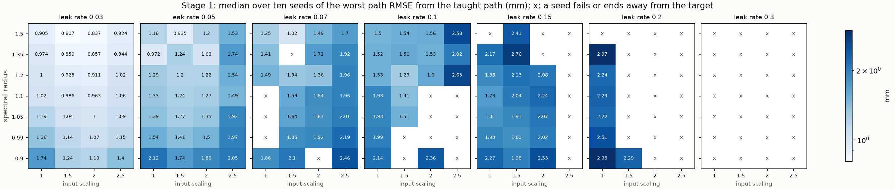

The map gives each setting's median over its ten seeds; a cross marks a setting
with a seed that fails, or whose hand has left the goal by the end of the run.

| Leak rate | Settings that hold (of 28) | Best setting | Median | Mean ± SD | Range over seeds | Arrival |
| --- | --- | --- | --- | --- | --- | --- |
| 0.03 | 28 | spectral radius 1.5, input scaling 1.5 | 0.81 mm | 0.82 ± 0.21 mm | 0.61–1.27 mm | 9.65 s |
| 0.05 | 28 | 1.5, 1.5 | 0.93 mm | 1.30 ± 0.68 mm | 0.74–2.55 mm | 9.75 s |
| 0.07 | 23 (4 more leave the goal later) | 1.5, 1.5 | 1.02 mm | 1.30 ± 0.62 mm | 0.72–2.69 mm | 9.91 s |
| 0.1 | 19 (2 more leave the goal later) | 1.2, 1.5 | 1.29 mm | 1.55 ± 0.61 mm | 1.03–3.06 mm | 10.51 s |
| 0.15 | 18 | 1.1, 1 | 1.73 mm | 1.94 ± 0.47 mm | 1.51–2.98 mm | 11.57 s |
| 0.2 | 7 | 1.05, 1 | 2.22 mm | 2.55 ± 0.93 mm | 1.54–4.10 mm | 13.39 s |
| 0.3 | 0 | | | | | |

The worst path RMSE of the two trackers; the arrival is the median of each seed's
latest. The settings at leak rate 0.03 and 0.05 with spectral radius 0.99 and input
scaling 2 repeat report 005's seed check (its stage 4) exactly.

- **A spectral radius over 1 helps at leak rate 0.03.** At every input scaling
  there, the best spectral radius over 1, 1.5, beats 0.99 in the median (0.81 to
  0.92 mm against 1.07 to 1.36 mm) and seed by seed for 8 to 10 of the 10 seeds. At
  leak rate 0.05 it does so only with input scaling 1 (10 of 10), elsewhere for 7
  of 10; at 0.07, with input scaling 1.5 (8 of 10).
- **Input scaling 2 was not needed.** At leak rate 0.03, it beats 1.5 for 5 or 6 of
  the 10 seeds, by 0.03 mm or less in the median, at every spectral radius from 1.1
  to 1.5.
- **Faster leak rates do worse,** and fewer of their settings hold; at 0.07 and 0.1,
  some settings whose seeds all hold leave the goal later in the run. They also
  arrive later: 10.5 s at 0.1, 13.4 s at 0.2, against the take's 9.6 s.
- **The best settings** all have leak rate 0.03 and spectral radius 1.2 to 1.5:
  0.81 to 0.92 mm in the median. Spectral radius 1.35 with input scaling 2 is the
  steadiest over its seeds (SD 0.12 mm).

### 3.2 Candidates in the apps

Seven settings of stage 1, each with its typical seed, were trained by
`autonomous_esn.py` and tried in the ESN app and the robot app:

| # | Leak rate | Spectral radius | Input scaling | Seed | Why | Worst path RMSE, this seed / its setting's median | Starts that arrive and hold, on its own |
| --- | --- | --- | --- | --- | --- | --- | --- |
| 1 | 0.03 | 1.5 | 1.5 | 2 | stage 1's best setting | 0.80 / 0.81 mm | 49 / 49 |
| 2 | 0.03 | 1.35 | 2 | 5 | the setting steadiest over its seeds | 0.85 / 0.86 mm | 49 / 49 |
| 3 | 0.03 | 1.5 | 1 | 7 | the weakest input among the best settings | 0.93 / 0.91 mm | 49 / 49 |
| 4 | 0.05 | 1.5 | 1.5 | 3 | report 005's leak rate, with a spectral radius over 1 | 0.97 / 0.93 mm | 49 / 49 |
| 5 | 0.07 | 1.5 | 1.5 | 3 | a faster leak rate | 0.94 / 1.02 mm | 49 / 49 |
| 6 | 0.1 | 1.2 | 1.5 | 4 | a faster leak rate still | 1.33 / 1.29 mm | 28 / 49 |
| 7 | 0.03 | 0.99 | 1.5 | 2 | #1's reservoir with spectral radius 0.99 | 1.02 / 1.14 mm | 49 / 49 |

Pushing the arm by hand in the robot app, **#2 felt the most balanced against
disturbances.** #1, #2, #6 (a fast leak rate), and #7 (a spectral radius below 1)
were kept for Step A, and the search was then narrowed around #2's setting alone.

### 3.3 Step A: the kept candidates in report 005's scenarios

| # | Undisturbed path RMSE | Block: reference lead at the release | Pushes: distance from the target at the end | Offset starts that arrive and hold |
| --- | --- | --- | --- | --- |
| 1 | 0.7 / 0.8 mm | 3.5 / 3.5% | **27 / 23 mm** | 49 / 49 |
| 2 | 0.8 / 0.9 mm | 2.8 / 2.8% | 3.1 / 3.2 mm | 49 / 49 |
| 6 | 1.2 / 1.3 mm | 0.7 / 0.7% | **1060 / 39 mm** | 28 / 26 |
| 7 | 0.9 / 1.0 mm | 2.3 / 2.3% | 2.8 / 2.8 mm | 49 / 49 |

Computed torque / joint PD. Report 005's ESN: 0.9 / 1.0 mm, a lead of 1.1%
(14 mm), 2.5 mm after the pushes, and 30 / 30 offset starts.

- **At leak rate 0.03, the ESN arrives from every offset start,** with either
  tracker.
- **The push at the target separates them.** After it, #1 (spectral radius 1.5)
  settles 23 to 27 mm from the target, outside the goal, though it arrived and held;
  #6 ends 1.06 m from the target with computed torque, and 39 mm with joint PD. #2
  and #7 return to within 3 mm.
- **Under the block, the candidates at leak rate 0.03 wait less** than report 005's
  ESN: their reference is 2.3 to 3.5% of the path ahead at the release, against
  1.1%. #6, with a fast leak rate, waits the most (0.7%).

### 3.4 Step B: a star around candidate #2

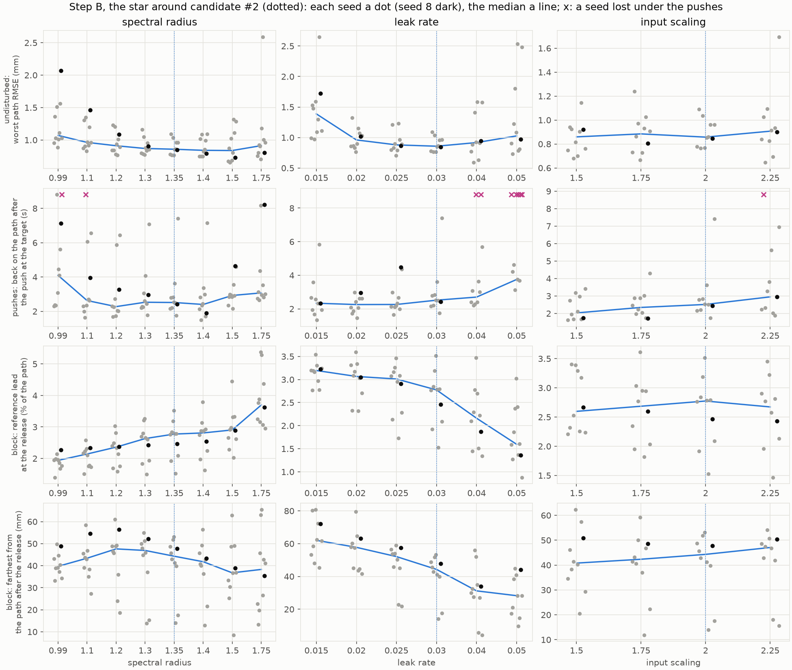

Each line of the star changes one of #2's settings, keeping the others, with ten
seeds each, undisturbed, under the pushes, and under the block.

| Setting | Lost seeds | Undisturbed path RMSE | Back after the push at the target: median / slowest | Block: lead | Block: farthest from the path |
| --- | --- | --- | --- | --- | --- |
| Spectral radius 0.99 | 1 (seed 9) | 1.07 mm | 4.1 / not back | 1.9% | 40 mm |
| 1.1 | 1 (seed 3) | 0.96 mm | 2.6 / 6.6 s | 2.1% | 43 mm |
| 1.2 | 0 | 0.91 mm | 2.3 / 6.4 s | 2.4% | 48 mm |
| 1.3 | 0 | 0.87 mm | 2.5 / 7.1 s | 2.6% | 47 mm |
| **1.35 (#2)** | 0 | 0.86 mm | 2.5 / 7.4 s | 2.8% | 44 mm |
| 1.4 | 0 | 0.84 mm | 2.4 / 7.2 s | 2.8% | 42 mm |
| 1.5 | 0 | 0.84 mm | 2.9 / 4.6 s | 2.9% | 37 mm |
| 1.75 | 0 | 0.91 mm | 3.1 / 8.2 s | 3.7% | 38 mm |
| Leak rate 0.015 | 0 | 1.39 mm | 2.3 / 5.8 s | 3.2% | 62 mm |
| 0.02 | 0 | 0.96 mm | 2.3 / 3.0 s | 3.1% | 58 mm |
| 0.025 | 0 | 0.88 mm | 2.3 / 4.5 s | 3.0% | 52 mm |
| **0.03 (#2)** | 0 | 0.86 mm | 2.5 / 7.4 s | 2.8% | 44 mm |
| 0.04 | 2 (seeds 4, 8) | 0.92 mm | 2.7 / 5.7 s | 2.2% | 31 mm |
| 0.05 | 5 (seeds 0, 4, 6, 8, 9) | 1.03 mm | 3.8 / 4.6 s | 1.6% | 28 mm |
| Input scaling 1.5 | 0 | 0.86 mm | 2.0 / 3.4 s | 2.6% | 41 mm |
| 1.75 | 0 | 0.88 mm | 2.3 / 4.3 s | 2.7% | 42 mm |
| **2 (#2)** | 0 | 0.86 mm | 2.5 / 7.4 s | 2.8% | 44 mm |
| 2.25 | 1 (seed 1) | 0.91 mm | 2.9 / 7.0 s | 2.7% | 47 mm |

Medians over the seeds; the return after the push at the target is the slower
tracker's, over the seeds not lost; a lead and a distance under the block, the
larger of the two trackers'. Every setting holds for all ten seeds undisturbed and
under the block.

- **A first rule failed nearly every setting under the pushes.** It required every
  seed to arrive and hold under the pushes, and to be back within 5 mm of the path
  before each next push. But the push at 13 s falls inside the 2 s hold window when
  the hand arrives after 11 s, and a hand still settling 5 to 7.5 mm from the path
  at the next push counted as not back. The real failures are the lost seeds, after
  the push at the target: in 11 of their 15 lost runs, the hand is back on the
  taught path, but has slid back along it toward the start, and stops 25 mm to 1.2 m
  from the target; in 3, it ends off the path, and in one it never arrives. The rule
  was revised to the measures above.
- **#2 lies on a plateau.** Spectral radius 1.2 to 1.75, leak rate 0.015 to 0.03,
  and input scaling 1.5 to 2 lose no seed, and their median returns lie within 2.0
  to 3.1 s. Spectral radius 0.99 and 1.1, leak rate 0.04 and 0.05, and input scaling
  2.25 lose seeds.
- **Memory keeps the target, waiting holds the arm.** A slower leak rate or a larger
  spectral radius keeps the target after the push, but lets the reference run
  further ahead under the block: from 1.9% at spectral radius 0.99 to 3.7% at 1.75,
  and from 1.6% at leak rate 0.05 to 3.2% at 0.015. Along the leak rate, the hand
  then strays further after the release, from 28 mm at 0.05 to 62 mm at 0.015;
  along the spectral radius, it does not. A faster leak rate waits, and loses
  seeds.
- **The seeds differ as much as the settings.** Within the plateau, the slowest seed
  of a setting takes 3 to 8 s to return, the medians 2 to 3 s.

### 3.5 Representatives, and a small grid

Eight seeds of the star were trained and tried in the apps: the typical seeds of
#2's setting, of leak rates 0.02, 0.025, and 0.04, of input scaling 1.5, and of
spectral radii 1.2 and 1.75, and a lost seed of leak rate 0.04. **In the apps, they
felt no different from one another.**

A small grid then combined the values that did better in the star: leak rate 0.02,
0.025, and 0.03, input scaling 1.5 and 2, and spectral radius 1.2 and 1.35, ten
seeds each, in the three scenarios of Step B. A rule fixed before the grid ran
decided whether a setting replaced #2's as the setting of the chosen ESN: if, over
its ten seeds,

1. no seed fails undisturbed or under the block, or is lost under the pushes;
2. after the push at the target, its hand is back on the path sooner than with
   #2's setting for at least 8 of the 10 seeds, seed by seed, with a median gain
   over 0.3 s (the slower tracker; a hand not back by the end of the run counts as
   back then);
3. it gives up no more than 0.1 mm in the median undisturbed path RMSE, and no more
   than 10 mm in the median farthest distance from the path under the block.

| Spectral radius | Leak rate | Input scaling | Undisturbed path RMSE | Back after the push at the target: median / slowest | Sooner than #2's | Median gain | Block: farthest from the path | Verdict |
| --- | --- | --- | --- | --- | --- | --- | --- | --- |
| 1.2 | 0.02 | 1.5 | 1.03 mm | 2.3 / 4.8 s | 7 | +0.18 s | 53 mm | fails 2 and 3 |
| 1.2 | 0.02 | 2 | 1.01 mm | 2.6 / 3.6 s | 5 | +0.01 s | 62 mm | fails 2 and 3 |
| 1.2 | 0.025 | 1.5 | 0.98 mm | 2.0 / 4.0 s | 8 | +0.66 s | 50 mm | fails 3 |
| 1.2 | 0.025 | 2 | 0.97 mm | 2.5 / 4.5 s | 4 | −0.01 s | 53 mm | fails 2 and 3 |
| 1.2 | 0.03 | 1.5 | 0.92 mm | 2.0 / 3.4 s | 7 | +0.61 s | 44 mm | fails 2 |
| 1.2 | 0.03 | 2 | 0.91 mm | 2.3 / 6.4 s | 5 | +0.03 s | 48 mm | fails 2 |
| 1.35 | 0.02 | 1.5 | 0.94 mm | 2.2 / 3.9 s | 7 | +0.35 s | 54 mm | fails 2 |
| 1.35 | 0.02 | 2 | 0.96 mm | 2.3 / 3.0 s | 7 | +0.22 s | 58 mm | fails 2 and 3 |
| 1.35 | 0.025 | 1.5 | 0.87 mm | 2.4 / 3.3 s | 6 | +0.17 s | 48 mm | fails 2 |
| 1.35 | 0.025 | 2 | 0.88 mm | 2.3 / 4.5 s | 6 | +0.20 s | 52 mm | fails 2 |
| **1.35** | **0.03** | **1.5** | 0.86 mm | 2.0 / 3.4 s | 8 | +0.41 s | 41 mm | **replaces #2's** |
| 1.35 | 0.03 | 2 | 0.86 mm | 2.5 / 7.4 s |  |  | 44 mm | #2's setting |

No seed is lost or fails in any setting of the grid. The settings it shares with
the star repeat it exactly.

- **Only input scaling 1.5, at #2's leak rate and spectral radius, replaces #2's
  setting,** and narrowly: sooner for 8 of the 10 seeds, by 0.41 s in the median.
  Spectral radius 1.2 with leak rate 0.025 and input scaling 1.5 gained more (0.66
  s, for 8 seeds) but gave up 0.12 mm undisturbed.
- **The chosen ESN is its typical seed, 8,** which had been tried in the apps as a
  representative of input scaling 1.5.
- **Judged on joint PD alone,** the tracker of the validation, the same rule would
  have chosen spectral radius 1.2 with the same leak rate and input scaling (back
  sooner for 8 of the 10 seeds, by 0.68 s), and the chosen setting would have
  missed narrowly (7 of 10, by 0.52 s): the two lie within the seeds' spread on a
  flat plateau. The search is reported as it was decided.

### 3.6 Validation: the chosen ESN against the replay

The ESN validated (`grid_lr0.03_sr1.35_is1.5_seed8_filtered`), its parameters
([`esn.toml`](results/20261013-104954-grid_lr0.03_sr1.35_is1.5_seed8_filtered/esn.toml)):

| Parameter | Value |
| --- | --- |
| Neurons | 400, tanh |
| Sparsity | 0.05, the fraction of nonzero reservoir connections |
| Spectral radius | 1.35 |
| Leak rate | 0.03 |
| Input | the arm's measured joint angles every 10 ms, normalized by the range each covers in the filtered take, (q − (67.80°, 71.74°)) / (46.54°, 41.74°), so that the take spans [−1, 1] |
| Input scaling | 1.5, the scale of the random input weights |
| Bias | a random constant input to each neuron |
| Readout | ridge regression on the reservoir state, with a bias; its output, converted back to joint angles, is the next posture, 10 ms on |
| Ridge | 1e-2, the regularization of the readout |
| Training | teacher forcing on the filtered take alone, without noise |
| Warm-up | 1 s of the held start posture, from a reset reservoir |
| Seed | 8, of the reservoir, its input weights, and its biases |

The trackers are report 005's ([Section 3.7](../005-tuned-on-the-robot/README.md#37-validation-the-chosen-esn-against-the-replay)),
both given a zero reference velocity: joint PD with K_p = 74.96 and 8.96 N m/rad and
K_d = 0.750 and 0.0896 N m s/rad, and computed torque with K_p = 400 s⁻² and
K_d = 4 s⁻¹ on both joints. The comparisons are made with joint PD: the chosen ESN
with it against the replay with it, and against the replay with computed torque,
the model-based tracker, which cancels the arm's dynamics.

| Scenario | Chosen ESN, joint PD | Replay, joint PD | Replay, computed torque |
| --- | --- | --- | --- |
| Nominal: path RMSE | 0.92 mm | 0.85 mm | 0.13 mm |
| Nominal: arrival | 9.67 s | 9.59 s | 9.60 s |
| Block: path RMSE | 13.3 mm | 16.6 mm | 7.5 mm |
| Block: force at the grip (peak) | 10.6 N | 11.3 N | 9.4 N |
| Block: force at the release (pressing) | 4.7 N | 20.0 N | 18.5 N |
| Block: reference ahead of the hand at the release | 36 mm | 156 mm | 154 mm |
| Block: ringing after the release | 4.9 mm | 33.9 mm | 33.4 mm |
| Block: arrival | 10.20 s | 9.59 s | 9.60 s |
| Pushes: path RMSE | 42.1 mm | 32.8 mm | 34.2 mm |
| Pushes: ringing after each push | 15–18 mm | 30–32 mm | 26–32 mm |
| Pushes: distance from the target at the end | 3.2 mm | 2.8 mm | 2.8 mm |
| Offsets: starts that arrive and hold | 49 of 49 | 49 of 49 | 49 of 49 |
| Offsets: median path RMSE | 22.8 mm | 27.0 mm | 14.6 mm |
| Offsets: median peak torque | 7.0 N m | 12 N m | 125 N m |

The force at the grip is the damper stopping the moving hand; the force at the
release is the mean over the block's last 0.1 s, how hard the arm then presses.
The ringing is the hand's motion above 1.5 Hz over the 2 s after a disturbance
ends (Section 2). Offset runs: [the map of the 49 starts](results/20261013-114518-offsets_robot_lr0.03_sr1.35_is1.5_seed8_filtered/grid.png).
For reference, the chosen ESN with computed torque follows the taught path within
0.80 mm undisturbed, presses with 2.8 N at the release and rings 7.9 mm after it,
rings 22 to 32 mm after the pushes, as much as the replays, and arrives from all 49
offset starts with a median peak torque of 81 N m.

- **Undisturbed, the ESN follows the taught path within 0.92 mm** with joint PD,
  as the replay does (0.85 mm), and arrives 0.08 s after the take; the replay with
  computed torque follows it within 0.13 mm.
- **Under the block, the ESN waits in part.** While the tip is held, its output
  creeps on, 36 mm ahead of the hand at the release, so its arm presses with 4.7 N,
  against the replays' 18.5 to 20 N, whose reference runs 155 mm ahead. The peak
  force, about 10 N for all three, is the grip's.
- **From every offset start, all three arrive and hold.** Report 005's ESN failed
  from 19 of the 21 starts with the elbow straighter. With computed torque, the
  replay's reference jumps to the take's start and costs a median peak torque of
  125 N m; with joint PD, the ESN's first step from an offset costs 7.0 N m.

### 3.7 The block and the pushes: ringing and return

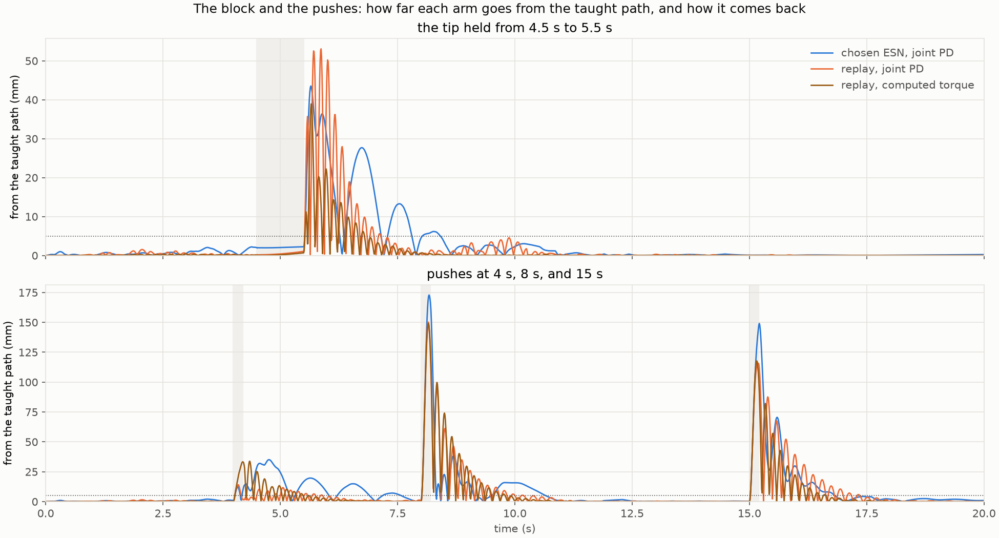

| Chosen ESN, joint PD / replay, joint PD / replay, computed torque | Block, after the release | Push at 4 s | Push at 8 s | Push at 15 s |
| --- | --- | --- | --- | --- |
| Gap between the reference and the arm at the end | 5.9 / 15.6 / 15.4° | 12.3 / 15.2 / 16.3° | 15.6 / 17.0 / 17.1° | 11.0 / 13.3 / 17.8° |
| Ringing over the next 2 s | **4.9** / 33.9 / 33.4 mm | **15.4** / 30.6 / 26.3 mm | **17.7** / 30.2 / 32.4 mm | **16.1** / 32.2 / 25.6 mm |
| Farthest from the taught path | 44 / 53 / 39 mm | 35 / 14 / 34 mm | 173 / 150 / 149 mm | 149 / 116 / 118 mm |
| Back within 5 mm of it | 2.9 / 1.7 / 1.3 s | 3.4 / 1.7 / 1.4 s | 2.5 / 2.0 / 1.6 s | 1.6 / 2.2 / 1.4 s |

The gap is the norm of the reference minus the arm's joint angles when the
disturbance ends; the return is counted from then, until the next push or the end
of the run. All three arms arrive under the pushes (the ESN at 10.5 s) and hold,
and end within 3.2 mm of the target. With computed torque, the chosen ESN's gaps
are 16 to 18° after the pushes and 5.9° at the release, and its ringing 22 to
32 mm and 7.9 mm.

- **With joint PD, the ESN rings a half to two-thirds as much as either replay
  after every push, and a seventh as much after the block.** Its reference goes with
  the arm, so the tracker starts from a smaller gap: 5.9° against 15.5° at the
  release, and 11 to 16° against 13 to 18° at the end of a push. Its joint torques
  ring less, too, and die out within about 1 s, where the replay's ring for 2 to
  3 s.
- **The replay rings about as much with computed torque as with joint PD.**
  Cancelling the arm's dynamics does not remove the ringing: the tracker still
  pulls the arm toward a reference that ignores it, at ζ = 0.1.
- **But the ESN's hand strays farther and returns more slowly.** Its reference
  returns to the taught path at the ESN's own pace, in slow swings of about 1 Hz
  (the figure) rather than the tracker's ringing at 3.2 Hz: the hand is back within
  5 mm of the path 2.5 to 3.4 s after the block and the first two pushes, against
  the replays' 1.3 to 2.0 s; after the push at the target it is back in 1.6 s,
  sooner than the replay with joint PD (2.2 s).
- **A push is quicker than the ESN.** A push lasts 0.2 s, and the ESN follows the
  arm over about 0.3 s (its period, 10 ms, divided by its leak rate, 0.03): at the
  end of a push, the gap is still 11 to 16°, close to the replay's. Under the block,
  held for 1 s, the ESN has time to follow; with computed torque, it does not ring
  less than the replays after the pushes (22 to 32 mm), a difference not examined
  here.

### 3.8 The chosen ESN, scenario by scenario

The animations show three arms side by side on one clock, each rendered by
skelarm's player; the purple dot is the target, the red arrow the force at the
tip. Each panel names the arm's reference and its tracker: the chosen ESN and the
replay of the take by time through joint PD, and the replay through computed
torque. The figures show the joint angles with joint PD (the taught motion, thick
gray; the ESN's output, dashed blue; the ESN's arm, blue; the replay's arm,
orange) and the joint torques; the disturbances are shaded.

#### Nominal

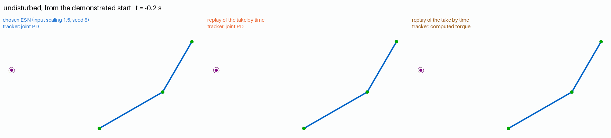

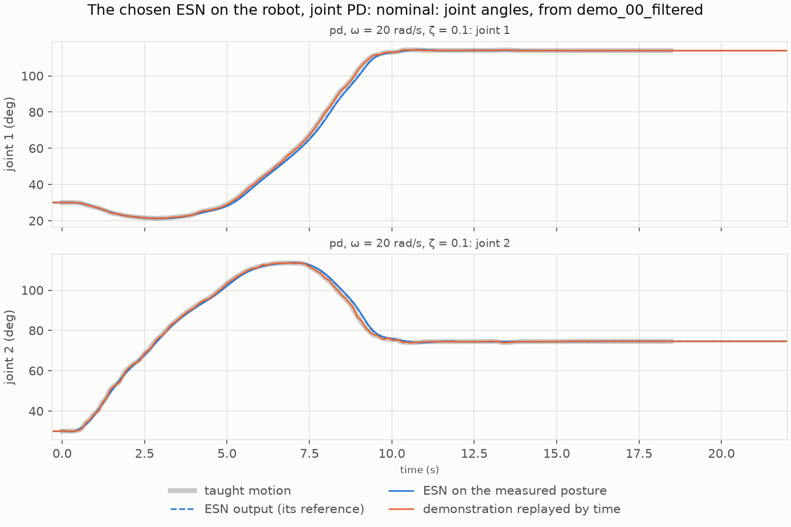

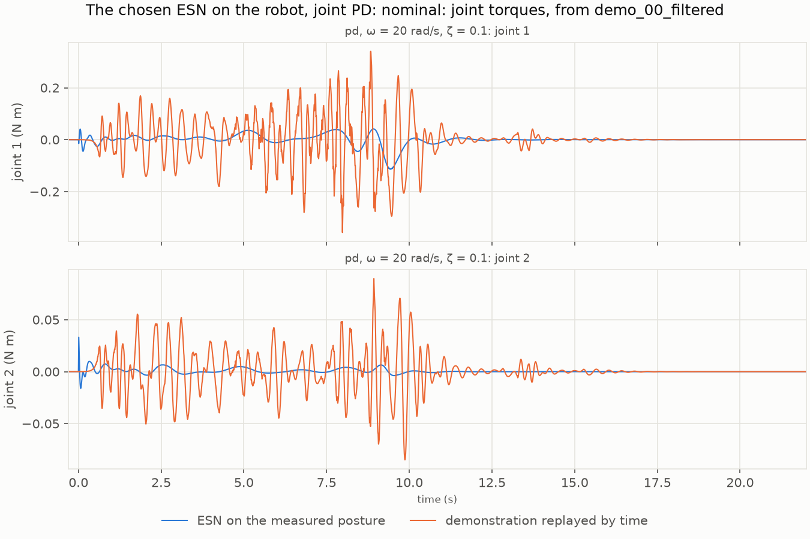

The ESN's arm follows the taught joint path, its output on it, and arrives at
9.67 s, with the take. Its torques stay within 0.11 N m; the replay's, tracking
the take's remaining pixel steps, jitter and ring, up to 0.36 N m (0.86 N m with
computed torque).

#### Block

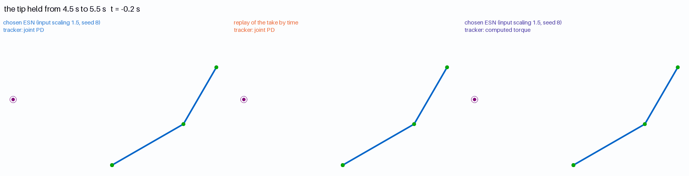

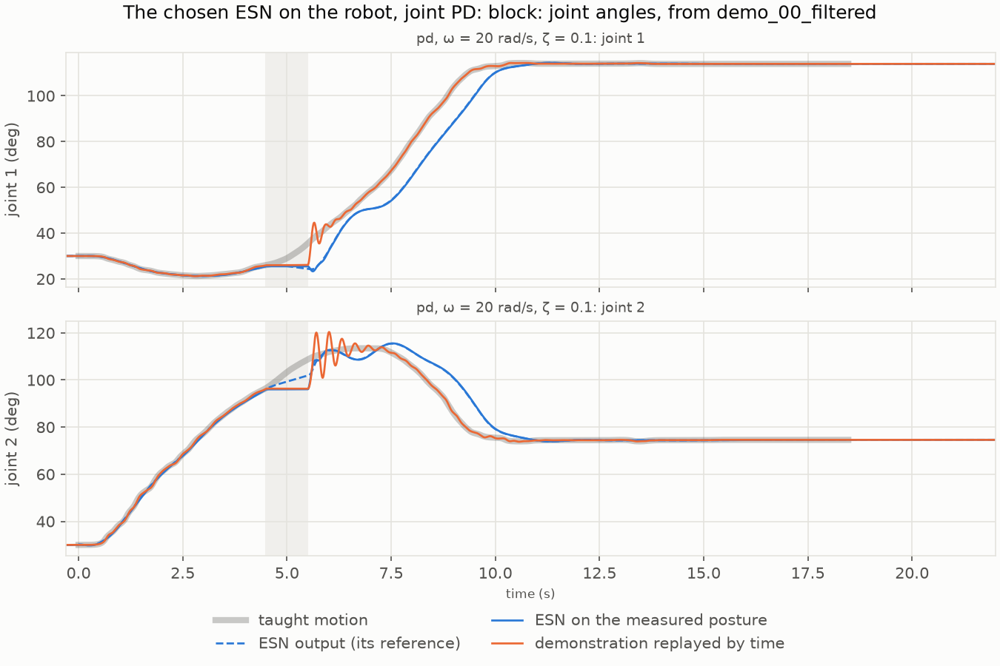

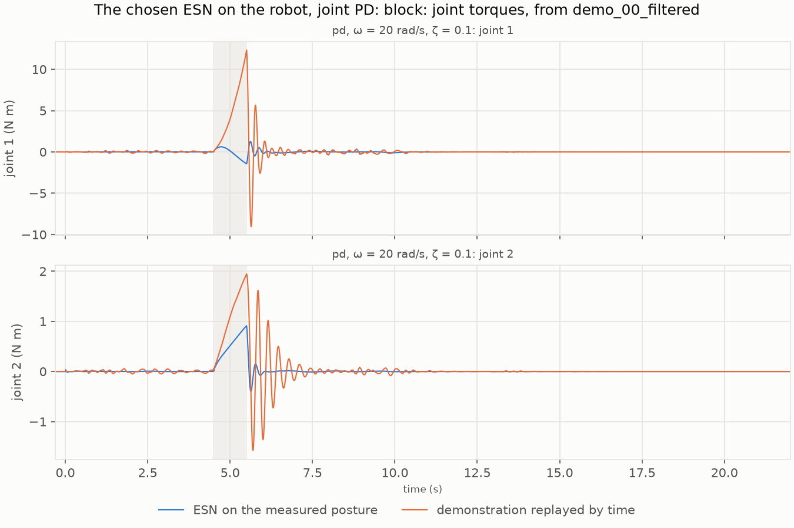

While the tip is held, from 4.5 s to 5.5 s, the ESN's output for joint 1 waits
with the arm, but joint 2's creeps on, from 96° to about 102°: 36 mm ahead of the
hand at the release. Its torques stay under 1.5 N m; the replay's climb to 12 N m
until the release, with either tracker, and its arm snaps forward and rings for
about 1.5 s. The ESN's
arm lurches 44 mm off the path at the release, without ringing, then carries on
about 0.6 s behind the take and arrives at 10.2 s.

#### Pushes

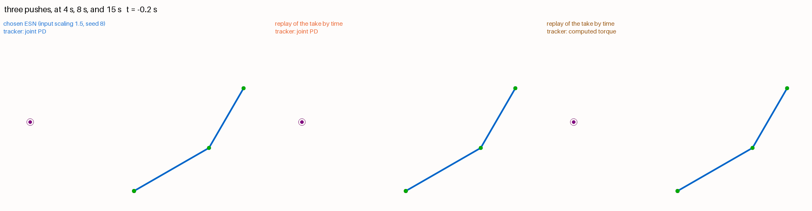

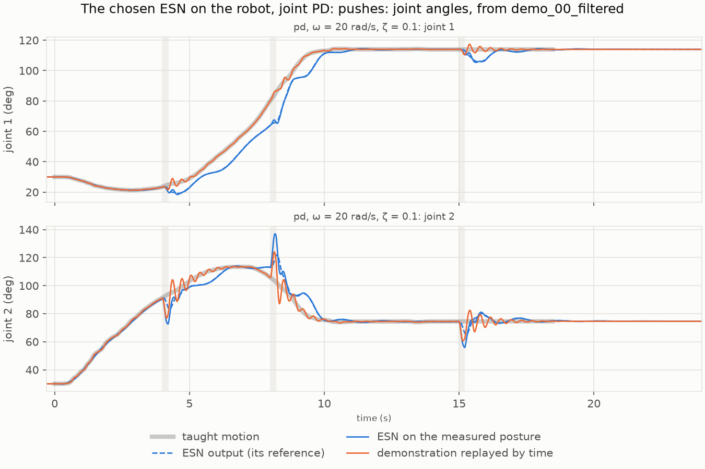

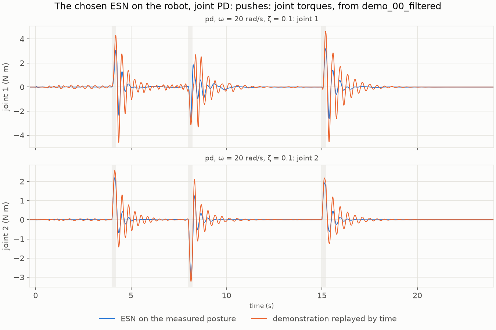

After each push, the chosen ESN's output goes with the arm and carries on from
where it was pushed; its torques peak at 3.0 to 3.2 N m after each push, lower
than the replay's (3.3 to 4.6 N m), and die out within about 1 s, while the
replay's ring for 2 to 3 s.

#### Offset starts

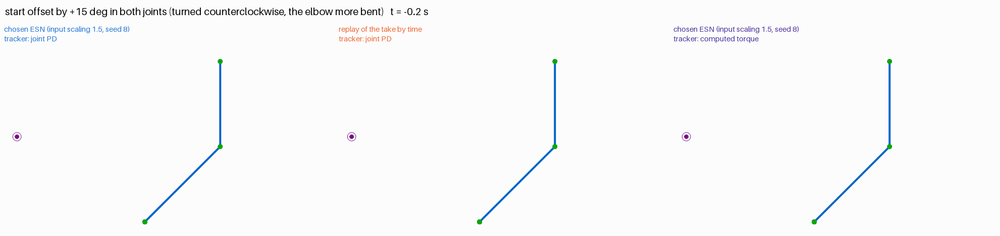

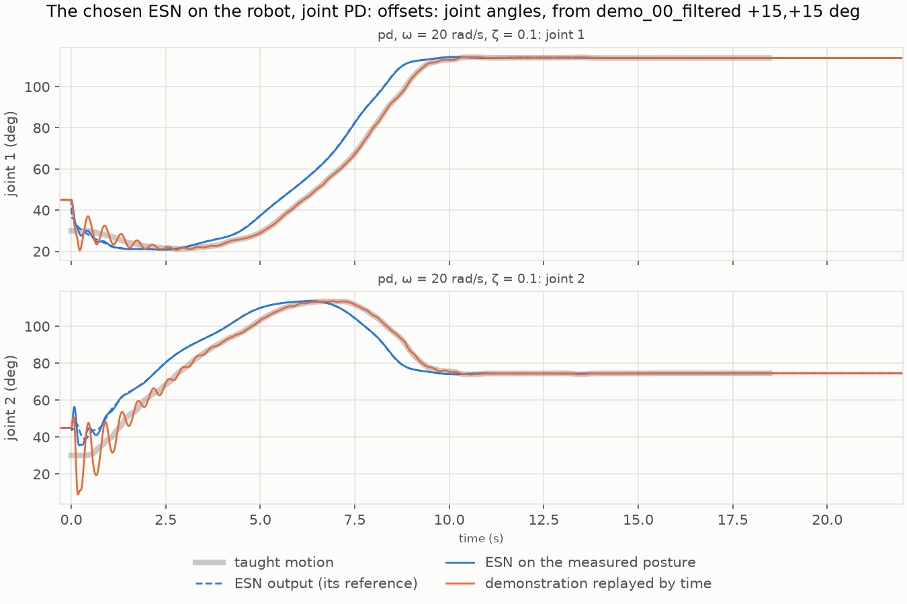

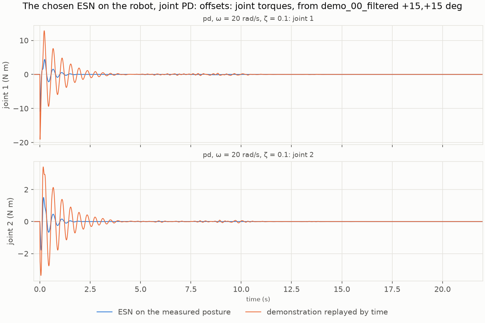

From the start offset by +15° in both joints, the arm turned counterclockwise and
the elbow more bent, the ESN's output brings the hand onto the taught path within
its first 0.2 m, farther along it than the take: the arm then runs about 0.5 s
ahead of the take and arrives at 8.9 s, its path 32 mm off the taught one, having
skipped the path's first part. From every offset start, the hand joins the taught
path near its start in the same way
([the hand paths](results/20261013-114518-offsets_robot_lr0.03_sr1.35_is1.5_seed8_filtered/paths.png)).
The replay's reference jumps back to the take's start: its arm swings there and
rings for about 2 s with joint PD (68 mm off the path), and with computed torque the
jump costs a peak torque of 257 N m.

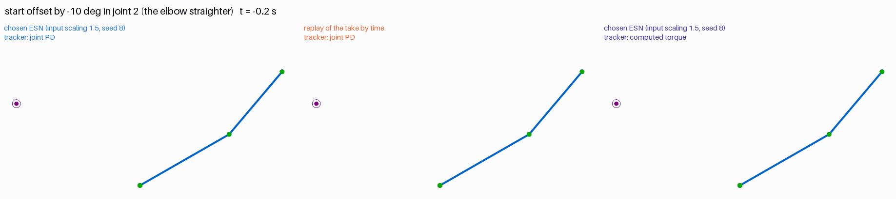

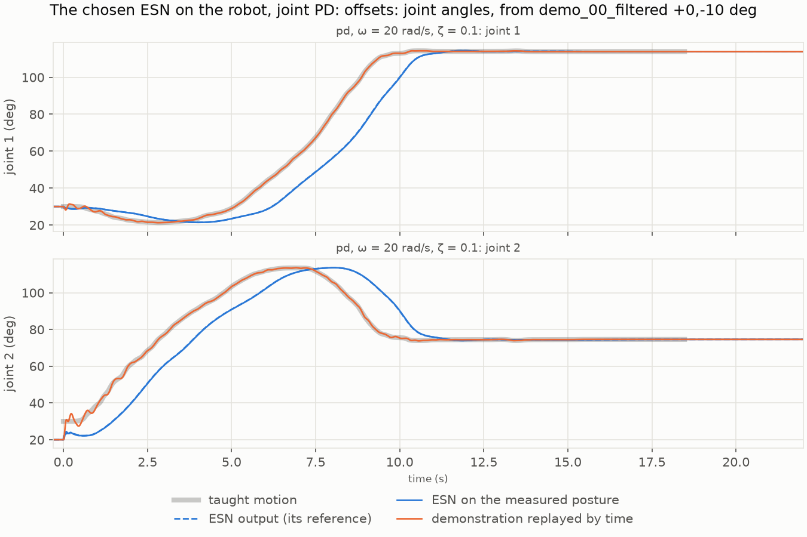

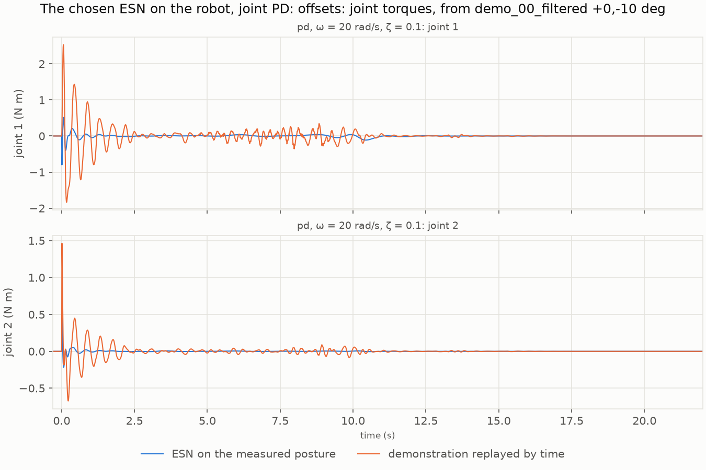

From the start offset by −10° in joint 2, the elbow straighter, one of the starts
from which report 005's ESN failed, the chosen ESN barely moves the arm for about
0.8 s, then reaches along a path close to the taught one, about 1 s behind the
take, and arrives at 10.7 s, its path 10 mm off the taught one. The replay's
reference jumps to the take's start, and its arm follows it there before replaying
the take (7 to 8 mm off the path).

### 3.9 The reservoir states

As in report 005 ([Section 3.10](../005-tuned-on-the-robot/README.md#310-the-reservoir-states)),
[`robot_states.py`](../../experiments/robot_states.py) recomputes the chosen ESN's
reservoir states from the runs' logs with joint PD, and refuses a log whose
reference the recomputed ESN does not reproduce; every one here passes. The figures
([run](results/20261013-132948-states_robot_lr0.03_sr1.35_is1.5_seed8_filtered))
draw the states of the ESN driving the robot (blue) over those of the take fed in as
in training (thick gray), with the warm-up and the disturbances shaded.

#### Eight neurons over the whole run

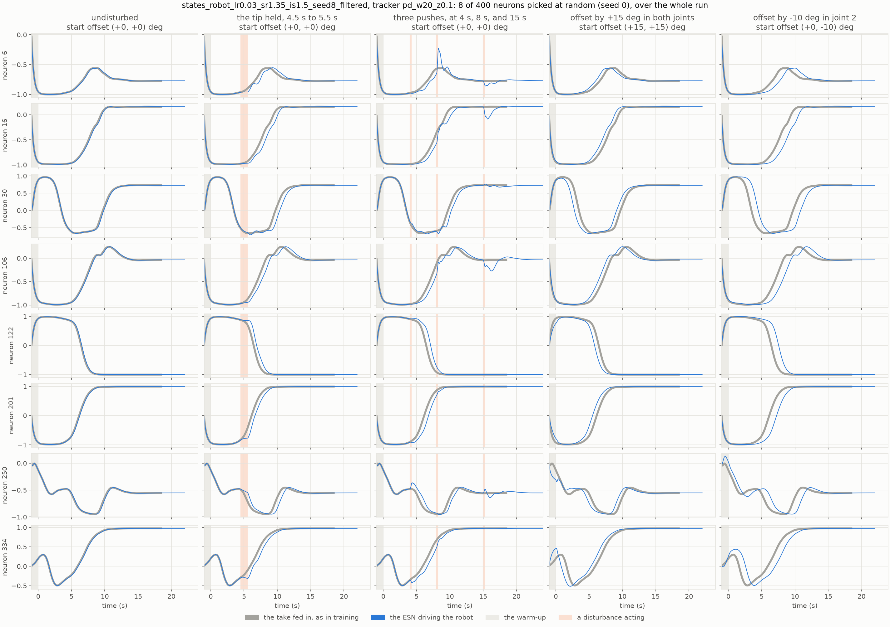

The same eight of the 400 neurons as in report 005 (picked at random, seed 0),
from the reset to the run's end, in this ESN's reservoir. Most switch between
plateaus near ±1 during the reach and settle once the arm holds at the target.

- **Undisturbed,** each neuron follows the take's states.
- **Under the block,** the states hold nearly still while the tip is held, then
  resume the take's course about 0.5 s late.
- **Each push** makes some of them swing; after the push at 15 s, neurons 16 and 106
  swing the farthest and settle back within 2 to 3 s.
- **From (+15°, +15°),** they leave the take's course early and stay about 0.5 s
  ahead of it to the end of the reach; **from (0°, −10°),** they stay about 1 s
  behind it.

#### The warm-up

The same neurons over the warm-up and the task's first 3 s, for the undisturbed run
and the two offset starts.

- **From the demonstrated start,** the warm-up brings every neuron onto the take's
  states, and the run then follows them.
- **From (+15°, +15°),** it leaves several neurons elsewhere, 201 and 334 the
  farthest; after the start, they cut across the take's course, ahead of it.
- **From (0°, −10°),** from which report 005's ESN failed, the warm-up ends close
  to the take's states, neurons 250 and 334 a little off; after the start, the
  neurons lag the take's while the arm waits at its start, then move on behind
  them.

#### The principal components

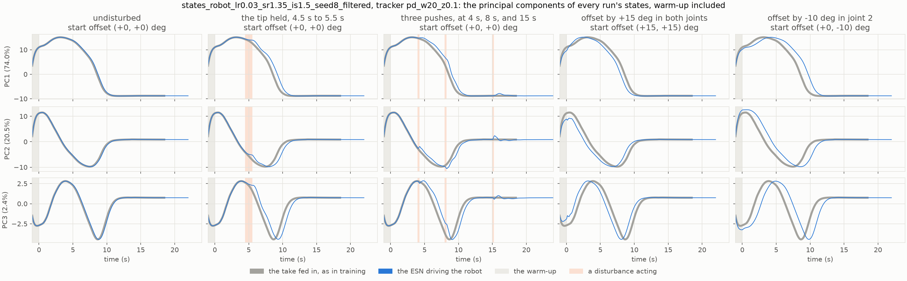

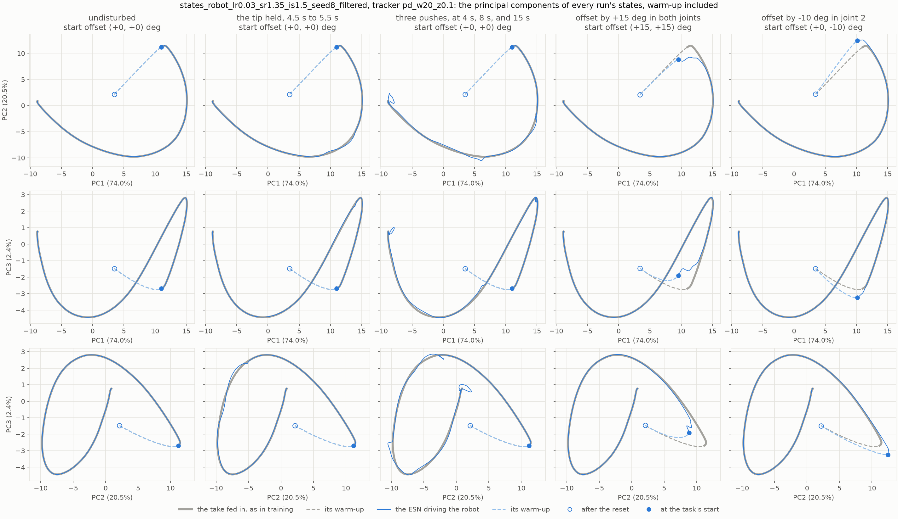

The principal components are those of all five runs' states, warm-up included:
PC1, PC2, and PC3 hold 74.0%, 20.5%, and 2.4% of the variance. In the planes, the
warm-up is dashed, a hollow dot marks the state just after the reset, and a filled
one the state at the task's start.

- **The take's states trace an arc** in the plane of PC1 and PC2, from the task's
  start, at the upper right, down and around to the target, at the left. The
  warm-up jumps from the reset to the arc's start, and the undisturbed run follows
  the arc.
- **Under the block, the states pause** along the arc while the tip is held (flat
  over time), then go on behind the take.
- **Each push throws the states off the arc** and back, the push at 15 s in a small
  loop near its end.
- **From both offset starts,** the warm-up ends off the arc's start, below it from
  (+15°, +15°) and above it from (0°, −10°), and the states join the arc within the
  first seconds: unlike report 005's ESN from (0°, −10°), whose states moved to a
  fixed point and never started the reach.

## 4. Observations

- **A spectral radius over 1 pays at a slow leak rate.** At leak rate 0.03, every
  input scaling does better with spectral radius 1.2 to 1.5 than with 0.99, seed by
  seed; report 005's cap below 1 had kept the search out of where the best settings
  lie.
- **Robust from many starts, though scored from one.** The ESNs at leak rate 0.03
  arrive from all 49 offset starts on the robot, where report 005's, at 0.05, failed
  from 19, although offsets were never in the score. Not every seed does: on its own,
  the representative of spectral radius 1.2 (seed 2) never arrives from 11 of the
  49.
- **An ESN that follows the arm rings less, with joint PD.** After the block and
  after every push, the chosen ESN's arm with joint PD rings a seventh to two-thirds
  as much as the replay's, with joint PD or with computed torque: its reference goes
  with the arm, so the tracker starts from a smaller gap. The ringing gives way to
  slower swings, at the ESN's own pace, and a slower return onto the path.
- **The pushes, not the undisturbed runs, separate the settings.** Undisturbed and
  under the block, every setting of the star holds for every seed; after the push at
  the target, some seeds lose the target, a failure the undisturbed score cannot
  see.
- **Keeping the target and waiting pull the leak rate apart.** A slower leak rate,
  or a larger spectral radius, keeps the target after a push, but lets the
  reference run ahead of a held arm; a faster one waits, and loses the target. The
  chosen ESN keeps the target and waits less than report 005's.
- **Below what a person feels.** Within the plateau around #2, the settings'
  medians differ by at most a few tenths of a millimeter undisturbed and of a second
  in the return after the push at the target, which the apps did not show: the
  representatives felt alike. The choice among them rests on a rule fixed
  beforehand, over ten seeds, and it was a narrow one: judged on joint PD alone, the
  same rule would have chosen spectral radius 1.2 instead (Section 3.5).
- **A rule is a measurement too.** The first rule under the pushes failed nearly
  every setting for reasons of its own, a hold window overlapping a push and a
  return deadline too tight for an underdamped tracker, until the runs were looked
  at.

## 5. Next steps

1. **A search scored on what the ESN does for joint PD:** with the last push after
   the hold window, as in Step C, so that the hold check holds again, and the ringing
   and the return after the block and the pushes measured with joint PD, by a rule
   fixed beforehand; the block's ringing also scores how well the ESN waits.
2. **Computed torque:** find why the chosen ESN does not ring less than the replays
   after the pushes with computed torque, for instance by running it without the
   reference's acceleration.
3. **Offset starts in the score:** add a few offset starts to the sweeps on the
   robot, as report 005 proposed: a representative of the star (spectral radius 1.2,
   seed 2) never arrives from 11 of the 49 starts on its own.
4. **Report 004's comparisons,** still open: the zero reference velocity against a
   tracker given the reference velocity, now with an ESN tuned under disturbances.
