# 007 Less ringing with joint PD

**Summary.** Report 006 found that, with joint PD, an ESN driving the robot through
the tracker makes the arm ring less after a disturbance than the replay of the take:
its reference follows the measured arm, so the tracker starts from a smaller gap.
But its pushes, 0.2 s long, ended before the ESN could follow. Here the pushes were
redesigned to let it respond, the ESN was searched with joint PD by that ringing,
and the ESN chosen was compared with the replay with joint PD and with computed
torque.

- **The pushes** last 0.5 s: 3 N nearly forward at 3 s, 5 N nearly across at 7 s,
  and 4 N nearly across the other way at 15 s, after the hold. A longer push does
  not carry the replay farther, since it is farthest at its first overshoot, 0.16 s
  in; at 0.5 s the arm is still moving when the push ends, where a push of 1 s would
  hold it off the path like a block; and the push across at 7 s leaves the hold
  after the arrival undisturbed.
- **The grid** (90 settings, ten seeds each, joint PD): under the pushes, most
  settings have seeds whose hand reaches the goal while still swinging from the
  push at 7 s and leaves it during the hold, or loses the target. Only three
  settings, all at leak rate 0.02, pass with every seed; averaged over the block and
  the three pushes, their arms ring 10 to 11 mm in the median, against the replay's
  25 mm with joint PD.
- **The chosen ESN,** picked in the apps from those three: leak rate 0.02, spectral
  radius 1.35, input scaling 2, seed 7.
- **Against the replay,** with joint PD, it follows the taught path within
  1.07 mm undisturbed (the replay 0.85 mm, and 0.13 mm with computed torque), and
  all arrive and hold from the 49 offset starts. After the block, its arm rings a
  fifth as much as the replay's, with joint PD or computed torque (6.1 mm against
  33 to 34 mm); after the pushes, a half to two-thirds as much (10 to 16 mm against
  17 to 29 mm): its reference goes with the arm, so the tracker starts from a
  smaller gap. In return, its hand strays farther and comes back in slow swings of
  about 1 Hz, 2.5 to 3.6 s after a disturbance, against the replays' 0.6 to 2.4 s.
- **Its reservoir states,** recomputed from the runs' logs, follow the take's
  undisturbed, pause while the tip is held, are thrown off the take's course and
  back by each push, and, from both offset starts shown, join it within the first
  seconds.

## 1. Question

1. **Pushes the ESN can answer:** how long, how strong, and when, so that a push
   is neither over before the ESN responds nor a block in disguise, and so that it
   leaves the hold after the arrival undisturbed?
2. **A search scored by the ringing:** with joint PD alone, which settings make the
   arm ring least after the block and the pushes, while every seed arrives, holds,
   and keeps the target?
3. **The ESN chosen:** with joint PD, how does it compare with the replay with joint
   PD and with computed torque, undisturbed, under the block and the pushes, and
   from offset starts?

## 2. Setup

### The arm, the take, the ESN, and the tracker

As in reports 005 and 006 ([report 005, Section 2](../005-tuned-on-the-robot/README.md#2-setup)):
the remade arm, the take filtered at 2 Hz, an ESN of 400 neurons with sparsity 0.05,
ridge 1e-2, and a 1 s warm-up, driven by the arm's measured joint angles. The
tracker is joint PD at ω = 20 rad/s with damping ratio 0.1, given a zero reference
velocity, in every run of the search. The validation also runs computed torque with
the same ω and ζ, for the replay with it, the model-based baseline; the ESN with
computed torque is given as a note. Every robot run lasts 24 s, from the
demonstrated start unless stated.

### Measures

- **Path RMSE** (`taught_path_rmse_m`): the RMS distance between the robot's hand
  path and the taught one, regardless of timing.
- **Holds:** the hand arrives within the goal (20 mm) and stays there for the 2 s
  hold window; a seed of the grid also needs its hand in the goal at the end of the
  run, in every scenario.
- **After each disturbance** (report 006, Section 2): the gap between the reference
  and the arm's joint angles at its end (`end_gap_deg`), the error the tracker
  starts from; the ringing (`ringing_m`), the RMS size of the hand's motion above
  1.5 Hz over the next 2 s, between the reach, under about 0.5 Hz, and the tracker's
  ringing, at 3.2 Hz; the farthest the hand strays from the taught path
  (`off_path_m`); and when it is back within 5 mm of it (`return_time_s`), each
  before the next disturbance starts or the run ends.

### Scenarios

- **Nominal:** undisturbed.
- **Block:** report 005's, the tip held by a stiff spring-damper from 4.5 s to
  5.5 s, in mid-reach (32% of the way).
- **Pushes:** the study's three pushes of 0.5 s at the tip (Section 3.1): 3 N nearly
  forward at 3 s (18% of the way), 5 N nearly across at 7 s (62%), and 4 N nearly
  across the other way at 15 s, after the arrival and its hold. Each direction is
  10° off forward or across (`angle_deg`, from the direction toward the target),
  fixed for the run by the start posture, so that every arm from the same start
  meets the same forces at the same times.
- **Offsets:** the demonstrated start offset by −15° to 15° in each joint, every 5°
  (49 starts), in the validation only.

### Reproducing the results

The runs read the take as `results/demonstrations/20261008-170034-reach_manual_v2`
under the storage root ([report 005's copy](../005-tuned-on-the-robot/data)), and
the robot runs read the trained ESNs (`esn.toml` and `esn.rclib`) by their run
names: the chosen ESN's are copied into its run's directory here, and report 006's
chosen ESN's into [report 006's](../006-wider-search-on-the-robot/results). A run is
found by its name anywhere under `results/`; place or link the copies there to
rerun. All configurations are in
[`manual_demonstration_v2_robot_ringing`](../../experiments/manual_demonstration_v2_robot_ringing/README.md).

| Runs | Command | Commit |
| --- | --- | --- |
| `pushes_robot_lr0.03_sr1.35_is1.5_seed8_filtered` (1), report 006's chosen ESN under the pushes | `uv run python experiments/robot_esn.py experiments/manual_demonstration_v2_robot_ringing/<name>.toml` | `6b7a05a` |
| `sweep_robot_ringing_lr<leak rate>_<scenario>_filtered` (18) | `uv run python experiments/sweep_robot_esn.py experiments/manual_demonstration_v2_robot_ringing/<name>.toml` | `c648fcb` |
| `grid_<shortlisted>_filtered` (3) | `uv run python experiments/autonomous_esn.py experiments/manual_demonstration_v2_robot_ringing/<name>.toml` | `e4158f4` |
| `<scenario>_robot_lr0.02_sr1.35_is2_seed7_filtered` (4) | as the first | `4c7d52a` |
| `states_robot_lr0.02_sr1.35_is2_seed7_filtered` (1) | `uv run python experiments/robot_states.py experiments/manual_demonstration_v2_robot_ringing/<name>.toml` | `5d2eebc` |
| [`summary`](results/summary) | `uv run python reports/007-ringing-with-joint-pd/make_figures.py --logs --animations` | |

All runs are deterministic, and every run record (`run.toml`) shows no uncommitted
changes. Each run directory here holds its configuration, its run record, and its
metrics (`metrics.csv`, or `sweep.csv`, `runs.csv`, and `seeds.csv`); the
shortlisted ESNs' runs also hold their map of the 49 starts (`grid.png`), and the
chosen ESN's its trained ESN; the offsets run holds its map and its hand paths
(`paths.png`), and the states run only its figures.
[`design_pushes.py`](design_pushes.py) reproduces the simulations behind the design
of the pushes (Section 3.1), without saving them, in about two minutes.
[`make_figures.py`](make_figures.py) draws `grid.png` and prints the tables of
Section 3 from the copies. With `--logs`, it reads the runs' logs under the storage
root, which are not kept in Git, to draw the joint angles and torques of the three
compared arms (`<scenario>_joints.png`, `<scenario>_torques.png`) and their distance
from the taught path under the block and the pushes (`disturbances.png`), and to
print the forces under the block. With `--animations`, it exports `nominal.gif`, `block.gif`,
`pushes.gif`, `offset.gif`, and `offset_straight.gif`, each arm rendered by
skelarm's player. With `--videos`, it exports the runs of those five animations,
for both arms and both trackers, as 20 MP4s for slides into
`<storage root>/reports/007-ringing-with-joint-pd/videos/`, explained in a
`README.md` there; they are not kept in Git.

## 3. Results

### 3.1 Designing the pushes

The pushes were designed by simulation with report 006's chosen ESN (leak rate
0.03, spectral radius 1.35, input scaling 1.5, seed 8) and the replay, both with
joint PD ([`design_pushes.py`](design_pushes.py)), and checked by eye in skelarm's
player. Report 006's pushes at 4 s and 8 s were moved, and its backward push,
which opposes the reach as the block does, was reversed into a forward one.

**The duration.** With the final times and forces (3 N forward at 3 s, 5 N across
at 7 s, 4 N across at 15 s):

| Push duration | The replay carried off the path by the push at 7 s | Hand speed when a push ends, ESN / replay | Ringing after the pushes, ESN / replay | Both arrive and hold |
| --- | --- | --- | --- | --- |
| 0.2 s | 149 mm | 0.3–0.4 / 0.1–0.9 m/s | 12–18 / 24–32 mm | yes |
| 0.35 s | 149 mm | 0.2–0.4 / 0.0–0.7 m/s | 6–13 / 8–16 mm | yes |
| **0.5 s** | 149 mm | 0.3–0.6 / 0.4–0.6 m/s | 8–15 / 19–26 mm | yes |
| 0.75 s | 149 mm | 0.2–0.4 / 0.2–0.3 m/s | 7–16 / 10–24 mm | the replay fails |
| 1 s | 149 mm | 0.2–0.3 / 0.1–0.3 m/s | 7–16 / 12–24 mm | yes |

- **A longer push does not carry the arm farther.** With ζ = 0.1, the push carries
  the replay farthest at its first overshoot, about 0.16 s after it starts, before
  even a 0.2 s push ends. So the pushes across keep report 006's forces, and the
  replay is carried as far as there.
- **At 0.5 s, the push is still a push.** When it ends, both arms are still moving,
  at 0.3 to 0.6 m/s; after 1 s, they are slower, held near where the push puts
  them, which would make it a block away from the path. 0.5 s is also of the order
  of the ESN's own time constant, its period of 10 ms divided by its leak rate:
  0.33 s at 0.03, 0.5 s at 0.02.
- **The replay's ringing depends on where in its oscillation the push ends.** The
  tracker rings with a period of 0.31 s, and the replay's ringing after a push
  ranges from 8 to 32 mm over these durations; the ESN's stays lower at every one.

**The time of the push across** (0.5 s pushes):

| Push across | ESN | Replay |
| --- | --- | --- |
| at 7 s | arrives at 8.95 s and holds | arrives at 9.57 s and holds |
| at 8 s | pushed into the goal at 8.71 s, swings out: fails | still ringing when it arrives: fails |

**The force of the push forward.** It sends the ESN ahead on a route of its own,
far more than the replay, and the ESN must settle before the push at 7 s:

| Push forward | Carried off the path, ESN / replay | ESN off the path when the push across starts | ESN holds with 0.5 s / 0.55 s pushes |
| --- | --- | --- | --- |
| 2 N | 38 / 6 mm | 4.6 mm | yes / no |
| **3 N** | 65 / 9 mm | 5.4 mm | yes / yes |
| 4 N | 92 / 13 mm | 10.2 mm | yes / no |

3 N leaves the ESN nearly settled when the push across comes, and holds either way.

### 3.2 The grid, with joint PD

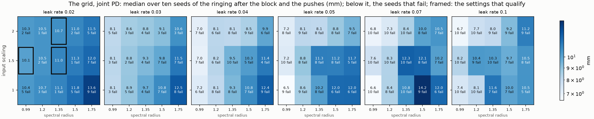

Leak rate 0.02 to 0.1, spectral radius 0.99 to 1.75, input scaling 1 to 2, ten
seeds each, with joint PD, undisturbed, under the block, and under the pushes. By
the rule fixed before the runs, a setting qualifies if every seed arrives, holds,
and ends in the goal in the three scenarios; the qualifying settings are ranked by
the median, over the seeds, of the ringing averaged over the block's release and
the three pushes.

| Leak rate | Settings that qualify (of 15) | Failing runs: nominal / block / pushes (of 150) | How the runs under the pushes fail |
| --- | --- | --- | --- |
| 0.02 | **3** | 9 / 11 / 42 | 24 end away, 18 leave the goal during the hold |
| 0.03 | 0 | 6 / 9 / 68 | 38 leave the goal, 30 end away |
| 0.04 | 0 | 2 / 5 / 106 | 61 leave the goal, 45 end away |
| 0.05 | 0 | 2 / 3 / 117 | 69 end away, 45 leave the goal, 3 never arrive |
| 0.07 | 0 | 3 / 10 / 133 | 87 end away, 28 leave the goal, 16 never arrive, 2 others |
| 0.1 | 0 | 0 / 6 / 129 | 92 end away, 19 never arrive, 14 leave the goal, 4 others |

The settings that qualify, all at leak rate 0.02 (medians over the seeds; ringing
after the block's release and the three pushes):

| Spectral radius | Input scaling | Ringing, mean | Ringing after each | Undisturbed path RMSE | Back on the path after each |
| --- | --- | --- | --- | --- | --- |
| 0.99 | 1.5 | 10.1 mm | 5.2 / 8.9 / 15.4 / 10.9 mm | 1.22 mm | 2.6 / 3.5 / 4.1 / 4.3 s |
| 1.35 | 2 | 10.7 mm | 6.5 / 9.0 / 16.4 / 10.5 mm | 0.96 mm | 2.3 / 2.6 / 2.9 / 3.5 s |
| 1.35 | 1.5 | 11.0 mm | 6.9 / 8.9 / 16.4 / 10.8 mm | 0.94 mm | 2.3 / 3.0 / 3.3 / 2.6 s |

- **Following faster rings less, and loses the target.** The faster the leak rate,
  the less the arm rings, down to 6.5 to 8 mm at leak rate 0.04 to 0.1 with spectral
  radius 0.99, but the more of its seeds lose the target under the pushes, their
  hand ending away from it: the trade-off of report 006, sharper with longer pushes.
- **The hold separates the slow leak rates.** At leak rates 0.03 to 0.05, most
  failing seeds reach the goal while still swinging from the push at 7 s, in the
  ESN's slow swings, and leave it during the hold; the replay, whose ringing has died
  out by then, does not. Report 006's chosen setting has four such seeds; its chosen
  ESN, seed 8, is not one of them.
- **Excusing that hold** under the pushes, as a comparison, nine settings would
  qualify, the best at leak rate 0.03 (spectral radius 1.2, input scaling 1.5:
  8.8 mm), and report 006's third (9.3 mm). Across all of them, the ringing differs
  by about 2 mm, against the replay's 19 to 26 mm after the pushes.

### 3.3 The shortlist, and the choice in the apps

The three qualifying settings, each with its typical seed (nearest its medians of
the undisturbed path RMSE, the ringing, and the latest return), were trained and
tried in the ESN app and the robot app, with report 006's chosen ESN for comparison:

| | Leak rate | Spectral radius | Input scaling | Seed | Ringing after the block and pushes 1, 2, 3 | Undisturbed path RMSE | Starts that arrive and hold, on its own |
| --- | --- | --- | --- | --- | --- | --- | --- |
| A | 0.02 | 0.99 | 1.5 | 8 | 5.6 / 9.4 / 14.9 / 10.8 mm | 1.29 mm | 49 of 49 |
| **B** | 0.02 | 1.35 | 2 | 7 | 6.1 / 9.6 / 15.9 / 11.3 mm | 1.07 mm | 49 of 49 |
| C | 0.02 | 1.35 | 1.5 | 6 | 6.7 / 8.9 / 17.9 / 10.4 mm | 0.95 mm | 49 of 49 |
| Report 006's | 0.03 | 1.35 | 1.5 | 8 | 4.9 / 8.4 / 14.5 / 9.3 mm | 0.92 mm | 49 of 49 |

**B was chosen in the apps.**

### 3.4 Validation: the chosen ESN against the replay

The ESN validated (`grid_lr0.02_sr1.35_is2_seed7_filtered`,
[`esn.toml`](results/20261013-153020-grid_lr0.02_sr1.35_is2_seed7_filtered/esn.toml)):
400 tanh neurons, sparsity 0.05, spectral radius 1.35, leak rate 0.02, input
scaling 2, a random bias, ridge 1e-2, trained by teacher forcing on the filtered
take with a 1 s warm-up, seed 7; its input is the arm's measured joint angles every
10 ms, normalized so that the take spans [−1, 1], and its output the next posture
(report 006, Section 3.6). Joint PD has K_p = 74.96 and 8.96 N m/rad and
K_d = 0.750 and 0.0896 N m s/rad; computed torque, K_p = 400 s⁻² and K_d = 4 s⁻¹ on
both joints; both are given a zero reference velocity.

| Scenario | Chosen ESN, joint PD | Replay, joint PD | Replay, computed torque |
| --- | --- | --- | --- |
| Nominal: path RMSE | 1.07 mm | 0.85 mm | 0.13 mm |
| Nominal: arrival | 9.64 s | 9.59 s | 9.60 s |
| Block: path RMSE | 18.3 mm | 16.6 mm | 7.5 mm |
| Block: force at the grip (peak) | 11.0 N | 11.3 N | 9.4 N |
| Block: force at the release (pressing) | 3.8 N | 20.0 N | 18.5 N |
| Block: reference ahead of the hand at the release | 41 mm | 156 mm | 154 mm |
| Block: ringing after the release | **6.1 mm** | 33.9 mm | 33.4 mm |
| Block: arrival | 9.90 s | 9.59 s | 9.60 s |
| Pushes: path RMSE | 52.5 mm | 35.9 mm | 38.6 mm |
| Pushes: ringing after each push | **9.6 / 15.9 / 11.3 mm** | 19.1 / 25.8 / 21.6 mm | 16.7 / 29.3 / 21.7 mm |
| Pushes: arrival | 9.88 s | 9.57 s | 9.61 s |
| Pushes: distance from the target at the end | 2.9 mm | 2.8 mm | 2.8 mm |
| Offsets: starts that arrive and hold | 49 of 49 | 49 of 49 | 49 of 49 |
| Offsets: median path RMSE | 28.6 mm | 27.0 mm | 14.6 mm |
| Offsets: median peak torque | 8.5 N m | 12 N m | 125 N m |

The force at the grip is the damper stopping the moving hand; the force at the
release is the mean over the block's last 0.1 s, how hard the arm then presses.
Offset runs: [the map of the 49 starts](results/20261013-153407-offsets_robot_lr0.02_sr1.35_is2_seed7_filtered/grid.png)
and [the hand paths](results/20261013-153407-offsets_robot_lr0.02_sr1.35_is2_seed7_filtered/paths.png).
For reference, the chosen ESN with computed torque follows the taught path within
0.95 mm undisturbed, rings 9.0 mm after the block and 14.7, 26.9, and 19.0 mm after
the pushes, about as much as the replays, and arrives from all 49 offset starts
with a median peak torque of 91 N m.

- **Undisturbed, the ESN follows the taught path within 1.07 mm** with joint PD,
  against the replay's 0.85 mm, and arrives 0.05 s after the take.
- **Under the block, the ESN waits in part:** its reference is 41 mm ahead of the
  held hand at the release, the replays' 155 mm, so its arm presses with 3.8 N,
  against 18.5 to 20 N.
- **From every offset start, all three arrive and hold.** With computed torque, the
  replay's reference jumps to the take's start, at a median peak torque of 125 N m;
  with joint PD, the ESN's first step costs 8.5 N m.

### 3.5 The block and the pushes: ringing and return

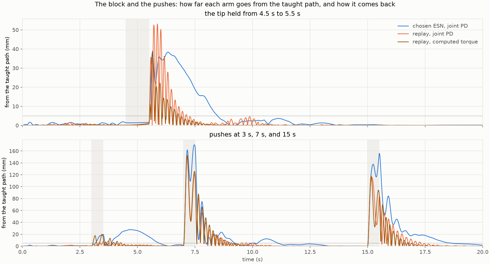

| Chosen ESN, joint PD / replay, joint PD / replay, computed torque | Block, after the release | Push forward at 3 s | Push across at 7 s | Push across at 15 s |
| --- | --- | --- | --- | --- |
| Gap between the reference and the arm at the end | 6.4 / 15.6 / 15.4° | 7.9 / 9.1 / 9.8° | 13.3 / 16.2 / 16.9° | 9.2 / 10.4 / 15.8° |
| Ringing over the next 2 s | **6.1** / 33.9 / 33.4 mm | **9.6** / 19.1 / 16.7 mm | **15.9** / 25.8 / 29.3 mm | **11.3** / 21.6 / 21.7 mm |
| Farthest from the taught path | 38 / 53 / 39 mm | 28 / 9 / 20 mm | 170 / 149 / 153 mm | 156 / 116 / 118 mm |
| Back within 5 mm of it | 3.0 / 1.7 / 1.3 s | 2.5 / 0.6 / 0.8 s | 3.6 / 2.4 / 1.6 s | 3.2 / 1.8 / 1.3 s |

The gap is the norm of the reference minus the arm's joint angles when the
disturbance ends; the return is counted from then, until the next push or the end
of the run.

- **With joint PD, the ESN's arm rings a fifth as much as either replay's after the
  block, and a half to two-thirds as much after each push.** Its reference goes
  with the arm, so the tracker starts from a smaller gap, most of all at the block's
  release (6.4° against 15.5°). Its torques ring less too: after each push they peak
  at 2.8 to 3.7 N m, against the replay's 3.3 to 4.6 N m, and die out within about
  1 s, where the replay's ring for 2 to 3 s.
- **The replay rings as much with computed torque as with joint PD.** Cancelling the
  arm's dynamics does not remove the ringing: the tracker still pulls the arm toward
  a reference that ignores it, at ζ = 0.1.
- **The ESN trades the ringing for slow swings.** Its hand strays farther (28 to
  170 mm after the pushes, against 9 to 153 mm) and comes back in swings of about
  1 Hz, at the ESN's own pace, rather than the tracker's 3.2 Hz ringing: it is back
  within 5 mm of the path 2.5 to 3.6 s after a disturbance, against the replays'
  0.6 to 2.4 s.
- **The push forward carries the ESN ahead.** Pushed along the reach, its arm leaves
  the path ahead of the take (28 mm) and comes back to it over 2.5 s; the replays'
  reference pulls their arm straight back (9 to 20 mm).

### 3.6 The chosen ESN, scenario by scenario

The animations show three arms side by side on one clock, each rendered by
skelarm's player; the purple dot is the target, the red arrow the force at the tip.
Each panel names the arm's reference and its tracker: the chosen ESN and the replay
of the take by time through joint PD, and the replay through computed torque. The
figures show the joint angles (the taught motion, thick gray; the chosen ESN's
output, dashed blue, and its arm, blue, with joint PD; the replay's arm with joint
PD, orange, and with computed torque, brown) and the joint torques of the same three
arms; the disturbances are shaded. Where the replay with computed torque leaves the
others' range, as when it jumps to the take's start from an offset start, the peak
of its torque is written in the panel instead.

#### Nominal

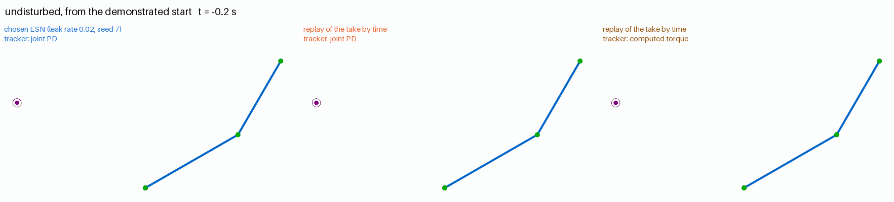

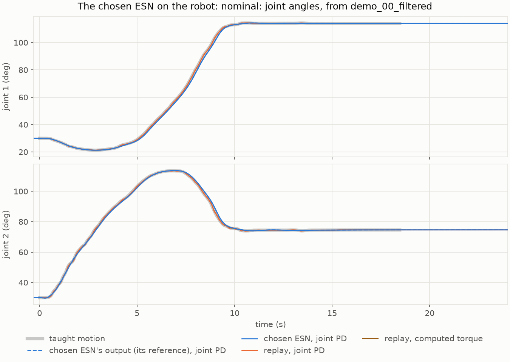

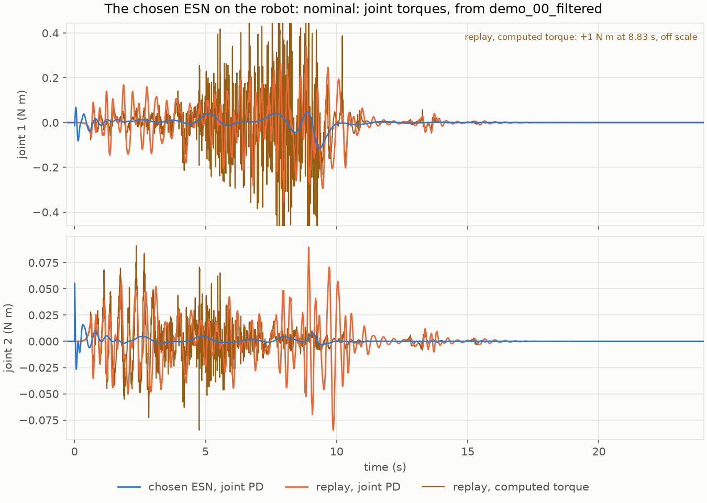

The ESN's arm follows the taught joint path, its output on it, and arrives at
9.64 s, with the take. Its torques stay within 0.12 N m; the replay's, tracking the
take's remaining pixel steps, jitter and ring, up to 0.36 N m (0.86 N m with
computed torque).

#### Block

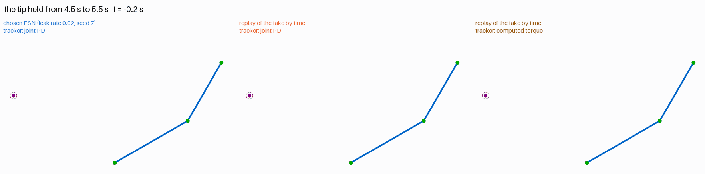

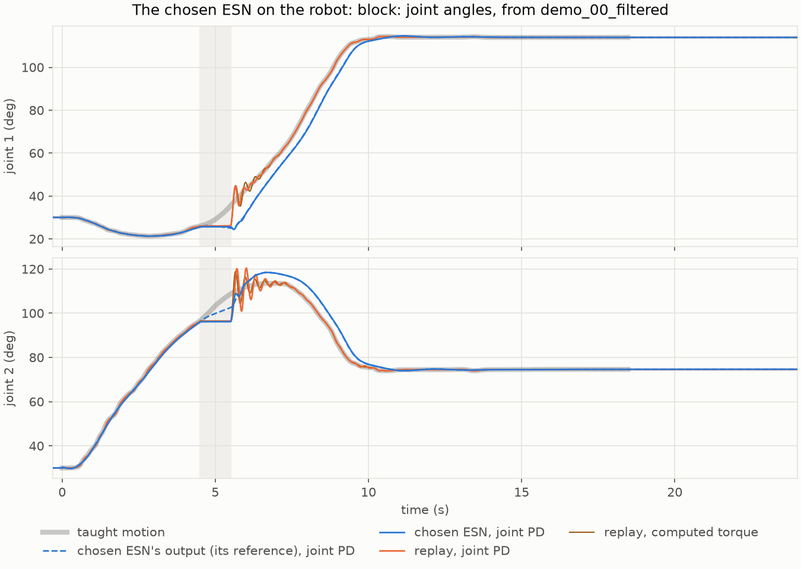

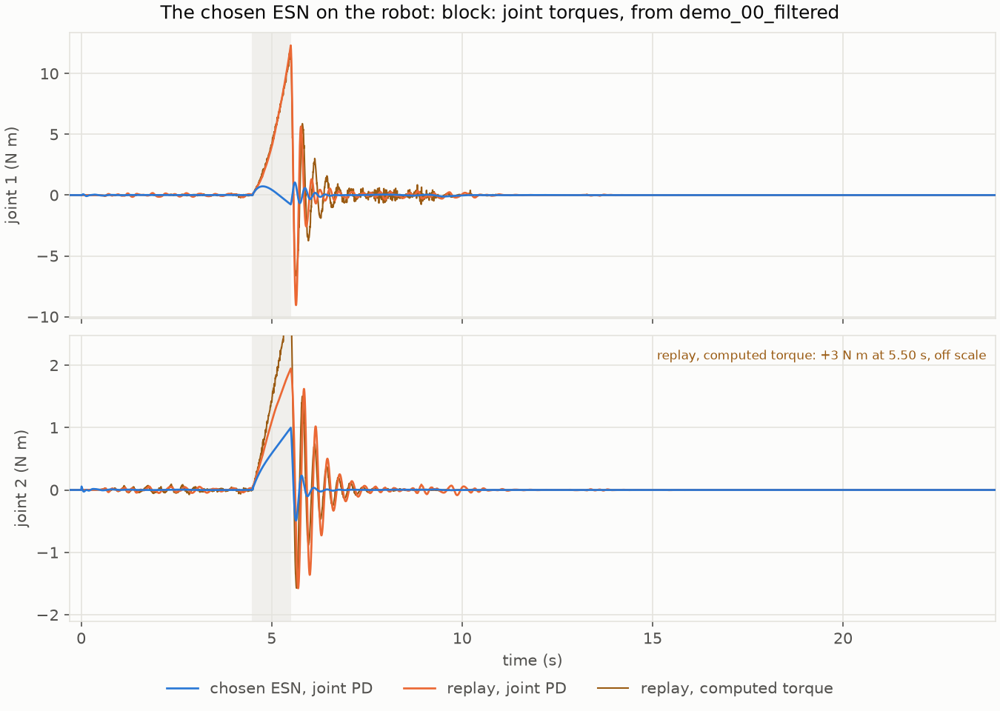

While the tip is held, from 4.5 s to 5.5 s, the ESN's output for joint 1 waits with
the arm, but joint 2's creeps on, from 96° to about 106°: 41 mm ahead of the hand
at the release. Its torques stay within 1.0 N m; the replay's climb to 12 N m until
the release, with either tracker, and its arm snaps forward and rings for about
2 s. The ESN's arm goes 38 mm off the path after the release in one slow swing,
without ringing, then carries on about 0.3 s behind the take and arrives at 9.9 s.

#### Pushes

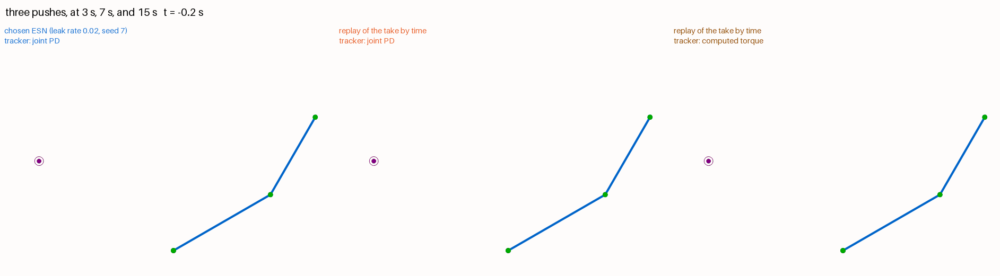

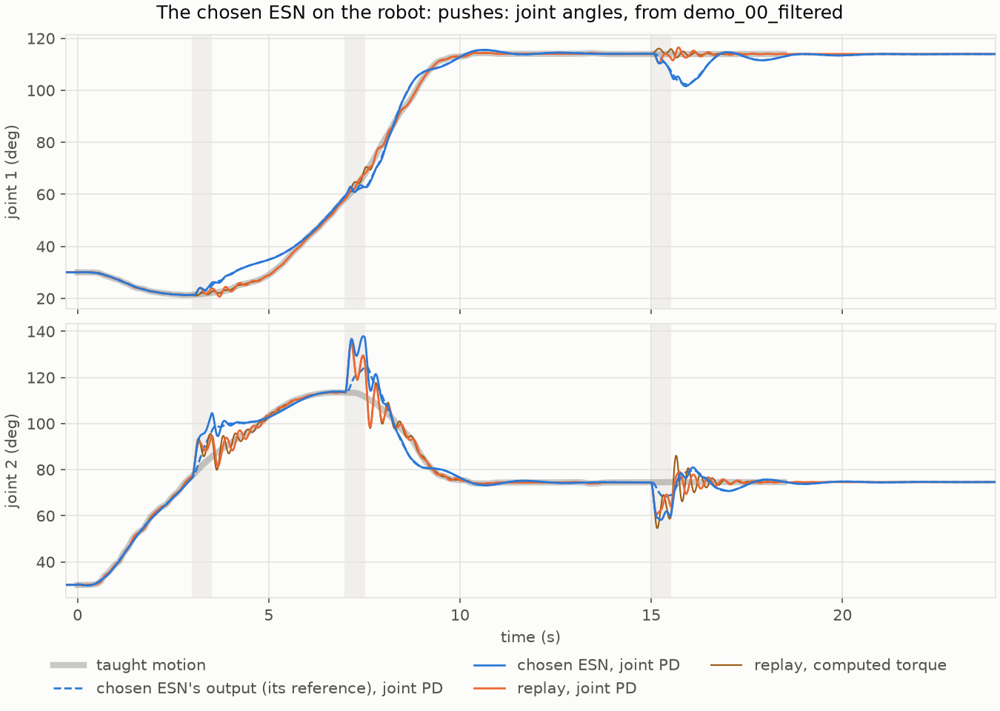

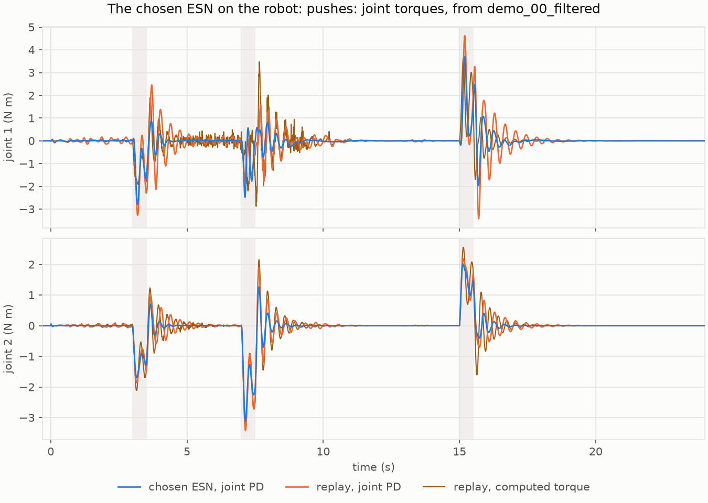

After each push, the chosen ESN's output goes with the arm and carries on from
where it was pushed. After the push forward, its arm runs ahead of the take in
joint 1 and rejoins it by about 5.5 s; after the push at the target, joint 1 sags
to 102° and swings back over about 1.5 s. The replay's arm is dragged back at once,
ringing for 2 to 3 s; with computed torque, it rings much as with joint PD, and its
torques also jitter between the pushes, following the take's remaining pixel
steps.

#### Offset starts

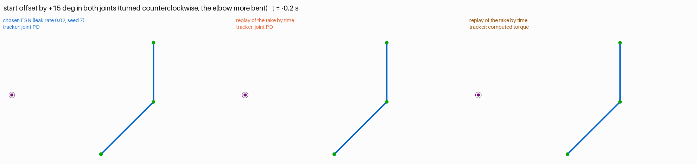

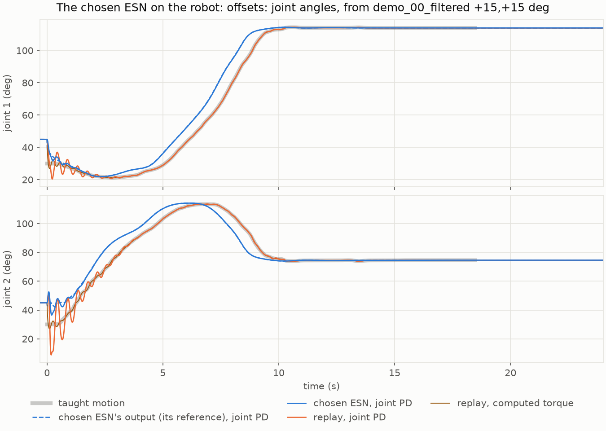

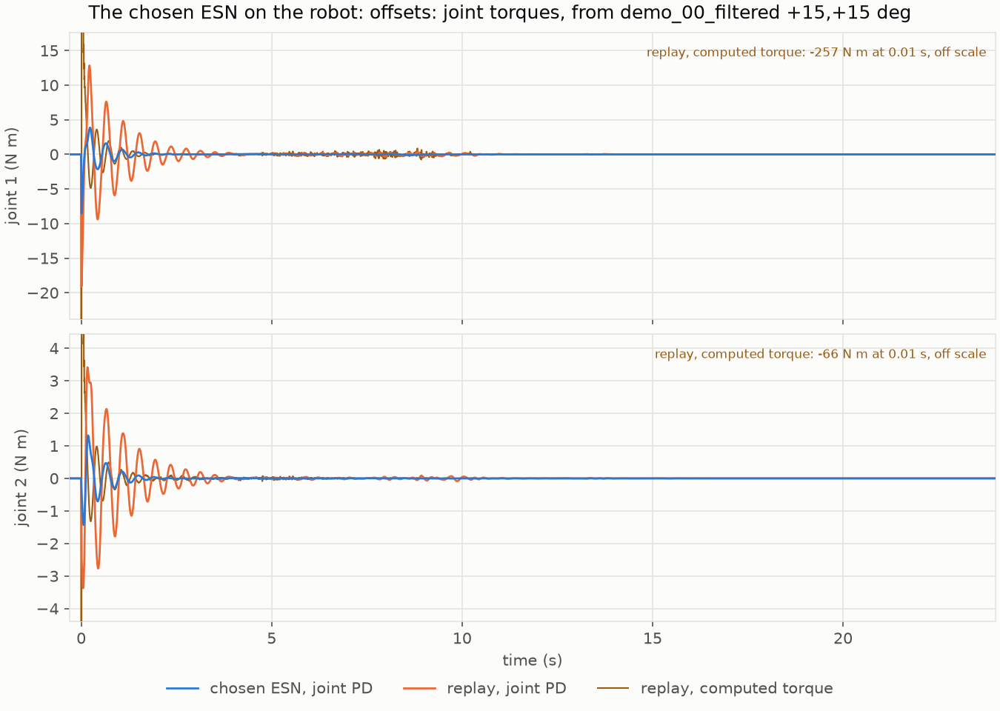

From the start offset by +15° in both joints, the arm turned counterclockwise and
the elbow more bent, the ESN's output turns joint 1 most of the way back at once,
and the arm then runs about half a second ahead of the take and arrives at 8.95 s,
its path 40 mm off the taught one. From every offset start, the hand joins the
taught path near its start
([the hand paths](results/20261013-153407-offsets_robot_lr0.02_sr1.35_is2_seed7_filtered/paths.png)).
The replay's reference jumps back to the take's start: its arm swings there and
rings for about 2 s with joint PD (68 mm off the path), and with computed torque the
jump costs a peak torque of 257 N m.

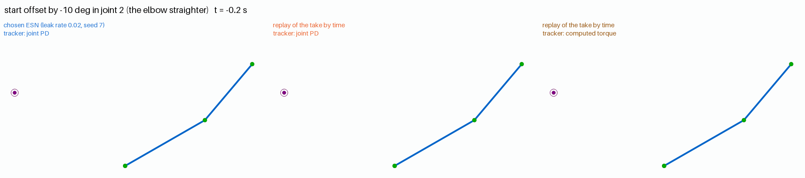

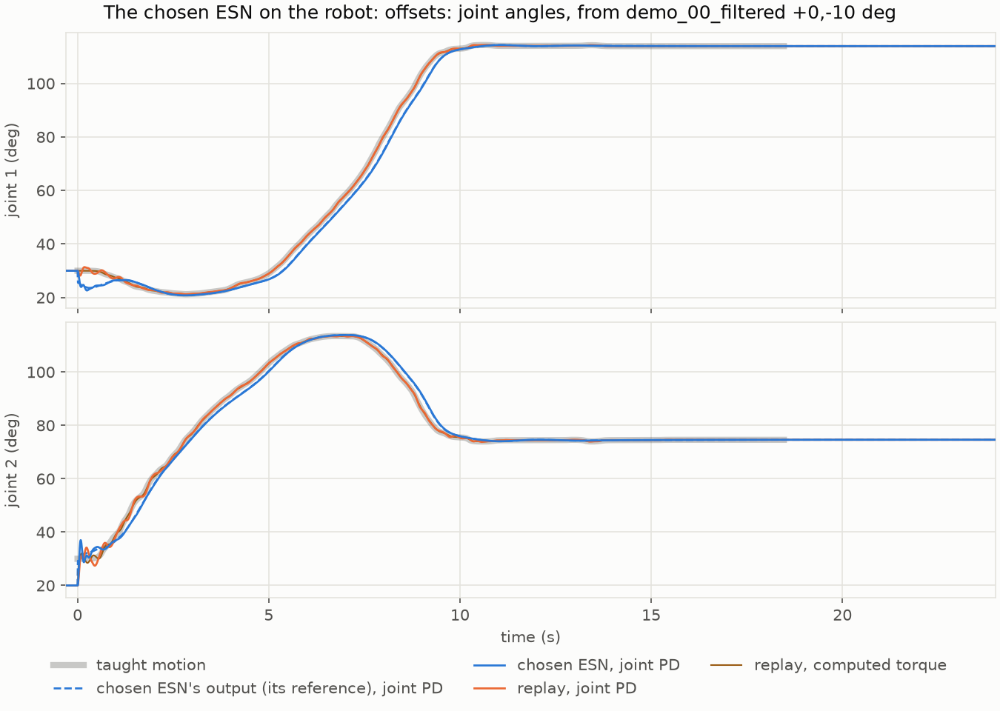

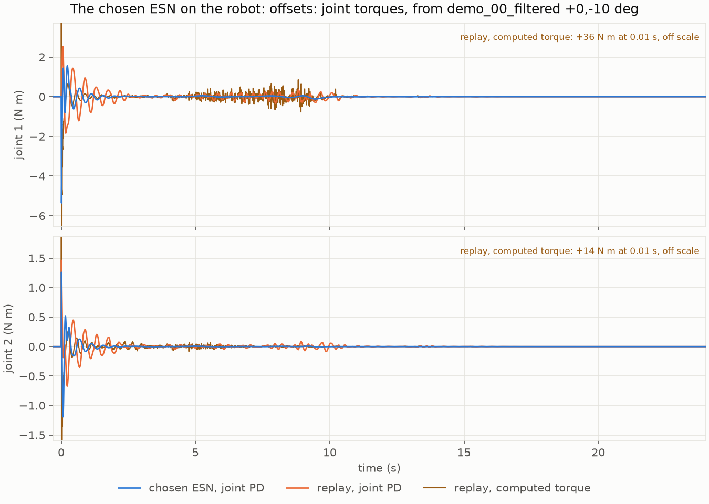

From the start offset by −10° in joint 2, the elbow straighter, one of the starts
from which report 005's ESN failed, the chosen ESN's first steps bend the elbow
back toward the take's start within about 0.2 s, and the arm then follows the
taught motion, slightly behind it, arriving at 9.76 s, its path 19 mm off the
taught one. The replay's reference jumps to the take's start, and its arm follows
it there before replaying the take (8 mm off the path).

### 3.7 The reservoir states

As in reports 005 and 006, [`robot_states.py`](../../experiments/robot_states.py)
recomputes the chosen ESN's reservoir states from the runs' logs, with joint PD, and
refuses a log whose reference the recomputed ESN does not reproduce; every one here
passes. The figures
([run](results/20261013-155105-states_robot_lr0.02_sr1.35_is2_seed7_filtered)) draw
the states of the ESN driving the robot (blue) over those of the take fed in as in
training (thick gray), with the warm-up and the disturbances shaded.

#### Eight neurons over the whole run

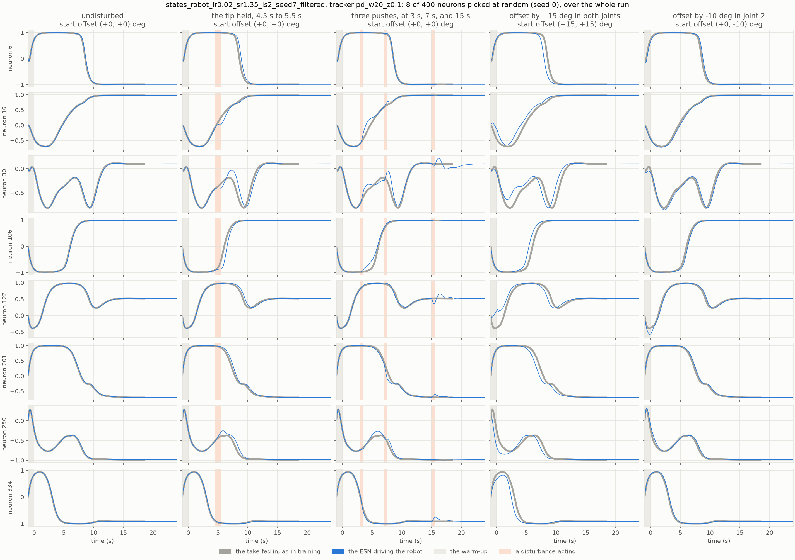

The same eight of the 400 neurons as in reports 005 and 006 (picked at random, seed
0), from the reset to the run's end, in this ESN's reservoir.

- **Undisturbed,** each neuron follows the take's states.
- **Under the block,** the states hold nearly still while the tip is held, then
  resume the take's course about 0.5 s late.
- **The push forward** moves some of them ahead of the take's course (neurons 16 and
  250), as it moves the arm ahead; **the push at the target** makes neurons 30 and
  122 swing and settle back within about 2 s.
- **From (+15°, +15°),** they run ahead of the take's course to the end of the
  reach; **from (0°, −10°),** they follow it closely.

#### The warm-up

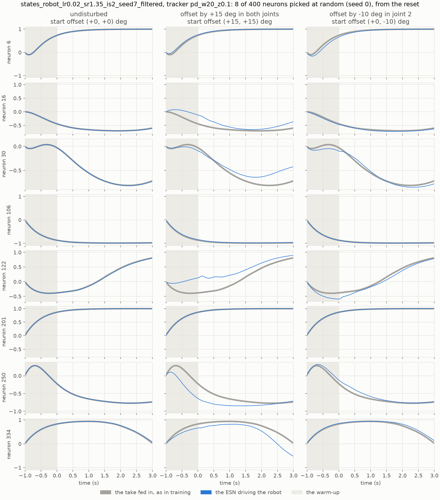

The same neurons over the warm-up and the task's first 3 s, for the undisturbed run
and the two offset starts.

- **From the demonstrated start,** the warm-up brings every neuron onto the take's
  states, and the run then follows them.
- **From (+15°, +15°),** it leaves several neurons elsewhere (16, 122, 250, and
  334); after the start, they run ahead of the take's course, as the arm does.
- **From (0°, −10°),** from which report 005's ESN failed, the warm-up ends near the
  take's states, neuron 122 a little below, and the run then follows them.

#### The principal components

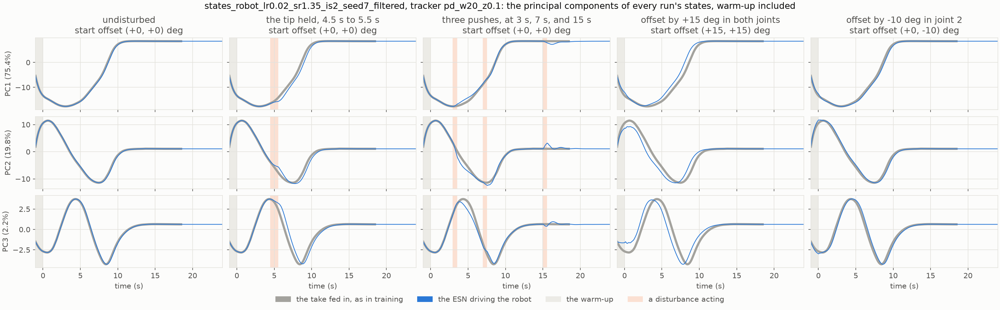

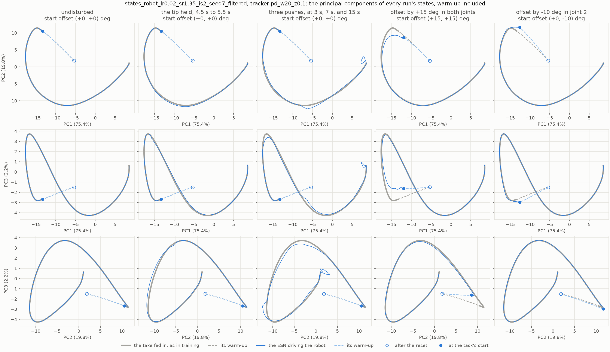

The principal components are those of all five runs' states, warm-up included:
PC1, PC2, and PC3 hold 75.4%, 19.8%, and 2.2% of the variance. In the planes, the
warm-up is dashed, a hollow dot marks the state just after the reset, and a filled
one the state at the task's start.

- **The take's states trace an arc** in the plane of PC1 and PC2, from the task's
  start, at the upper left, down and around to the target, at the right; the
  undisturbed run follows it.
- **Under the block, the states pause** along the arc while the tip is held, then
  go on behind the take.
- **Each push throws the states off the arc** and back: the push at 7 s near the
  bottom of the arc, the push at 15 s in a small loop near its end.
- **From both offset starts,** the warm-up ends off the arc's start, below it from
  (+15°, +15°) and above it from (0°, −10°), and the states join the arc within the
  first seconds.

## 4. Observations

- **An ESN that follows the arm makes joint PD ring less.** After a block or a push,
  the chosen ESN's arm rings a fifth to two-thirds as much as the replay's, with
  joint PD or computed torque: its reference goes with the arm, so the tracker
  starts from a smaller gap. The pushes of 0.5 s let it follow; report 006's of
  0.2 s ended before it could.
- **A model of the arm does not do it.** The replay rings as much with computed
  torque as with joint PD: the ringing comes from a reference that ignores the arm,
  not from the tracker's model.
- **The ringing gives way to slow swings.** The ESN's hand strays farther and
  returns at the ESN's own pace, in swings of about 1 Hz, more slowly than the
  replays'. The ringing measure, above 1.5 Hz, does not see them; the hold under the
  pushes does, and decided the search.
- **Following faster rings less, and loses the target.** In the grid, the faster the
  leak rate, the less the arm rings, but the more of its seeds lose the target or
  swing out of the goal; only the slowest leak rate, 0.02, passed with every seed.
- **Below what a person feels, again.** Among the qualifying settings, the ringing
  differs by about 1 mm; the choice among them was made by hand. The undisturbed
  path is the price: 1.07 mm with the chosen ESN, against report 006's 0.92 mm.

## 5. Next steps

1. **The slow swings in the score:** measure the hand's excursion after a
   disturbance below the ringing's cutoff too, or its return, so that the score sees
   what the hold under the pushes decided by.
2. **The hold's dependence on timing:** the push across at 7 s ends 2.1 s before the
   arrival; repeat the grid with it a little earlier or later, to see how much of
   the selection the push's time decides.
3. **Offset starts in the score,** as reports 005 and 006 proposed.
4. **Report 004's comparisons,** still open: the zero reference velocity against a
   tracker given the reference velocity, now with an ESN chosen for joint PD.
