# 008 Damping and the reference velocity

**Summary.** Report 007 found that, with joint PD at a damping ratio of 0.1, given
a zero reference velocity, the chosen ESN makes the arm ring less after a block or
a push than the replay of the take. Here the same ESN and the replay ran with joint
PD better damped, at damping ratios 0.4 and 0.8, and with each tracker given the
reference's velocity as well as a zero one, to see whether the ESN still helps
when the tracker rings less by itself. All runs were then repeated with the
tracker's torque computed every 10 ms, the ESN's period, and held between.

- **Damping does most of the work.** At a damping ratio of 0.4, the replay's arm
  rings less after the pushes (6.3 to 9.5 mm) than the ESN's did at 0.1 (9.6 to
  15.9 mm). As the damping rises, the ESN's advantage after the pushes shrinks from
  a half or two-thirds of the replay's ringing to three-quarters at 0.4 and
  four-fifths at 0.8.
- **After the block, the ESN's arm still rings a fifth to a quarter as much** at
  every damping ratio (1.7 to 6.5 mm against 10.5 to 34 mm). At 0.4 and above,
  though, the replay's ringing is mostly a fast snap back onto the path, over within
  0.4 s, rather than a lasting oscillation.
- **The ESN's slow return does not depend on the tracker.** Its hand strays as far
  and comes back within 5 mm of the taught path 2.4 to 4.5 s after a disturbance at
  any damping ratio. With more damping, the replay's hand strays less and comes
  back within 0.5 s. So at 0.4 and above, the replay comes back to the path much
  faster.
- **The ESN's lasting gain is under the block,** where it presses against the grip
  with a peak torque of 1 N m against the replay's 12 to 14 N m, at every damping
  ratio: its reference waits for the arm.
- **The reference velocity removes the tracker's lag.** Given a zero reference
  velocity, the arm trails its reference more as the damping rises, and the ESN,
  driven by the arm, follows it: undisturbed at 0.8, its path RMSE is 6.3 mm and it
  arrives 0.65 s later than at 0.1, though it never stalls. Given the reference's
  velocity, its path RMSE is 0.57 to 0.58 mm, and it arrives at 9.55 s, at every
  damping ratio. The reference velocity changes little after a disturbance. Its
  cost is a large torque at t = 0 from an offset start, where both references jump:
  up to 166 N m at 0.8.
- **A 10 ms control period hurts only the lightly damped tracker, the replay most.**
  With the torque computed every 10 ms and held, the replay's arm at 0.1 rings 32
  to 43% more after a disturbance, comes back to the path 0.8 to 1.7 s later, and
  no longer holds under the pushes; the ESN's rings 10 to 22% more and comes back as
  before. At 0.4 and 0.8, the ringing rises by at most 10%, and the returns and
  the holds are unchanged.

## 1. Question

1. **Does the ESN still help with a better-damped tracker?** With joint PD at
   damping ratios 0.4 and 0.8, how does the arm ring after the block and the
   pushes with the ESN and with the replay, and how far does each stray and how
   soon does it return?
2. **What does the reference velocity change?** With each tracker given the
   reference's velocity rather than a zero one, how do the two references compare,
   undisturbed, after a disturbance, and from offset starts?
3. **And with a slower controller?** With the tracker's torque computed every 10 ms,
   the ESN's period, and held between, what changes?

## 2. Setup

### The arm, the take, the ESN, and the scenarios

As in report 007 ([report 007, Section 2](../007-ringing-with-joint-pd/README.md#2-setup)):
the remade arm, the take filtered at 2 Hz, and report 007's chosen ESN (leak rate
0.02, spectral radius 1.35, input scaling 2, seed 7), unchanged, against the
replay of the take by time. The scenarios are report 007's, each run for 24 s:
undisturbed; the block, the tip held from 4.5 s to 5.5 s; the three pushes of
0.5 s, forward at 3 s, across at 7 s, and across the other way at 15 s; and the 49
offset starts, −15° to 15° in each joint, every 5°.

### The trackers

Joint PD at ω = 20 rad/s, with damping ratios ζ of 0.1, 0.4, and 0.8, each given:

- **a zero reference velocity,** as in reports 005 to 007: the derivative term
  damps the arm's own velocity, as in PD control of a fixed posture, so the arm
  trails a moving reference by about 2ζ/ω (0.01 s, 0.04 s, and 0.08 s);
- **the reference velocity:** the change of the reference over each 10 ms period,
  so the derivative term damps the velocity error.

The gains follow from ω and ζ at the end posture, as before: the derivative gain
grows four and eight times from ζ = 0.1. At ζ = 0.1, the tracker overshoots a step
by 73%, at 0.4 by 25%, and at 0.8 by 1.5%. ζ = 0.1 with a zero reference velocity
repeats report 007; its runs here reproduce report 007's metrics exactly.

As in reports 005 to 007, the tracker computes its torque at every simulation step
of 2 ms. Every run is repeated with a control period of 10 ms
(`control_period = 0.01`, Section 3.4): the tracker computes its torque every
10 ms, at the ESN's instants, and holds it between, while the arm is still
simulated every 2 ms. At each of these instants, the reference is the posture the
ESN gave for it, as the tracker sees it at that instant every 2 ms.

### Measures

Report 007's ([Section 2](../007-ringing-with-joint-pd/README.md#measures)): the
path RMSE; whether the hand arrives and holds; and after each disturbance, the gap
between the reference and the arm's joint angles at its end, the ringing (the RMS
of the hand's motion above 1.5 Hz over the next 2 s), the farthest the hand strays
from the taught path, and when it is back within 5 mm of it. The ringing keeps its
cutoff of 1.5 Hz, below the tracker's own ringing (3.2 Hz at ζ = 0.1, 2.9 Hz at
0.4, and 1.9 Hz at 0.8); at 0.8 the tracker hardly oscillates, so what the measure
sees there is how fast the hand moves back, not how long it rings. Also: the peak
joint torque, under the block from its onset to 0.5 s after its release.

### Reproducing the results

The runs read the take as in report 007, and the ESN by its run name
(`20261013-153020-grid_lr0.02_sr1.35_is2_seed7_filtered`), copied in
[report 007's results](../007-ringing-with-joint-pd/results). All configurations are
in [`manual_demonstration_v2_robot_damping`](../../experiments/manual_demonstration_v2_robot_damping/README.md).

| Runs | Command | Commit |
| --- | --- | --- |
| `<scenario>_robot_pd_{zero,reference}_velocity_filtered` (8) | `uv run python experiments/robot_esn.py experiments/manual_demonstration_v2_robot_damping/<name>.toml` | `9149131` |
| `<scenario>_robot_pd_{zero,reference}_velocity_control10ms_filtered` (8) | as the first | `7b6c7b2` |
| [`summary`](results/summary) | `uv run python reports/008-damping-and-reference-velocity/make_figures.py --logs --animations` | |

All runs are deterministic, and every run record (`run.toml`) shows no uncommitted
changes. Each run directory here holds its configuration, its run record, and its
metrics (`metrics.csv`). [`make_figures.py`](make_figures.py) draws
`undisturbed.png`, `disturbed.png`, and `control_period.png` and prints the tables
of Section 3 from the copies. With `--logs`, it reads the runs' logs under the
storage root, which are not kept in Git, to draw each arm's distance from the
taught path under the block and the pushes (`block_distances.png`,
`pushes_distances.png`, and with the torque computed every 10 ms,
`pushes_control10ms_distances.png`), and copies three of the runs' own figures
(`pushes_joints.png`, `pushes_control10ms_joints.png`, `offset_torques.png`). With
`--animations`, it exports `block.gif`, `pushes.gif`, and `pushes_control10ms.gif`,
each arm rendered by skelarm's player.

## 3. Results

### 3.1 Undisturbed

| Tracker | ESN: arrival (s) | ESN: path RMSE (mm) | ESN: tracking error (°) | Replay: arrival (s) | Replay: path RMSE (mm) | Replay: tracking error (°) |
| --- | ---: | ---: | ---: | ---: | ---: | ---: |
| ζ 0.1, zero reference velocity | 9.64 | 1.07 | 0.09 | 9.59 | 0.85 | 0.13 |
| ζ 0.4, zero reference velocity | 9.90 | 3.32 | 0.35 | 9.60 | 0.34 | 0.36 |
| ζ 0.8, zero reference velocity | 10.29 | 6.31 | 0.69 | 9.65 | 0.30 | 0.71 |
| ζ 0.1, reference velocity | 9.55 | 0.58 | 0.02 | 9.58 | 0.87 | 0.09 |
| ζ 0.4, reference velocity | 9.55 | 0.57 | 0.01 | 9.56 | 0.38 | 0.04 |
| ζ 0.8, reference velocity | 9.55 | 0.57 | 0.01 | 9.56 | 0.27 | 0.03 |

The tracking error is the RMS gap between the reference and the arm's joint angles.
Every arm arrives and holds, with every tracker.

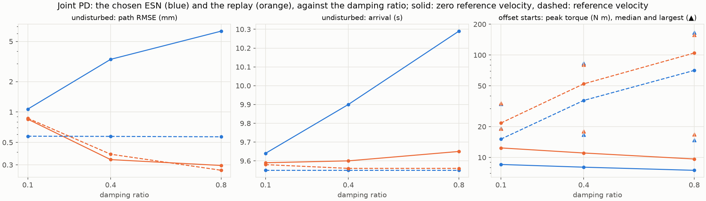

- **Given a zero reference velocity, the arm trails its reference** in proportion to
  the damping (tracking error 0.09° to 0.69°). The replay's arm only runs later, on
  the same path, which even improves with the damping (0.85 to 0.30 mm). The ESN,
  driven by the trailing arm, waits for it, so its own course changes: its path
  RMSE is 3.3 mm at 0.4 and 6.3 mm at 0.8, and it arrives 0.26 s and 0.65 s later
  than at 0.1. It never stalls, unlike report 004's candidate F, critically damped
  (ζ = 1) at the same ω.
- **Given the reference velocity, the arm keeps up** (tracking error 0.01° to
  0.09°), and the ESN's path RMSE is 0.57 to 0.58 mm at every damping ratio, below
  report 006's chosen ESN's 0.92 mm and report 007's 1.07 mm. The replay's is 0.27
  to 0.87 mm. The replay's peak torque rises a little with the reference velocity
  (0.42 to 1.00 N m, against 0.21 to 0.36 N m), but the take, filtered at 2 Hz, no
  longer has the pixel steps that gave report 004's replay its torque pulses.

### 3.2 After the block and the pushes

Each cell gives the ESN, then the replay.

**The ringing over the next 2 s** (mm):

| Tracker | The block's release | Push forward at 3 s | Push across at 7 s | Push across at 15 s |
| --- | ---: | ---: | ---: | ---: |
| ζ 0.1, zero reference velocity | 6.1 / 33.9 | 9.6 / 19.1 | 15.9 / 25.8 | 11.3 / 21.6 |
| ζ 0.4, zero reference velocity | 2.9 / 16.2 | 4.7 / 6.3 | 7.5 / 9.5 | 5.8 / 7.8 |
| ζ 0.8, zero reference velocity | 1.7 / 10.5 | 3.1 / 3.7 | 4.7 / 5.7 | 3.8 / 4.8 |
| ζ 0.1, reference velocity | 6.5 / 34.1 | 9.7 / 19.1 | 16.2 / 25.8 | 11.1 / 21.6 |
| ζ 0.4, reference velocity | 3.8 / 16.7 | 4.8 / 6.3 | 7.7 / 9.4 | 5.8 / 7.8 |
| ζ 0.8, reference velocity | 2.6 / 11.0 | 3.1 / 3.7 | 4.8 / 5.7 | 3.9 / 4.8 |

**Back within 5 mm of the taught path** (s after the disturbance's end):

| Tracker | The block's release | Push forward at 3 s | Push across at 7 s | Push across at 15 s |
| --- | ---: | ---: | ---: | ---: |
| ζ 0.1, zero reference velocity | 2.98 / 1.65 | 2.45 / 0.60 | 3.61 / 2.42 | 3.15 / 1.81 |
| ζ 0.4, zero reference velocity | 3.11 / 0.42 | 2.43 / 0.03 | 3.81 / 0.38 | 3.18 / 0.45 |
| ζ 0.8, zero reference velocity | 4.49 / 0.17 | not back* / 0.00 | 4.10 / 0.17 | 3.37 / 0.16 |
| ζ 0.1, reference velocity | 2.95 / 1.64 | 2.41 / 0.61 | 3.58 / 2.24 | 3.13 / 1.81 |
| ζ 0.4, reference velocity | 2.97 / 0.42 | 2.50 / 0.04 | 3.63 / 0.38 | 3.12 / 0.45 |
| ζ 0.8, reference velocity | 3.00 / 0.17 | 2.58 / 0.04 | 3.68 / 0.17 | 3.14 / 0.16 |

\* Before the push at 7 s. At ζ = 0.8 with a zero reference velocity, the ESN's hand
runs 3 to 7 mm off the taught path in that part of the reach even undisturbed
(Section 3.1), so 5 mm is out of its reach there.

**The farthest the hand strays from the taught path** (mm):

| Tracker | The block's release | Push forward at 3 s | Push across at 7 s | Push across at 15 s |
| --- | ---: | ---: | ---: | ---: |
| ζ 0.1, zero reference velocity | 38 / 53 | 28 / 9 | 170 / 149 | 156 / 116 |
| ζ 0.4, zero reference velocity | 40 / 25 | 19 / 6 | 155 / 108 | 141 / 97 |
| ζ 0.8, zero reference velocity | 42 / 19 | 11 / 4 | 147 / 89 | 127 / 80 |
| ζ 0.1, reference velocity | 38 / 54 | 31 / 9 | 172 / 149 | 157 / 116 |
| ζ 0.4, reference velocity | 39 / 26 | 33 / 7 | 160 / 109 | 151 / 97 |
| ζ 0.8, reference velocity | 40 / 21 | 35 / 7 | 156 / 90 | 148 / 80 |

**The gap between the reference and the arm at the disturbance's end** (°):

| Tracker | The block's release | Push forward at 3 s | Push across at 7 s | Push across at 15 s |
| --- | ---: | ---: | ---: | ---: |
| ζ 0.1, zero reference velocity | 6.4 / 15.6 | 7.9 / 9.1 | 13.3 / 16.2 | 9.2 / 10.4 |
| ζ 0.4, zero reference velocity | 6.1 / 15.8 | 6.1 / 7.2 | 11.8 / 13.1 | 8.8 / 9.4 |
| ζ 0.8, zero reference velocity | 5.6 / 16.1 | 4.9 / 6.6 | 11.1 / 13.2 | 8.6 / 9.6 |
| ζ 0.1, reference velocity | 6.4 / 15.4 | 8.1 / 9.2 | 13.5 / 16.1 | 9.0 / 10.4 |
| ζ 0.4, reference velocity | 6.4 / 15.4 | 7.3 / 7.7 | 12.2 / 12.7 | 8.6 / 9.4 |
| ζ 0.8, reference velocity | 6.4 / 15.4 | 7.4 / 7.7 | 12.2 / 12.5 | 8.9 / 9.6 |

Every arm arrives and holds under the block and under the pushes, with every
tracker; the ESN arrives at 9.83 to 10.52 s, the replay at 9.56 to 9.65 s. Under
the block, the ESN's peak torque is 1.0 to 1.1 N m with every tracker, the
replay's 12.3 to 14.0 N m.

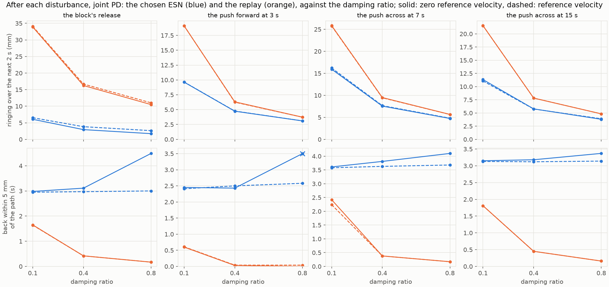

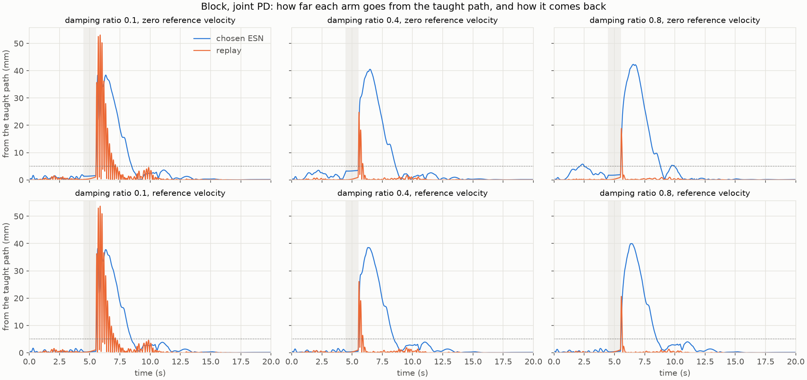

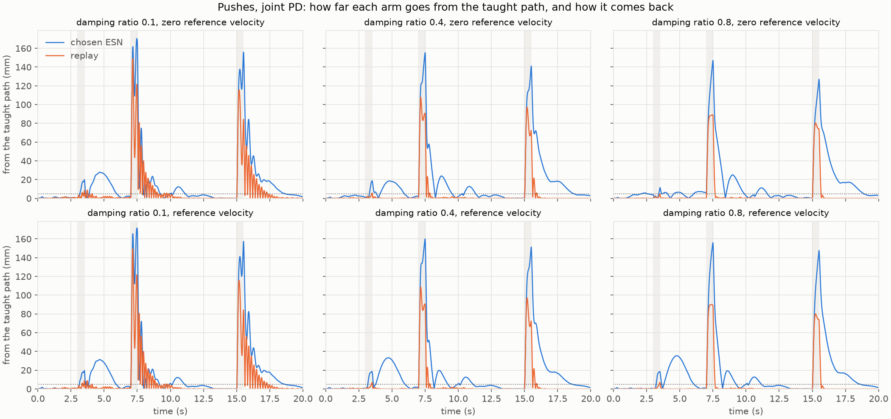

- **The replay's ringing falls with the damping,** to a half at 0.4 and a third at
  0.8 after the block, and to about a third and a fifth after the pushes. The ESN's
  falls too, but after the pushes it is no longer much below the replay's: from a
  half to two-thirds of the replay's at 0.1, it is about three-quarters at 0.4 and
  four-fifths at 0.8. At the end of a push, the ESN's gap is 74 to 98% of the
  replay's with every tracker: over 0.5 s, its reference follows the arm only a
  little.
- **After the block, the ESN still rings a fifth to a quarter as much,** from a gap
  less than half the replay's: the block lasts 1 s, and the ESN waits for the arm.
  But at 0.4 and above, the replay's ringing is a fast snap back onto the path, with
  one or two overshoots at 0.4 and none at 0.8, over within 0.4 s (the distance
  plot); the measure, above 1.5 Hz, counts that motion too. The ESN's hand instead
  swings out to about 40 mm and back over 3 to 4.5 s, below the cutoff.
- **The ESN's return is its own.** Its hand strays about as far and comes back as
  slowly at every damping ratio; given a zero reference velocity at 0.8, it is
  slower still after the block (4.5 s), with the arm trailing its reference. The
  replay's hand strays less as the damping rises and is back within 0.2 to 0.5 s at
  0.4 and above.
- **The reference velocity changes little after a disturbance.** The replay's
  numbers hardly change; the ESN's ringing after the block rises by 0.4 to 0.9 mm.
  After the push at 3 s, the ESN's hand swings out to 31 to 35 mm, about 1 s after
  the push, at every damping ratio; given a zero reference velocity, that swing
  shrinks as the damping rises (28, 19, and 11 mm), likely because the derivative
  term then brakes all of the arm's motion, the swing included.

The joint angles under the pushes, given a zero reference velocity, from the run's
own figure (ζ = 0.1, 0.4, and 0.8 from left to right):

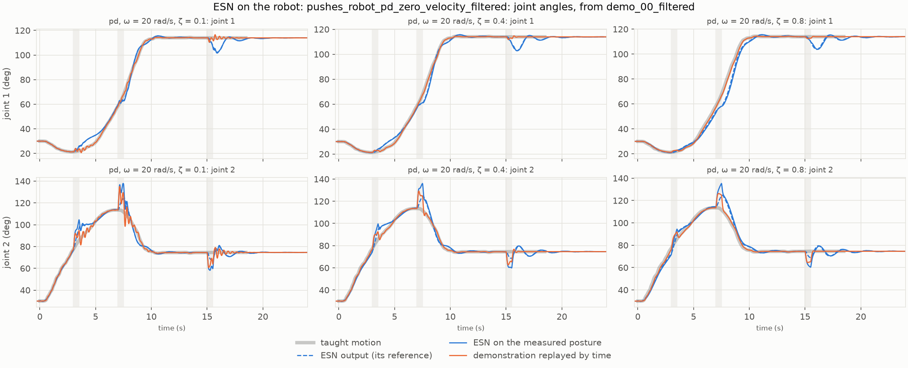

The animations show the ESN with ζ = 0.8, the replay with ζ = 0.8, and the replay
with ζ = 0.1 (report 007's tracker), each given a zero reference velocity:

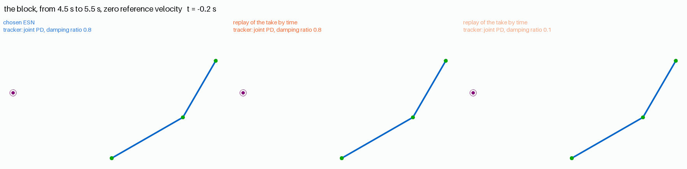

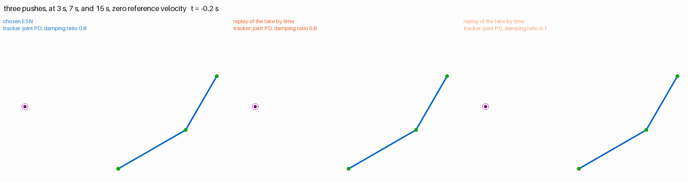

### 3.3 From the offset starts

| Tracker | ESN: median path RMSE (mm) | ESN: peak torque, median / largest (N m) | Replay: median path RMSE (mm) | Replay: peak torque, median / largest (N m) |
| --- | ---: | ---: | ---: | ---: |
| ζ 0.1, zero reference velocity | 28.6 | 8.5 / 19 | 27.0 | 12.4 / 19 |
| ζ 0.4, zero reference velocity | 23.6 | 8.0 / 17 | 16.9 | 11.1 / 18 |
| ζ 0.8, zero reference velocity | 21.1 | 7.5 / 15 | 14.8 | 9.7 / 17 |
| ζ 0.1, reference velocity | 28.6 | 15.1 / 33 | 27.4 | 21.7 / 34 |
| ζ 0.4, reference velocity | 24.5 | 36.0 / 83 | 18.4 | 52.3 / 81 |
| ζ 0.8, reference velocity | 20.4 | 70.8 / 166 | 15.5 | 104.7 / 157 |

Every arm arrives and holds from all 49 starts, with every tracker.

- **Both references jump at t = 0.** The replay moves from the start posture to the
  take's start, and the ESN to its first output: the larger joint's step over the
  first 10 ms is 10.0° in the median for the replay and 8.7° for the ESN, and at
  most 15° and 18°. Given a zero reference velocity, the jump costs only the
  proportional term's step, up to 19 N m. Given the reference velocity, the
  derivative term multiplies the jump's speed, up to about 30 rad/s, by its gain:
  up to 33 N m at ζ = 0.1, 83 N m at 0.4, and 166 N m at 0.8.
- **After the first 0.1 s, the torques are small:** at most 4.5 N m for the ESN and
  8.4 N m for the replay given the reference velocity at 0.8, and 2.1 and 4.1 N m
  given a zero one.
- **The replay's path from an offset start improves more with the damping** than
  the ESN's (27 to 15 mm, against 29 to 20 mm in the median): with less ringing,
  its arm follows the take from the first moment, while the ESN's reference makes
  its own way back to the taught path.

Joint torques from the start offset by +15° in both joints, given the reference
velocity, from the run's own figure:

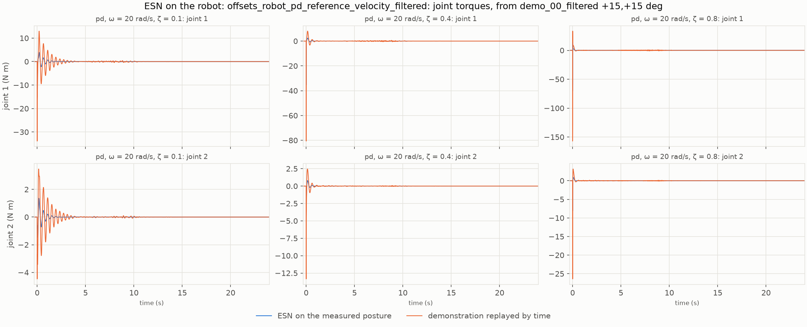

### 3.4 A 10 ms control period

The runs of Sections 3.1 to 3.3 again, with the tracker's torque computed every
10 ms and held between. Below, given a zero reference velocity, each cell gives the
torque computed every 2 ms (Section 3.2), then every 10 ms; the runs given the
reference's velocity change in the same way (`make_figures.py` prints both).

**The ringing over the next 2 s** (mm):

| Tracker | Arm | The block's release | Push forward at 3 s | Push across at 7 s | Push across at 15 s |
| --- | --- | ---: | ---: | ---: | ---: |
| ζ 0.1 | ESN | 6.1 → 6.8 | 9.6 → 11.5 | 15.9 → 18.9 | 11.3 → 13.8 |
| ζ 0.1 | replay | 33.9 → 44.7 | 19.1 → 27.4 | 25.8 → 35.5 | 21.6 → 30.2 |
| ζ 0.4 | ESN | 2.9 → 3.1 | 4.7 → 5.0 | 7.5 → 8.0 | 5.8 → 6.2 |
| ζ 0.4 | replay | 16.2 → 17.0 | 6.3 → 6.9 | 9.5 → 10.1 | 7.8 → 8.5 |
| ζ 0.8 | ESN | 1.7 → 1.7 | 3.1 → 3.2 | 4.7 → 4.8 | 3.8 → 3.9 |
| ζ 0.8 | replay | 10.5 → 10.7 | 3.7 → 3.9 | 5.7 → 5.8 | 4.8 → 5.0 |

**Back within 5 mm of the taught path** (s after the disturbance's end):

| Tracker | Arm | The block's release | Push forward at 3 s | Push across at 7 s | Push across at 15 s |
| --- | --- | ---: | ---: | ---: | ---: |
| ζ 0.1 | ESN | 2.98 → 2.98 | 2.45 → 2.42 | 3.61 → 3.60 | 3.15 → 3.16 |
| ζ 0.1 | replay | 1.65 → 2.56 | 0.60 → 2.25 | 2.42 → 3.24 | 1.81 → 3.32 |
| ζ 0.4 | ESN | 3.11 → 3.10 | 2.43 → 2.42 | 3.81 → 3.81 | 3.18 → 3.17 |
| ζ 0.4 | replay | 0.42 → 0.42 | 0.03 → 0.03 | 0.38 → 0.38 | 0.45 → 0.45 |
| ζ 0.8 | ESN | 4.49 → 4.49 | not back* | 4.10 → 4.10 | 3.37 → 3.37 |
| ζ 0.8 | replay | 0.17 → 0.16 | 0.00 → 0.00 | 0.17 → 0.16 | 0.16 → 0.16 |

\* As in Section 3.2.

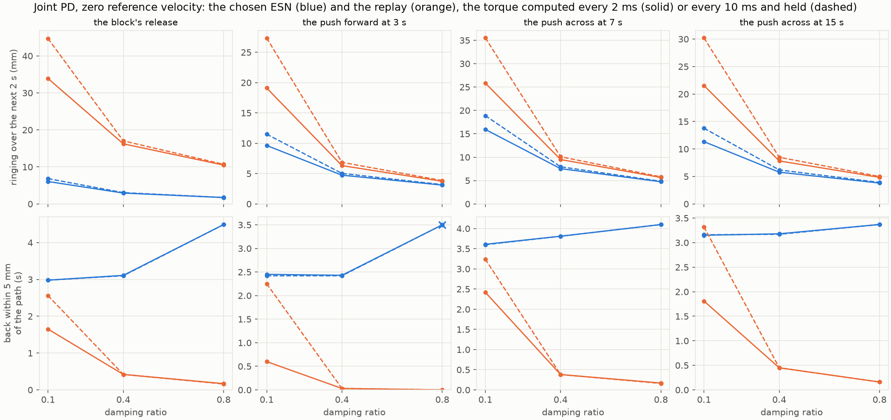

- **At ζ = 0.1, the replay suffers most.** Holding the torque over a period acts
  roughly as a delay of half a period, which takes damping from the tracker, and at
  0.1 there is little to spare. The replay's arm rings 32 to 43% more after each
  disturbance and comes back to the path 0.8 to 1.7 s later; under the pushes it
  arrives at 9.59 s still swinging from the push at 7 s, and leaves the goal during
  the hold, with either reference velocity. The ESN's arm rings 10 to 22% more and
  comes back as soon as before, so its ringing falls from 0.18 to 0.15 of the
  replay's after the block, and from 0.50–0.62 to 0.42–0.53 after the pushes.
- **At ζ = 0.4 and 0.8, almost nothing changes.** The ringing rises by at most 10%
  for either arm, and the returns, the arrivals, and the holds are the same, so
  Section 3.2's findings stand.
- **Undisturbed,** only the replay at ζ = 0.1 changes noticeably: its path RMSE
  rises from 0.85 to 1.13 mm (0.87 to 1.13 mm given the reference velocity).
- **From the offset starts,** every arm still arrives and holds from all 49
  starts, and the median path RMSE grows by 0.2 to 3.8 mm, most for the replay at
  ζ = 0.1. The torque at t = 0 is computed while the reference is still at the
  start posture, so the reference's first step reaches the tracker 10 ms later, as
  a whole step of the proportional term, held for 10 ms. Given a zero reference
  velocity, that step does not depend on the damping: the replay's median peak
  torque is 13.1 N m at every damping ratio (9.7 to 12.4 N m every 2 ms), the ESN's
  8.8 N m (7.5 to 8.5 N m). Given the reference velocity, the spike at t = 0 is as
  high as every 2 ms at 0.4 and 0.8 (up to 79 to 83 N m and 157 to 166 N m), but
  held for the whole 10 ms; at 0.1 it is lower (the replay's median: 13.1 N m,
  against 21.7 N m).

Under the pushes with the torque computed every 10 ms, given a zero reference
velocity: each arm's distance from the taught path, the joint angles from the run's
own figure, and the animation, with the same arms as in Section 3.2, to compare
with `pushes_distances.png`, `pushes_joints.png`, and `pushes.gif` there.

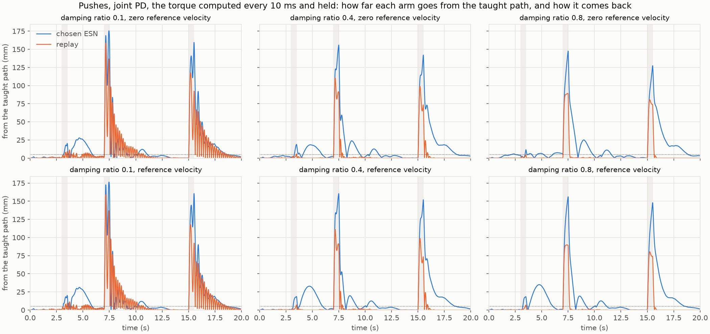

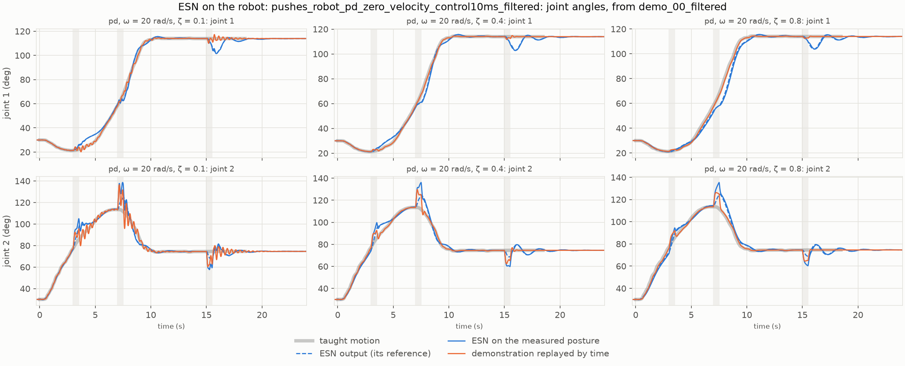

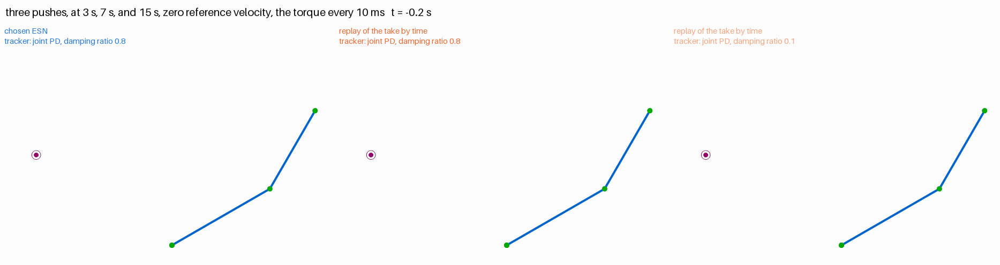

- **Only the replay at ζ = 0.1 looks different.** Its hand swings about the path
  for longer after each push: back within 5 mm at 5.75 s rather than 4.10 s after
  the push at 3 s, at 10.74 s rather than 9.92 s after the push at 7 s, and at
  18.82 s rather than 17.31 s after the push at 15 s. It arrives at 9.59 s still
  swinging, and from 9.66 s to 9.75 s it is outside the goal's 20 mm radius, up to
  23.6 mm from the target; every 2 ms, it stays within. The ESN's hand at
  ζ = 0.1, and both arms at 0.4 and 0.8, take much the same course as every 2 ms.

## 4. Observations

- **Following the arm and damping it do the same job.** The ESN reduces the ringing
  by starting the tracker from a smaller gap; damping reduces it by stopping the
  oscillation. Once the tracker is damped at 0.4 or more, the ESN adds little after
  the pushes, and after the block what it removes is mostly the replay's fast snap
  back.
- **Its price stays.** The ESN's hand strays farther and returns in slow swings of
  2.4 to 4.5 s at every damping ratio; with damping, the replay returns within
  0.5 s. The ringing measure does not count these swings, as report 007 noted.
- **What only the ESN gives:** a reference that waits for an arm that cannot move.
  Under the block it presses with about a twelfth of the replay's torque, with
  every tracker.
- **The reference velocity suits the ESN.** It removes the lag that, with a zero
  reference velocity, makes the ESN wait for the arm and change its course, and it
  gives the ESN its best undisturbed path, at any damping. The torque pulses that
  report 004 found with it show up here only at the offset starts, where both
  references jump at t = 0.
- **A slower controller hurts the replay more.** With the torque computed every
  10 ms, the ESN's period, the lightly damped replay rings a third to two-fifths
  more and loses the hold under the pushes, while the ESN's arm rings only a little
  more, likely because its reference goes with the arm. With ζ of 0.4 or more, the
  control period hardly matters to either.

## 5. Next steps

1. **The tracker for the next studies:** joint PD given the reference velocity,
   with ζ of 0.4 or 0.8, rather than report 007's ζ = 0.1 with a zero reference
   velocity. At these damping ratios, a control period of 10 ms, the ESN's, changes
   little (Section 3.4).
2. **A faster return in the score:** search the ESN with the chosen tracker, scored
   by the return to the path as well as the ringing, as report 007's first next
   step proposed; the slow swings now decide the comparison with the replay.
3. **A smooth start:** let the reference velocity start from rest, for example by
   limiting the reference's step at t = 0, so that offset starts do not jump.
