# 009 Noisy training for a faster return

**Summary.** Report 008 found that with joint PD better damped, the replay of the
take rings nearly as little as report 007's ESN after a push, and that what then set
the ESN apart was its slow return onto the taught path after a disturbance: 2.4 to
4.5 s, against the replay's 0.5 s at most. Here the ESN was searched again with the
tracker report 008 proposed (joint PD at a damping ratio of 0.4, given the reference
velocity, its torque computed every 10 ms), scored by the ringing and the return
together; then trained with noise added to its input, white, pink, or brown; and
the ESN chosen was compared with the replay at damping ratios of 0.1 to 0.8.

- **The grid** (105 settings, ten seeds each): only five settings qualify, all at
  leak rates 0.015 and 0.02, and none returns faster than report 007's chosen
  setting, the score's reference: 2.66 s in the median, the fastest of all 105.
- **Noise in the training does what the grid could not.** With the take fed in four
  times, each with white noise of 1° on the input, report 007's setting returns in
  0.80 s, faster in every one of its ten seeds, and rings 34% more (7.9 mm against
  5.9 mm), with an undisturbed path as close (0.60 mm). Pink noise does less, and
  brown noise, which drifts slowly, qualifies at no level: it spoils the
  undisturbed path and slows the return.
- **The chosen ESN,** picked in the robot app from five: report 007's setting
  trained with white noise of 1°, seed 3.
- **Against the replay,** with the search's tracker: its reference now holds to the
  taught path during a push, as the replay's does, so after a push it rings about
  as much (6.1 to 10.1 mm, against 6.8 to 10.0 mm) and is back on the path within
  0.6 to 0.9 s, against the replay's 0.04 to 0.46 s. Under the block, which lasts
  1 s, it still waits for the arm: it presses with 1.8 N m against 13.1 N m, and
  rings 7.1 mm after the release against 17.5 mm. From all 49 offset starts, both
  arrive and hold, the ESN with lower torque spikes at the start.
- **With every tracker,** the ESN is back on the path within 0.6 to 1.3 s after a
  disturbance, except with the lightly damped tracker after the pushes across.
  There, at a damping ratio of 0.1, it rings three-fifths to nine-tenths as much as
  the replay after a push and, like the replay, briefly leaves the goal during the
  hold, where report 007's ESN did not: the noise suits a damped tracker.

## 1. Question

1. **A search with the better-damped tracker:** with joint PD at a damping ratio of
   0.4, given the reference velocity, its torque computed every 10 ms, which
   settings of the reservoir make the arm both ring little and come back to the
   taught path soon after a block or a push?
2. **Noise in the training:** does noisy teacher forcing, with white, pink, or brown
   noise, make the return faster, and at what cost?
3. **The ESN chosen:** with joint PD at damping ratios 0.1, 0.4, and 0.8, given a zero
   reference velocity or the reference's, all with the torque computed every 10 ms,
   how does it compare with the replay, undisturbed, under the block and the
   pushes, and from offset starts?

## 2. Setup

### The arm, the take, and the scenarios

As in reports 007 and 008 ([report 007, Section 2](../007-ringing-with-joint-pd/README.md#2-setup)):
the remade arm and the take filtered at 2 Hz. The scenarios are report 007's, each
run for 24 s from the demonstrated start: undisturbed; the block, the tip held from
4.5 s to 5.5 s; and the three pushes of 0.5 s, forward at 3 s, across at 7 s, and
across the other way at 15 s, after the hold. The validation adds the 49 offset
starts, −15° to 15° in each joint, every 5°.

### The tracker

In every run of the search, joint PD at ω = 20 rad/s and a damping ratio ζ of 0.4,
given the reference velocity (the change of the reference over each 10 ms period),
with its torque computed every 10 ms, at the ESN's instants, and held between, while
the arm is still simulated every 2 ms (`control_period = 0.01`; [report 008,
Section 3.4](../008-damping-and-reference-velocity/README.md#34-a-10-ms-control-period)).
The validation runs report 008's six trackers, ζ of 0.1, 0.4, and 0.8, each given a
zero reference velocity or the reference's, all with the torque computed every
10 ms.

### The ESN and noisy teacher forcing

As in reports 005 to 008, an ESN of 400 neurons with sparsity 0.05, a random bias,
ridge 1e-2, and a 1 s warm-up, driven by the arm's measured joint angles every
10 ms, its output the next posture of its reference.

**Noisy teacher forcing** (report 004; Lukoševičius's practical guide to ESNs, 2012,
section 5.2.1) feeds the take in several times (`teacher_copies`), each time with
fresh noise added to the input while the target stays the clean take one step
ahead: from a posture off the take, the ESN learns to give the take's next posture.
Here the noise is also colored (`teacher_noise_exponent`, new): its power spectrum
goes as 1/f^β, white for β = 0, pink for 1, and brown for 2, which drifts like a
random walk. Colored noise is drawn white, shaped in the frequency domain, without
its mean, and scaled so that over each copy of the take its standard deviation in
each joint is the noise level (`teacher_noise_deg`); white noise is drawn as before.

Every copy weakens the ridge, so K copies weaken a given ridge K times. With four
copies at every noise level, the noiseless included, ridge 4e-2 weighs as report
007's 1e-2 with one copy: the noiseless setting at ridge 4e-2 repeats report 007's
chosen setting run for run, and the noise is all that changes from it.

### Measures and the rule

Report 007's measures ([Section 2](../007-ringing-with-joint-pd/README.md#measures)):
the path RMSE; whether the hand arrives, holds within the goal (20 mm) for 2 s, and
ends there; and after each disturbance, the gap between the reference and the arm's
joint angles at its end, the ringing (the RMS of the hand's motion above 1.5 Hz over
the next 2 s), the farthest the hand strays from the taught path, and when it is
back within 5 mm of it, counted as back at the next disturbance or the run's end if
it is not. Also: under the block, the peak joint torque from its onset to 0.5 s
after its release, and how far the reference is ahead of the held hand at the
release (`reference_lead`, % of the path).

The rule, fixed before the runs in the [experiment's README](../../experiments/manual_demonstration_v2_robot_damped_search/README.md):

- **A seed qualifies** if in each of the three scenarios its run arrives, holds, and
  ends within the goal; **a setting qualifies** if all ten of its seeds do.
- **The score:** a seed's ringing and return are their means over the four
  disturbances, the block's release and the three pushes. A setting's score is the
  mean of two ratios: the median over its seeds of the ringing to that of report
  007's chosen setting in the grid, and likewise of the return. Report 007's
  setting scores 1; below 1 is better on balance, where a return 10% faster counts
  as much as a ringing 10% smaller.
- **The shortlist:** the grid's top three settings, each with its typical seed, the
  one nearest its medians of the undisturbed path RMSE, the ringing, and the return,
  each scaled by its interquartile range over the seeds; report 007's chosen ESN;
  and from the noise sweep, for each noise, the qualifying setting with noise that
  scores the lowest, with its typical seed, if it scores below 1.

### Reproducing the results

The runs read the take as `results/demonstrations/20261008-170034-reach_manual_v2`
under the storage root ([report 005's copy](../005-tuned-on-the-robot/data)), and the
robot runs read the trained ESN by its run name: the chosen ESN's (`esn.toml` and
`esn.rclib`) is copied into its run's directory here, and report 007's chosen ESN's
into [report 007's](../007-ringing-with-joint-pd/results). A run is found by its name
anywhere under `results/`; place or link the copies there to rerun. All
configurations are in
[`manual_demonstration_v2_robot_damped_search`](../../experiments/manual_demonstration_v2_robot_damped_search/README.md).

| Runs | Command | Commit |
| --- | --- | --- |
| `sweep_robot_damped_lr<leak rate>_<scenario>_filtered` (21) | `uv run python experiments/sweep_robot_esn.py experiments/manual_demonstration_v2_robot_damped_search/<name>.toml` | `084c10b` |
| `sweep_robot_damped_noise_ridge<ridge>_<scenario>_filtered` (6) | as the first | `87e1d9b` |
| `grid_<shortlisted>_filtered` (2), `noise_<shortlisted>_filtered` (2) | `uv run python experiments/autonomous_esn.py experiments/manual_demonstration_v2_robot_damped_search/<name>.toml` | `27f779c` |
| `<scenario>_robot_white1deg_seed3_{zero,reference}_velocity_filtered` (8) | `uv run python experiments/robot_esn.py experiments/manual_demonstration_v2_robot_damped_search/<name>.toml` | `4d02144` |
| `states_robot_white1deg_seed3_filtered` (1) | `uv run python experiments/robot_states.py experiments/manual_demonstration_v2_robot_damped_search/<name>.toml` | `65e5a18` |
| [`summary`](results/summary) | `uv run python reports/009-noisy-training-for-a-faster-return/make_figures.py --logs --animations` | |

All runs are deterministic, and every run record (`run.toml`) shows no uncommitted
changes. Each run directory here holds its configuration, its run record, and its
metrics (`metrics.csv`, or `sweep.csv`, `runs.csv`, and `seeds.csv`); the
shortlisted ESNs' runs also hold their map of the 49 starts (`grid.png`), and the
chosen ESN's its trained ESN; the offsets runs hold their map and their hand paths
(`paths.png`), and the states run only its figures.
[`make_figures.py`](make_figures.py) draws `grid.png`, `noise.png`,
`undisturbed.png`, and `disturbed.png` and prints the tables of Section 3 from the
copies. With `--logs`, it reads the runs' logs under the storage root, which are not
kept in Git, to draw each arm's distance from the taught path under the block and
the pushes (`block_distances.png`, `pushes_distances.png`), to print how far each
reference goes from it under the pushes, and copies three of the runs' own figures
(`block_joints.png`, `pushes_joints.png`, `offset_torques.png`).
With `--animations`, it exports `block.gif` and `pushes.gif`, each arm rendered by
skelarm's player.

## 3. Results

### 3.1 The grid

Report 007's grid with leak rate 0.015 added: leak rate 0.015 to 0.1, spectral
radius 0.99 to 1.75, input scaling 1 to 2, ten seeds each, undisturbed, under the
block, and under the pushes.

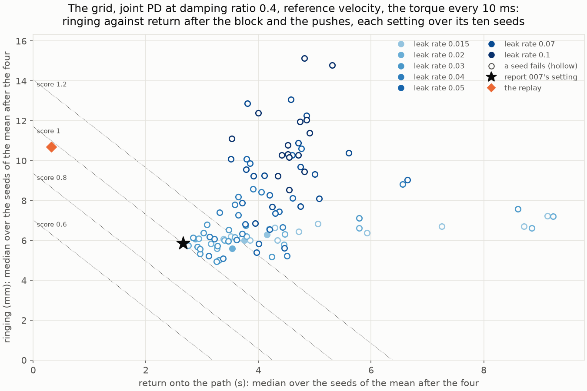

| Leak rate | Settings that qualify (of 15) | Failing runs: undisturbed / block / pushes (of 150) | How the runs under the pushes fail |
| --- | --- | --- | --- |
| 0.015 | **2** | 18 / 18 / 46 | 30 end away, 15 leave the goal during the hold, 1 never arrives |
| 0.02 | **3** | 10 / 11 / 42 | 23 end away, 19 leave the goal |
| 0.03 | 0 | 6 / 10 / 58 | 30 leave the goal, 28 end away |
| 0.04 | 0 | 2 / 6 / 102 | 58 leave the goal, 44 end away |
| 0.05 | 0 | 2 / 5 / 122 | 71 end away, 47 leave the goal, 4 never arrive |
| 0.07 | 0 | 3 / 20 / 133 | 82 end away, 29 leave the goal, 18 never arrive, 4 others |
| 0.1 | 0 | 3 / 17 / 135 | 90 end away, 22 leave the goal, 19 never arrive, 4 others |

The settings that qualify, ranked by the score (medians over the seeds; after the
block's release and the three pushes):

| Leak rate | Spectral radius | Input scaling | Score | Ringing, mean | Return, mean | Undisturbed path RMSE | Ringing after each | Back on the path after each |
| --- | --- | --- | ---: | ---: | ---: | ---: | --- | --- |
| 0.02 | 1.35 | 2 | **1.000** | 5.86 mm | 2.66 s | 0.58 mm | 4.2 / 5.0 / 8.3 / 6.0 mm | 2.3 / 2.6 / 2.9 / 3.5 s |
| 0.02 | 1.35 | 1.5 | 1.060 | 6.07 mm | 2.88 s | 0.67 mm | 4.2 / 5.1 / 8.4 / 6.2 mm | 2.3 / 2.9 / 3.2 / 2.6 s |
| 0.02 | 0.99 | 1.5 | 1.142 | 5.59 mm | 3.54 s | 0.83 mm | 3.3 / 5.0 / 8.0 / 6.0 mm | 2.5 / 3.5 / 4.0 / 4.2 s |
| 0.015 | 1.2 | 2 | 1.219 | 6.01 mm | 3.75 s | 0.72 mm | 4.1 / 5.2 / 8.5 / 6.2 mm | 4.4 / 3.3 / 3.7 / 5.0 s |
| 0.015 | 1.35 | 1.5 | 1.317 | 6.29 mm | 4.15 s | 0.75 mm | 4.8 / 5.3 / 8.5 / 6.4 mm | 3.1 / 3.3 / 3.7 / 3.9 s |

- **No setting returns faster than report 007's.** Its setting ranks first, and its
  median return, 2.66 s, is the fastest of all 105 settings, qualifying or not (2.66
  to 9.23 s); its seeds return in 1.89 to 3.67 s. The settings that qualify ring
  about alike (5.6 to 6.3 mm); their returns set them apart.
- **The replay,** with the same tracker, rings 10.7 mm and returns in 0.33 s, a score
  of 0.975, about that of report 007's setting: it rings almost twice as much and
  returns eight times as fast.
- **As in report 007, the pushes decide.** At leak rates 0.03 and above, most failing
  seeds end away from the target or leave the goal during the hold, most of the
  latter having arrived early, carried toward the goal by the push at 7 s. At 0.015
  and 0.02, some seeds also drift away from the target undisturbed, after their
  hold: 18 runs at 0.015 and 10 at 0.02, ending 20 to 469 mm from it.

### 3.2 Noise in the training

The leak rate, the spectral radius, and the input scaling shape how the reservoir
responds to the posture; none of them teaches the ESN what to do off the taught
path, where its return happens. Noisy teacher forcing does. It was swept at report
007's chosen setting (leak rate 0.02, spectral radius 1.35, input scaling 2): noise
of 0.5° to 8°, white, pink, or brown, at ridge 1e-2 or 4e-2, the take fed in four
times at every level, ten seeds each, in the grid's three scenarios.

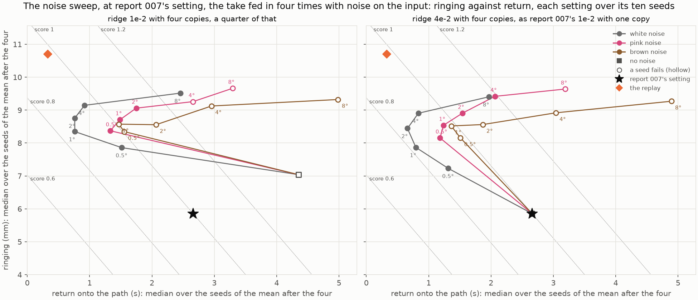

At ridge 4e-2, as report 007's ridge with one copy; each cell gives the score, then
the median ringing and return (* a seed fails):

| Noise | 0.5° | 1° | 2° | 4° | 8° |
| --- | --- | --- | --- | --- | --- |
| white | 0.864 (7.2 mm, 1.31 s) | **0.821** (7.9 mm, 0.80 s) | 0.845 (8.4 mm, 0.66 s) | 0.917 (8.9 mm, 0.84 s) | 1.172 (9.4 mm, 1.97 s) |
| pink | **0.919** (8.2 mm, 1.18 s) | 0.962 (8.5 mm, 1.24 s) | 1.050 (8.9 mm, 1.54 s) | 1.192 (9.4 mm, 2.06 s) | 1.423* (9.6 mm, 3.19 s) |
| brown | 0.980* (8.2 mm, 1.51 s) | 0.984* (8.5 mm, 1.36 s) | 1.082* (8.6 mm, 1.87 s) | 1.333* (8.9 mm, 3.04 s) | 1.711* (9.3 mm, 4.89 s) |

Without noise, the setting scores 1 (5.9 mm, 2.66 s), as in the grid. The undisturbed
path RMSE, in the median (0.58 mm without noise):

| Noise | 0.5° | 1° | 2° | 4° | 8° |
| --- | ---: | ---: | ---: | ---: | ---: |
| white | 0.58 mm | 0.60 mm | 0.75 mm | 1.48 mm | 4.62 mm |
| pink | 0.72 mm | 0.80 mm | 1.52 mm | 3.58 mm | 8.60 mm |
| brown | 0.95 mm | 1.38 mm | 2.73 mm | 5.25 mm | 12.47 mm |

- **White noise speeds the return in every seed.** At 1°, the ten seeds return in
  0.53 to 1.27 s, against 1.89 to 3.67 s without noise, and ring 7.6 to 8.8 mm,
  against 5.6 to 6.3 mm, every seed more. The undisturbed path stays as close up to
  1°, and the peak torque under the block barely rises (2.5 N m in the median,
  against 2.0 N m). After the pushes, the arm now rings about as much as the
  replay's (6.1 / 9.7 / 8.2 mm, against 6.8 / 10.0 / 8.5 mm); after the block's
  release, still less than half as much (7.5 mm, against 17.5 mm).
- **More noise costs more than it gives.** From 2° on, the undisturbed path drifts
  from the take, and the return slows again, in part because a hand whose own path
  is millimeters off takes longer to come within 5 mm of the taught one.
- **The color matters, against expectation.** Pink noise does best at its lowest
  level, and brown noise qualifies at no level: one seed (seed 2) fails at every
  level and both ridges, and the undisturbed path drifts fastest. Before
  the runs, brown noise seemed the likelier to help: at a leak rate of 0.02 the
  reservoir averages its input over about 0.5 s, and a first-order low-pass with that
  time constant keeps about 10% of white noise's deviation, against 54% of pink's and
  88% of brown's, which drifts as a disturbed arm does. A possible reading, not
  tested: the noise teaches the readout which changes of its input to disregard.
  White noise changes from one 10 ms step to the next, faster than the take, as the
  arm does under a push, while brown noise drifts as slowly as the take itself, so
  that disregarding it disregards the reach's own progress.
- **With noise, the ridge matters little.** At ridge 1e-2, a quarter of report 007's
  with four copies, every noise ranks as at 4e-2, a little worse (white noise at 1°:
  0.856). Without noise, that weaker ridge loses five seeds under the pushes (score
  1.419).

By the rule, the best qualifying setting of each noise joins the shortlist: white
noise of 1° at ridge 4e-2 (0.821, typical seed 3) and pink noise of 0.5° at ridge
4e-2 (0.919, typical seed 8); no setting with brown noise qualifies.

### 3.3 The shortlist, and the choice in the app

The shortlisted ESNs, trained and run on their own from the 49 starts, were tried in
the robot app with the search's tracker:

| | Setting | Seed | Setting's score | Ringing | Return | Undisturbed path RMSE | Peak torque under the block | On its own: starts that arrive and hold | On its own: first step from an offset start, median / largest |
| --- | --- | --- | ---: | ---: | ---: | ---: | ---: | --- | --- |
| Report 007's chosen ESN | leak rate 0.02, spectral radius 1.35, input scaling 2 | 7 | 1.000 | 5.84 mm | 3.05 s | 0.57 mm | 1.0 N m | 49 of 49 | 96 / 168 mm |
| Grid, rank 2 | leak rate 0.02, spectral radius 1.35, input scaling 1.5 | 0 | 1.060 | 6.04 mm | 3.04 s | 0.68 mm | 2.9 N m | 49 of 49 | 104 / 193 mm |
| Grid, rank 3 | leak rate 0.02, spectral radius 0.99, input scaling 1.5 | 6 | 1.142 | 5.60 mm | 3.22 s | 0.85 mm | 1.6 N m | 49 of 49 | 71 / 187 mm |
| **White noise** | report 007's, white noise of 1°, ridge 4e-2 | 3 | 0.821 | 7.86 mm | 0.81 s | 0.60 mm | 1.8 N m | 49 of 49 | 120 / 253 mm |
| Pink noise | report 007's, pink noise of 0.5°, ridge 4e-2 | 8 | 0.919 | 8.17 mm | 1.15 s | 0.81 mm | 3.3 N m | 49 of 49 | 97 / 245 mm |

The ringing, the return, the path RMSE, and the torque are the ESN's own, from the
sweeps. On its own, every ESN's first step from an offset start goes most of the way
back toward the take's start, the ESNs trained with noise a little farther.

**The ESN trained with white noise was chosen in the app.**

### 3.4 Validation: undisturbed

The ESN validated (`noise_white1deg_ridge4e-2_seed3_filtered`,
[`esn.toml`](results/20261014-000719-noise_white1deg_ridge4e-2_seed3_filtered/esn.toml)):
400 tanh neurons, sparsity 0.05, spectral radius 1.35, leak rate 0.02, input scaling
2, a random bias, ridge 4e-2, trained by teacher forcing on the filtered take fed in
four times, each with white noise of 1° added to its input, with a 1 s warm-up, seed
3. Every tracker computes its torque every 10 ms.

| Tracker | ESN: arrival (s) | ESN: path RMSE (mm) | ESN: tracking error (°) | Replay: arrival (s) | Replay: path RMSE (mm) | Replay: tracking error (°) |
| --- | ---: | ---: | ---: | ---: | ---: | ---: |
| ζ 0.1, zero reference velocity | 9.63 | 0.73 | 0.09 | 9.60 | 1.13 | 0.14 |
| ζ 0.4, zero reference velocity | 9.85 | 1.29 | 0.35 | 9.61 | 0.36 | 0.36 |
| ζ 0.8, zero reference velocity | 10.17 | 2.06 | 0.68 | 9.66 | 0.30 | 0.71 |
| ζ 0.1, reference velocity | 9.56 | 0.62 | 0.02 | 9.59 | 1.13 | 0.11 |
| ζ 0.4, reference velocity | 9.56 | 0.60 | 0.01 | 9.56 | 0.40 | 0.04 |
| ζ 0.8, reference velocity | 9.56 | 0.59 | 0.01 | 9.56 | 0.27 | 0.02 |

Every arm arrives and holds, with every tracker.

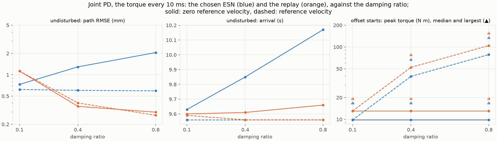

- **Given the reference velocity, the ESN follows the taught path within 0.6 mm** and
  arrives with the take at every damping ratio; the replay follows it within 0.27 to
  1.13 mm.
- **Given a zero reference velocity, it waits for the trailing arm less** than report
  007's ESN did: its path RMSE is 1.3 mm at ζ = 0.4 and 2.1 mm at 0.8, and it arrives
  0.22 s and 0.54 s later than at 0.1, where report 007's ESN reached 3.3 mm and
  6.3 mm (report 008, Section 3.4).

### 3.5 After the block and the pushes

Each cell gives the chosen ESN, then the replay.

**The ringing over the next 2 s** (mm):

| Tracker | The block's release | Push forward at 3 s | Push across at 7 s | Push across at 15 s |
| --- | ---: | ---: | ---: | ---: |
| ζ 0.1, zero reference velocity | 14.1 / 44.7 | 17.1 / 27.4 | 32.4 / 35.5 | 26.7 / 30.2 |
| ζ 0.4, zero reference velocity | 6.2 / 17.0 | 6.0 / 6.9 | 9.9 / 10.1 | 8.1 / 8.5 |
| ζ 0.8, zero reference velocity | 3.8 / 10.7 | 3.6 / 3.9 | 5.6 / 5.8 | 4.7 / 5.0 |
| ζ 0.1, reference velocity | 14.8 / 44.9 | 17.1 / 27.4 | 32.6 / 35.4 | 26.5 / 30.2 |
| ζ 0.4, reference velocity | 7.1 / 17.5 | 6.1 / 6.8 | 10.1 / 10.0 | 8.1 / 8.5 |
| ζ 0.8, reference velocity | 4.6 / 11.3 | 3.7 / 3.8 | 5.8 / 5.8 | 4.8 / 5.0 |

**Back within 5 mm of the taught path** (s after the disturbance's end):

| Tracker | The block's release | Push forward at 3 s | Push across at 7 s | Push across at 15 s |
| --- | ---: | ---: | ---: | ---: |
| ζ 0.1, zero reference velocity | 1.15 / 2.56 | 0.65 / 2.25 | 3.08 / 3.24 | 2.95 / 3.32 |
| ζ 0.4, zero reference velocity | 0.99 / 0.42 | 0.66 / 0.03 | 0.86 / 0.38 | 0.98 / 0.45 |
| ζ 0.8, zero reference velocity | 1.18 / 0.16 | 0.68 / 0.00 | 0.92 / 0.16 | 1.09 / 0.16 |
| ζ 0.1, reference velocity | 1.32 / 2.44 | 0.66 / 2.25 | 3.09 / 3.24 | 2.95 / 3.32 |
| ζ 0.4, reference velocity | 0.86 / 0.42 | 0.61 / 0.04 | 0.81 / 0.38 | 0.94 / 0.46 |
| ζ 0.8, reference velocity | 0.91 / 0.16 | 0.61 / 0.04 | 0.85 / 0.16 | 0.97 / 0.16 |

**The farthest the hand strays from the taught path** (mm):

| Tracker | The block's release | Push forward at 3 s | Push across at 7 s | Push across at 15 s |
| --- | ---: | ---: | ---: | ---: |
| ζ 0.1, zero reference velocity | 44 / 80 | 12 / 11 | 158 / 158 | 122 / 118 |
| ζ 0.4, zero reference velocity | 26 / 26 | 9 / 6 | 112 / 110 | 102 / 99 |
| ζ 0.8, zero reference velocity | 19 / 19 | 6 / 4 | 91 / 89 | 87 / 80 |
| ζ 0.1, reference velocity | 45 / 81 | 12 / 11 | 159 / 159 | 123 / 118 |
| ζ 0.4, reference velocity | 28 / 28 | 11 / 7 | 114 / 111 | 103 / 99 |
| ζ 0.8, reference velocity | 20 / 21 | 11 / 7 | 91 / 90 | 90 / 80 |

**The gap between the reference and the arm at the disturbance's end** (°):

| Tracker | The block's release | Push forward at 3 s | Push across at 7 s | Push across at 15 s |
| --- | ---: | ---: | ---: | ---: |
| ζ 0.1, zero reference velocity | 9.1 / 15.6 | 9.3 / 9.7 | 16.6 / 17.4 | 10.9 / 11.3 |
| ζ 0.4, zero reference velocity | 8.9 / 15.8 | 7.1 / 7.3 | 13.2 / 13.1 | 9.4 / 9.5 |
| ζ 0.8, zero reference velocity | 8.7 / 16.1 | 6.3 / 6.6 | 13.2 / 13.2 | 9.4 / 9.6 |
| ζ 0.1, reference velocity | 9.1 / 15.5 | 9.4 / 9.9 | 16.5 / 17.3 | 10.8 / 11.3 |
| ζ 0.4, reference velocity | 9.1 / 15.4 | 7.7 / 7.8 | 12.7 / 12.7 | 9.3 / 9.5 |
| ζ 0.8, reference velocity | 9.1 / 15.4 | 7.7 / 7.7 | 12.5 / 12.5 | 9.4 / 9.6 |

Under the block, every arm arrives and holds with every tracker, the ESN at 9.93 to
10.53 s, the replay at 9.56 to 9.66 s; the ESN's peak torque is 1.4 to 1.8 N m, the
replay's 12.3 to 14.1 N m, and at the release its reference is 4 to 5% of the path
ahead of the hand, the replay's 9%. Under the pushes, every arm arrives and holds at
ζ = 0.4 and 0.8, the ESN at 9.51 to 10.04 s; at 0.1, both arms reach the goal still
swinging from the push at 7 s and leave it briefly during the hold, with either
reference velocity.

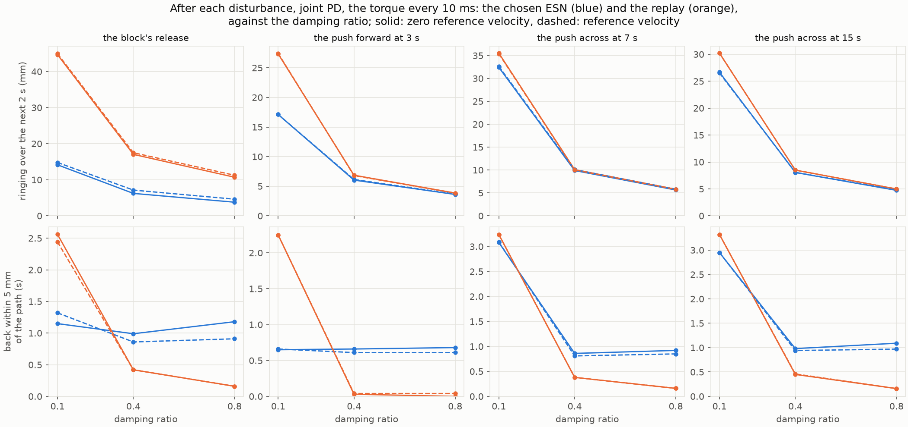

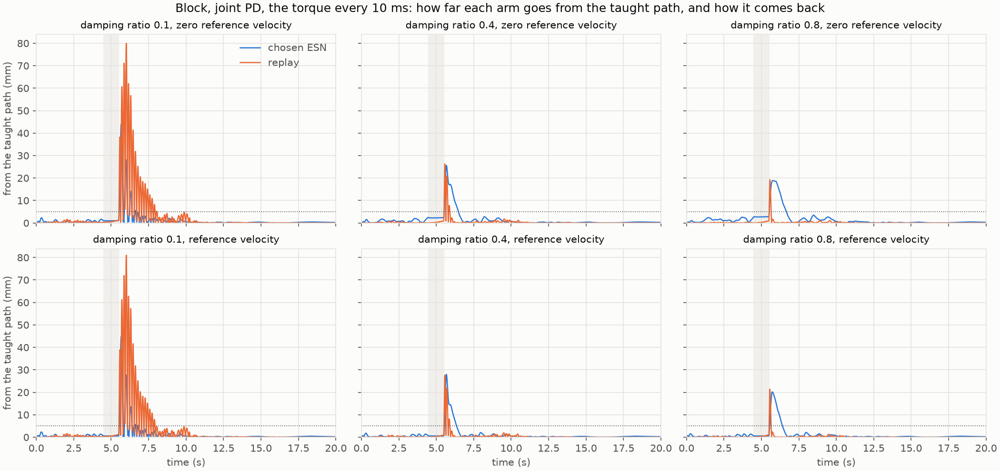

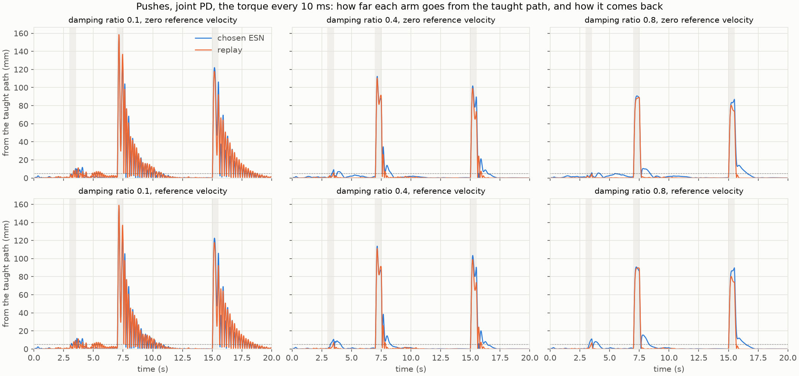

- **A push no longer carries the ESN's reference.** With the search's tracker, while
  the pushes at 7 s and 15 s carry the arm 114 mm and 104 mm off the taught path, the
  ESN's reference goes 4.5 mm and 18 mm off it, and at most 15 mm and 19 mm over the
  next second; report 007's ESN's, with the same tracker, went 75 mm and 88 mm off
  it (report 008's runs; `make_figures.py --logs` prints these). At the end of a
  push, the gap between the reference and the arm is the replay's, within 0.8°. So
  after a push, at ζ = 0.4 and 0.8, the chosen ESN's arm strays as far as the
  replay's, rings about as much, and takes much the same course, ending in a slower
  tail: back within 5 mm 0.6 to 1.1 s after the push, the replay within 0.5 s.
- **Under the block, it still waits.** Over the block's 1 s, its reference stays
  nearer the held arm: the gap at the release is 9°, against the replay's 15.5°, and
  the arm presses with an eighth of the replay's torque. After the release, its hand
  swings out about as far as the replay's snap (19 to 28 mm at ζ = 0.4 and 0.8) and
  back in one swing, within 0.9 to 1.2 s, without ringing; the replay snaps back
  within 0.2 to 0.4 s and rings briefly, which the measure counts: 6.2 to 7.1 mm
  against 17.0 to 17.5 mm at 0.4.
- **At ζ = 0.1, the noise costs the ESN its lead.** It rings less than the replay,
  a third as much after the block and three-fifths to nine-tenths as much after the
  pushes, but more than report 007's ESN did with the torque every 10 ms (6.8 / 11.5
  / 18.9 / 13.8 mm, report 008), and it leaves the goal under the pushes, as the
  replay does, where report 007's ESN held: its reference no longer goes with the
  arm, which with so little damping was what kept the arm from ringing.
- **The reference velocity changes little after a disturbance,** as in report 008:
  the ESN's ringing after the block rises by 0.8 to 0.9 mm at ζ = 0.4 and 0.8.

The joint angles under the block and the pushes, given the reference velocity, from
the runs' own figures (ζ = 0.1, 0.4, and 0.8 from left to right):

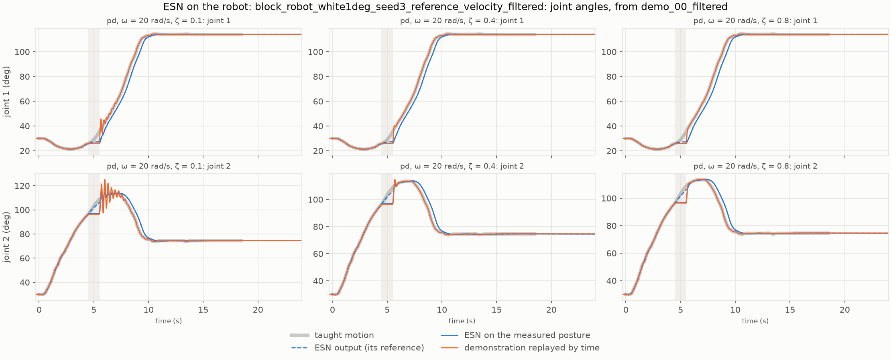

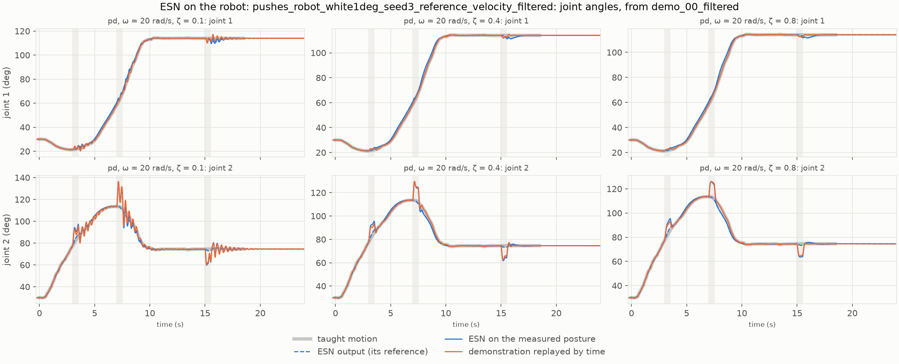

While the tip is held, the ESN's output for joint 1 waits with the arm, and joint
2's creeps on, from about 97° to about 110°; after the release, the arm runs about
0.4 s behind the take and arrives at 9.95 s. Under the pushes, the ESN's output
hardly leaves the taught motion, and its arm and the replay's take nearly the same
course.

The animations show the chosen ESN and the replay with the search's tracker (ζ = 0.4,
given the reference velocity, the torque every 10 ms):

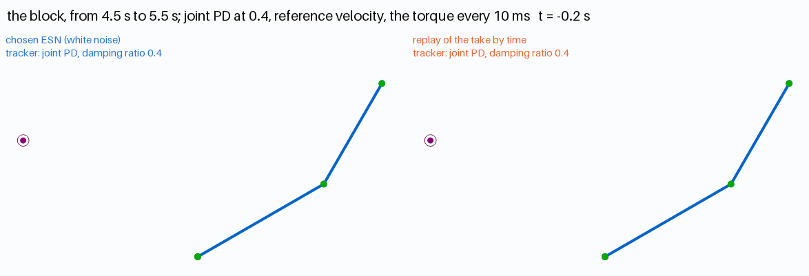

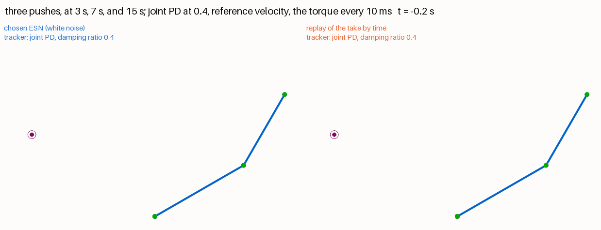

### 3.6 From the offset starts

| Tracker | ESN: median path RMSE (mm) | ESN: peak torque, median / largest (N m) | Replay: median path RMSE (mm) | Replay: peak torque, median / largest (N m) |
| --- | ---: | ---: | ---: | ---: |
| ζ 0.1, zero reference velocity | 24.9 | 9.8 / 17 | 30.8 | 13.1 / 20 |
| ζ 0.4, zero reference velocity | 17.4 | 9.8 / 17 | 17.8 | 13.1 / 20 |
| ζ 0.8, zero reference velocity | 15.9 | 9.8 / 17 | 15.0 | 13.1 / 20 |
| ζ 0.1, reference velocity | 25.0 | 9.8 / 17 | 30.8 | 13.1 / 20 |
| ζ 0.4, reference velocity | 18.2 | 39.2 / 68 | 19.4 | 52.3 / 79 |
| ζ 0.8, reference velocity | 17.8 | 78.5 / 136 | 16.4 | 104.7 / 157 |

Every arm arrives and holds from all 49 starts, with every tracker. Offset runs given
the reference velocity: [the map of the 49 starts](results/20261014-003451-offsets_robot_white1deg_seed3_reference_velocity_filtered/grid.png)
and [the hand paths](results/20261014-003451-offsets_robot_white1deg_seed3_reference_velocity_filtered/paths.png).

- **Both references still jump at t = 0,** and with the torque computed every 10 ms
  the jump reaches the tracker 10 ms later (report 008, Section 3.4). Given a zero
  reference velocity, it costs a proportional step, 17 N m at most for the ESN and
  20 N m for the replay; given the reference velocity, the derivative term
  multiplies its speed, up to 68 N m at ζ = 0.4 and 136 N m at 0.8 for the ESN, about
  three-quarters of the replay's in the median and less than report 007's ESN's 83
  and 166 N m at most (report 008). On its own, the chosen ESN's first step is the longer (Section 3.3);
  on the robot, its torque at the start is the lower.
- **Its path from an offset start is about the replay's** at ζ = 0.4 and 0.8 (16 to
  18 mm in the median, against 15 to 19 mm), and closer at 0.1 (25 mm against
  31 mm); report 007's ESN's was 21 to 30 mm (report 008).

Joint torques from the start offset by +15° in both joints, given the reference
velocity, from the run's own figure:

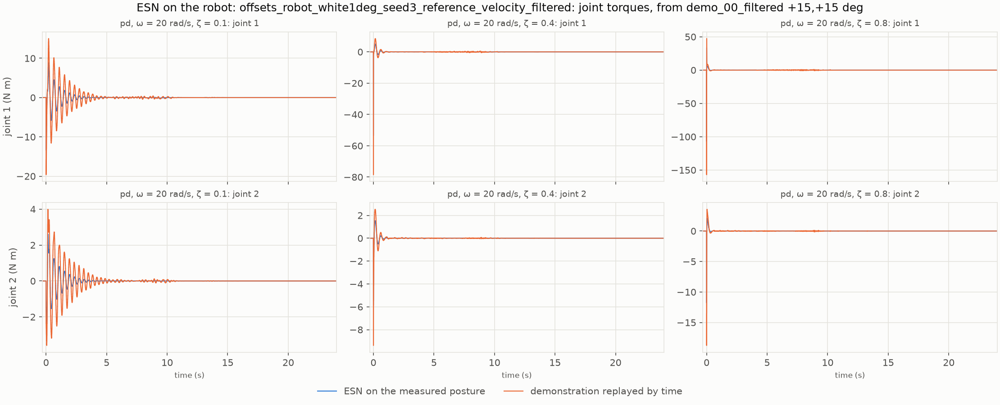

### 3.7 The reservoir states

As in reports 005 to 007, [`robot_states.py`](../../experiments/robot_states.py)
recomputes the chosen ESN's reservoir states from the runs' logs, with the search's
tracker (ζ = 0.4, given the reference velocity), and refuses a log whose reference
the recomputed ESN does not reproduce; every one here passes. The figures
([run](results/20261014-005643-states_robot_white1deg_seed3_filtered)) draw the
states of the ESN driving the robot (blue) over those of the take fed in as in
training, without noise (thick gray), with the warm-up and the disturbances shaded.

#### Eight neurons over the whole run

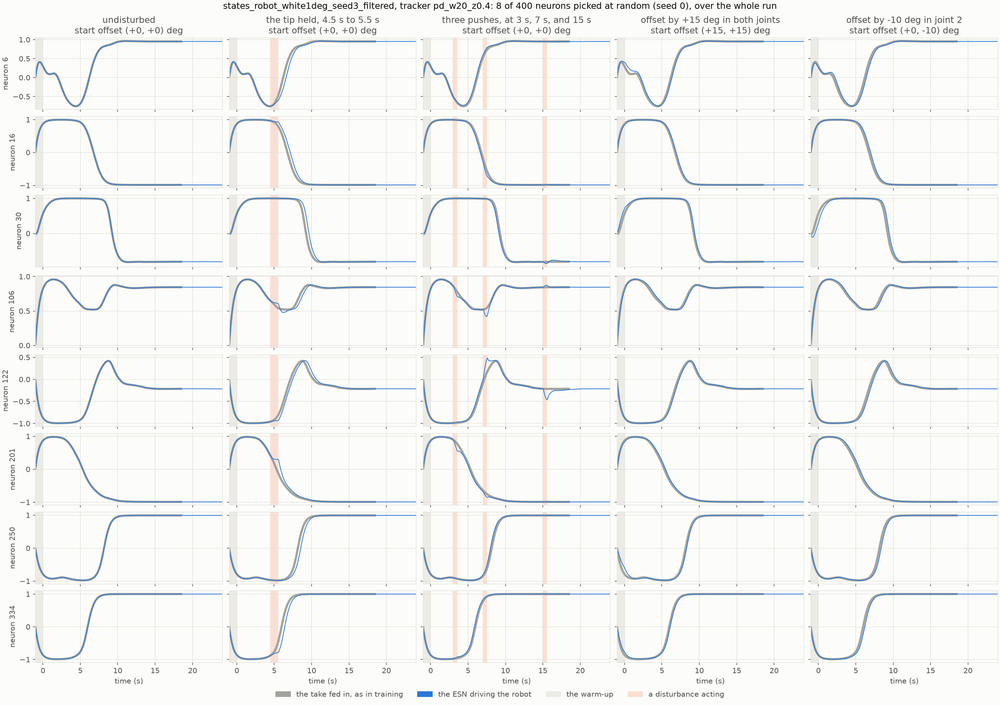

Eight of the 400 neurons, picked at random (seed 0), from the reset to the run's end,
in this ESN's reservoir.

- **Undisturbed,** each neuron follows the take's states.
- **Under the block,** some hold nearly still while the tip is held (201 and 334),
  then resume the take's course 0.3 to 0.5 s late.
- **The pushes** nudge a few of them off the take's course and back within 1 to
  2 s: neurons 106 and 201 at 3 s, 106 and 122 at 7 s, and 122 at 15 s.
- **From both offset starts,** they follow the take's states, a little off at first
  (neurons 6 and 30).

#### The warm-up

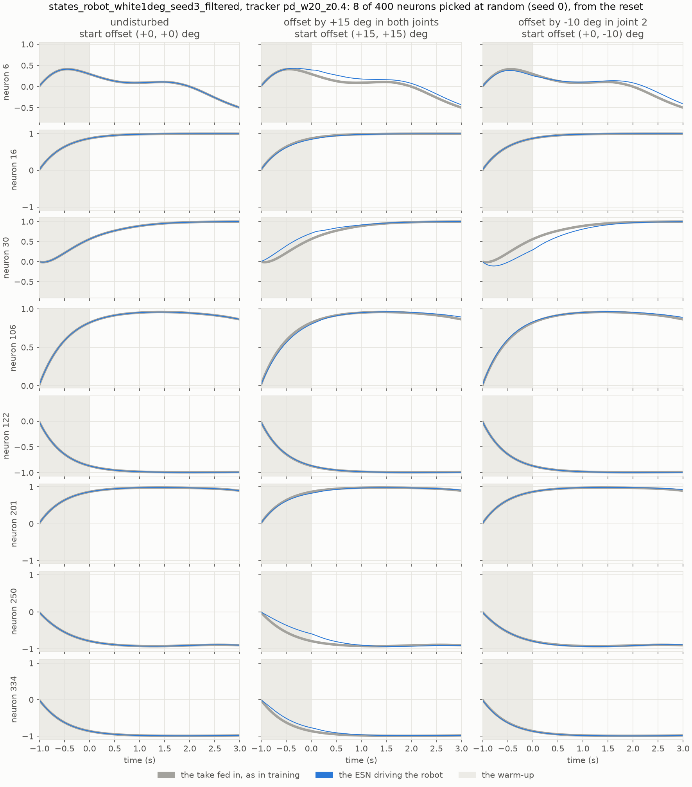

The same neurons over the warm-up and the task's first 3 s, for the undisturbed run
and the two offset starts.

- **From the demonstrated start,** the warm-up brings every neuron onto the take's
  states, and the run then follows them.
- **From (+15°, +15°),** it leaves neurons 6, 30, 250, and 334 off the take's
  states; 30, 250, and 334 join them within about 1 s, and 6 runs a little above
  them to the end of the 3 s.
- **From (0°, −10°),** it leaves neuron 30 below the take's states; it joins them
  within about 2 s.

#### The principal components

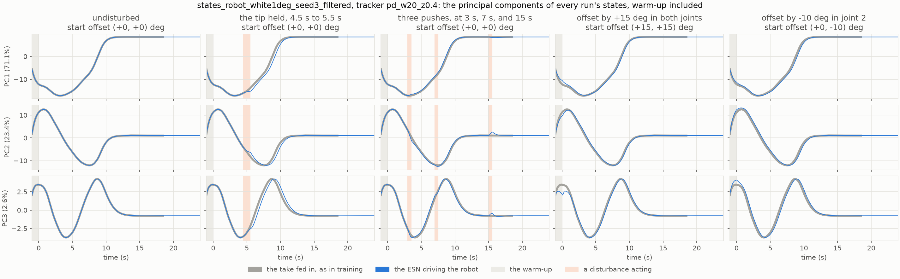

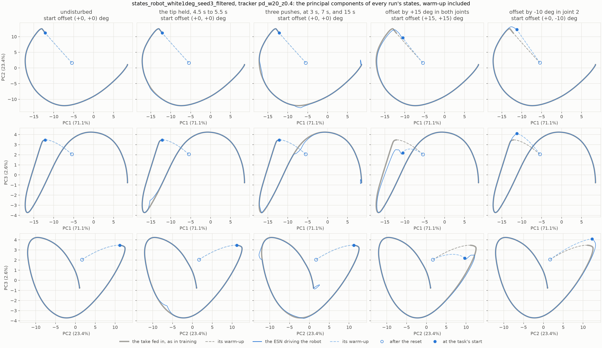

The principal components are those of all five runs' states, warm-up included: PC1,
PC2, and PC3 hold 71.1%, 23.4%, and 2.6% of the variance. In the planes, the warm-up
is dashed, a hollow dot marks the state just after the reset, and a filled one the
state at the task's start.

- **The take's states trace an arc** in the plane of PC1 and PC2, from the task's
  start, at the upper left, down and around to the target, at the right; the
  undisturbed run follows it.
- **Under the block, the states pause** along the arc while the tip is held, leaving
  it only slightly, then go on about 0.5 s behind the take.
- **The pushes move the states off the arc only a little:** near the bottom of the
  arc after the push at 7 s, and in a small hook near its end after the push at 15 s.
- **From both offset starts,** the warm-up ends near the arc's start, and the states
  join the arc within the first seconds.

## 4. Observations

- **Noise trains what the reservoir's settings cannot.** Over 105 settings of the
  leak rate, the spectral radius, and the input scaling, none returned faster than
  2.66 s in the median; white noise of 1° in the training brings report 007's
  setting to 0.80 s. The settings shape how the reservoir follows the posture; the
  noise teaches the readout what to give for a posture off the take.
- **The ESN moves toward the replay, but keeps the block.** Its reference now holds to
  the taught path during a push, as the replay's does, so it rings as much after a
  push and returns within about a second; under the block, which holds the arm for
  1 s, it still waits for the arm and presses with an eighth of the replay's
  torque. A push displaces the arm within a fraction of a second; under the block,
  the take moves away from the held arm more slowly, which fits the reading of
  Section 3.2, though it was not tested.
- **The noise's color matters, opposite to the expectation.** White noise, which the
  slow reservoir mostly averages away, helps most; brown noise, which it passes,
  spoils the reach. The noise seems to teach which changes to disregard, by how fast
  they change, rather than how far the arm can be off.
- **The score weighs a trade.** It barely tells the replay from report 007's setting
  (0.975 against 1), the replay's ringing set against its fast return. With the
  search's tracker, the chosen ESN scores 0.82 against the replay's 0.98; at ζ = 0.8,
  the two score alike (0.56 and 0.58, given the reference velocity), since with that
  much damping the replay rings little. What only the ESN gives is under the block.
- **The noise suits a damped tracker.** With ζ = 0.1, report 007's ESN kept the arm
  from ringing by following it; the chosen ESN follows it less, and rings and loses
  the hold under the pushes much as the replay does. With the trackers report 008
  proposed, ζ of 0.4 or 0.8, it comes back to the path within about a second and
  still yields under the block.

## 5. Next steps

1. **The noise's band:** to test the reading of Section 3.2, train with noise limited
   to a band, below or above about 1 Hz, at the same level, and see which band speeds
   the return and which spoils the reach.
2. **The grid with noise:** the reservoir's settings were searched without noise;
   with white noise of 1°, faster leak rates, which rang less but lost the target in
   reports 007 and 009, might now qualify.
3. **A smooth start,** as report 008 proposed: the references still jump at t = 0
   from an offset start, at up to 136 N m for the ESN at ζ = 0.8.
