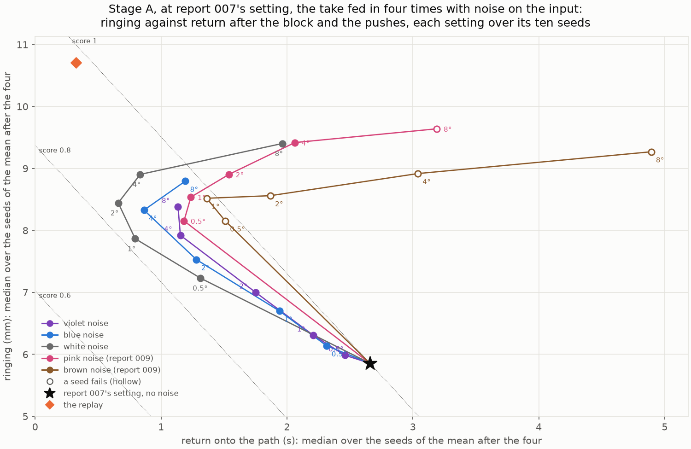
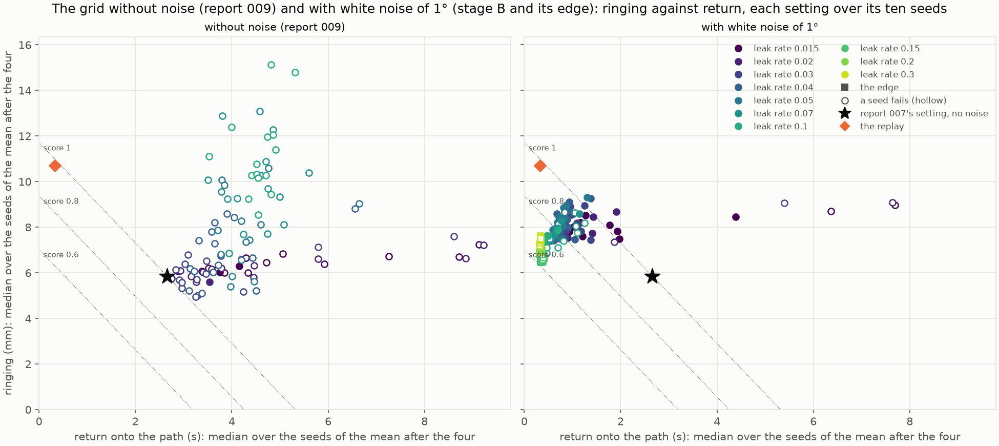

# 010 The noisy search: a negative result

**Summary.** Report 009 found that training report 007's setting with white noise on
its input brought the arm back onto the taught path after a disturbance in 0.8 s instead
of 2.7 s. This study pushed that further: it tried noise faster than white, searched
report 009's grid again with the best noise, and extended the grid beyond the corner
where the best settings lay. The search's score kept improving, but in the robot
app no ESN trained with noise, report 009's chosen ESN included, did better than
report 007's chosen ESN, which was trained without noise. The faster return turned
out to be the replay's snap-back, which is not what this work is after.

- **Noise faster than white does no better.** Blue and violet noise trade ringing
  for return as white noise does, but they need two to four times its level to get
  as far, and they spoil the undisturbed path before matching white noise's best.
  White noise of 1° stays the best (score 0.821).
- **With that noise, almost every setting of the grid qualifies:** 88 of 105,
  against 5 without noise. The fast leak rates, which lost the target under the
  pushes without noise, gain the most. The best settings sit at the grid's corner:
  leak rate 0.1, input scaling 2, and the smaller spectral radii.
- **Beyond the corner, the score levels off.** The best setting (leak rate 0.1,
  spectral radius 0.8, input scaling 2.5) scores 0.618, against stage B's best
  0.634, which it beats in only 6 of 10 paired seeds. The return stops at about
  0.32 s, the replay's 0.33 s, and above leak rate 0.15 the ringing rises again.
- **The shortlisted ESNs fail from many offset starts on their own:** they reach the
  target from 24, 33, and 25 of the 48 offset starts. Every failing start of an ESN
  ends at the same resting posture, one per ESN, off the taught motion. Report 009's
  and report 007's chosen ESNs reach it from all 48.
- **In the robot app, none did better than report 007's chosen ESN.**
- **The reading:** the noise teaches the ESN to disregard fast changes of the arm's
  posture. During a push its reference holds the taught path, as the replay's does,
  and the tracker snaps the arm back. The score rewarded a fast return, at which the
  replay is already best, so the search moved the ESN toward the replay. This work
  wants the opposite: a reference that adapts to the arm's actual state, from an
  offset start and under an external force.

## 1. Question

1. **Noise faster than white:** report 009 read its noise sweep as the noise teaching
   the readout which changes of its input to disregard, by how fast they change. Do
   blue or violet noise, whose power rises with the frequency, then speed the return
   further than white noise?
2. **The grid with noise:** trained with the best noise, which settings of the
   reservoir make the arm ring least and return soonest after a block or a push?
3. **In the app:** is the ESN they give better than report 007's and report 009's
   chosen ESNs?

## 2. Setup

As in report 009 ([Section 2](../009-noisy-training-for-a-faster-return/README.md#2-setup)):

- **The arm and the take:** the remade arm and the take filtered at 2 Hz.
- **The scenarios:** undisturbed, the block (the tip held from 4.5 s to 5.5 s), and
  the three pushes (forward at 3 s, across at 7 s, across the other way at 15 s, each
  for 0.5 s), each run for 24 s from the demonstrated start.
- **The tracker:** joint PD at ω = 20 rad/s and a damping ratio of 0.4, given the
  reference velocity, with its torque computed every 10 ms.
- **The ESN:** 400 neurons, trained with noisy teacher forcing: the take is fed in
  four times at ridge 4e-2, each copy with its own noise on the input. The
  noise's level (`teacher_noise_deg`) is its standard deviation over each copy, in
  each joint. Its power spectrum goes as 1/f^β (`teacher_noise_exponent`): white
  for β = 0, pink 1, brown 2, and, new here, blue −1 and violet −2, whose power rises
  with the frequency.
- **The measures and the score:** after the block's release and each push, the
  ringing (the RMS of the hand's motion above 1.5 Hz over 2 s) and the return (when
  the hand is back within 5 mm of the taught path). A setting's score is the mean of
  two ratios: the median over its seeds of the ringing, and of the return, each over
  that of report 007's setting without noise in report 009's grid (5.86 mm and
  2.66 s). Lower is better.
- **A setting qualifies** if all ten of its seeds arrive, hold, and end within the
  goal in the three scenarios.

The stages, each with its rule fixed before its runs in the
[experiment's README](../../experiments/manual_demonstration_v2_robot_noisy_search/README.md):

1. **Stage A:** report 007's setting (leak rate 0.02, spectral radius 1.35, input
   scaling 2) with violet, blue, and white noise of 0.5° to 8°, ten seeds each.
   - The prediction: blue or violet noise at some level scores no higher than white
     noise's best (0.821) with an undisturbed path RMSE no larger (0.60 mm).
   - Stage B uses the best qualifying noise.
2. **Stage B:** report 009's grid (leak rate 0.015 to 0.1, spectral radius 0.99 to
   1.75, input scaling 1 to 2) with that noise.
3. **The edge:** stage B's top three settings lay at its grid's corner, so the grid
   was extended beyond it before the shortlist: leak rate 0.1 to 0.3, spectral
   radius 0.8 to 0.99, input scaling 2 to 3. The search stops there.
4. **The shortlist:** the top three qualifying settings of both grids, each with its
   typical seed, and report 009's chosen ESN.
   - The three new ones are trained by `autonomous_esn.py`, which also runs them on
     their own from the 49 starts.
   - All four are tried in the robot app.

### Reproducing the results

The runs read the take as `results/demonstrations/20261008-170034-reach_manual_v2`
under the storage root ([report 005's copy](../005-tuned-on-the-robot/data)). All
configurations are in
[`manual_demonstration_v2_robot_noisy_search`](../../experiments/manual_demonstration_v2_robot_noisy_search/README.md).

| Runs | Command | Commit |
| --- | --- | --- |
| `sweep_robot_noise_spectrum_<scenario>_filtered` (3) | `uv run python experiments/sweep_robot_esn.py experiments/manual_demonstration_v2_robot_noisy_search/<name>.toml` | `8dd01b4` |
| `sweep_robot_noisy_lr<leak rate>_<scenario>_filtered` (21) | as the first | `b04b662` |
| `sweep_robot_noisy_edge_lr<leak rate>_<scenario>_filtered` (12) | as the first | `39cf385` |
| `grid_<shortlisted>_filtered` (3) | `uv run python experiments/autonomous_esn.py experiments/manual_demonstration_v2_robot_noisy_search/<name>.toml` | `c8f329b` |
| [`summary`](results/summary) | `uv run python reports/010-noisy-search-a-negative-result/make_figures.py --logs` | |

All runs are deterministic, and every run record (`run.toml`) shows no uncommitted
changes. Each run directory here holds its configuration, its run record, and its
metrics (`runs.csv`, `seeds.csv`, and `sweep.csv`, or `metrics.csv`); the
shortlisted ESNs' runs also hold their map of the 49 starts (`grid.png`).
[`make_figures.py`](make_figures.py) draws `spectrum.png` and `grid.png` and prints
the tables of Sections 3 and 4 from these copies and from report 009's copies of its
grid, its noise sweep, and its validation. With `--logs`, it reads the shortlisted
ESNs' logs under the storage root, which are not kept in Git, to find where their
failing offset starts end.

## 3. Results

### 3.1 Noise faster than white (stage A)

Each cell gives the score, then the median ringing and return; * a seed fails. Pink
and brown noise are report 009's.

| Noise | 0.5° | 1° | 2° | 4° | 8° |
| --- | --- | --- | --- | --- | --- |
| violet | 0.974 (6.0 mm, 2.46 s) | 0.954 (6.3 mm, 2.21 s) | 0.927 (7.0 mm, 1.75 s) | 0.893 (7.9 mm, 1.15 s) | 0.929 (8.4 mm, 1.14 s) |
| blue | 0.960 (6.1 mm, 2.32 s) | 0.937 (6.7 mm, 1.94 s) | 0.884 (7.5 mm, 1.28 s) | 0.874 (8.3 mm, 0.87 s) | 0.975 (8.8 mm, 1.19 s) |
| white | 0.864 (7.2 mm, 1.31 s) | **0.821** (7.9 mm, 0.80 s) | 0.845 (8.4 mm, 0.66 s) | 0.917 (8.9 mm, 0.84 s) | 1.172 (9.4 mm, 1.97 s) |
| pink | 0.919 (8.2 mm, 1.18 s) | 0.962 (8.5 mm, 1.24 s) | 1.050 (8.9 mm, 1.54 s) | 1.192 (9.4 mm, 2.06 s) | 1.423* (9.6 mm, 3.19 s) |
| brown | 0.980* (8.2 mm, 1.51 s) | 0.984* (8.5 mm, 1.36 s) | 1.082* (8.6 mm, 1.87 s) | 1.333* (8.9 mm, 3.04 s) | 1.711* (9.3 mm, 4.89 s) |

The undisturbed path RMSE, in the median (0.58 mm without noise):

| Noise | 0.5° | 1° | 2° | 4° | 8° |
| --- | ---: | ---: | ---: | ---: | ---: |
| violet | 0.58 mm | 0.58 mm | 0.63 mm | 0.94 mm | 2.64 mm |
| blue | 0.57 mm | 0.58 mm | 0.62 mm | 1.03 mm | 2.78 mm |
| white | 0.58 mm | 0.60 mm | 0.75 mm | 1.48 mm | 4.62 mm |

- **The prediction fails.** The best blue setting (4°) scores 0.874 with a path RMSE
  of 1.03 mm, and the best violet (4°) 0.893; neither matches white noise of 1°
  (0.821, 0.60 mm). Every blue and violet setting qualifies.
- **Blue and violet noise move along white noise's line** from report 007's setting,
  trading ringing for return, but they need two to four times white noise's level
  to get as far along it. The path drifts from the take before they reach white
  noise's best.
- By the rule, stage B uses white noise of 1°.

### 3.2 The grid with noise, and beyond its corner (stage B and the edge)

Settings that qualify, with white noise of 1° (without noise, report 009's grid):

| Leak rate | Qualify (of 15) | How the failing runs under the pushes fail |
| --- | --- | --- |
| 0.015 | 13 (2) | 7 end away |
| 0.02 | 13 (3) | 5 end away, 1 leaves the goal during the hold |
| 0.03 | 14 (0) | 2 end away |
| 0.04 | 15 (0) | none |
| 0.05 | 13 (0) | 2 end away |
| 0.07 | 12 (0) | 3 end away, 1 leaves the goal |
| 0.1 | 8 (0) | 9 end away, 1 never arrives, 1 leaves the goal |

Beyond the corner, with the same noise:

| Leak rate | Qualify (of 9) | How the failing runs under the pushes fail |
| --- | --- | --- |
| 0.1 | 4 | 8 end away |
| 0.15 | 4 | 6 end away |
| 0.2 | 6 | 4 end away |
| 0.3 | 2 | 18 leave the goal during the hold, 3 end away |

Every setting with input scaling 3 fails, mostly on the same two seeds, 4 and 7.
The edge's runs of stage B's top setting repeat stage B's.

The top settings of both grids together (medians over the seeds; the ringing after
the block's release and each push):

| Leak rate | Spectral radius | Input scaling | Grid | Score | Ringing | Return | Undisturbed path RMSE | Typical seed | Ringing after each |
| ---: | ---: | ---: | --- | ---: | ---: | ---: | ---: | ---: | --- |
| 0.1 | 0.8 | 2.5 | edge | **0.618** | 6.48 mm | 0.34 s | 0.57 mm | 9 | 2.3 / 4.7 / 11.8 / 7.4 mm |
| 0.15 | 0.9 | 2 | edge | 0.625 | 6.50 mm | 0.37 s | 0.63 mm | 4 | 1.8 / 4.6 / 11.9 / 8.2 mm |
| 0.15 | 0.8 | 2 | edge | 0.631 | 6.63 mm | 0.35 s | 0.69 mm | 7 | 1.7 / 4.5 / 12.0 / 8.5 mm |
| 0.1 | 0.99 | 2 | B | 0.634 | 6.62 mm | 0.37 s | 0.59 mm | 8 | 2.9 / 4.8 / 11.9 / 7.5 mm |
| 0.02 | 1.35 | 2 | B | 0.821 | 7.86 mm | 0.80 s | 0.60 mm | | report 009's chosen setting |
| the replay | | | | 0.975 | 10.70 mm | 0.33 s | | | 17.5 / 6.8 / 10.0 / 8.5 mm |

- **The noise collapses the grid.** Without noise, the settings' returns spread over
  2.7 to 9.2 s. With it, 95 of the 105 return within 1.5 s, and all ring 6.6 to
  9.3 mm.
- **The score levels off beyond the corner.** The top four scores lie within 0.016
  of each other. Against stage B's top setting, seed by seed, the edge's top three
  score better in 6, 8, and 8 of 10 seeds. The return stops at about 0.32 s, the
  replay's, and above leak rate 0.15 the ringing rises again: after the push at
  15 s, it is 11.5 to 12.7 mm at leak rate 0.3, against 7.0 to 8.0 mm at 0.1.
- **The top setting is at the extension's edge,** its smallest spectral radius. As
  the rule says, the grid was not extended further.

### 3.3 The shortlist, on its own from the offset starts

| ESN | Reach the target and hold, of the 48 offset starts | First step, median / largest | Where the failing starts end (joint angles) |
| --- | --- | --- | --- |
| leak rate 0.1, spectral radius 0.8, input scaling 2.5, seed 9 | 24 | 113 / 315 mm | all at (52.5°, 9.2°) |
| leak rate 0.15, spectral radius 0.9, input scaling 2, seed 4 | 33 | 122 / 340 mm | all at (37.1°, 17.0°) |
| leak rate 0.15, spectral radius 0.8, input scaling 2, seed 7 | 25 | 124 / 326 mm | all at (54.5°, −4.9°) |
| report 009's chosen ESN | 48 | 120 / 253 mm | |
| report 007's chosen ESN | 48 | 96 / 168 mm | |

The maps of the 49 starts:
[seed 9](results/20261014-111930-grid_lr0.1_sr0.8_is2.5_seed9_filtered/grid.png),
[seed 4](results/20261014-111930-grid_lr0.15_sr0.9_is2_seed4_filtered/grid.png),
[seed 7](results/20261014-111930-grid_lr0.15_sr0.8_is2_seed7_filtered/grid.png).

- **The failing starts settle on a resting posture, off the taught motion.** They
  start with joint 2 lowered (offset −5° to −15°): all such starts for seeds 9 and
  7, which also fail with joint 1 raised by 5° to 15° and joint 2 as demonstrated,
  and the middle ones for seed 4. Each ESN carries them within 0.3 to 2.4 s to one
  posture of its own, where they stay; the demonstrated start is at (30°, 30°).
- **The search could not see this:** all its runs started from the demonstrated
  posture.

### 3.4 In the robot app

The four ESNs were tried in the robot app with the search's tracker and compared
with report 007's chosen ESN. **None of the ESNs trained with noise did better than
report 007's chosen ESN.** Their snap-back after
a push is not the behavior this work is after: the aim is a reference that adapts to
the arm's actual state when it is disturbed, from an offset start or by an external
force. No ESN of this study was chosen.

## 4. Observations

- **The faster return was the replay's snap-back.** Report 009 found that during the
  pushes at 7 s and 15 s, the noisy ESN's reference stayed within 4.5 mm and 18 mm of
  the taught path, where report 007's ESN's went 75 mm and 88 mm off it.
  - The sweeps record a coarser sign of it for every setting: the gap between the
    reference and the arm at a push's end, against the replay's gap, in the mean
    over the three pushes.
  - With noise, it is 0.93 to 0.99 of the replay's in stage B's grid, and 0.87 to
    0.93 beyond the corner. Without noise, it is 0.46 to 0.96.
  - For report 007's setting, it goes from 0.94 to 0.99. A push lasts only 0.5 s, so
    by its end even report 007's ESN has followed the arm only a little; the
    measure narrows with noise but does not separate every setting.
- **The score rewarded the snap-back.** A reference that holds the taught path is the
  quickest way to bring the arm back onto it, and the replay's return, 0.33 s, is
  the floor the search reached. A score built on the return moves the ESN toward
  the replay, whatever its settings.
- **Under the block, the noisy ESNs still wait for the arm.** In the median over the
  settings, the gap between the reference and the arm at the release is 0.30 of the
  replay's without noise, 0.53 with noise in stage B's grid, and 0.13 beyond the
  corner: with noise, the ESN waits a little less, but it still waits, and the more
  so at fast leak rates.
  - So the noise does not make the ESN ignore the arm altogether; it mostly
    disregards fast changes, as report 009 read it.
  - The block holds the arm for 1 s, slowly enough to steer the ESN; a push moves it
    within a fraction of a second.
- **Fast leak rates are fragile off the taught motion.** On its own, each
  shortlisted ESN has a resting posture that captures a third to a half of the
  offset starts. A search run only from the demonstrated start cannot find this.
- **Report 007's chosen ESN remains the one to beat.** Report 009's choice of the
  ESN trained with white noise did not hold up in this second trial in the app.

## 5. Next steps

1. **Measure what is wanted:** how far the reference goes with the arm while it is
   disturbed, and how the arm is then brought back to the task, rather than how
   soon it is back on the taught path.
2. **Search from offset starts too,** so that a reservoir with a resting posture off
   the taught motion cannot qualify.
3. **The next study** is to be planned from these, with the search settings of
   reports 007 and 009 compared.
