# 011 Following the arm

**Summary.** Report 010 found that a search scored by how fast the arm returns onto the
taught path after a disturbance led to ESNs whose reference held to the taught path
during a push, as the replay of the take does: the tracker snapped the arm back, and
in the robot app none did better than report 007's ESN. What this work wants is the
opposite: a reference that adapts to the arm's actual state when it is disturbed,
waiting for the arm under a block and yielding to a push, from wherever the arm
starts. Here a measure of that, the following gain, scores a new search of report
009's grid, and the two ESNs chosen in the app are compared with the replay across
six joint PD trackers, all with the torque computed every 10 ms.

- **The following gain** measures how much of the arm's displacement by a disturbance
  the reference shares: 0 for the replay, 1 for a reference that goes wherever the
  arm goes. It hardly depends on the tracker: report 007's ESN follows by 0.82 under
  the block and by 0.75, 0.50, and 0.70 under the three pushes, and report 009's,
  trained with noise, by 0.63 and by 0.23, 0.00, and 0.19.
- **Following trades against completing the task.** Over the grid, the following rises
  with the leak rate, up to 0.95, but every setting at a leak rate of 0.04 or more
  loses the target, mostly ending away from it after the pushes. Of 105 settings, 11
  qualify, at leak rates 0.015 to 0.03, following by 0.65 to 0.76.
- **Two ESNs were chosen in the app,** both at leak rate 0.03 and spectral radius 1.2:
  ESN #1 (input scaling 1.5, seed 8) follows by 0.79 in the mean, ESN #2 (input
  scaling 1, seed 2) by 0.73, against report 007's ESN's 0.69. Most of the gain is
  at the push across at 7 s (0.63 against 0.50), and #1's also under the block and at
  the push at 15 s.
- **Across the six trackers,** both arrive and hold in every run, from all 49 offset
  starts too, and their following changes by 0.07 at most. They ring less than the
  replay: after the block's release, about a fifth as much or less at every damping
  ratio; after a push, about half as much when lightly damped (0.2), and about as
  much at 0.8. Under the block they press with about a sixth of the replay's torque or
  less, and from an offset start their reference jumps half as far, with half its
  torque at the start.
- **The cost of following is the return.** A pushed arm whose reference goes with it is
  carried farther, up to 209 mm off the path against the replay's 138 mm, and comes
  back in 2 to 5.6 s, against the replay's 1 s at most. Given a zero reference
  velocity, the ESNs also trail the taught path more as the damping rises, by 4.5 to
  4.6 mm at 0.8.

## 1. Question

1. **A measure:** can how much the reference follows the arm, waiting under the block
   and yielding to a push, be measured in a way that tells report 007's ESN from report
   009's and from the replay?
2. **A search:** which settings of the reservoir follow the arm most and still complete
   the reach, undisturbed, under the block and the pushes, and from offset starts?
3. **The ESNs chosen:** how do they compare with the replay with joint PD at damping
   ratios 0.2, 0.4, and 0.8, given a zero reference velocity or the reference's, all
   with the torque computed every 10 ms?

## 2. Setup

### The arm, the take, the scenarios, and the tracker

As in reports 007 to 010 ([report 009, Section 2](../009-noisy-training-for-a-faster-return/README.md#2-setup)):
the remade arm and the take filtered at 2 Hz; the scenarios undisturbed, the block
(the tip held from 4.5 s to 5.5 s), and the three pushes of 0.5 s (forward at 3 s,
across at 7 s, across the other way at 15 s), each run for 24 s from the demonstrated
start; and the 49 offset starts, −15° to 15° in each joint, every 5°.

The search runs joint PD at ω = 20 rad/s and a damping ratio of 0.4, given the
reference velocity, with its torque computed every 10 ms and held between, as report
009's. The validation runs six trackers: damping ratios 0.2, 0.4, and 0.8, each given
a zero reference velocity or the reference's, all with the torque computed every
10 ms. With the torque held for 10 ms, the tracker acts about 5 ms late on average,
which takes about 0.05 off its damping ratio (computed for a pure inertia): a set
ratio of 0.1, report 008's lightest, acts like about 0.05, and 0.2 like about 0.15, so
0.2 replaces 0.1 here.

The ESN is report 009's: 400 neurons, sparsity 0.05, a random bias, ridge 1e-2, a 1 s
warm-up, trained by teacher forcing on the take, without noise, and driven by the
arm's measured joint angles every 10 ms.

### The following gain

For each disturbance, over the window from its onset to 0.5 s past its end (the
block's effort window), the arm's hand and its reference's hand are taken from where
the take's hand is at the same time, which is where the replay's reference puts it,
less their values at the onset, so that a lag from an earlier disturbance cancels.
The following gain is the least-squares slope of the reference's displacement on the
arm's:

  gain = Σ ⟨d_reference, d_arm⟩ / Σ |d_arm|²

It is 0 for a reference that keeps to the take whatever the arm does, as the
replay's does, and 1 for one that goes wherever the arm goes. Under the block, it
measures how far the reference waits for the held arm; under a push, how far it yields
to it. ([`disturbance_following`](../../src/arm_esn_ctrl/metrics.py); `following_gain`
in the runs' metrics.)

Recomputed from report 008's and report 009's runs with the 10 ms torque, every other
measure unchanged, it tells the ESNs apart:

| Following gain | Block | Push at 3 s | Push at 7 s | Push at 15 s |
| --- | ---: | ---: | ---: | ---: |
| Report 007's ESN, over report 008's six trackers | 0.82 to 0.88 | 0.69 to 0.76 | 0.44 to 0.56 | 0.68 to 0.71 |
| Report 009's ESN, trained with noise | 0.61 to 0.71 | 0.18 to 0.25 | −0.02 to 0.09 | 0.17 to 0.20 |
| The replay | 0 | 0 | 0 | 0 |

### Measures and the rule

Report 009's other measures: the path RMSE; whether the hand arrives, holds within
the goal (20 mm) for 2 s, and ends there; after each disturbance, the ringing (the RMS
of the hand's motion above 1.5 Hz over the next 2 s), the farthest the hand strays
from the taught path, and when it is back within 5 mm of it, counted as back at the
next disturbance or the run's end if it is not; and under the block, the peak torque
and how far the reference is ahead of the held hand at the release.

The rule, fixed before the runs in the [experiment's README](../../experiments/manual_demonstration_v2_robot_following_search/README.md):

- **A setting qualifies** if every one of its ten seeds arrives, holds, and ends within
  the goal undisturbed, under the block, and from eight offset starts (the
  demonstrated start offset by −15°, 0, or 15° in each joint, run for the settings
  that pass the other scenarios); and under the pushes arrives and ends within the
  goal. Leaving the goal during the hold is excused under the pushes, since the push
  at 7 s can carry the arm into the goal early, still swinging.
- **The following:** a seed's is the mean of its following gain over the block and
  the three pushes; a setting's is the median over its seeds. The qualifying settings
  are ranked by it, the largest first.
- **The guard:** a setting that rings more than the replay with the same tracker
  (10.70 mm, each seed's mean over the four disturbances, in the median) is not
  shortlisted.
- **The shortlist:** the top three settings, each with its typical seed (nearest its
  medians of the undisturbed path RMSE, the following, and the ringing, each scaled
  by its interquartile range over the seeds), and report 007's chosen ESN, tried in
  the robot app.

### Reproducing the results

The runs read the take as `results/demonstrations/20261008-170034-reach_manual_v2`
under the storage root ([report 005's copy](../005-tuned-on-the-robot/data)), and the
robot runs read the trained ESN by its run name: the chosen ESNs' (`esn.toml` and
`esn.rclib`) are copied into their runs' directories here, and report 007's chosen
ESN's into [report 007's](../007-ringing-with-joint-pd/results). A run is found by its
name anywhere under `results/`; place or link the copies there to rerun. All
configurations are in
[`manual_demonstration_v2_robot_following_search`](../../experiments/manual_demonstration_v2_robot_following_search/README.md),
and the following gain was added in `3ccb447`.

| Runs | Command | Commit |
| --- | --- | --- |
| `sweep_robot_following_lr<leak rate>_<scenario>_filtered` (21) | `uv run python experiments/sweep_robot_esn.py experiments/manual_demonstration_v2_robot_following_search/<name>.toml` | `95ec784` |
| `sweep_robot_following_offsets_lr<leak rate>_sr<spectral radius>_is<input scaling>_filtered` (13) | as the first | `9134138` |
| `grid_<shortlisted>_filtered` (3) | `uv run python experiments/autonomous_esn.py experiments/manual_demonstration_v2_robot_following_search/<name>.toml` | `e9d294e` |
| `<scenario>_robot_<ESN>_{zero,reference}_velocity_filtered` (32) | `uv run python experiments/robot_esn.py experiments/manual_demonstration_v2_robot_following_search/<name>.toml` | `90df044` |
| `states_robot_<ESN>_filtered` (2) | `uv run python experiments/robot_states.py experiments/manual_demonstration_v2_robot_following_search/<name>.toml` | `7c80475` |
| [`summary`](results/summary) | `uv run python reports/011-following-the-arm/make_figures.py --logs --animations` | |

All runs are deterministic up to floating-point rounding: the grid's runs repeat
report 009's, but for the new following gain, to within 3 µm in one final distance,
with no outcome changed. Every run record (`run.toml`) shows no uncommitted changes.
Each run directory here holds its configuration, its run record, and its metrics
(`metrics.csv`, or `sweep.csv`, `runs.csv`, and `seeds.csv`); the shortlisted ESNs'
runs also hold their map of the 49 starts (`grid.png`), and the chosen ESNs' their
trained ESN; the chosen ESNs' offset runs hold their map and their hand paths
(`paths.png`), and the states runs only their figures. [`make_figures.py`](make_figures.py)
draws `grid.png`, `undisturbed.png`, and `disturbed.png` and prints the tables of
Section 3 from the copies. With `--logs`, it reads the runs' logs under the storage
root, which are not kept in Git, to draw each arm's distance from the taught path and
its joint angles and torques over time. With `--animations`, it exports `block.gif`
and `pushes.gif`, each arm rendered by skelarm's player. With `--videos`, it exports
the four runs drawn over time (undisturbed, the block, the pushes, and the start
offset by +15° in both joints), for ESN #1, ESN #2, and the replay with each of the
six trackers, as 72 MP4s for slides into
`<storage root>/reports/011-following-the-arm/videos/`, explained in a `README.md`
there; they are not kept in Git.

## 3. Results

### 3.1 The grid

Report 009's grid without noise, leak rate 0.015 to 0.1, spectral radius 0.99 to
1.75, input scaling 1 to 2, ten seeds each, undisturbed, under the block, and under
the pushes, now measured by the following gain too.

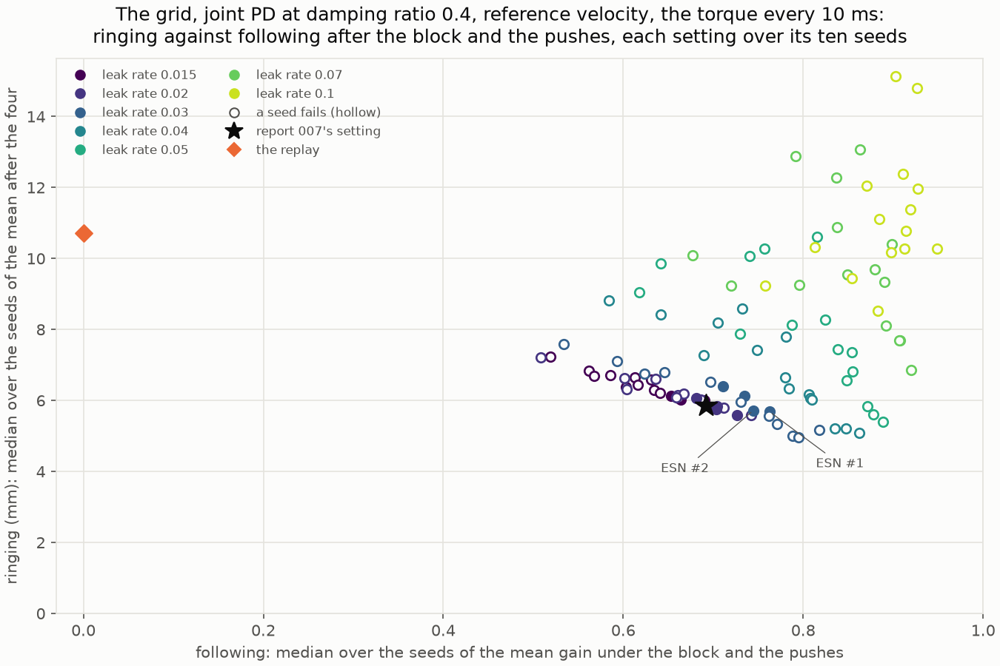

| Leak rate | Settings that pass the three scenarios (of 15) | How the failing runs fail, mostly | The settings' following |
| --- | ---: | --- | --- |
| 0.015 | 4 | pushed: 30 end away; undisturbed: 18 end away; block: 17 end away | 0.52 to 0.69 |
| 0.02 | 5 | pushed: 23 end away; undisturbed and block: 10 each end away | 0.51 to 0.74 |
| 0.03 | 4 | pushed: 28 end away; block: 8 end away; undisturbed: 6 end away | 0.53 to 0.82 |
| 0.04 | 0 | pushed: 44 end away | 0.58 to 0.86 |
| 0.05 | 0 | pushed: 71 end away, 4 never arrive | 0.62 to 0.89 |
| 0.07 | 0 | pushed: 82 end away, 18 never arrive; block: 11 leave the goal, 7 never arrive | 0.68 to 0.92 |
| 0.1 | 0 | pushed: 90 end away, 19 never arrive; block: 12 leave the goal | 0.76 to 0.95 |

- **The faster the leak rate, the more the reference follows,** and the more often a
  seed loses the reach: a pushed arm whose reference goes with it far enough does not
  come back, and ends away from the target.
- **The settings that follow most and still complete the task** lie at leak rate 0.03,
  following by up to 0.76; above it, nothing passes.
- **Ringing and following do not trade** among the settings that pass: they all ring
  5.6 to 6.4 mm, below the replay's 10.7 mm, so the guard excludes none.

### 3.2 The offset starts and the ranking

Of the 13 settings that pass the three scenarios, 11 also pass from the eight offset
starts; at leak rate 0.015, spectral radius 0.99, input scaling 1.5, seed 1 never
arrives from (+15°, −15°), and at spectral radius 1.35, input scaling 1.5, seed 6
leaves the goal from (+15°, +15°). The 11, ranked (medians over the seeds; the
following under the block and each push):

| Leak rate | Spectral radius | Input scaling | Following | Block / pushes at 3, 7, 15 s | Ringing | Return | Undisturbed path RMSE | Typical seed |
| ---: | ---: | ---: | ---: | --- | ---: | ---: | ---: | ---: |
| 0.03 | 1.2 | 1.5 | **0.76** | 0.88 / 0.79 / 0.56 / 0.77 | 5.68 mm | 2.92 s | 0.69 mm | 8 |
| 0.03 | 1.2 | 1 | 0.74 | 0.84 / 0.81 / 0.62 / 0.75 | 5.72 mm | 3.27 s | 0.88 mm | 2 |
| 0.03 | 1.35 | 1.5 | 0.73 | 0.85 / 0.72 / 0.55 / 0.77 | 6.14 mm | 2.84 s | 0.58 mm | 6 |
| 0.02 | 0.99 | 1.5 | 0.73 | 0.87 / 0.77 / 0.55 / 0.70 | 5.59 mm | 3.54 s | 0.83 mm | 5 |
| 0.03 | 1.35 | 1 | 0.71 | 0.80 / 0.74 / 0.58 / 0.71 | 6.39 mm | 3.03 s | 0.77 mm | 3 |
| 0.02 | 1.2 | 1.5 | 0.70 | 0.86 / 0.76 / 0.47 / 0.69 | 5.84 mm | 3.16 s | 0.76 mm | 0 |
| 0.02 | 1.2 | 2 | 0.70 | 0.88 / 0.79 / 0.42 / 0.71 | 5.75 mm | 2.75 s | 0.65 mm | 8 |
| 0.02 | 1.35 | 2 | 0.69 | 0.84 / 0.78 / 0.41 / 0.70 | 5.86 mm | 2.66 s | 0.58 mm | 7 |
| 0.02 | 1.35 | 1.5 | 0.68 | 0.85 / 0.74 / 0.43 / 0.67 | 6.07 mm | 2.88 s | 0.67 mm | 6 |
| 0.015 | 1.2 | 2 | 0.66 | 0.86 / 0.76 / 0.38 / 0.67 | 6.01 mm | 3.75 s | 0.72 mm | 3 |
| 0.015 | 1.2 | 1.5 | 0.65 | 0.82 / 0.70 / 0.40 / 0.65 | 6.13 mm | 3.70 s | 0.80 mm | 1 |

- **The settings differ most at the push across at 7 s:** 0.38 to 0.62, where the block
  and the other pushes vary by about 0.1.
- **Report 007's chosen setting ranks eighth** (0.69). A seed draws the same random
  reservoir at every setting, scaled differently; seed by seed, the top two settings
  follow more than report 007's in all ten seeds, the third in nine.
- **The top three are all at leak rate 0.03,** the third being report 006's chosen
  setting.

### 3.3 The shortlist, with six trackers, and the choice

The shortlisted ESNs, each trained with its setting's typical seed (the following,
ringing, return, and path RMSE are the ESN's own, from the sweeps):

| | Setting | Seed | Following | Block / pushes at 3, 7, 15 s | Ringing | Return | Undisturbed path RMSE | On its own: first step from an offset start, mean |
| --- | --- | ---: | ---: | --- | ---: | ---: | ---: | ---: |
| **ESN #1** | leak rate 0.03, spectral radius 1.2, input scaling 1.5 | 8 | **0.79** | 0.89 / 0.80 / 0.63 / 0.83 | 5.61 mm | 3.17 s | 0.74 mm | 79 mm |
| **ESN #2** | leak rate 0.03, spectral radius 1.2, input scaling 1 | 2 | 0.73 | 0.82 / 0.76 / 0.63 / 0.73 | 5.71 mm | 3.52 s | 0.87 mm | 82 mm |
| ESN #3 | leak rate 0.03, spectral radius 1.35, input scaling 1.5 | 6 | 0.74 | 0.85 / 0.71 / 0.62 / 0.77 | 6.18 mm | 2.80 s | 0.60 mm | 84 mm |
| Report 007's chosen ESN | leak rate 0.02, spectral radius 1.35, input scaling 2 | 7 | 0.69 | 0.82 / 0.75 / 0.50 / 0.70 | 5.84 mm | 3.05 s | 0.57 mm | 90 mm |

On its own, each arrives and holds from all 49 starts. Each was then run against the
replay with the six trackers, undisturbed, under the block and the pushes, and from
the 49 offset starts: every run of every ESN arrives, holds, and ends within the goal,
as does every run of the replay.

**Both ESN #1 and ESN #2 were chosen in the app,** and both are compared with the
replay below; report 007's ESN appears in passing.

### 3.4 Undisturbed

The ESNs validated: ESN #1
([`esn.toml`](results/20261014-155052-grid_lr0.03_sr1.2_is1.5_seed8_filtered/esn.toml))
and ESN #2 ([`esn.toml`](results/20261014-155052-grid_lr0.03_sr1.2_is1_seed2_filtered/esn.toml)),
each of 400 tanh neurons, sparsity 0.05, spectral radius 1.2, leak rate 0.03, input
scaling 1.5 and 1, a random bias, ridge 1e-2, trained by teacher forcing on the
filtered take with a 1 s warm-up, seeds 8 and 2.

| Tracker | ESN #1: arrival, path RMSE | ESN #2: arrival, path RMSE | Replay: arrival, path RMSE |
| --- | --- | --- | --- |
| ζ 0.2, zero reference velocity | 9.86 s, 1.45 mm | 9.74 s, 1.43 mm | 9.59 s, 0.62 mm |
| ζ 0.4, zero reference velocity | 10.18 s, 2.50 mm | 9.96 s, 2.42 mm | 9.61 s, 0.36 mm |
| ζ 0.8, zero reference velocity | 10.85 s, 4.51 mm | 10.44 s, 4.59 mm | 9.66 s, 0.30 mm |
| ζ 0.2, reference velocity | 9.55 s, 0.74 mm | 9.54 s, 0.87 mm | 9.57 s, 0.64 mm |
| ζ 0.4, reference velocity | 9.55 s, 0.74 mm | 9.54 s, 0.87 mm | 9.56 s, 0.40 mm |
| ζ 0.8, reference velocity | 9.55 s, 0.73 mm | 9.54 s, 0.88 mm | 9.56 s, 0.27 mm |

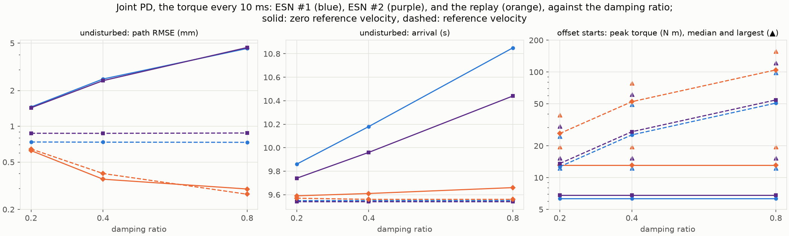

- **Given the reference velocity, both ESNs follow the taught path within 0.9 mm** and
  arrive with the take at every damping ratio.
- **Given a zero reference velocity, the arm trails a following reference more as the
  damping rises:** the ESNs' path RMSE grows from 1.4 mm to 4.6 mm, and their arrival
  from 9.7 s to 10.9 s, presumably since a reference that follows the arm also waits
  for it when it lags. Report 007's ESN trailed more, by 6.3 mm at 0.8 (report 008),
  and report 009's noisy ESN less, by 2.1 mm.

The joint angles over time, given the reference velocity and given a zero reference
velocity, with each ESN's reference dashed:

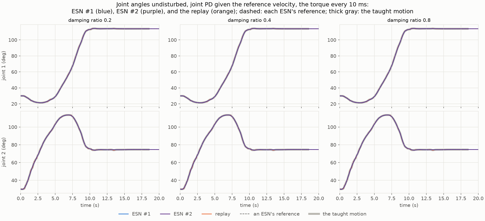

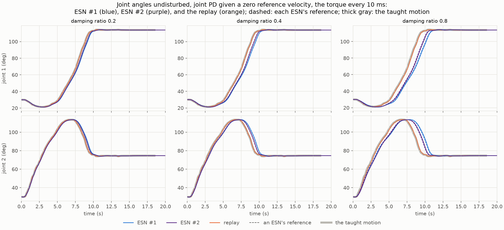

The joint torques over time, given the reference velocity (given a zero reference
velocity: [torques](results/summary/nominal_torques_zero.png)):

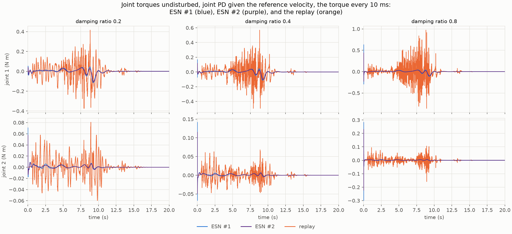

- **Given a zero reference velocity, the ESNs' references fall behind the take with
  their arms,** the more the higher the damping: at ζ = 0.8, the reach's second half
  runs 0.7 to 1.2 s late, and the arms arrive 0.8 s (#2) and 1.2 s (#1) after the
  replay's. Each reference stays just ahead of its arm, as a reference that follows
  does.
- **The ESNs' torque is smooth; the replay's is jagged through the reach** with every
  tracker. Given the reference velocity, the jaggedness grows with the damping, to
  about ±1 N m in joint 1 at ζ = 0.8 against the ESNs' ±0.1 N m; given a zero
  reference velocity, it stays at a few tenths of a N m. The cause was not looked
  into; one possibility is the take's own small step-to-step changes, which the replay
  replays and the ESNs do not reproduce.

### 3.5 Under the block and the pushes

Each cell gives ESN #1, ESN #2, and the replay, but for the following gain, whose
replay's is 0.

**The following gain**, ESN #1 / ESN #2:

| Tracker | The block | Push forward at 3 s | Push across at 7 s | Push across at 15 s |
| --- | --- | --- | --- | --- |
| ζ 0.2, zero reference velocity | 0.90 / 0.84 | 0.78 / 0.74 | 0.64 / 0.62 | 0.83 / 0.73 |
| ζ 0.4, zero reference velocity | 0.92 / 0.86 | 0.77 / 0.73 | 0.64 / 0.62 | 0.84 / 0.74 |
| ζ 0.8, zero reference velocity | 0.94 / 0.87 | 0.73 / 0.71 | 0.61 / 0.63 | 0.84 / 0.75 |
| ζ 0.2, reference velocity | 0.88 / 0.82 | 0.79 / 0.75 | 0.62 / 0.62 | 0.83 / 0.72 |
| ζ 0.4, reference velocity | 0.89 / 0.82 | 0.80 / 0.76 | 0.63 / 0.63 | 0.83 / 0.73 |
| ζ 0.8, reference velocity | 0.89 / 0.82 | 0.80 / 0.76 | 0.64 / 0.63 | 0.83 / 0.73 |

**The ringing over the next 2 s** (mm):

| Tracker | The block's release | Push forward at 3 s | Push across at 7 s | Push across at 15 s |
| --- | --- | --- | --- | --- |
| ζ 0.2, zero reference velocity | 3.7 / 4.1 / 26.1 | 6.9 / 7.1 / 13.3 | 11.1 / 10.0 / 18.2 | 7.7 / 8.4 / 15.5 |
| ζ 0.4, zero reference velocity | 2.2 / 2.8 / 17.0 | 4.7 / 4.8 / 6.9 | 7.5 / 6.9 / 10.1 | 5.4 / 5.8 / 8.5 |
| ζ 0.8, zero reference velocity | 1.2 / 1.8 / 10.7 | 3.0 / 3.1 / 3.9 | 4.7 / 4.5 / 5.8 | 3.5 / 3.7 / 5.0 |
| ζ 0.2, reference velocity | 4.5 / 4.8 / 26.5 | 7.0 / 7.3 / 13.3 | 12.4 / 10.8 / 18.1 | 7.4 / 8.2 / 15.5 |
| ζ 0.4, reference velocity | 3.3 / 3.6 / 17.5 | 4.9 / 5.2 / 6.8 | 8.7 / 8.1 / 10.0 | 5.5 / 6.0 / 8.5 |
| ζ 0.8, reference velocity | 2.4 / 2.5 / 11.3 | 3.3 / 3.6 / 3.8 | 6.1 / 6.2 / 5.8 | 3.9 / 4.2 / 5.0 |

**Back within 5 mm of the taught path** (s after the disturbance's end; – if not back
before the next push):

| Tracker | The block's release | Push forward at 3 s | Push across at 7 s | Push across at 15 s |
| --- | --- | --- | --- | --- |
| ζ 0.2, zero reference velocity | 2.42 / 3.29 / 1.00 | 3.22 / 3.38 / 0.25 | 2.38 / 3.59 / 1.01 | 5.11 / 4.27 / 1.04 |
| ζ 0.4, zero reference velocity | 2.61 / 4.29 / 0.42 | 3.44 / – / 0.03 | 2.88 / 3.83 / 0.38 | 5.27 / 4.43 / 0.45 |
| ζ 0.8, zero reference velocity | 5.24 / 5.01 / 0.16 | 2.13 / 3.15 / 0.00 | 3.42 / 4.21 / 0.16 | 5.57 / 4.74 / 0.16 |
| ζ 0.2, reference velocity | 2.21 / 3.04 / 0.99 | 2.98 / – / 0.25 | 2.46 / 3.33 / 1.00 | 4.96 / 4.14 / 1.04 |
| ζ 0.4, reference velocity | 2.22 / 3.08 / 0.42 | 2.98 / – / 0.04 | 2.52 / 3.33 / 0.38 | 4.98 / 4.16 / 0.46 |
| ζ 0.8, reference velocity | 2.25 / 3.88 / 0.16 | 2.96 / – / 0.04 | 2.62 / 3.33 / 0.16 | 5.02 / 4.19 / 0.16 |

**The farthest the hand strays from the taught path** (mm):

| Tracker | The block's release | Push forward at 3 s | Push across at 7 s | Push across at 15 s |
| --- | --- | --- | --- | --- |
| ζ 0.2, zero reference velocity | 42 / 25 / 43 | 54 / 64 / 8 | 172 / 204 / 137 | 195 / 164 / 112 |
| ζ 0.4, zero reference velocity | 37 / 25 / 26 | 43 / 56 / 6 | 166 / 197 / 110 | 180 / 154 / 99 |
| ζ 0.8, zero reference velocity | 36 / 27 / 19 | 27 / 43 / 4 | 148 / 180 / 89 | 155 / 137 / 80 |
| ζ 0.2, reference velocity | 45 / 24 / 44 | 68 / 69 / 8 | 177 / 209 / 138 | 205 / 169 / 112 |
| ζ 0.4, reference velocity | 38 / 23 / 28 | 66 / 67 / 7 | 175 / 206 / 111 | 202 / 166 / 99 |
| ζ 0.8, reference velocity | 37 / 22 / 21 | 63 / 63 / 7 | 173 / 200 / 90 | 195 / 162 / 80 |

Under the block, every arm arrives and holds with every tracker: ESN #1 at 10.07 to
11.45 s, ESN #2 at 9.96 to 10.77 s, the replay at 9.56 to 9.66 s. The ESNs press with
1.6 to 2.3 N m (#1) and 0.8 to 1.1 N m (#2), the replay with 12.3 to 14.1 N m, and at
the release their reference is 2 to 3% of the path ahead of the hand, the replay's
9%. Under the pushes, every arm arrives, none leaves the goal during the hold, and
every arm ends within 3 mm of the target.

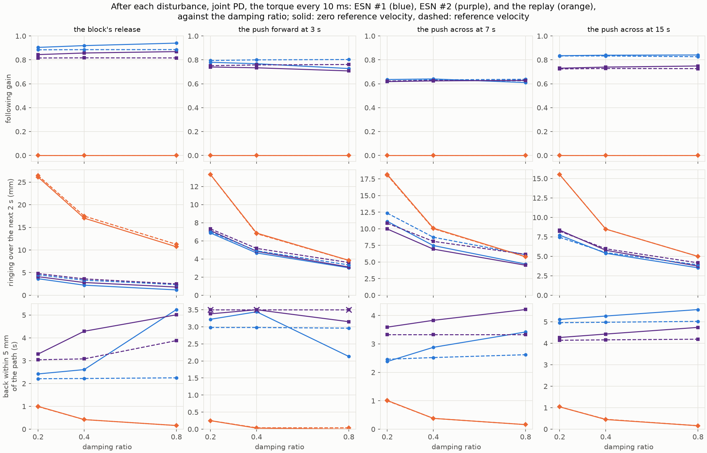

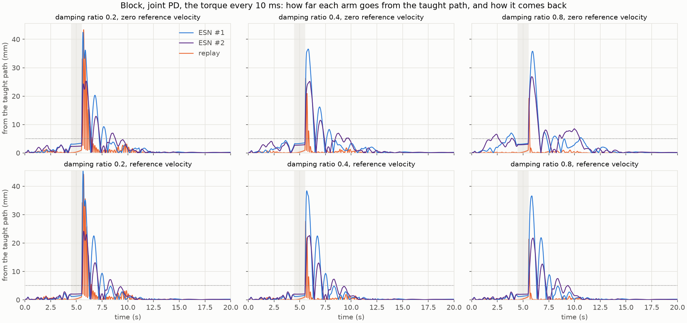

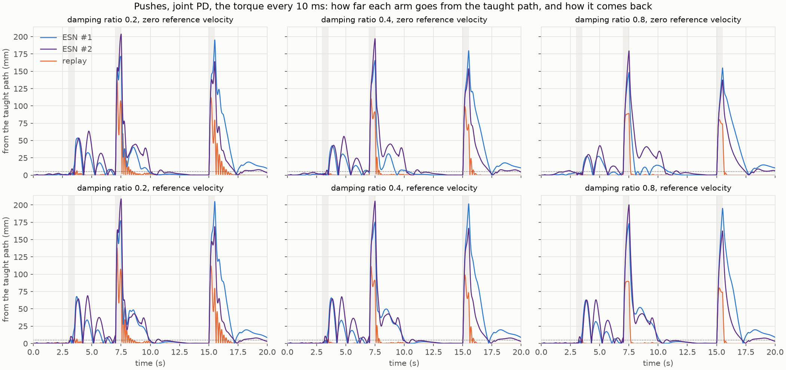

- **The following holds with every tracker:** within 0.07 for each ESN and
  disturbance over the six. ESN #1 follows more than ESN #2 under the block (0.88 to
  0.94 against 0.82 to 0.87) and after the push at 15 s (0.83 against 0.73), alike at
  the push at 7 s (about 0.63).
- **The ESNs ring less than the replay, and the more so the lighter the damping.** At
  ζ = 0.2, they ring a sixth as much after the block's release (3.7 to 4.8 mm against
  26 mm) and about half as much after a push; at 0.4, a fifth or less after the
  release and two-thirds to nine-tenths after a push; at 0.8, about a fifth or less
  after the release and 0.7 to 1.07 times as much after a push, more only at the push
  at 7 s given the reference velocity (6.1 and 6.2 mm against 5.8 mm).
- **Following costs the return.** A push carries an arm whose reference goes with it
  farther from the path: 148 to 209 mm after the push at 7 s, against the replay's 89
  to 138 mm. It then comes back with the reference over 2 to 5.6 s, where the replay's
  arm is back within 1 s at most. After the push at 3 s, ESN #2's arm is not back
  within 5 mm before the next push given the reference velocity. After the push at
  15 s, ESN #1's swings back past the path and settles over about 5 s.
- **Under the block, both wait.** Their reference stays with the held arm, 2 to 3% of
  the path ahead at the release against the replay's 9%, and the arm resumes the
  reach about 0.5 s late, arriving 0.4 to 1.8 s after the replay's.

The joint angles over time, given the reference velocity, with each ESN's reference
dashed (given a zero reference velocity: [the block](results/summary/block_joints_zero.png),
[the pushes](results/summary/pushes_joints_zero.png)):

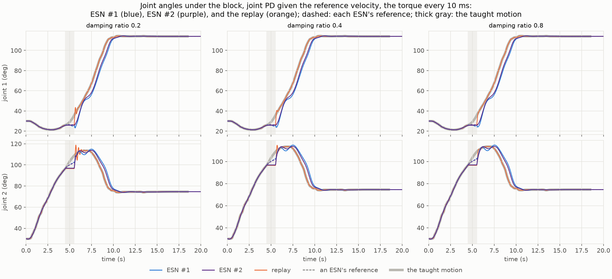

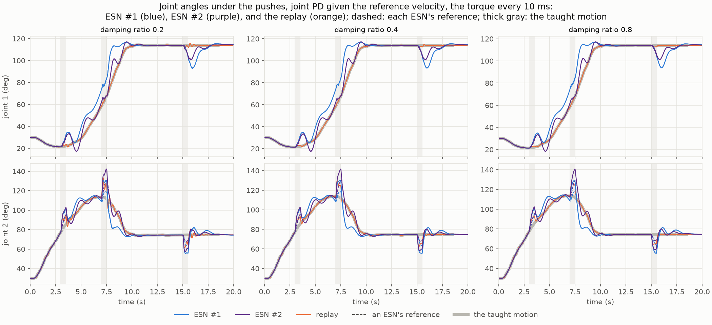

The joint torques over time, given the reference velocity (given a zero reference
velocity: [the block](results/summary/block_torques_zero.png),
[the pushes](results/summary/pushes_torques_zero.png)):

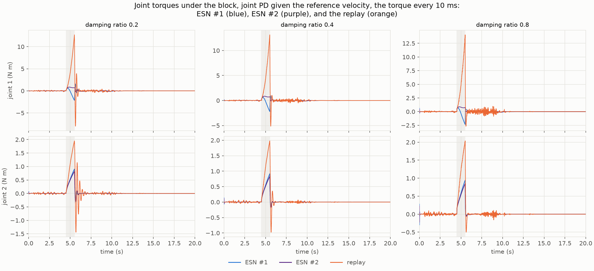

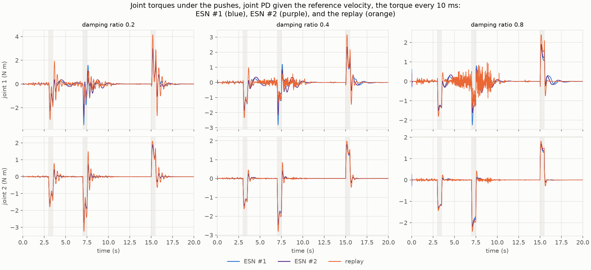

- **Under the block,** the replay's reference runs on while the tip is held, and the arm
  snaps to it at the release, ringing at ζ = 0.2. The ESNs' references wait: joint
  1's holds with the arm, joint 2's creeps on by about 5°, and after the release the
  arm resumes the reach without a snap.
- **Under the push at 7 s,** which carries joint 1 forward, ESN #1's reference goes
  with the arm and, from there, runs on ahead of the take, reaching the end posture by
  8 s, 1.5 s before the take; ESN #2's arm is pushed farther in joint 2 (to 142°,
  against 130°), and its reference brings joint 1 on more slowly, with a dip before
  the end. Under the push at 15 s, after the hold, both references go with the arm
  and bring it back over 1 to 2 s, where the replay's arm snaps back within 0.5 s.
- **The torques are alike during a push,** set mostly by the push itself, but after
  it the replay's rings at ζ = 0.2. Between the pushes, the replay's torque is as
  jagged as undisturbed (Section 3.4), and the ESNs' as smooth.

The animations show ESN #1, ESN #2, and the replay with the search's tracker (ζ = 0.4,
given the reference velocity, the torque every 10 ms):

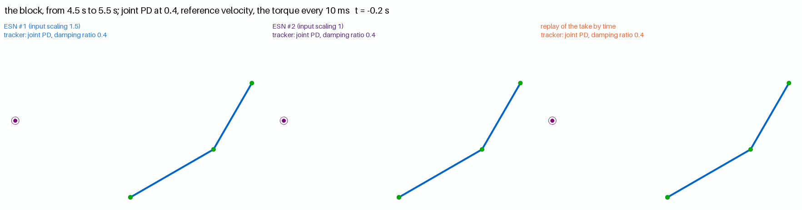

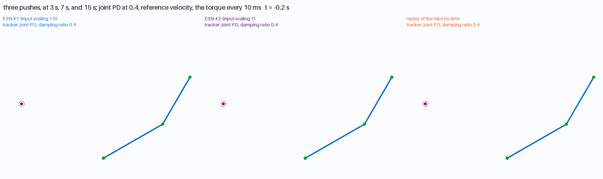

### 3.6 From the offset starts

| Tracker | ESN #1: path RMSE, peak torque median / largest | ESN #2: likewise | Replay: likewise |
| --- | --- | --- | --- |
| ζ 0.2, zero reference velocity | 19.1 mm, 6 / 12 N m | 21.0 mm, 7 / 15 N m | 23.5 mm, 13 / 20 N m |
| ζ 0.4, zero reference velocity | 17.1 mm, 6 / 12 N m | 16.8 mm, 7 / 15 N m | 17.8 mm, 13 / 20 N m |
| ζ 0.8, zero reference velocity | 17.1 mm, 6 / 12 N m | 16.4 mm, 7 / 15 N m | 15.0 mm, 13 / 20 N m |
| ζ 0.2, reference velocity | 19.9 mm, 13 / 25 N m | 20.7 mm, 14 / 31 N m | 24.3 mm, 26 / 39 N m |
| ζ 0.4, reference velocity | 17.8 mm, 25 / 49 N m | 18.2 mm, 27 / 61 N m | 19.4 mm, 52 / 79 N m |
| ζ 0.8, reference velocity | 17.6 mm, 51 / 98 N m | 16.1 mm, 54 / 122 N m | 16.4 mm, 105 / 157 N m |

Every arm arrives and holds from all 49 starts, with every tracker. Offset runs of
ESN #1 given the reference velocity:
[the map of the 49 starts](results/20261014-155211-offsets_robot_lr0.03_sr1.2_is1.5_seed8_reference_velocity_filtered/grid.png)
and [the hand paths](results/20261014-155211-offsets_robot_lr0.03_sr1.2_is1.5_seed8_reference_velocity_filtered/paths.png);
of ESN #2: [the map](results/20261014-155211-offsets_robot_lr0.03_sr1.2_is1_seed2_reference_velocity_filtered/grid.png)
and [the hand paths](results/20261014-155211-offsets_robot_lr0.03_sr1.2_is1_seed2_reference_velocity_filtered/paths.png).

- **The ESNs' reference jumps half as far at t = 0.** In the first period, the replay's
  reference jumps the whole offset, at a median of 1000°/s, the ESNs' about half of
  it, at 508°/s (#1) and 519°/s (#2). Their peak torque at the start is half the
  replay's with every tracker, and less than report 007's ESN's (9 / 21 N m given a
  zero reference velocity, 77 / 166 N m at ζ = 0.8 given the reference's).
- **Given the reference velocity, the jump still costs torque,** growing with the
  damping, up to 98 N m (#1) and 122 N m (#2) at ζ = 0.8; given a zero reference
  velocity, at most 12 and 15 N m.
- **Their paths from an offset start are about the replay's,** 16 to 21 mm in the
  median, against 15 to 24 mm, the closer at ζ = 0.2.

The joint angles and torques from the start offset by +15° in both joints, given the
reference velocity, over the first 4 s (given a zero reference velocity:
[joint angles](results/summary/offset_joints_zero.png),
[torques](results/summary/offset_torques_zero.png)):

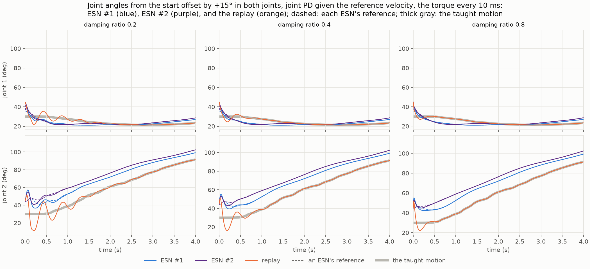

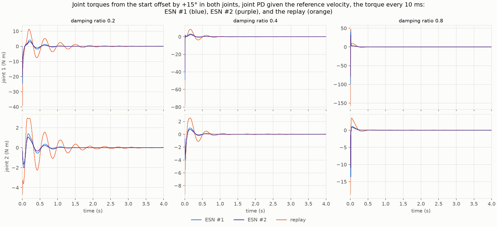

### 3.7 The reservoir states

As in reports 005 to 009, [`robot_states.py`](../../experiments/robot_states.py)
recomputes each chosen ESN's reservoir states from its runs with the search's tracker
(ζ = 0.4, given the reference velocity), and refuses a log whose reference the
recomputed ESN does not reproduce; every one here passes. The figures draw the states
of the ESN driving the robot (blue) over those of the take fed in as in training
(thick gray), with the warm-up and the disturbances shaded: ESN #1's
([run](results/20261014-163705-states_robot_lr0.03_sr1.2_is1.5_seed8_filtered)) and
ESN #2's ([run](results/20261014-163705-states_robot_lr0.03_sr1.2_is1_seed2_filtered)).
The neurons are picked at random (seed 0), the same eight in both reservoirs.

#### ESN #1: eight neurons over the whole run

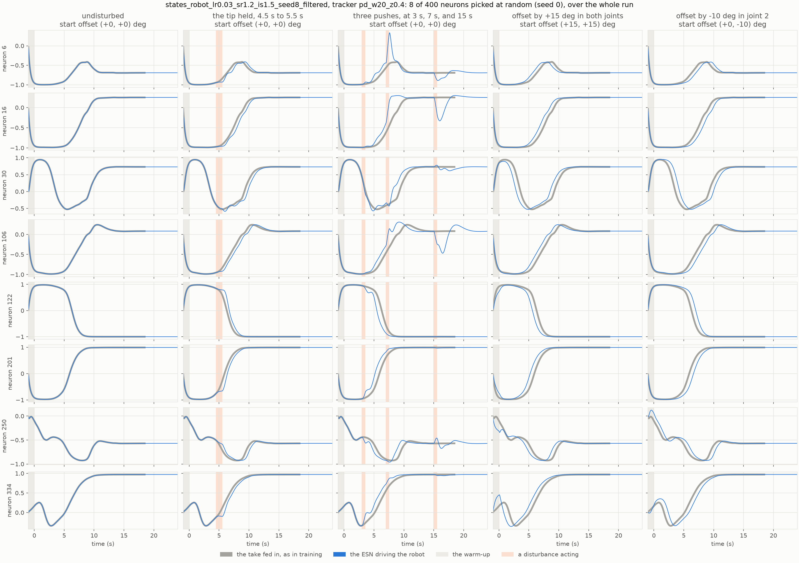

- **Undisturbed,** each neuron follows the take's states.
- **Under the block,** most hold nearly still while the tip is held (16, 106, 201, and
  334), then resume the take's course about 0.5 s late.
- **The pushes move the states:** after the push at 7 s, several run ahead of the
  take's states by 1 to 2 s (16, 106, 201, and 334), as the arm, carried toward the
  target, runs ahead, and neuron 6 spikes; after the push at 15 s, neurons 16 and 106
  dip far off their held values and come back within about 2 s.
- **From the offset starts,** the states run ahead of the take's from (+15°, +15°) and
  behind them from (0°, −10°), as the arm does.

#### ESN #1: the warm-up

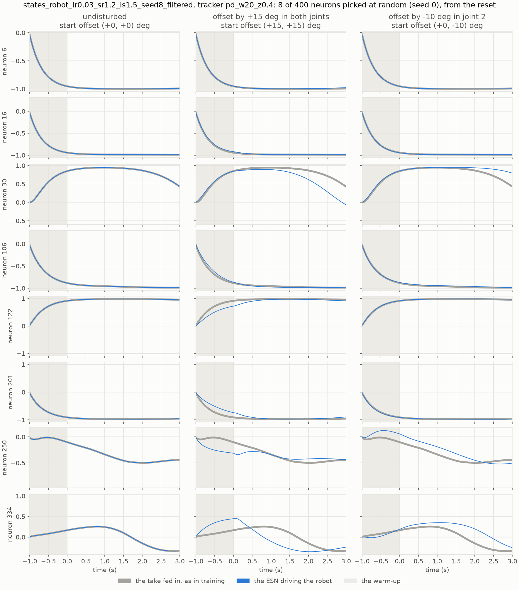

From (+15°, +15°), the warm-up leaves neurons 122, 201, 250, and 334 off the take's
states; 122, 201, and 250 join them within about 1 s, while 334, and later 30, run
ahead of them through the first 3 s. From (0°, −10°), neurons 30, 250, and 334 lag
the take's states through the first 3 s.

#### ESN #1: the principal components

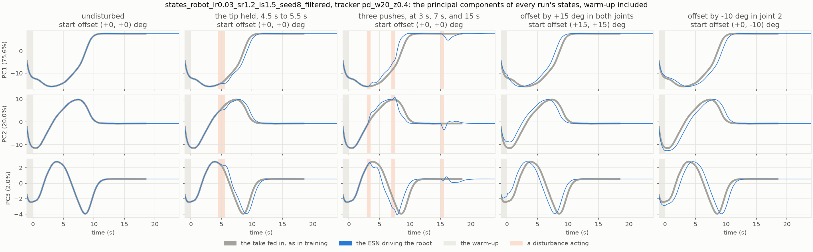

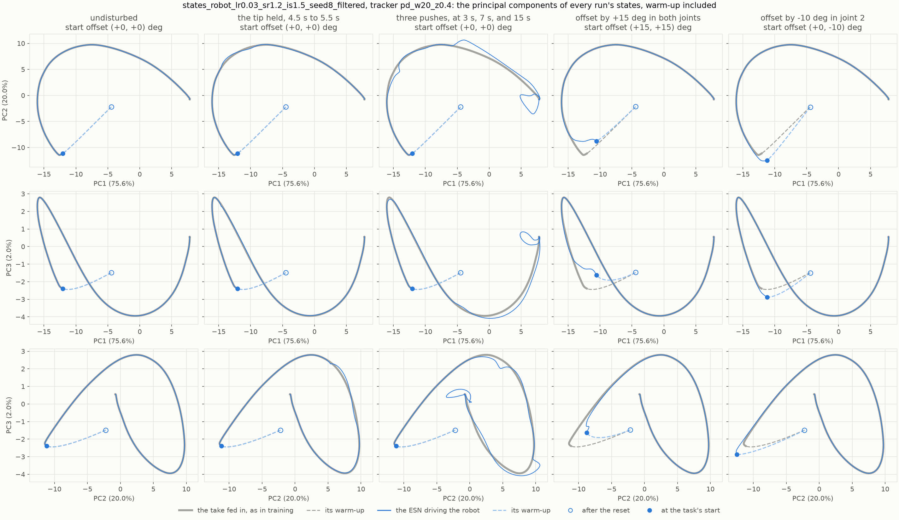

PC1, PC2, and PC3 hold 75.6%, 20.0%, and 2.0% of the variance. The take's states trace
an arc in the plane of PC1 and PC2; the undisturbed run follows it, and the run under
the block leaves it only slightly. Under the pushes, the states leave the arc after
the push at 7 s, running above it, and loop near its end after the push at 15 s, far
more than report 009's noisy ESN's, which the pushes moved only a little. From
(+15°, +15°), the warm-up ends off the arc's start, partway along its first stretch,
and the states join the arc within about a second.

#### ESN #2: eight neurons over the whole run

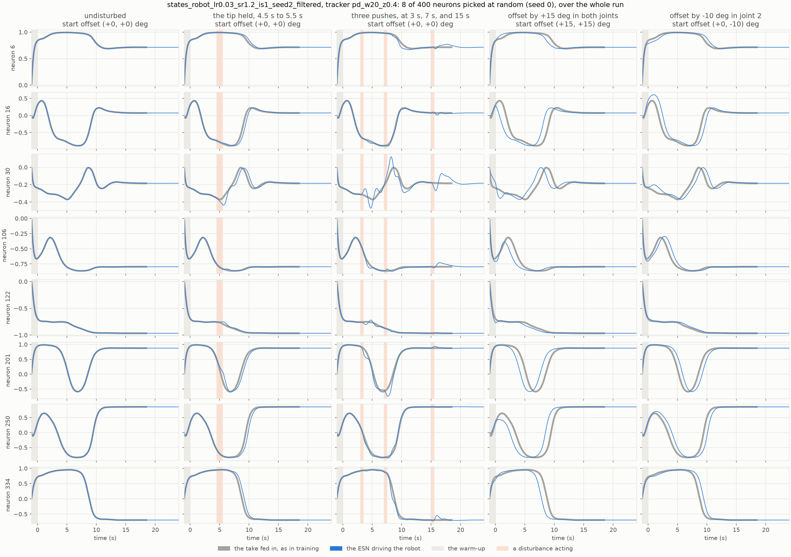

- **Under the block,** neurons 16, 201, 250, and 334 resume the take's course about
  0.5 s late, after holding.
- **The pushes** nudge them off the take's course and back, most at 7 s (neurons 30 and
  201), and briefly at 15 s (30, 106, and 334).
- **From the offset starts,** the states run ahead of the take's from (+15°, +15°) and
  behind them from (0°, −10°), as ESN #1's do.

#### ESN #2: the warm-up and the principal components

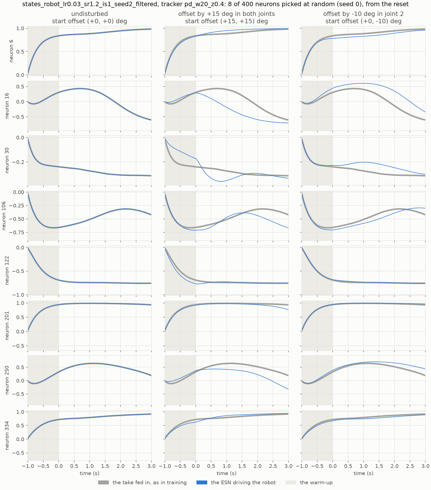

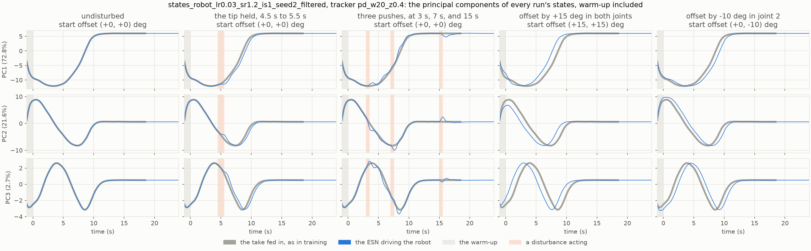

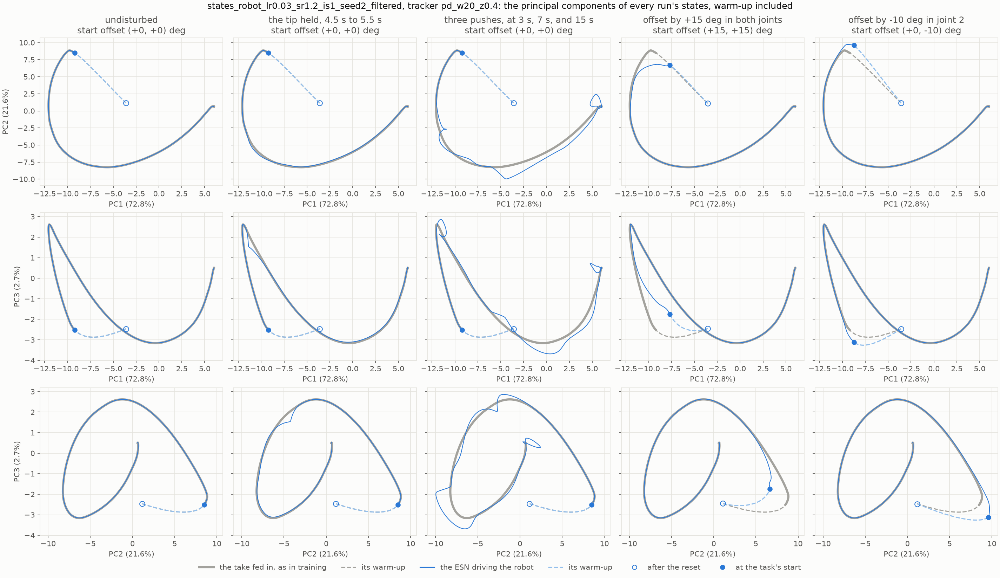

PC1, PC2, and PC3 hold 72.8%, 21.6%, and 2.7% of the variance. Under the pushes, the
states hook off the arc after the push at 3 s, swing well below it after the push at
7 s, and loop at its end after the push at 15 s. From both offset starts, the warm-up
ends off the arc's start, beyond it from (0°, −10°), and the states join the arc
within the first seconds.

## 4. Observations

- **Following can be measured, and it describes the ESN.** The following gain is 0 for
  the replay, about 0.2 under the pushes for report 009's noisy ESN, and 0.6 to 0.9 for
  the ESNs chosen here, and it changes by 0.07 at most across six trackers. It tells
  apart what report 010 could only see in the app.
- **Following and completing the task trade against each other in the reservoir's
  settings.** Faster leak rates follow more, up to 0.95, but past 0.03 a pushed arm is
  taken too far for the ESN to bring it back to the reach. The search found the most
  following settings that still complete it; to follow more, the ESN would need to
  learn to bring a displaced arm back, which the settings alone do not give.
- **Following is what the ESN offers over the replay, and its value depends on the
  tracker.** With light damping, it is what keeps the arm from ringing: at ζ = 0.2,
  half the replay's ringing after a push and a sixth after the block. With heavy
  damping, the tracker damps the ringing by itself, and the ESNs ring about as much as
  the replay after a push; under the block, they still press with about a sixth of its
  torque or less.
- **Following costs the return onto the taught path.** The arm goes farther with the
  push and comes back more slowly, 2 to 5.6 s against the replay's 1 s at most: the
  slow return that report 008 noted, and that report 009's search, by scoring it,
  removed together with the following.
- **The reference velocity matters most for a following reference.** Given a zero
  reference velocity, the derivative term damps the arm's own velocity, so the arm
  trails, and a reference that follows waits for it: the lag grows with the damping.
  Given the reference velocity, the path stays within 0.9 mm at every damping, at the
  cost of torque at an offset start, half the replay's.
- **The ESNs' torque is smooth where the replay's is jagged,** through the reach with
  every tracker, most with the reference velocity and heavy damping.
- **ESN #1 and ESN #2 differ in where they follow.** ESN #1 follows more under the
  block and after the push at 15 s, swinging farther and longer after it; ESN #2
  follows as much at the push at 7 s and presses less under the block (0.8 to 1.1
  against 1.6 to 2.3 N m), but goes farther after the push at 7 s (180 to 209 mm) and is
  slow back after the push at 3 s.

## 5. Next steps

1. **Disturbances the search did not use:** pushes at other times, in other directions,
   and of other forces, and a block at another time, to see whether the following
   holds beyond the scenarios it was searched with.
2. **More following that still completes the task:** the settings alone stop at about
   0.76. Training could teach the ESN to go on from a displaced posture back to the
   reach, for instance by noisy teacher forcing whose target continues from the
   noisy input rather than returning to the take at once, which report 009's noise did.
3. **A smooth start:** the ESNs' reference still jumps half the offset at t = 0,
   costing up to 122 N m at ζ = 0.8 given the reference velocity.
