# 012 Pushes by hand

**Summary.** Report 011 chose two ESNs whose reference follows the arm, and compared
them with the replay of the take under three scripted pushes. Here the arm was pushed
by hand in the robot app, three times over, while ESN #2 ran; the tip force of each run
was saved, and the same force, replayed by time, met ESN #1, ESN #2, and the replay
with six joint PD trackers. The ten pushes differ from the scripted ones in direction,
force, length, and time: 2.3 to 8.0 N in the mean, up to 14.4 N, for 0.4 to 1.3 s,
backward, across, and forward, early in the reach, midway, and at the target.

- **The ESNs follow the pushes by hand as they did the scripted ones:** by 0.50 to
  0.97, about 0.7 in the median, against the replay's 0.
- **Every run reaches the target.** Every arm arrives and ends within 3 mm of the
  target, but for ESN #2 in one run (11 mm). The exception is log 001, given a zero
  reference velocity: the ESNs arrive 2.4 to 12 s after the replay, and in four of
  its six ESN runs the last push, at 14.4 s, then pushes the hand out of the goal
  during its hold.
- **A strong push backward can carry a following reference back along the reach.**
  Log 001's second push is 8 N in the mean for 1.3 s at mid-reach. Given a zero
  reference velocity, it swings both ESNs' arms up and away from the path, 196 to
  308 mm, and their references go with them. ESN #1's goes back toward the start,
  joint 1 to where the take is at 2.5 to 5.5 s, and the arm then reaches again.
  Given the reference velocity, the same push carries them 78 to 157 mm, and they are
  back within 2.5 s.
- **After a push at the target, the ESNs ring less than the replay with light
  damping:** 4 to 16 mm at a damping ratio of 0.2, against the replay's 15 to 23 mm.
  Over the ten pushes, in the median, they ring about four-fifths as much as the
  replay at 0.2 and about as much at 0.4 and 0.8, less of an edge than under report
  011's scripted pushes.
- **The cost of following is the return, as in report 011.** The ESNs' arms go
  farther from the taught path, 79 to 135 mm in the median against the replay's 53
  to 71 mm. They come back in 2.3 to 3.7 s in the median, against 0.1 to 0.6 s. After
  2 to 4 of the ten pushes, they are not back before the next push or the run's end.

## 1. Question

How do report 011's two ESNs and the replay of the take compare under pushes they were
not searched with, given by hand, with joint PD at damping ratios 0.2, 0.4, and 0.8,
given a zero reference velocity or the reference's?

## 2. Setup

### The recordings

In the robot app ([`tools/robot_app.py`](../../tools/README.md)), report 011's ESN #2
drove the arm with joint PD at ω = 20 rad/s and a damping ratio of 0.4, given the
reference velocity, with the torque computed every 10 ms. Each run was from the
demonstrated start, and the arm was pushed by dragging its tip with the mouse. Each
run's log, saved with the tip force (Ctrl+S), is replayed by time on the task clock
(`[disturbance] type = "recorded"`; see
[Recorded forces](../../experiments/README.md#recorded-forces)). Every arm and tracker
meets the same force at the same times; [`compare_arms.py`](../../experiments/compare_arms.py)
refuses arms that met different forces, and none did. A push is a span in which the
force exceeds 0.5 N, with spans less than 0.2 s apart joined into one.

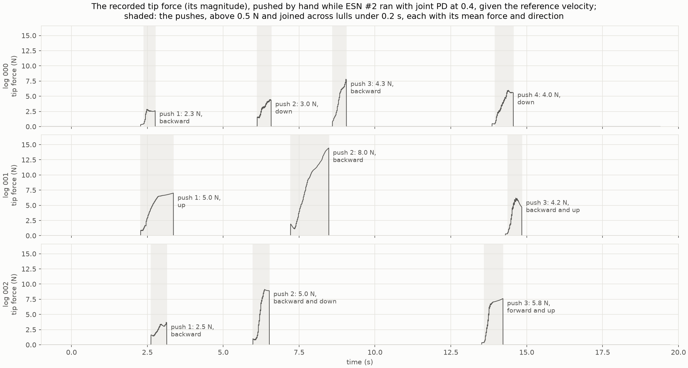

| Log | Push | From, to | Length | Peak force | Mean force | Impulse | Direction | Where the recorded tip was |
| --- | ---: | --- | ---: | ---: | ---: | ---: | --- | ---: |
| 000 | 1 | 2.38 to 2.76 s | 0.38 s | 2.8 N | 2.3 N | 0.9 N s | backward (−175°) | 12% of the way |
| 000 | 2 | 6.12 to 6.58 s | 0.46 s | 4.5 N | 3.0 N | 1.4 N s | down (+78°) | 50% of the way |
| 000 | 3 | 8.60 to 9.06 s | 0.46 s | 7.8 N | 4.3 N | 2.0 N s | backward (−169°) | 91% of the way |
| 000 | 4 | 13.96 to 14.56 s | 0.60 s | 6.0 N | 4.0 N | 2.4 N s | down (+86°) | at the target |
| 001 | 1 | 2.28 to 3.36 s | 1.08 s | 7.0 N | 5.0 N | 5.5 N s | up (−101°) | 12% of the way |
| 001 | 2 | 7.22 to 8.48 s | 1.26 s | 14.4 N | 8.0 N | 10.6 N s | backward (+169°) | 62% of the way |
| 001 | 3 | 14.38 to 14.84 s | 0.46 s | 6.2 N | 4.2 N | 2.0 N s | backward and up (−143°) | at the target |
| 002 | 1 | 2.62 to 3.14 s | 0.52 s | 3.7 N | 2.5 N | 1.3 N s | backward (+177°) | 15% of the way |
| 002 | 2 | 5.98 to 6.52 s | 0.54 s | 9.1 N | 5.0 N | 2.9 N s | backward and down (+129°) | 48% of the way |
| 002 | 3 | 13.60 to 14.22 s | 0.62 s | 7.6 N | 5.8 N | 3.7 N s | forward and up (−52°) | at the target |

The direction is that of the mean force, by its angle from the reach's direction, from
the start to the target: the reach runs leftward, above the base, so that up is away
from the base and down toward it. The impulse is the integral of the force's magnitude.
Log 000 holds four drags, so its figures draw four arrows, one per push, where the
others draw three.

Two things to keep in mind:

- **The force was given to ESN #2's arm.** A drag pulls the tip toward the mouse, so
  the hand that pushed reacted to how ESN #2's arm moved. Replayed by time, the force
  no longer reacts: the other arms meet the force that ESN #2's arm met.
- **The recordings were made with the app's former joint PD gains,** about 0.4% stiffer
  in joint 1 than the runs' (fixed in `e7ad339`). Rerun headless with ESN #2 and the
  same tracker, each recording is retraced within 0.02° (logs 000 and 002) and 0.45°
  (log 001) in the joints, and 0.4, 3.2, and 0.1 mm at the tip.

### The arms and the trackers

The arms are report 011's ESN #1 (leak rate 0.03, spectral radius 1.2, input scaling
1.5, seed 8), ESN #2 (input scaling 1, seed 2), and the replay of the take. The
trackers are joint PD at ω = 20 rad/s and damping ratios 0.2, 0.4, and 0.8, each given
a zero reference velocity or the reference's, all with the torque computed every
10 ms, as in report 011. Each run starts from the log's start posture, the
demonstrated start, and lasts 24 s.

### Measures

As in report 011, after each push: the following gain, from the push's onset to 0.5 s
past its end; the ringing, the RMS of the hand's motion above 1.5 Hz over the next
2 s; the farthest the hand strays from the taught path; and when it is back within
5 mm of it, if it is back before the next push or the run's end. The ringing counts
any fast motion of the hand after the push, a large swing too. Also, whether the hand
arrives, holds within the goal (20 mm) for 2 s, and ends there.

### Reproducing the results

The runs read the recorded logs as `data/recorded_forces/recorded_forces_{000,001,002}.sklog.npz`
under the storage root (copied here in [`data`](data)), the take as in report 011, and
the ESNs by their run names (copied in
[report 011's results](../011-following-the-arm/results)). All configurations are in
[`manual_demonstration_v2_robot_recorded_pushes`](../../experiments/manual_demonstration_v2_robot_recorded_pushes/README.md).

| Runs | Command | Commit |
| --- | --- | --- |
| `recorded<log>_robot_<ESN>_{zero,reference}_velocity_filtered` (12) | `uv run python experiments/robot_esn.py experiments/manual_demonstration_v2_robot_recorded_pushes/<name>.toml` | `b5cdaa7` |
| `compare_recorded<log>_{zero,reference}_velocity` (6) | `uv run python experiments/compare_arms.py experiments/manual_demonstration_v2_robot_recorded_pushes/<name>.toml` | `abdebfa` |
| [`summary`](results/summary) | `uv run python reports/012-pushes-by-hand/make_figures.py --logs --animations` | |

Every run record (`run.toml`) shows no uncommitted changes. Each robot run's directory
here holds its configuration, its run record, its metrics (`metrics.csv`), and the
SHA-256 of its log (`recorded_forces.toml`); each comparison's holds its
configuration, its run record, and its figures. [`make_figures.py`](make_figures.py)
draws `forces.png` and `pushes.png` and prints the tables of this report from the
copies. With `--logs`, it compares each recording with its rerun, from the runs' logs
under the storage root, which are not kept in Git. With `--animations`, it exports the
animations of Section 3.6.

## 3. Results

In each comparison figure, the columns are the damping ratios. In the time series, the
ESNs' lines are drawn over the replay's, each ESN's reference dashed, and the pushes
are shaded. In the paths, the rows are the arms: each panel draws the arm at its
initial posture (faint gray), the taught path (thick gray), the goal, and the tip's
path. At each push's onset, a red arrow from that arm's tip shows the mean force over
the push, 25 mm per newton. In the tables, each cell gives ESN #1 / ESN #2 / the
replay, but for the following gain, whose replay's is 0; – marks a hand not back
before the next push or the run's end.

### 3.1 Log 000: four short pushes

The tip's path, given the reference velocity (given a zero reference velocity:
[paths](results/20261014-203410-compare_recorded000_zero_velocity/paths.png)):

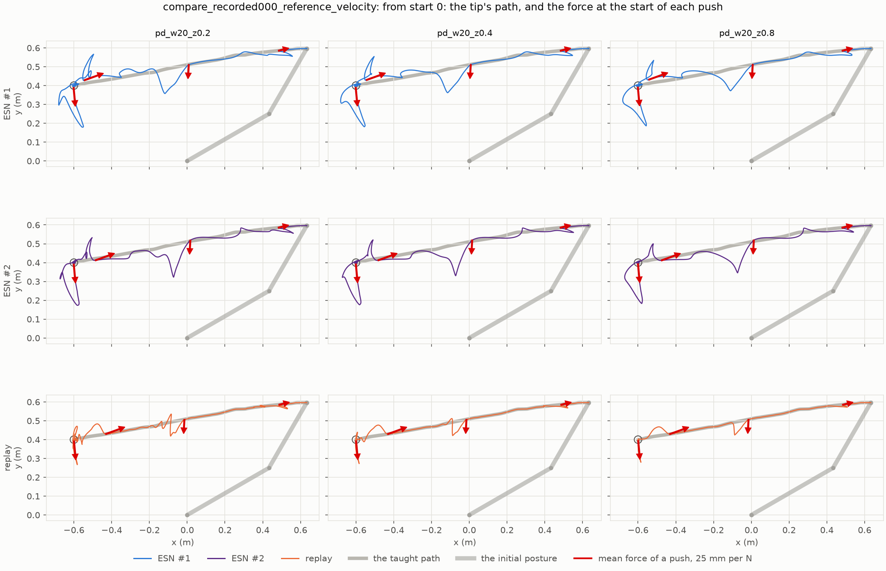

The joint angles and torques over time, given the reference velocity (given a zero
reference velocity: [joint angles](results/20261014-203410-compare_recorded000_zero_velocity/joints.png),
[torques](results/20261014-203410-compare_recorded000_zero_velocity/torques.png)):

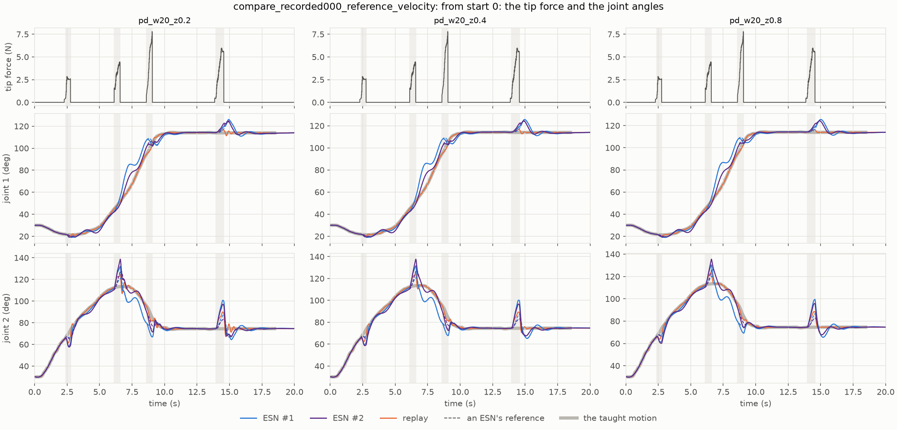

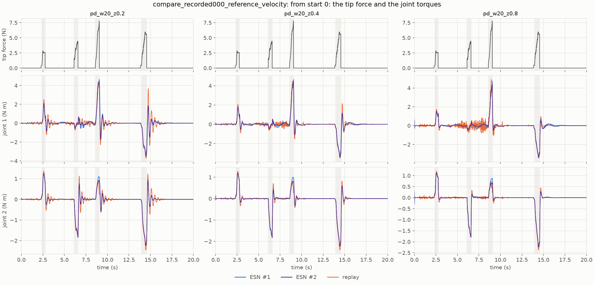

**The following gain**, ESN #1 / ESN #2:

| Tracker | Push 1 | Push 2 | Push 3 | Push 4 |
| --- | --- | --- | --- | --- |
| ζ 0.2, zero reference velocity | 0.59 / 0.66 | 0.81 / 0.71 | 0.76 / 0.64 | 0.62 / 0.61 |
| ζ 0.4, zero reference velocity | 0.63 / 0.69 | 0.83 / 0.73 | 0.54 / 0.59 | 0.63 / 0.62 |
| ζ 0.8, zero reference velocity | 0.68 / 0.71 | 0.87 / 0.80 | 0.61 / 0.59 | 0.64 / 0.63 |
| ζ 0.2, reference velocity | 0.56 / 0.64 | 0.80 / 0.70 | 0.81 / 0.71 | 0.61 / 0.60 |
| ζ 0.4, reference velocity | 0.58 / 0.66 | 0.80 / 0.71 | 0.83 / 0.72 | 0.62 / 0.61 |
| ζ 0.8, reference velocity | 0.60 / 0.67 | 0.79 / 0.71 | 0.84 / 0.73 | 0.63 / 0.62 |

**The ringing over the next 2 s** (mm):

| Tracker | Push 1 | Push 2 | Push 3 | Push 4 |
| --- | --- | --- | --- | --- |
| ζ 0.2, zero reference velocity | 5.3 / 5.0 / 9.3 | 10.4 / 9.9 / 14.0 | 10.7 / 9.9 / 10.4 | 15.3 / 15.1 / 22.7 |
| ζ 0.4, zero reference velocity | 3.9 / 3.7 / 6.1 | 6.9 / 6.6 / 8.5 | 6.9 / 5.9 / 6.4 | 10.4 / 10.4 / 13.8 |
| ζ 0.8, zero reference velocity | 2.7 / 2.6 / 3.8 | 3.8 / 3.8 / 5.0 | 4.0 / 3.4 / 3.7 | 6.5 / 6.5 / 8.0 |
| ζ 0.2, reference velocity | 5.8 / 5.6 / 9.3 | 11.3 / 10.7 / 14.0 | 12.5 / 11.2 / 10.3 | 15.9 / 15.8 / 22.7 |
| ζ 0.4, reference velocity | 4.5 / 4.5 / 6.0 | 8.2 / 7.8 / 8.5 | 8.7 / 7.5 / 6.3 | 11.2 / 11.2 / 13.8 |
| ζ 0.8, reference velocity | 3.3 / 3.3 / 3.6 | 5.6 / 5.4 / 5.1 | 5.3 / 4.4 / 3.7 | 7.3 / 7.4 / 8.0 |

**Back within 5 mm of the taught path** (s after the push's end):

| Tracker | Push 1 | Push 2 | Push 3 | Push 4 |
| --- | --- | --- | --- | --- |
| ζ 0.2, zero reference velocity | 2.43 / – / 0.22 | – / – / 0.81 | – / 0.96 / 0.95 | 2.75 / 3.32 / 1.20 |
| ζ 0.4, zero reference velocity | 2.68 / – / 0.07 | – / – / 0.36 | – / 1.12 / 0.42 | 2.43 / 3.45 / 0.47 |
| ζ 0.8, zero reference velocity | – / 3.08 / 0.09 | 1.96 / – / 0.15 | – / 1.78 / 0.14 | 1.40 / 3.71 / 0.27 |
| ζ 0.2, reference velocity | 2.20 / – / 0.22 | – / – / 0.81 | – / 0.93 / 0.93 | 2.62 / 3.26 / 1.20 |
| ζ 0.4, reference velocity | 2.22 / – / 0.07 | – / – / 0.35 | – / 0.93 / 0.41 | 2.63 / 3.33 / 0.47 |
| ζ 0.8, reference velocity | 2.25 / – / 0.09 | – / – / 0.16 | 1.69 / 0.91 / 0.14 | 2.27 / 3.44 / 0.27 |

**The farthest the hand strays from the taught path** (mm):

| Tracker | Push 1 | Push 2 | Push 3 | Push 4 |
| --- | --- | --- | --- | --- |
| ζ 0.2, zero reference velocity | 36 / 37 / 27 | 114 / 150 / 72 | 118 / 98 / 60 | 216 / 217 / 130 |
| ζ 0.4, zero reference velocity | 31 / 32 / 22 | 99 / 126 / 70 | 102 / 81 / 55 | 208 / 207 / 125 |
| ζ 0.8, zero reference velocity | 27 / 30 / 17 | 74 / 90 / 66 | 93 / 70 / 46 | 192 / 188 / 118 |
| ζ 0.2, reference velocity | 37 / 38 / 27 | 124 / 170 / 73 | 145 / 112 / 60 | 222 / 224 / 130 |
| ζ 0.4, reference velocity | 32 / 32 / 21 | 121 / 163 / 70 | 134 / 101 / 55 | 219 / 221 / 125 |
| ζ 0.8, reference velocity | 30 / 29 / 16 | 112 / 147 / 67 | 116 / 82 / 47 | 214 / 214 / 118 |

- **After the push down at mid-reach (push 2),** the ESNs' references go with the arm
  and run ahead of the take. At ζ = 0.4 given the reference velocity, ESN #1's joint 1
  is at 76° at 7 s, where the take is 0.85 s later, and ESN #2's at 65°, 0.36 s
  ahead. Neither is back within 5 mm of the path before push 3, 2 s later, but for
  ESN #1 at ζ = 0.8 given a zero reference velocity; the replay's arm is back within
  0.8 s.
- **After the push down at the target (push 4),** the ESNs' arms go 60 to 70% farther
  than the replay's, 188 to 224 mm against 118 to 130 mm, and come back over 1.4 to
  3.7 s. They ring less: 15 to 16 mm against 23 mm at ζ = 0.2, and 6.5 to 7.4 mm
  against 8.0 mm at 0.8.
- **The torques are alike during a push,** set mostly by the push itself, with peaks of
  4.1 to 4.9 N m for every arm and tracker.

### 3.2 Log 001: three long pushes, one strong

The tip's path, given the reference velocity and given a zero reference velocity:

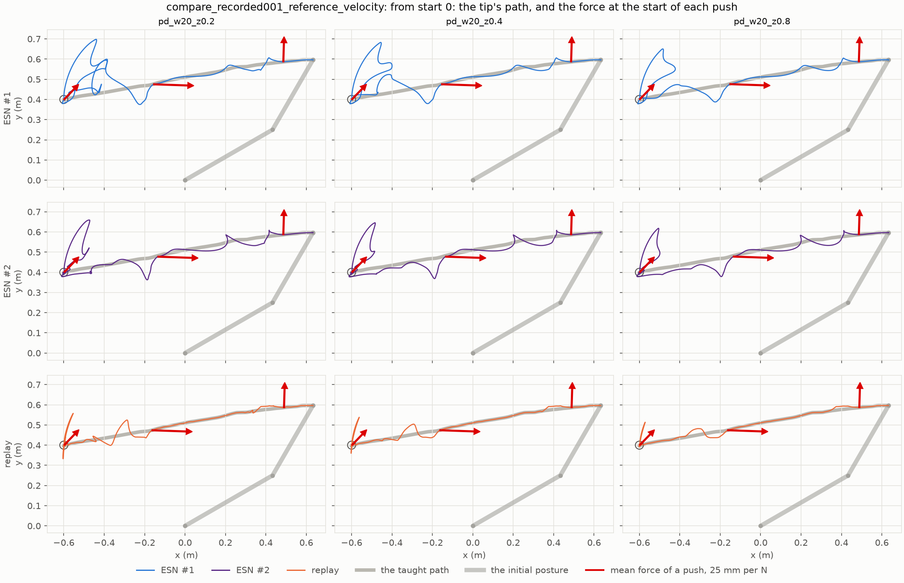

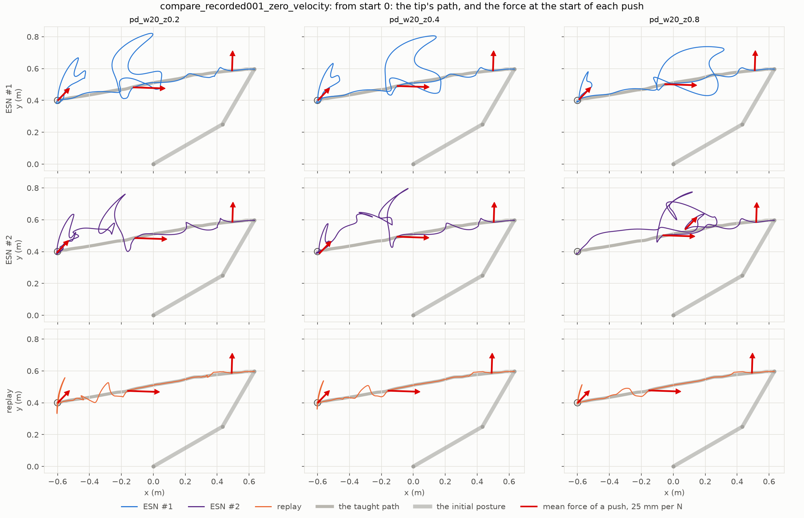

The joint angles over time, given the reference velocity and given a zero reference
velocity:

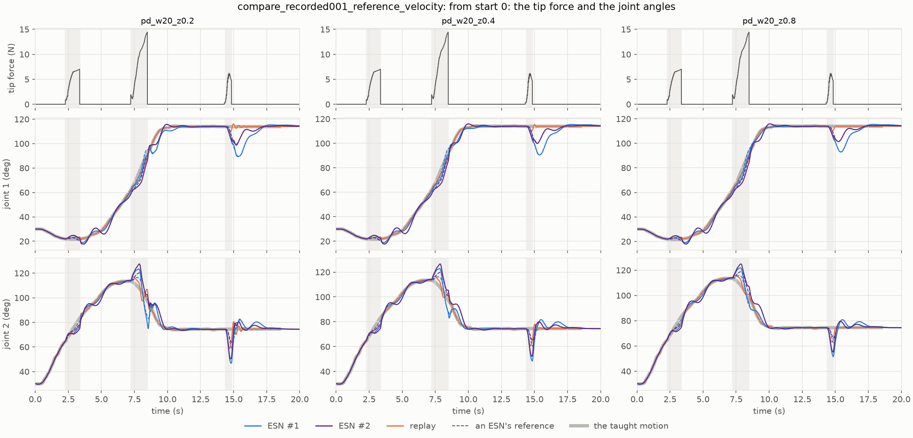

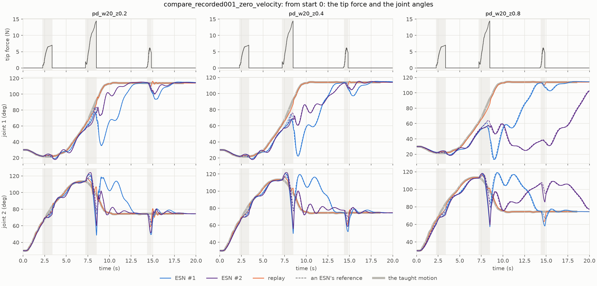

The joint torques over time, given the reference velocity (given a zero reference
velocity: [torques](results/20261014-203410-compare_recorded001_zero_velocity/torques.png)):

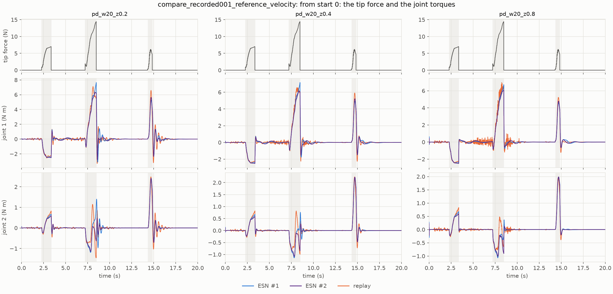

**The following gain**, ESN #1 / ESN #2:

| Tracker | Push 1 | Push 2 | Push 3 |
| --- | --- | --- | --- |
| ζ 0.2, zero reference velocity | 0.65 / 0.77 | 0.81 / 0.64 | 0.80 / 0.69 |
| ζ 0.4, zero reference velocity | 0.67 / 0.76 | 0.85 / 0.73 | 0.79 / 0.60 |
| ζ 0.8, zero reference velocity | 0.72 / 0.76 | 0.88 / 0.81 | 0.75 / 0.70 |
| ζ 0.2, reference velocity | 0.65 / 0.78 | 0.51 / 0.57 | 0.80 / 0.67 |
| ζ 0.4, reference velocity | 0.66 / 0.78 | 0.50 / 0.59 | 0.80 / 0.67 |
| ζ 0.8, reference velocity | 0.68 / 0.79 | 0.52 / 0.60 | 0.79 / 0.68 |

**The ringing over the next 2 s** (mm):

| Tracker | Push 1 | Push 2 | Push 3 |
| --- | --- | --- | --- |
| ζ 0.2, zero reference velocity | 2.7 / 2.6 / 3.9 | 34.4 / 30.5 / 8.4 | 13.7 / 14.3 / 20.8 |
| ζ 0.4, zero reference velocity | 1.6 / 1.6 / 2.5 | 27.0 / 25.2 / 4.5 | 9.5 / 9.5 / 12.7 |
| ζ 0.8, zero reference velocity | 0.9 / 0.9 / 1.5 | 17.6 / 17.2 / 2.7 | 5.8 / 5.2 / 7.3 |
| ζ 0.2, reference velocity | 2.9 / 2.8 / 4.0 | 18.8 / 6.9 / 8.6 | 15.4 / 15.7 / 20.8 |
| ζ 0.4, reference velocity | 2.0 / 2.0 / 2.6 | 8.5 / 4.8 / 4.5 | 11.4 / 11.5 / 12.7 |
| ζ 0.8, reference velocity | 1.3 / 1.4 / 1.7 | 3.3 / 3.5 / 2.4 | 7.5 / 7.6 / 7.3 |

**Back within 5 mm of the taught path** (s after the push's end):

| Tracker | Push 1 | Push 2 | Push 3 |
| --- | --- | --- | --- |
| ζ 0.2, zero reference velocity | 3.29 / 3.59 / 0.16 | 3.38 / 5.89 / 0.41 | 5.37 / 4.45 / 1.16 |
| ζ 0.4, zero reference velocity | 2.87 / 3.78 / 0.06 | 5.30 / – / 0.05 | 5.34 / 3.22 / 0.46 |
| ζ 0.8, zero reference velocity | 3.39 / 3.35 / 0.10 | 5.76 / – / 0.11 | 5.18 / – / 0.25 |
| ζ 0.2, reference velocity | 3.10 / 3.85 / 0.16 | 2.46 / 1.77 / 0.41 | 5.37 / 4.39 / 1.16 |
| ζ 0.4, reference velocity | 3.12 / 3.40 / 0.06 | 2.36 / 1.86 / 0.06 | 5.29 / 4.34 / 0.46 |
| ζ 0.8, reference velocity | 3.14 / 3.42 / 0.10 | 2.17 / 1.95 / 0.08 | 5.20 / 4.28 / 0.25 |

**The farthest the hand strays from the taught path** (mm):

| Tracker | Push 1 | Push 2 | Push 3 |
| --- | --- | --- | --- |
| ζ 0.2, zero reference velocity | 28 / 36 / 17 | 308 / 280 / 70 | 242 / 213 / 145 |
| ζ 0.4, zero reference velocity | 27 / 34 / 17 | 274 / 286 / 52 | 211 / 159 / 128 |
| ζ 0.8, zero reference velocity | 25 / 29 / 17 | 196 / 241 / 37 | 164 / 89 / 105 |
| ζ 0.2, reference velocity | 28 / 38 / 18 | 157 / 106 / 69 | 266 / 234 / 145 |
| ζ 0.4, reference velocity | 28 / 37 / 18 | 91 / 100 / 50 | 254 / 222 / 128 |
| ζ 0.8, reference velocity | 27 / 36 / 18 | 78 / 90 / 31 | 227 / 197 / 105 |

- **The push backward at mid-reach (push 2) splits on the reference velocity.** Given
  the reference velocity, the ESNs follow it by 0.50 to 0.60, the least of any push.
  Their arms go 78 to 157 mm off the path, against the replay's 31 to 69 mm, are back
  within 2.5 s, and arrive 0.1 to 1.1 s after the replay's.
- **Given a zero reference velocity, the same push swings both ESNs' arms away from
  the path, and takes ESN #1 back toward the start.** They follow it by 0.64 to 0.88.
  Both tips swing up to 0.74 to 0.82 m, 196 to 308 mm off the path, the references
  going with the arms. About 0.6 s after the push, ESN #1's joint 1 is down to 35°,
  22°, and 13° at ζ = 0.2, 0.4, and 0.8, where the take is at 5.5, 3.6, and 2.5 s,
  and the arm then reaches again, arriving 3.1 to 4.4 s after the replay. ESN #2's
  joint 1 holds at 55° or more at ζ = 0.2 and 0.4, and its arm arrives 2.4 s and
  4.5 s after the replay. At 0.8, its joint 1 creeps back to 25° by 12.6 s, where the
  take is at 4.2 s; the arm is still mid-reach when push 3 comes, and arrives at
  21.5 s, ending 10.7 mm from the target. The ringing after this push, 17 to 34 mm, is
  mostly this swing, not an oscillation about the path.
- **Push 3 comes during the hold of the late arms.** ESN #1 at all three damping ratios
  and ESN #2 at 0.4 arrive at 12.7 to 14.1 s, so that push 3, at 14.4 s, pushes the
  hand out of the goal before its 2 s hold ends. The replay's and the other arms' holds
  end before it.
- **After push 3, at the target,** the ESNs ring less than the replay at ζ = 0.2 and
  0.4 (14 to 16 mm against 21 mm, and 10 to 12 mm against 13 mm), and about as much at
  0.8. They go farther, up to 266 mm against 145 mm, and come back over 3.2 to 5.4 s,
  but for ESN #2 at ζ = 0.8 given a zero reference velocity, still mid-reach then.
- **The torques peak during push 2:** 6.1 to 7.7 N m for every arm given the reference
  velocity. Given a zero reference velocity, the ESNs' torques peak at its end at 9.0
  to 10.2 N m, against the replay's 6.4 to 7.1 N m. As in report 011, the
  replay's torque is jagged through the reach, most at ζ = 0.8, and the ESNs' smooth.

### 3.3 Log 002: three short pushes, one forward

The tip's path, given the reference velocity (given a zero reference velocity:
[paths](results/20261014-203410-compare_recorded002_zero_velocity/paths.png)):

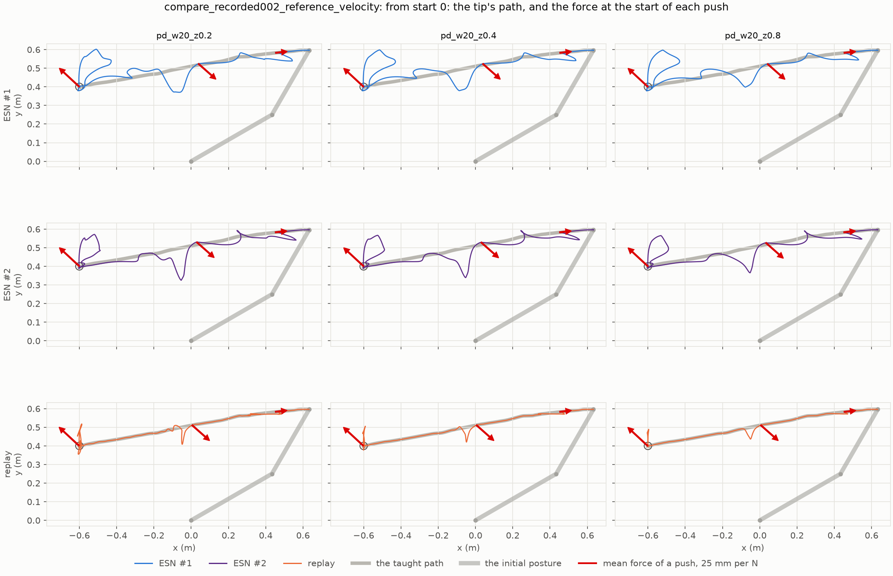

The joint angles and torques over time, given the reference velocity (given a zero
reference velocity: [joint angles](results/20261014-203410-compare_recorded002_zero_velocity/joints.png),
[torques](results/20261014-203410-compare_recorded002_zero_velocity/torques.png)):

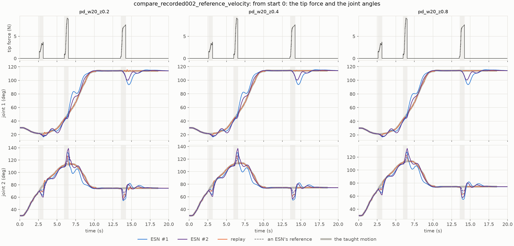

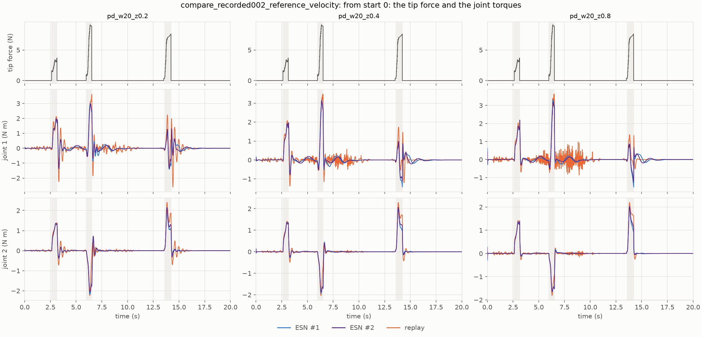

**The following gain**, ESN #1 / ESN #2:

| Tracker | Push 1 | Push 2 | Push 3 |
| --- | --- | --- | --- |
| ζ 0.2, zero reference velocity | 0.60 / 0.66 | 0.84 / 0.74 | 0.88 / 0.78 |
| ζ 0.4, zero reference velocity | 0.62 / 0.67 | 0.89 / 0.85 | 0.88 / 0.79 |
| ζ 0.8, zero reference velocity | 0.65 / 0.69 | 0.78 / 0.97 | 0.88 / 0.80 |
| ζ 0.2, reference velocity | 0.58 / 0.65 | 0.80 / 0.68 | 0.87 / 0.77 |
| ζ 0.4, reference velocity | 0.60 / 0.66 | 0.80 / 0.69 | 0.87 / 0.77 |
| ζ 0.8, reference velocity | 0.61 / 0.67 | 0.81 / 0.70 | 0.86 / 0.77 |

**The ringing over the next 2 s** (mm):

| Tracker | Push 1 | Push 2 | Push 3 |
| --- | --- | --- | --- |
| ζ 0.2, zero reference velocity | 8.7 / 8.5 / 13.9 | 5.0 / 6.0 / 6.7 | 4.0 / 5.5 / 14.7 |
| ζ 0.4, zero reference velocity | 6.3 / 6.1 / 8.5 | 2.4 / 2.3 / 4.5 | 2.7 / 3.5 / 7.6 |
| ζ 0.8, zero reference velocity | 4.1 / 4.0 / 5.1 | 3.7 / 3.3 / 2.9 | 1.8 / 2.3 / 4.2 |
| ζ 0.2, reference velocity | 9.2 / 9.0 / 13.9 | 9.4 / 10.1 / 6.8 | 4.0 / 5.6 / 14.7 |
| ζ 0.4, reference velocity | 6.9 / 6.9 / 8.5 | 6.9 / 7.2 / 4.8 | 2.8 / 3.9 / 7.6 |
| ζ 0.8, reference velocity | 4.8 / 4.8 / 5.2 | 4.3 / 4.4 / 3.3 | 2.0 / 2.7 / 4.2 |

**Back within 5 mm of the taught path** (s after the push's end):

| Tracker | Push 1 | Push 2 | Push 3 |
| --- | --- | --- | --- |
| ζ 0.2, zero reference velocity | 2.53 / 2.69 / 0.25 | 2.92 / 2.95 / 0.42 | 5.05 / 4.30 / 1.00 |
| ζ 0.4, zero reference velocity | 2.77 / – / 0.09 | 2.60 / 1.86 / 0.19 | 5.26 / 4.48 / 0.44 |
| ζ 0.8, zero reference velocity | – / – / 0.09 | 3.93 / 3.82 / 0.13 | 5.62 / 4.83 / 0.16 |
| ζ 0.2, reference velocity | – / – / 0.25 | 2.26 / 2.76 / 0.43 | 4.86 / 4.17 / 1.00 |
| ζ 0.4, reference velocity | – / – / 0.09 | 2.25 / 2.83 / 0.20 | 4.89 / 4.19 / 0.44 |
| ζ 0.8, reference velocity | – / – / 0.08 | 2.25 / 2.96 / 0.14 | 4.96 / 4.24 / 0.16 |

**The farthest the hand strays from the taught path** (mm):

| Tracker | Push 1 | Push 2 | Push 3 |
| --- | --- | --- | --- |
| ζ 0.2, zero reference velocity | 50 / 49 / 15 | 90 / 113 / 89 | 176 / 151 / 113 |
| ζ 0.4, zero reference velocity | 47 / 45 / 15 | 60 / 70 / 76 | 166 / 142 / 102 |
| ζ 0.8, zero reference velocity | 42 / 41 / 14 | 34 / 38 / 59 | 150 / 132 / 87 |
| ζ 0.2, reference velocity | 52 / 52 / 15 | 125 / 171 / 90 | 182 / 154 / 113 |
| ζ 0.4, reference velocity | 50 / 49 / 14 | 112 / 157 / 78 | 179 / 150 / 102 |
| ζ 0.8, reference velocity | 46 / 45 / 13 | 95 / 132 / 63 | 179 / 149 / 87 |

- **After the push backward early in the reach (push 1),** the ESNs' arms stray about
  three times as far as the replay's, 41 to 52 mm against 13 to 15 mm. Given the
  reference velocity, neither is back within 5 mm before push 2, 2.8 s later.
- **After the push backward and down at mid-reach (push 2),** ESN #1's reference runs
  ahead of the take, as after log 000's push 2. Given a zero reference velocity, at
  ζ = 0.4 and 0.8, both ESNs' arms stray less than the replay's (34 to 70 mm against
  59 to 76 mm). Given the reference velocity, they stray more (95 to 171 mm against
  63 to 90 mm) and ring more (4.3 to 10.1 mm against 3.3 to 6.8 mm).
- **After the push forward and up at the target (push 3),** the ESNs ring a quarter to
  two-thirds as much as the replay (1.8 to 5.6 mm against 4.2 to 14.7 mm), and come
  back over 4.2 to 5.6 s. Given the reference velocity, both arrive at about 9.4 s,
  0.1 to 0.2 s before the replay, carried ahead by push 2.

### 3.4 Over the ten pushes

The median over the ten pushes of the three logs, with the least and the most. A hand
not back counts as back at the next push or the run's end, so that the ESNs' return
is a lower bound; the count of pushes it is not back after follows it.

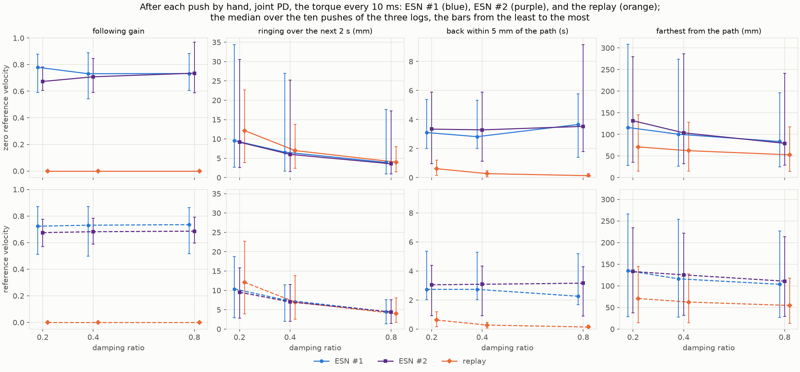

| Tracker | Following, ESN #1 / ESN #2 | Ringing (mm) | Back within 5 mm (s); not back | Farthest (mm) |
| --- | --- | --- | --- | --- |
| ζ 0.2, zero reference velocity | 0.78 (0.59 to 0.88) / 0.67 (0.61 to 0.78) | 9.6 (2.7 to 34.4) / 9.2 (2.6 to 30.5) / 12.2 (3.9 to 22.7) | 3.1; 2 / 3.3; 2 / 0.6; 0 | 116 (28 to 308) / 132 (36 to 280) / 71 (15 to 145) |
| ζ 0.4, zero reference velocity | 0.73 (0.54 to 0.89) / 0.71 (0.59 to 0.85) | 6.6 (1.6 to 27.0) / 6.0 (1.6 to 25.2) / 7.0 (2.5 to 13.8) | 2.8; 2 / 3.3; 4 / 0.3; 0 | 100 (27 to 274) / 104 (32 to 286) / 62 (15 to 128) |
| ζ 0.8, zero reference velocity | 0.73 (0.61 to 0.88) / 0.74 (0.59 to 0.97) | 3.9 (0.9 to 17.6) / 3.6 (0.9 to 17.2) / 4.0 (1.5 to 8.0) | 3.7; 3 / 3.5; 4 / 0.1; 0 | 84 (25 to 196) / 79 (29 to 241) / 53 (14 to 118) |
| ζ 0.2, reference velocity | 0.72 (0.51 to 0.87) / 0.68 (0.57 to 0.78) | 10.4 (2.9 to 18.8) / 9.5 (2.8 to 15.8) / 12.1 (4.0 to 22.7) | 2.7; 3 / 3.0; 3 / 0.6; 0 | 135 (28 to 266) / 133 (38 to 234) / 71 (15 to 145) |
| ζ 0.4, reference velocity | 0.73 (0.50 to 0.87) / 0.68 (0.59 to 0.78) | 7.5 (2.0 to 11.4) / 7.0 (2.0 to 11.5) / 7.0 (2.6 to 13.8) | 2.7; 3 / 3.1; 3 / 0.3; 0 | 116 (28 to 254) / 125 (32 to 222) / 62 (14 to 128) |
| ζ 0.8, reference velocity | 0.74 (0.52 to 0.86) / 0.69 (0.60 to 0.79) | 4.5 (1.3 to 7.5) / 4.4 (1.4 to 7.6) / 4.0 (1.7 to 8.0) | 2.3; 2 / 3.2; 3 / 0.1; 0 | 104 (27 to 227) / 111 (29 to 214) / 55 (13 to 118) |

- **The following holds with every tracker,** 0.67 to 0.78 in the median, as under
  report 011's scripted pushes (0.61 to 0.84). It is least after log 001's push 2
  given the reference velocity (0.50 to 0.60).
- **The ESNs ring about four-fifths as much as the replay at ζ = 0.2** (9.2 to 10.4 mm
  against 12.1 to 12.2 mm, in the median), and about as much at 0.4 and 0.8. Under
  report 011's scripted pushes, they rang about half as much at 0.2.
- **They go farther and come back later:** 79 to 135 mm against 53 to 71 mm, and 2.3
  to 3.7 s against 0.1 to 0.6 s, with 2 to 4 of the ten pushes not back. The replay's
  arm is back after every push, within 1.2 s.

### 3.5 Arriving, holding, and ending

When the hand arrives within the goal (s), ESN #1 / ESN #2 / the replay; * marks a hand
that leaves the goal during its 2 s hold:

| Tracker | Log 000 | Log 001 | Log 002 |
| --- | --- | --- | --- |
| ζ 0.2, zero reference velocity | 10.22 / 9.95 / 9.63 | 12.74* / 11.96 / 9.59 | 9.61 / 9.62 / 9.59 |
| ζ 0.4, zero reference velocity | 10.32 / 10.04 / 9.59 | 13.39* / 14.13* / 9.61 | 10.18 / 9.90 / 9.61 |
| ζ 0.8, zero reference velocity | 11.50 / 10.34 / 9.66 | 14.05* / 21.47 / 9.66 | 11.09 / 10.65 / 9.66 |
| ζ 0.2, reference velocity | 10.24 / 9.88 / 9.62 | 10.62 / 10.03 / 9.57 | 9.37 / 9.45 / 9.57 |
| ζ 0.4, reference velocity | 10.15 / 9.87 / 9.56 | 10.35 / 10.11 / 9.56 | 9.37 / 9.46 / 9.56 |
| ζ 0.8, reference velocity | 10.12 / 9.88 / 9.57 | 9.68 / 10.16 / 9.56 | 9.37 / 9.49 / 9.57 |

Every arm arrives with every tracker under every log, and ends within 2.9 mm of the
target, but for ESN #2 under log 001 at ζ = 0.8 given a zero reference velocity
(10.7 mm, still settling at 24 s). Undisturbed, the ESNs arrive at 9.5 to 10.9 s, the
replay at 9.6 to 9.7 s (report 011, Section 3.4).

### 3.6 Animations

Log 001 with the damping ratio 0.4, ESN #1, ESN #2, and the replay side by side, the
recorded force drawn as a red arrow at the tip; given the reference velocity, the
tracker that ESN #2 was pushed with in the app:

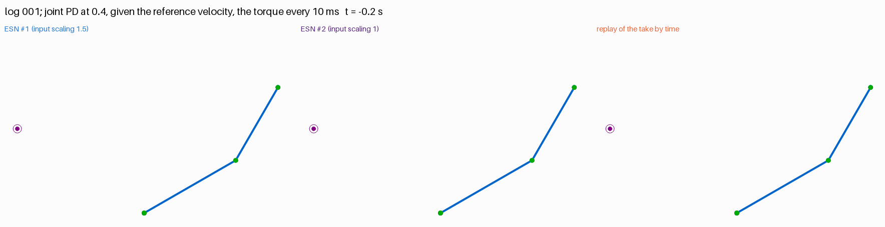

and given a zero reference velocity, where push 2 swings both ESNs' arms away from
the path and takes ESN #1's back toward the start:

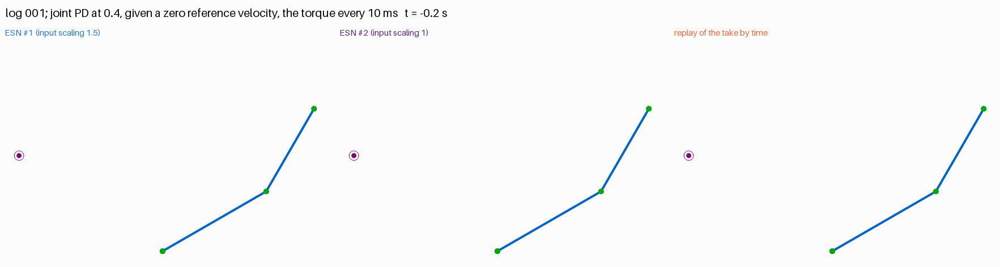

## 4. Observations

- **The following is a property of the ESN, not of the pushes it was searched with.**
  Under ten pushes by hand, in directions, forces, lengths, and times report 011 did
  not use, both ESNs follow by about 0.7, as under the scripted pushes, with every
  tracker.
- **A following reference goes where a strong push takes the arm, even back along the
  reach.** Given a zero reference velocity, log 001's push 2 took ESN #1 back toward
  the start, and from there it reached again, as a reference that adapts to the arm's
  actual state would; ESN #2's reference went with its arm, up and away from the path. Whether a reach that starts over is wanted is a question
  for the task. Given the reference velocity, the same push moved them half as far,
  and they went on with the reach; why the reference velocity changes this so much was
  not looked into.
- **Following helps most against light damping and a push at the target.** There, the
  ESNs ring a quarter to three-quarters as much as the replay at ζ = 0.2. Over all ten
  pushes, their edge in ringing is smaller than under the scripted pushes: about
  four-fifths of the replay's at 0.2, and none at 0.4 and 0.8.
- **Following still costs the return, as in report 011.** The ESNs' arms go farther from
  the path and come back over seconds, where the replay's snaps back within 1.2 s.
  Pushes 2 to 3 s apart, as in logs 000 and 002, often find them not yet back.
- **ESN #1 and ESN #2 behave alike,** with differences that depend on the push. After
  the short pushes at mid-reach (logs 000 and 002), ESN #1's reference runs further
  ahead, and ESN #2's arm strays farther given the reference velocity. After log 001's
  push 2, given a zero reference velocity, ESN #1 goes back toward the start and
  reaches again, where ESN #2 goes on, but for ζ = 0.8, where it creeps back.
- **Recorded forces work as a test:** each arm meets the same force bit for bit, and a
  recording rerun with its own ESN and tracker retraces it within 0.45°, the
  difference coming from the app's former gains.

## 5. Next steps

1. **Why the reference velocity changes the response to a strong push:** log 001's
   push 2 takes the ESNs back toward the start given a zero reference velocity, but
   not given the reference's.
2. **More pushes by hand,** also given to ESN #1 and to the replay, so that the force is
   shaped by each arm's motion in turn, and pushes at times the three logs do not
   cover, such as during the hold.
3. **A faster return that keeps the following:** as report 011 proposed, training the
   ESN to go on from a displaced posture back to the reach.
