# 013 Equal gains for both joints

**Summary.** Reports 011 and 012 ran joint PD with each joint's gains scaled by its
inertia, so that each joint alone would track with ω = 20 rad/s and a set damping
ratio. Here both joints take the same gains, kp = 80 N m/rad and kd = 3 N m s/rad,
in every scenario of the two reports: undisturbed, the block, report 011's three
pushes, the 49 offset starts, and report 012's ten pushes by hand, for ESN #1, ESN #2,
and the replay of the take, given a zero reference velocity or the reference's, the
torque computed every 10 ms. They are compared with reports 011's and 012's runs at
ω = 20 rad/s and ζ = 0.4.

- **Each joint alone:** joint 1 has ω = 20.7 rad/s and ζ = 0.39 at the target, 18.4
  to 24.4 rad/s and 0.35 to 0.46 over the reach, almost report 011's 20 rad/s and
  0.4. Joint 2, whose inertia is an eighth of joint 1's, has ω = 59.8 rad/s and
  ζ = 1.12: three times faster, and overdamped.
- **With the torque held for 10 ms, joint 2's gains are too high where the arm
  starts.** The two joints together have a fast mode that, with the held torque,
  flips sign every 10 ms. It grows wherever joint 2 is under 69.5°, three-fold per
  period at the start (30°), and decays above, by 0.85 per period at the target.
  With the torque computed every 2 ms, every posture is stable.
- **So every run starts with a chatter:** joint 2's torque flips sign every 10 ms,
  up to 750 to 2,200 N m from the demonstrated start and 3,800 N m from the offset
  starts, against 0.1 to 79 N m with report 011's gains. Joint 2 swings up to its
  limit at 180° and the hand moves at up to 37 m/s. The chatter ends once the
  reference takes joint 2 a few degrees past 69.5°: by 1.2 to 2.0 s for the ESNs,
  whose reference follows the flung arm up, and by 3.0 s for the replay. It never
  comes back.
- **Every run still arrives,** and every one holds, from all 49 offset starts too,
  but for three runs under log 000: there, the chatter throws the ESNs ahead, so that
  they arrive at 8.0 to 8.3 s and the push at 8.6 s comes during their hold.
- **After the chatter, the pushes do far less.** Over the 13 pushes, in the median,
  the hand strays 22 to 39 mm from the taught path against 70 to 150 mm, rings 1.6 to
  2.2 mm against 5.9 to 7.6 mm, and the ESNs' hands are back within 0.7 to 1.3 s
  against 2.8 to 3.5 s. The ESNs follow by 0.78 to 0.90 against 0.69 to 0.80. Log
  001's strong push no longer takes ESN #1 back toward the start.
- **The chatter leaves the ESNs off the taught path.** Undisturbed, after the
  chatter, the replay's hand keeps within 0.2 mm (RMS) of it, a little closer than
  with report 011's gains (0.3 mm). The ESNs, whose references the chatter sent onto
  a route of their own, keep 1.7 to 6.6 mm (RMS) and up to 38 mm off it, against 0.6
  to 1.8 mm.

## 1. Question

1. What natural frequency and damping ratio do joint PD's gains kp = 80 N m/rad and
   kd = 3 N m s/rad, the same for both joints, give the tracking error?
2. How do report 011's two ESNs and the replay of the take do with them, against
   reports 011 and 012's gains scaled by each joint's inertia, in every scenario of
   the two reports?

## 2. Setup

### The arms, the scenarios, and the trackers

The arms are report 011's ESN #1 (leak rate 0.03, spectral radius 1.2, input scaling
1.5, seed 8), ESN #2 (input scaling 1, seed 2), and the replay of the take. The
scenarios are report 011's and report 012's, each run for 24 s:

- **Undisturbed,** from the demonstrated start.
- **The block:** the tip held from 4.5 s to 5.5 s, in mid-reach, then let go.
- **Report 011's three pushes** of 0.5 s at the tip: 3 N nearly forward at 3 s, 5 N
  nearly across at 7 s, and 4 N nearly across the other way at 15 s, after the hold.
- **The 49 offset starts,** undisturbed: the demonstrated start offset by −15° to 15°
  in each joint, every 5°, so that joint 2 starts at 15° to 45°.
- **Report 012's ten pushes by hand,** recorded in three logs and replayed by time:
  2.3 to 8.0 N in the mean, up to 14.4 N, for 0.4 to 1.3 s (see
  [report 012, Section 2](../012-pushes-by-hand/README.md#2-setup)). Each log's first
  push comes at 2.3 to 2.6 s.

The tracker is joint PD at kp = 80 N m/rad and kd = 3 N m s/rad for both joints,
given in `[tracker]` as `kp` and `kd` (new in `robot_esn.py`, `2b7d0f3`), given a zero reference
velocity or the reference's, with the torque computed every 10 ms and held between,
while the arm is simulated every 2 ms, as in reports 011 and 012. It is compared with
their joint PD at ω = 20 rad/s and ζ = 0.4, whose gains are scaled by each joint's
inertia at the take's final posture: kp = 74.96 and 8.96 N m/rad, and kd = 3.00 and
0.358 N m s/rad. Joint 1's gains are almost the same; joint 2's are 8.9 times stiffer
and 8.4 times more damped.

### The natural frequency and the damping ratio

The tracking error is taken three ways:

- **Each joint alone,** as reports 011 and 012 set their gains: with the joint's
  inertia M_ii, the diagonal of the mass matrix, ω = √(kp / M_ii) and
  ζ = kd / (2 √(kp M_ii)). Joint 1's inertia depends on joint 2's angle, from 0.134
  to 0.235 kg m² over the take; joint 2's is 0.0224 kg m² at every posture.
- **The two joints together:** the error of the arm at rest,
  M ë + Kd ė + Kp e = 0 with the whole mass matrix M, its coupling too, and without
  the velocity terms. Each of its eigenvalues s gives a mode's ω = |s| and
  ζ = −Re s / |s|.
- **With the torque held for 10 ms:** the torque u = −Kp e − Kd ė is computed at a
  period's start and held, so that over the period T the error of the arm at rest
  becomes e + T ė + T²/2 M⁻¹u, and its rate ė + T M⁻¹u. The eigenvalues z of this
  map tell, period by period, whether the error shrinks, every |z| below 1, or grows,
  one above 1; s = ln z / T gives each mode's ω and ζ as before. A negative z flips
  the error's sign every period. Report 011 found this way that the 10 ms hold takes
  about 0.05 off the damping ratio.

The mass matrix depends on joint 2's angle alone, so that each is computed against it.

### Measures

As in reports 011 and 012: after each disturbance, the following gain, from its onset
to 0.5 s past its end; the ringing, the RMS of the hand's motion above 1.5 Hz over the
next 2 s; the farthest the hand strays from the taught path; and when it is back within
5 mm of it, if before the next disturbance or the run's end. Also whether the hand
arrives, holds within the goal (20 mm) for 2 s, and ends there; the peak joint torque
over the run, but under the block from 4.5 s to 6 s; and the peak hand speed.

New here, **the chatter:** a 10 ms period chatters when joint 2's held torque turns
back and forth by more than 10 N m, from the period before to it and from it to the
period after. The chatter spans from the first such period to the last.

### Reproducing the results

The runs read the take as in report 011 and the ESNs by their run names (copied in
[report 011's results](../011-following-the-arm/results)), and the logs of pushes by
hand under the storage root (copied in [report 012's data](../012-pushes-by-hand/data)).
All configurations are in
[`manual_demonstration_v2_robot_equal_gains`](../../experiments/manual_demonstration_v2_robot_equal_gains/README.md),
each the configuration of the same name of reports 011 or 012 with the equal gains in
place of the three damping ratios.

| Runs | Command | Commit |
| --- | --- | --- |
| `{nominal,block,pushes,offsets,recorded000,recorded001,recorded002}_robot_<ESN>_{zero,reference}_velocity_filtered` (28) | `uv run python experiments/robot_esn.py experiments/manual_demonstration_v2_robot_equal_gains/<name>.toml` | `a2c9e8c` |
| [`summary`](results/summary) | `uv run python reports/013-equal-gains/make_figures.py --logs` | |

Every run record (`run.toml`) shows no uncommitted changes. Each run's directory here
holds its configuration, its run record, its metrics (`metrics.csv`), and, under a
recorded force, the SHA-256 of its log (`recorded_forces.toml`).
[`make_figures.py`](make_figures.py) computes the natural frequencies and damping ratios,
draws `stability.png`, and prints the tables of this report from the copies here and in
reports 011 and 012. With `--logs`, it reads the runs' logs under the storage root,
which are not kept in Git, to measure the chatter and draw the other figures.

## 3. Results

In the comparison figures, the columns are the trackers: the equal gains, then report
011's at ζ = 0.4, each given the reference velocity, then a zero reference velocity.
Over time, the ESNs' lines are drawn over the replay's, each ESN's reference dashed,
and the disturbances shaded; under a disturbance, a first row draws each arm's tip
force. With the equal gains, the torques' scale leaves out the chatter, whose end and
peak each panel states. In the paths, the rows are the arms: each panel draws the arm
at its initial posture (faint gray), the taught path (thick gray), the goal, and the
tip's path; at each disturbance's onset, a red arrow from the tip shows its mean force
over the disturbance, 25 mm per newton. In the tables, each cell gives ESN #1 / ESN #2 /
the replay, but for the following gain, whose replay's is 0; – marks a hand not back
before the next disturbance or the run's end.

### 3.1 The natural frequency and the damping ratio

**Each joint alone**, at the take's final posture (113.94°, 74.59°), and over the take:

| Tracker | Joint | kp (N m/rad) | kd (N m s/rad) | Inertia (kg m²) | ω (rad/s) | ζ | Over the take: ω (rad/s), ζ |
| --- | ---: | ---: | ---: | ---: | ---: | ---: | --- |
| kp 80, kd 3 for both joints | 1 | 80.00 | 3.000 | 0.1874 | 20.7 | 0.39 | 18.4 to 24.4, 0.35 to 0.46 |
| kp 80, kd 3 for both joints | 2 | 80.00 | 3.000 | 0.0224 | 59.8 | 1.12 | the same |
| ω 20, ζ 0.4 (reports 011, 012) | 1 | 74.96 | 2.999 | 0.1874 | 20.0 | 0.40 | 17.8 to 23.6, 0.36 to 0.47 |
| ω 20, ζ 0.4 (reports 011, 012) | 2 | 8.96 | 0.358 | 0.0224 | 20.0 | 0.40 | the same |

**The two joints together**, at the take's final posture. The decay over 10 ms is
|z|; a continuous mode's is e^(Re s × 10 ms):

| Tracker | Torque | Mode | Decay over 10 ms | ω (rad/s) | ζ |
| --- | --- | --- | ---: | ---: | ---: |
| kp 80, kd 3 for both joints | continuous | oscillates | 0.926 | 20.3 | 0.38 |
| kp 80, kd 3 for both joints | continuous | decays | 0.725 | 32.2 | 1 |
| kp 80, kd 3 for both joints | continuous | decays | 0.212 | 154.9 | 1 |
| kp 80, kd 3 for both joints | held 10 ms | oscillates | 0.930 | 21.1 | 0.34 |
| kp 80, kd 3 for both joints | held 10 ms | flips sign every period | 0.851 | 314.6 | 0.05 |
| kp 80, kd 3 for both joints | held 10 ms | decays | 0.730 | 31.4 | 1 |
| ω 20, ζ 0.4 (reports 011, 012) | continuous | oscillates | 0.948 | 16.3 | 0.33 |
| ω 20, ζ 0.4 (reports 011, 012) | continuous | oscillates | 0.849 | 28.6 | 0.57 |
| ω 20, ζ 0.4 (reports 011, 012) | held 10 ms | oscillates | 0.953 | 16.7 | 0.29 |
| ω 20, ζ 0.4 (reports 011, 012) | held 10 ms | oscillates | 0.845 | 31.1 | 0.54 |

**At the demonstrated start** (30°, 30°):

| Tracker | Torque | Mode | Decay over 10 ms | ω (rad/s) | ζ |
| --- | --- | --- | ---: | ---: | ---: |
| kp 80, kd 3 for both joints | continuous | oscillates | 0.942 | 17.9 | 0.34 |
| kp 80, kd 3 for both joints | continuous | decays | 0.749 | 28.9 | 1 |
| kp 80, kd 3 for both joints | continuous | decays | 0.033 | 342.0 | 1 |
| kp 80, kd 3 for both joints | held 10 ms | flips sign every period, **grows** | 2.953 | 332.3 | −0.33 |
| kp 80, kd 3 for both joints | held 10 ms | oscillates | 0.947 | 18.4 | 0.30 |
| kp 80, kd 3 for both joints | held 10 ms | decays | 0.750 | 28.8 | 1 |
| ω 20, ζ 0.4 (reports 011, 012) | continuous | oscillates | 0.961 | 14.1 | 0.28 |
| ω 20, ζ 0.4 (reports 011, 012) | continuous | oscillates | 0.715 | 41.0 | 0.82 |
| ω 20, ζ 0.4 (reports 011, 012) | held 10 ms | oscillates | 0.965 | 14.3 | 0.25 |
| ω 20, ζ 0.4 (reports 011, 012) | held 10 ms | oscillates | 0.643 | 50.8 | 0.87 |

Against joint 2's angle, the largest |z| over 10 ms:

- **Joint 1 tracks as with report 011's gains:** ω = 20.7 rad/s and ζ = 0.39 alone,
  and together with joint 2 an oscillating mode of 20.3 rad/s and ζ = 0.38, 0.34 with
  the torque held.
- **Joint 2 alone is fast and overdamped,** ω = 59.8 rad/s and ζ = 1.12: kp = 80 is
  8.9 times its gain at ω = 20, for an inertia of 0.0224 kg m². Together, the joints'
  continuous modes are one oscillation and two decays, at 32 and 155 s⁻¹ at the target.
- **With the torque held for 10 ms, the fastest decay turns into a flip.** At the
  target it flips sign every period and shrinks by 0.85 per period, an oscillation at
  50 Hz with ζ = 0.05. Below joint 2 at 69.5°, it grows: at the start, three-fold per
  period. The 49 offset starts, joint 2 at 15° to 45°, are all below the bound, where
  |z| is 2.0 to 3.9. With the torque computed every 2 ms, the largest |z| over 10 ms
  is 0.85 to 0.95 at every angle; report 011's gains, held 10 ms, give 0.93 to 0.97.
- **Why joint 2:** while joint 1 moves along with it, joint 2 feels the inertia
  M₂₂ − M₁₂²/M₁₁, less than M₂₂: 0.0086 kg m² at the start, 0.0156 at the bound, and
  0.0166 at the target. A damping torque −kd ė held for T multiplies the velocity by
  1 − kd T / M, which is below −1 once kd T / M is above 2: the velocity then flips
  and grows each period. With kd = 3, kd T / M is 3.5 at the start, 1.93 at the
  bound, and 1.81 at the target; with report 011's kd = 0.358, it is 0.54 at most, at
  any angle. Taken alone, with M₂₂, joint 2 (1.34) would seem stable.
- **Report 011's gains, taken together, are not ω = 20 and ζ = 0.4 either:** at the
  target, their modes are 16.3 rad/s with ζ = 0.33 and 28.6 rad/s with ζ = 0.57, and
  0.29 and 0.54 with the torque held, as `tracking_gains` warns ("only approximate,
  since the inertia changes with the posture and couples the joints").

### 3.2 The chatter at the start

The first 4 s undisturbed with the equal gains, and joint 2's torque over 0.2 s
(shaded), where the minor grid marks each 10 ms period:

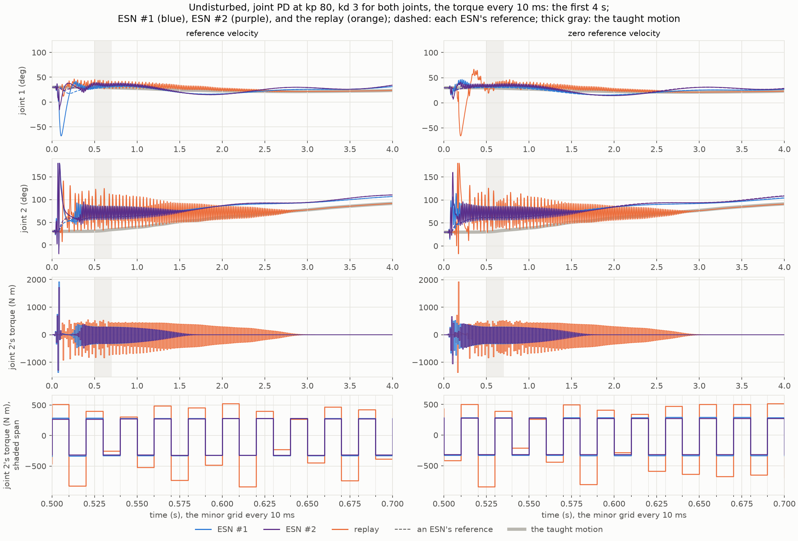

When each run's chatter starts and ends (s), and its peak joint torque until then (N m):

| Scenario | Reference velocity | From (s) | Last period (s) | Peak torque (N m) |
| --- | --- | --- | --- | --- |
| undisturbed, the block, report 011's pushes | the reference's | 0.02 / 0.02 / 0.09 | 1.60 / 1.68 / 2.96 | 1,918 / 1,713 / 924 |
| undisturbed, the block, report 011's pushes | zero | 0.04 / 0.04 / 0.11 | 1.66 / 1.75 / 2.99 to 3.00 | 749 / 1,062 / 1,927 |
| the offset start −15°, −15° | the reference's | 0.00 / 0.00 / 0.00 | 1.63 / 1.71 / 2.96 | 1,074 / 784 / 1,977 |
| the offset start −15°, −15° | zero | 0.01 / 0.02 / 0.01 | 1.71 / 1.84 / 3.00 | 1,140 / 2,656 / 1,414 |
| report 012's three logs | the reference's | 0.02 / 0.02 / 0.06 | 1.60 / 1.68 / 2.98 to 3.00 | 1,918 / 1,716 / 1,555 |
| report 012's three logs | zero | 0.04 / 0.04 / 0.09 | 1.66 / 1.75 / 3.01 to 3.04 | 747 / 1,059 / 2,178 |

- **The chatter starts as soon as the reference moves,** within 0.1 s of the task's
  start: during the warm-up, the arm holds its start posture without error, and the
  growing mode has nothing to grow from.
- **It is violent.** In the shaded span, joint 2's torque flips between about
  ±300 N m (the ESNs) and ±500 to 800 N m (the replay) every 10 ms; it peaks at 750
  to 2,200 N m. Joint 2
  swings by tens of degrees within a period, at up to 45,000°/s, up to its limit at
  180° and down to −19°; joint 1 is thrown to −68° in some runs. The hand moves at up
  to 37 m/s, against 0.3 m/s with report 011's gains.
- **It stays bounded, and ends past the bound.** The swings carry joint 2 above
  69.5°, where the mode decays, 55 to 59% of the time, so that the chatter settles
  into a bounded swing rather than growing without end. It dies out once the
  reference has joint 2 at 77° to 79°, a few degrees past the bound, so that the
  swings no longer reach below it: by 1.6 to 1.75 s for the ESNs, whose references
  follow the flung arm up (dashed) and are then 24° ahead of the take in joint 2, and
  by 3.0 s for the replay, whose reference keeps to the take. In every run, joint 2
  then stays above 71.3°, and the chatter never comes back.
- **The pushes by hand meet the replay while it chatters:** each log's first push,
  at 2.3 to 2.6 s, comes before the replay's chatter ends at 3.0 s, so that the
  replay's measures after it include the chatter's end. Report 011's first push, at
  3 s, comes just after.
- **The details differ from run to run** with the same arm and tracker: from the
  logs' start posture, the replay's chatter peaks at 1,555 N m where from the
  demonstrated start it peaks at 924 N m, though the two postures differ by about
  0.001°. Under the block and report 011's pushes, which come later, the first
  3 s are those of the undisturbed run.

### 3.3 Undisturbed and from the offset starts

Arrival (s), final distance from the target (mm), peak torque (N m), peak hand speed
(m/s), and the RMS distance from the taught path over the run (mm):

| Tracker | Arrival (s) | Final (mm) | Peak torque (N m) | Peak hand speed (m/s) | Path (mm) |
| --- | --- | --- | --- | --- | --- |
| kp 80, kd 3 for both joints, reference velocity | 8.31 / 8.07 / 9.57 | 2.9 / 2.7 / 2.8 | 1,918 / 1,714 / 924 | 36.1 / 31.6 / 23.4 | 245.1 / 163.1 / 75.4 |
| ω 20, ζ 0.4 (reports 011, 012), reference velocity | 9.55 / 9.54 / 9.56 | 2.9 / 2.7 / 2.8 | 0.2 / 0.1 / 0.6 | 0.23 / 0.23 / 0.27 | 0.7 / 0.9 / 0.4 |
| kp 80, kd 3 for both joints, zero reference velocity | 8.79 / 8.28 / 9.61 | 2.9 / 2.7 / 2.8 | 749 / 1,062 / 1,927 | 11.1 / 24.0 / 34.7 | 74.5 / 81.4 / 191.1 |
| ω 20, ζ 0.4 (reports 011, 012), zero reference velocity | 10.18 / 9.96 / 9.61 | 2.9 / 2.7 / 2.8 | 0.1 / 0.1 / 0.3 | 0.21 / 0.22 / 0.26 | 2.5 / 2.4 / 0.4 |

After the chatter, from 3.1 s to 20 s, the distance from the taught path, RMS (largest),
in mm:

| Tracker | ESN #1 | ESN #2 | replay |
| --- | --- | --- | --- |
| kp 80, kd 3 for both joints, reference velocity | 1.7 (8.8) | 4.3 (20.8) | 0.2 (1.6) |
| ω 20, ζ 0.4 (reports 011, 012), reference velocity | 0.6 (2.3) | 0.7 (2.8) | 0.3 (1.9) |
| kp 80, kd 3 for both joints, zero reference velocity | 2.8 (13.4) | 6.6 (38.1) | 0.2 (1.2) |
| ω 20, ζ 0.4 (reports 011, 012), zero reference velocity | 1.8 (4.8) | 1.5 (4.3) | 0.3 (1.8) |

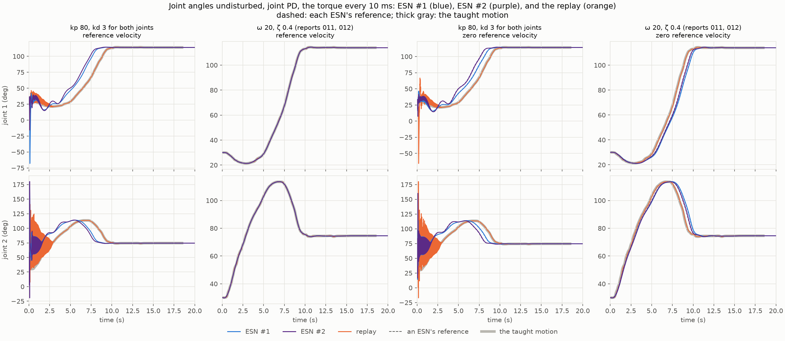

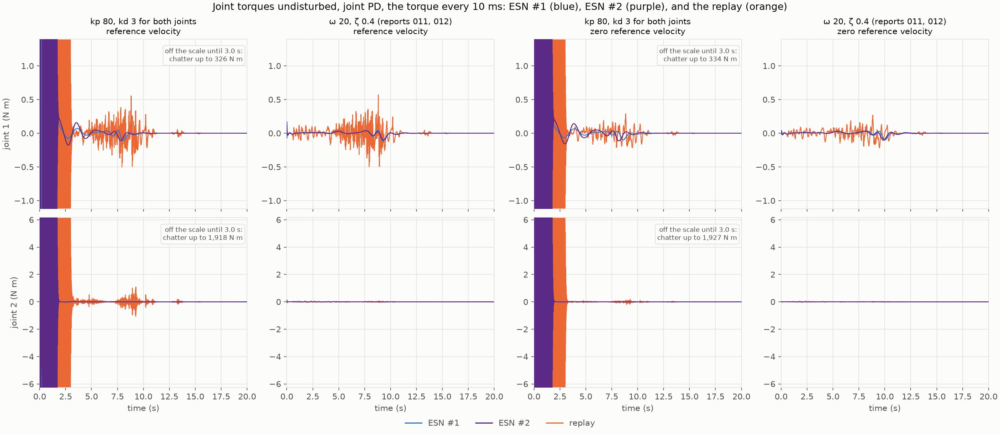

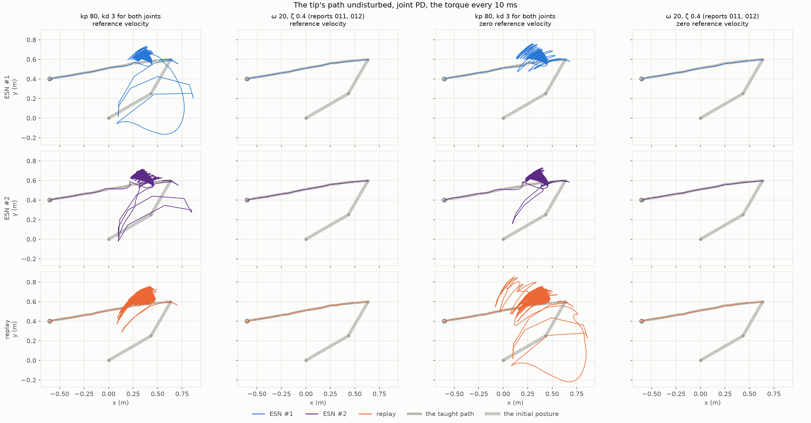

From the 49 offset starts, the successes, and the peak torque, median (largest):

| Tracker | ESN #1 | ESN #2 | replay |
| --- | --- | --- | --- |
| kp 80, kd 3 for both joints, reference velocity | 49/49; 931 (2,679) N m | 49/49; 931 (2,538) N m | 49/49; 1,158 (2,375) N m |
| ω 20, ζ 0.4 (reports 011, 012), reference velocity | 49/49; 25 (49) N m | 49/49; 27 (61) N m | 49/49; 52 (79) N m |
| kp 80, kd 3 for both joints, zero reference velocity | 49/49; 935 (3,846) N m | 49/49; 1,008 (3,716) N m | 49/49; 1,019 (2,466) N m |
| ω 20, ζ 0.4 (reports 011, 012), zero reference velocity | 49/49; 6 (12) N m | 49/49; 7 (15) N m | 49/49; 13 (20) N m |

The offset start −15° in both joints, where joint 2 starts at 15°, the farthest
into the chatter:

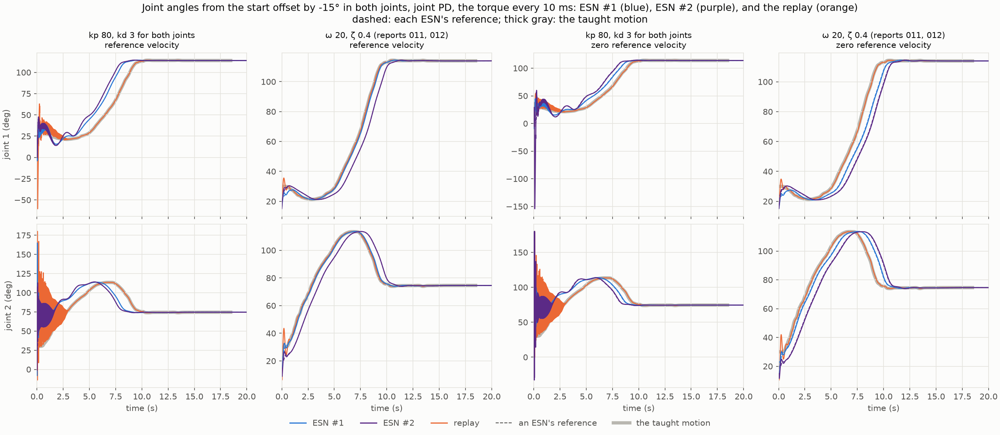

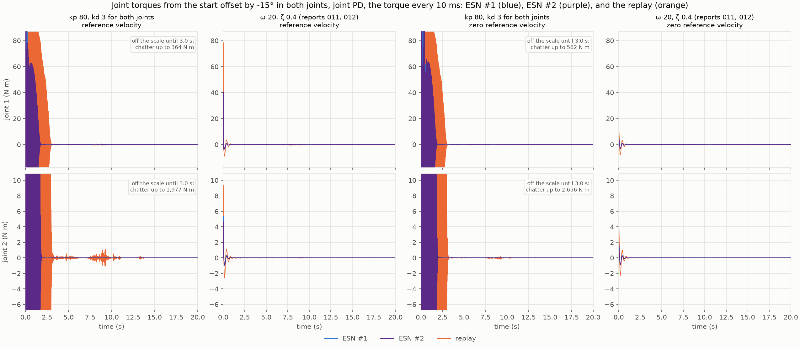

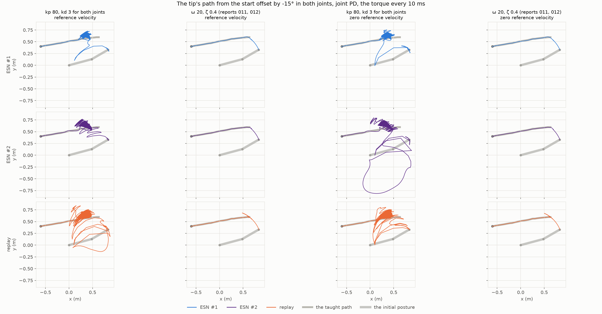

- **Every arm arrives and holds, from every start,** and ends within 2.9 mm of the
  target. The ESNs arrive at 8.1 to 8.8 s from the demonstrated start, 0.8 to 1.5 s
  before the replay and 1.2 to 1.7 s before their own arrival with report 011's
  gains: the chatter flung their arms ahead along the reach, and their references
  went with them.
- **From the offset starts, the chatter ends later the lower joint 2 starts,** for
  the ESNs from 1.2 to 1.6 s (joint 2 at 45°) to 1.6 to 2.0 s (at 15°); the replay's
  ends at 3.0 s from every start, when the take's joint 2 is past the bound. The peak
  torque is 540 to 3,800 N m, the least from the starts with joint 2 at 45°, against
  0.1 to 79 N m.
- **After the chatter, the replay tracks the taught path closely,** within 0.2 mm RMS,
  joint 2's stiffer gains holding it a little closer than report 011's (0.3 mm). The
  ESNs' hands keep 1.7 to 6.6 mm RMS off the path, up to 38 mm for ESN #2 given a zero
  reference velocity, 1.6 to 6 times as far as with report 011's gains: after the
  chatter, their references take a route of their own, joint 2 ahead of the take
  through the middle of the reach (Section 3.2's figure, and the joint angles above).

### 3.4 Under the block and report 011's pushes

**The following gain**, ESN #1 / ESN #2:

| Tracker | Block | Push 1 | Push 2 | Push 3 |
| --- | --- | --- | --- | --- |
| kp 80, kd 3 for both joints, reference velocity | 0.82 / 0.77 | 0.73 / 1.00 | 0.72 / 0.67 | 0.70 / 0.57 |
| ω 20, ζ 0.4 (reports 011, 012), reference velocity | 0.89 / 0.82 | 0.80 / 0.76 | 0.63 / 0.63 | 0.83 / 0.73 |
| kp 80, kd 3 for both joints, zero reference velocity | 0.78 / 0.65 | 0.86 / 1.03 | 0.81 / 0.66 | 0.70 / 0.58 |
| ω 20, ζ 0.4 (reports 011, 012), zero reference velocity | 0.92 / 0.86 | 0.77 / 0.73 | 0.64 / 0.62 | 0.84 / 0.74 |

**The ringing over the next 2 s** (mm):

| Tracker | Block | Push 1 | Push 2 | Push 3 |
| --- | --- | --- | --- | --- |
| kp 80, kd 3 for both joints, reference velocity | 3.2 / 4.4 / 14.2 | 1.2 / 1.2 / 1.7 | 2.5 / 2.7 / 2.0 | 1.8 / 2.0 / 2.2 |
| ω 20, ζ 0.4 (reports 011, 012), reference velocity | 3.3 / 3.6 / 17.5 | 4.9 / 5.2 / 6.8 | 8.7 / 8.1 / 10.0 | 5.5 / 6.0 / 8.5 |
| kp 80, kd 3 for both joints, zero reference velocity | 3.7 / 5.7 / 13.7 | 1.1 / 1.2 / 1.7 | 1.7 / 2.2 / 1.9 | 1.7 / 1.8 / 2.2 |
| ω 20, ζ 0.4 (reports 011, 012), zero reference velocity | 2.2 / 2.8 / 17.0 | 4.7 / 4.8 / 6.9 | 7.5 / 6.9 / 10.1 | 5.4 / 5.8 / 8.5 |

**Back within 5 mm of the taught path** (s after the end):

| Tracker | Block | Push 1 | Push 2 | Push 3 |
| --- | --- | --- | --- | --- |
| kp 80, kd 3 for both joints, reference velocity | 0.78 / 3.34 / 0.16 | 0.09 / 1.54 / 0.04 | 1.86 / 0.73 / 0.04 | 0.93 / 0.51 / 0.07 |
| ω 20, ζ 0.4 (reports 011, 012), reference velocity | 2.22 / 3.08 / 0.42 | 2.98 / – / 0.04 | 2.52 / 3.33 / 0.38 | 4.98 / 4.16 / 0.46 |
| kp 80, kd 3 for both joints, zero reference velocity | 1.32 / 3.63 / 0.16 | 1.28 / – / 0.05 | 2.43 / 0.87 / 0.04 | 1.05 / 0.59 / 0.07 |
| ω 20, ζ 0.4 (reports 011, 012), zero reference velocity | 2.61 / 4.29 / 0.42 | 3.44 / – / 0.03 | 2.88 / 3.83 / 0.38 | 5.27 / 4.43 / 0.45 |

**The farthest the hand strays from the taught path** (mm):

| Tracker | Block | Push 1 | Push 2 | Push 3 |
| --- | --- | --- | --- | --- |
| kp 80, kd 3 for both joints, reference velocity | 16 / 20 / 8 | 11 / 28 / 9 | 45 / 51 / 12 | 44 / 37 / 22 |
| ω 20, ζ 0.4 (reports 011, 012), reference velocity | 38 / 23 / 28 | 66 / 67 / 7 | 175 / 206 / 111 | 202 / 166 / 99 |
| kp 80, kd 3 for both joints, zero reference velocity | 21 / 17 / 8 | 13 / 44 / 9 | 34 / 39 / 12 | 40 / 35 / 22 |
| ω 20, ζ 0.4 (reports 011, 012), zero reference velocity | 37 / 25 / 26 | 43 / 56 / 6 | 166 / 197 / 110 | 180 / 154 / 99 |

Under the block, from 4.5 s to 6 s, the peak torque (N m):

| Tracker | Peak torque (N m) |
| --- | --- |
| kp 80, kd 3 for both joints, reference velocity | 4.4 / 6.9 / 17.0 |
| ω 20, ζ 0.4 (reports 011, 012), reference velocity | 2.2 / 0.9 / 13.1 |
| kp 80, kd 3 for both joints, zero reference velocity | 5.4 / 10.5 / 17.0 |
| ω 20, ζ 0.4 (reports 011, 012), zero reference velocity | 2.1 / 0.8 / 12.4 |

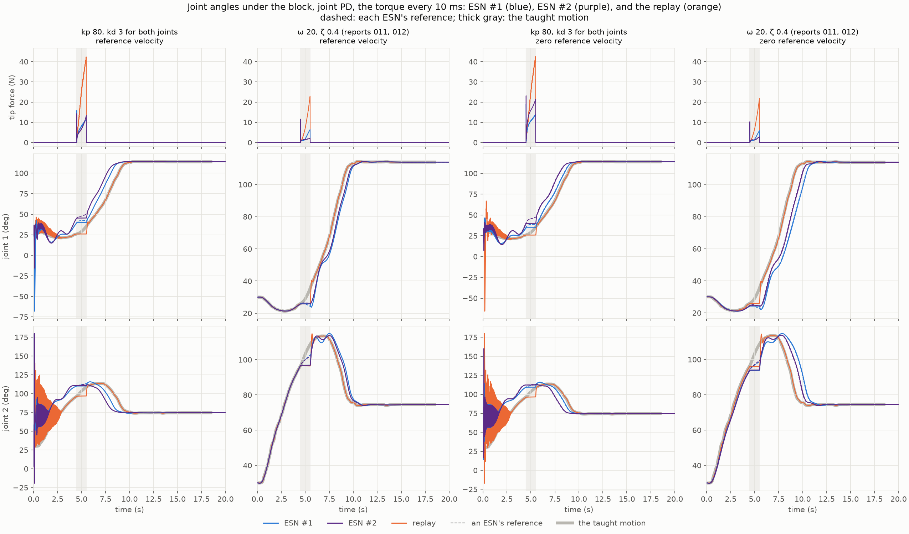

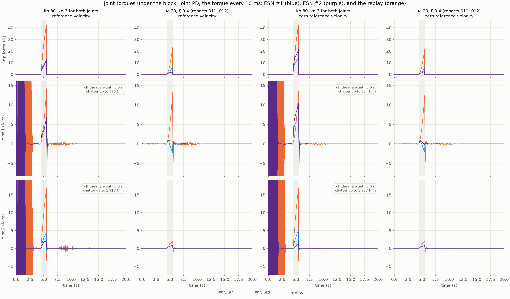

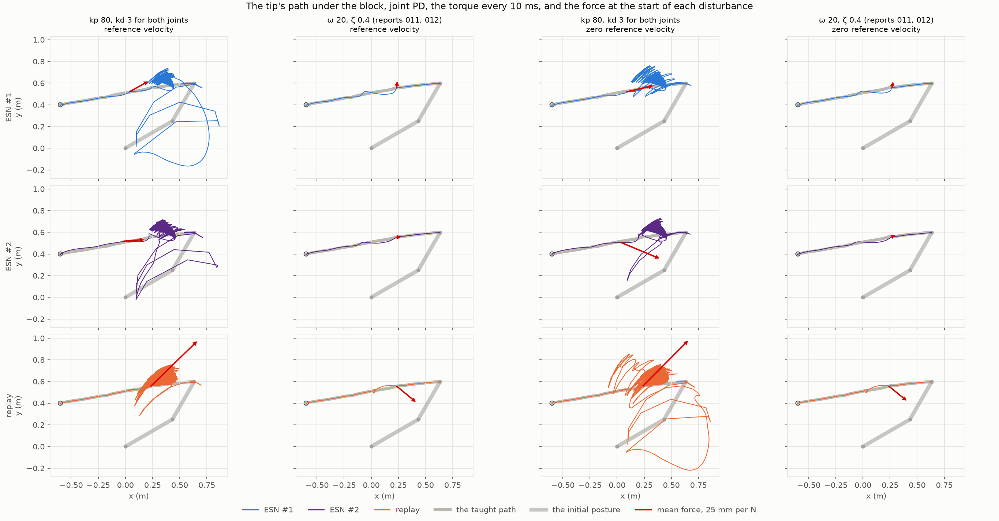

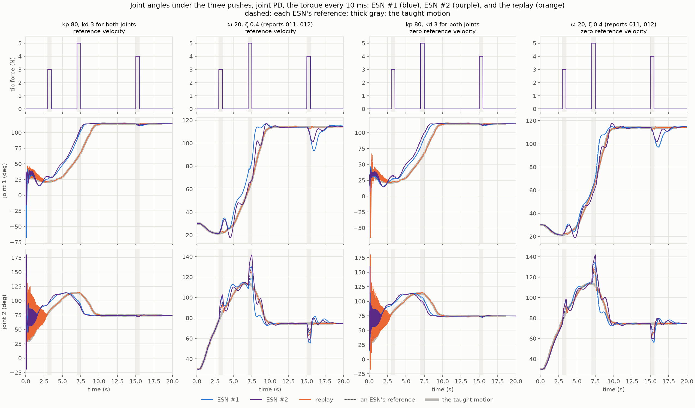

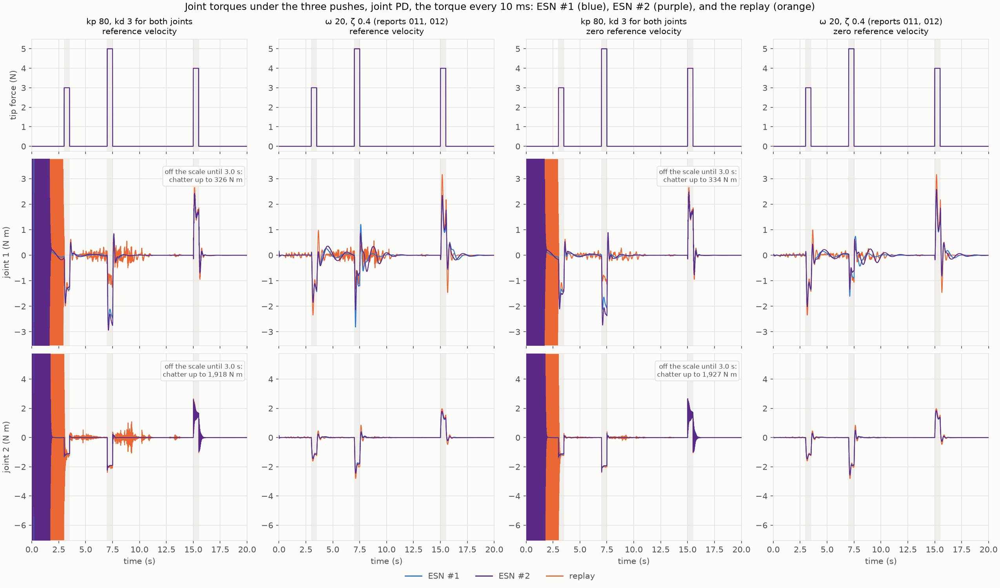

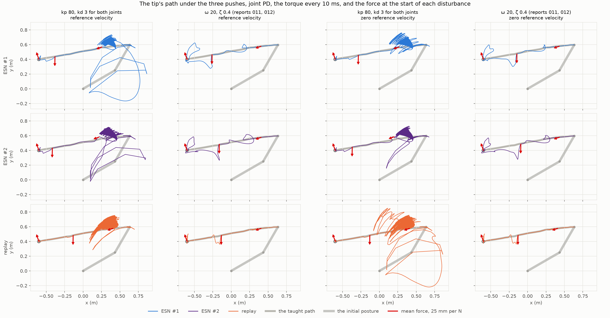

- **The pushes move the arm a fraction as far:** the push across at 7 s carries the
  hand 12 mm from the path (the replay) to 51 mm (ESN #2), against 110 to 206 mm, and
  the push at 15 s, at the target, 22 to 44 mm against 99 to 202 mm. Joint 2, 8.9
  times stiffer, gives way far less.
- **They ring a quarter to a third as much,** 1.1 to 2.7 mm against 4.7 to 10.1 mm,
  and the replay's hand is back within 0.07 s against 0.46 s. The ESNs' hands are back
  within 0.1 to 2.4 s, against 2.5 to 5.3 s; ESN #2's is not back after the first push
  given a zero reference velocity, as with report 011's gains given either.
- **The ESNs follow the pushes about as much, and the block less.** After the pushes,
  0.57 to 1.03 against 0.62 to 0.84; a following gain of 1 or more, after the first
  push, is a reference that moves as far as the arm or farther. Under the block, 0.65
  to 0.82 against 0.82 to 0.92, and they press against it with 4 to 11 N m against
  1 to 2 N m. The replay presses with 17 N m against 12 to 13 N m, and the block's
  force on its tip reaches 42 N against 22 to 23 N.
- **After the block's release, the replay rings a little less** (14 mm against 17 mm)
  and is back sooner (0.16 s against 0.42 s); the ESNs ring 3.2 to 5.7 mm against 2.2
  to 3.6 mm, and stray 16 to 21 mm against 23 to 38 mm.

### 3.5 Under the pushes by hand

Logs 000 and 002 hold four and three short pushes, log 001 three long ones, of which
the second is 8 N in the mean for 1.26 s at mid-reach (report 012, Section 2).

#### Log 000

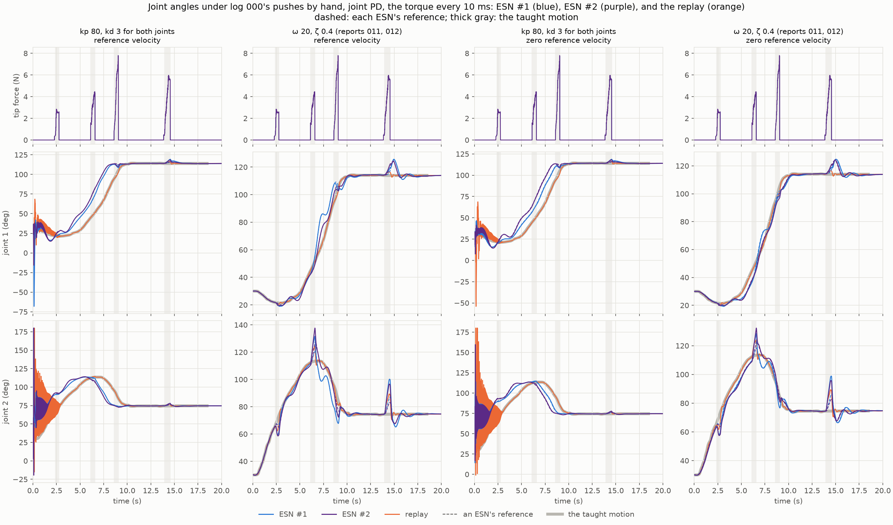

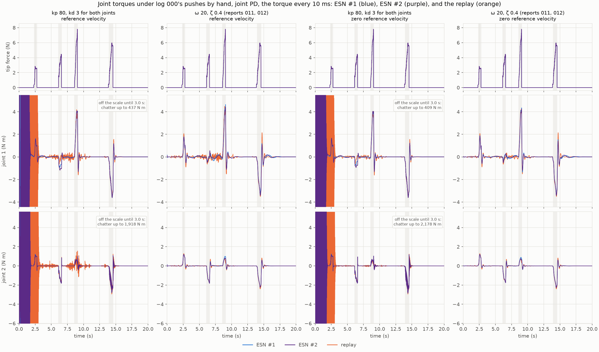

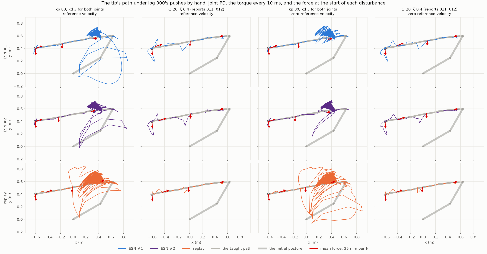

| Following, ESN #1 / ESN #2 | Push 1 | Push 2 | Push 3 | Push 4 |
| --- | --- | --- | --- | --- |
| kp 80, kd 3 for both joints, reference velocity | 0.92 / 1.02 | 0.95 / 0.93 | 0.92 / 0.91 | 0.67 / 0.55 |
| ω 20, ζ 0.4 (reports 011, 012), reference velocity | 0.58 / 0.66 | 0.80 / 0.71 | 0.83 / 0.72 | 0.62 / 0.61 |
| kp 80, kd 3 for both joints, zero reference velocity | 0.95 / 0.91 | 0.93 / 0.99 | 0.94 / 0.92 | 0.68 / 0.55 |
| ω 20, ζ 0.4 (reports 011, 012), zero reference velocity | 0.63 / 0.69 | 0.83 / 0.73 | 0.54 / 0.59 | 0.63 / 0.62 |

| Ringing (mm) | Push 1 | Push 2 | Push 3 | Push 4 |
| --- | --- | --- | --- | --- |
| kp 80, kd 3 for both joints, reference velocity | 1.1 / 1.2 / 1.6 | 1.3 / 1.3 / 1.4 | 3.9 / 4.1 / 3.6 | 3.5 / 3.6 / 3.9 |
| ω 20, ζ 0.4 (reports 011, 012), reference velocity | 4.5 / 4.5 / 6.0 | 8.2 / 7.8 / 8.5 | 8.7 / 7.5 / 6.3 | 11.2 / 11.2 / 13.8 |
| kp 80, kd 3 for both joints, zero reference velocity | 1.0 / 1.1 / 1.9 | 0.9 / 1.0 / 1.3 | 3.4 / 3.6 / 3.7 | 3.2 / 3.3 / 3.9 |
| ω 20, ζ 0.4 (reports 011, 012), zero reference velocity | 3.9 / 3.7 / 6.1 | 6.9 / 6.6 / 8.5 | 6.9 / 5.9 / 6.4 | 10.4 / 10.4 / 13.8 |

| Back within 5 mm (s) | Push 1 | Push 2 | Push 3 | Push 4 |
| --- | --- | --- | --- | --- |
| kp 80, kd 3 for both joints, reference velocity | 0.99 / 2.22 / 0.00 | 0.24 / 0.58 / 0.02 | 1.01 / 0.68 / 0.19 | 1.21 / 0.84 / 0.20 |
| ω 20, ζ 0.4 (reports 011, 012), reference velocity | 2.22 / – / 0.07 | – / – / 0.35 | – / 0.93 / 0.41 | 2.63 / 3.33 / 0.47 |
| kp 80, kd 3 for both joints, zero reference velocity | 1.80 / 2.68 / 0.00 | 0.23 / 0.12 / 0.02 | 0.98 / 0.70 / 0.20 | 1.39 / 0.97 / 0.20 |
| ω 20, ζ 0.4 (reports 011, 012), zero reference velocity | 2.68 / – / 0.07 | – / – / 0.36 | – / 1.12 / 0.42 | 2.43 / 3.45 / 0.47 |

| Farthest (mm) | Push 1 | Push 2 | Push 3 | Push 4 |
| --- | --- | --- | --- | --- |
| kp 80, kd 3 for both joints, reference velocity | 15 / 25 / 23 | 21 / 23 / 7 | 49 / 46 / 22 | 84 / 73 / 38 |
| ω 20, ζ 0.4 (reports 011, 012), reference velocity | 32 / 32 / 21 | 121 / 163 / 70 | 134 / 101 / 55 | 219 / 221 / 125 |
| kp 80, kd 3 for both joints, zero reference velocity | 26 / 34 / 24 | 14 / 15 / 7 | 44 / 41 / 22 | 75 / 67 / 38 |
| ω 20, ζ 0.4 (reports 011, 012), zero reference velocity | 31 / 32 / 22 | 99 / 126 / 70 | 102 / 81 / 55 | 208 / 207 / 125 |

#### Log 001

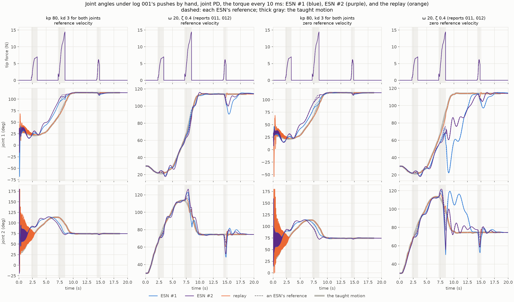

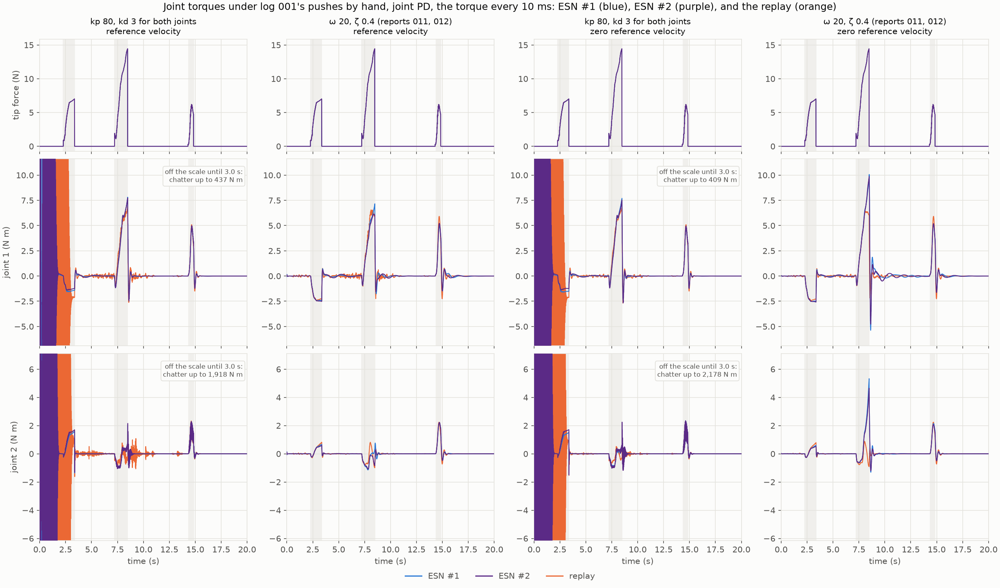

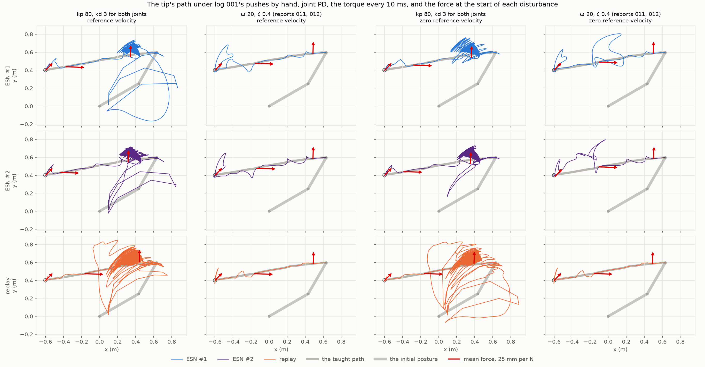

| Following, ESN #1 / ESN #2 | Push 1 | Push 2 | Push 3 |
| --- | --- | --- | --- |
| kp 80, kd 3 for both joints, reference velocity | 0.90 / 0.91 | 0.78 / 0.81 | 0.64 / 0.48 |
| ω 20, ζ 0.4 (reports 011, 012), reference velocity | 0.66 / 0.78 | 0.50 / 0.59 | 0.80 / 0.67 |
| kp 80, kd 3 for both joints, zero reference velocity | 0.89 / 0.86 | 0.71 / 0.79 | 0.64 / 0.49 |
| ω 20, ζ 0.4 (reports 011, 012), zero reference velocity | 0.67 / 0.76 | 0.85 / 0.73 | 0.79 / 0.60 |

| Ringing (mm) | Push 1 | Push 2 | Push 3 |
| --- | --- | --- | --- |
| kp 80, kd 3 for both joints, reference velocity | 1.1 / 1.2 / 1.9 | 7.2 / 7.5 / 5.4 | 3.5 / 3.8 / 3.9 |
| ω 20, ζ 0.4 (reports 011, 012), reference velocity | 2.0 / 2.0 / 2.6 | 8.5 / 4.8 / 4.5 | 11.4 / 11.5 / 12.7 |
| kp 80, kd 3 for both joints, zero reference velocity | 1.0 / 1.0 / 1.9 | 6.0 / 6.7 / 5.5 | 3.2 / 3.4 / 3.9 |
| ω 20, ζ 0.4 (reports 011, 012), zero reference velocity | 1.6 / 1.6 / 2.5 | 27.0 / 25.2 / 4.5 | 9.5 / 9.5 / 12.7 |

| Back within 5 mm (s) | Push 1 | Push 2 | Push 3 |
| --- | --- | --- | --- |
| kp 80, kd 3 for both joints, reference velocity | 2.23 / 3.02 / 0.06 | 1.30 / 3.28 / 0.20 | 1.12 / 0.64 / 0.20 |
| ω 20, ζ 0.4 (reports 011, 012), reference velocity | 3.12 / 3.40 / 0.06 | 2.36 / 1.86 / 0.06 | 5.29 / 4.34 / 0.46 |
| kp 80, kd 3 for both joints, zero reference velocity | 2.69 / 3.77 / 0.06 | 1.59 / 3.45 / 0.20 | 1.25 / 0.73 / 0.20 |
| ω 20, ζ 0.4 (reports 011, 012), zero reference velocity | 2.87 / 3.78 / 0.06 | 5.30 / – / 0.05 | 5.34 / 3.22 / 0.46 |

| Farthest (mm) | Push 1 | Push 2 | Push 3 |
| --- | --- | --- | --- |
| kp 80, kd 3 for both joints, reference velocity | 28 / 46 / 28 | 109 / 101 / 25 | 61 / 56 / 36 |
| ω 20, ζ 0.4 (reports 011, 012), reference velocity | 28 / 37 / 18 | 91 / 100 / 50 | 254 / 222 / 128 |
| kp 80, kd 3 for both joints, zero reference velocity | 34 / 49 / 29 | 86 / 94 / 25 | 54 / 50 / 36 |
| ω 20, ζ 0.4 (reports 011, 012), zero reference velocity | 27 / 34 / 17 | 274 / 286 / 52 | 211 / 159 / 128 |

#### Log 002

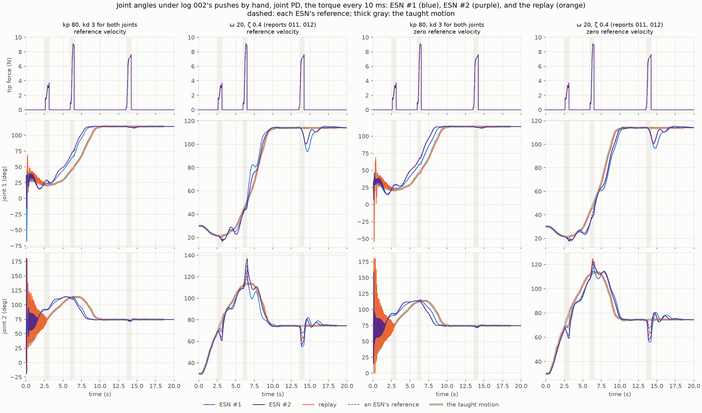

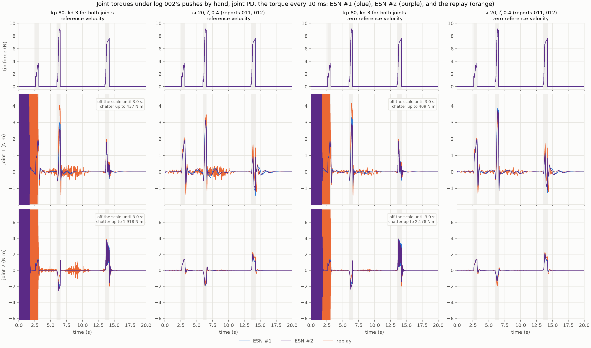

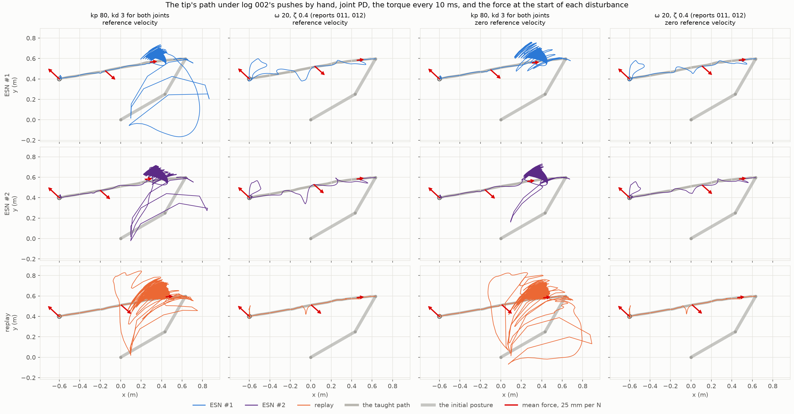

| Following, ESN #1 / ESN #2 | Push 1 | Push 2 | Push 3 |
| --- | --- | --- | --- |
| kp 80, kd 3 for both joints, reference velocity | 0.85 / 0.90 | 0.90 / 0.99 | 0.75 / 0.63 |
| ω 20, ζ 0.4 (reports 011, 012), reference velocity | 0.60 / 0.66 | 0.80 / 0.69 | 0.87 / 0.77 |
| kp 80, kd 3 for both joints, zero reference velocity | 0.93 / 1.02 | 0.46 / 1.06 | 0.76 / 0.64 |
| ω 20, ζ 0.4 (reports 011, 012), zero reference velocity | 0.62 / 0.67 | 0.89 / 0.85 | 0.88 / 0.79 |

| Ringing (mm) | Push 1 | Push 2 | Push 3 |
| --- | --- | --- | --- |
| kp 80, kd 3 for both joints, reference velocity | 1.6 / 1.6 / 2.3 | 1.9 / 1.8 / 2.4 | 0.7 / 0.7 / 0.9 |
| ω 20, ζ 0.4 (reports 011, 012), reference velocity | 6.9 / 6.9 / 8.5 | 6.9 / 7.2 / 4.8 | 2.8 / 3.9 / 7.6 |
| kp 80, kd 3 for both joints, zero reference velocity | 1.4 / 1.5 / 2.3 | 1.6 / 1.6 / 2.5 | 0.6 / 0.6 / 0.9 |
| ω 20, ζ 0.4 (reports 011, 012), zero reference velocity | 6.3 / 6.1 / 8.5 | 2.4 / 2.3 / 4.5 | 2.7 / 3.5 / 7.6 |

| Back within 5 mm (s) | Push 1 | Push 2 | Push 3 |
| --- | --- | --- | --- |
| kp 80, kd 3 for both joints, reference velocity | 1.35 / 1.79 / 0.06 | 0.59 / 0.19 / 0.00 | 0.86 / 0.46 / 0.03 |
| ω 20, ζ 0.4 (reports 011, 012), reference velocity | – / – / 0.09 | 2.25 / 2.83 / 0.20 | 4.89 / 4.19 / 0.44 |
| kp 80, kd 3 for both joints, zero reference velocity | 1.15 / 2.24 / 0.06 | 0.84 / 0.02 / 0.00 | 1.00 / 0.56 / 0.03 |
| ω 20, ζ 0.4 (reports 011, 012), zero reference velocity | 2.77 / – / 0.09 | 2.60 / 1.86 / 0.19 | 5.26 / 4.48 / 0.44 |

| Farthest (mm) | Push 1 | Push 2 | Push 3 |
| --- | --- | --- | --- |
| kp 80, kd 3 for both joints, reference velocity | 14 / 27 / 11 | 13 / 15 / 7 | 33 / 28 / 20 |
| ω 20, ζ 0.4 (reports 011, 012), reference velocity | 50 / 49 / 14 | 112 / 157 / 78 | 179 / 150 / 102 |
| kp 80, kd 3 for both joints, zero reference velocity | 13 / 24 / 11 | 12 / 10 / 7 | 30 / 26 / 20 |
| ω 20, ζ 0.4 (reports 011, 012), zero reference velocity | 47 / 45 / 15 | 60 / 70 / 76 | 166 / 142 / 102 |

- **Log 001's strong push no longer takes the ESNs off the reach.** Given a zero
  reference velocity, it carried them 274 to 286 mm from the path with report 011's
  gains, and took ESN #1's reference back toward the start; with the equal gains, 86
  to 94 mm, about as far as given the reference velocity (101 to 109 mm), and they go
  on with the reach. Their hands are back within 1.6 to 3.5 s and arrive at 9.5 to
  9.7 s, where they arrived at 13.4 to 14.1 s and left the goal during the hold.
- **After the pushes at the target,** the last of each log, the hand goes 20 to 84 mm
  from the path against 102 to 254 mm, rings 0.6 to 3.9 mm against 2.7 to 13.8 mm, and
  the ESNs' hands are back within 0.5 to 1.4 s against 2.4 to 5.3 s.
- **The ESNs follow the pushes by hand in the reach more,** 0.71 to 1.06 against 0.50
  to 0.89, but for ESN #1 at log 002's push 2 given a zero reference velocity (0.46);
  the pushes at the target less, 0.48 to 0.76 against 0.60 to 0.88.
- **Under log 000, the push at 8.6 s comes during the ESNs' hold** given the
  reference velocity, and ESN #2's given a zero one: thrown ahead by the chatter, they
  arrive at 8.0 to 8.3 s, and the push takes the hand out of the goal (Section 3.6).

### 3.6 Over the 13 pushes, and arriving

The median over report 011's three pushes and report 012's ten, with the least and the
most. A hand not back counts as back at the next push or the run's end; the count of
pushes it is not back after follows the return:

| Tracker | Following, ESN #1 / ESN #2 | Ringing (mm) | Back within 5 mm (s); not back | Farthest (mm) |
| --- | --- | --- | --- | --- |
| kp 80, kd 3 for both joints, reference velocity | 0.78 (0.64 to 0.95) / 0.90 (0.48 to 1.02) | 1.8 (0.7 to 7.2) / 1.8 (0.7 to 7.5) / 2.2 (0.9 to 5.4) | 1.01 (0.09 to 2.23); 0 / 0.73 (0.19 to 3.28); 0 / 0.06 (0.00 to 0.20); 0 | 33 (11 to 109) / 37 (15 to 101) / 22 (7 to 38) |
| ω 20, ζ 0.4 (reports 011, 012), reference velocity | 0.80 (0.50 to 0.87) / 0.69 (0.59 to 0.78) | 6.9 (2.0 to 11.4) / 6.9 (2.0 to 11.5) / 7.6 (2.6 to 13.8) | 2.84 (2.02 to 5.29); 3 / 3.33 (0.93 to 4.34); 4 / 0.35 (0.04 to 0.47); 0 | 121 (28 to 254) / 150 (32 to 222) / 70 (7 to 128) |
| kp 80, kd 3 for both joints, zero reference velocity | 0.81 (0.46 to 0.95) / 0.86 (0.49 to 1.06) | 1.6 (0.6 to 6.0) / 1.6 (0.6 to 6.7) / 2.2 (0.9 to 5.5) | 1.25 (0.23 to 2.69); 0 / 0.87 (0.02 to 3.77); 1 / 0.06 (0.00 to 0.20); 0 | 34 (12 to 86) / 39 (10 to 94) / 22 (7 to 38) |
| ω 20, ζ 0.4 (reports 011, 012), zero reference velocity | 0.77 (0.54 to 0.89) / 0.73 (0.59 to 0.85) | 6.3 (1.6 to 27.0) / 5.9 (1.6 to 25.2) / 7.6 (2.5 to 13.8) | 2.88 (2.02 to 5.34); 2 / 3.45 (1.12 to 5.90); 5 / 0.36 (0.03 to 0.47); 0 | 102 (27 to 274) / 126 (32 to 286) / 70 (6 to 128) |

When the hand arrives within the goal (s); * marks a hand that leaves the goal during
its 2 s hold:

| Tracker | Undisturbed | Block | Pushes | Log 000 | Log 001 | Log 002 |
| --- | --- | --- | --- | --- | --- | --- |
| kp 80, kd 3 for both joints, reference velocity | 8.31 / 8.07 / 9.57 | 8.75 / 8.66 / 9.57 | 8.00 / 7.91 / 9.57 | 8.29* / 8.04* / 9.54 | 9.47 / 9.36 / 9.57 | 8.41 / 8.07 / 9.57 |
| ω 20, ζ 0.4 (reports 011, 012), reference velocity | 9.55 / 9.54 / 9.56 | 10.08 / 9.98 / 9.56 | 9.70 / 9.75 / 9.56 | 10.15 / 9.87 / 9.56 | 10.35 / 10.11 / 9.56 | 9.37 / 9.46 / 9.56 |
| kp 80, kd 3 for both joints, zero reference velocity | 8.79 / 8.28 / 9.61 | 9.14 / 8.80 / 9.61 | 8.52 / 8.14 / 9.61 | 9.57 / 8.26* / 9.60 | 9.73 / 9.51 / 9.61 | 8.89 / 8.29 / 9.61 |
| ω 20, ζ 0.4 (reports 011, 012), zero reference velocity | 10.18 / 9.96 / 9.61 | 10.74 / 10.31 / 9.61 | 9.19 / 10.07 / 9.61 | 10.32 / 10.04 / 9.59 | 13.39* / 14.13* / 9.61 | 10.18 / 9.90 / 9.61 |

Every arm ends within 2.9 mm of the target in every run, with both trackers.

- **The pushes move the arm a quarter to a third as far, and the ringing falls about
  as much.** The ESNs' hands stray 33 to 39 mm in the median against 102 to 150 mm,
  the replay's 22 mm against 70 mm; they ring 1.6 to 2.2 mm against 5.9 to 7.6 mm.
- **The ESNs come back in about a second, not three:** 0.73 to 1.25 s in the median
  against 2.84 to 3.45 s, and back after every push but one, against 2 to 5 not back.
  The replay is back within 0.06 s against 0.35 s.
- **They follow as much or more:** 0.78 to 0.90 in the median against 0.69 to 0.80.
  The cost of following that reports 011 and 012 found, the return, shrinks with the
  displacement.

## 4. Observations

- **Gains that are fine for a continuous tracker can be unstable when the torque is
  held.** Per joint, kp = 80 and kd = 3 give joint 1 ω = 20.7 rad/s and ζ = 0.39 and
  joint 2 an overdamped ω = 59.8 rad/s. Yet with the torque computed every 10 ms,
  the arm flips joint 2's torque every period from the start, as the analysis of the
  arm at rest predicts for joint 2 under 69.5°, and the chatter ends once the reach is
  a few degrees past that. The bound comes from kd T against joint 2's inertia while
  joint 1 moves with it, which is under M₂₂: a per-joint analysis misses it.
- **The chatter is bounded only because the reach leaves the unstable postures.** It
  swings the arm into the stable postures more than half the time, and dies out once
  the reference stays clear of them. A reach, or a push, that kept joint 2 under 69.5°
  would be expected to chatter as long; none here does after the start.
- **Stiffer, better-damped joint 2 suits disturbances.** After the chatter, every push
  moves the arm a quarter to a third as far, and the ESNs, following as much or more,
  are back on the path in about a second instead of three. This is the faster return
  that report 012 asked for, gotten from the tracker rather than the ESN.
- **But the chatter costs the ESNs their route.** They follow the flung arm, so their
  references come out of the chatter 24° ahead of the take in joint 2, and keep a
  route of their own, 1.7 to 6.6 mm RMS off the taught path, where the replay's keeps
  to the take.
- **The per-joint ω and ζ are approximate with report 011's gains too.** Together,
  their modes at the target are 16.3 and 28.6 rad/s, with ζ = 0.33 and 0.57, not 20
  and 0.4; with the torque held, 0.29 and 0.54.

## 5. Next steps

1. **The same gains with the torque every 2 ms,** where the analysis finds every
   posture stable (|z| ≤ 0.95 over 10 ms): to see what equal gains do without the
   chatter, at the start and after the pushes.
2. **A joint 2 stable with the torque held 10 ms:** with kp = 80, joint 2's kd at
   1.0 N m s/rad keeps every angle stable (largest |z| 0.95 over 10 ms), where 1.2
   does not (1.19); it gives joint 2 alone ζ = 0.37.
3. **What part of the smaller displacement is joint 2's stiffness and what its
   damping:** for example report 011's gains with joint 2's kp or kd raised alone,
   checked against the bound above.
