# 014 A replay that waits: the progress-based baseline

**Summary.** Reports 007 to 013 compared the ESNs with the take replayed by time, a
reference that ignores the arm. Much of the ESNs' compliance, waiting under a block
with a fraction of the replay's torque, could come from any reference that keeps to
the arm's progress along the taught path. Here a third arm tests that: the take
replayed by time, but never more than 2.5° along its joint path past the arm's
progress, and falling back by at most one sample a period. It runs with report 011's
two ESNs and the replay in every scenario of reports 011 and 012, with joint PD at
ζ = 0.4 (reports 011 and 012) and at kp = 80 and kd = 1.2 for both joints (report
013), given the reference velocity or a zero one.

- **Undisturbed, and from the 49 offset starts, the progress replay is the replay:**
  their arms move alike to the last digit undisturbed, and from the offset starts
  their measures differ only in arrival, by at most 0.06 s, from 8 of them.
- **Under the block, it does what the ESNs do, and more:** it presses with 1.0 to
  3.3 N m, against the ESNs' 0.8 to 8.0 N m and the replay's 12 to 17 N m, and the
  block's force on its tip is 8.8 to 10.0 N, against 9.5 to 26.6 N and 21.8 to
  41.8 N. After the release, its hand is back on the path within 0.06 s, against the
  ESNs' 2.2 to 4.3 s and the replay's 0.3 to 0.4 s, strays 2 to 6 mm, against 22 to
  38 mm and 26 to 30 mm, and rings 2.2 to 2.9 mm, against 2.2 to 3.6 mm and 17 to
  22 mm.
- **Under a push across the path, it is the replay; under a push back along it, it
  falls back.** Over the 13 pushes at ζ = 0.4, in the median, its hand strays 55 to
  56 mm from the path, against the replay's 70 mm and the ESNs' 102 to 150 mm, is
  back within 0.29 to 0.38 s, against 0.35 s and 2.8 to 3.5 s, and rings 8.0 to
  8.1 mm, against 7.6 mm and 5.9 to 6.9 mm. At kp = 80, it is the replay over the 13
  pushes.
- **What the ESNs keep:** from the offset starts, half the replays' peak torque, 6 to
  27 N m in the median against 13 to 52 N m, as their references start from wherever
  the arm is; after the pushes at ζ = 0.4, a little less ringing; and they yield
  across the path as well as along it, which costs them a slower return.
- **Falling back has a cost, and has to be slow.** A first version, letting the
  reference fall back at once, jumped at up to 1,556°/s under the strongest pushes by
  hand and threw the arm; limited to a sample a period, its reference never moves
  faster than the take's 36°/s. Still, under log 001 at ζ = 0.4, the first push sets
  it 0.7 s behind the take, and the second, replayed by time, meets it at an earlier
  posture and sends it 5 s of the take back: its hand strays 118 mm from the path,
  against the replay's 50 mm.

## 1. Question

1. Does the ESNs' compliance, waiting under a block and yielding to pushes, come from
   more than keeping to the arm's progress along the taught path?
2. How does a replay that keeps to the arm's progress do against the ESNs and the
   replay by time, in every scenario of reports 011 and 012?

## 2. Setup

### The arms, the scenarios, and the trackers

The arms are report 011's ESN #1 (leak rate 0.03, spectral radius 1.2, input scaling
1.5, seed 8) and ESN #2 (input scaling 1, seed 2), the take replayed by time, and the
take replayed by the arm's progress (below). The scenarios are report 011's and report
012's, each run for 24 s:

- **Undisturbed,** from the demonstrated start.
- **The block:** the tip held from 4.5 s to 5.5 s, in mid-reach, then let go.
- **Report 011's three pushes** of 0.5 s at the tip: 3 N nearly forward at 3 s, 5 N
  nearly across at 7 s, and 4 N nearly across the other way at 15 s, after the hold.
- **The 49 offset starts,** undisturbed: the demonstrated start offset by −15° to 15°
  in each joint, every 5°.
- **Report 012's ten pushes by hand,** recorded in three logs and replayed by time
  (see [report 012, Section 2](../012-pushes-by-hand/README.md#2-setup)).

The trackers are joint PD, with the torque computed every 10 ms and held between, given
the reference velocity or a zero one: at ω = 20 rad/s and ζ = 0.4, each joint's gains
scaled by its inertia, as in reports 011 and 012 (kp = 74.96 and 8.96 N m/rad, kd =
3.00 and 0.358 N m s/rad); and at kp = 80 N m/rad and kd = 1.2 N m s/rad for both
joints, as in [report 013](../013-equal-gains/README.md).

### The progress replay

[`ProgressReplaySource`](../../src/arm_esn_ctrl/tracking.py) (`afc990f`, `98c1a25`),
the arm `progress` of [`robot_esn.py`](../../experiments/robot_esn.py), configured by
a `[progress]` table:

- **The arm's progress:** every 10 ms, the length of the take's joint path up to its
  sample nearest the measured joint angles, searched within 1 s of the last one found.
  Where the take rests, at its start and its end, its path does not lengthen, so that
  progress is the same whichever resting sample is nearest.
- **The reference:** the replayed sample advances by one each period, as the replay's
  does, but never to where the path is more than the lead, 2.5°, past the arm's
  progress. So it waits for an arm that is held. With an arm pushed back along the
  path, it falls back, by at most one sample a period: the take's pace in reverse.
  Pushed across the path, or forward along it, the arm's progress changes little, and
  the reference goes on as the replay's.
- **The lead:** undisturbed, the replay's arm trails its reference along the path by at
  most about 2.2° (at the reach's fastest, 50°/s, given a zero reference velocity at
  ζ = 0.4), so that with 2.5° the progress replay is the replay, while the torque on a
  held arm stays small.
- **The fall-back:** a first version (`afc990f`, its runs at `a0ff165`) let the
  reference fall back at once to the lead past the arm. Under the strongest pushes by
  hand, the pushed arm's nearest sample jumped back along the path, and the reference
  with it, at up to 1,556°/s, against the replay's 36°/s: given the reference velocity,
  the tracker threw the arm, joint 2 to 10°, and under log 001 it redid the reach from
  near the start and never arrived. Limited to a sample a period (`98c1a25`), it moves
  no faster than the take. Those first runs were deleted once rerun; their numbers here
  are from their metrics.

### Measures

As in reports 011 to 013: after each disturbance, the following gain, from its onset to
0.5 s past its end (0 for a reference that keeps to the taught motion by time, 1 for one
that goes wherever the arm goes); the ringing, the RMS of the hand's motion above 1.5 Hz
over the next 2 s; the farthest the hand strays from the taught path; and when it is
back within 5 mm of it, if before the next disturbance or the run's end. Also whether
the hand arrives, holds within the goal (20 mm) for 2 s, and ends there; the peak joint
torque over the run, but under the block from 4.5 s to 6 s; the peak hand speed; and the
references' peak joint speed.

### Reproducing the results

The runs read the take as in report 011 and the ESNs by their run names (copied in
[report 011's results](../011-following-the-arm/results)), and the logs of pushes by hand
under the storage root (copied in [report 012's data](../012-pushes-by-hand/data)). The
configurations are in
[`manual_demonstration_v2_robot_progress_replay`](../../experiments/manual_demonstration_v2_robot_progress_replay/README.md).

| Runs | Command | Commit |
| --- | --- | --- |
| `{nominal,block,pushes,offsets,recorded000,recorded001,recorded002}_{w20_z0.4,kp80_kd1.2}_robot_<ESN>_{zero,reference}_velocity_filtered` (56) | `uv run python experiments/robot_esn.py experiments/manual_demonstration_v2_robot_progress_replay/<name>.toml` | `53288fa` |
| [`summary`](results/summary) | `uv run python reports/014-progress-replay/make_figures.py --logs` | |

Every run record (`run.toml`) shows no uncommitted changes. Each run's directory here
holds its configuration, its run record, its metrics (`metrics.csv`), and, under a
recorded force, the SHA-256 of its log (`recorded_forces.toml`).
[`make_figures.py`](make_figures.py) prints the tables of this report from the copies
here. With `--logs`, it reads the runs' logs under the storage root, which are not kept
in Git, to check the progress replay against the replay and draw the figures.

## 3. Results

In the comparison figures, the columns are the trackers, each given the reference
velocity, then a zero one. Over time, the ESNs' lines are drawn over the replays', and
the progress replay's over the replay's, so that where the two replays move alike, only
the progress replay's line shows; the references of the ESNs and the progress replay are
dashed, and the disturbances shaded; under a disturbance, a first row draws each arm's
tip force. In the paths, the rows are the arms: each panel draws the arm at its initial
posture (faint gray), the taught path (thick gray), the goal, and the tip's path; at each
disturbance's onset, a red arrow from the tip shows its mean force over the disturbance,
25 mm per newton. In the tables, each cell gives ESN #1 / ESN #2 / the replay / the
progress replay, but for the following gain, whose replay's is 0; – marks a hand not back
before the next disturbance or the run's end, or one that never arrives.

### 3.1 How the progress replay keeps to the arm

The progress along the taught joint path, of each arm and of the references, under the
block and under log 001's pushes by hand:

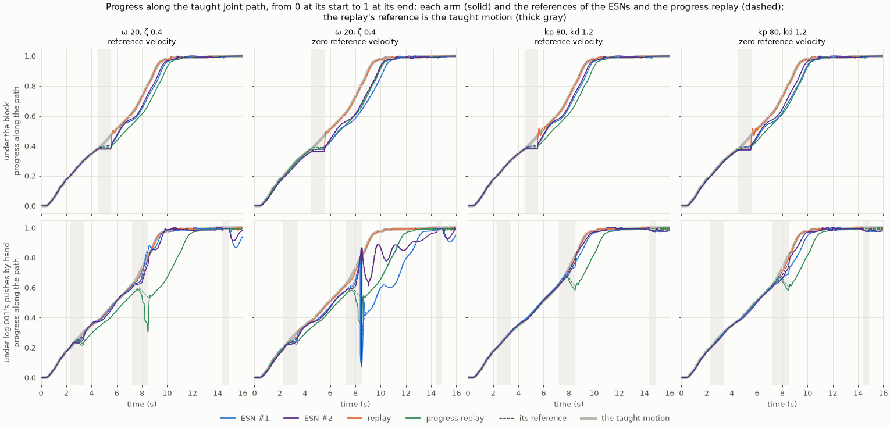

Undisturbed, the largest difference between the progress replay's and the replay's
joint angles is 0° with every tracker. The references' peak joint speed (deg/s):

| Scenario | ω 20, ζ 0.4, reference velocity | ω 20, ζ 0.4, zero reference velocity | kp 80, kd 1.2, reference velocity | kp 80, kd 1.2, zero reference velocity |
| --- | --- | --- | --- | --- |
| undisturbed | 27 / 27 / 36 / 36 | 25 / 26 / 36 / 36 | 27 / 27 / 36 / 36 | 26 / 26 / 36 / 36 |
| under the block | 34 / 33 / 36 / 36 | 27 / 31 / 36 / 36 | 38 / 37 / 36 / 36 | 35 / 36 / 36 / 36 |
| under the three pushes | 107 / 76 / 36 / 36 | 83 / 59 / 36 / 36 | 36 / 30 / 36 / 36 | 32 / 29 / 36 / 36 |
| under log 000's pushes by hand | 81 / 67 / 36 / 36 | 68 / 60 / 36 / 36 | 27 / 28 / 36 / 36 | 30 / 32 / 36 / 36 |
| under log 001's pushes by hand | 68 / 61 / 36 / 36 | 146 / 98 / 36 / 36 | 37 / 45 / 36 / 36 | 37 / 47 / 36 / 36 |
| under log 002's pushes by hand | 58 / 56 / 36 / 36 | 46 / 45 / 36 / 36 | 29 / 30 / 36 / 36 | 28 / 29 / 36 / 36 |

- **Under the block, the progress replay's reference stops** 2.5° along the path past
  the held arm, and goes on at the take's pace from the release: its arm runs about 0.9 s
  behind the take from then on, and arrives at 10.4 to 10.5 s. The ESNs' references wait
  too, then catch up with the take in part (9.9 to 10.7 s); the replay's runs on, and its
  arm jumps ahead at the release.
- **Under log 001's second push, a long push back along the path** at ζ = 0.4, the
  progress replay's arm is pushed back, and its reference follows it at the take's pace,
  more slowly than the arm goes. The first push had already set it 0.7 s behind the take,
  where the replay's arm is on time: at the second push's onset, its joint 1 is at 50°
  against the replay's 62°. The same force, replayed by time, sends it from 0.55 to 0.31
  of the path, 5 s of the take, where the replay's arm keeps going.
- **The references never move faster than the take's 36°/s with either replay;** the
  ESNs' reach 146°/s when they follow a strong push.

### 3.2 Undisturbed and from the offset starts

Arrival (s), final distance from the target (mm), peak torque (N m), peak hand speed
(m/s), and the RMS distance from the taught path over the run (mm):

| Tracker | Arrival (s) | Final distance (mm) | Peak torque (N m) | Peak hand speed (m/s) | Path (mm) |
| --- | --- | --- | --- | --- | --- |
| ω 20, ζ 0.4, reference velocity | 9.55 / 9.54 / 9.56 / 9.56 | 2.9 / 2.7 / 2.8 / 2.8 | 0.2 / 0.1 / 0.6 / 0.6 | 0.23 / 0.23 / 0.27 / 0.27 | 0.7 / 0.9 / 0.4 / 0.4 |
| ω 20, ζ 0.4, zero reference velocity | 10.18 / 9.96 / 9.61 / 9.61 | 2.9 / 2.7 / 2.8 / 2.8 | 0.1 / 0.1 / 0.3 / 0.3 | 0.21 / 0.22 / 0.26 / 0.26 | 2.5 / 2.4 / 0.4 / 0.4 |
| kp 80, kd 1.2, reference velocity | 9.54 / 9.53 / 9.58 / 9.58 | 2.9 / 2.7 / 2.8 / 2.8 | 0.7 / 0.6 / 0.4 / 0.4 | 0.23 / 0.23 / 0.28 / 0.28 | 0.7 / 0.8 / 0.5 / 0.5 |
| kp 80, kd 1.2, zero reference velocity | 9.77 / 9.68 / 9.59 / 9.59 | 2.9 / 2.7 / 2.8 / 2.8 | 0.4 / 0.3 / 0.4 / 0.4 | 0.22 / 0.22 / 0.27 / 0.27 | 1.1 / 1.1 / 0.5 / 0.5 |

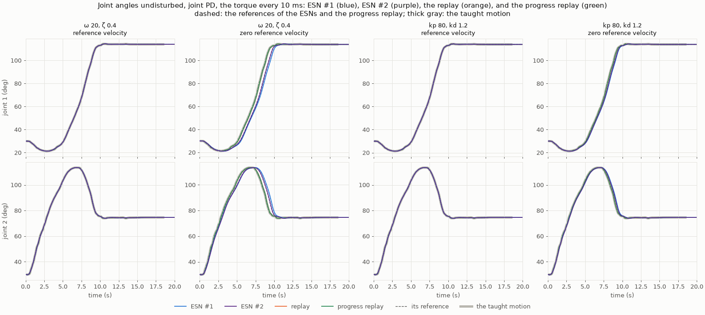

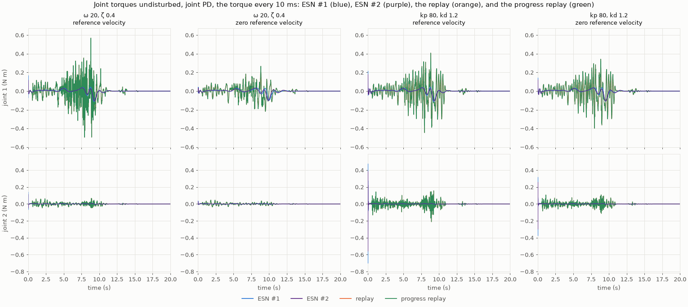

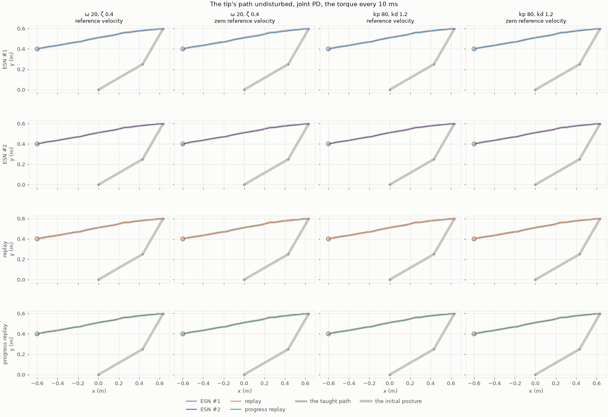

From the 49 offset starts, the successes, the peak torque, median (largest), and the
RMS distance from the taught path, median:

| Tracker | ESN #1 | ESN #2 | replay | progress replay |
| --- | --- | --- | --- | --- |
| ω 20, ζ 0.4, reference velocity | 49/49; 25.4 (49.1) N m; 17.8 mm | 49/49; 27.2 (61.1) N m; 18.2 mm | 49/49; 52.3 (78.5) N m; 19.4 mm | 49/49; 52.3 (78.5) N m; 19.4 mm |
| ω 20, ζ 0.4, zero reference velocity | 49/49; 6.3 (12.3) N m; 17.1 mm | 49/49; 6.8 (15.3) N m; 16.8 mm | 49/49; 13.1 (19.6) N m; 17.8 mm | 49/49; 13.1 (19.6) N m; 17.8 mm |
| kp 80, kd 1.2, reference velocity | 49/49; 10.8 (20.6) N m; 19.2 mm | 49/49; 13.4 (35.8) N m; 21.3 mm | 49/49; 31.4 (63.7) N m; 23.2 mm | 49/49; 31.4 (63.7) N m; 23.2 mm |
| kp 80, kd 1.2, zero reference velocity | 49/49; 7.4 (14.5) N m; 18.9 mm | 49/49; 9.0 (21.8) N m; 21.2 mm | 49/49; 20.9 (37.5) N m; 22.4 mm | 49/49; 20.9 (37.5) N m; 22.4 mm |

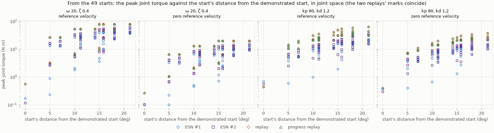

The offset start −15° in both joints:

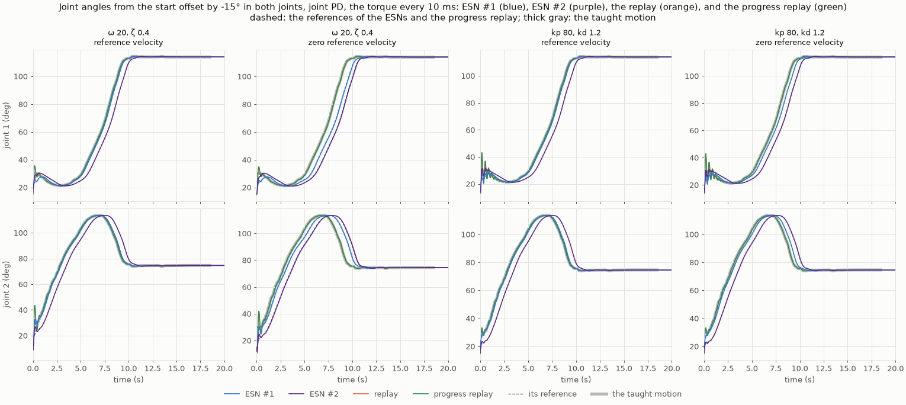

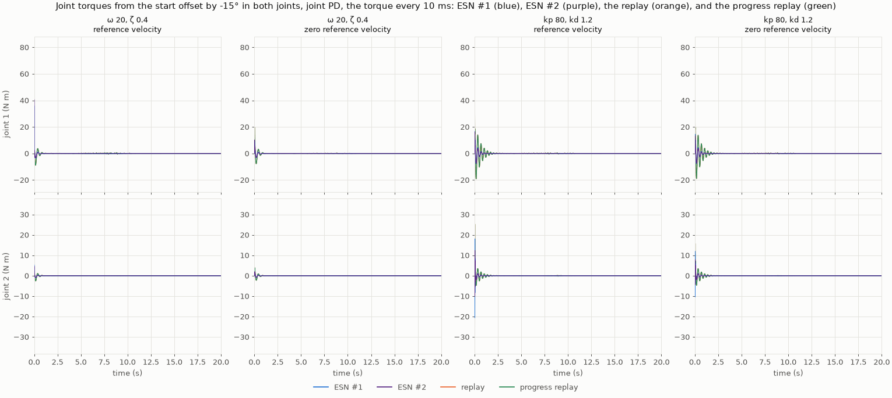

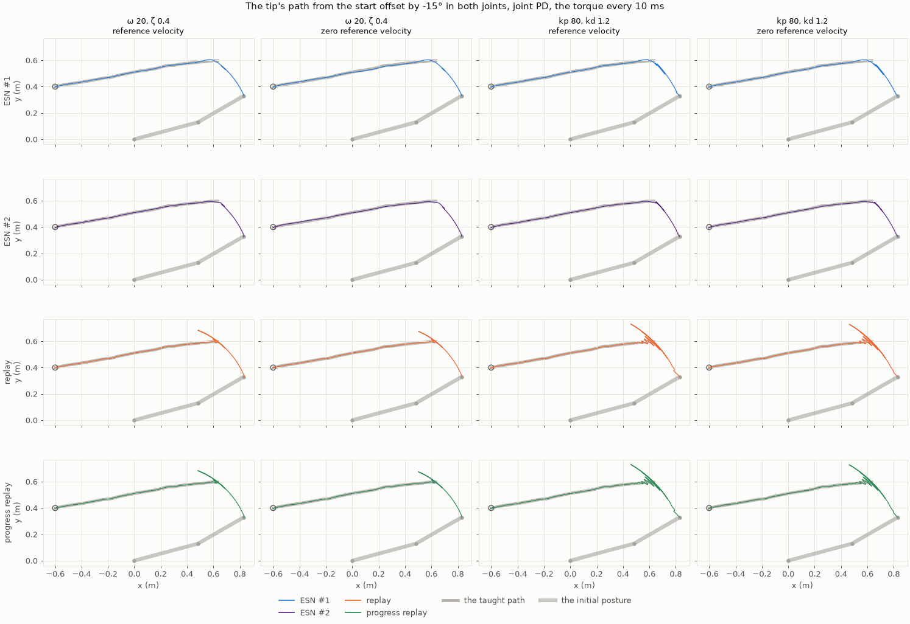

- **Undisturbed, and from the offset starts, the progress replay is the replay:** the
  arm keeps up with its reference, so that the lead does not bind, but for about 0.1 s
  from the 8 starts with joint 1 offset by 10° or 15° at ζ = 0.4, where their joint
  angles part by up to 1.9° and the progress replay arrives up to 0.06 s later.
- **From the offset starts, the ESNs need half the replays' torque:** 6.3 to 27.2 N m in
  the median against 13.1 to 52.3 N m at ζ = 0.4, and 7.4 to 13.4 N m against 20.9 to
  31.4 N m at kp = 80, and they keep as near the taught path (16.8 to 21.3 mm RMS
  against 17.8 to 23.2 mm). Both replays start from the take's first posture, wherever
  the arm is, so that their reference jumps by the offset at once; the ESNs' starts from
  the arm's posture.
- **Undisturbed, the replays keep nearer the taught path,** 0.4 to 0.5 mm (RMS) against
  the ESNs' 0.7 to 2.5 mm.

### 3.3 Under the block and report 011's pushes

Under the block, as in Section 3.2, the peak torque from 4.5 s to 6 s:

| Tracker | Arrival (s) | Final distance (mm) | Peak torque (N m) | Peak hand speed (m/s) | Path (mm) |
| --- | --- | --- | --- | --- | --- |
| ω 20, ζ 0.4, reference velocity | 10.08 / 9.98 / 9.56 / 10.40 | 2.9 / 2.7 / 2.8 / 2.8 | 2.2 / 0.9 / 13.1 / 1.1 | 0.52 / 0.56 / 2.04 / 0.37 | 12.7 / 8.5 / 8.4 / 0.4 |
| ω 20, ζ 0.4, zero reference velocity | 10.74 / 10.31 / 9.61 / 10.48 | 2.9 / 2.7 / 2.8 / 2.8 | 2.1 / 0.8 / 12.4 / 1.0 | 0.41 / 0.47 / 1.98 / 0.31 | 11.3 / 9.6 / 7.8 / 0.4 |
| kp 80, kd 1.2, reference velocity | 10.03 / 9.93 / 9.58 / 10.40 | 2.9 / 2.7 / 2.8 / 2.8 | 8.0 / 7.2 / 16.7 / 3.3 | 1.51 / 1.38 / 3.40 / 0.66 | 11.7 / 7.9 / 7.1 / 0.9 |
| kp 80, kd 1.2, zero reference velocity | 10.28 / 10.04 / 9.59 / 10.42 | 2.9 / 2.7 / 2.8 / 2.8 | 7.5 / 7.3 / 16.7 / 3.2 | 1.38 / 1.36 / 3.39 / 0.62 | 11.4 / 8.6 / 7.1 / 0.8 |

The block's peak force on the tip (N), from 4.5 s to 6 s:

| Tracker | Block's force (N) |
| --- | --- |
| ω 20, ζ 0.4, reference velocity | 11.5 / 11.6 / 23.0 / 9.6 |
| ω 20, ζ 0.4, zero reference velocity | 9.5 / 10.3 / 21.8 / 8.8 |
| kp 80, kd 1.2, reference velocity | 26.6 / 20.6 / 41.7 / 10.0 |
| kp 80, kd 1.2, zero reference velocity | 25.5 / 21.7 / 41.8 / 9.7 |

Under report 011's three pushes:

| Tracker | Arrival (s) | Final distance (mm) | Peak torque (N m) | Peak hand speed (m/s) | Path (mm) |
| --- | --- | --- | --- | --- | --- |
| ω 20, ζ 0.4, reference velocity | 9.70 / 9.75 / 9.56 / 9.64 | 2.8 / 2.7 / 2.8 / 2.8 | 2.8 / 2.5 / 3.2 / 3.2 | 1.28 / 1.29 / 1.21 / 1.21 | 62.5 / 57.2 / 26.4 / 25.8 |
| ω 20, ζ 0.4, zero reference velocity | 9.19 / 10.07 / 9.61 / 9.71 | 2.7 / 2.6 / 2.8 / 2.8 | 2.6 / 2.6 / 3.2 / 3.2 | 1.21 / 1.21 / 1.20 / 1.20 | 54.5 / 55.1 / 26.2 / 25.8 |
| kp 80, kd 1.2, reference velocity | 9.26 / 9.37 / 9.58 / 9.58 | 2.9 / 2.7 / 2.8 / 2.8 | 2.8 / 2.8 / 3.1 / 3.1 | 0.48 / 0.48 / 0.46 / 0.46 | 9.2 / 9.8 / 4.4 / 4.4 |
| kp 80, kd 1.2, zero reference velocity | 9.50 / 9.53 / 9.59 / 9.59 | 2.9 / 2.7 / 2.8 / 2.8 | 2.8 / 2.8 / 3.1 / 3.1 | 0.47 / 0.47 / 0.47 / 0.47 | 8.1 / 8.8 / 4.4 / 4.4 |

**The following gain**, ESN #1 / ESN #2 / the progress replay:

| Tracker | Block | Push 1 | Push 2 | Push 3 |
| --- | --- | --- | --- | --- |
| ω 20, ζ 0.4, reference velocity | 0.89 / 0.82 / 0.91 | 0.80 / 0.76 / 0.00 | 0.63 / 0.63 / 0.03 | 0.83 / 0.73 / 0.00 |
| ω 20, ζ 0.4, zero reference velocity | 0.92 / 0.86 / 0.91 | 0.77 / 0.73 / 0.00 | 0.64 / 0.62 / 0.04 | 0.84 / 0.74 / 0.00 |
| kp 80, kd 1.2, reference velocity | 0.88 / 0.81 / 0.90 | 0.55 / 0.52 / 0.00 | 0.85 / 0.64 / -0.00 | 0.69 / 0.55 / 0.00 |
| kp 80, kd 1.2, zero reference velocity | 0.90 / 0.83 / 0.91 | 0.52 / 0.49 / 0.00 | 0.72 / 0.63 / -0.00 | 0.69 / 0.56 / 0.00 |

**The ringing over the next 2 s** (mm):

| Tracker | Block | Push 1 | Push 2 | Push 3 |
| --- | --- | --- | --- | --- |
| ω 20, ζ 0.4, reference velocity | 3.3 / 3.6 / 17.5 / 2.9 | 4.9 / 5.2 / 6.8 / 6.8 | 8.7 / 8.1 / 10.0 / 10.2 | 5.5 / 6.0 / 8.5 / 8.5 |
| ω 20, ζ 0.4, zero reference velocity | 2.2 / 2.8 / 17.0 / 2.2 | 4.7 / 4.8 / 6.9 / 6.7 | 7.5 / 6.9 / 10.1 / 10.2 | 5.4 / 5.8 / 8.5 / 8.5 |
| kp 80, kd 1.2, reference velocity | 3.5 / 3.6 / 22.0 / 2.9 | 2.2 / 2.2 / 3.4 / 3.4 | 2.0 / 1.8 / 2.8 / 2.8 | 3.0 / 3.3 / 5.0 / 5.0 |
| kp 80, kd 1.2, zero reference velocity | 3.2 / 3.1 / 21.7 / 2.6 | 2.1 / 2.0 / 3.4 / 3.4 | 1.7 / 1.5 / 2.8 / 2.8 | 2.9 / 3.1 / 5.0 / 5.0 |

**Back within 5 mm of the taught path** (s after the end):

| Tracker | Block | Push 1 | Push 2 | Push 3 |
| --- | --- | --- | --- | --- |
| ω 20, ζ 0.4, reference velocity | 2.22 / 3.08 / 0.42 / 0.00 | 2.98 / – / 0.04 / 0.04 | 2.52 / 3.33 / 0.38 / 0.38 | 4.98 / 4.16 / 0.46 / 0.45 |
| ω 20, ζ 0.4, zero reference velocity | 2.61 / 4.29 / 0.42 / 0.00 | 3.44 / – / 0.03 / 0.03 | 2.88 / 3.83 / 0.38 / 0.38 | 5.27 / 4.43 / 0.45 / 0.45 |
| kp 80, kd 1.2, reference velocity | 2.16 / 2.93 / 0.31 / 0.06 | 0.94 / 1.91 / 0.17 / 0.17 | 0.23 / 2.17 / 0.03 / 0.03 | 0.94 / 0.44 / 0.49 / 0.49 |
| kp 80, kd 1.2, zero reference velocity | 2.33 / 3.11 / 0.31 / 0.06 | 1.12 / 1.23 / 0.17 / 0.17 | 0.24 / 2.33 / 0.03 / 0.03 | 0.98 / 0.45 / 0.49 / 0.49 |

**The farthest the hand strays from the taught path** (mm):

| Tracker | Block | Push 1 | Push 2 | Push 3 |
| --- | --- | --- | --- | --- |
| ω 20, ζ 0.4, reference velocity | 38 / 23 / 28 / 2 | 66 / 67 / 7 / 7 | 175 / 206 / 111 / 111 | 202 / 166 / 99 / 99 |
| ω 20, ζ 0.4, zero reference velocity | 37 / 25 / 26 / 2 | 43 / 56 / 6 / 6 | 166 / 197 / 110 / 110 | 180 / 154 / 99 / 99 |
| kp 80, kd 1.2, reference velocity | 37 / 22 / 30 / 6 | 18 / 17 / 12 / 12 | 27 / 34 / 12 / 12 | 46 / 40 / 27 / 27 |
| kp 80, kd 1.2, zero reference velocity | 37 / 23 / 30 / 6 | 15 / 14 / 12 / 12 | 25 / 29 / 12 / 12 | 44 / 39 / 27 / 27 |

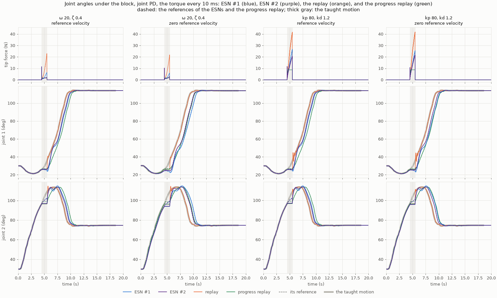

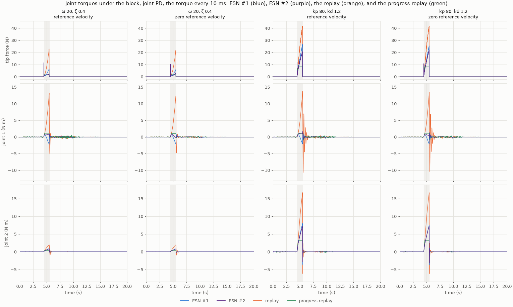

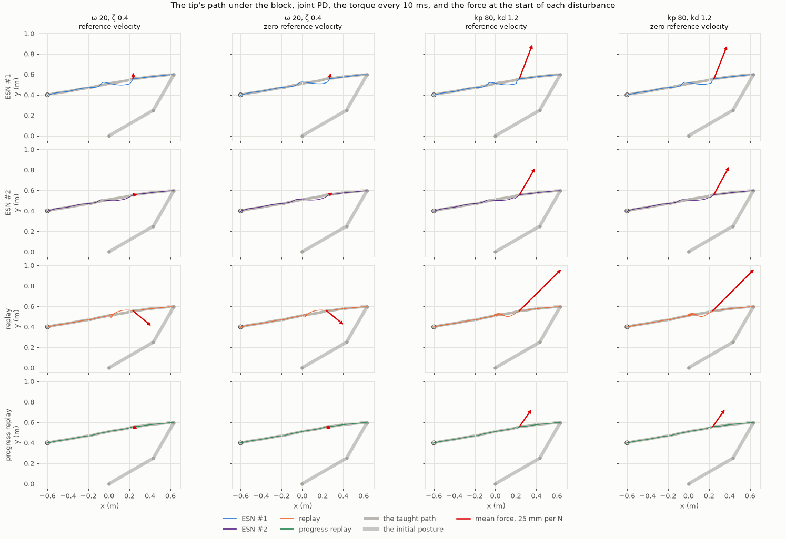

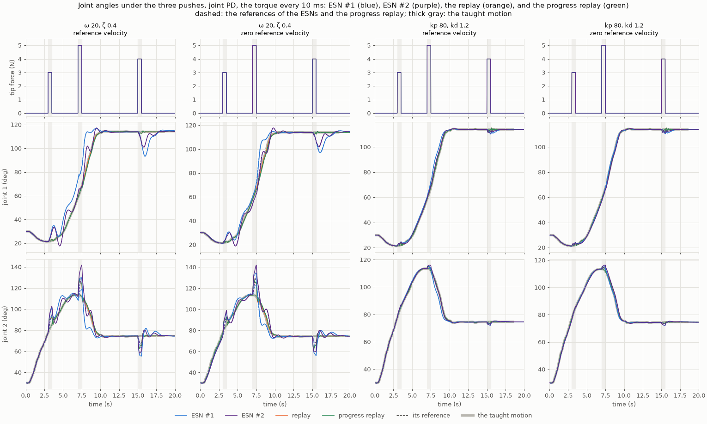

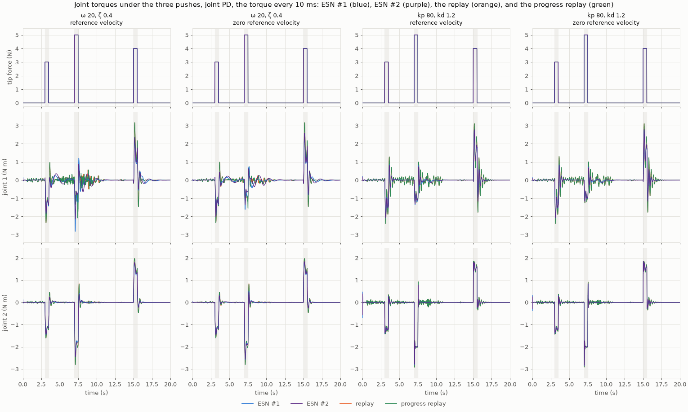

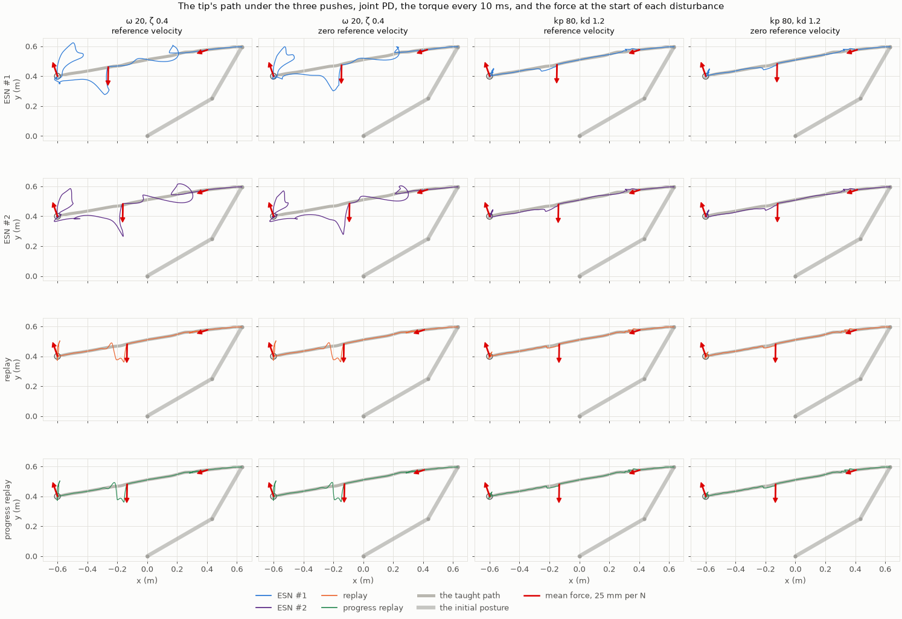

- **Under the block, the progress replay waits as the ESNs do,** following by 0.90 to
  0.91 against 0.81 to 0.92, and presses with 1.0 to 1.1 N m at ζ = 0.4, against the
  ESNs' 0.8 to 2.2 N m and the replay's 12.4 to 13.1 N m, and with 3.2 to 3.3 N m at
  kp = 80, against 7.2 to 8.0 N m and 16.7 N m.
- **After the release, it does better than either:** it keeps on the path, 2 to 6 mm
  from it, against the ESNs' 22 to 38 mm and the replay's 26 to 30 mm, is back within
  0.00 to 0.06 s, against 2.16 to 4.29 s and 0.31 to 0.42 s, and rings 2.2 to 2.9 mm,
  against 2.2 to 3.6 mm and 17.0 to 22.0 mm. Its reference has waited on the path just
  ahead of the arm, so that the release leaves nothing to catch up; the ESNs'
  references wait too, but after the release their arms swing 22 to 38 mm off the path
  and take seconds to come back.
- **Under report 011's three pushes, the progress replay is the replay,** following by
  0.00 to 0.04: the pushes are across the path, or forward along it, and leave the
  arm's progress about where it was. The ESNs follow by 0.49 to 0.85, stray farther
  (43 to 206 mm at ζ = 0.4, against 6 to 111 mm), come back more slowly (2.5 to 5.3 s
  at ζ = 0.4, against 0.03 to 0.46 s), and ring less (4.7 to 8.7 mm, against 6.7 to
  10.2 mm at ζ = 0.4; 1.5 to 3.3 mm, against 2.8 to 5.0 mm at kp = 80).

### 3.4 Under the pushes by hand

#### Log 000

As in Section 3.2:

| Tracker | Arrival (s) | Final distance (mm) | Peak torque (N m) | Peak hand speed (m/s) | Path (mm) |
| --- | --- | --- | --- | --- | --- |
| ω 20, ζ 0.4, reference velocity | 10.15 / 9.87 / 9.56 / 10.26 | 2.9 / 2.7 / 2.8 / 2.8 | 4.6 / 4.4 / 4.5 / 4.4 | 1.26 / 1.26 / 1.38 / 1.38 | 59.0 / 60.2 / 25.0 / 24.0 |
| ω 20, ζ 0.4, zero reference velocity | 10.32 / 10.04 / 9.59 / 10.33 | 2.9 / 2.7 / 2.8 / 2.8 | 4.4 / 4.3 / 4.2 / 4.2 | 1.17 / 1.18 / 1.38 / 1.38 | 53.2 / 53.4 / 25.0 / 24.1 |
| kp 80, kd 1.2, reference velocity | 9.79 / 9.54* / 9.47* / 9.47* | 2.9 / 2.7 / 2.8 / 2.8 | 4.1 / 4.1 / 3.9 / 3.9 | 0.69 / 0.72 / 0.69 / 0.69 | 15.3 / 13.1 / 6.6 / 6.6 |
| kp 80, kd 1.2, zero reference velocity | 9.97 / 9.80 / 9.47* / 9.50* | 2.9 / 2.7 / 2.8 / 2.8 | 4.0 / 4.1 / 3.9 / 3.9 | 0.67 / 0.70 / 0.68 / 0.69 | 14.6 / 12.5 / 6.6 / 6.4 |

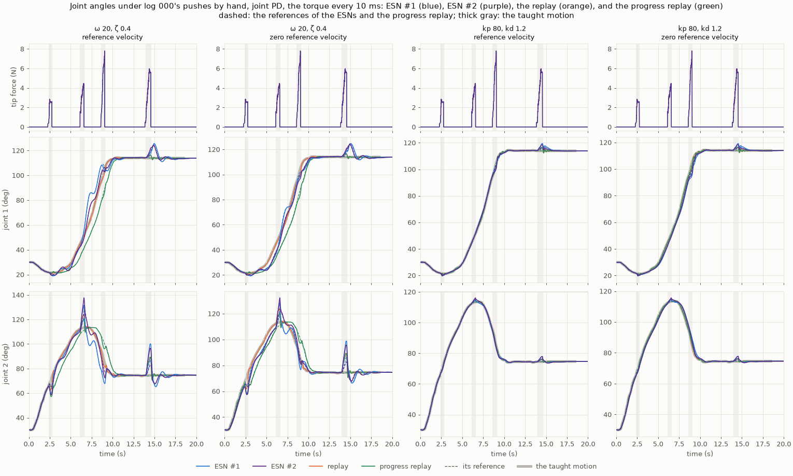

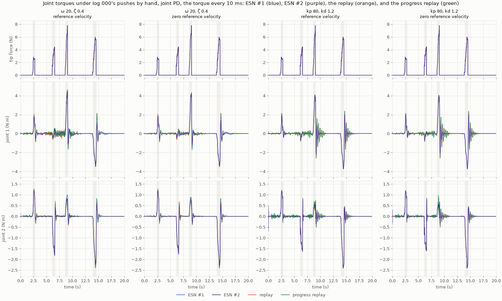

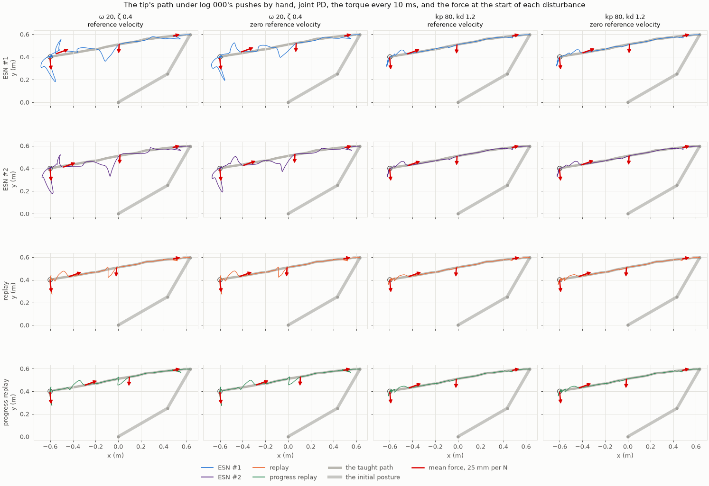

| Following, ESN #1 / ESN #2 / progress | Push 1 | Push 2 | Push 3 | Push 4 |
| --- | --- | --- | --- | --- |
| ω 20, ζ 0.4, reference velocity | 0.58 / 0.66 / 0.78 | 0.80 / 0.71 / 0.18 | 0.83 / 0.72 / 0.11 | 0.62 / 0.61 / -0.01 |
| ω 20, ζ 0.4, zero reference velocity | 0.63 / 0.69 / 0.82 | 0.83 / 0.73 / 0.19 | 0.54 / 0.59 / 0.14 | 0.63 / 0.62 / -0.01 |
| kp 80, kd 1.2, reference velocity | 0.53 / 0.55 / 0.00 | 0.82 / 0.76 / 0.00 | 0.55 / 0.51 / 0.00 | 0.66 / 0.53 / -0.00 |
| kp 80, kd 1.2, zero reference velocity | 0.61 / 0.61 / 0.00 | 0.82 / 0.75 / 0.00 | 0.56 / 0.52 / 0.12 | 0.67 / 0.53 / -0.00 |

| Ringing (mm) | Push 1 | Push 2 | Push 3 | Push 4 |
| --- | --- | --- | --- | --- |
| ω 20, ζ 0.4, reference velocity | 4.5 / 4.5 / 6.0 / 5.5 | 8.2 / 7.8 / 8.5 / 7.2 | 8.7 / 7.5 / 6.3 / 6.0 | 11.2 / 11.2 / 13.8 / 13.8 |
| ω 20, ζ 0.4, zero reference velocity | 3.9 / 3.7 / 6.1 / 5.3 | 6.9 / 6.6 / 8.5 / 7.2 | 6.9 / 5.9 / 6.4 / 6.1 | 10.4 / 10.4 / 13.8 / 13.8 |
| kp 80, kd 1.2, reference velocity | 1.3 / 1.3 / 1.7 / 1.7 | 0.9 / 0.9 / 1.7 / 1.7 | 5.6 / 5.7 / 7.0 / 7.0 | 5.3 / 5.5 / 6.9 / 6.9 |
| kp 80, kd 1.2, zero reference velocity | 1.2 / 1.2 / 1.8 / 1.8 | 0.9 / 0.8 / 1.7 / 1.7 | 4.8 / 5.0 / 7.0 / 7.2 | 5.1 / 5.2 / 6.9 / 6.9 |

| Back within 5 mm (s) | Push 1 | Push 2 | Push 3 | Push 4 |
| --- | --- | --- | --- | --- |
| ω 20, ζ 0.4, reference velocity | 2.22 / – / 0.07 / 0.24 | – / – / 0.35 / 0.24 | – / 0.93 / 0.41 / 0.39 | 2.63 / 3.33 / 0.47 / 0.47 |
| ω 20, ζ 0.4, zero reference velocity | 2.68 / – / 0.07 / 0.24 | – / – / 0.36 / 0.24 | – / 1.12 / 0.42 / 0.39 | 2.43 / 3.45 / 0.47 / 0.47 |
| kp 80, kd 1.2, reference velocity | 0.11 / 1.13 / 0.00 / 0.00 | 0.72 / 0.32 / 0.02 / 0.02 | 0.71 / 0.68 / 0.78 / 0.78 | 1.18 / 0.75 / 0.63 / 0.63 |
| kp 80, kd 1.2, zero reference velocity | 0.13 / 0.12 / 0.00 / 0.00 | 0.77 / 0.30 / 0.02 / 0.02 | 0.68 / 0.67 / 0.78 / 0.78 | 1.26 / 0.81 / 0.63 / 0.63 |

| Farthest (mm) | Push 1 | Push 2 | Push 3 | Push 4 |
| --- | --- | --- | --- | --- |
| ω 20, ζ 0.4, reference velocity | 32 / 32 / 21 / 25 | 121 / 163 / 70 / 56 | 134 / 101 / 55 / 50 | 219 / 221 / 125 / 125 |
| ω 20, ζ 0.4, zero reference velocity | 31 / 32 / 22 / 25 | 99 / 126 / 70 / 55 | 102 / 81 / 55 / 50 | 208 / 207 / 125 / 125 |
| kp 80, kd 1.2, reference velocity | 17 / 17 / 14 / 14 | 12 / 17 / 7 / 7 | 42 / 41 / 23 / 23 | 85 / 73 / 40 / 40 |
| kp 80, kd 1.2, zero reference velocity | 17 / 17 / 14 / 14 | 11 / 15 / 7 / 7 | 38 / 38 / 23 / 22 | 82 / 71 / 40 / 40 |

#### Log 001

As in Section 3.2:

| Tracker | Arrival (s) | Final distance (mm) | Peak torque (N m) | Peak hand speed (m/s) | Path (mm) |
| --- | --- | --- | --- | --- | --- |
| ω 20, ζ 0.4, reference velocity | 10.35 / 10.11 / 9.56 / 11.93 | 2.9 / 2.7 / 2.8 / 2.8 | 7.2 / 6.1 / 6.6 / 9.4 | 1.07 / 1.01 / 1.18 / 2.94 | 71.2 / 56.4 / 25.7 / 39.3 |
| ω 20, ζ 0.4, zero reference velocity | 13.39* / 14.13* / 9.61 / 12.03 | 2.8 / 2.8 / 2.8 / 2.8 | 10.1 / 9.9 / 6.4 / 9.5 | 2.09 / 2.13 / 1.18 / 2.95 | 97.5 / 110.0 / 25.7 / 39.4 |
| kp 80, kd 1.2, reference velocity | 10.21 / 10.10 / 9.48* / 11.00 | 2.9 / 2.7 / 2.8 / 2.8 | 7.7 / 7.7 / 6.8 / 7.3 | 1.14 / 1.27 / 1.11 / 0.80 | 19.4 / 24.1 / 9.2 / 6.2 |
| kp 80, kd 1.2, zero reference velocity | 10.38 / 10.47 / 9.50* / 11.05 | 2.9 / 2.7 / 2.8 / 2.8 | 7.6 / 7.8 / 6.7 / 7.2 | 1.08 / 1.25 / 1.11 / 0.78 | 16.6 / 23.4 / 9.1 / 6.1 |

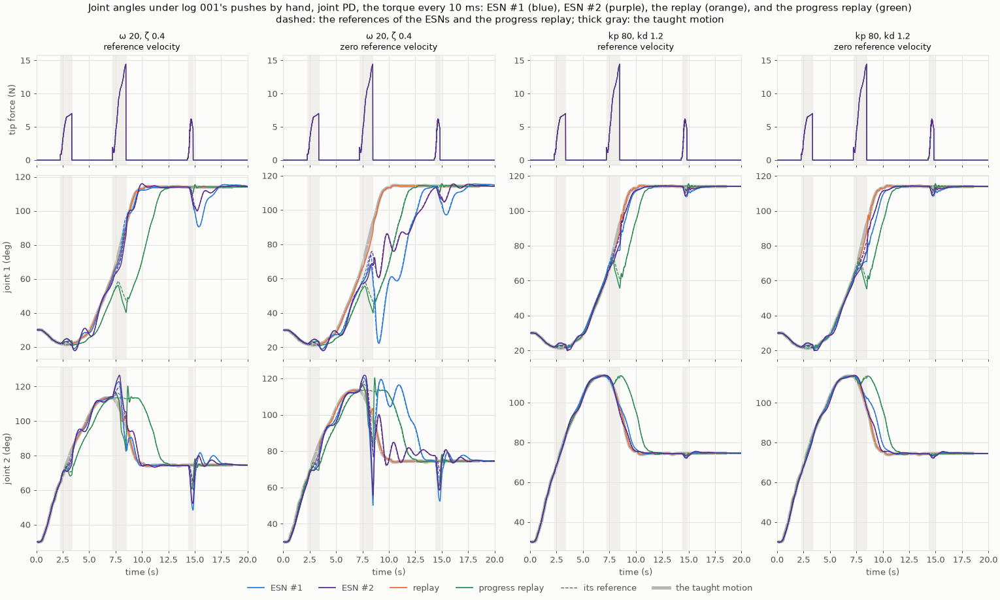

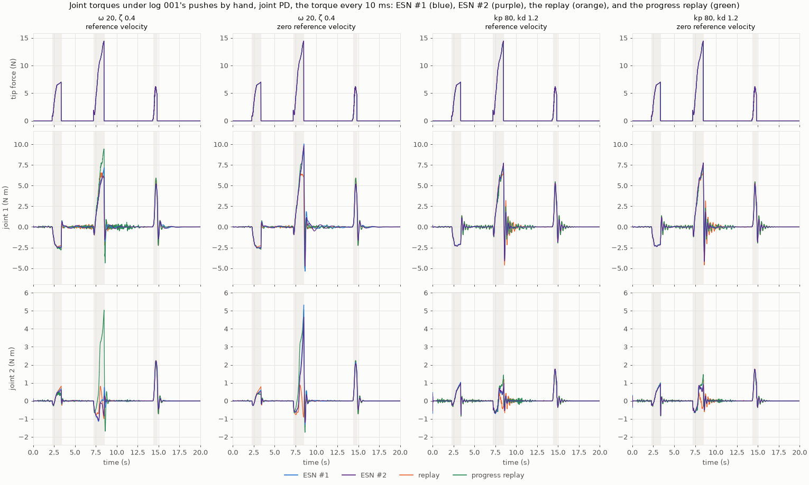

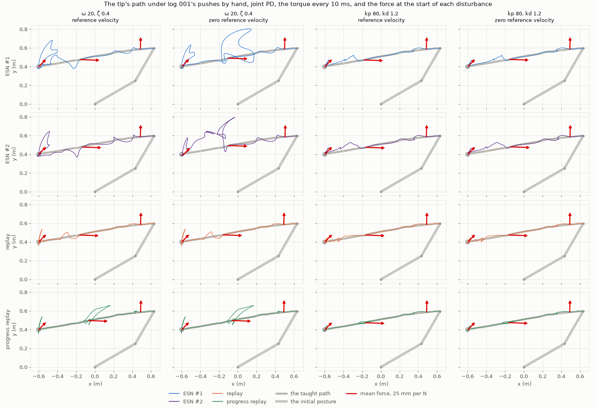

| Following, ESN #1 / ESN #2 / progress | Push 1 | Push 2 | Push 3 |
| --- | --- | --- | --- |
| ω 20, ζ 0.4, reference velocity | 0.66 / 0.78 / 0.95 | 0.50 / 0.59 / 0.67 | 0.80 / 0.67 / -0.00 |
| ω 20, ζ 0.4, zero reference velocity | 0.67 / 0.76 / 0.94 | 0.85 / 0.73 / 0.70 | 0.79 / 0.60 / -0.00 |
| kp 80, kd 1.2, reference velocity | 0.37 / 0.46 / 0.00 | 0.74 / 0.59 / 0.92 | 0.64 / 0.48 / 0.01 |
| kp 80, kd 1.2, zero reference velocity | 0.33 / 0.48 / 0.00 | 0.80 / 0.63 / 0.93 | 0.64 / 0.49 / 0.01 |

| Ringing (mm) | Push 1 | Push 2 | Push 3 |
| --- | --- | --- | --- |
| ω 20, ζ 0.4, reference velocity | 2.0 / 2.0 / 2.6 / 2.3 | 8.5 / 4.8 / 4.5 / 26.0 | 11.4 / 11.5 / 12.7 / 12.6 |
| ω 20, ζ 0.4, zero reference velocity | 1.6 / 1.6 / 2.5 / 2.4 | 27.0 / 25.2 / 4.5 / 26.2 | 9.5 / 9.5 / 12.7 / 12.7 |
| kp 80, kd 1.2, reference velocity | 2.6 / 2.7 / 3.5 / 3.5 | 8.8 / 9.7 / 10.8 / 7.4 | 4.8 / 5.2 / 5.7 / 5.8 |
| kp 80, kd 1.2, zero reference velocity | 2.6 / 2.6 / 3.5 / 3.5 | 7.7 / 8.8 / 10.7 / 6.8 | 4.6 / 4.9 / 5.7 / 5.8 |

| Back within 5 mm (s) | Push 1 | Push 2 | Push 3 |
| --- | --- | --- | --- |
| ω 20, ζ 0.4, reference velocity | 3.12 / 3.40 / 0.06 / 0.07 | 2.36 / 1.86 / 0.06 / 0.42 | 5.29 / 4.34 / 0.46 / 0.60 |
| ω 20, ζ 0.4, zero reference velocity | 2.87 / 3.78 / 0.06 / 0.07 | 5.30 / – / 0.05 / 0.42 | 5.34 / 3.22 / 0.46 / 0.61 |
| kp 80, kd 1.2, reference velocity | 1.54 / 2.46 / 0.19 / 0.19 | 2.15 / 1.97 / 0.76 / 0.02 | 1.10 / 0.69 / 0.50 / 0.49 |
| kp 80, kd 1.2, zero reference velocity | 2.32 / 2.64 / 0.19 / 0.19 | 1.68 / 2.22 / 0.75 / 0.02 | 1.18 / 0.70 / 0.50 / 0.49 |

| Farthest (mm) | Push 1 | Push 2 | Push 3 |
| --- | --- | --- | --- |
| ω 20, ζ 0.4, reference velocity | 28 / 37 / 18 / 18 | 91 / 100 / 50 / 118 | 254 / 222 / 128 / 127 |
| ω 20, ζ 0.4, zero reference velocity | 27 / 34 / 17 / 17 | 274 / 286 / 52 / 118 | 211 / 159 / 128 / 127 |
| kp 80, kd 1.2, reference velocity | 23 / 25 / 15 / 15 | 66 / 77 / 26 / 17 | 62 / 59 / 40 / 40 |
| kp 80, kd 1.2, zero reference velocity | 23 / 25 / 15 / 15 | 56 / 71 / 26 / 16 | 58 / 56 / 40 / 39 |

#### Log 002

As in Section 3.2:

| Tracker | Arrival (s) | Final distance (mm) | Peak torque (N m) | Peak hand speed (m/s) | Path (mm) |
| --- | --- | --- | --- | --- | --- |
| ω 20, ζ 0.4, reference velocity | 9.37 / 9.46 / 9.56 / 11.16 | 2.9 / 2.8 / 2.8 / 2.8 | 3.2 / 3.1 / 3.5 / 6.0 | 0.97 / 0.86 / 0.95 / 1.22 | 50.6 / 45.6 / 20.2 / 16.6 |
| ω 20, ζ 0.4, zero reference velocity | 10.18 / 9.90 / 9.61 / 11.24 | 2.9 / 2.7 / 2.8 / 2.8 | 3.9 / 3.7 / 3.5 / 5.8 | 0.80 / 0.78 / 0.95 / 1.21 | 41.1 / 34.0 / 20.0 / 16.6 |
| kp 80, kd 1.2, reference velocity | 9.63 / 9.57 / 9.58 / 9.79 | 2.9 / 2.7 / 2.8 / 2.8 | 4.2 / 4.2 / 4.1 / 3.9 | 0.59 / 0.59 / 0.59 / 0.58 | 5.9 / 6.3 / 3.2 / 3.1 |
| kp 80, kd 1.2, zero reference velocity | 9.87 / 9.73 / 9.59 / 9.83 | 2.9 / 2.7 / 2.8 / 2.8 | 4.3 / 4.3 / 4.2 / 3.9 | 0.59 / 0.59 / 0.58 / 0.55 | 5.8 / 5.9 / 3.2 / 3.1 |

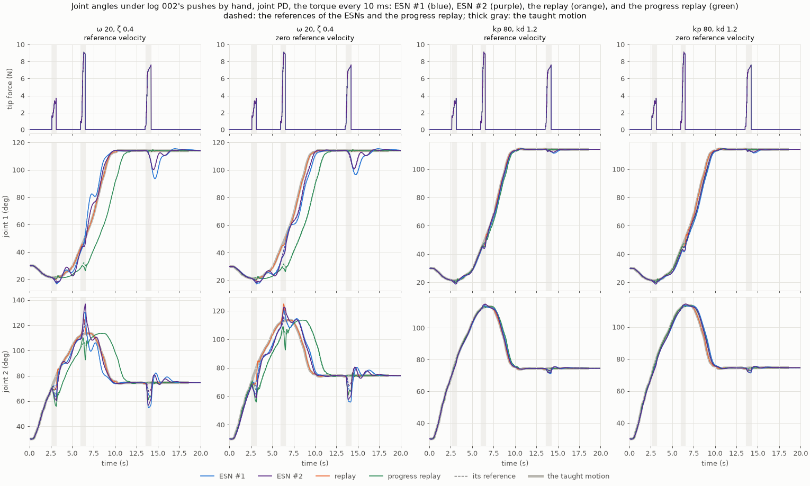

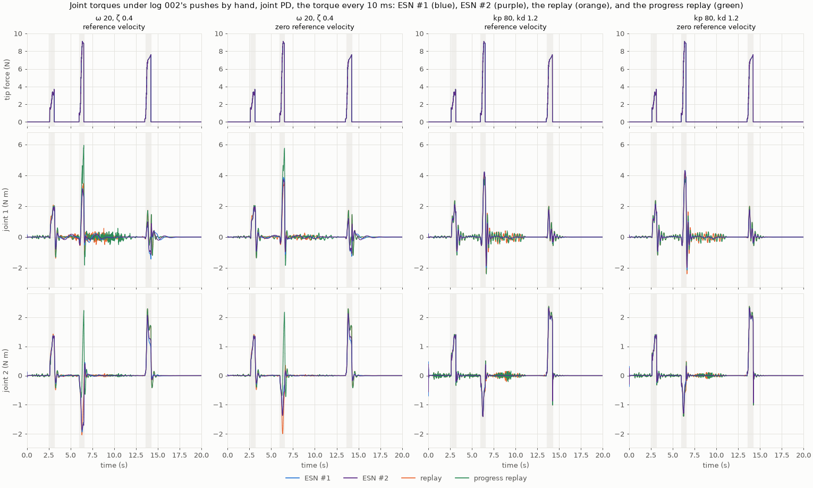

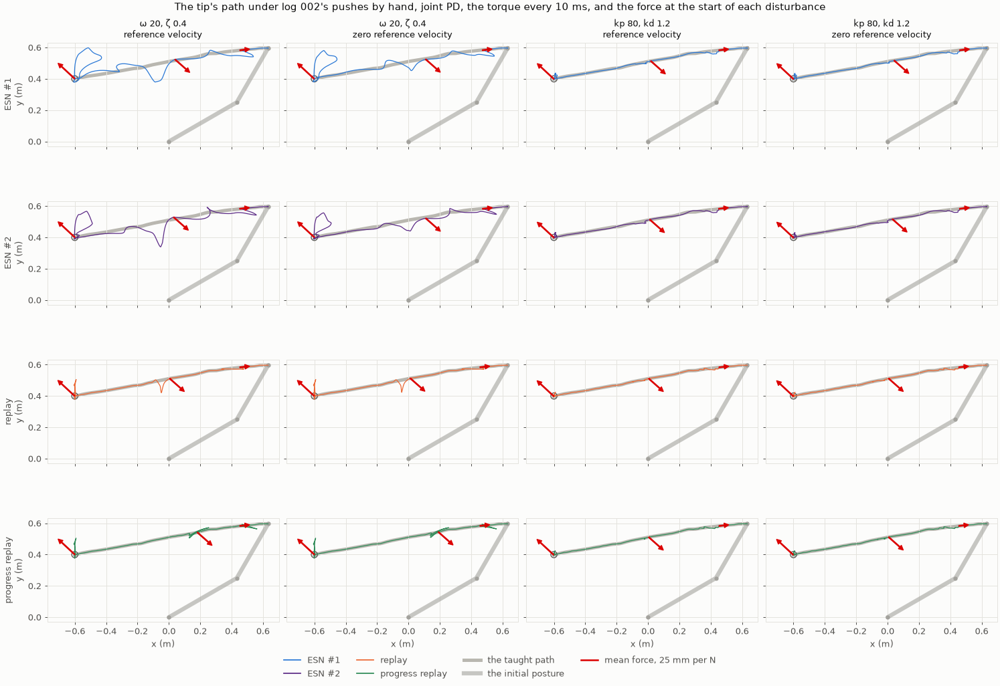

| Following, ESN #1 / ESN #2 / progress | Push 1 | Push 2 | Push 3 |
| --- | --- | --- | --- |
| ω 20, ζ 0.4, reference velocity | 0.60 / 0.66 / 0.75 | 0.80 / 0.69 / 0.53 | 0.87 / 0.77 / 0.00 |
| ω 20, ζ 0.4, zero reference velocity | 0.62 / 0.67 / 0.78 | 0.89 / 0.85 / 0.58 | 0.88 / 0.79 / 0.00 |
| kp 80, kd 1.2, reference velocity | 0.52 / 0.54 / -0.00 | 0.25 / 0.43 / 0.70 | 0.75 / 0.64 / 0.01 |
| kp 80, kd 1.2, zero reference velocity | 0.56 / 0.57 / -0.00 | 0.21 / 0.39 / 0.76 | 0.75 / 0.64 / 0.01 |

| Ringing (mm) | Push 1 | Push 2 | Push 3 |
| --- | --- | --- | --- |
| ω 20, ζ 0.4, reference velocity | 6.9 / 6.9 / 8.5 / 8.0 | 6.9 / 7.2 / 4.8 / 13.4 | 2.8 / 3.9 / 7.6 / 7.6 |
| ω 20, ζ 0.4, zero reference velocity | 6.3 / 6.1 / 8.5 / 8.1 | 2.4 / 2.3 / 4.5 / 12.6 | 2.7 / 3.5 / 7.6 / 7.6 |
| kp 80, kd 1.2, reference velocity | 2.7 / 2.6 / 3.4 / 3.4 | 3.5 / 3.4 / 4.1 / 4.6 | 1.1 / 1.2 / 1.9 / 1.9 |
| kp 80, kd 1.2, zero reference velocity | 2.5 / 2.5 / 3.4 / 3.4 | 3.5 / 3.3 / 4.1 / 4.3 | 1.1 / 1.1 / 1.9 / 1.9 |

| Back within 5 mm (s) | Push 1 | Push 2 | Push 3 |
| --- | --- | --- | --- |
| ω 20, ζ 0.4, reference velocity | – / – / 0.09 / 0.28 | 2.25 / 2.83 / 0.20 / 0.26 | 4.89 / 4.19 / 0.44 / 0.29 |
| ω 20, ζ 0.4, zero reference velocity | 2.77 / – / 0.09 / 0.28 | 2.60 / 1.86 / 0.19 / 0.25 | 5.26 / 4.48 / 0.44 / 0.40 |
| kp 80, kd 1.2, reference velocity | 0.90 / 1.73 / 0.17 / 0.17 | 0.04 / 1.23 / 0.00 / 0.00 | 0.88 / 0.47 / 0.01 / 0.01 |
| kp 80, kd 1.2, zero reference velocity | 0.38 / 1.87 / 0.17 / 0.17 | 0.06 / 0.23 / 0.00 / 0.00 | 0.93 / 0.54 / 0.01 / 0.01 |

| Farthest (mm) | Push 1 | Push 2 | Push 3 |
| --- | --- | --- | --- |
| ω 20, ζ 0.4, reference velocity | 50 / 49 / 14 / 29 | 112 / 157 / 78 / 26 | 179 / 150 / 102 / 102 |
| ω 20, ζ 0.4, zero reference velocity | 47 / 45 / 15 / 29 | 60 / 70 / 76 / 24 | 166 / 142 / 102 / 102 |
| kp 80, kd 1.2, reference velocity | 21 / 21 / 13 / 13 | 11 / 16 / 8 / 8 | 35 / 30 / 23 / 23 |
| kp 80, kd 1.2, zero reference velocity | 21 / 21 / 13 / 13 | 11 / 15 / 8 / 8 | 34 / 29 / 23 / 23 |

- **At ζ = 0.4, the progress replay follows the pushes back along the path,** by 0.53
  to 0.95: each log's first push, log 001's second, and log 002's second. Under the
  first pushes, it strays 17 to 29 mm from the path, against the replay's 14 to 22 mm;
  under log 002's second, 24 to 26 mm against 76 to 78 mm, back about as soon (0.25 to
  0.26 s against 0.19 to 0.20 s), but ringing more, 12.6 to 13.4 mm against 4.5 to
  4.8 mm. Under the pushes across the path, it is the replay.
- **Under log 001's second push at ζ = 0.4, it does worst of all:** met 0.7 s behind the
  take (Section 3.1), it is sent 118 mm from the path, against the replay's 50 to 52 mm
  and the ESNs' 91 to 286 mm, rings 26 mm, against 4.5 mm and 4.8 to 27.0 mm, its hand
  reaches 2.9 m/s, and it arrives at 11.9 to 12.0 s, against 9.6 s and 10.1 to 14.1 s.
  It holds, as the replay does, where the ESNs given a zero reference velocity leave the
  goal.
- **At kp = 80, the progress replay is the replay** but under log 001's and log 002's
  second pushes, which it follows by 0.70 to 0.93: under log 001's, it strays 16 to
  17 mm, against the replay's 26 mm, rings 6.8 to 7.4 mm, against 10.7 to 10.8 mm, and
  is back within 0.02 s, against 0.75 to 0.76 s, and then holds, where the replay leaves
  the goal. Under log 000, it leaves the goal as the replay does, the hand swinging out
  of it right after it arrives (report 013, Section 3.5).

### 3.5 Over the 13 pushes

The median over report 011's three pushes and report 012's ten, with the least and the
most. A hand not back counts as back at the next push or the run's end; the count of
pushes it is not back after follows the return:

| Tracker | Following | Ringing (mm) | Back within 5 mm (s); not back | Farthest (mm) |
| --- | --- | --- | --- | --- |
| ω 20, ζ 0.4, reference velocity | 0.80 (0.50 to 0.87) / 0.69 (0.59 to 0.78) / 0.11 (-0.01 to 0.95) | 6.9 (2.0 to 11.4) / 6.9 (2.0 to 11.5) / 7.6 (2.6 to 13.8) / 8.0 (2.3 to 26.0) | 2.84 (2.02 to 5.29); 3 / 3.33 (0.93 to 4.34); 4 / 0.35 (0.04 to 0.47); 0 / 0.29 (0.04 to 0.60); 0 | 121 (28 to 254) / 150 (32 to 222) / 70 (7 to 128) / 56 (7 to 127) |
| ω 20, ζ 0.4, zero reference velocity | 0.77 (0.54 to 0.89) / 0.73 (0.59 to 0.85) / 0.14 (-0.01 to 0.94) | 6.3 (1.6 to 27.0) / 5.9 (1.6 to 25.2) / 7.6 (2.5 to 13.8) / 8.1 (2.4 to 26.2) | 2.88 (2.02 to 5.34); 2 / 3.45 (1.12 to 5.90); 5 / 0.36 (0.03 to 0.47); 0 / 0.38 (0.03 to 0.61); 0 | 102 (27 to 274) / 126 (32 to 286) / 70 (6 to 128) / 55 (6 to 127) |
| kp 80, kd 1.2, reference velocity | 0.64 (0.25 to 0.85) / 0.54 (0.43 to 0.76) / 0.00 (-0.00 to 0.92) | 2.7 (0.9 to 8.8) / 2.7 (0.9 to 9.7) / 3.5 (1.7 to 10.8) / 3.5 (1.7 to 7.4) | 0.90 (0.04 to 2.15); 0 / 1.13 (0.32 to 2.46); 0 / 0.17 (0.00 to 0.78); 0 / 0.17 (0.00 to 0.78); 0 | 27 (11 to 85) / 30 (16 to 77) / 15 (7 to 40) / 15 (7 to 40) |
| kp 80, kd 1.2, zero reference velocity | 0.64 (0.21 to 0.82) / 0.56 (0.39 to 0.75) / 0.00 (-0.00 to 0.93) | 2.6 (0.9 to 7.7) / 2.6 (0.8 to 8.8) / 3.5 (1.7 to 10.7) / 3.5 (1.7 to 7.2) | 0.93 (0.06 to 2.32); 0 / 0.70 (0.12 to 2.64); 0 / 0.17 (0.00 to 0.78); 0 / 0.17 (0.00 to 0.78); 0 | 25 (11 to 82) / 29 (14 to 71) / 15 (7 to 40) / 15 (7 to 40) |

- **At ζ = 0.4, the progress replay keeps the hand nearest the path,** 55 to 56 mm in
  the median, against the replay's 70 mm and the ESNs' 102 to 150 mm, and is back about
  as soon as the replay, 0.29 to 0.38 s against 0.35 to 0.36 s, after every push; the
  ESNs are back in 2.8 to 3.5 s, 2 to 5 pushes not back at all.
- **It rings a little more than the replay, 8.0 to 8.1 mm against 7.6 mm,** and the ESNs
  a little less, 5.9 to 6.9 mm: what following costs the progress replay, a reference
  that falls back, it saves the ESNs, whose references give way smoothly.
- **At kp = 80, it is the replay:** the stiff arm moves too little along the path for
  its progress to change, but under log 001's and log 002's second pushes.

## 4. Observations

- **Waiting under a block is not the ESNs' own.** A replay that keeps to the arm's
  progress along the taught path waits as well, with less torque, and, keeping its
  reference on the path, comes back at once after the release. The ESNs' advantage over
  the replay by time under the block, reported since report 003, is what any
  progress-based reference gives.
- **The ESNs' own advantages are where the arm leaves the path, or starts off it.** From
  an offset start, their references start where the arm is, and the tracker pushes half
  as hard. Under a push across the path, they give way across it too, where a progress
  replay, keeping to the path, pulls the arm straight back: they ring less, but come back
  in seconds.
- **Following along the path has to be gradual.** A reference that falls back with the
  arm's nearest point jumps when that point does, and throws the arm; one that falls back
  at the take's pace lags a fast push, and then pulls hard. The ESNs' references give way
  smoothly, at the speed of their own dynamics.
- **Forces replayed by time meet arms that fall behind at other postures.** The progress
  replay's worst push, log 001's second, met it 0.7 s behind the take, where the same
  force sent it far back. Recorded pushes compare the arms fairly only while they keep
  time; an arm that waits or follows meets a different push.

## 5. Next steps

1. **A progress replay that starts from the arm:** blending from the start posture into
   the take, to see whether the ESNs' last clear advantage, half the torque from an
   offset start, also comes without an ESN.
2. **Where giving way across the path is wanted:** a disturbance across the path that
   lasts, as a block does along it, such as a wall beside the path, where a reference
   that keeps to the path would press against it, to measure what the ESNs' yielding
   across it is worth.
3. **Pushes that follow the arm:** forces applied where the arm is, by a model of the
   hand that pushed, rather than replayed by time, so that arms that wait or follow meet
   the same push.
