# 015 What the ESNs learned: a path into the target, joined from anywhere

**Summary.** Reports 011 to 014 measured how report 011's two ESNs drive the robot. This
report asks what they learned as dynamical systems. Is the take's target an
equilibrium that attracts them from anywhere? Is the take's path a trajectory that
attracts them when they are off it? Or do they time their reach from the reset, like
a clock? Each ESN runs on its own, fed its own output, from rest at 1,296 postures over
both joints' whole range. It runs with other warm-ups than the trained 1 s. On the
robot, it is pushed at the tip by 160 short pulses along the reach, against the replay
and the progress replay. Finally, it is read as the map of its 400 reservoir values,
which rclib's new weight getters make possible to evaluate anywhere: its fixed points,
their eigenvalues, and how fast changes across its run decay.

- **The target attracts both ESNs from every start posture.**
  - Every one of the 2 × 1,296 runs ends at rest within 3 mm of the target, arriving
    by 11.4 s (ESN #1) and 13.5 s (ESN #2).
  - Each ESN has an attracting fixed point at the take's end posture, within 0.02°.
    It is the only attracting one found from 2,592 states. Its slowest mode decays
    in 1.5 s, turning with a period of 7 to 8 s.
  - ESN #2 also has two unstable fixed points, beside the take's path and inside its
    bend. None was found for ESN #1.
- **From far away, an ESN jumps first, then joins the take's path and follows it.**
  - The first output lies a median 79° to 84° from the start posture, up to 248°.
    The warm-up's state reads out as a posture squashed toward the region the take
    covers.
  - Within 1.3 s (ESN #1) and 2.4 s (ESN #2), in the median, a run stays within 5° of
    the take's joint path for good. Most join near the path's start: at a median of
    0.20 and 0.02 of the way along it. From there they follow it to the target.
  - The reservoir states converge onto the take's states too, to within 10⁻² of their
    spread by 4 s and 6 s (median), but at a phase of their own.
- **Along the path, they time the reach by where they are on it, not by a clock.**
  - From rest on the path, ESN #1 arrives as the rest of the take from there would.
  - On the robot, a pulse that sets an ESN's arm back or forward along the path shifts
    its arrival by about that time: correlation 0.78 to 0.79, from −0.55 s to +1.40 s.
    The replay keeps its time to within 0.12 s.
  - ESN #2 breaks this from the middle of the path, where its unstable fixed point
    lies: from rest halfway along, it arrives at 10.9 s, later than from the take's
    start.
- **But the warm-up leaves a clock in when the reach starts.**
  - When the 1 s warm-up ends, the state still drifts as fast as the take's states move
    during the reach. The held reservoir settles with a time constant of 0.6 s
    (median).
  - Warm-ups of 2 s and 4 s bring the arrival forward by 0.7 to 0.8 s and 1.0 to 1.2 s
    (median). A clock from the reset would bring it forward by 1 s and 3 s; the effect
    saturates as the reservoir settles.
- **The path attracts slowly, after a transient.**
  - Along an ESN's own run, some changes of the state across the run grow over windows
    of up to 2 s. They decay only over 4 s windows: −0.20 and −0.11 /s (median).
  - A deviation of the output posture keeps a median 78% (ESN #1) and 51% (ESN #2) of
    its size after 1 s, and 6% to 8% after 4 s. Mid-reach it can grow up to 2.5-fold
    first.
  - On the robot, after a 6 N pulse, the ESNs' hands are back within 5 mm of the path
    in 2.0 and 3.0 s (median), against 0.3 to 0.4 s for the replays. They follow the
    arm with a gain of 0.56.

## 1. Question

Since report 003, the ESNs have been described by what they do on the robot: they
reach, they wait under a block, they follow a push. Report 014 showed that a replay
that keeps to the arm's progress along the taught path waits as well. So what is the
ESN's own? An ESN fed its own output is an autonomous dynamical system of its
reservoir state: nothing but the state carries over from one step to the next, so its
history is in the state. Three hypotheses about what it learned from one take:

- **H1, a target:** the take's end posture is a stable equilibrium, and attracts the
  ESN from wherever it starts.
- **H2, a path:** the take's path is a trajectory that attracts the ESN, in posture and
  in state, and the ESN, once on it, goes on from where it is.
- **H3, a clock:** the ESN times its reach from the reset, through the transient of its
  reservoir, whatever happens to it.

## 2. Setup

### The ESNs and the steps

- **The ESNs:** report 011's ESN #1 (leak rate 0.03, spectral radius 1.2, input scaling
  1.5, seed 8) and ESN #2 (input scaling 1, seed 2), 400 neurons, trained on the take
  with a 1 s warm-up, as on the robot since report 011.
- **Step 1, from rest anywhere**
  ([`global_starts.py`](../../experiments/global_starts.py)):
  - Each ESN runs on its own, fed its own output, for 20 s.
  - It starts from rest at every 10° of both joints, from −180° to 170° (1,296
    postures), each held for the 1 s warm-up first, as in training.
  - Each start posture is also held for 4 s, to see how far the state still moves
    after the warm-up.
- **Step 1b, the warm-up** ([`warmup_esn.py`](../../experiments/warmup_esn.py)):
  - Added to the plan because step 1 found the state still moving at the end of the
    warm-up.
  - Each ESN runs with warm-ups of 0.25, 0.5, 1, 2, and 4 s, the trained model
    unchanged.
  - It starts from report 011's 49 offset starts (±15° in steps of 5°), and from rest
    at three postures on the take's path: a quarter, half, and three quarters of the
    way along it.
- **Step 2, pushed along the reach** ([`push_pulses.py`](../../experiments/push_pulses.py)):
  - On the robot, from the take's start, with joint PD at ω = 20 rad/s and ζ = 0.4,
    given the reference velocity, its torque computed every 10 ms (reports 011, 012,
    and 014).
  - Four arms: ESN #1, ESN #2, the replay of the take by time, and its replay by the
    arm's progress (report 014's, a lead of 2.5°).
  - One pulse a run, 160 per arm, plus one undisturbed run: a tip force of 3 N or
    6 N for 0.2 s, at 1 to 9 s every second and at 12 s, at the target, in 8
    directions.
  - The directions are counted counterclockwise from the direction toward the target,
    0° forward and 180° backward.
- **Step 3, where they can rest** ([`fixed_points.py`](../../experiments/fixed_points.py)):
  - Each ESN is read as the map G of its reservoir state that its runs follow
    ([`dynamics.py`](../../src/arm_esn_ctrl/dynamics.py)). Rebuilt with numpy from the
    weights, G reproduces the ESN's run to 10⁻¹⁵ rad.
  - Fixed points of G: sought by Newton's method from the states at the start and end
    of every step-1 run, with their eigenvalues.
  - The held reservoir's fixed point at every start posture, and how slowly it
    settles.
  - Along the ESN's own run from the take's start: how fast changes of the state across
    the run grow or decay over windows of 0.5 to 4 s, and how much a deviation of the
    output posture shrinks.

### Measures

- **The take's path and progress:** the distance of the joint angles from the take's
  joint path, and how far along that path the nearest point lies, 0 at its start and 1
  at its end. A run **joins** the path once within 5° of it for good.
- **The take's states:** the reservoir states while the take is fed in, as in training.
  A run's state is compared with the nearest of them, whose time is the run's
  **phase**, and with the one at the same time. Distances are relative to the spread
  of the take's states, their RMS distance from their mean.
- **Arrival:** when the hand first comes within the 20 mm goal radius. A run succeeds
  when it then stays there for 2 s.
- **After a pulse** (robot_esn.py's measures, reports 011 to 014):
  - the hand's farthest distance from the taught path;
  - the time from the pulse's end until the hand is back within 5 mm of it;
  - the following gain;
  - against the same arm undisturbed: how much later it arrives, how far back along
    the path it goes, and how much its peak torque over 2 s rises.

### Reproducing the results

The runs read the take as in report 011 and the ESNs by their run names (copied in
[report 011's results](../011-following-the-arm/results)). The configurations are in
[`manual_demonstration_v2_esn_dynamics`](../../experiments/manual_demonstration_v2_esn_dynamics/README.md).

| Run | Command | Commit |
| --- | --- | --- |
| `20261015-223608-global_starts` | `uv run python experiments/global_starts.py experiments/manual_demonstration_v2_esn_dynamics/global_starts.toml` | `e2e5d77` |
| `20261015-225101-warmup_{lr0.03_sr1.2_is1.5_seed8,lr0.03_sr1.2_is1_seed2}` | `uv run python experiments/warmup_esn.py experiments/manual_demonstration_v2_esn_dynamics/warmup_<ESN>.toml` | `9bb8790` |
| `20261015-223608-push_pulses` | `uv run python experiments/push_pulses.py experiments/manual_demonstration_v2_esn_dynamics/push_pulses.toml` | `e2e5d77` |
| `20261015-225557-fixed_points` | `uv run python experiments/fixed_points.py experiments/manual_demonstration_v2_esn_dynamics/fixed_points.toml` | `b0b42ec` |
| [`summary`](results/summary) | `uv run python reports/015-what-the-esns-learned/make_figures.py` | |

Every run record (`run.toml`) shows no uncommitted changes. Step 3 needs rclib's
read-only weight getters (rclib's `791af14`), to which commit `1b44ee9` advances the
pin; commit `73badd3` advances it to rclib's main, which runs both ESNs bit for bit as
before. Each run's directory here holds its configuration, its run
record, and its CSV files. [`make_figures.py`](make_figures.py) copies them from the
runs under the storage root, prints the tables of this report, and draws the figures.
The arrays they read (`runs_<ESN>.npz`, `runs.npz`, `spectra_<ESN>.npz`,
`rates_<ESN>.npz`), 120 MB in all, are not kept in Git.

## 3. Results

### 3.1 From rest anywhere

**Figure 1.** When the hand arrives, over the 1,296 start postures, each held for the
1 s warm-up and then released to the ESN on its own. The thick gray line is the take's
joint path, from its start (circle) to the target (star). The dashed square holds
report 011's 49 offset starts.

| From the 1,296 starts, median (range) | ESN #1 | ESN #2 |
| --- | --- | --- |
| End at rest at the target | 1,296 | 1,296 |
| Final distance from the target | 2.9 mm | 2.7 mm (2.7 to 2.9 mm) |
| Arrival | 8.84 s (0.01 to 11.40 s) | 9.85 s (0.08 to 13.53 s) |
| First step | 84° (up to 248°) | 79° (up to 229°) |
| Join the take's path (within 5° for good) | 1,296, at 1.30 s (up to 2.69 s) | 1,296, at 2.41 s (up to 9.02 s) |
| … at a progress along it of | 0.20 (0 to 1) | 0.02 (0 to 1) |

The take itself arrives at 9.58 s. From its start, both ESNs arrive at 9.55 and 9.54 s.

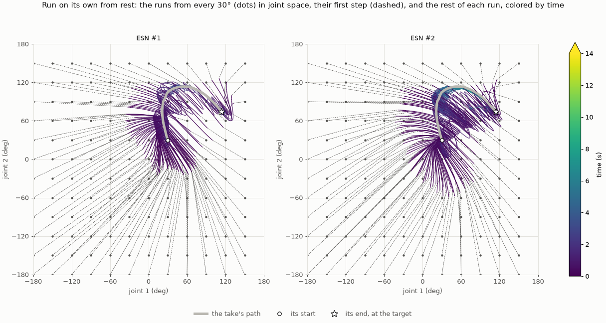

**Figure 2.** The runs from every 30° in joint space: from the start posture (dot), the
first step (dashed), and the rest of the run, colored by time.

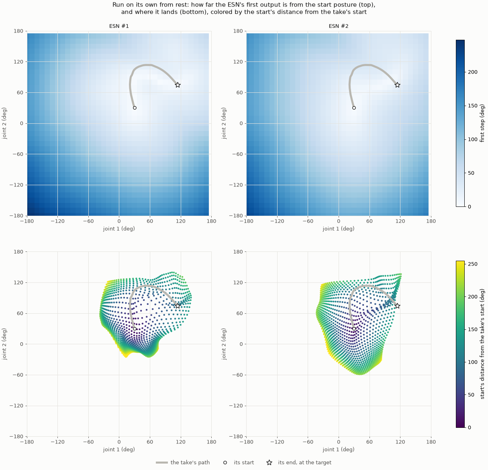

**Figure 3.** Top: how far the first output is from the start posture. Bottom: where it
lands, for every start, colored by the start's distance from the take's start.

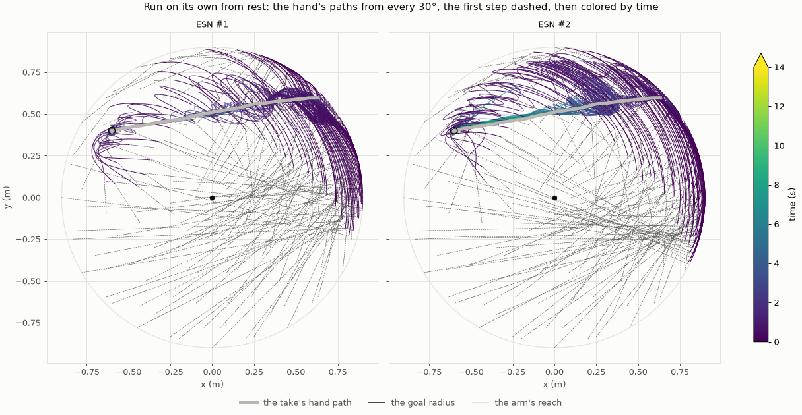

**Figure 4.** The hand's paths from every 30°, the first step dashed. The gray circle
is the arm's reach.

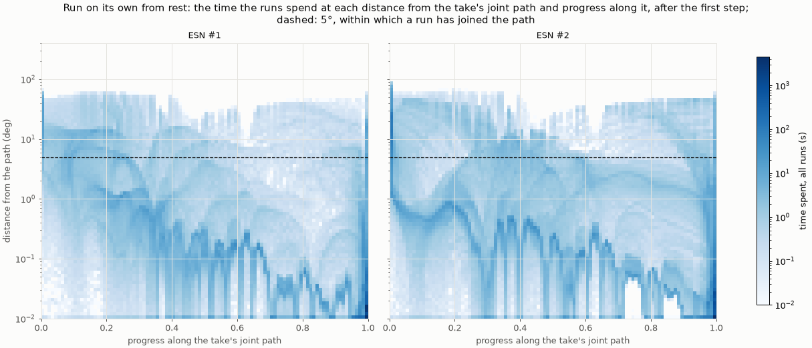

**Figure 5.** Where the runs spend their time after the first step: their distance
from the take's joint path against their progress along it, summed over every run.

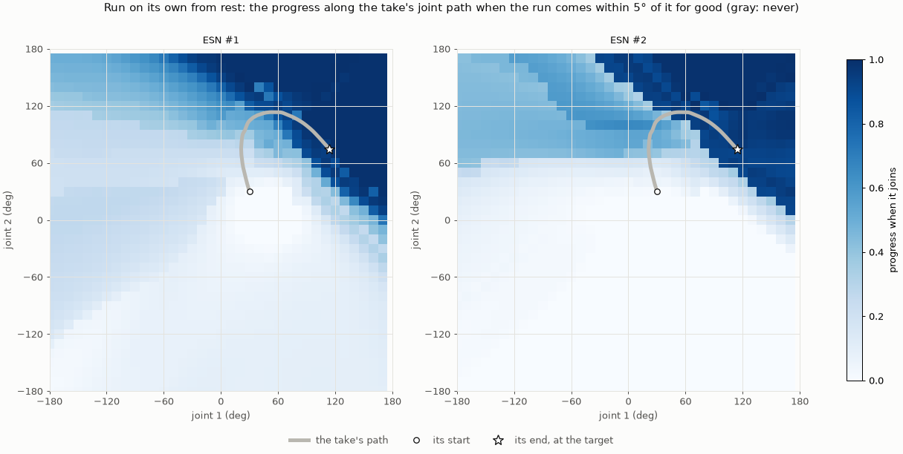

**Figure 6.** The progress along the take's path at which each run joins it.

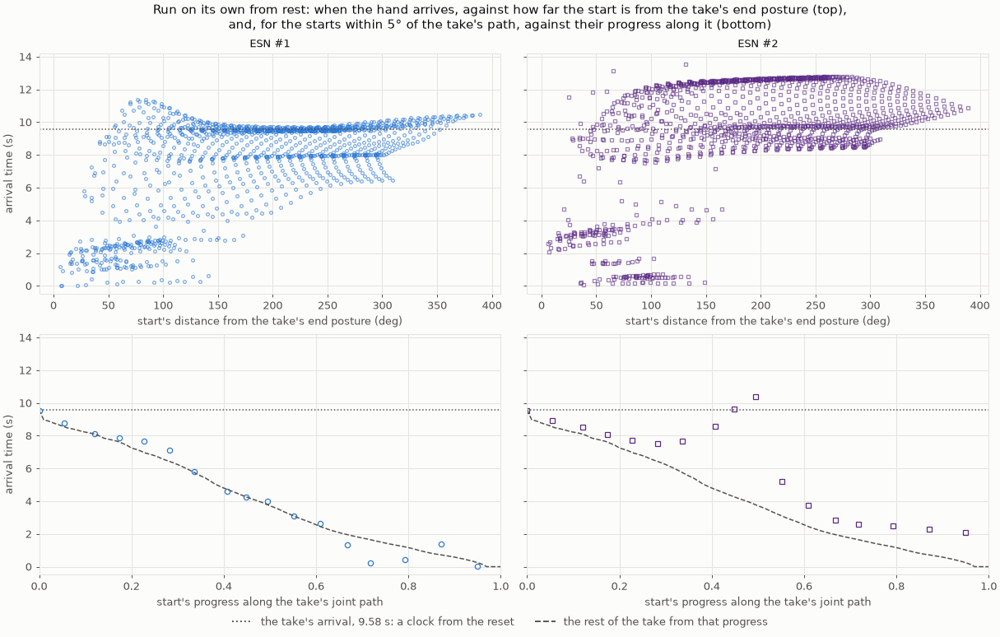

**Figure 7.** Top: when the hand arrives, against the start's distance from the take's
end posture. Bottom: for the starts within 5° of the take's path, against their progress
along it. The dotted line is the take's arrival, what a clock from the reset would give.
The dashed line is the rest of the take from that progress, what a path follower would
give.

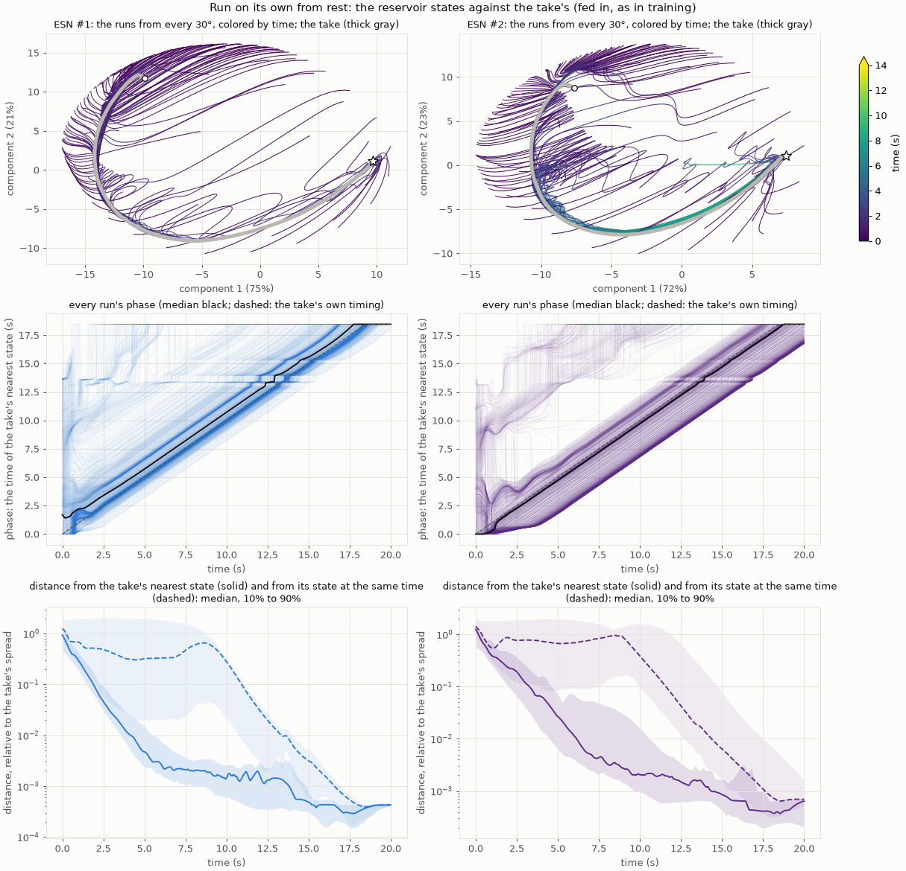

**Figure 8.** Top: the states of the runs from every 30° projected onto the first two
principal components of the take's states (thick gray). Middle: every run's phase, the
time of the take's nearest state; a run that keeps the take's timing lies on the dashed
line. Bottom: the distance from the take's nearest state (solid) and from its state at
the same time (dashed), median and 10% to 90%.

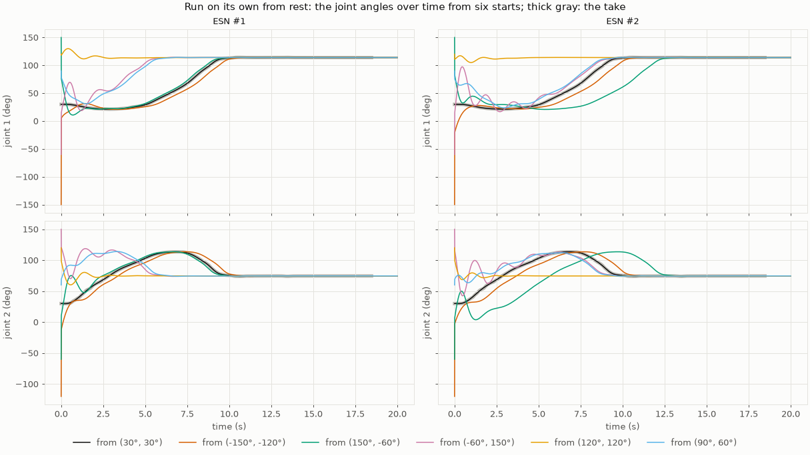

**Figure 9.** The joint angles over time from six starts: the take's start (black),
three far from it, and two near the target.

- **H1 holds over the whole joint space.**
  - Both ESNs reach the target and rest there from every start posture of both
    joints' whole range.
  - None ends elsewhere, keeps moving, or passes ±180°.
  - Starts near the target arrive within a step (Figure 1, the light corner).
- **The ESN does not start from where it is held.**
  - Its first output after a far start lands in a bounded region around the take
    (Figure 3, bottom), a median 79° to 84° away.
  - The start postures outside the posture range the ESN was trained on read out
    squashed toward that range.
  - On the robot, the arm cannot jump: the tracker would see the jump as its error.
    From starts 15° from the take's start, as report 011's offsets, the first step is
    5.5° (median, ESN #1).
- **Then the runs join the path, mostly near its start, and follow it.**
  - Within a second or two the runs come within 5° of the take's joint path (Figures 2,
    5, and 6).
  - Starts below the path join it near its start, starts above its second half near
    its end, and those between midway (Figure 6).
  - From then on they follow the path's shape, wiggles and all (Figure 5), to the
    target.
- **In state, the runs converge onto the take's state trajectory, but not onto its
  timing.**
  - The distance from the take's nearest state falls below 10⁻² of the spread by 4.2 s
    (ESN #1) and 6.2 s (ESN #2) in the median, and on to 10⁻³ (Figure 8, bottom).
  - The distance from the take's state at the same time stays large until the reach
    ends: each run's phase runs parallel to the take's timing, at an offset of its own
    (Figure 8, middle). At 5 s it leads the take by a median 0.71 s (ESN #1) and lags
    by 0.29 s (ESN #2).
  - This is H2 in state: the take's state trajectory attracts, and a run on it goes on
    from where it joined.
- **The arrival depends on where the run joins, which is why it hardly depends on the
  start.**
  - From far starts, the runs join near the path's start, and so arrive close to the
    take's 9.58 s (Figure 7, top).
  - From rest on the path, ESN #1 arrives as the rest of the take from there would
    (Figure 7, bottom, dashed). It is not the clock's constant (dotted).
  - ESN #2 does the same near the path's start and end, but from rest 0.3 to 0.5 of
    the way along it arrives later than the rest of the take would, at up to 10.4 s.
    That is near its unstable fixed point (Section 3.4).

### 3.2 The warm-up

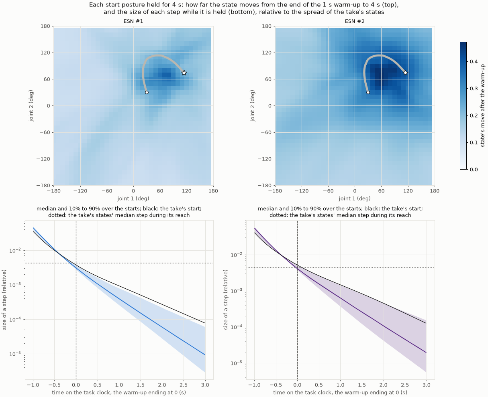

**Figure 10.** Each start posture held for 4 s. Top: how far the state moves from the
end of the 1 s warm-up to 4 s. Bottom: the size of each step while it is held, median
and 10% to 90% over the starts, the take's start in black. The dotted line is the take's
states' median step during its reach.

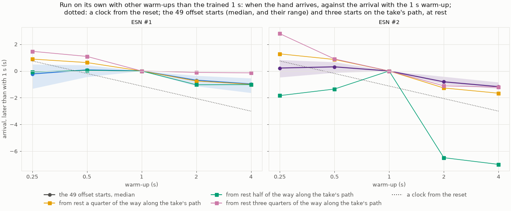

**Figure 11.** Run with other warm-ups than the trained 1 s: when the hand arrives,
against the arrival with 1 s. The band is the range over the 49 offset starts. The
dotted line is a clock from the reset.

| Arrival, later than with 1 s, median of the 49 offset starts | 0.25 s | 0.5 s | 2 s | 4 s |
| --- | ---: | ---: | ---: | ---: |
| ESN #1 | −0.22 s | +0.08 s | −0.69 s | −0.97 s |
| ESN #2 | +0.22 s | +0.31 s | −0.81 s | −1.17 s |
| A clock from the reset | +0.75 s | +0.50 s | −1.00 s | −3.00 s |

| From rest on the take's path: arrival with warm-ups of 0.25, 0.5, 1, 2, 4 s | ESN #1 | ESN #2 |
| --- | --- | --- |
| A quarter of the way (the take there at 2.8 s) | 8.43, 8.17, 7.54, 6.79, 6.54 s | 8.88, 8.46, 7.60, 6.33, 5.94 s |
| Half of the way (5.9 s) | 3.96, 4.08, 4.03, 3.00, 3.01 s | 9.07, 9.56, 10.91, 4.43\*, 3.93 s |
| Three quarters of the way (8.1 s) | 1.76, 1.38, 0.29\*, 0.18\*, 0.15\* s | 5.35\*, 3.46\*, 2.56, 1.45\*, 1.35\* s |

\* arrives, but leaves the goal radius within 2 s.

- **The 1 s warm-up does not settle the reservoir.**
  - At its end, the held state still moves 3.1·10⁻³ (ESN #1) and 4.1·10⁻³ (ESN #2) of
    the spread a step (median): about as fast as the take's states during the reach,
    4.3·10⁻³ and 4.4·10⁻³ (Figure 10).
  - It then slows down exponentially, and moves on by a median 0.14 (ESN #1) and 0.20
    (ESN #2) of the spread before 4 s. It moves most near the take's bend (Figure 10,
    top).
- **What is left of a clock times the start, and saturates.**
  - Held longer than trained, the ESNs start sooner: 0.7 to 0.8 s sooner after 2 s,
    1.0 to 1.2 s after 4 s.
  - The take's hand set off 0.6 s after its own warm-up. While the posture is held,
    the reservoir's drift is the only thing that changes, so it is what the ESN learned
    to set off by.
  - But a clock from the reset would gain 1 s and 3 s. The drift slows as the
    reservoir settles (Section 3.4: time constant 0.6 s), so what it can tell runs out
    within a couple of seconds.
  - Shorter warm-ups delay the arrival by at most 0.31 s, not the 0.5 to 0.75 s of a
    clock.
- **Along the path, the timing is the path's.** From rest a quarter and half of the
  way, ESN #1 arrives at 7.54 s and 4.03 s with the trained warm-up, close to what the
  rest of the take needs from there (6.78 s and 3.72 s), and about 1 s sooner with
  longer warm-ups, as from the other starts.

### 3.3 Pushed along the reach

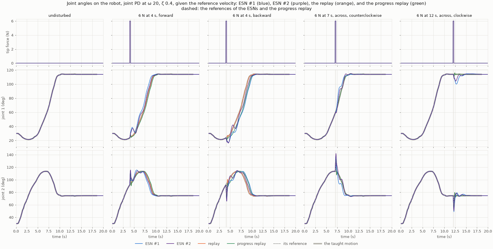

**Figure 12.** The joint angles on the robot, undisturbed and under four 6 N pulses:
forward and backward at 4 s, across at 7 s, and across at the target at 12 s. ESN #1
(blue) and ESN #2 (purple) over the replay (orange) and the progress replay (green); the
references dashed, the take thick gray. The top row is the tip force, the same for
every arm.

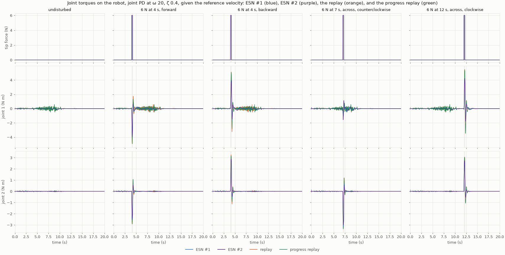

**Figure 13.** The joint torques of the same runs.

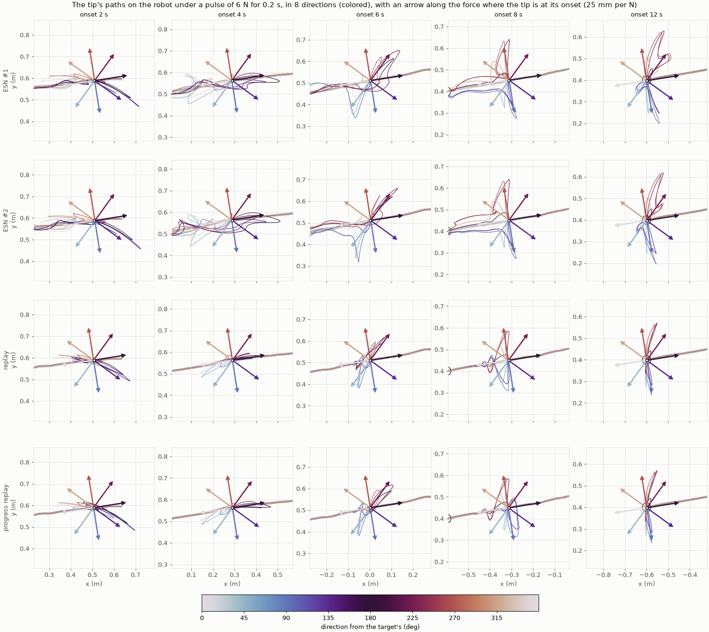

**Figure 14.** The tip's paths under the pulses of 6 N, the 8 directions overlaid by
color, with an arrow along the force from where the tip is at the onset (25 mm per N).
A row per arm, a column per onset. Each panel is centered where the take's hand is at
the onset.

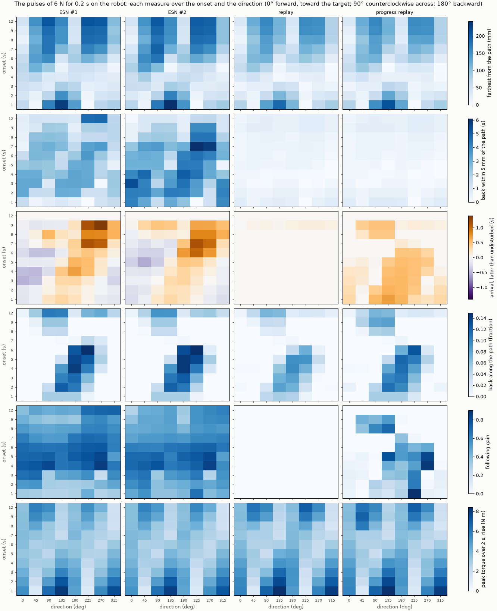

**Figure 15.** The measures of each pulse of 6 N, over its onset (rows) and direction
(columns), for each arm.

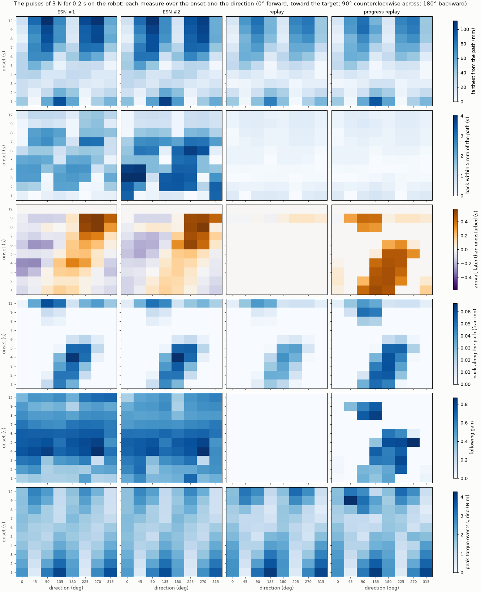

**Figure 16.** The same for 3 N.

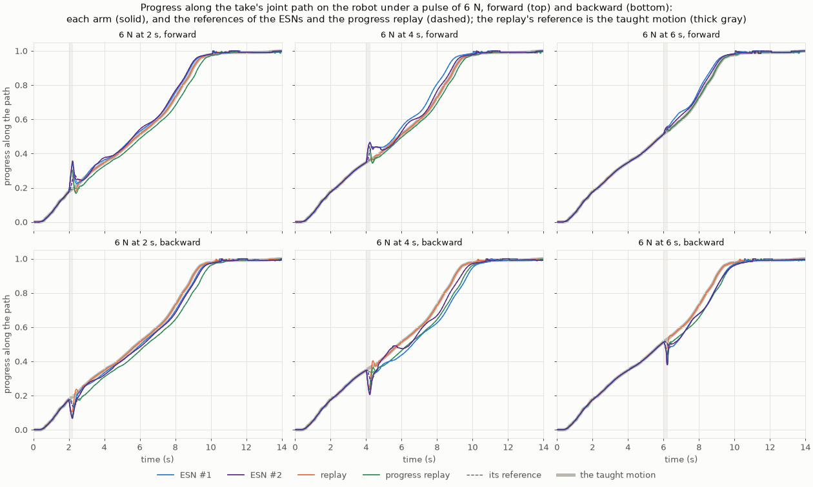

**Figure 17.** The progress along the take's path of each arm (solid) and of the
references of the ESNs and the progress replay (dashed), under 6 N forward and
backward at 2, 4, and 6 s.

| Over the 80 pulses of 6 N, median (range) | ESN #1 | ESN #2 | replay | progress replay |
| --- | --- | --- | --- | --- |
| Farthest from the path | 70 mm (3 to 229) | 78 mm (4 to 242) | 54 mm (3 to 190) | 58 mm (2 to 211) |
| Back within 5 mm | 1.98 s (0 to 4.75) | 3.00 s (0 to 6.11) | 0.37 s (0 to 0.70) | 0.29 s (0 to 0.76) |
| Arrival, later than undisturbed | +0.05 s (−0.52 to +1.40) | +0.06 s (−0.55 to +1.16) | 0.00 s (−0.01 to +0.12) | +0.12 s (−0.01 to +0.69) |
| Following gain | 0.57 (0.22 to 0.85) | 0.56 (0.27 to 0.84) | 0.00 | 0.04 (0 to 0.90) |
| Peak torque over 2 s, rise | 3.5 N m (1.1 to 8.1) | 3.6 N m (1.2 to 7.8) | 3.6 N m (1.2 to 8.3) | 3.6 N m (1.2 to 8.4) |

At 3 N, the medians are 34, 39, 28, and 27 mm, and back in 1.47, 1.70, 0.24, and
0.24 s. Undisturbed, all four arrive at 9.54 to 9.56 s, the ESNs with a peak torque of
0.17 and 0.12 N m, the replays 0.57 N m.

| Arrival, later than undisturbed, 6 N, onsets 1 to 9 s, median (range) | forward (0°, ±45°) | across (90°, 270°) | backward (135° to 225°) |
| --- | --- | --- | --- |
| ESN #1 | −0.13 s (−0.52 to +0.59) | +0.12 s (−0.42 to +1.40) | +0.32 s (−0.12 to +1.16) |
| ESN #2 | −0.08 s (−0.55 to +0.61) | +0.10 s (−0.37 to +0.99) | +0.28 s (−0.20 to +1.16) |
| replay | 0.00 s | 0.00 s | 0.00 s |
| progress replay | +0.05 s | +0.08 s | +0.46 s |

- **The ESNs go on from where the pulse leaves them.**
  - Pushed forward, they arrive sooner; pushed back, later (Figure 17).
  - Their arrival shift follows the time the pulse sets them forward or back along the
    path, measured 0.5 s after its end: correlation 0.78 (ESN #1) and 0.79 (ESN #2),
    slope 0.61 and 0.87.
  - The progress replay does the same when pushed back (0.97, slope 0.92), but never
    goes ahead. The replay keeps its time, within 0.12 s.
  - This is H2 on the robot, and against H3: the ESN keeps no schedule of its own once
    it moves.
- **Off the path, the ESNs return slowly.**
  - Their hands are back within 5 mm of the path in 2.0 and 3.0 s (median, 6 N),
    against 0.3 to 0.4 s for both replays.
  - They stray farther: 70 and 78 mm, against 54 and 58 mm.
  - Their references follow the arm, with a gain of 0.56 to 0.57 in the median, in
    every direction (Figure 15). The replays' references keep to the take: 0, and 0.04
    for the progress replay, which follows only backward pushes.
  - What the tracker gives back, the reference has partly given away. The path pulls
    the arm back only as fast as the ESN's own dynamics return to it (Section 3.4).
- **The peak torque after a pulse rises alike for every arm**, 3.5 to 3.6 N m at 6 N in
  the median: the push itself, not the reference, sets it.
- **At the target, the ESNs hold, but slowly.** At 12 s, a pulse across sends the ESNs'
  hands 196 to 206 mm out and the replays' 154 to 162 mm. The ESNs are back within
  5 mm in up to 4.75 s (ESN #1, at 225° and 270°) and 1.66 s (ESN #2), the replays in
  0.66 s.
- **Six pulsed runs fail**, all pulsed at 9 s, just before arriving: ESN #1 at 6 N and
  ESN #2 at 3 N, at 45°, 90°, and 135°. Each hand arrives at 9.4 s, and the response to
  the pulse carries it out of the goal radius within the hold. All six end at rest at
  the target.

### 3.4 Where they can rest, and how fast they are drawn there

**Figure 18.** The fixed points of each ESN fed its own output (star: attracting;
cross: unstable). The ellipses show how each of the six slowest modes moves the
posture around its fixed point, scaled to 15°.

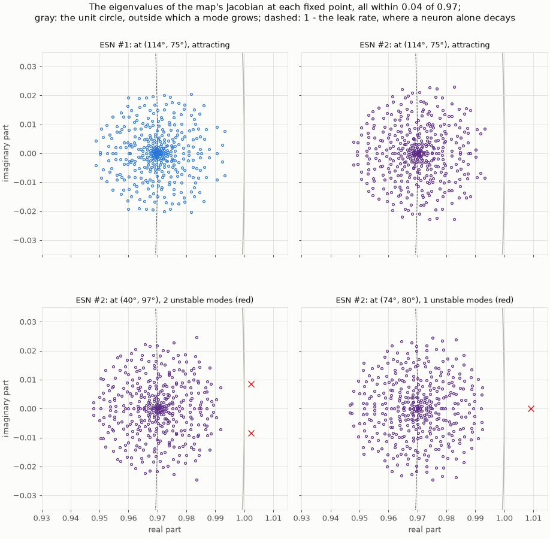

**Figure 19.** The eigenvalues of the map's Jacobian at each fixed point. Unstable modes
(outside the unit circle) are red.

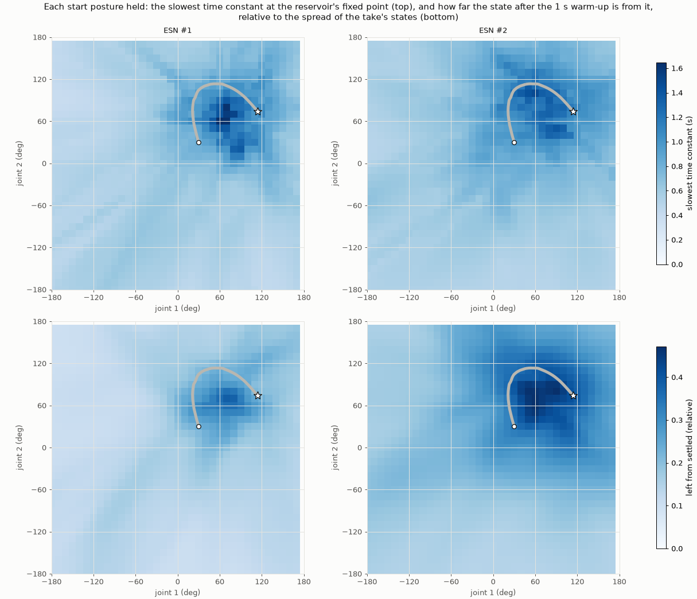

**Figure 20.** Each start posture held. Top: the slowest time constant of the held
reservoir at its fixed point. Bottom: how far the state after the 1 s warm-up is from
that fixed point, relative to the spread of the take's states.

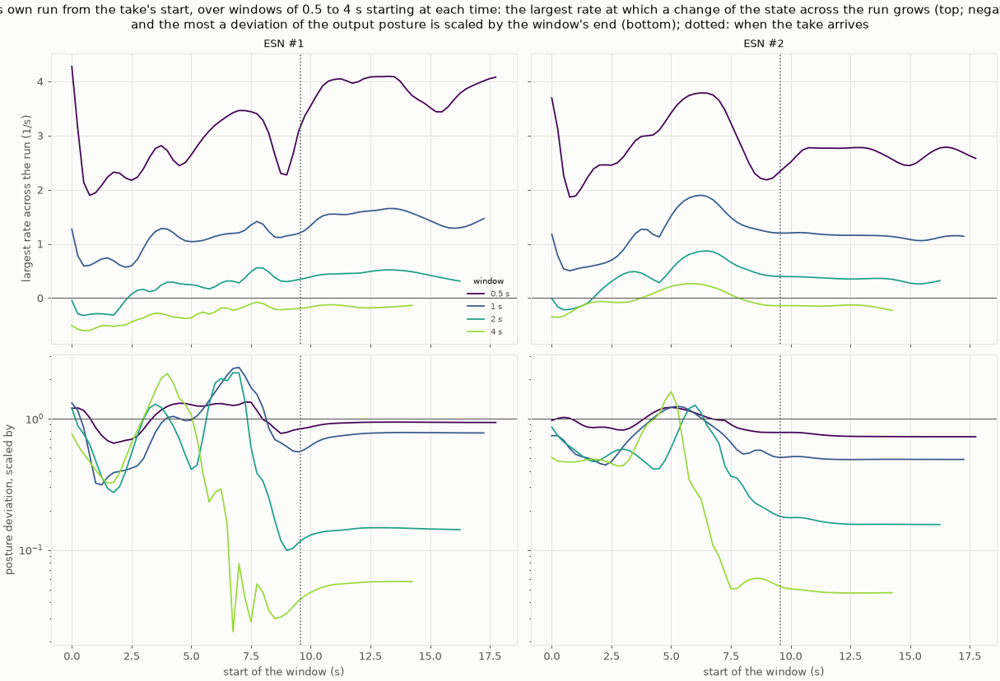

**Figure 21.** Along the ESN's own run from the take's start, over windows of 0.5 to
4 s starting at each time. Top: the largest rate at which a change of the state across
the run grows (negative: it decays). Bottom: the most a deviation of the output posture
is scaled by the window's end. The dotted line is when the take arrives.

| Fixed points | Posture | Unstable modes | Slowest mode | Found from (of 1,296) |
| --- | --- | --- | --- | --- |
| ESN #1, at the target | (113.96°, 74.59°) | 0 | decays in 1.48 s, period 8.1 s | 1,084 starts, 1,296 ends |
| ESN #2, at the target | (113.95°, 74.57°) | 0 | decays in 1.47 s, period 7.3 s | 985 starts, 1,296 ends |
| ESN #2, beside the path | (39.85°, 97.12°), 12° from it, 0.44 of the way | 2 (\|λ\| = 1.0023, period 7.4 s) | grows | 262 starts |
| ESN #2, inside the bend | (73.66°, 79.61°), 26° from it, 0.79 of the way | 1 (λ = 1.0092) | grows | 41 starts |

The take ends at (113.94°, 74.59°). Newton's method did not converge from the other
states at the start of the runs.

| Along the run from the take's start, median (range) over the windows | 0.5 s | 1 s | 2 s | 4 s |
| --- | --- | --- | --- | --- |
| ESN #1, largest rate across the run (1/s) | +3.43 (+1.90 to +4.28) | +1.27 (+0.57 to +1.65) | +0.33 (−0.32 to +0.56) | −0.20 (−0.60 to −0.08) |
| ESN #1, a posture deviation scaled by at most | 0.94 (0.65 to 1.34) | 0.78 (0.31 to 2.46) | 0.26 (0.10 to 2.24) | 0.06 (0.02 to 2.21) |
| ESN #2, largest rate across the run (1/s) | +2.74 (+1.87 to +3.79) | +1.16 (+0.50 to +1.90) | +0.37 (−0.22 to +0.87) | −0.11 (−0.36 to +0.27) |
| ESN #2, a posture deviation scaled by at most | 0.79 (0.73 to 1.22) | 0.51 (0.44 to 1.24) | 0.28 (0.16 to 1.27) | 0.08 (0.05 to 1.60) |

- **The map is the whole system.** Rebuilt with numpy from the reservoir's and the
  readout's weights, it reproduces each ESN's run to 10⁻¹⁵ rad. Every state of a run is
  the image of the one before. Its history matters only through the state, so the
  fixed points and Jacobians below are those of the ESN itself.
- **H1 in the linearization:**
  - All 400 eigenvalues at the target lie inside the unit circle, within 0.04 of
    0.97 = 1 − the leak rate (Figure 19).
  - The slowest pair, |λ| = 0.9933, decays in 1.5 s while turning with a period of 7 to
    8 s. The next slow modes decay in 1.1 to 1.3 s, with periods of 7 to 22 s or none.
  - Their posture motions are small ellipses around the target, mostly along joint 2
    (Figure 18). The hand settles into the target slowly, along slow oscillations.
- **ESN #2's unstable fixed points lie where it misbehaves.**
  - One sits 12° from the take's path, near 0.44 of the way, with a slowly growing
    oscillation (|λ| = 1.0023, a period of 7.4 s). The other sits inside the path's
    bend, 26° from it, with one growing mode.
  - A state near them lingers before it leaves: hence ESN #2's late arrivals from rest
    0.3 to 0.5 of the way along the path (Sections 3.1 and 3.2).
  - Its worst arrival in step 1, 13.5 s from (0°, 140°), joins the path 0.35 of the
    way along it, just before the first.
  - ESN #1 shows no unstable fixed point.
- **The held reservoir settles in 0.6 s, and the warm-up stops it short.**
  - With the start posture held, every one of the 1,296 reservoirs has an attracting
    fixed point (Figure 20).
  - Their slowest time constant is 0.57 s (ESN #1) and 0.63 s (ESN #2) in the median,
    up to 1.65 and 1.48 s near the take's bend.
  - The 1 s warm-up leaves the state 0.14 and 0.20 of the spread from it (median), most
    near the bend: what is left of a clock in Section 3.2.
- **The path attracts slowly, after a transient.**
  - Over windows of up to 2 s, some changes of the state across the run grow: up to
    3.4 /s over 0.5 s (Figure 21). The map is far from normal, and some directions are
    amplified for a while before they decay.
  - Only over 4 s windows do all of them decay: at −0.20 /s (ESN #1) and −0.11 /s
    (ESN #2) in the median, a time constant of 5 to 9 s. ESN #2's still grow in windows
    starting at 4 to 7 s, near its unstable fixed points.
  - A deviation of the output posture, made by the smallest change of the state,
    shrinks faster: to 0.78 and 0.51 of its size in 1 s, 0.26 and 0.28 in 2 s, 0.06
    and 0.08 in 4 s (median).
  - Mid-reach, in windows starting from 3 s to 7 s, where the path turns, ESN #1
    amplifies it up to 2.5-fold first. Pushed there on the robot, its hand takes up to
    3.6 s to come back (Figure 15).

## 4. Observations

- **What the ESNs learned is a path into the target, joined from anywhere.**
  - The target is a stable equilibrium whose basin covers the whole joint space (H1).
  - The take's path is an attracting trajectory in posture, and the take's states an
    attracting trajectory in the reservoir (H2). A run joins them at a phase of its
    own, and goes on from there at the take's pace.
  - From far starts it joins near the path's start, which is why its arrival hardly
    depends on how far it starts from the target.
- **The clock (H3) survives only in when to set off.** The 1 s warm-up stops the held
  reservoir before it settles, and the ESNs learned to set off when its drift reaches a
  certain point. A longer hold starts them earlier, by up to about 1 s. Once moving,
  their timing is the path's: pushed along it, they arrive later or sooner by the time
  the push cost or gave them.
- **This is what the ESN has over a replay.** A replay by time keeps its schedule and
  pulls the arm back to where the take is now. A progress replay keeps to the arm's
  progress, but only backward along the path. The ESNs give way in every direction,
  go on from where the arm is, and need no warm-up to know where they are on the path:
  their state finds it.
- **And what it costs.**
  - The path attracts slowly, and only after a transient. The ESNs' references follow
    a push by half, and the arm comes back in seconds, not tenths.
  - From far starts, the first output jumps by tens of degrees: harmless when the ESN
    runs on its own, a large tracking error on the robot.
  - ESN #2 carries two unstable fixed points near the path, which make it linger.
    Nothing in training saw to that, and ESN #1, trained the same way with another
    input scaling and seed, has none.

## 5. Next steps

1. **Warm-ups that settle:** train with a warm-up long enough for the held reservoir to
   settle (about 3 s, five of its 0.6 s time constants), or with a faster leak, and
   check that the ESN then sets off when released rather than when its transient says
   so, without losing the path.
2. **Faster return to the path:** the slow transverse contraction (time constants of 5
   to 9 s over 4 s windows) sets how slowly the ESNs come back after a push. Train on
   states off the path, such as runs pushed off it, and measure the rates across the
   run and the return time again. Reports 009 and 010's teacher noise, scored by other
   measures, did not help in the app.
3. **Unstable fixed points as a check:** Newton's method from the states of a few runs
   finds them in seconds. Screening candidate ESNs for unstable fixed points near the
   path, and for the slowest mode at the target, could replace part of the robot
   searches of reports 006 to 011.
4. **The first step on the robot:** from report 011's offsets the ESNs start 5.5° from
   the arm. A start blended from the arm's posture, as for the progress replay (report
   014's next step 1), would remove it.
