# 016 Screening ESNs without the robot: within a leak rate, not across

**Summary.** Report 015 found where report 011's two ESNs can rest, and proposed to
screen candidate ESNs that way instead of on the robot. This report screens all 1,050
ESNs of report 011's search on their own, in under two minutes each, 30 at a time. For each ESN it
finds where the ESN can rest, how far its output leads an arm held still, and how
fast changes along its run decay. Four rules fixed in advance are then set against
report 011's robot outcomes. The ESNs that pass are held still on the robot at their
unstable fixed points and under blocks along the reach. Finally, the findings are
checked on 1,050 new ESNs (seeds 10 to 19), screened and run on the robot alike.

- **Across the grid, the screen tells no more than the leak rate does.**
  - The leak rate alone tells failing ESNs from passing ones with an area under the
    ROC curve of 0.749, and 0.766 among the held-out ESNs.
  - No rule does better: 0.717 to 0.736 for (a), (b), and the lead, 0.599 for (c);
    0.618 to 0.748 among the held-out ESNs.
- **Within a leak rate, it does tell.**
  - An attracting fixed point off the target (rule (a)): flagged ESNs fail more
    often at every leak rate among the held-out ESNs. The gap is largest at the slow
    leak rates: 59% against 15% at 0.015, 61% against 12% at 0.02.
  - An unstable fixed point nearer the path tells failing ESNs apart with an area
    under the ROC curve of 0.57 to 0.78 within each leak rate, in both sets.
  - How much a deviation of the output posture is scaled along the ESN's own run
    ranks report 011's following, with rank correlations of 0.54 to 0.78 within
    each leak rate up to 0.05, in both sets.
- **Unstable fixed points near the path are the rule, not the exception.**
  - 77% of the ESNs have one within 30° of the take's path. Rule (c), which flags
    them, rejects 71% of the ESNs that pass on the robot, ESN #2, #3, and report
    007's among them.
  - Under blocks along the reach, the passing ESNs with one fail no more often than
    those without, and are delayed only a little more near one.
- **Released at an unstable fixed point, the robot does what the ESN does on its
  own, and some passing ESNs never arrive.**
  - Held 4 s at each of 810 unstable fixed points near the path and let go, the
    robot arrives when the ESN on its own does: a median +0.05 s later, rank
    correlation +0.99.
  - At 99 of them, in 86 of the 420 passing ESNs that have one, the arm never
    arrives within 60 s (nor, at 98, the ESN on its own). It does not stall: it
    leaves within 5 s at 80 of them, mostly where the fixed point lies near the
    path's start. Report 011's scenarios never probed this.

## 1. Question

Report 011 searched 1,050 ESNs on the robot: every one was trained, then run
undisturbed, under a block, and under three pushes, with joint PD. Report 015 then
read two of them as maps of their reservoir state, and found where they can rest. ESN
#2, which passed every scenario, has two unstable fixed points beside the take's path,
where an arm held still for a few seconds stays long after it is let go. Report 015's
next step 3 asked whether such measures, computed from an ESN alone in seconds,
could replace part of the robot search.

Four rules, written before the screen's results were known, said what the screen
should predict:

- **(a)** an attracting fixed point whose hand is outside the goal radius predicts
  ending away from the target under the pushes;
- **(b)** a small lead near the path, a reference that stays with a held arm,
  predicts the same, at fast leak rates;
- **(c)** an unstable fixed point near the take's path, or a late arrival after a
  release there, predicts never arriving or arriving late;
- **(d)** the rates along the ESN's own run predict the return time and the
  following gain.

## 2. Setup

### The ESNs

| Parameter | Value |
| --- | --- |
| Leak rate | 0.015, 0.02, 0.03, 0.04, 0.05, 0.07, 0.1 |
| Spectral radius | 0.99, 1.2, 1.35, 1.5, 1.75 |
| Input scaling | 1, 1.5, 2 |
| Seed (the random reservoir, its input weights, and its biases) | 0 to 9 (report 011's grid, 1,050 ESNs); 10 to 19 (held out, 1,050 more) |
| Neurons | 400 |
| Sparsity (nonzero reservoir connections) | 0.05 |
| Bias | yes |
| Ridge | 10⁻² |
| Warm-up (the start posture held before the ESN moves) | 1 s |
| Sampling period | 10 ms |
| Teacher noise | none |
| Training take | `results/demonstrations/20261008-170034-reach_manual_v2`, `demo_00_filtered` (filtered at 2 Hz) |

Every combination of the swept values is one ESN, trained on the take as report
011's sweeps trained it. The ESNs named in this report:

| Name | Leak rate | Spectral radius | Input scaling | Seed |
| --- | ---: | ---: | ---: | ---: |
| ESN #1 (report 011's first) | 0.03 | 1.2 | 1.5 | 8 |
| ESN #2 (report 011's second) | 0.03 | 1.2 | 1 | 2 |
| ESN #3 (report 011's third) | 0.03 | 1.35 | 1.5 | 6 |
| report 007's | 0.02 | 1.35 | 2 | 7 |

### The robot's outcome

On the simulated arm with joint PD at ω = 20 rad/s and ζ = 0.4, given the
reference velocity, its torque computed every 10 ms, from the take's start (report
011's sweeps):

- **undisturbed and under the block** (the tip held from 4.5 s to 5.5 s), an ESN
  passes if its hand arrives within the 20 mm goal radius, holds there for 2 s, and
  ends there;
- **under the three pushes** (0.5 s each, at 3, 7, and 15 s), it passes if its hand
  arrives and ends within the goal. Leaving the goal during the hold is excused, as in
  report 011.

Of the 1,050 ESNs, 620 pass and 430 fail. Report 011's offset starts, run only for a
few settings, are not counted. Of the held-out ESNs, 604 pass and 446 fail.

### The screen

The ESN fed its own output is a map G of its reservoir state
([`dynamics.py`](../../src/arm_esn_ctrl/dynamics.py)). A fixed point x\* of G is also
the fixed point of the reservoir held at its own output posture q\*. So where the held
reservoir has one fixed point at each posture, the fixed points are the zeros of a map
of the joint angles alone ([`screening.py`](../../src/arm_esn_ctrl/screening.py)):

    R(q) = (the posture the ESN outputs once its reservoir has settled at q) − q.

On the robot, R(q) is how far the ESN's reference leads an arm held still at q, as
under report 011's block. The screen
([`screen_esns.py`](../../experiments/screen_esns.py)) computes, for each ESN:

- **its fixed points:**
  - R is evaluated every 10° over both joints' whole range. Newton's method on R
    searches each cell over whose corners both components of R change sign.
  - Newton's method on G also starts from wherever a run from rest below comes to
    rest. This adds the attracting fixed points the grid misses where R is nearly
    flat.
  - For each fixed point: its eigenvalues, the hand's distance from the target, and
    its distance from the take's joint path;
- **the lead:** the median of |R| over the grid's postures within 15° of the take's
  joint path, up to 0.9 of the way along it;
- **runs from rest:** 144 start postures every 30°, and 16 around the take's end
  posture, each run on its own for 60 s;
- **releases:** held at each unstable fixed point for 4 s, then run on its own for
  60 s, when it arrives;
- **the rates along its own run** from the take's start, over 4 s windows starting
  every 0.5 s for 14 s (report 015's measures):
  - how fast a change of the state across the run grows;
  - how much a deviation of the output posture is scaled by the window's end.

### The steps

Each step's design was fixed in the
[study's README](../../experiments/manual_demonstration_v2_esn_screening/README.md)
before its runs.

- **Step 0:** report 011's sweeps at leak rate 0.03, rerun, give the same outcome and
  event times for all 450 runs. So the retrained ESNs are report 011's.
- **Step 1, the screen** of the 1,050 ESNs, and a check of the 10° grid against a 5°
  one on the first seed of each of the 105 settings.
- **Step 2, against the robot**
  ([`screen_against_robot.py`](../../experiments/screen_against_robot.py)). The rules,
  scored as fixed before the robot's outcomes were read:
  - (a) flags an attracting fixed point whose hand is more than 20 mm from the
    target, counted against ending away from the target under the pushes.
  - (b) is scored by the lead's area under the ROC curve for that outcome, over the
    grid and within each leak rate; for counts, it flags a lead under 10°.
  - (c) flags an unstable fixed point within 30° of the take's joint path, or a
    release arriving later than the take's 9.58 s or never. It is counted against
    never arriving in some scenario. The release arrival's rank correlation with the
    robot's arrival time stands for "arriving late".
  - (d) is the rank correlations of the rates with the return time (the mean over
    the three pushes, of the ESNs that return after each) and with report 011's
    following (the mean following gain over the block and the three pushes).
- **Step 3, held still on the robot**
  ([`release_robot.py`](../../experiments/release_robot.py)). The 620 passing ESNs,
  with report 011's tracker:
  - **released:** at each unstable fixed point within 30° of the path, the arm at
    rest at its posture, the ESN held there 4 s, then let go for 60 s;
  - **blocks along the reach:** the tip held for 1 s or 3 s from 2, 3, 4, 5, 6, 7,
    or 8 s, one block a run, 30 s long. Each run reports whether it passes under
    report 011's rule for the block, and its delay: the arrival after the release
    less the take's time from the progress held to its arrival.
- **Step 4, held out:** seeds 10 to 19, screened, run on the robot by report 011's
  sweeps unchanged but for the seeds, and set against each other as in step 2. Four
  claims drawn from step 2 were fixed first (Section 3.4).

### Reproducing the results

The runs read the take as in report 011, under the storage root (report 005's copy).
The configurations are in
[`manual_demonstration_v2_esn_screening`](../../experiments/manual_demonstration_v2_esn_screening/README.md).

| Run | Command | Commit |
| --- | --- | --- |
| `20261020-131544-sweep_robot_following_lr0.03_{nominal,block,pushes}_filtered` (step 0) | `uv run python experiments/sweep_robot_esn.py experiments/manual_demonstration_v2_robot_following_search/sweep_robot_following_lr0.03_<scenario>_filtered.toml` | `a7d159f` |
| `20261020-134112-screen` (the first screen, which missed fixed points) | `uv run python experiments/screen_esns.py experiments/manual_demonstration_v2_esn_screening/screen.toml` | `da23be0` |
| `20261020-151050-screen` (runs from rest 20 s long), `20261020-160829-screen_5deg_seed0` | `uv run python experiments/screen_esns.py experiments/manual_demonstration_v2_esn_screening/<configuration>.toml` | `fe2a921` |
| `20261020-165217-screen` (runs from rest 60 s long) | `uv run python experiments/screen_esns.py experiments/manual_demonstration_v2_esn_screening/screen.toml` | `8711521` |
| `20261020-194204-against_robot` | `uv run python experiments/screen_against_robot.py experiments/manual_demonstration_v2_esn_screening/against_robot.toml` | `8da99e6` |
| `20261020-182057-release_robot` | `uv run python experiments/release_robot.py experiments/manual_demonstration_v2_esn_screening/release_robot.toml` | `2deb92c` |
| `20261020-19421?-sweep_robot_following_lr<leak rate>_{nominal,block,pushes}_filtered_seeds10to19`, `20261020-200400-screen_seeds10to19` | `uv run python experiments/sweep_robot_esn.py ...` and `screen_esns.py ... screen_seeds10to19.toml` | `8da99e6` |
| `20261020-210939-against_robot_seeds10to19` | `uv run python experiments/screen_against_robot.py experiments/manual_demonstration_v2_esn_screening/against_robot_seeds10to19.toml` | `3de6eee` |
| `20261020-212045-block{5to8,8to11}_robot_<ESN>` | `uv run python experiments/robot_esn.py experiments/manual_demonstration_v2_esn_screening/<configuration>.toml` | `5ac6c34` |
| `20261020-212252-released_robot_<ESN>` | the same | `d1c1983` |
| [`summary`](results/summary) | `uv run python reports/016-screening-esns/make_figures.py` | |

The undisturbed runs shown are report 011's
`20261014-155211-nominal_robot_<ESN>_reference_velocity_filtered`. Every run record
(`run.toml`) shows no uncommitted changes. [`make_figures.py`](make_figures.py)
copies each run's configuration, run record, and CSV files from the runs under the
storage root into [`results`](results), prints the tables of this report, and draws
the figures. The held-out sweeps' CSV files are left on the storage drive: the
held-out set's `esns.csv` holds what this report reads of them. Also left there are
the arrays it reads: each screen's `maps.npz`, 22 MB, and the shown robot runs'
logs.

## 3. Results

### 3.1 The screen

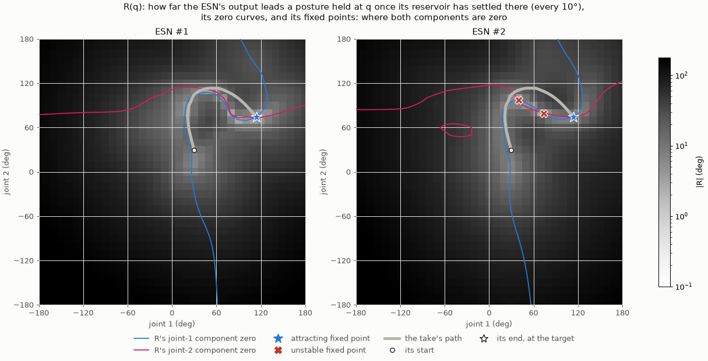

**Figure 1.** R for ESN #1 and #2, every 10°. The shading is how far the ESN's output
leads a posture held there; the curves are where each component of R is zero, and
the fixed points are where both are.

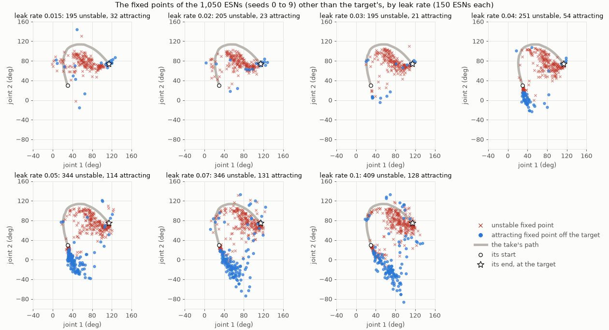

**Figure 2.** Every fixed point of the 1,050 ESNs of seeds 0 to 9 off the target,
by leak rate.

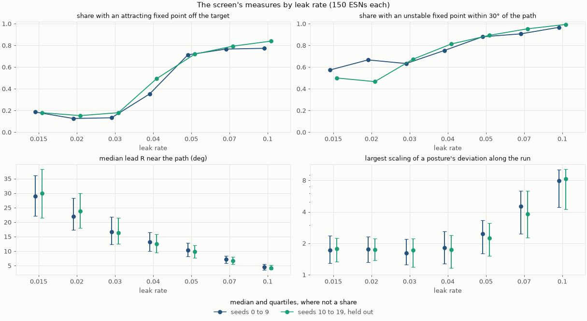

**Figure 3.** The screen's measures by leak rate, of seeds 0 to 9 and of the
held-out seeds 10 to 19.

| Seeds 0 to 9, per leak rate (150 ESNs each) | 0.015 | 0.02 | 0.03 | 0.04 | 0.05 | 0.07 | 0.1 |
| --- | ---: | ---: | ---: | ---: | ---: | ---: | ---: |
| An attracting fixed point within the goal | 123 | 133 | 140 | 145 | 145 | 145 | 149 |
| An attracting fixed point off the target | 28 | 19 | 20 | 53 | 107 | 115 | 116 |
| An unstable fixed point within 30° of the path | 86 | 100 | 95 | 113 | 132 | 136 | 145 |
| … released there after 4 s, arriving after 9.58 s or never | 66 | 73 | 81 | 107 | 126 | 126 | 136 |
| All 144 runs from rest end at the target | 116 | 127 | 129 | 96 | 42 | 30 | 24 |
| Median lead near the path | 28.9° | 22.0° | 16.7° | 13.2° | 10.4° | 7.1° | 4.5° |
| The target's slowest time constant, median | 2.81 s | 2.15 s | 1.62 s | 1.58 s | 1.54 s | 1.39 s | 1.06 s |
| Largest scaling of a posture's deviation, median | 1.72 | 1.76 | 1.61 | 1.81 | 2.48 | 4.51 | 7.92 |

| The named ESNs | ESN #1 | ESN #2 | ESN #3 | report 007's |
| --- | --- | --- | --- | --- |
| Fixed points (attracting, unstable) | 1 (1, 0) | 3 (1, 2) | 3 (1, 2) | 3 (1, 2) |
| The target's slowest mode | 1.48 s, period 8.1 s | 1.47 s, period 7.3 s | 1.34 s, period 6.9 s | 1.55 s, period 26.9 s |
| The unstable fixed point nearest the path | none | 12.1°, 0.44 of the way | 24.0°, 0.76 of the way | 31.4°, 0.67 of the way |
| Released after 4 s, the latest arrival | | 20.15 s | 6.65 s | 11.70 s |
| Median lead near the path | 13.7° | 17.3° | 16.5° | 21.7° |
| Largest scaling of a posture's deviation | 2.21 | 1.60 | 2.08 | 1.97 |
| On the robot (report 011) | passes, following 0.79 | passes, following 0.73 | passes, following 0.74 | passes, following 0.69 |

- **The screen finds report 015's fixed points, and checks itself.**
  - On ESN #1 and #2, the 10° grid finds exactly the fixed points that report 015
    found by Newton's method from 2,592 states of their runs (Figure 1).
  - The first screen searched only the grid's cells. It missed the target's own
    fixed point in 128 ESNs: near the take's end posture, where the ESN learned to
    hold still, R changes by less than 3° over a 10° cell, and Newton's method on R
    steps far from its zero. Newton's method on G from where the runs from rest come
    to rest finds it. Of 3,486 fixed points, 163 are found only that way, 132 of them
    at the target.
  - Every 5°, the first seed of each setting has 333 fixed points, against 324
    every 10°. The 10° grid misses 10 unstable ones in 9 ESNs, but none changes
    whether an ESN has an unstable fixed point within 30° of the path or an
    attracting one off the target.
  - The held reservoir settles to one fixed point at every posture checked, from
    random states as well, for every ESN with a spectral radius up to 1.35. At 1.75
    it does not settle at some postures in 196 of the 210 ESNs. There, R is not
    well defined.
- **With a faster leak, more places to rest, and less lead.**
  - Attracting fixed points off the target appear at leak rates of 0.04 and above,
    in 71% to 77% of the ESNs from 0.05 (Figures 2 and 3). From 0.04, most lie below
    the take's start, more than 40 cm from the target.
  - Unstable fixed points lie mostly inside the path's bend and along it. At 0.1,
    145 of 150 ESNs have one within 30° of the path.
  - The lead near the path falls from 29° at 0.015 to 4.5° at 0.1. A fast-leaking
    ESN's reference stays close to an arm held still.
  - The largest scaling of a posture's deviation along the run is flat up to 0.04
    and rises to 8 at 0.1.
- **Runs from rest must outlast the robot's.** In the screen with 20 s runs, 49
  ESNs, 36 of them at a spectral radius of 1.75, have no fixed point within the goal.
  Their runs from the take's start pass through it and leave at 20.6 to 29 s (median
  23.4 s), within report 011's 24 s robot runs. So the runs are 60 s long.

### 3.2 Against the robot

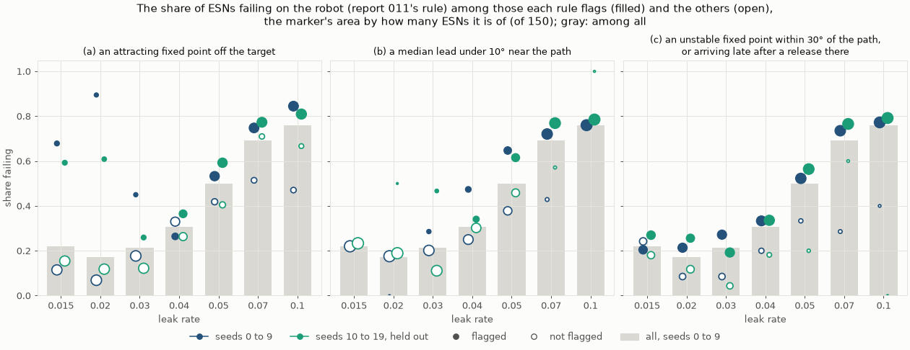

**Figure 4.** The share failing on the robot among the ESNs each rule flags and among
the others, by leak rate, with the share among all.

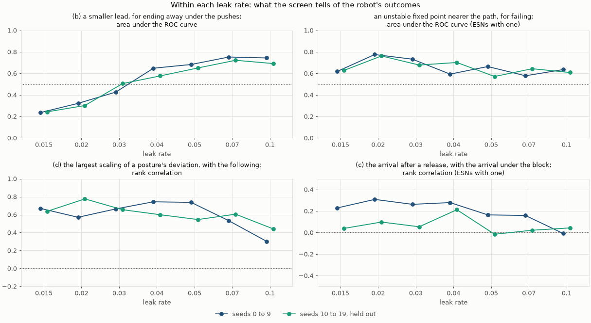

**Figure 5.** Within each leak rate: the lead's area under the ROC curve for ending
away under the pushes, that of an unstable fixed point nearer the path for failing,
and the rank correlations of the posture's scaling with the following and of the
release arrival with the arrival under the block.

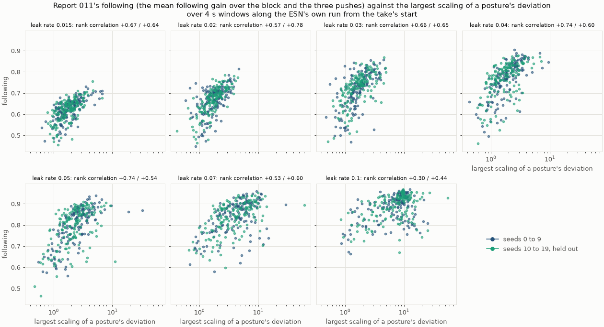

**Figure 6.** Report 011's following against the largest scaling of a posture's
deviation along the ESN's own run, by leak rate.

| Seeds 0 to 9 | Flagged | Its outcome caught | Failing caught (of 430) | Passing rejected (of 620) | Qualifying rejected (of 110) | Of ESN #1, #2, #3, and report 007's |
| --- | ---: | --- | ---: | ---: | ---: | --- |
| (a) | 458 | ending away, 288 of 410 | 300 | 158 | 3 | none |
| (a), only more than 10 cm off | 423 | ending away, 262 of 410 | 273 | 150 | 3 | none |
| (b) | 415 | ending away, 272 of 410 | 280 | 135 | 0 | none |
| (c) | 827 | never arriving, 49 of 49 | 389 | 438 | 72 | #2, #3, report 007's |

| Share failing, flagged / not, seeds 0 to 9 | 0.015 | 0.02 | 0.03 | 0.04 | 0.05 | 0.07 | 0.1 |
| --- | --- | --- | --- | --- | --- | --- | --- |
| (a) | 0.68 / 0.11 | 0.89 / 0.07 | 0.45 / 0.18 | 0.26 / 0.33 | 0.53 / 0.42 | 0.75 / 0.51 | 0.84 / 0.47 |
| (b) | none flagged / 0.22 | 0.00 / 0.18 | 0.29 / 0.20 | 0.47 / 0.25 | 0.65 / 0.38 | 0.72 / 0.43 | 0.76 / none unflagged |
| (c) | 0.20 / 0.24 | 0.21 / 0.09 | 0.27 / 0.09 | 0.33 / 0.20 | 0.52 / 0.33 | 0.74 / 0.29 | 0.77 / 0.40 |

The share failing rises with the leak rate: 0.22, 0.17, 0.21, 0.31, 0.50, 0.69, and
0.76. The 11 qualifying settings are all at 0.015 to 0.03.

| Area under the ROC curve for failing, over all the ESNs | the leak rate | the lead | (a) | (b) | (c) |
| --- | ---: | ---: | ---: | ---: | ---: |
| Seeds 0 to 9 | 0.749 | 0.736 | 0.721 | 0.717 | 0.599 |
| Seeds 10 to 19, held out | 0.766 | 0.748 | 0.710 | 0.724 | 0.618 |

- **(a) tells failing apart at slow leak rates.** At 0.015 and 0.02, 68% and 89% of
  the flagged ESNs fail, against 11% and 7% of the others. At 0.04 and 0.05 it tells
  little in this set (Figure 4). It mostly catches the ESNs that end away after the
  pushes, but 122 end away without an attracting fixed point off the target. The 3
  qualifying ESNs it rejects have theirs more than 1 m from the target, and pass.
- **(b) repeats the leak rate.** The lead falls with the leak rate (Section 3.1), so
  over the grid its area under the ROC curve, 0.75, is the leak rate's. Within each
  leak rate it is 0.65 to 0.75 from 0.04 up, as the rule said. At 0.015 to 0.03 it
  runs the other way (0.24 to 0.43): there, the ESNs that end away lead more
  (Figure 5).
- **(c) flags nearly every ESN.** It catches all 49 that never arrive in some
  scenario, but flags 79% of the ESNs and rejects 71% of the passing ones. The
  release arrival has a rank correlation of +0.44 with the robot's arrival under
  the block over the grid, +0.16 to +0.31 within each leak rate up to 0.07, and
  none with the undisturbed arrival (+0.03).
- **(d): the posture's scaling ranks the following.**
  - The largest scaling of a posture's deviation has a rank correlation with report
    011's following of +0.72 over the grid. Within each leak rate it is +0.53 to
    +0.74 up to 0.07, and +0.30 at 0.1 (pooled, +0.60) (Figure 6).
  - An ESN whose own run amplifies a deviation of its output gives way to the arm
    more.
  - The rate across the run correlates with it −0.67 over the grid, but only −0.10
    to −0.42 within a leak rate.
  - The return time is predicted at most weakly (+0.24). It is defined only for the
    324 ESNs whose arm returns after each push, 276 of the 620 passing.
- **Apart from the rules,** an unstable fixed point nearer the path tells failing
  apart within each leak rate (area under the ROC curve 0.58 to 0.78). Its growth
  rate does not: the sign changes between the leak rates.

### 3.3 Held still on the robot

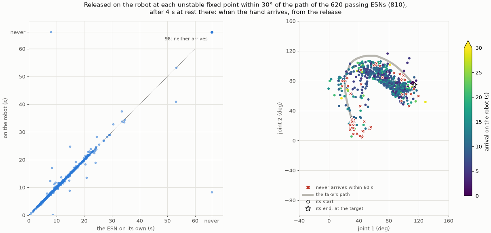

**Figure 7.** Left: the robot's arrival after a release at an unstable fixed point,
against the ESN's own after the same hold. Right: where the releases were, colored by
the robot's arrival; red: never within 60 s.

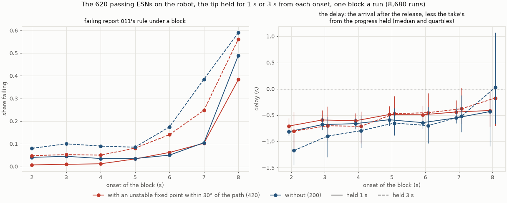

**Figure 8.** The 620 passing ESNs under blocks along the reach. Left: the share
failing report 011's rule under a block. Right: the delay, by onset, for the ESNs with
an unstable fixed point within 30° of the path (420) and those without (200).

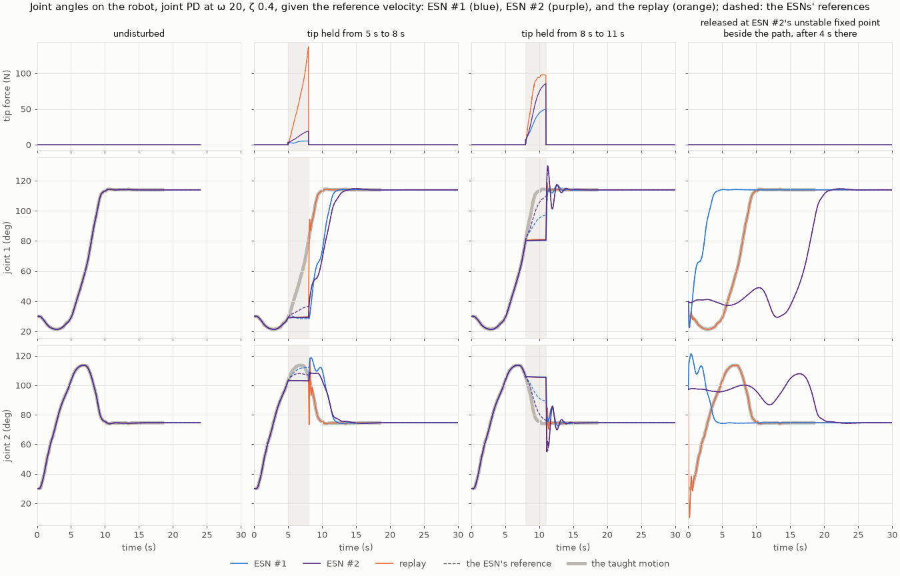

**Figure 9.** ESN #1 and #2 against the replay of the take: undisturbed (report 011's
runs, 24 s), the tip held from 5 s to 8 s and from 8 s to 11 s, and released at ESN
#2's unstable fixed point beside the path, (39.85°, 97.12°), after 4 s there. The
replay replays the take from its start whatever the arm's posture.

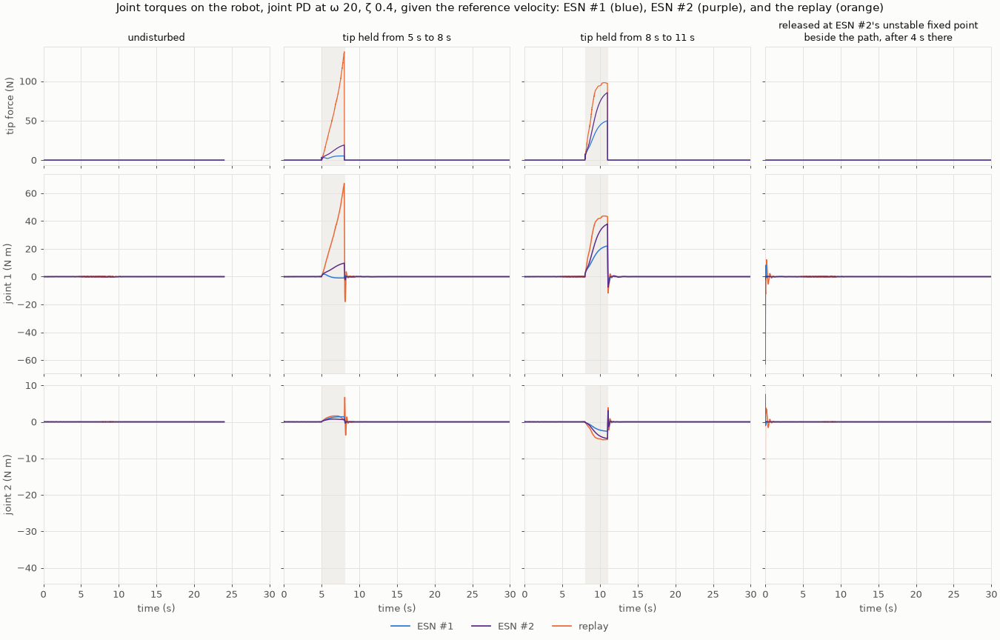

**Figure 10.** The joint torques of the same runs.

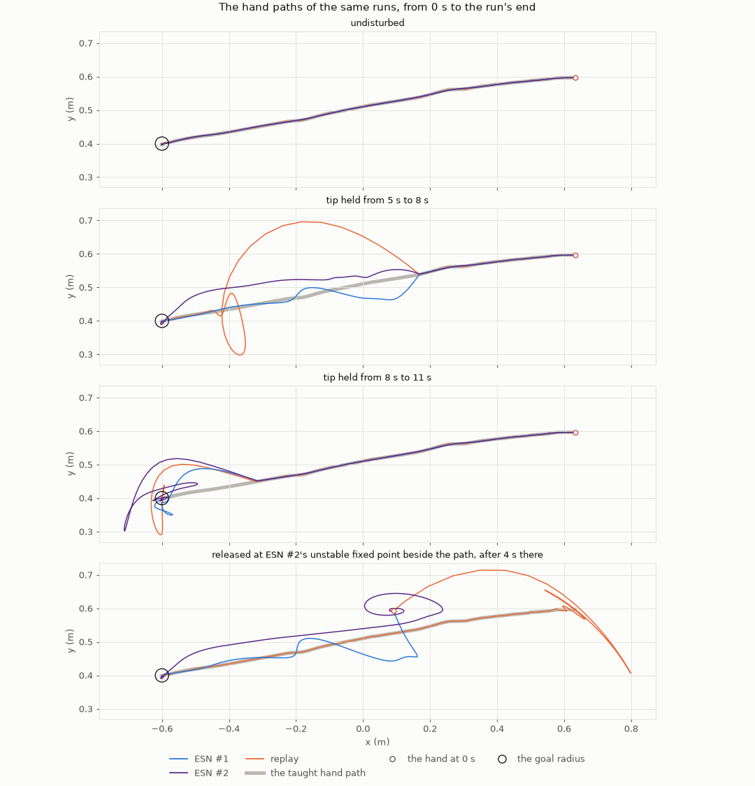

**Figure 11.** The hand paths of the same runs.

| Released at 810 unstable fixed points (420 ESNs) | |
| --- | --- |
| Both the robot and the ESN on its own arrive | 710: the robot a median +0.05 s later (10th to 90th percentiles −0.05 to +0.25 s), rank correlation +0.99 |
| Neither arrives within 60 s | 98 (and one each where only the robot, or only the ESN, does not) |
| Arriving later than the take's 9.58 s | the robot 498, the ESN on its own 490 |

| Blocks, failing report 011's rule | held 1 s | held 3 s |
| --- | ---: | ---: |
| With an unstable fixed point within 30° of the path (420 ESNs) | 8.7% | 16.9% |
| Without (200 ESNs) | 11.4% | 21.5% |
| From 2 to 4 s | 1.8% to 2.1% | 5.8% to 6.8% |
| From 8 s | 41.8% | 57.1% |

| Shown runs: arrival (peak torque over the block or the run) | ESN #1 | ESN #2 | replay |
| --- | --- | --- | --- |
| Undisturbed | 9.55 s (0.2 N m) | 9.54 s (0.1 N m) | 9.56 s (0.6 N m) |
| Tip held from 5 s to 8 s | 11.73 s (1.8 N m) | 12.85 s (9.7 N m) | 9.56 s (67.1 N m) |
| Tip held from 8 s to 11 s | 11.24 s, leaves the goal (22.1 N m) | 12.33 s, leaves the goal (37.8 N m) | 11.30 s, leaves the goal (43.6 N m) |
| Released at ESN #2's unstable fixed point | 3.86 s (62.8 N m) | 20.16 s (2.0 N m) | 9.56 s (51.5 N m) |

- **The screen's release is the robot's.**
  - Released at an unstable fixed point, the arm arrives when the ESN on its own
    does, to within a quarter of a second at 624 of the 710 releases where both
    arrive (Figure 7, left).
    The tracker at 20 rad/s follows the reference closely, and the slow modes that
    set the arrival are the ESN's.
  - So this test needs no robot.
- **Some passing ESNs never arrive from there.**
  - 86 of the 420 ESNs, 75 of them at leak rates of 0.04 to 0.1, have an unstable
    fixed point near the path from which, after 4 s at rest, the arm never reaches
    the target within 60 s. Three are in report 011's qualifying settings.
  - The arm does not stall: it leaves the posture within 5 s at 80 of these 99
    releases, and stays within 1° for the whole 60 s at 3.
  - Their unstable fixed points lie at the start of the path (median progress 0),
    and grow fast, 1.2 per second (median; 0.75 at the others). 76 of the 86 ESNs
    also have an attracting fixed point off the target (Figure 2).
  - None of the named ESNs is among them. ESN #2 released beside the path lingers,
    turning slowly with its unstable pair, and arrives 20.2 s later (Figure 9, last
    column). From the same posture, ESN #1 jumps and arrives in 3.9 s, with 63 N m.
- **Unstable fixed points near the path do not make the blocks fail.**
  - The ESNs with one fail no more often than those without, at either hold (Figure
    8).
  - What fails is a late block. Most failing runs (1,086 of 1,213) arrive and then
    leave the goal or do not hold, most of them under the blocks from 7 s and 8 s,
    held near the target. So do ESN #1, ESN #2, and the replay under the block from
    8 s to 11 s: each arrives after the release and swings back out of the goal
    (Figures 9 to 11).
  - The delay after a block grows a little as the held posture nears an unstable
    fixed point: rank correlation −0.07 to −0.27 within each leak rate. It also grows
    as the lead there shrinks: −0.21 to −0.39 with a hold of 1 s.
  - The median delay is negative (−0.5 to −0.7 s): released, the arm reaches the
    target sooner than the take would from where it was held, its reference leading
    it after the block.

### 3.4 Held out

| Step 4's claims, of seeds 10 to 19 | Result |
| --- | --- |
| 1. (a): at 0.015, 0.02, 0.07, and 0.1, more of the flagged ESNs fail than of the others; and at 0.04 and 0.05, by less than at each of those four | **In part.** At the four: 0.59 against 0.15, 0.61 against 0.12, 0.77 against 0.71, and 0.81 against 0.67. But at 0.04 (0.36 against 0.26) and 0.05 (0.59 against 0.40), not by less than at 0.07 |
| 2. (d): within each leak rate from 0.015 to 0.05, the posture's scaling has a rank correlation of at least 0.5 with the following | **Holds:** +0.64, +0.78, +0.65, +0.60, and +0.54 (+0.60 and +0.44 at 0.07 and 0.1; pooled, +0.61) |
| 3. An unstable fixed point nearer the path tells failing apart within each of the seven leak rates (area under the ROC curve above 0.5) | **Holds:** 0.63, 0.76, 0.68, 0.70, 0.57, 0.64, and 0.61 |
| 4. Over all the ESNs, no rule's flag, nor the lead, has a larger area under the ROC curve for failing than the leak rate | **Holds:** the leak rate 0.766; the lead 0.748; (a) 0.710, (b) 0.724, (c) 0.618 |

- **What step 2 found holds on new reservoirs, but for one detail.** Among the held-out
  ESNs, (a) tells failing apart at every leak rate. It is most informative at 0.015
  and 0.02, as before, but also informative at 0.04 and 0.05, where seeds 0 to 9 had
  it telling nothing (Figure 4).
- **(b)'s pattern repeats:** an area under the ROC curve of 0.24 and 0.30 at 0.015
  and 0.02, and 0.65 to 0.72 from 0.05 up (Figure 5).
- **(c)'s link with the block does not.** The release arrival's rank correlation with
  the arrival under the block is +0.29 over all the held-out ESNs, but −0.02 to +0.21
  within each leak rate (Figure 5). That link was the leak rate's.
- (a) rejects 8 of the qualifying settings' 110 held-out ESNs, (c) 58.

## 4. Observations

- **A screen without the robot finds what an ESN can do, but not whether it passes.**
  - The fixed points, the lead, and the rates follow the leak rate, and so does
    failing on the robot (Figure 3, Figure 4's gray bars). Across the grid they tell
    no more than the leak rate.
  - What they add is within a leak rate. Among ESNs that share their time scale,
    those with an attracting fixed point off the target fail more often. Those with
    an unstable fixed point near the path do too. And the posture's scaling ranks how
    much they follow the arm.
- **A fixed point off the target is the screen's clearest signal, and it is cheap.**
  - At leak rates of 0.015 and 0.02, where report 011's qualifying settings lie, the
    flagged ESNs fail four to thirteen times as often as the others.
  - It misses the ESNs that end away without one: 122 of the 410 that end away.
- **Unstable fixed points are everywhere, and harmless under the scenarios tried.**
  - They are where the ESN's path into the target bends (Figure 2). A rule that
    rejects them rejects most ESNs, including all of report 011's shortlist but ESN #1.
  - On the robot, they delay an arm held near them a little, but no block fails
    because of them.
- **But held still at one, the arm can leave for somewhere else.**
  - About a fifth of the passing ESNs with an unstable fixed point near the path never
    reach the target when let go there. Those fixed points mostly lie near the path's
    start, and nearly all those ESNs also have an attracting fixed point off the
    target.
  - Report 011's scenarios never stopped an arm there. The screen's release test
    finds these ESNs, and the robot confirms its arrival times to within a quarter of
    a second.
- **How much an ESN follows the arm is its own dynamics.** The scaling of a
  posture's deviation along the ESN's own run, computed in seconds, ranks report 011's
  following within a leak rate. An ESN that amplifies a deviation of its own output for
  a while gives way to a pushed arm more (report 015).
- **The screen has limits of its own.**
  - At a spectral radius of 1.75 the held reservoir does not settle everywhere, and
    R is not defined there.
  - Near the target R is nearly flat, and only the runs from rest find the fixed
    point there.
  - About half of the ESNs retrain differently by up to 2 × 10⁻⁹ rad in R between
    runs, which flips a fixed point's detection only at 1.75.

## 5. Next steps

1. **Screen first, then the robot:** among ESNs of a leak rate chosen on the robot,
   reject those with an attracting fixed point off the target, or those that never
   arrive after a release at an unstable fixed point, before any robot run. Then rank
   the rest by the posture's scaling for the following they should give.
2. **The release scenario on the robot:** add a stop at an ESN's unstable fixed
   points, or a block held a few seconds where the path starts, to the robot
   scenarios. The 86 passing ESNs that never arrive from there passed report 011's
   search.
3. **The screen as a measure of training:** report 015's next step 2, training on
   states off the path, can be judged by the screen in minutes: whether it removes
   the attracting fixed points off the target, below the take's start at fast leak
   rates, and how it changes the posture's scaling.
4. **The warm-up and the first step,** report 015's next steps 1 and 4, remain.
