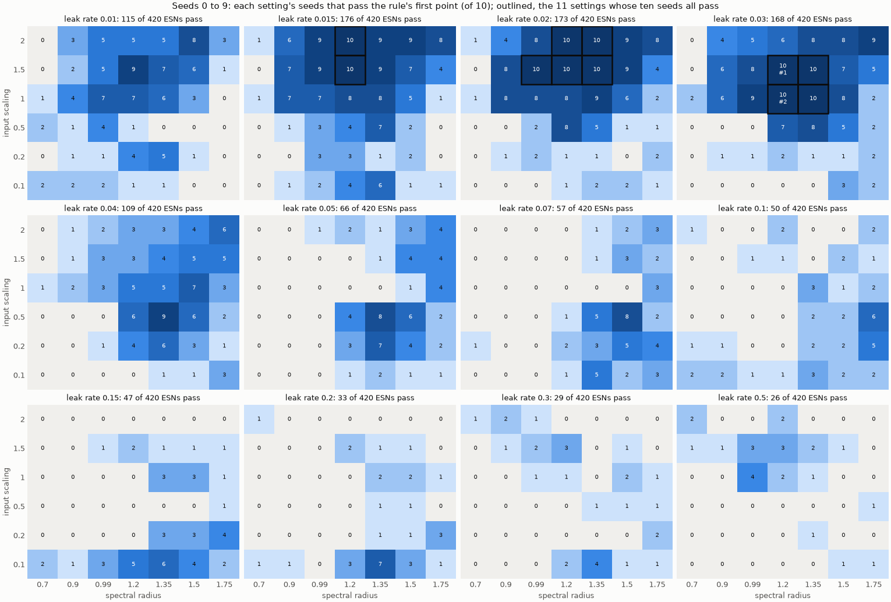
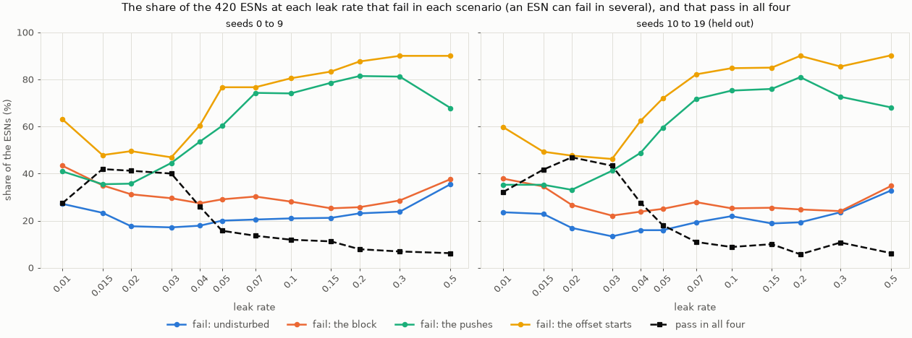
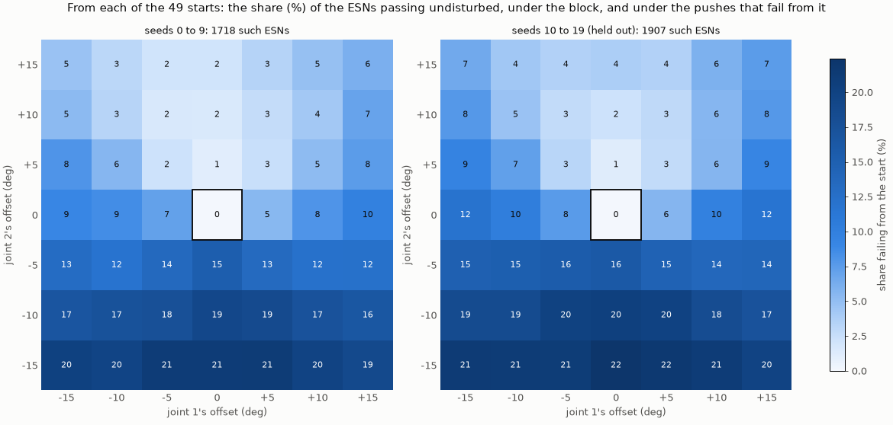
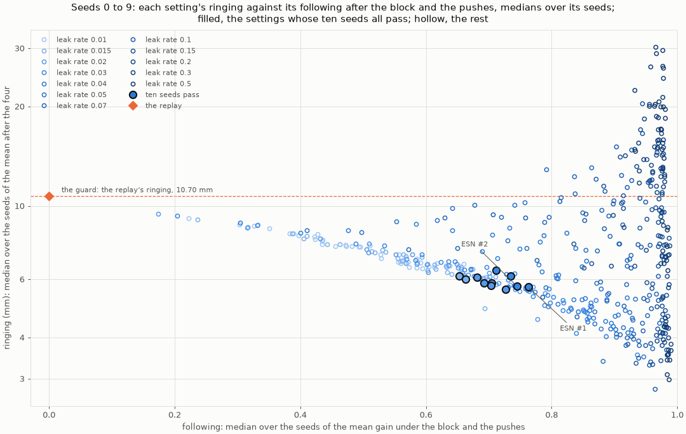
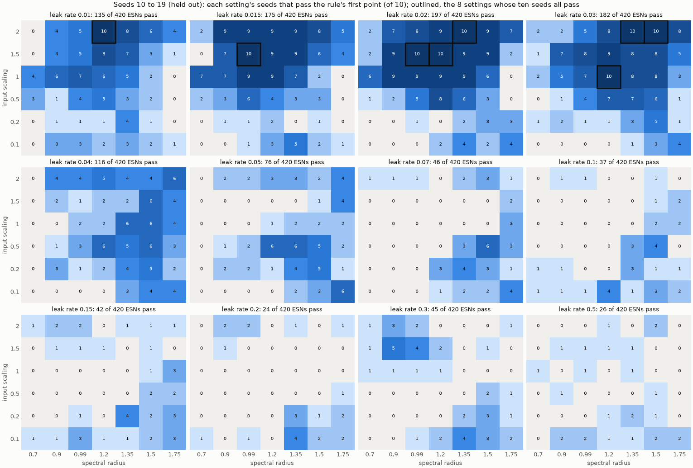
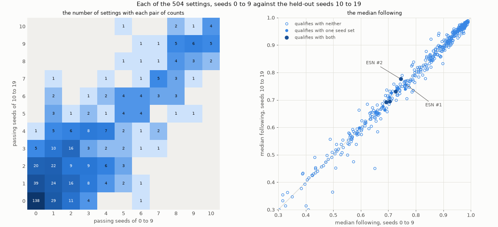
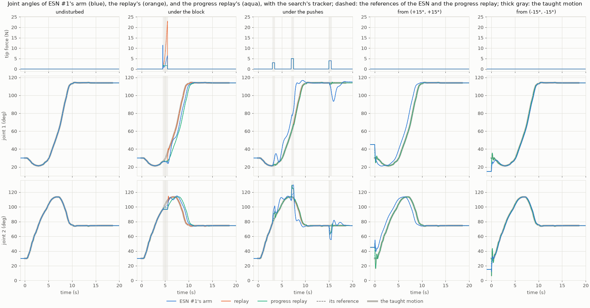
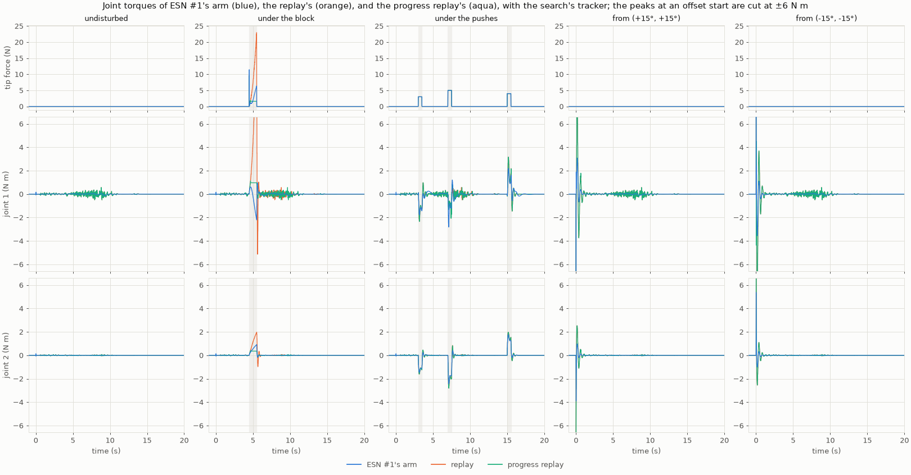

# 017 The search under one protocol: report 011's ESNs again, by rule

**Summary.** Reports 005 to 016 changed their assumptions as they went: the tracker the
search ran with, the pushes, the measure the search ranked by, how many offset starts
an ESN was tried from, and how the final ESN was chosen, by hand in the robot app in
reports 005, 007, 009, and 011. This report runs the search again under one protocol,
fixed in the [experiment's README](../../experiments/manual_demonstration_v2_consistent_search/README.md)
before any run:

- a grid of 504 settings with ten seeds each, wider than report 011's 105;
- every ESN run with the search's tracker, undisturbed, under the block, under the
  pushes, and from all 49 offset starts;
- ESN #1 and ESN #2 chosen by report 011's rule, written as code;
- the choice checked on 5,040 held-out ESNs, and on the reservoir's size and ridge.

The findings:

- **The rule chooses report 011's two ESNs.**
  - 1,049 of the 5,040 ESNs pass. 11 of the 504 settings have all ten seeds pass:
    the same 11 as in report 011, with the same medians and the same typical seeds.
  - ESN #1 (leak rate 0.03, spectral radius 1.2, input scaling 1.5, seed 8) and
    ESN #2 (input scaling 1, seed 2) are the typical seeds of the top two settings.
    Report 011 chose both by hand in the app.
  - The wider grid adds no setting. Beyond report 011's range, the nearest pass nine
    seeds of ten.
- **The offset starts decide most of the search.**
  - 1,718 ESNs pass undisturbed, under the block, and under the pushes; 1,049 of them
    also from all 49 starts. 94.5% of the failing runs start from an offset.
  - Starts with joint 2 offset by −10° or −15° fail most, 16% to 21% of the ESNs
    passing the rest; joint 1's offset hardly matters.
- **The following keeps its order across seeds; what qualifies rests on single
  seeds.**
  - With the held-out seeds 10 to 19, 8 settings qualify, 4 of them again. ESN #2's
    setting passes all ten and ranks first. ESN #1's passes nine: seed 13 never
    arrives from nine of the starts with joint 2 at −10° or −15°.
  - Each setting's median following holds: a rank correlation of 0.99 over the 504
    settings, and no change above 0.03 among the 15 that qualify with either seed set.
  - The choice was fixed to seeds 0 to 9 and stands. Over all 20 seeds, ESN #1's
    setting passes 19 and ESN #2's 20.
- **At ESN #1's setting, only 400 neurons and a ridge of 10⁻² pass with all ten
  seeds.**
  - 100, 200, and 800 neurons pass 6, 8, and 7 seeds; ridges of 10⁻⁴ and 10⁻³ overfit,
    and pass none; 10⁻¹ and 1 pass 9 and 6.
  - The following hardly changes, 0.72 to 0.78, wherever seeds pass.
- **On the robot with the search's tracker,** both ESNs repeat report 011's runs: they
  wait under the block, give way to the pushes, ring less than the replay, and come
  back to the taught path more slowly.
- **New: how hard the motors work.**
  - Over the whole task, the ESNs' accumulated torque is a quarter of the replay's
    undisturbed (0.21 and 0.20 N m s against 0.93 N m s). The replay's torque is
    jagged through the reach; the ESNs' is smooth.
  - It is also a quarter or less under the block (1.9 and 1.7 against 8.3 N m s), and
    40% from an offset start. Under the pushes it is about the same.
  - The progress replay, which waits under the block too, accumulates 2.3 N m s there.

## 1. Question

1. **The search:** under one protocol fixed before the runs, which settings of the
   reservoir complete the task in every scenario with every seed? Which two ESNs
   does the rule choose?
2. **How much the choice depends on the protocol:**
   - on counting the offset starts for every ESN;
   - on the measure the settings are ranked by;
   - on the seeds;
   - on the reservoir's size and ridge.
3. **The chosen ESNs:** how do they compare on the robot with the replay and the
   progress replay, with the search's tracker? How hard do the motors work?

## 2. Setup

### The protocol

As the [experiment's README](../../experiments/manual_demonstration_v2_consistent_search/README.md)
fixed it before any run, for this report and reports 018 and 019.

**The robot, the task, and the take.** The arm of
[`reach_manual_v2.toml`](../../experiments/demonstrations/reach_manual_v2.toml), as in
reports 005 to 016:
- two links, simulated every 2 ms;
- the target at (−0.6, 0.4) m, with a goal radius of 20 mm.

The ESNs are trained on its one take, untrimmed and filtered at 2 Hz: `demo_00_filtered`
of `results/demonstrations/20261008-170034-reach_manual_v2`
([report 005's copy](../005-tuned-on-the-robot/data)).

**The ESNs.** Trained by teacher forcing on the take, without noise, and driven on the
robot by the arm's measured joint angles every 10 ms. Fixed:

| Parameter | Value |
| --- | --- |
| Neurons | 400, tanh |
| Sparsity (nonzero reservoir connections) | 0.05 |
| Bias | yes, random |
| Ridge | 10⁻² |
| Warm-up (the start posture held before the ESN moves, in training and on the robot) | 1 s |
| Sampling period | 10 ms |

Swept, every combination, 504 settings:

| Parameter | Values |
| --- | --- |
| Leak rate | 0.01, 0.015, 0.02, 0.03, 0.04, 0.05, 0.07, 0.1, 0.15, 0.2, 0.3, 0.5 |
| Spectral radius | 0.7, 0.9, 0.99, 1.2, 1.35, 1.5, 1.75 |
| Input scaling | 0.1, 0.2, 0.5, 1, 1.5, 2 |
| Seed (the random reservoir, its input weights, and its biases) | 0 to 9 for the search; 10 to 19 held out |

**The search's tracker.** Joint PD, report 009's and 011's search tracker:
- ω = 20 rad/s and a damping ratio of 0.4, each joint's gains scaled by its inertia at
  the take's final posture: kp = 74.96 and 8.96 N m/rad, kd = 3.00 and 0.358 N m s/rad;
- given the reference's velocity;
- its torque computed every 10 ms and held between.

**The scenarios.** Runs of 24 s after the 1 s warm-up:

| Scenario | What happens |
| --- | --- |
| undisturbed | from the take's start |
| block | the tip held by a spring of 20,000 N/m and a damper of 100 N s/m from 4.5 s to 5.5 s |
| pushes | 3 N at 3 s, nearly forward; 5 N at 7 s, nearly across; 4 N at 15 s, after the hold, nearly across the other way; each 0.5 s at the tip |
| offsets | undisturbed from the 49 starts offset from the take's by −15° to 15° in steps of 5° in each joint |

Each ESN runs 52 times.

**The measures,** as reports 006 to 016 defined them:
- whether the hand arrives within the goal radius, holds there for 2 s, and ends there;
- the path RMSE from the taught hand path.

After each disturbance:
- the following gain, from its onset to 0.5 s past its end (0 for the replay, 1 for a
  reference that goes wherever the arm goes);
- the ringing: the RMS of the hand's motion above 1.5 Hz over 2 s;
- the farthest from the taught path;
- the return within 5 mm of the path. A hand not back by the next disturbance, or by
  the run's end, counts as back then.

New here, how hard the motors work over the whole task ([`motor_effort`](../../src/arm_esn_ctrl/metrics.py)):
- the accumulated torque ∫ Σ|τ| dt (N m s);
- the squared torque ∫ Σ τ² dt (N² m² s, a stand-in for the motors' copper losses);
- the positive work ∫ Σ max(τ q̇, 0) dt (J), none recovered while a joint is driven
  backward.

**The rule,** report 011's with the offset starts counted for every ESN, coded in
[`select_esns.py`](../../experiments/select_esns.py):

1. **An ESN passes** if, undisturbed, under the block, and from all 49 offset starts,
   its hand arrives, holds for the whole hold window, and ends within the goal; and
   if, under the pushes, it arrives and ends within the goal. Leaving the goal during
   the hold is excused under the pushes, since the push at 7 s can carry the arm
   there early, still swinging.
2. **A setting qualifies** if all ten of its seeds pass. Its measures are the medians
   over its seeds. A seed's following, ringing, and return are its means over the
   block and the three pushes.
3. **The guard:** a setting whose median ringing exceeds the replay's with the same
   tracker (10.70 mm) is not chosen.
4. **The ranking:** the qualifying settings within the guard, by their median
   following, the largest first.
5. **The typical seed** of a setting is the one nearest its medians of the
   undisturbed path RMSE, the following, and the ringing, each scaled by its
   interquartile range over the seeds.
6. **ESN #1 and ESN #2** are the typical seeds of the top two settings. Nothing is
   chosen in the app.

Run on report 011's own sweeps, the code gives report 011's qualifying settings,
medians, and typical seeds exactly.

**The comparison arms** on the robot:
- the replay of the take by time;
- the progress replay (report 014's): the take replayed by time, but never more than
  2.5° along its joint path past the arm's progress.

### What changed from report 011's search

| | Report 011 | Here |
| --- | --- | --- |
| Grid | 105 settings: leak rate 0.015 to 0.1, spectral radius 0.99 to 1.75, input scaling 1 to 2 | 504 settings: leak rate 0.01 to 0.5, spectral radius 0.7 to 1.75, input scaling 0.1 to 2 |
| Offset starts | 8, for the 13 settings that passed the other scenarios | all 49, for every ESN |
| Seeds | 0 to 9 | 0 to 9, and 10 to 19 held out |
| The choice | in the robot app, from a shortlist of three | by the rule, the typical seeds of the top two |
| Size and ridge | fixed | fixed, and checked at ESN #1's setting |
| How hard the motors work | not measured | the accumulated torque, the squared torque, and the positive work |

### Reproducing the results

The runs read the take under the storage root ([report 005's copy](../005-tuned-on-the-robot/data)).
The robot runs read the chosen ESNs by their run names; their `esn.toml` and
`esn.rclib` are copied into their runs' directories here. A run is found by its name
anywhere under `results/`; place or link the copies there to rerun. All
configurations are in
[`manual_demonstration_v2_consistent_search`](../../experiments/manual_demonstration_v2_consistent_search/README.md).

| Runs | Command | Commit |
| --- | --- | --- |
| `guard_{block,pushes}_robot` (2) | `uv run python experiments/robot_esn.py experiments/manual_demonstration_v2_consistent_search/<name>.toml` | `fa90929` |
| `sweep_lr<leak rate>_<scenario>` (48) | `uv run python experiments/sweep_robot_esn.py experiments/manual_demonstration_v2_consistent_search/<name>.toml --workers 30` | `fa90929` |
| `select` | `uv run python experiments/select_esns.py experiments/manual_demonstration_v2_consistent_search/select.toml` | `3baccaa` |
| `esn1_lr0.03_sr1.2_is1.5_seed8`, `esn2_lr0.03_sr1.2_is1_seed2` | `uv run python experiments/autonomous_esn.py experiments/manual_demonstration_v2_consistent_search/<name>.toml` | `f00cb38` |
| `sweep_lr<leak rate>_<scenario>_seeds10to19` (48), `size_<scenario>` (4), `ridge_<scenario>` (4) | as the sweeps | `f00cb38` |
| `select_seeds10to19`, `select_size`, `select_ridge` | as `select` | `8056861` |
| `<scenario>_robot_esn1_lr0.03_sr1.2_is1.5_seed8`, `<scenario>_robot_esn2_lr0.03_sr1.2_is1_seed2` (8) | as the guard's | `eadfff8` |
| [`summary`](results/summary) | `uv run python reports/017-search-under-one-protocol/make_figures.py --logs` | |

**Running time.** Each set of 48 sweeps took 23.5 h on 30 worker processes of one
thread each (an i9-14900KF); each leak rate's sweep from the offset starts takes
1.8 h of it.

**Checks against the earlier runs.** Before the grid, the current code ran again what
reports 011 and 015 ran (the experiment's step 0):
- report 011's sweep at leak rate 0.03 under the pushes: within a relative 1.2 × 10⁻⁷,
  with every outcome the same;
- report 011's ESN #1 and the replay with the search's tracker under the block and the
  pushes, and report 015's fixed points: identical.

The grid's runs at report 011's settings repeat report 011's:
- the 3,150 runs undisturbed, under the block, and under the pushes, within a relative
  2.4 × 10⁻⁴ (one final distance), with every outcome the same;
- report 011's 1,040 runs from its 8 offset starts, within 6 × 10⁻⁸.

The two ESNs, trained again here, repeat report 011's runs from the 49 starts
exactly. Their robot runs repeat their sweeps' runs within 10⁻⁸.

**What is kept here.** Every run record (`run.toml`) shows no uncommitted changes.
Each run directory here holds:
- **every run:** its configuration and run record;
- **a sweep:** its `seeds.csv`; its `runs.csv` (264 MB for the offset sweeps) and its
  figures stay under the storage root;
- **a run of the rule:** `esns.csv` (each ESN's outcome, how it fails, and its
  measures), `settings.csv`, and `chosen.csv`;
- **a robot run:** its `metrics.csv`; the offset runs also their map of the 49 starts
  (`grid.png`) and their hand paths (`paths.png`);
- **the chosen ESNs' training runs:** their trained ESN.

[`make_figures.py`](make_figures.py) draws the figures and prints the tables of
Section 3 from these copies. With `--logs`, it also reads the robot runs' logs under
the storage root, which are not kept in Git, to draw the joint angles and torques over
time.

## 3. Results

### 3.1 The grid

| Leak rate | ESNs passing, of 420 (held out) | ESNs failing undisturbed / block / pushes / offsets | Settings with 10 / 9 seeds passing (held out) | The settings' median following |
| ---: | ---: | --- | --- | --- |
| 0.01 | 115 (135) | 114 / 182 / 172 / 265 | 0 / 1 (1 / 0) | 0.22 to 0.66 |
| 0.015 | 176 (175) | 98 / 147 / 149 / 201 | 2 / 5 (1 / 8) | 0.24 to 0.73 |
| 0.02 | 173 (197) | 74 / 131 / 150 / 208 | 5 / 3 (3 / 9) | 0.17 to 0.79 |
| 0.03 | 168 (182) | 72 / 124 / 187 / 197 | 4 / 2 (3 / 1) | 0.20 to 0.94 |
| 0.04 | 109 (116) | 75 / 115 / 225 / 254 | 0 / 1 (0 / 0) | 0.30 to 0.95 |
| 0.05 | 66 (76) | 84 / 122 / 253 / 322 | 0 / 0 (0 / 0) | 0.41 to 0.97 |
| 0.07 | 57 (46) | 86 / 127 / 312 / 322 | 0 / 0 (0 / 0) | 0.57 to 0.97 |
| 0.1 | 50 (37) | 88 / 118 / 311 / 338 | 0 / 0 (0 / 0) | 0.71 to 0.98 |
| 0.15 | 47 (42) | 89 / 106 / 330 / 350 | 0 / 0 (0 / 0) | 0.83 to 0.99 |
| 0.2 | 33 (24) | 97 / 108 / 342 / 368 | 0 / 0 (0 / 0) | 0.89 to 0.99 |
| 0.3 | 29 (45) | 100 / 120 / 341 / 378 | 0 / 0 (0 / 0) | 0.93 to 0.99 |
| 0.5 | 26 (26) | 149 / 158 / 285 / 378 | 0 / 0 (0 / 0) | 0.93 to 0.99 |

An ESN can fail in several scenarios.

- **The ESNs pass most at leak rates 0.015 to 0.03,** 40% to 42% of them. The share
  falls to 26% at 0.04 and 6% at 0.5, and is 27% at 0.01.
- **From 0.04 up, the pushes and the offset starts fail most:** 54% to 81% of the ESNs
  under the pushes. Undisturbed, 17% to 35% fail at every leak rate.
- **The following rises with the leak rate,** from 0.22 to 0.66 among the settings at
  0.01 to 0.93 to 0.99 at 0.3 and 0.5: a faster reservoir follows the arm more, and
  loses the reach more often.
- **The other two axes:**
  - Spectral radius: 0.7 passes 25 of its 720 ESNs (3.5%); 1.35 passes 244 (34%).
  - Input scaling: 0.5 or less passes 13% to 17%; 1 to 2 passes 26% to 29%.
- **No setting outside report 011's range has all ten seeds pass.** The nearest have
  nine: leak rate 0.01 (spectral radius 1.2, input scaling 1.5), and input scaling 0.5
  (leak rate 0.04, spectral radius 1.35).

### 3.2 The offset starts

- **The offset starts reject 669 of the 1,718 ESNs that pass the other scenarios.**
  Of all the failing runs, 99,020 of 104,761 (94.5%) start from an offset; 63% of those
  never arrive.
- **An ESN that fails only from the offset starts fails from a median of 11 of them.**
- **Joint 2's offset decides.** Joint 2 starts at 30°, where 0° is the straight arm.
  - Taking it 10° or 15° nearer straight fails 16% to 21% of these ESNs per start.
  - Taking it 5° to 15° more bent fails 1% to 8%.
  - Joint 1's offset changes the share by 2 points at most, averaged over joint 2's
    offsets.
- **The same pattern holds with the held-out seeds** (right).
- **Counting the offset starts for every ESN removes three settings.** Without them,
  14 settings would qualify. The three that fail are:
  - leak rate 0.015 at spectral radius 0.99 and at 1.35, input scaling 1.5;
  - leak rate 0.02, spectral radius 0.99, input scaling 0.1.
  
  Report 011 had dropped the first two on its 8 starts. The third lay outside its grid.

### 3.3 The ranking and the choice

The 11 qualifying settings, ranked (medians over the seeds; the following under the
block and each push; the last column is the held-out seeds', Section 3.4):

| Rank | Leak rate | Spectral radius | Input scaling | Following | Block / pushes at 3, 7, 15 s | Ringing | Return | Undisturbed path RMSE | Typical seed | Held out: passing seeds, following |
| ---: | ---: | ---: | ---: | ---: | --- | ---: | ---: | ---: | ---: | --- |
| **1** | 0.03 | 1.2 | 1.5 | **0.76** | 0.88 / 0.79 / 0.56 / 0.77 | 5.68 mm | 2.92 s | 0.69 mm | 8 | 9, 0.76 |
| **2** | 0.03 | 1.2 | 1 | 0.74 | 0.84 / 0.81 / 0.62 / 0.75 | 5.72 mm | 3.27 s | 0.88 mm | 2 | 10, 0.78 |
| 3 | 0.03 | 1.35 | 1.5 | 0.73 | 0.85 / 0.72 / 0.55 / 0.77 | 6.14 mm | 2.84 s | 0.58 mm | 6 | 8, 0.74 |
| 4 | 0.02 | 0.99 | 1.5 | 0.73 | 0.87 / 0.77 / 0.55 / 0.70 | 5.59 mm | 3.54 s | 0.83 mm | 5 | 10, 0.73 |
| 5 | 0.03 | 1.35 | 1 | 0.71 | 0.80 / 0.74 / 0.58 / 0.71 | 6.39 mm | 3.03 s | 0.77 mm | 3 | 8, 0.73 |
| 6 | 0.02 | 1.2 | 1.5 | 0.70 | 0.86 / 0.76 / 0.47 / 0.69 | 5.84 mm | 3.16 s | 0.76 mm | 0 | 10, 0.70 |
| 7 | 0.02 | 1.2 | 2 | 0.70 | 0.88 / 0.79 / 0.42 / 0.71 | 5.75 mm | 2.75 s | 0.65 mm | 8 | 9, 0.71 |
| 8 | 0.02 | 1.35 | 2 | 0.69 | 0.84 / 0.78 / 0.41 / 0.70 | 5.86 mm | 2.66 s | 0.58 mm | 7 | 10, 0.69 |
| 9 | 0.02 | 1.35 | 1.5 | 0.68 | 0.85 / 0.74 / 0.43 / 0.67 | 6.07 mm | 2.88 s | 0.67 mm | 6 | 9, 0.68 |
| 10 | 0.015 | 1.2 | 2 | 0.66 | 0.86 / 0.76 / 0.38 / 0.67 | 6.01 mm | 3.75 s | 0.72 mm | 3 | 9, 0.65 |
| 11 | 0.015 | 1.2 | 1.5 | 0.65 | 0.82 / 0.70 / 0.40 / 0.65 | 6.13 mm | 3.70 s | 0.80 mm | 1 | 9, 0.66 |

- **The rule chooses ESN #1 and ESN #2:** the typical seeds of the top two settings,
  both at leak rate 0.03 and spectral radius 1.2.
  - ESN #1: input scaling 1.5, seed 8.
  - ESN #2: input scaling 1, seed 2.

  They are the ESNs report 011 chose by hand in the app. The table is report 011's
  Section 3.2, row for row.
- **None rings more than the replay** (10.70 mm), so the guard excludes none: they
  ring 5.6 to 6.4 mm, about half as much.
  - The settings that follow more, at faster leak rates, ring from 3 to 30 mm.
  - None of them completes the task with all ten seeds.
- **The settings differ most at the push across at 7 s:** 0.38 to 0.62, where the block
  and the other pushes vary by about 0.1.
- **Ranked by the measures the earlier searches used, the top setting would change:**

  | Ranked by | Top setting (leak rate, spectral radius, input scaling) | Its rank here |
  | --- | --- | --- |
  | The path RMSE (reports 005 and 006) | 0.03, 1.35, 1.5 (0.58 mm, tied with 0.02, 1.35, 2) | 3 |
  | The ringing (report 007) | 0.02, 0.99, 1.5 (5.59 mm) | 4 |
  | The return (reports 009 and 010) | 0.02, 1.35, 2 (2.66 s) | 8 |

  The setting top by the return is report 007's chosen one.

### 3.4 The held-out seeds

The rule applied to the held-out seeds 10 to 19 alone; nothing is chosen from it.

| Rank, held out | Leak rate | Spectral radius | Input scaling | Following | Ringing | Return | Path RMSE | Typical seed | Seeds 0 to 9: passing seeds, rank |
| ---: | ---: | ---: | ---: | ---: | ---: | ---: | ---: | ---: | --- |
| 1 | 0.03 | 1.2 | 1 | 0.78 | 5.61 mm | 3.56 s | 0.85 mm | 19 | 10, 2 |
| 2 | 0.03 | 1.35 | 2 | 0.74 | 5.50 mm | 3.07 s | 0.52 mm | 15 | 8, - |
| 3 | 0.03 | 1.5 | 2 | 0.74 | 5.76 mm | 3.54 s | 0.50 mm | 15 | 8, - |
| 4 | 0.02 | 0.99 | 1.5 | 0.73 | 5.57 mm | 3.44 s | 0.85 mm | 17 | 10, 4 |
| 5 | 0.02 | 1.2 | 1.5 | 0.70 | 5.72 mm | 3.53 s | 0.78 mm | 11 | 10, 6 |
| 6 | 0.02 | 1.35 | 2 | 0.69 | 5.95 mm | 3.52 s | 0.60 mm | 14 | 10, 8 |
| 7 | 0.015 | 0.99 | 1.5 | 0.66 | 6.04 mm | 3.57 s | 0.86 mm | 15 | 9, - |
| 8 | 0.01 | 1.2 | 2 | 0.60 | 6.56 mm | 5.03 s | 0.81 mm | 11 | 5, - |

- **1,101 of the 5,040 held-out ESNs pass; 8 settings qualify.**
  - Four qualify with both seed sets: ESN #2's setting, and three at leak rate 0.02
    (spectral radius 0.99, input scaling 1.5; 1.2, 1.5; 1.35, 2). These four pass all
    20 seeds.
  - Every setting that qualifies with seeds 0 to 9 passes at least 8 held-out seeds.
  - The two seed sets give each setting about the same number of passing seeds: a
    correlation of 0.86 over the 504 settings.
- **ESN #1's setting passes 9 of the 10 held-out seeds.** Seed 13 never arrives from 9
  of the 49 starts: those with joint 2 at −10° or −15° and joint 1 at −15° to +5°.
  Over all 20 seeds, the setting passes 19.
- **ESN #2's setting ranks first with the held-out seeds,** following by 0.78.
- **The following keeps its order:**
  - a rank correlation of 0.99 over the 504 settings, and 0.97 over the 15 that
    qualify with either set;
  - none of those 15 changes by more than 0.03.
- **The choice stands.** The protocol fixed it to seeds 0 to 9, and both ESNs' settings
  pass at least 19 of the 20 seeds. Had the rule pooled all 20 seeds, ESN #2's setting
  would rank first. Both are compared in reports 018 and 019.

### 3.5 The size and the ridge

At ESN #1's setting (leak rate 0.03, spectral radius 1.2, input scaling 1.5), seeds 0
to 9, every scenario of the search:

| Neurons, ridge 10⁻² | Passing seeds | Following | Ringing | Return | Undisturbed path RMSE | How the others fail |
| ---: | ---: | ---: | ---: | ---: | ---: | --- |
| 100 | 6 | 0.78 | 5.30 mm | 3.28 s | 0.91 mm | each from 5 to 31 offset starts |
| 200 | 8 | 0.76 | 5.35 mm | 3.54 s | 0.77 mm | one from 3 offset starts; one also ends away under the pushes |
| **400** | **10** | 0.76 | 5.68 mm | 2.92 s | 0.69 mm | |
| 800 | 7 | 0.73 | 7.35 mm | 3.64 s | 0.69 mm | two from 7 and 13 offset starts; one also under the pushes |

| Ridge, 400 neurons | Passing seeds | Following | Ringing | Return | Undisturbed path RMSE | How the others fail |
| ---: | ---: | ---: | ---: | ---: | ---: | --- |
| 10⁻⁴ | 0 | 0.70 | 89.8 mm | 9.50 s | 195 mm | in every scenario |
| 10⁻³ | 0 | 0.75 | 26.2 mm | 8.62 s | 6.93 mm | under the block, the pushes, or undisturbed, and from the offset starts; two from the offset starts alone |
| **10⁻²** | **10** | 0.76 | 5.68 mm | 2.92 s | 0.69 mm | |
| 10⁻¹ | 9 | 0.73 | 5.47 mm | 2.77 s | 0.86 mm | one from 12 offset starts |
| 1 | 6 | 0.72 | 5.74 mm | 3.36 s | 1.13 mm | three also under the pushes; one from 6 offset starts |

The figures are medians over the seeds. The rows of 400 neurons and of ridge 10⁻² are
ESN #1's setting itself; they repeat the grid's runs.

- **Below a ridge of 10⁻², the ESN overfits.** It leaves the taught path undisturbed:
  a path RMSE of 6.9 mm at 10⁻³ and 195 mm at 10⁻⁴. None of its seeds passes.
- **Above it, and at other sizes, a few seeds fail from some offset starts or under
  the pushes.** The following stays within 0.72 to 0.78.
  - Fewer neurons ring a little less (5.3 mm with 100 and 200).
  - 800 neurons ring more (7.35 mm).
- **These favour 400 neurons and 10⁻² by construction.** The spectral radius and
  input scaling were chosen at those values. The check shows that, at this setting,
  the outcome depends on the size and the ridge. It does not show that 400 and 10⁻²
  are best for the reservoir in general.

### 3.6 The chosen ESNs on the robot

The ESNs, as trained here:

| | ESN #1 ([`esn.toml`](results/20261024-205825-esn1_lr0.03_sr1.2_is1.5_seed8/esn.toml)) | ESN #2 ([`esn.toml`](results/20261024-205835-esn2_lr0.03_sr1.2_is1_seed2/esn.toml)) |
| --- | --- | --- |
| Leak rate | 0.03 | 0.03 |
| Spectral radius | 1.2 | 1.2 |
| Input scaling | 1.5 | 1 |
| Seed | 8 | 2 |
| Fixed | 400 tanh neurons, sparsity 0.05, a random bias, ridge 10⁻², a 1 s warm-up, a 10 ms period | the same |
| Training | teacher forcing on the take (`demo_00_filtered`, untrimmed), without noise | the same |

Each runs against the replay and the progress replay with the search's tracker, in
every scenario of the search. Every run of every arm arrives, holds, and ends within
the goal, from all 49 offset starts too.

**From the take's start** (arrival, and the path RMSE from the taught hand path):

| Arm | Undisturbed | Under the block | Under the pushes |
| --- | --- | --- | --- |
| ESN #1 | 9.55 s, 0.74 mm | 10.08 s, 12.7 mm | 9.70 s, 62.5 mm |
| ESN #2 | 9.54 s, 0.87 mm | 9.98 s, 8.5 mm | 9.75 s, 57.2 mm |
| Replay | 9.56 s, 0.40 mm | 9.56 s, 8.4 mm | 9.56 s, 26.4 mm |
| Progress replay | 9.56 s, 0.40 mm | 10.40 s, 0.4 mm | 9.64 s, 25.8 mm |

**After each disturbance**, ESN #1 / ESN #2 / the replay / the progress replay:

| | The block | Push forward at 3 s | Push across at 7 s | Push across at 15 s |
| --- | --- | --- | --- | --- |
| Following | 0.89 / 0.82 / 0.00 / 0.91 | 0.80 / 0.76 / 0.00 / 0.00 | 0.63 / 0.63 / 0.00 / 0.03 | 0.83 / 0.73 / 0.00 / 0.00 |
| Ringing over the next 2 s (mm) | 3.3 / 3.6 / 17.5 / 2.9 | 4.9 / 5.2 / 6.8 / 6.8 | 8.7 / 8.1 / 10.0 / 10.2 | 5.5 / 6.0 / 8.5 / 8.5 |
| Back within 5 mm of the path (s; – if not before the next push) | 2.22 / 3.08 / 0.42 / 0.00 | 2.98 / – / 0.04 / 0.04 | 2.52 / 3.33 / 0.38 / 0.38 | 4.98 / 4.16 / 0.46 / 0.45 |
| Farthest from the path (mm) | 38 / 23 / 28 / 2 | 66 / 67 / 7 / 7 | 175 / 206 / 111 / 111 | 202 / 166 / 99 / 99 |

**From the 49 offset starts** (medians over the 48 offset starts, and the largest peak
torque):

| Arm | Path RMSE | The hand's first step | Peak torque, median / largest |
| --- | ---: | ---: | --- |
| ESN #1 | 17.8 mm | 4 mm | 26 / 49 N m |
| ESN #2 | 18.2 mm | 6 mm | 28 / 61 N m |
| Replay | 19.4 mm | 11 mm | 52 / 79 N m |
| Progress replay | 19.4 mm | 11 mm | 52 / 79 N m |

**How hard the motors work over the task:** the accumulated torque (N m s), the squared
torque (N² m² s), and the positive work (J); from the offset starts, the medians over
the 48:

| Arm | Undisturbed | Under the block | Under the pushes | From the offset starts |
| --- | --- | --- | --- | --- |
| ESN #1 | 0.21, 0.01, 0.02 | 1.88, 1.56, 0.08 | 5.61, 6.90, 0.44 | 1.13, 7.37, 0.31 |
| ESN #2 | 0.20, 0.01, 0.02 | 1.65, 0.91, 0.06 | 5.94, 6.80, 0.46 | 1.14, 8.83, 0.43 |
| Replay | 0.93, 0.11, 0.11 | 8.30, 48.27, 0.75 | 6.18, 8.22, 0.66 | 2.90, 31.68, 1.45 |
| Progress replay | 0.93, 0.11, 0.11 | 2.29, 1.15, 0.12 | 6.30, 8.39, 0.66 | 2.90, 31.68, 1.45 |

ESN #1's joint angles and torques over time, against both replays (ESN #2's:
[joint angles](results/summary/joints_esn2.png), [torques](results/summary/torques_esn2.png)):

- **These runs repeat report 011's** with the search's tracker: every figure above
  matches its tables at ζ = 0.4, given the reference velocity, but the median peak
  torques from the offset starts, taken here over the 48 offset starts rather than
  all 49.
- **Undisturbed, both ESNs keep to the taught path** within 0.9 mm, and arrive with the
  take.
- **Under the block, both ESNs wait.** At the release, their reference is 2.5% and
  2.7% of the path ahead of the hand, against the replay's 8.8%. They press with 2.2
  and 0.9 N m at most, against the replay's 13.1 N m.
  - The progress replay waits as well: 1.3% ahead, 1.1 N m, following by 0.91, and
    ringing least (2.9 mm).
  - After the release, the replay's arm snaps to its reference, which ran on while the
    tip was held, and rings 17.5 mm.
- **Under the pushes, the ESNs give way.**
  - They follow by 0.63 to 0.83, where both replays keep to the take (0.03 at most).
  - A push carries their arms farther: 175 and 206 mm after the push at 7 s, against
    111 mm.
  - They come back to the path over 2.5 to 5 s, against the replays' 0.5 s at most.
    After the push at 3 s, ESN #2's arm is not back within 5 mm before the next push.
  - They ring less after every push, 4.9 to 8.7 mm against 6.8 to 10.2 mm.
- **From an offset start, the ESNs set off gently.** Their hand's first step is a
  third to a half of the replays', and their peak torque about half. From
  (+15°, +15°), both arrive 0.7 to 1 s before the replay (8.84 and 8.59 s, against
  9.56 s). From (−15°, −15°), ESN #1 arrives with it (9.64 s); ESN #2 is 0.65 s
  later.
- **The motors work least for the ESNs:**
  - **Undisturbed,** the replays accumulate 4.4 to 4.7 times the ESNs' torque, 0.93
    against 0.21 and 0.20 N m s. Their joint 1 torque is jagged through the reach, peaking at 0.57 N m;
    the ESNs' is smooth, peaking at 0.11 N m. Undisturbed, the replay and the progress
    replay are the same.
  - **Under the block,** the replay accumulates 8.3 N m s and 48 N² m² s, pressing
    against the held tip. The ESNs accumulate 1.9 and 1.7 N m s; the progress replay,
    which waits, 2.3 N m s.
  - **Under the pushes,** all four are alike, 5.6 to 6.3 N m s: the pushes themselves
    set the torque.
  - **From an offset start,** the ESNs' median is 1.1 N m s against 2.9 N m s, and a
    quarter of the replays' squared torque.

## 4. Observations

- **The search's choice does not depend on the hand in the app.** Under one protocol,
  with a grid five times wider and every ESN tried from all 49 starts, the rule gives
  report 011's 11 settings and chooses the two ESNs that report 011 chose by hand.
- **The range that completes the task is narrow, and the wider grid confirms it.**
  - Every setting that qualifies with either seed set lies at leak rates 0.01 to 0.03,
    spectral radii 0.99 to 1.5, and input scalings 1 to 2.
  - Faster leak rates follow more but lose the reach, mostly after a push or from an
    offset start.
  - A smaller spectral radius or input scaling passes rarely.
- **The offset starts are the hardest test,** and starts with joint 2 nearer straight
  the hardest of them. A search that tries a few of them, or only for the settings
  that pass the rest, passes ESNs that fail there.
- **The following is a property of the setting; passing every seed is not.** Each
  qualifying setting's median following holds from one set of seeds to the other
  within 0.03. Whether all ten seeds pass changes with the set: only four settings
  pass all 20. Report 011's ESN #1's setting, the top here,
  passes 19.
- **The rule's measure decides the choice among the qualifying settings.** Ranked by
  the path RMSE, the ringing, or the return, as the earlier searches were, the top
  setting is a different one each time, the return's being report 007's choice.
- **Waiting is cheap, following costs the return.** The ESNs' motors work a quarter
  of the replay's undisturbed and under the block, and alike under the pushes. A
  pushed arm whose reference goes with it comes back over seconds, where the replays
  snap back. The progress replay waits under the block as cheaply as the ESNs, but
  does not give way to a push.

## 5. Next steps

1. **Report 018: the trackers.** ESN #1 and ESN #2 against both replays:
   - with joint PD at damping ratios 0.2, 0.4, and 0.8, given a zero or the reference
     velocity;
   - with computed torque at the same ratios;
   - under the search's scenarios and report 012's three pushes by hand;
   - with the motors' effort over the task, and its excess over the same arm
     undisturbed.
2. **Report 019: the ESNs as dynamical systems.**
   - Report 015's analyses of ESN #1 and ESN #2.
   - Report 016's screen of the 5,040 and 5,040 held-out ESNs, set against this
     report's outcomes with the offset starts counted.
   - The releases at unstable fixed points on the robot.
   - A closing table of the claims of reports 011 to 016.
3. **The offset starts nearer straight:** why starts with joint 2 at −10° to −15° fail
   most, and whether the warm-up or the take's own start decides it.
