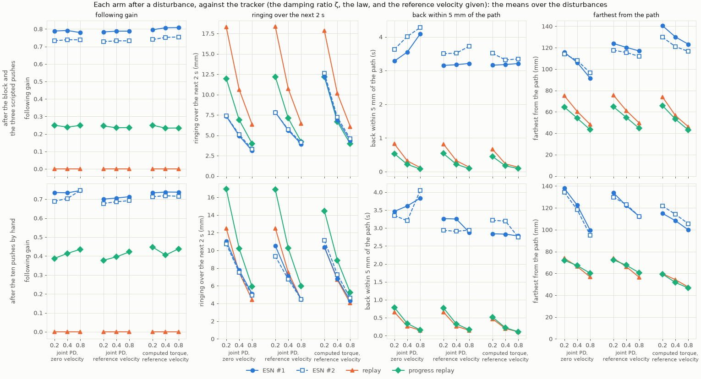
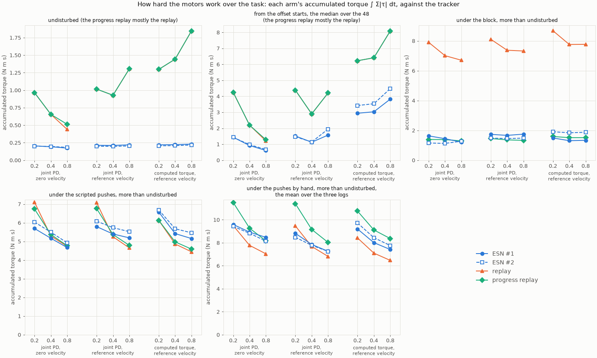
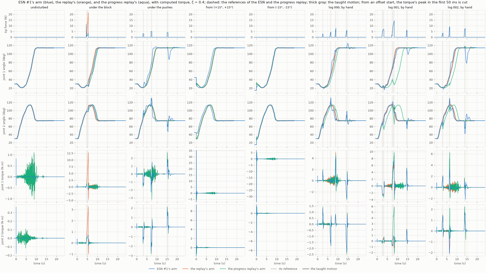
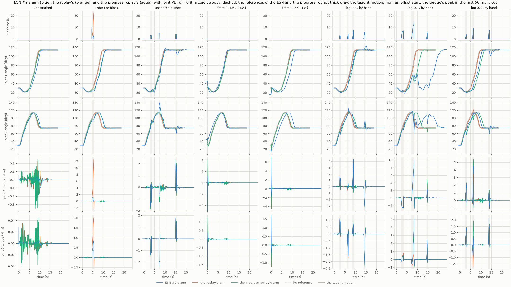

# 018 The trackers under one protocol: the chosen ESNs and both replays with nine trackers

**Summary.** [Report 017](../017-search-under-one-protocol/README.md) chose ESN #1 and
ESN #2 by rule, searching with one tracker: joint PD at a damping ratio of 0.4, given
the reference's velocity. Here the two ESNs, the replay of the take, and the progress
replay run with every tracker of the protocol, fixed in the
[search's README](../../experiments/manual_demonstration_v2_consistent_search/README.md)
before any run:

- joint PD at damping ratios 0.2, 0.4, and 0.8, each given a zero reference velocity or
  the reference's;
- computed torque at the same damping ratios, given the reference's velocity;
- in the search's four scenarios, and under report 012's three recordings of pushes by
  hand;
- with how hard the motors work over the task, and how much more than the same arm
  undisturbed.

The findings:

- **Every arm completes the task with every tracker.**
  - None of the 1,980 runs fails the rule's first point, from all 49 offset starts too.
  - The one strain is the strongest push by hand (log 001), given a zero reference
    velocity. It carries ESN #1's arm and reference back toward the start at every
    damping ratio, and ESN #2's at 0.8; they reach again. ESN #1 then leaves the goal
    during the hold at every damping ratio, and ESN #2 at 0.4, which the pushes excuse.
    ESN #2 arrives at 21.5 s at 0.8.
- **The ESNs follow the arm with every tracker:** by 0.73 to 0.81 after the block and
  the scripted pushes, and by 0.68 to 0.75 after the pushes by hand. The replay
  follows by 0, and the progress replay by 0.23 to 0.25 and 0.38 to 0.45.
- **After the block, the ESNs ring about a quarter of the replay's or less with every
  tracker. After a push, they ring less only with light damping.**
  - After the block's release: 1.2 to 6.8 mm, against the replay's 10.7 to 26.5 mm.
    The progress replay, which waits too, rings 1.3 to 4.3 mm.
  - After the scripted pushes, with joint PD, they ring 54 to 57% of the replay's at
    ζ = 0.2, 69 to 76% at 0.4, and 77 to 95% at 0.8. With computed torque, they ring
    94 to 114% of it.
  - After the pushes by hand, they ring about as the replay does: 75 to 88% of it with
    joint PD at 0.2, 89 to 116% with every other tracker.
- **Following costs the return with every tracker.** The ESNs' arms are carried 92 to
  141 mm from the taught path, against the replays' 43 to 76 mm. They come back in
  2.7 to 4.3 s on average, against 0.1 to 0.8 s.
- **Against the replay with computed torque,** the closest tracking of the take, the
  ESNs with joint PD:
  - ring less after the block and the scripted pushes: 3.1 to 7.8 mm, against 6.1 to
    17.8 mm at the same damping ratios;
  - keep to the taught path less closely, 0.7 to 4.6 mm undisturbed against 0.0 to
    0.1 mm, and come back to it more slowly, in 3.2 to 4.3 s against 0.1 to 0.7 s;
  - work the motors 6 to 11 times less undisturbed, and need 4 to 8 times less extra
    torque under the block.
- **The motors work least for the ESNs undisturbed, under the block, and from the
  offset starts, with every tracker.**
  - **Undisturbed,** the ESNs' accumulated torque is 0.17 to 0.23 N m s with every
    tracker. The replays' is 0.44 to 1.85 N m s, 2.4 to 8.5 times as much, the more
    the closer they track: their arm follows the take's hand-made unevenness, with 29
    to 111 speed peaks against the ESN arm's 5 or 6.
  - **Under the block,** the ESNs need 1.1 to 1.9 N m s more than undisturbed. The
    replay needs 6.7 to 8.7 N m s more, and the progress replay 1.3 to 1.6 N m s.
  - **From an offset start,** the ESNs need a third to a little over half of the
    replays' torque. With computed torque, the start's peak torque is 88 to 166 N m in
    the median for the ESNs, and 149 to 236 N m for the replays.
  - **Under the pushes,** scripted or by hand, all four are alike, 4.4 to 11.5 N m s
    more than undisturbed: the pushes set the torque.
- **The joint PD runs repeat reports 011, 012, and 014 to the digit.** New here are
  computed torque for every arm, the progress replay at damping ratios 0.2 and 0.8, and
  the motors' effort.

## 1. Question

1. **The trackers:** with each of the protocol's nine trackers, do the chosen ESNs
   still complete the task, follow the arm, and ring less than the replays?
2. **The replay with computed torque:** it tracks the take most closely. How do the
   ESNs with joint PD compare with it?
3. **The motors:** how hard do they work over the task, for each arm and tracker? How
   much more under a disturbance than the same arm undisturbed?

## 2. Setup

### The protocol

As the [search's README](../../experiments/manual_demonstration_v2_consistent_search/README.md)
fixed it before any run; [report 017](../017-search-under-one-protocol/README.md#the-protocol)
gives it in full. The arm, the target, the take, the scenarios, and the measures are the
search's.

**The ESNs,** report 017's ESN #1 and ESN #2, as the rule chose and trained them:

| | ESN #1 ([`esn.toml`](../017-search-under-one-protocol/results/20261024-205825-esn1_lr0.03_sr1.2_is1.5_seed8/esn.toml)) | ESN #2 ([`esn.toml`](../017-search-under-one-protocol/results/20261024-205835-esn2_lr0.03_sr1.2_is1_seed2/esn.toml)) |
| --- | --- | --- |
| Leak rate | 0.03 | 0.03 |
| Spectral radius | 1.2 | 1.2 |
| Input scaling | 1.5 | 1 |
| Seed | 8 | 2 |
| Fixed | 400 tanh neurons, sparsity 0.05, a bias drawn from [−1, 1] and not scaled, ridge 10⁻², a 1 s warm-up, a 10 ms period | the same |
| Training | teacher forcing on the take (`demo_00_filtered` of `results/demonstrations/20261008-170034-reach_manual_v2`, untrimmed, filtered at 2 Hz), without noise | the same |

**The arms:**
- ESN #1 and ESN #2, driven by the arm's measured joint angles every 10 ms;
- the replay of the take by time;
- the progress replay (report 014's): the take replayed by time, but never more than
  2.5° along its joint path past the arm's progress.

**The trackers,** all at ω = 20 rad/s, their torque computed every 10 ms and held
between. Joint PD's gains are scaled by each joint's inertia at the take's final
posture. Computed torque cancels the arm's modelled dynamics, so its gains are joint
accelerations per error:

| Tracker | kp, joint 1 and 2 | kd, joint 1 and 2 | Reference velocity |
| --- | --- | --- | --- |
| joint PD, ζ = 0.2 | 74.96 and 8.96 N m/rad | 1.50 and 0.179 N m s/rad | zero, or the reference's |
| joint PD, ζ = 0.4 (the search's, with the reference's) | the same | 3.00 and 0.358 N m s/rad | zero, or the reference's |
| joint PD, ζ = 0.8 | the same | 6.00 and 0.717 N m s/rad | zero, or the reference's |
| computed torque, ζ = 0.2, 0.4, 0.8 | 400 s⁻² | 8, 16, and 32 s⁻¹ | the reference's |

The tracking error rings at about 3.1, 2.9, and 1.9 Hz at the three damping ratios.
Given a zero reference velocity, the derivative term damps the arm's own velocity rather
than the error's.

**The scenarios,** runs of 24 s after the 1 s warm-up:

| Scenario | What happens |
| --- | --- |
| undisturbed | from the take's start |
| block | the tip held by a spring of 20,000 N/m and a damper of 100 N s/m from 4.5 s to 5.5 s |
| pushes | 3 N at 3 s, nearly forward; 5 N at 7 s, nearly across; 4 N at 15 s, after the hold, nearly across the other way; each 0.5 s at the tip |
| offsets | undisturbed from the 49 starts offset from the take's by −15° to 15° in steps of 5° in each joint |
| logs 000, 001, 002 | report 012's pushes by hand, recorded in the robot app and replayed by time on the task clock, from the logs' start, (30°, 30°), within 0.002° of the take's |

The pushes by hand, as report 012 measured them (above 0.5 N, joined across lulls under
0.2 s):

| Log | Pushes | Lengths | Peak force | Impulse |
| --- | --- | --- | --- | --- |
| 000 | 4, from 2.4, 6.1, 8.6, and 14.0 s | 0.38 to 0.60 s | 2.8 to 7.8 N | 0.9 to 2.4 N s |
| 001 | 3, from 2.3, 7.2, and 14.4 s | 1.08, 1.26, and 0.46 s | 7.0, 14.4, and 6.2 N | 5.5, 10.6, and 2.0 N s |
| 002 | 3, from 2.6, 6.0, and 13.6 s | 0.52 to 0.62 s | 3.7 to 9.1 N | 1.3 to 3.7 N s |

**The measures,** the search's:
- **Completing the task:** whether the hand arrives within the goal radius (20 mm),
  holds there for 2 s, and ends there. Under any push, scripted or by hand, leaving
  the goal during the hold is excused, as the rule excuses it under the scripted
  pushes.
- **After each disturbance:** the following gain, the ringing over the next 2 s, the
  farthest from the taught path, and the return within 5 mm of it. A hand not back by
  the next disturbance, or by the run's end, counts as back then. They are given as
  the means over the block and the three scripted pushes, as the rule takes them, and
  over the ten pushes by hand.
- **How hard the motors work over the whole task:** the accumulated torque ∫ Σ|τ| dt
  (N m s), the squared torque ∫ Σ τ² dt (N² m² s), and the positive work (J).
  Each disturbed run's is set against the same arm's undisturbed run with the same
  tracker.

**The comparison.** The main one is the ESNs with joint PD against the replays with
joint PD and the replay with computed torque. The ESNs with computed torque are given
in the tables, and noted.

### What changed from reports 011, 012, and 014

| | Reports 011, 012, and 014 | Here |
| --- | --- | --- |
| Trackers | the six joint PD trackers (011, 012); joint PD at ζ = 0.4 and at equal gains (014) | the six joint PD trackers, and computed torque at ζ = 0.2, 0.4, and 0.8 |
| Arms | the ESNs and the replay (011, 012); and the progress replay (014) | the ESNs, the replay, and the progress replay, with every tracker |
| Scenarios | the search's (011); the pushes by hand (012); both (014) | both |
| How hard the motors work | the peak torque and the squared torque over an effort window | also the accumulated torque, the squared torque, and the positive work over the task, and their excess over the arm undisturbed |

### Reproducing the results

The runs read the take and the recorded forces under the storage root, and the ESNs by
their run names (report 017 keeps copies of their `esn.toml` and `esn.rclib`). A run is
found by its name anywhere under `results/`; place or link the copies there to rerun.
All configurations are in
[`manual_demonstration_v2_consistent_trackers`](../../experiments/manual_demonstration_v2_consistent_trackers/README.md).

| Runs | Command | Commit |
| --- | --- | --- |
| `<scenario>_robot_esn1_lr0.03_sr1.2_is1.5_seed8_{reference,zero}_velocity`, `<scenario>_robot_esn2_lr0.03_sr1.2_is1_seed2_{reference,zero}_velocity` (28) | `uv run python experiments/robot_esn.py experiments/manual_demonstration_v2_consistent_trackers/<name>.toml` | `5513ef3` |
| [`summary`](results/summary) | `uv run python reports/018-trackers-under-one-protocol/make_figures.py --logs` | |

**Running time.** The 28 runs took 67 min all at once, one thread each, on an
i9-14900KF. The runs from the 49 offset starts took 33 min with three trackers and
67 min with six; the others, 1.5 to 4.5 min.

**Checks.**
- The replays' runs beside ESN #1 and beside ESN #2 are identical, in every scenario
  and with every tracker.
- Joint PD at ζ = 0.4, given the reference's velocity, repeats report 017's step 4: its
  312 runs, to the digit.
- The runs repeat the earlier reports' runs of the same two ESNs, in every field both
  record, to the digit:
  - report 011's 1,248 runs of the ESNs and the replay with the six joint PD trackers,
    in the search's scenarios;
  - report 012's 72 runs under the pushes by hand;
  - report 014's 660 runs at ζ = 0.4, the progress replay's too.

**What is kept here.** Every run record (`run.toml`) shows no uncommitted changes. Each
run directory here holds its configuration, run record, and `metrics.csv`. The runs
under the pushes by hand also hold `recorded_forces.toml`, the log they replayed and its
SHA-256. The runs from the offset starts also hold their map of the 49 starts
(`grid.png`) and their hand paths (`paths.png`). The logs stay under the storage root.

[`make_figures.py`](make_figures.py) draws the figures and prints the tables of
Section 3 from these copies, and runs the checks above. With `--logs`, it also reads
the runs' logs under the storage root, which are not kept in Git, to draw the series
over time.

## 3. Results

### 3.1 Completing the task

Every run of every arm, with every tracker, completes the task by the rule's first
point: 495 runs per arm, 1,980 in all.

**Arrival** (s), the earliest to the latest over the nine trackers; from the offset
starts, the latest over the 49:

| Arm | Undisturbed | The block | The pushes | The offset starts | Log 000 | Log 001 | Log 002 |
| --- | --- | --- | --- | --- | --- | --- | --- |
| ESN #1 | 9.55 to 10.85 | 10.07 to 11.45 | 9.08 to 9.80 | 11.12 to 12.72 | 9.77 to 11.50 | 9.68 to 14.05 | 9.35 to 11.09 |
| ESN #2 | 9.54 to 10.44 | 9.96 to 10.77 | 9.71 to 10.43 | 10.63 to 11.75 | 9.45 to 10.34 | 10.03 to 21.47 | 9.45 to 10.65 |
| Replay | 9.56 to 9.66 | 9.56 to 9.66 | 9.56 to 9.66 | 9.56 to 9.66 | 9.49 to 9.66 | 9.55 to 9.66 | 9.56 to 9.66 |
| Progress replay | 9.56 to 9.99 | 10.40 to 10.87 | 9.64 to 10.08 | 9.56 to 10.05 | 10.24 to 10.70 | 11.93 to 13.88 | 11.13 to 11.64 |

**Leaving the goal during the hold,** excused under a push, all under log 001:

| Arm | Trackers | Arrival | Ends |
| --- | --- | --- | --- |
| ESN #1 | joint PD at ζ = 0.2, 0.4, and 0.8, given a zero velocity | 12.74, 13.39, and 14.05 s | 2.8 mm from the target |
| ESN #2 | joint PD at ζ = 0.4, given a zero velocity | 14.13 s | 2.8 mm |
| Progress replay | computed torque at ζ = 0.2, 0.4, and 0.8 | 13.88, 13.30, and 13.21 s | 2.8 mm |

- **The replay arrives with the take,** 9.49 to 9.66 s, whatever the tracker and the
  disturbance.
- **Given the reference's velocity, the ESNs arrive with the take undisturbed** (9.54 to
  9.56 s), and by 11.3 s under every disturbance. They never leave the goal.
- **Given a zero reference velocity,** the ESNs arrive later as the damping rises:
  undisturbed, up to 1.3 s after the take (ESN #1 at 0.8, 10.85 s).
- **Log 001 is the strain.** Its second push, 14.4 N at its peak for 1.3 s at mid-reach,
  pushes back along the reach. Given a zero reference velocity, it carries ESN #1's arm
  back to 13° to 35° in joint 1, about where the reach starts (30°), at every damping
  ratio, and ESN #2's to 25° at 0.8. Their references go with them, and the arms reach
  again (Section 3.7). ESN #2 at 0.8 arrives at 21.47 s and ends 10.7 mm from the
  target, the farthest of any run. ESN #2's arm at 0.2 and 0.4, the ESNs' arms given
  the reference's velocity, and the replay's with every tracker do not go back in
  joint 1 past where the push finds them.
- The progress replay falls back under the same push, to 40° to 41° with joint PD and
  to 26° to 29° with computed torque, and then arrives 3.6 to 4.3 s after the take.
- Every other run ends within 2.9 mm of the target.

### 3.2 Undisturbed

ESN #1 / ESN #2 / the replay (the progress replay is the replay, to the digit, but with
joint PD at 0.8 given a zero velocity):

| Tracker | Path RMSE (mm) | Arrival (s) | Peak torque (N m) | Speed peaks of the arm |
| --- | --- | --- | --- | --- |
| joint PD, ζ = 0.2, a zero velocity | 1.5 / 1.4 / 0.6 | 9.86 / 9.74 / 9.59 | 0.11 / 0.11 / 0.31 | 5 / 5 / 29 |
| joint PD, ζ = 0.4, a zero velocity | 2.5 / 2.4 / 0.4 | 10.18 / 9.96 / 9.61 | 0.10 / 0.10 / 0.27 | 5 / 5 / 30 |
| joint PD, ζ = 0.8, a zero velocity | 4.5 / 4.6 / 0.3 | 10.85 / 10.44 / 9.66 | 0.09 / 0.09 / 0.23 | 5 / 5 / 34 |
| joint PD, ζ = 0.2, the reference velocity | 0.7 / 0.9 / 0.6 | 9.55 / 9.54 / 9.57 | 0.12 / 0.11 / 0.42 | 5 / 5 / 30 |
| joint PD, ζ = 0.4, the reference velocity | 0.7 / 0.9 / 0.4 | 9.55 / 9.54 / 9.56 | 0.17 / 0.12 / 0.57 | 5 / 5 / 52 |
| joint PD, ζ = 0.8, the reference velocity | 0.7 / 0.9 / 0.3 | 9.55 / 9.54 / 9.56 | 0.63 / 0.44 / 0.97 | 5 / 5 / 92 |
| computed torque, ζ = 0.2 | 0.7 / 0.8 / 0.1 | 9.55 / 9.54 / 9.59 | 0.69 / 0.71 / 0.99 | 5 / 5 / 81 |
| computed torque, ζ = 0.4 | 0.7 / 0.9 / 0.1 | 9.55 / 9.54 / 9.59 | 0.83 / 0.85 / 1.10 | 5 / 5 / 95 |
| computed torque, ζ = 0.8 | 0.7 / 0.9 / 0.0 | 9.56 / 9.55 / 9.59 | 1.10 / 1.12 / 1.57 | 6 / 5 / 111 |

- **The replay with computed torque keeps closest to the taught path,** within 0.1 mm.
  With joint PD, the replay keeps within 0.3 to 0.6 mm, closer as the damping rises.
- **Given the reference's velocity, the ESNs keep within 0.7 to 0.9 mm** with every
  tracker, and arrive with the take.
- **Given a zero reference velocity, the arm trails its reference, and the ESN,
  driven by the arm, trails with it.** Its path RMSE is 1.4 to 4.6 mm, more as the
  damping rises. The replay does not wait for the arm, and keeps within 0.6 mm.
  - With joint PD at 0.8, given a zero velocity, the arm trails by more than 2.5°.
    The progress replay then waits, and arrives at 9.99 s against the replay's
    9.66 s.
- **The ESNs' reference is smoother than the take.** Its peak speed is 27.4°/s against
  the take's 36.1°/s. The arm it drives has 5 or 6 speed peaks with every tracker. The
  replay's arm has 29 to 111, more the closer it tracks; the take itself has 189.

### 3.3 The offset starts

From the 48 starts offset from the take's: the medians of the path RMSE and of the
hand's first step, and the peak torque, median and largest; ESN #1 / ESN #2 / the
replay (the progress replay's alike):

| Tracker | Path RMSE (mm) | First step (mm) | Peak torque, median and largest (N m) |
| --- | --- | --- | --- |
| joint PD, ζ = 0.2, a zero velocity | 19.9 / 21.0 / 24.2 | 0.0 / 0.0 / 0.0 | 6, 12 / 7, 15 / 13, 20 |
| joint PD, ζ = 0.4, a zero velocity | 17.7 / 17.6 / 18.2 | 0.0 / 0.0 / 0.0 | 6, 12 / 7, 15 / 13, 20 |
| joint PD, ζ = 0.8, a zero velocity | 17.4 / 16.6 / 15.3 | 0.0 / 0.0 / 0.0 | 6, 12 / 7, 15 / 13, 20 |
| joint PD, ζ = 0.2, the reference velocity | 20.1 / 20.8 / 24.9 | 2.2 / 3.0 / 5.7 | 13, 25 / 14, 31 / 26, 39 |
| joint PD, ζ = 0.4, the reference velocity | 18.0 / 18.3 / 19.7 | 4.3 / 6.0 / 11.2 | 26, 49 / 28, 61 / 52, 79 |
| joint PD, ζ = 0.8, the reference velocity | 17.8 / 17.3 / 17.6 | 8.5 / 11.9 / 21.6 | 52, 98 / 57, 122 / 105, 157 |
| computed torque, ζ = 0.2 | 17.2 / 17.2 / 15.2 | 19.9 / 22.5 / 33.9 | 88, 158 / 105, 175 / 149, 329 |
| computed torque, ζ = 0.4 | 16.7 / 15.7 / 15.0 | 23.8 / 26.9 / 40.6 | 105, 189 / 125, 209 / 178, 393 |
| computed torque, ζ = 0.8 | 16.7 / 15.7 / 14.9 | 31.5 / 35.6 / 53.9 | 139, 250 / 166, 277 / 236, 521 |

- **At an offset start, the replays' reference jumps to the take's start;** the ESNs'
  starts nearer the arm. The ESNs' peak torque is about half the replays' with joint
  PD (49 to 54% in the median), and 59 to 70% with computed torque.
- **Given the reference's velocity, the jump's speed drives the torque.** The peak
  rises with the damping, and the hand's first step with it: with joint PD at 0.8, the
  replays' hand jumps 22 mm in its first 10 ms. Computed torque, which also feeds
  forward the reference's acceleration, peaks at 149 to 236 N m in the median for the
  replays, and at 521 N m from one start.
- **Given a zero reference velocity, the arm does not jump:** the first step is 0 and
  the peak torque 6 to 13 N m, the same at every damping ratio.
- The path RMSE from an offset start, 15 to 25 mm, is mostly the start's offset itself;
  it differs little between the arms.
- **The progress replay is the replay from the offset starts** with joint PD at 0.8,
  given the reference's velocity, and with computed torque; at 0.4, it arrives 0.01 s
  later from one start. With the other joint PD trackers, it waits for the trailing
  arm and arrives later from 7 to 48 of the starts, by at most 0.46 s.

### 3.4 After the block and the scripted pushes

The rule's means over the block and the three scripted pushes; ESN #1 / ESN #2 / the
replay / the progress replay:

| Tracker | Following | Ringing (mm) | Back within 5 mm (s) | Farthest (mm) |
| --- | --- | --- | --- | --- |
| joint PD, ζ = 0.2, a zero velocity | 0.79 / 0.73 / 0.00 / 0.25 | 7.3 / 7.4 / 18.3 / 12.0 | 3.28 / 3.63 / 0.82 / 0.53 | 116 / 114 / 75 / 65 |
| joint PD, ζ = 0.4, a zero velocity | 0.79 / 0.74 / 0.00 / 0.24 | 4.9 / 5.1 / 10.6 / 6.9 | 3.55 / 4.01 / 0.32 / 0.22 | 106 / 108 / 60 / 54 |
| joint PD, ζ = 0.8, a zero velocity | 0.78 / 0.74 / 0.00 / 0.25 | 3.1 / 3.3 / 6.3 / 4.0 | 4.09 / 4.28 / 0.12 / 0.08 | 92 / 97 / 48 / 43 |
| joint PD, ζ = 0.2, the reference velocity | 0.78 / 0.73 / 0.00 / 0.25 | 7.8 / 7.8 / 18.3 / 12.2 | 3.15 / 3.50 / 0.82 / 0.54 | 124 / 118 / 76 / 65 |
| joint PD, ζ = 0.4, the reference velocity | 0.79 / 0.73 / 0.00 / 0.24 | 5.6 / 5.7 / 10.7 / 7.1 | 3.17 / 3.52 / 0.33 / 0.22 | 120 / 116 / 61 / 55 |
| joint PD, ζ = 0.8, the reference velocity | 0.79 / 0.73 / 0.00 / 0.24 | 3.9 / 4.1 / 6.5 / 4.2 | 3.21 / 3.73 / 0.13 / 0.09 | 117 / 112 / 50 / 45 |
| computed torque, ζ = 0.2 | 0.80 / 0.74 / 0.00 / 0.25 | 12.2 / 12.6 / 17.8 / 12.2 | 3.16 / 3.51 / 0.67 / 0.45 | 141 / 130 / 74 / 66 |
| computed torque, ζ = 0.4 | 0.81 / 0.75 / 0.00 / 0.23 | 6.9 / 7.2 / 10.1 / 6.7 | 3.18 / 3.32 / 0.23 / 0.17 | 130 / 121 / 57 / 53 |
| computed torque, ζ = 0.8 | 0.81 / 0.75 / 0.00 / 0.23 | 4.3 / 4.6 / 6.1 / 4.0 | 3.21 / 3.35 / 0.13 / 0.10 | 123 / 117 / 46 / 43 |

The same after the block alone, and in the mean over the three scripted pushes:

| Tracker | Following, block | Following, pushes | Ringing (mm), block | Ringing (mm), pushes | Back (s), block | Back (s), pushes |
| --- | --- | --- | --- | --- | --- | --- |
| joint PD, ζ = 0.2, a zero velocity | 0.90 / 0.84 / 0.00 / 0.92 | 0.75 / 0.70 / 0.00 / 0.03 | 3.7 / 4.1 / 26.1 / 3.6 | 8.6 / 8.5 / 15.7 / 14.8 | 2.42 / 3.29 / 1.00 / 0.00 | 3.57 / 3.75 / 0.77 / 0.71 |
| joint PD, ζ = 0.4, a zero velocity | 0.92 / 0.86 / 0.00 / 0.91 | 0.75 / 0.70 / 0.00 / 0.02 | 2.2 / 2.8 / 17.0 / 2.2 | 5.8 / 5.9 / 8.5 / 8.4 | 2.61 / 4.29 / 0.42 / 0.00 | 3.86 / 3.92 / 0.29 / 0.29 |
| joint PD, ζ = 0.8, a zero velocity | 0.94 / 0.87 / 0.00 / 0.92 | 0.73 / 0.70 / 0.00 / 0.02 | 1.2 / 1.8 / 10.7 / 1.3 | 3.7 / 3.8 / 4.9 / 4.9 | 5.24 / 5.01 / 0.16 / 0.00 | 3.71 / 4.03 / 0.11 / 0.11 |
| joint PD, ζ = 0.2, the reference velocity | 0.88 / 0.82 / 0.00 / 0.91 | 0.75 / 0.70 / 0.00 / 0.03 | 4.5 / 4.8 / 26.5 / 4.1 | 8.9 / 8.8 / 15.6 / 14.9 | 2.21 / 3.04 / 0.99 / 0.00 | 3.47 / 3.66 / 0.76 / 0.72 |
| joint PD, ζ = 0.4, the reference velocity | 0.89 / 0.82 / 0.00 / 0.91 | 0.76 / 0.70 / 0.00 / 0.01 | 3.3 / 3.6 / 17.5 / 2.9 | 6.4 / 6.4 / 8.4 / 8.5 | 2.22 / 3.08 / 0.42 / 0.00 | 3.49 / 3.66 / 0.29 / 0.29 |
| joint PD, ζ = 0.8, the reference velocity | 0.89 / 0.82 / 0.00 / 0.90 | 0.76 / 0.70 / 0.00 / 0.02 | 2.4 / 2.5 / 11.3 / 2.1 | 4.5 / 4.6 / 4.9 / 4.9 | 2.25 / 3.88 / 0.16 / 0.00 | 3.53 / 3.67 / 0.12 / 0.12 |
| computed torque, ζ = 0.2 | 0.88 / 0.81 / 0.00 / 0.91 | 0.77 / 0.72 / 0.00 / 0.03 | 6.7 / 6.8 / 26.3 / 4.3 | 14.0 / 14.6 / 15.0 / 14.8 | 2.16 / 2.94 / 0.68 / 0.00 | 3.49 / 3.70 / 0.66 / 0.60 |
| computed torque, ζ = 0.4 | 0.89 / 0.81 / 0.00 / 0.91 | 0.78 / 0.73 / 0.00 / 0.01 | 4.4 / 4.5 / 17.0 / 2.9 | 7.7 / 8.1 / 7.9 / 7.9 | 2.18 / 2.97 / 0.24 / 0.00 | 3.51 / 3.43 / 0.23 / 0.23 |
| computed torque, ζ = 0.8 | 0.89 / 0.81 / 0.00 / 0.90 | 0.78 / 0.73 / 0.00 / 0.01 | 2.8 / 2.9 / 10.8 / 2.1 | 4.8 / 5.1 / 4.5 / 4.6 | 2.20 / 3.05 / 0.14 / 0.00 | 3.55 / 3.44 / 0.13 / 0.13 |

Under the block: the reference's lead over the arm along the path at the release, the
peak torque, and the block's peak force on the tip:

| Tracker | Lead at the release (%) | Peak torque (N m) | Peak force on the tip (N) |
| --- | --- | --- | --- |
| joint PD, ζ = 0.2, a zero velocity | 2.4 / 2.7 / 9.0 / 1.3 | 2.2 / 0.8 / 12.3 / 1.0 | 10.2 / 10.5 / 21.7 / 10.5 |
| joint PD, ζ = 0.4, a zero velocity | 2.4 / 2.9 / 9.0 / 1.4 | 2.1 / 0.8 / 12.4 / 1.0 | 9.5 / 10.3 / 21.8 / 8.8 |
| joint PD, ζ = 0.8, a zero velocity | 1.8 / 2.9 / 9.2 / 1.3 | 1.6 / 1.1 / 12.5 / 1.0 | 9.0 / 10.3 / 22.0 / 8.5 |
| joint PD, ζ = 0.2, the reference velocity | 2.5 / 2.7 / 8.8 / 1.3 | 2.1 / 0.9 / 12.7 / 1.0 | 11.4 / 11.6 / 22.3 / 11.0 |
| joint PD, ζ = 0.4, the reference velocity | 2.5 / 2.7 / 8.8 / 1.3 | 2.2 / 0.9 / 13.1 / 1.1 | 11.5 / 11.6 / 23.0 / 9.6 |
| joint PD, ζ = 0.8, the reference velocity | 2.5 / 2.7 / 8.8 / 1.3 | 2.3 / 0.9 / 14.1 / 1.3 | 11.5 / 11.6 / 24.7 / 9.4 |
| computed torque, ζ = 0.2 | 2.5 / 2.7 / 8.8 / 1.3 | 1.3 / 1.3 / 12.3 / 1.7 | 11.6 / 11.9 / 20.7 / 9.5 |
| computed torque, ζ = 0.4 | 2.5 / 2.7 / 8.8 / 1.3 | 1.1 / 1.3 / 12.8 / 1.6 | 11.7 / 11.9 / 21.5 / 9.9 |
| computed torque, ζ = 0.8 | 2.5 / 2.7 / 8.8 / 1.3 | 1.2 / 1.4 / 13.6 / 1.7 | 11.7 / 11.9 / 23.2 / 10.0 |

- **The following hardly depends on the tracker.** ESN #1 follows by 0.78 to 0.81,
  ESN #2 by 0.73 to 0.75; a little more with computed torque. Under the block they
  follow by 0.81 to 0.94, as the progress replay does (0.90 to 0.92); under the pushes
  by 0.70 to 0.78, where the progress replay keeps to the take (0.03 at most).
- **Under the block, the ESNs and the progress replay wait with every tracker.** At the
  release, their reference is 1.3 to 2.9% of the path ahead of the arm, against the
  replay's 8.8 to 9.2%. They press with 0.8 to 2.3 N m, against the replay's 12.3 to
  14.1 N m, and the block holds the tip with half the replay's force.
- **After the block's release, the ESNs ring about a quarter of the replay's or less**
  (11 to 27%): 1.2 to 4.8 mm with joint PD and 2.8 to 6.8 mm with computed torque,
  against 10.7 to 26.5 mm. The progress replay rings 1.3 to 4.3 mm and is back on the
  path at once; the ESNs take 2.2 to 5.2 s.
- **After the scripted pushes, the ESNs' edge in ringing shrinks as the tracker damps
  more:**
  - with joint PD, 54 to 57% of the replay's ringing at ζ = 0.2, 69 to 76% at 0.4,
    and 77 to 95% at 0.8;
  - with computed torque, 94 to 114%.
  - The progress replay rings as the replay does after a push, within 0.9 mm.
- **The ESNs pay with the return at every tracker.** They are carried 92 to 141 mm from
  the path on average, against 43 to 76 mm, and come back in 3.2 to 4.3 s, against 0.1
  to 0.8 s. ESN #2 is not back within 5 mm before the next push, after the push at 3 s,
  with seven of the nine trackers.
- **Against the replay with computed torque at the same damping ratio,** the ESNs with
  joint PD ring less in the mean (3.1 to 7.8 mm against 6.1 to 17.8 mm), and come back
  5 to 33 times more slowly, the more so as the damping rises (3.2 to 4.3 s against
  0.13 to 0.67 s).
- **With computed torque, the ESNs gain nothing over joint PD.** They follow a little
  more, but ring more after the block and as much as the replay after a push, and are
  carried farther: 117 to 141 mm, against 92 to 124 mm.

### 3.5 After the pushes by hand

The means over the ten pushes of the three logs, and the pushes after which the hand is
not back within 5 mm before the next or the run's end; ESN #1 / ESN #2 / the replay /
the progress replay:

| Tracker | Following | Ringing (mm) | Back within 5 mm (s) | Farthest (mm) | Not back (of 10) |
| --- | --- | --- | --- | --- | --- |
| joint PD, ζ = 0.2, a zero velocity | 0.74 / 0.69 / 0.00 / 0.39 | 11.0 / 10.7 / 12.5 / 16.9 | 3.46 / 3.35 / 0.66 / 0.78 | 138 / 134 / 74 / 72 | 2 / 2 / 0 / 0 |
| joint PD, ζ = 0.4, a zero velocity | 0.73 / 0.70 / 0.00 / 0.41 | 7.8 / 7.5 / 7.5 / 10.2 | 3.62 / 3.20 / 0.26 / 0.34 | 122 / 118 / 66 / 67 | 2 / 4 / 0 / 0 |
| joint PD, ζ = 0.8, a zero velocity | 0.75 / 0.75 / 0.00 / 0.44 | 5.1 / 4.9 / 4.4 / 5.9 | 3.83 / 4.05 / 0.15 / 0.16 | 100 / 95 / 57 / 60 | 3 / 4 / 0 / 0 |
| joint PD, ζ = 0.2, the reference velocity | 0.70 / 0.68 / 0.00 / 0.38 | 10.5 / 9.3 / 12.5 / 16.9 | 3.26 / 2.93 / 0.66 / 0.77 | 134 / 130 / 74 / 72 | 3 / 3 / 0 / 0 |
| joint PD, ζ = 0.4, the reference velocity | 0.71 / 0.69 / 0.00 / 0.40 | 7.1 / 6.7 / 7.5 / 10.2 | 3.25 / 2.91 / 0.26 / 0.33 | 122 / 123 / 66 / 67 | 3 / 3 / 0 / 0 |
| joint PD, ζ = 0.8, the reference velocity | 0.71 / 0.69 / 0.00 / 0.42 | 4.5 / 4.5 / 4.5 / 5.9 | 2.88 / 2.94 / 0.15 / 0.16 | 112 / 112 / 56 / 61 | 2 / 3 / 0 / 0 |
| computed torque, ζ = 0.2 | 0.73 / 0.71 / 0.00 / 0.45 | 10.4 / 11.1 / 10.4 / 14.5 | 2.84 / 3.21 / 0.47 / 0.52 | 115 / 122 / 60 / 59 | 2 / 4 / 0 / 0 |
| computed torque, ζ = 0.4 | 0.74 / 0.72 / 0.00 / 0.41 | 6.8 / 7.3 / 6.7 / 8.9 | 2.83 / 3.19 / 0.19 / 0.22 | 108 / 114 / 54 / 52 | 2 / 4 / 0 / 0 |
| computed torque, ζ = 0.8 | 0.74 / 0.72 / 0.00 / 0.44 | 4.3 / 4.6 / 4.0 / 5.2 | 2.78 / 2.74 / 0.11 / 0.11 | 100 / 106 / 47 / 47 | 1 / 4 / 0 / 0 |

The ringing (mm) by log, the means over its pushes:

| Tracker | Log 000 | Log 001 | Log 002 |
| --- | --- | --- | --- |
| joint PD, ζ = 0.2, a zero velocity | 10.4 / 10.0 / 14.1 / 13.1 | 16.9 / 15.8 / 11.0 / 22.1 | 5.9 / 6.7 / 11.8 / 16.8 |
| joint PD, ζ = 0.4, a zero velocity | 7.0 / 6.7 / 8.7 / 8.1 | 12.7 / 12.1 / 6.5 / 13.8 | 3.8 / 4.0 / 6.9 / 9.4 |
| joint PD, ζ = 0.8, a zero velocity | 4.3 / 4.1 / 5.1 / 4.8 | 8.1 / 7.8 / 3.8 / 8.1 | 3.2 / 3.2 / 4.1 / 5.3 |
| joint PD, ζ = 0.2, the reference velocity | 11.4 / 10.8 / 14.1 / 13.0 | 12.4 / 8.5 / 11.1 / 22.0 | 7.5 / 8.2 / 11.8 / 16.9 |
| joint PD, ζ = 0.4, the reference velocity | 8.1 / 7.8 / 8.6 / 8.1 | 7.3 / 6.1 / 6.6 / 13.6 | 5.5 / 6.0 / 7.0 / 9.7 |
| joint PD, ζ = 0.8, the reference velocity | 5.4 / 5.1 / 5.1 / 4.9 | 4.0 / 4.2 / 3.8 / 8.0 | 3.7 / 4.0 / 4.2 / 5.3 |
| computed torque, ζ = 0.2 | 10.8 / 10.8 / 10.6 / 10.0 | 10.6 / 12.5 / 9.4 / 19.3 | 9.6 / 10.3 / 11.1 / 15.5 |
| computed torque, ζ = 0.4 | 7.2 / 7.2 / 6.8 / 6.6 | 6.7 / 7.8 / 6.2 / 12.1 | 6.2 / 6.8 / 6.9 / 8.8 |
| computed torque, ζ = 0.8 | 4.7 / 4.7 / 4.2 / 4.1 | 4.1 / 4.7 / 3.6 / 6.8 | 4.1 / 4.5 / 4.2 / 5.1 |

- **The ESNs follow the pushes by hand as they follow the scripted ones,** by 0.68 to
  0.75, with every tracker. The progress replay follows by 0.38 to 0.45: some of these
  pushes go back along the path, where it falls back.
- **Their edge in ringing is gone, but for light damping.** They ring 75 to 88% of the
  replay's with joint PD at 0.2, and 89 to 116% with every other tracker.
  - With joint PD, they ring 50 to 94% of the replay's under log 002, and 71 to 105%
    under log 000.
  - Under log 001, given a zero reference velocity, they ring 1.4 to 2.1 times the
    replay's: its pushes carry them 196 to 308 mm from the path, against the replay's
    105 to 145 mm.
- **The progress replay rings most,** 5.2 to 16.9 mm, and up to 22.1 mm under log 001.
  Falling back and catching up again sets its arm swinging.
- **The return is the ESNs' cost here too:** 2.7 to 4.1 s against 0.1 to 0.8 s, with
  1 to 4 of the ten pushes not over before the next one or the run's end. The replays
  are back after every push.

### 3.6 How hard the motors work

The accumulated torque (N m s): undisturbed; how much more under the block, under the
scripted pushes, and under the pushes by hand (the mean over the three logs); and from
the offset starts (the median over the 48); ESN #1 / ESN #2 / the replay / the progress
replay:

| Tracker | Undisturbed | Block, more | Pushes, more | By hand, more | Offset starts |
| --- | --- | --- | --- | --- | --- |
| joint PD, ζ = 0.2, a zero velocity | 0.21 / 0.20 / 0.97 / 0.97 | 1.63 / 1.16 / 7.90 / 1.39 | 5.69 / 6.04 / 7.11 / 6.74 | 9.59 / 9.43 / 9.50 / 11.50 | 1.44 / 1.43 / 4.24 / 4.25 |
| joint PD, ζ = 0.4, a zero velocity | 0.19 / 0.20 / 0.66 / 0.66 | 1.44 / 1.13 / 7.01 / 1.38 | 5.17 / 5.50 / 5.30 / 5.38 | 8.93 / 8.83 / 7.78 / 9.27 | 0.92 / 0.97 / 2.19 / 2.19 |
| joint PD, ζ = 0.8, a zero velocity | 0.17 / 0.18 / 0.44 / 0.51 | 1.21 / 1.27 / 6.70 / 1.30 | 4.67 / 4.93 / 4.74 / 4.77 | 8.47 / 8.15 / 7.04 / 8.17 | 0.61 / 0.67 / 1.21 / 1.28 |
| joint PD, ζ = 0.2, the reference velocity | 0.21 / 0.20 / 1.02 / 1.02 | 1.73 / 1.48 / 8.11 / 1.45 | 5.79 / 6.09 / 7.08 / 6.76 | 8.82 / 8.48 / 9.47 / 11.40 | 1.52 / 1.47 / 4.38 / 4.39 |
| joint PD, ζ = 0.4, the reference velocity | 0.21 / 0.20 / 0.93 / 0.93 | 1.67 / 1.45 / 7.37 / 1.37 | 5.40 / 5.74 / 5.25 / 5.37 | 7.86 / 7.78 / 7.68 / 9.16 | 1.13 / 1.14 / 2.90 / 2.90 |
| joint PD, ζ = 0.8, the reference velocity | 0.22 / 0.20 / 1.31 / 1.31 | 1.75 / 1.48 / 7.32 / 1.33 | 5.19 / 5.52 / 4.65 / 4.79 | 7.26 / 7.25 / 6.81 / 8.03 | 1.57 / 1.95 / 4.21 / 4.21 |
| computed torque, ζ = 0.2 | 0.22 / 0.21 / 1.30 / 1.30 | 1.49 / 1.91 / 8.68 / 1.59 | 6.57 / 6.69 / 6.13 / 6.13 | 9.20 / 9.73 / 8.42 / 10.76 | 2.94 / 3.42 / 6.23 / 6.23 |
| computed torque, ζ = 0.4 | 0.22 / 0.21 / 1.44 / 1.44 | 1.31 / 1.84 / 7.76 / 1.51 | 5.42 / 5.68 / 4.86 / 4.98 | 8.01 / 8.45 / 7.10 / 9.12 | 3.03 / 3.53 / 6.41 / 6.41 |
| computed torque, ζ = 0.8 | 0.23 / 0.22 / 1.85 / 1.85 | 1.33 / 1.87 / 7.77 / 1.51 | 5.16 / 5.46 / 4.44 / 4.59 | 7.42 / 7.76 / 6.47 / 8.37 | 3.82 / 4.48 / 8.08 / 8.08 |

`make_figures.py` prints the same for the squared torque and the positive work, and the
excess under each log.

- **Undisturbed, the ESNs' accumulated torque hardly depends on the tracker,** 0.17 to
  0.23 N m s. The replays' does: 0.44 to 1.85 N m s, 2.4 to 8.5 times the ESNs'.
  - The replays' arm tracks the take's hand-made unevenness. The more closely it
    tracks, the more the motors work: with joint PD given a zero velocity, which damps
    the arm itself, 0.44 to 0.97 N m s; with the reference's velocity, 0.93 to
    1.31 N m s; with computed torque, 1.30 to 1.85 N m s.
  - Their squared torque is 0.02 to 0.76 N² m² s, against the ESNs' 0.03 at most.
- **Under the block, the replay works hardest with every tracker.** It needs 6.7 to
  8.7 N m s more than undisturbed, pressing against the held tip; its squared torque
  rises by 42 to 53 N² m² s. The ESNs need 1.1 to 1.9 N m s more (0.6 to 1.7 N² m² s),
  and the progress replay, which waits as well, 1.3 to 1.6 N m s (1.0 to 1.4 N² m² s).
- **Under the pushes, scripted or by hand, the four arms are alike.** The scripted
  pushes cost 4.4 to 7.1 N m s more; the pushes by hand 6.5 to 11.5 N m s more in the
  mean over the logs.
  - After the scripted pushes, the ESNs need less than the replays with joint PD at
    0.2 (5.7 to 6.1 N m s against 6.7 to 7.1 N m s), and about as much or a little
    more with every other tracker.
  - Under log 001, given a zero reference velocity, the ESNs need 13.8 to 15.7 N m s
    more, against the replay's 10.8 to 13.0: their arms are carried farther, and ESN
    #1's reaches a second time.
  - The progress replay needs the most under the pushes by hand, falling back and
    catching up.
- **From the offset starts, the ESNs need a third to a little over half of the
  replays' torque,** 0.61 to 4.48 N m s in the median against 1.21 to 8.08 N m s. With
  the reference's velocity, the start's jump dominates the squared torque: 34 to
  378 N² m² s for the ESNs, against 143 to 773 N² m² s for the replays with joint PD
  at 0.8 and computed torque.

### 3.7 Over time

ESN #1 with computed torque at ζ = 0.4, against the replay and the progress replay with
the same tracker:

ESN #2 with joint PD at ζ = 0.8, given a zero reference velocity, against both replays.
Under log 001, the second push carries its arm and its reference back toward the start
(joint 1 back to 25° at 12.6 s); the arm reaches again from about 15 s and arrives at
21.5 s:

Each figure has a row for the tip force, the two joint angles, and the two joint
torques, and a column per scenario: undisturbed; under the block; under the pushes;
from (+15°, +15°) and (−15°, −15°); and under logs 000, 001, and 002. From an offset
start, the torque's axis leaves out the peak of the first 50 ms. Every tracker, for
each ESN:

| Tracker | ESN #1 | ESN #2 |
| --- | --- | --- |
| joint PD, ζ = 0.2, a zero velocity | [series](results/summary/series_pd_z0.2_zero_esn1.png) | [series](results/summary/series_pd_z0.2_zero_esn2.png) |
| joint PD, ζ = 0.4, a zero velocity | [series](results/summary/series_pd_z0.4_zero_esn1.png) | [series](results/summary/series_pd_z0.4_zero_esn2.png) |
| joint PD, ζ = 0.8, a zero velocity | [series](results/summary/series_pd_z0.8_zero_esn1.png) | [series](results/summary/series_pd_z0.8_zero_esn2.png) |
| joint PD, ζ = 0.2, the reference velocity | [series](results/summary/series_pd_z0.2_reference_esn1.png) | [series](results/summary/series_pd_z0.2_reference_esn2.png) |
| joint PD, ζ = 0.4, the reference velocity (the search's) | [series](results/summary/series_pd_z0.4_reference_esn1.png) | [series](results/summary/series_pd_z0.4_reference_esn2.png) |
| joint PD, ζ = 0.8, the reference velocity | [series](results/summary/series_pd_z0.8_reference_esn1.png) | [series](results/summary/series_pd_z0.8_reference_esn2.png) |
| computed torque, ζ = 0.2 | [series](results/summary/series_ct_z0.2_reference_esn1.png) | [series](results/summary/series_ct_z0.2_reference_esn2.png) |
| computed torque, ζ = 0.4 | [series](results/summary/series_ct_z0.4_reference_esn1.png) | [series](results/summary/series_ct_z0.4_reference_esn2.png) |
| computed torque, ζ = 0.8 | [series](results/summary/series_ct_z0.8_reference_esn1.png) | [series](results/summary/series_ct_z0.8_reference_esn2.png) |

- **Undisturbed,** the replays' torque is jagged through the reach with every tracker,
  and more so with computed torque; the ESNs' is smooth.
- **Under the block,** the replay's torque climbs while the tip is held, and its arm
  snaps after the release; the ESNs' and the progress replay's stay low.
- **Under a push,** the four arms' torques are alike while the push lasts. Afterwards,
  the ESNs' arms come back to the taught motion over seconds, and the replays' at once.

## 4. Observations

- **What the ESNs gain from their reference holds with every tracker; what they gain
  from the tracker's ringing does not.**
  - Their reference waits for a held arm and goes with a pushed one. So, with every
    tracker, they follow by 0.7 to 0.8, press against the block with about a sixth of
    the replay's peak torque or less, ring about a quarter of its ringing or less after
    the release, and set off from an offset start with half to two-thirds of its peak
    torque.
  - After a push, their edge in ringing depends on the tracker. It is largest when the
    tracker rings by itself, at a damping ratio of 0.2, fades as the damping rises, and
    is gone with computed torque. At the push's end, the error the tracker starts from
    is nearly the replay's (8.3 to 12.0° against 9.8 to 12.4°).
- **The cost of following is the return, with every tracker.** A pushed ESN arm is
  carried about twice as far from the taught path and comes back over 3 to 4 s, where
  the replays come back within 1 s. No tracker changes that; the reference decides it.
- **The replay with computed torque tracks the take most closely, and pays for it.**
  It keeps within 0.1 mm of the taught path and comes back within 0.7 s. It works the
  motors 6 to 11 times as much as the ESNs undisturbed, presses against the block with
  12 to 14 N m, and jumps from an offset start with up to 521 N m.
- **The ESNs' smoothness is in their reference, not the tracker.** The take, given by
  hand, is uneven; the ESN learned a smoother motion than it was shown. Whatever the
  tracker, the ESNs' arms accumulate 0.17 to 0.23 N m s over the reach. The replays
  reproduce the unevenness, the more the closer they track.
- **A zero reference velocity trades the path for a soft start,** for the ESNs most.
  - It removes the jump torque from an offset start, for every arm.
  - Undisturbed, the ESNs' arms trail by up to 4.6 mm and arrive up to 1.3 s late. The
    trailing arm drives the ESN, and the ESN trails with it.
  - Under the strongest push by hand, log 001's, it lets the ESNs' arms be carried
    farther: ESN #1's reference goes back toward the start at every damping ratio, and
    ESN #2's at 0.8.
- **The progress replay does the ESNs' waiting, not their following.** It waits under
  the block as cheaply as the ESNs, with every tracker. Under a push across the path
  it is the replay. Under the pushes by hand that go back along the path, it falls
  back, then catches up: it rings the most of the four arms there. With computed
  torque, log 001 takes it out of the goal during the hold.

## 5. Next steps

1. **Report 019: the ESNs as dynamical systems.**
   - Report 015's analyses of ESN #1 and ESN #2.
   - Report 016's screen of the 5,040 and 5,040 held-out ESNs of report 017.
   - The releases at unstable fixed points on the robot.
   - A closing table of the claims of reports 011 to 016, with reports 017 and 018's
     findings.
2. **A faster return without losing the following.** No tracker shortens the ESNs'
   return; it is set by how slowly their reference comes back to the taught motion
   after a disturbance. Report 019's map of their dynamics may show where that pace
   comes from.
3. **A softer start for the tracker given the reference's velocity:** from an offset
   start, its first period differentiates the reference's jump. Withholding the
   reference's velocity, or its acceleration for computed torque, until the reference
   is continuous should remove most of the start's peak, for every arm.
