# 019 The ESNs as dynamical systems under one protocol, and the study's claims

**Summary.** [Report 017](../017-search-under-one-protocol/README.md) chose ESN #1 and
ESN #2 by rule, and [report 018](../018-trackers-under-one-protocol/README.md) ran them
with every tracker of the protocol. This report runs again, under the same protocol,
the two reports that read the ESNs as dynamical systems:

- [report 015](../015-what-the-esns-learned/README.md)'s analyses of the two chosen
  ESNs: runs on their own from rest anywhere, other warm-ups, pulses on the robot, and
  their fixed points and rates;
- [report 016](../016-screening-esns/README.md)'s screen of every ESN of the search,
  5,040 and 5,040 held out, set against their outcomes on the robot. These now count
  the 49 offset starts, as the search's rule does;
- report 016's release and blocks on the robot, for the 1,049 ESNs that pass the
  search's rule.

Every step and every claim was fixed in the
[experiment's README](../../experiments/manual_demonstration_v2_consistent_dynamics/README.md)
before its runs. The report closes the study with a table of the main claims of reports
011 to 016.

The findings:

- **Report 015's analyses repeat to the digit.** The rule chose report 011's ESN #1
  and ESN #2, the ESNs report 015 read.
  - Every measure report 015 reports is the same; only the end of the longer runs
    differs.
  - From rest at 1,296 postures, every run of both ESNs still rests at the target after
    60 s.
  - The fixed points are the same, ESN #2's two unstable ones beside the path among
    them.
- **Across the wider grid, with the offset starts counted, an attracting fixed point
  off the target predicts failing better than the leak rate does.**
  - Rule (a) has an area under the ROC curve for failing of 0.82 (held out: 0.81),
    against the leak rate's 0.70 (0.72). The lead also does better, 0.73 (0.74).
    Report 016 found no rule better than the leak rate; that claim fails.
  - Without the offset starts, over report 016's grid, the code gives report 016's
    numbers exactly.
  - Each change alone overturns it:
    - With the offset starts, even over report 016's grid, (a) gives 0.84 against
      the leak rate's 0.83. (a) flags 67% of the ESNs that fail only from an offset
      start, against 14% to 17% of the passing.
    - Over the wider grid, even without them, (a) gives 0.73 against 0.67: there the
      failing share no longer rises with the leak rate.
- **Within a leak rate, the screen tells what report 016 found,** now at all 12 leak
  rates and in both sets:
  - the ESNs flagged by (a) fail more often than the others;
  - an unstable fixed point nearer the path tells failing ESNs apart, with an area
    under the ROC curve of 0.55 to 0.85;
  - how much a posture's deviation is scaled along the ESN's own run ranks the
    following, by 0.74 to 0.79 at leak rates 0.015 to 0.05. That fades to nothing at
    0.2 and above.
- **Unstable fixed points near the path are still common, and still do not make the
  blocks fail.**
  - 70% of the ESNs have one within 30° of the path.
  - Under 14,686 blocks of the passing ESNs, those with one fail less often: 8%
    against 15% held 1 s, and 17% against 30% held 3 s.
- **The offset starts already catch most of the ESNs that never arrive after a
  release.**
  - Of report 016's 86 passing ESNs that never arrived after a release, 75 fail the
    search's rule from an offset start.
  - Of the 1,049 that pass it, 47 never arrive after a release, at 83 of 994 unstable
    fixed points; 3 are in the qualifying settings.
- **Released at an unstable fixed point, the robot does what the ESN does on its own
  up to a leak rate of 0.1.**
  - Up to 0.1, the rank correlation is 0.996, and where both arrive, the robot arrives
    within 0.25 s of the ESN on its own at 90% of the releases.
  - At 0.15 to 0.5, which report 016 did not try, it does not. Where both arrive, the
    rank correlation is 0.95 and only 30% are within 0.25 s. At 40 of 244 releases
    only one of them arrives. At 45, the arm stays within 1° of the fixed point for
    the whole 60 s.
- **Of the 29 main claims of reports 011 to 016:**
  - 22 are confirmed and 2 confirmed in part;
  - 3 are changed, all report 016's;
  - 2, report 013's, are not tested, the protocol having dropped its equal gains
    (Section 4).

## 1. Question

1. **Report 015:** report 017's rule chose the ESNs that report 015 read. With the
   protocol's longer runs and its tracker, do report 015's findings repeat?
2. **Report 016:** the search's grid is wider than report 011's, and its outcome counts
   the 49 offset starts. Do report 016's findings hold, and its claims of the held-out
   ESNs, now in both seed sets? Do the passing ESNs, held still on the robot, behave as
   report 016's did?
3. **The study:** of the main claims of reports 011 to 016, which stand under one
   protocol?

## 2. Setup

### The protocol

As the [search's README](../../experiments/manual_demonstration_v2_consistent_search/README.md)
fixed it before any run; [report 017](../017-search-under-one-protocol/README.md#the-protocol)
gives it in full. The arm, the target, the take, the tracker, and the outcome on the
robot are the search's.

**The ESNs.** Report 017's ESN #1 and ESN #2, as the rule chose and trained them, and
every ESN of its search, trained as its sweeps trained them:

| | ESN #1 ([`esn.toml`](../017-search-under-one-protocol/results/20261024-205825-esn1_lr0.03_sr1.2_is1.5_seed8/esn.toml)) | ESN #2 ([`esn.toml`](../017-search-under-one-protocol/results/20261024-205835-esn2_lr0.03_sr1.2_is1_seed2/esn.toml)) | The search's grid |
| --- | --- | --- | --- |
| Leak rate | 0.03 | 0.03 | 0.01, 0.015, 0.02, 0.03, 0.04, 0.05, 0.07, 0.1, 0.15, 0.2, 0.3, 0.5 |
| Spectral radius | 1.2 | 1.2 | 0.7, 0.9, 0.99, 1.2, 1.35, 1.5, 1.75 |
| Input scaling | 1.5 | 1 | 0.1, 0.2, 0.5, 1, 1.5, 2 |
| Seed (the reservoir, its input weights, and its biases) | 8 | 2 | 0 to 9 (5,040 ESNs); 10 to 19 (5,040 held out) |
| Fixed | 400 tanh neurons, sparsity 0.05, a bias drawn from [−1, 1] and not scaled, ridge 10⁻², a 1 s warm-up, a 10 ms period | the same | the same |
| Training | teacher forcing on the take (`demo_00_filtered` of `results/demonstrations/20261008-170034-reach_manual_v2`, untrimmed, filtered at 2 Hz), without noise | the same | the same |

The ESNs named in this report, as report 016 named them:

| Name | Leak rate | Spectral radius | Input scaling | Seed |
| --- | ---: | ---: | ---: | ---: |
| ESN #1 | 0.03 | 1.2 | 1.5 | 8 |
| ESN #2 | 0.03 | 1.2 | 1 | 2 |
| ESN #3 (report 011's third) | 0.03 | 1.35 | 1.5 | 6 |
| report 007's | 0.02 | 1.35 | 2 | 7 |

**The tracker,** wherever the robot runs: the search's, joint PD at ω = 20 rad/s and
ζ = 0.4, given the reference's velocity, its torque computed every 10 ms and held
between. It is report 011's, and reports 015's and 016's.

**The arms on the robot:** the ESN, the replay of the take by time, and the progress
replay (report 014's: the take replayed by time, but never more than 2.5° along its
joint path past the arm's progress).

**The outcome on the robot,** the search's rule's first point: an ESN passes if it
passes undisturbed, under the block, under the pushes, and from all 49 offset starts.
It passes a run if its hand arrives within the 20 mm goal radius, holds there for 2 s,
and ends there; under the pushes, leaving the goal during the hold is excused.
1,049 of the 5,040 ESNs pass, and 1,101 of the held-out ones (report 017). Report
016's outcome left out the offset starts, and its grid held 1,050 ESNs of each set.

### The steps

| Step | What it does | Report 015's or 016's, but for |
| --- | --- | --- |
| 1. From rest anywhere ([`global_starts.py`](../../experiments/global_starts.py)) | each chosen ESN on its own, fed its own output, from 1,296 start postures every 10°, each held for the 1 s warm-up | runs of 60 s (20 s) |
| 2. The warm-up ([`warmup_esn.py`](../../experiments/warmup_esn.py)) | warm-ups of 0.25 to 4 s, from the 49 offset starts and three postures on the take's path | runs of 24 s (20 s) |
| 3. Pushed along the reach ([`push_pulses.py`](../../experiments/push_pulses.py)) | on the robot, each ESN and both replays, one pulse a run, 3 N or 6 N for 0.2 s, at 1 to 9 s and 12 s, in 8 directions | runs of 24 s (20 s) |
| 4. Where they can rest ([`fixed_points.py`](../../experiments/fixed_points.py)) | the fixed points by Newton's method from step 1's states, their eigenvalues, the held reservoir, and the rates along the run from the take's start | step 1's run |
| 5. The screen ([`screen_esns.py`](../../experiments/screen_esns.py)) | each ESN of the search on its own: its fixed points from the zeros of R(q) every 10° and from where its runs from rest come to rest, the lead near the path, runs from rest, releases at its unstable fixed points, and the rates along its run | the search's 5,040 and 5,040 held-out ESNs (report 011's 1,050 and 1,050) |
| 6. What the screen predicts ([`screen_against_robot.py`](../../experiments/screen_against_robot.py)) | each screen against the search's sweeps of the same ESNs, with report 016's rules (a) to (d) and thresholds | the search's outcome, the offset starts counted |
| 7. Held still on the robot ([`release_robot.py`](../../experiments/release_robot.py)) | the passing ESNs of seeds 0 to 9, released at each unstable fixed point within 30° of the path after 4 s there, and blocked from the take's start for 1 s or 3 s from 2 to 8 s | the 1,049 ESNs passing the search's rule (report 016's 620) |

Report 016's rules flag an ESN from the screen alone:

- **(a)** an attracting fixed point whose hand is outside the goal radius, against
  ending away from the target under the pushes;
- **(b)** a median lead near the path under 10°, against the same;
- **(c)** an unstable fixed point within 30° of the take's joint path, or arriving
  later than the take's 9.58 s (or never) after a 4 s hold at one, against never
  arriving in some scenario;
- **(d)** the rates along the ESN's own run, against the return and the following.

Report 016's measures are kept: the **lead** is the median of |R(q)| over the grid's
postures within 15° of the path, up to 0.9 of the way along it, how far the ESN's
output leads an arm held still there; the **posture's scaling** is the most a deviation
of the output posture is scaled along the ESN's own run, over 4 s windows; the
**delay** after a block is the arrival after the release less the take's time from the
progress held to its arrival. Report 015's measures are kept as well.

**The claims,** fixed in the experiment's README before the runs:

- step 6, report 016's claims of its held-out ESNs, now of both sets, over the 12
  leak rates:
  1. (a): at each leak rate, the share failing is larger among the flagged ESNs than
     among the others;
  2. (d): within each leak rate from 0.015 to 0.05, the posture's scaling has a rank
     correlation of at least 0.5 with the following;
  3. an unstable fixed point nearer the path tells failing ESNs apart, with an area
     under the ROC curve above 0.5 within each leak rate;
  4. over all the ESNs, no rule's flag, nor the lead, has a larger area under the ROC
     curve for failing than the leak rate alone;
- step 7, report 016's findings of its step 3:
  1. released, where both the robot and the ESN on its own arrive, their arrivals have
     a rank correlation of at least 0.9;
  2. under the blocks, the ESNs with an unstable fixed point within 30° of the path
     fail no more often than those without, with either hold;
  3. the delay after a block has a negative rank correlation with the distance from the
     held posture to the nearest unstable fixed point, with either hold.

**Shown over time,** as report 016 showed them: ESN #1 and ESN #2, each against both
replays, under the blocks from 5 s to 8 s and from 8 s to 11 s, and released at ESN
#2's unstable fixed point beside the path, (39.85°, 97.12°), after 4 s there; with the
search's step 4 undisturbed.

### Reproducing the results

The runs read the take under the storage root, and the ESNs by their run names (report
017 keeps copies of the chosen ESNs' `esn.toml` and `esn.rclib`; the screens and the
release retrain the others). All configurations are in
[`manual_demonstration_v2_consistent_dynamics`](../../experiments/manual_demonstration_v2_consistent_dynamics/README.md).

| Runs | Command | Commit |
| --- | --- | --- |
| `20261027-180441-global_starts`, `-warmup_esn1_lr0.03_sr1.2_is1.5_seed8`, `-warmup_esn2_lr0.03_sr1.2_is1_seed2`, `-push_pulses` | `uv run python experiments/<script>.py experiments/manual_demonstration_v2_consistent_dynamics/<name>.toml` | `3bf44e8` |
| `20261027-183137-fixed_points`, `20261027-183607-screen` | the same | `4bcaddd` |
| `20261028-044632-against_robot` | `uv run python experiments/screen_against_robot.py experiments/manual_demonstration_v2_consistent_dynamics/against_robot.toml` | `c8c473e` |
| `20261028-044731-release_robot`, `20261028-064044-screen_seeds10to19` | `uv run python experiments/release_robot.py ... release_robot.toml --workers 30`, `screen_esns.py ... screen_seeds10to19.toml --workers 30` | `5a18b39` |
| `20261028-115552-against_robot_seeds10to19` | `uv run python experiments/screen_against_robot.py ... against_robot_seeds10to19.toml` | `22cf715` |
| `20261028-155031-{block5to8,block8to11,released}_robot_{esn1_lr0.03_sr1.2_is1.5_seed8,esn2_lr0.03_sr1.2_is1_seed2}` | `uv run python experiments/robot_esn.py experiments/manual_demonstration_v2_consistent_dynamics/<name>.toml` | `4bbc579` |
| [`summary`](results/summary) | `uv run python reports/019-dynamics-under-one-protocol/make_figures.py` | |

The undisturbed runs shown are report 017's `20261026-132722-nominal_robot_<ESN>`.

**The held-out screen ran twice.** Its first run, at `4bcaddd`, stopped at its 4,609th
ESN (leak rate 0.3, spectral radius 1.75, input scaling 1.5, seed 18) and wrote nothing.
That ESN's run from the take's start comes to rest on a fixed point to the last bit, so
its step along the run is zero. The rates across the run divided by that zero. Commit
`f86a72e` takes every change as across a run at rest, and changes nothing where the run
moves. Of the 4,608 ESNs both runs screened, 19 print another count of fixed points or
of runs from rest ending at the target. All 19 are at spectral radii of 1.5 and 1.75,
whose runs from rest are chaotic: retrained, they agree with the first run's to
rounding, not bit for bit.

**Running time,** on an i9-14900KF: steps 1 to 3 together, 27 min; step 4, 4.5 min;
each screen, 5.1 to 5.2 h on 30 processes (102 s an ESN in the median); step 6, 2 s
each; step 7, 1.9 h on 30 processes; the shown runs, 15 s.

**Checks.** [`make_figures.py`](make_figures.py) runs them all.
- **Against report 015's runs:**
  - the warm-ups, the fixed points, their eigenvalues' files, and the held reservoir
    at each start are identical;
  - from rest, the runs differ only in where they end, after 60 s rather than 20 s:
    by at most 0.03° and 0.17 mm;
  - under the pulses, only the measures over the whole run differ, which now spans
    24 s rather than 20 s. The arrival, its shift, the following, the return, and the
    peak torque's rise are the same.
- **Against report 016's runs, over its 1,050 ESNs of each set:**
  - The screens give the same counts of fixed points and of runs from rest ending at
    the target for all but 2 ESNs of each set, at spectral radii of 1.5 and 1.75. The
    others' measures agree to 2 × 10⁻⁶ or better.
  - Without the offset starts, the search's sweeps give every one of these ESNs
    report 016's outcome. The rules' areas under the ROC curve are then report 016's
    to the digit (Section 3.6).
  - Of the ESNs that pass here and passed in report 016, the 496 releases arrive as
    in report 016 but for 2.
    Both belong to one ESN, at a leak rate of 0.1, that lingers 15 to 34 s near its
    fixed points, long enough for the rounding to grow.
  - Their 6,510 blocks end the same, with the same arrival and delays within
    10⁻¹⁰ s. The lead differs in 7 runs of 5 ESNs at a spectral
    radius of 1.75, where the held reservoir does not settle and R is not defined; the
    distance to the nearest unstable fixed point in 2 runs of one of the ESNs whose
    fixed points the screens count differently.
  - The shown runs of ESN #1, ESN #2, and the replay are report 016's, to the digit.

**What is kept here.** Every run record (`run.toml`) shows no uncommitted changes. Each
run directory here holds its configuration, run record, and CSV files, 21 MB in all.
The arrays stay under the storage root: the runs from rest and the pulses' runs
(`runs_<ESN>.npz`, `runs.npz`), the screens' maps of R (`maps.npz`), and the shown runs'
logs. [`make_figures.py`](make_figures.py) reads them there, copies the rest into
[`results`](results), prints the tables of Section 3, and draws the figures. For Sections
3.1 to 3.4, it draws and prints with report 015's own
[`make_figures.py`](../015-what-the-esns-learned/make_figures.py), pointed at these runs.

## 3. Results

### 3.1 From rest anywhere

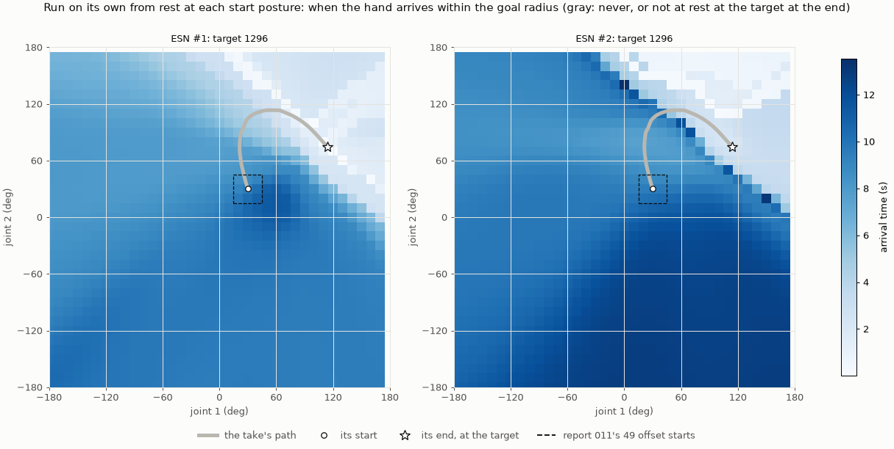

**Figure 1.** When the hand arrives, over the 1,296 start postures, each held for the
1 s warm-up and then released to the ESN on its own. The thick gray line is the take's
joint path, from its start (circle) to the target (star). The dashed square holds the
49 offset starts.

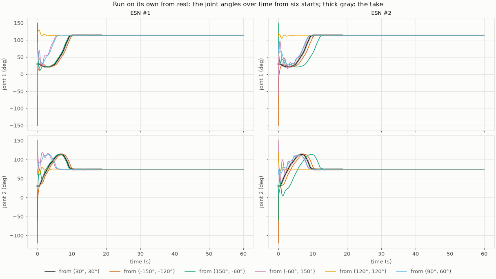

**Figure 2.** The joint angles over the 60 s of the runs from six starts: the take's
start (black), three far from it, and two near the target.

| From the 1,296 starts, median (range) | ESN #1 | ESN #2 | Report 015 |
| --- | --- | --- | --- |
| End at rest at the target | 1,296 | 1,296 | the same |
| Arrival | 8.84 s (0.01 to 11.40 s) | 9.85 s (0.08 to 13.53 s) | the same |
| Join the take's path (within 5° for good) | 1,296, at 1.30 s (up to 2.69 s) | 1,296, at 2.41 s (up to 9.02 s) | the same |
| … at a progress along it of | 0.20 (0 to 1) | 0.02 (0 to 1) | the same |
| The state's move after the warm-up, held to 4 s (of the take's spread) | 0.14 (0.10 to 0.38) | 0.20 (0.14 to 0.47) | the same |

- **The target attracts both ESNs from every start, and holds them.** After 60 s, every
  run still rests within 3 mm of the target: none drifts off once the reach is over
  (Figure 2).
- **Everything else is report 015's:** the first step, where and when the runs join the
  path, the reservoir's convergence onto the take's states, and the arrival's
  dependence on where the run joins.

### 3.2 The warm-up

**Figure 3.** Run with other warm-ups than the trained 1 s: when the hand arrives,
against the arrival with 1 s. The band is the range over the 49 offset starts. The
dotted line is a clock from the reset.

| Arrival, later than with 1 s, median of the 49 offset starts | 0.25 s | 0.5 s | 2 s | 4 s |
| --- | ---: | ---: | ---: | ---: |
| ESN #1 | −0.22 s | +0.08 s | −0.69 s | −0.97 s |
| ESN #2 | +0.22 s | +0.31 s | −0.81 s | −1.17 s |
| A clock from the reset | +0.75 s | +0.50 s | −1.00 s | −3.00 s |

- **The runs are report 015's, row by row,** the 8 of 520 that fail to hold included:
  each starts on the take's path, three quarters of the way along it (ESN #1) or half
  and three quarters (ESN #2).
- **What is left of a clock times the start, and saturates,** as report 015 found:
  held 2 s and 4 s, the ESNs start 0.7 to 0.8 s and 1.0 to 1.2 s sooner, not the 1 s
  and 3 s of a clock.

### 3.3 Pushed along the reach

**Figure 4.** The measures of each pulse of 6 N, over its onset (rows) and direction
(columns), for each arm.

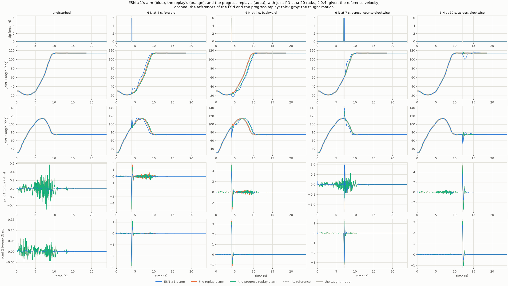

**Figure 5.** ESN #1's arm against the replay's and the progress replay's, undisturbed
and under four pulses of 6 N: forward and backward at 4 s, across at 7 s, and across at
the target at 12 s. Top: the tip force. Then the joint angles, the references dashed,
the take thick gray; and the joint torques.

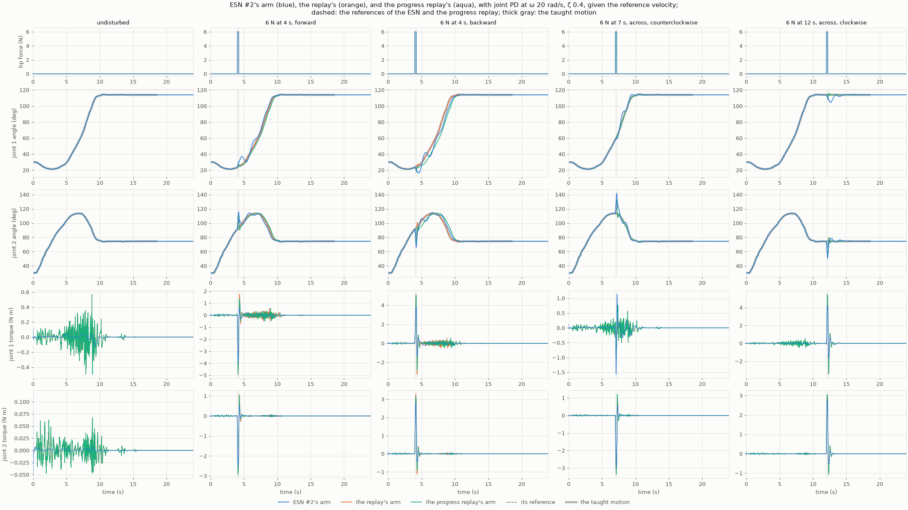

**Figure 6.** The same for ESN #2.

| Over the 80 pulses of 6 N, median (range) | ESN #1 | ESN #2 | replay | progress replay |
| --- | --- | --- | --- | --- |
| Farthest from the path | 70 mm (3 to 229) | 78 mm (4 to 242) | 54 mm (3 to 190) | 58 mm (2 to 211) |
| Back within 5 mm | 1.98 s (0 to 4.75) | 3.00 s (0 to 6.11) | 0.37 s (0 to 0.70) | 0.29 s (0 to 0.76) |
| Arrival, later than undisturbed | +0.05 s (−0.52 to +1.40) | +0.06 s (−0.55 to +1.16) | 0.00 s (−0.01 to +0.12) | +0.12 s (−0.01 to +0.69) |
| Following gain | 0.57 (0.22 to 0.85) | 0.56 (0.27 to 0.84) | 0.00 | 0.04 (0 to 0.90) |
| Peak torque over 2 s, rise | 3.5 N m (1.1 to 8.1) | 3.6 N m (1.2 to 7.8) | 3.6 N m (1.2 to 8.3) | 3.6 N m (1.2 to 8.4) |

At 3 N, the medians are 34, 39, 28, and 27 mm, and back in 1.47, 1.70, 0.24, and
0.24 s. Undisturbed, all four arrive at 9.54 to 9.56 s, the ESNs with a peak torque of
0.17 and 0.12 N m, the replays 0.57 N m.

- **The table is report 015's,** and so are its findings:
  - the ESNs go on from where a pulse leaves them, arriving sooner when pushed forward
    and later when pushed back (Figure 5, the second and third columns);
  - they follow the arm by about half, and come back to the path in seconds, not
    tenths;
  - the peak torque's rise is the push's, alike for every arm;
  - the same six pulsed runs fail, all pulsed at 9 s, just before arriving.
- **Over time, the ESN's arm is the smooth one** (Figures 5 and 6). Undisturbed, its
  torque stays within 0.2 N m; the replays' chatters up to 0.6 N m through the reach.
  After a pulse, the torques of all three arms spike alike. The ESN's arm then moves
  off the take, its reference with it, while both replays' arms snap back.

### 3.4 Where they can rest, and how fast they are drawn there

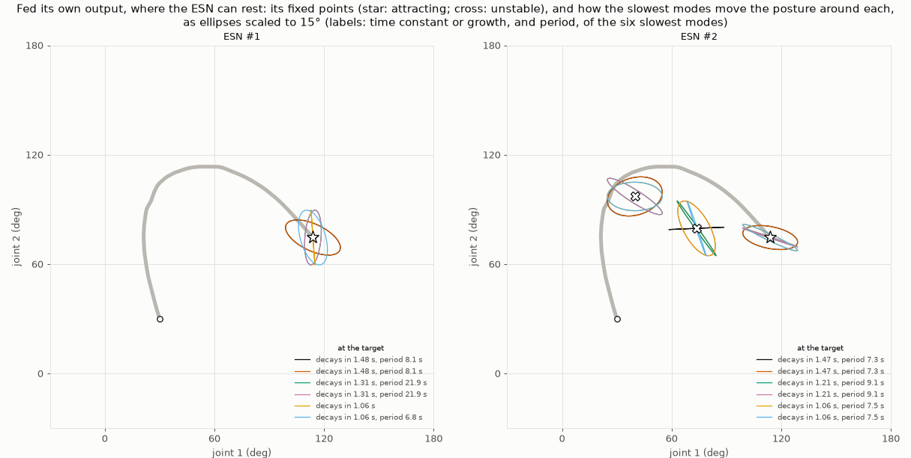

**Figure 7.** The fixed points of each ESN fed its own output (star: attracting;
cross: unstable). The ellipses show how each of the six slowest modes moves the
posture around its fixed point, scaled to 15°.

**Figure 8.** Along the ESN's own run from the take's start, over windows of 0.5 to
4 s starting at each time. Top: the largest rate at which a change of the state across
the run grows (negative: it decays). Bottom: the most a deviation of the output posture
is scaled by the window's end. The dotted line is when the take arrives.

| Fixed points | Posture | Unstable modes | Slowest mode | Found from (of 1,296) |
| --- | --- | --- | --- | --- |
| ESN #1, at the target | (113.96°, 74.59°) | 0 | decays in 1.48 s, period 8.1 s | 1,084 starts, 1,296 ends |
| ESN #2, at the target | (113.95°, 74.57°) | 0 | decays in 1.47 s, period 7.3 s | 985 starts, 1,296 ends |
| ESN #2, beside the path | (39.85°, 97.12°), 12° from it, 0.44 of the way | 2 (\|λ\| = 1.0023, period 7.4 s) | grows | 262 starts |
| ESN #2, inside the bend | (73.66°, 79.61°), 26° from it, 0.79 of the way | 1 (λ = 1.0092) | grows | 41 starts |

| Along the run from the take's start, median over the windows | 0.5 s | 1 s | 2 s | 4 s |
| --- | --- | --- | --- | --- |
| ESN #1, largest rate across the run (1/s) | +3.43 | +1.27 | +0.33 | −0.20 |
| ESN #1, a posture deviation scaled by at most | 0.94 | 0.78 | 0.26 | 0.06 |
| ESN #2, largest rate across the run (1/s) | +2.74 | +1.16 | +0.37 | −0.11 |
| ESN #2, a posture deviation scaled by at most | 0.79 | 0.51 | 0.28 | 0.08 |

- **The fixed points and the rates are report 015's, to the digit.** The runs from rest
  end within 0.03° of where the earlier, shorter runs ended, and Newton's method from
  their ends converges to the same fixed points.
- **So report 015's reading holds for the ESNs the rule chose:**
  - a path into the target, joined from anywhere;
  - a clock left only in when to set off;
  - a path that attracts slowly, after a transient;
  - ESN #2's two unstable fixed points beside the path, ESN #1 none.

### 3.5 The screen

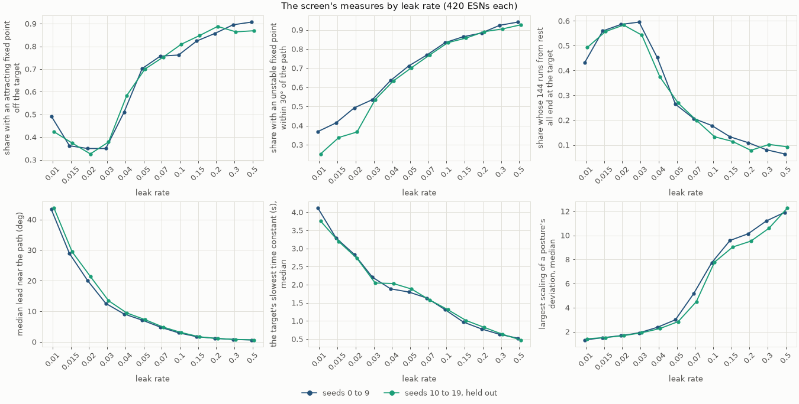

**Figure 9.** The screen's measures by leak rate, of seeds 0 to 9 and of the held-out
seeds 10 to 19, 420 ESNs each.

| Seeds 0 to 9, per leak rate (420 ESNs each) | 0.01 | 0.015 | 0.02 | 0.03 | 0.04 | 0.05 | 0.07 | 0.1 | 0.15 | 0.2 | 0.3 | 0.5 |
| --- | ---: | ---: | ---: | ---: | ---: | ---: | ---: | ---: | ---: | ---: | ---: | ---: |
| An attracting fixed point within the goal | 240 | 298 | 316 | 326 | 322 | 316 | 313 | 315 | 323 | 337 | 352 | 359 |
| An attracting fixed point off the target | 207 | 152 | 147 | 147 | 214 | 295 | 318 | 320 | 346 | 360 | 376 | 381 |
| An unstable fixed point within 30° of the path | 155 | 174 | 207 | 225 | 267 | 299 | 323 | 350 | 363 | 371 | 388 | 395 |
| … released there after 4 s, arriving after 9.58 s or never | 142 | 151 | 181 | 195 | 239 | 260 | 291 | 326 | 358 | 370 | 390 | 397 |
| All 144 runs from rest end at the target | 181 | 235 | 246 | 250 | 190 | 111 | 87 | 75 | 56 | 46 | 34 | 27 |
| Median lead near the path | 43.3° | 28.9° | 20.0° | 12.6° | 9.1° | 7.1° | 4.8° | 3.0° | 1.7° | 1.2° | 0.8° | 0.6° |
| The target's slowest time constant, median | 4.11 s | 3.29 s | 2.84 s | 2.21 s | 1.89 s | 1.80 s | 1.63 s | 1.31 s | 0.97 s | 0.78 s | 0.63 s | 0.52 s |
| Largest scaling of a posture's deviation, median | 1.32 | 1.50 | 1.67 | 1.90 | 2.36 | 2.99 | 5.15 | 7.74 | 9.58 | 10.14 | 11.20 | 11.91 |

| The named ESNs | ESN #1 | ESN #2 | ESN #3 | report 007's |
| --- | --- | --- | --- | --- |
| Fixed points (attracting, unstable) | 1 (1, 0) | 3 (1, 2) | 3 (1, 2) | 3 (1, 2) |
| The target's slowest mode | 1.48 s, period 8.1 s | 1.47 s, period 7.3 s | 1.34 s, period 6.9 s | 1.55 s, period 26.9 s |
| The unstable fixed point nearest the path | none | 12.1°, 0.44 of the way | 24.0°, 0.76 of the way | 31.4°, 0.67 of the way |
| Released after 4 s, the latest arrival | | 20.15 s | 6.65 s | 11.70 s |
| Median lead near the path | 13.7° | 17.3° | 16.5° | 21.7° |
| Largest scaling of a posture's deviation | 2.21 | 1.60 | 2.08 | 1.97 |
| Flagged by | none | (c) | (c) | (c) |
| On the robot (the search) | passes, following 0.79 | passes, following 0.73 | passes, following 0.74 | passes, following 0.69 |

- **Within report 011's range, the measures are report 016's** (Checks), and so is the
  named ESNs' table.
- **The search's wider grid extends the trends at both ends:**
  - The lead falls from 43° at 0.01 to 0.6° at 0.5. A fast-leaking ESN's reference
    stays with an arm held still.
  - The target's slowest time constant falls from 4.1 s to 0.5 s.
  - The posture's scaling rises from 1.3 to 12.
  - Unstable fixed points near the path: 37% of the ESNs at 0.01, 94% at 0.5. Over the
    grid, 70% have one (held out: 67%), against report 016's 77% over its own.
- **Attracting fixed points off the target are fewest at 0.015 to 0.03, not at the
  slowest leak rate.**
  - At 0.01, 49% of the ESNs have one, against 35% to 36% at 0.015 to 0.03. From
    0.05, 70% to 91% do.
  - Their runs from rest do best at 0.015 to 0.03: 56% to 60% of the ESNs end every
    run at the target.
- **At spectral radii of 1.5 and 1.75, the held reservoir does not settle at some
  postures in 752 ESNs** (held out: 916): 676 at 1.75, and 76 at 1.5. There, R is not
  well defined, as report 016 found at 1.75.

### 3.6 Against the robot

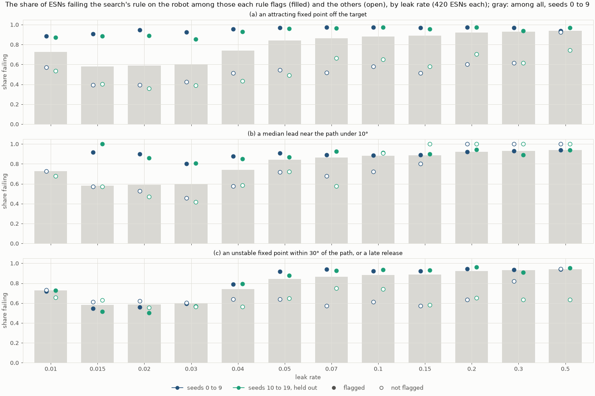

**Figure 10.** The share failing on the robot among the ESNs each rule flags (filled)
and among the others (open), by leak rate, with the share among all of seeds 0 to 9
(gray).

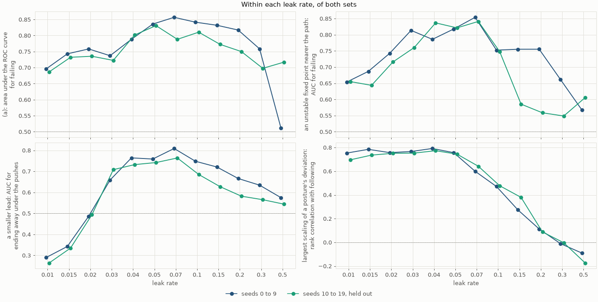

**Figure 11.** Within each leak rate, of both sets: the area under the ROC curve for
failing of (a), and of an unstable fixed point nearer the path; that of a smaller lead
for ending away under the pushes; and the rank correlation of the posture's scaling
with the following.

| Seeds 0 to 9 | Flagged | Its outcome caught | Failing caught (of 3,991) | Passing rejected (of 1,049) | Qualifying rejected (of 110) | Of ESN #1, #2, #3, and report 007's |
| --- | ---: | --- | ---: | ---: | ---: | --- |
| (a) | 3,263 | ending away, 2,526 of 3,057 | 3,117 | 146 | 3 | none |
| (a), only more than 10 cm off | 3,023 | ending away, 2,364 of 3,057 | 2,904 | 119 | 3 | none |
| (b) | 3,201 | ending away, 2,416 of 3,057 | 2,884 | 317 | 0 | none |
| (c) | 3,681 | never arriving, 2,592 of 2,899 | 3,116 | 565 | 72 | #2, #3, report 007's |

| Share failing, flagged / not, seeds 0 to 9 | 0.01 | 0.015 | 0.02 | 0.03 | 0.04 | 0.05 | 0.07 | 0.1 | 0.15 | 0.2 | 0.3 | 0.5 |
| --- | --- | --- | --- | --- | --- | --- | --- | --- | --- | --- | --- | --- |
| (a) | 0.88 / 0.57 | 0.91 / 0.40 | 0.95 / 0.40 | 0.93 / 0.42 | 0.96 / 0.51 | 0.97 / 0.54 | 0.97 / 0.52 | 0.97 / 0.58 | 0.97 / 0.51 | 0.97 / 0.60 | 0.97 / 0.61 | 0.94 / 0.92 |
| (b) | none / 0.73 | 0.92 / 0.57 | 0.90 / 0.53 | 0.80 / 0.46 | 0.88 / 0.58 | 0.91 / 0.72 | 0.89 / 0.68 | 0.89 / 0.72 | 0.89 / 0.80 | 0.92 / 1.00 | 0.93 / 1.00 | 0.94 / 1.00 |
| (c) | 0.72 / 0.73 | 0.54 / 0.61 | 0.56 / 0.62 | 0.60 / 0.61 | 0.79 / 0.64 | 0.92 / 0.64 | 0.94 / 0.57 | 0.92 / 0.61 | 0.92 / 0.57 | 0.94 / 0.63 | 0.94 / 0.82 | 0.94 / 0.94 |
| All | 0.73 | 0.58 | 0.59 | 0.60 | 0.74 | 0.84 | 0.86 | 0.88 | 0.89 | 0.92 | 0.93 | 0.94 |

Of the 3,991 failing ESNs, 3,581 fail from an offset start, 3,057 end away under the
pushes, and 2,899 never arrive in some run; 888 fail from an offset start without
ending away. Among the held-out ESNs, 3,939 fail, and (a) flags 3,283, catching 3,095
of them and rejecting 188 of the 1,101 passing.

| Area under the ROC curve for failing | ESNs (failing) | the leak rate | the lead | (a) | (b) | (c) |
| --- | --- | ---: | ---: | ---: | ---: | ---: |
| Report 016's grid, without the offset starts | 1,050 (430) | **0.749** | 0.736 | 0.721 | 0.717 | 0.599 |
| Report 016's grid, with them | 1,050 (585) | 0.829 | 0.780 | **0.841** | 0.729 | 0.643 |
| The search's grid, without them | 5,040 (3,322) | 0.669 | 0.698 | **0.728** | 0.678 | 0.607 |
| The search's grid, with them (the search's outcome) | 5,040 (3,991) | 0.704 | 0.728 | **0.821** | 0.710 | 0.621 |
| Held out: report 016's grid, without the offset starts | 1,050 (446) | **0.766** | 0.748 | 0.710 | 0.724 | 0.618 |
| Held out: report 016's grid, with them | 1,050 (609) | 0.827 | 0.780 | **0.822** | 0.748 | 0.661 |
| Held out: the search's grid, without them | 5,040 (3,133) | 0.677 | 0.697 | **0.716** | 0.682 | 0.603 |
| Held out: the search's grid, with them | 5,040 (3,939) | 0.720 | 0.738 | **0.807** | 0.724 | 0.634 |

The first and fifth rows are report 016's, to the digit.

| Step 6's claims | Seeds 0 to 9 | Seeds 10 to 19, held out |
| --- | --- | --- |
| 1. (a): at each leak rate, more of the flagged ESNs fail than of the others | **Holds** at all 12: by 0.02 (at 0.5) to 0.55 | **Holds** at all 12: by 0.22 to 0.53 |
| 2. (d): within each leak rate from 0.015 to 0.05, the posture's scaling has a rank correlation of at least 0.5 with the following | **Holds:** +0.78, +0.76, +0.77, +0.79, and +0.76 | **Holds:** +0.74, +0.75, +0.75, +0.77, and +0.74 |
| 3. An unstable fixed point nearer the path tells failing apart within each leak rate (area under the ROC curve above 0.5) | **Holds:** 0.57 to 0.85 | **Holds:** 0.55 to 0.84 |
| 4. Over all the ESNs, no rule's flag, nor the lead, has a larger area under the ROC curve for failing than the leak rate | **Fails:** the leak rate 0.704; (a) 0.821, the lead 0.728, (b) 0.710; (c) 0.621 | **Fails:** the leak rate 0.720; (a) 0.807, the lead 0.738, (b) 0.724; (c) 0.634 |

- **Claim 4 fails twice over.**
  - **The offset starts:** an ESN with an attracting fixed point off the target is
    often drawn to it from a start off the take's. (a) flags 67% of the ESNs that
    fail only from an offset start (669 of seeds 0 to 9, 806 held out), against 14%
    and 17% of the passing ones. Even over report 016's grid, it then beats the leak
    rate (0.84 against 0.83).
  - **The wider grid:** the failing share no longer rises with the leak rate. It is
    0.73 at 0.01, 0.58 to 0.60 at 0.015 to 0.03, and 0.74 to 0.94 above (Figure 10,
    gray). So the leak rate tells less (0.67), and (a), which tracks the failing
    within each leak rate, tells more (0.73), even without the offset starts.
- **(a) tells failing apart at every leak rate,** by 0.27 to 0.55 of the share up to
  0.3 in both sets. At 0.5, among seeds 0 to 9, nearly every ESN fails either way, by
  0.94 against 0.92 (Figure 10, top).
- **(b)'s pattern repeats.** Its area under the ROC curve for ending away is 0.26 to
  0.34 at 0.01 and 0.015, below chance: there, the ESNs that end away lead more. It
  is 0.66 to 0.81 from 0.03 to 0.1, and falls to 0.54 to 0.58 at 0.5 (Figure 11).
- **(c) still flags most ESNs:** 73% of them, and 54% of the passing ones (51% held
  out), ESN #2, #3, and report 007's among them. Up to 0.03, the flagged ESNs fail no
  more often than the others: 0.54 to 0.72 against 0.61 to 0.73.
- **(d): the posture's scaling ranks the following up to 0.07,** by 0.60 to 0.79 in
  both sets. Its link fades with the leak rate: +0.47 at 0.1, +0.27 to +0.38 at 0.15,
  and −0.17 to +0.11 from 0.2 (Figure 11). The rate across the run correlates with the
  following −0.51 over the grid, but by −0.18 to +0.21 within each leak rate above
  0.01.
- **The release arrival tells the block's arrival little:** a rank correlation of
  +0.32 over the grid (held out: +0.36), +0.06 to +0.41 within a leak rate.

### 3.7 Held still on the robot

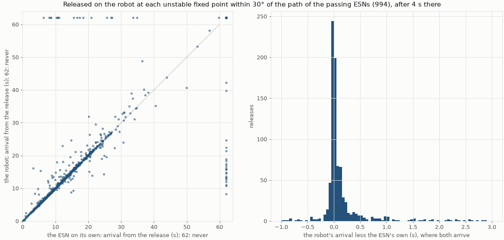

**Figure 12.** Left: the robot's arrival after a release at an unstable fixed point,
against the ESN's own after the same hold; never within 60 s is drawn at 62 s. Right:
the robot's arrival less the ESN's own, where both arrive.

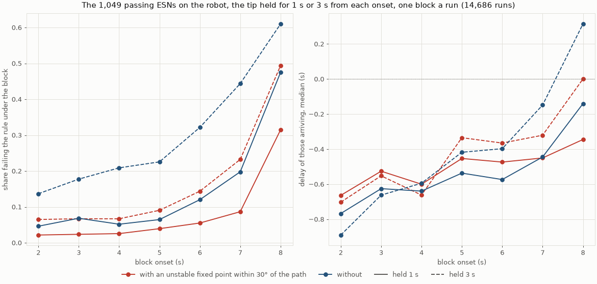

**Figure 13.** The 1,049 passing ESNs under blocks along the reach. Left: the share
failing the rule under a block, by onset. Right: the median delay of those arriving, by
onset. With an unstable fixed point within 30° of the path, 508 ESNs; without, 541.

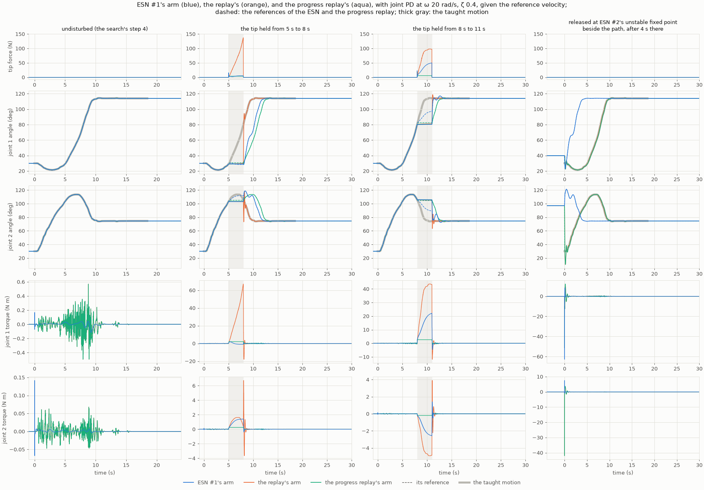

**Figure 14.** ESN #1's arm against the replay's and the progress replay's: undisturbed
(the search's step 4), the tip held from 5 s to 8 s and from 8 s to 11 s, and released at
ESN #2's unstable fixed point beside the path after 4 s there. Top: the tip force. Then
the joint angles, the references dashed, the take thick gray; and the joint torques,
each column on its own scale.

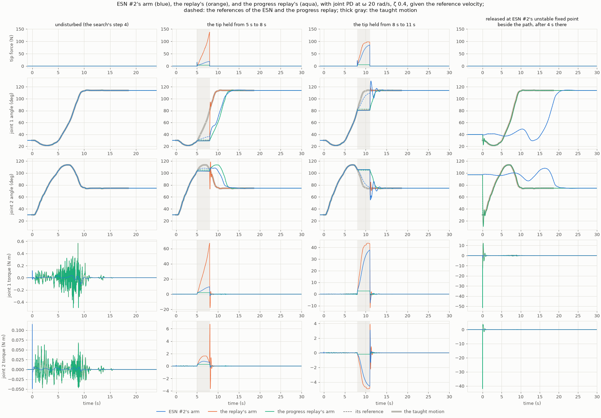

**Figure 15.** The same for ESN #2.

| Released at 994 unstable fixed points (508 ESNs) | Leak rates 0.01 to 0.1 | Leak rates 0.15 to 0.5 |
| --- | --- | --- |
| Releases | 750 | 244 |
| Both the robot and the ESN on its own arrive | 725: the robot a median +0.05 s later (90th percentile +0.20 s); within 0.25 s at 90%; rank correlation +0.996 | 164: a median +0.42 s later (90th percentile +4.19 s); within 0.25 s at 30%; rank correlation +0.947 |
| Only one of them arrives | 1 | 40: only the robot, 21; only the ESN on its own, 19 |
| The arm stays within 1° of the fixed point for 60 s | 2 | 45 |

Over all 994, where both arrive (889), the rank correlation is +0.982. The robot never
arrives within 60 s at 83 releases, in 47 ESNs, 3 of them in qualifying settings; their
fixed points lie a median 0.58 of the way along the path.

| Blocks, failing the rule | held 1 s | held 3 s |
| --- | ---: | ---: |
| With an unstable fixed point within 30° of the path (508 ESNs) | 8.1% | 16.6% |
| Without (541 ESNs) | 14.6% | 30.3% |
| From 2 to 5 s | 3.4% to 5.2% | 10.2% to 16.0% |
| From 8 s | 39.8% | 55.4% |
| The delay of those arriving, median (10th to 90th percentile) | −0.54 s (−0.90 to +0.44) | −0.42 s (−1.36 to +1.71) |

| Shown runs: arrival (peak torque over the block or the run) | ESN #1 | ESN #2 | replay | progress replay |
| --- | --- | --- | --- | --- |
| Undisturbed | 9.55 s (0.2 N m) | 9.54 s (0.1 N m) | 9.56 s (0.6 N m) | 9.56 s (0.6 N m) |
| Tip held from 5 s to 8 s | 11.73 s (1.8 N m) | 12.85 s (9.7 N m) | 9.56 s (67.1 N m) | 12.44 s (2.4 N m) |
| Tip held from 8 s to 11 s | 11.24 s, leaves the goal (22.1 N m) | 12.33 s, leaves the goal (37.8 N m) | 11.30 s, leaves the goal (43.6 N m) | 12.49 s (3.5 N m) |
| Released at ESN #2's unstable fixed point | 3.86 s (62.8 N m) | 20.16 s (2.0 N m) | 9.56 s (51.5 N m) | 9.64 s (51.5 N m) |

| Step 7's claims | Result |
| --- | --- |
| 1. Released, where both arrive, the robot's arrival has a rank correlation of at least 0.9 with the ESN's own | **Holds:** +0.982 over 889 releases; +0.996 up to a leak rate of 0.1, +0.947 above |
| 2. Under the blocks, the ESNs with an unstable fixed point within 30° of the path fail no more often than those without | **Holds:** 8.1% against 14.6% held 1 s, 16.6% against 30.3% held 3 s |
| 3. The delay after a block has a negative rank correlation with the distance to the nearest unstable fixed point | **Holds, barely:** −0.10 held 1 s, −0.05 held 3 s |

- **Released, the robot does what the ESN does on its own, up to a leak rate of 0.1.**
  There the claim holds as report 016 found it: 90% of the releases within 0.25 s.
  At 0.15 to 0.5 the two part:
  - at 40 of 244 releases only one of them arrives;
  - the arm stays at the fixed point for the whole 60 s at 45, where report 016 saw
    it stay at 4 of 810;
  - where both arrive, the robot is a median 0.42 s later, and 4.2 s or more at the
    90th percentile.
- **The offset starts already catch most of the ESNs that never arrive from there.**
  - Report 016 found 86 passing ESNs that never arrive after a release, their unstable
    fixed points at the path's start. Of them, 75 fail the search's rule from an
    offset start, and 11 pass it.
  - Of the 1,049 passing ESNs, 47 never arrive after a release, at 83 releases. Their
    fixed points lie further along the path, a median 0.58 of the way. 34 of the 47
    also have an attracting fixed point off the target; 29 are at leak rates of 0.15
    or more.
  - Three are in the qualifying settings: (0.015, 1.2, 2, seed 4), (0.03, 1.35, 1,
    seed 5), and (0.03, 1.35, 1.5, seed 2). None of the named ESNs is among them.
- **Unstable fixed points near the path do not make the blocks fail.**
  - The ESNs with one fail less often, at either hold and at every onset (Figure 13,
    left). Within each leak rate from 0.01 to 0.07 too. From 0.1 up, those with one
    fail more often, 1% to 17% against 0% to 6%, among 1 to 26 ESNs of each kind.
  - What fails is a late block: most failing runs (2,540 of 2,580) arrive and then
    leave the goal or do not hold, most of them under the blocks from 7 s and 8 s.
    So do ESN #1, ESN #2, and the replay under the block from 8 s to 11 s (Figures
    14 and 15). The progress replay holds there.
- **The delay grows little near an unstable fixed point, and not at fast leak rates.**
  - Its rank correlation with the distance is −0.09 to −0.23 within each leak rate
    from 0.015 to 0.05, held 1 s, as report 016 found within its range. It is +0.14
    to +0.39 at 0.1 to 0.3.
  - The lead at the held posture tells more: −0.42 over all, held 1 s, and −0.23 to
    −0.67 within each leak rate.
  - The median delay is negative, −0.5 s held 1 s and −0.4 s held 3 s: released, the
    arm reaches the target sooner than the take would from where it was held.
- **The shown runs of ESN #1, ESN #2, and the replay are report 016's, to the digit**
  (Figures 14 and 15):
  - Under the block from 5 s to 8 s, ESN #1 presses with 1.8 N m and ESN #2 with
    9.7 N m, against the replay's 67 N m. The progress replay waits as well, with
    2.4 N m.
  - Released at ESN #2's unstable fixed point, ESN #2 lingers and turns slowly with its
    unstable pair, and arrives after 20.2 s, with 2 N m. ESN #1 jumps and arrives in
    3.9 s, with 63 N m.
  - Both replays jump to the take's start and replay it, with 52 N m.

## 4. The study's claims

The main claims of reports 011 to 016, against reports 017 to 019 under one protocol.
**Confirmed:** the protocol's runs show it again, in the earlier report's terms.
**Confirmed in part:** they show it where the earlier report tried it, and not
everywhere the protocol tried. **Changed:** they show otherwise. **Not tested:** the
protocol did not try it.

| Report | Claim | Under one protocol | Verdict |
| --- | --- | --- | --- |
| 011 | The following gain hardly depends on the tracker | 0.73 to 0.81 with all nine trackers, computed torque included (018) | Confirmed |
| 011 | Following trades against completing the task: it rises with the leak rate, but at 0.04 and above no setting keeps the target; 11 settings qualify, at 0.015 to 0.03 | The same 11 settings qualify, with the same medians, with the offset starts counted and over 504 settings; the wider grid adds none; the leak rate ranks the following by +0.86 (017, 019) | Confirmed |
| 011 | ESN #1 and ESN #2, chosen by hand in the app | The rule, written as code, chooses the same two; on held-out seeds, ESN #2's setting ranks first and ESN #1's passes 9 of 10 (017) | Confirmed |
| 011 | With the six joint PD trackers both ESNs arrive and hold, from the 49 offset starts too; they ring less than the replay after the block, and after a push when lightly damped; they press on the block with a sixth of its torque; from an offset start, half its torque | Every run of every tracker completes the task, and the joint PD runs repeat report 011's to the digit; with computed torque, the ESNs ring a quarter of the replay's or less after the block, and as much after a push (018) | Confirmed |
| 011 | The cost of following is the return | 92 to 141 mm from the path and back in 2.7 to 4.3 s, against the replays' 43 to 76 mm and 0.1 to 0.8 s, with every tracker (018) | Confirmed |
| 012 | The ESNs follow pushes by hand as the scripted ones, by about 0.7 | 0.68 to 0.75 with every tracker (018) | Confirmed |
| 012 | Every run reaches the target, but under log 001, given a zero velocity, the ESNs arrive late | Every run completes the task; under log 001 at ζ = 0.8, given a zero velocity, ESN #2 arrives at 21.5 s (018) | Confirmed |
| 012 | A strong push backward can carry a following reference back along the reach | Under log 001, given a zero velocity, ESN #1 at every damping ratio and ESN #2 at 0.8 (018) | Confirmed |
| 012 | After pushes by hand the ESNs ring less only with light damping | 75% to 88% of the replay's at ζ = 0.2, 89% to 116% otherwise (018) | Confirmed |
| 012 | The cost of following is the return | Back in 2.7 to 4.1 s against 0.1 to 0.8 s (018) | Confirmed |
| 013 | With equal gains, the held torque chatters unless kd < 2μ/T − kpT/10 | The protocol keeps joint PD with each joint's gains scaled by its inertia | Not tested |
| 013 | kp = 80 and kd = 1.2 keep the arm on the path under pushes, at the cost of joint 1's light damping | The same | Not tested |
| 014 | Undisturbed and from the offset starts, the progress replay is the replay | With report 014's trackers, to the digit; with joint PD at ζ = 0.8 given a zero velocity the arm trails, and the progress replay waits, arriving at 9.99 s against 9.66 s; from the offset starts, with the other joint PD trackers, it arrives later from up to 48 starts, by 0.46 s at most (018) | Confirmed in part |
| 014 | Under the block, the progress replay waits as the ESNs do | It needs 1.3 to 1.6 N m s more than undisturbed, the ESNs 1.1 to 1.9, the replay 6.7 to 8.7, with every tracker (018); it waits under both blocks shown here (019) | Confirmed |
| 014 | Under a push across the path it is the replay; under a push back, it falls back | It follows the scripted pushes by 0.23 to 0.25 (018), and the pulses by 0.04 in the median, up to 0.90, against the ESNs' 0.56 to 0.57 (019) | Confirmed |
| 014 | What the ESNs keep: half the replays' peak torque from an offset start, and they yield across the path as well as along it | 49% to 54% of it with joint PD, 59% to 70% with computed torque (018); they follow the pulses in every direction (019) | Confirmed |
| 014 | Falling back has a cost: under log 001 the progress replay is sent seconds of the take back | Repeated to the digit; it rings most of the three arms under the pushes by hand, up to 22 mm (018) | Confirmed |
| 015 | The target attracts both ESNs from every start posture | All 2 × 1,296 runs rest at the target, now over 60 s (019, step 1) | Confirmed |
| 015 | Each ESN has one attracting fixed point, at the target; ESN #2 has two unstable ones beside the path, ESN #1 none | The same files, byte for byte (019, step 4) | Confirmed |
| 015 | From far away, an ESN jumps first, then joins the take's path and follows it | Every measure the same (019, step 1) | Confirmed |
| 015 | Along the path, the ESNs time the reach by where they are on it: a pulse shifts the arrival by the time it costs | The same runs and measures (019, step 3) | Confirmed |
| 015 | The warm-up leaves a clock in when the reach starts, and it saturates | The same runs, row by row (019, step 2) | Confirmed |
| 015 | The path attracts slowly, after a transient: rates of −0.20 and −0.11 /s over 4 s windows; back within 5 mm in 2.0 and 3.0 s after 6 N | The same (019, steps 3 and 4) | Confirmed |
| 016 | Across the grid, the screen tells no more than the leak rate | With the offset starts counted, or over the wider grid, (a) tells more: 0.82 and 0.81 against 0.70 and 0.72; the lead too (019, step 6) | Changed |
| 016 | Within a leak rate it tells: (a), an unstable fixed point nearer the path, and the posture's scaling for the following | At all 12 leak rates, in both sets; the posture's scaling up to 0.07, fading above (019, step 6) | Confirmed |
| 016 | Unstable fixed points near the path are the rule: rule (c) rejects most passing ESNs, ESN #2's among them | 70% of the ESNs have one; (c) rejects 54% of the passing, ESN #2, #3, and report 007's among them (019, step 6) | Confirmed |
| 016 | Under blocks, ESNs with an unstable fixed point near the path fail no more often, and are delayed only a little more near one | They fail less often; the delay grows a little near one at leak rates 0.015 to 0.05, and not at 0.1 to 0.3 (019, step 7) | Confirmed in part |
| 016 | Released at an unstable fixed point, the robot does what the ESN does on its own | Up to a leak rate of 0.1 (rank correlation 0.996); at 0.15 to 0.5, they part at 40 of 244 releases, and the arm stalls at 45 (019, step 7) | Changed |
| 016 | Some passing ESNs, 86 of them, never arrive after a release, their fixed points at the path's start; report 011's scenarios never probed it | The offset starts catch 75 of them; 47 passing ESNs never arrive, their fixed points further along the path (019, step 7) | Changed |

- **Every claim about the chosen ESNs stands.** Reports 011, 012, 014, and 015 studied
  ESN #1 and ESN #2, which the rule chooses again. Their runs repeat to the digit
  wherever the earlier reports ran them. What the protocol adds, the other trackers
  and the longer runs, confirms what they found.
- **What changes is the screen's,** and it changes with the outcome it predicts.
  Report 016 scored the screen against an outcome without the offset starts, over a
  grid narrower than the search's. Counting the offset starts favours the screen's
  clearest signal, an attracting fixed point off the target. They also remove most of
  the ESNs that the release scenario was to catch.

## 5. Observations

- **A rule fixed before the runs reproduces the study's choices.** Report 017's rule
  chose the ESNs that reports 011 to 016 had studied. So reports 015's and 016's
  analyses of them hold as they were, and this report finds the same fixed points,
  rates, and timings to the digit.
- **An attracting fixed point off the target is the screen's best predictor.**
  - From the screen alone, (a) catches 78% of the failing ESNs and rejects 14% of the
    passing (held out: 79% and 17%). It rejects 3 of the 110 qualifying ESNs (2 of 80).
  - It works because a start off the take's path finds the fixed point the ESN can rest
    at instead of the target: two-thirds of the ESNs that fail only from an offset
    start have one.
  - Most failing ESNs fail from an offset start (3,581 of 3,991), and report 016 did
    not count those. So the screen could stand in for much of the search's costliest
    scenario: the 49 offset starts took 22.0 of its 23.5 h.
- **The fast leak rates are a different regime.** From 0.15, the lead is under 2°: the
  ESN's reference stays with a held arm. The posture's scaling no longer ranks the
  following. And on the robot, a release at an unstable fixed point no longer does what
  the ESN on its own does. None of these ESNs qualify; the search's wider grid finds
  nothing there, and none of report 016's findings that rest on leak rates up to 0.1
  extend to them without a check.
- **Unstable fixed points near the path stay harmless under the scenarios tried.** The
  ESNs with one fail the blocks less often, not more, and are delayed little near it.
  Released at one, 47 passing ESNs never arrive, but the search's scenarios never stop
  an arm there.

## 6. Next steps

1. **The screen before the offset starts:** reject the ESNs flagged by (a) before
   running them from the 49 offset starts. Count what the search would then have run,
   and whether it would still choose ESN #1 and ESN #2. Report 017's runs hold
   everything needed to score this without new runs.
2. **The release at fast leak rates:** why the robot stalls where the ESN on its own
   leaves, at leak rates of 0.15 and more. The closed loop of the ESN and the tracked
   arm has fixed points of its own; its linearization, the ESN's map with the
   tracker's lag, would say whether they are stable.
3. **The release as a scenario:** 47 passing ESNs, three in qualifying settings, never
   arrive after 4 s at rest at an unstable fixed point near the path. A block of a few
   seconds there, added to the robot scenarios, would test them as the rule tests the
   rest.
4. **Report 015's open steps remain:** a warm-up that lets the held reservoir settle,
   training on states off the path for a faster return, and a first step blended from
   the arm's posture.
