# 020 The ESN and the robot as one dynamical system

**Summary.** [Report 019](../019-dynamics-under-one-protocol/README.md) read the chosen
ESNs as dynamical systems on their own, fed their own output. On the robot they are fed
the arm's measured posture instead, and the arm follows them through the tracker. This
report reads the ESN and the robot as one system: every 10 ms, its state is the
reservoir's 400 values and the arm's two joint angles and two velocities, and nothing
else carries over. Its fixed points are the ESN's own, the arm at rest at their postures;
what the arm can change is how they attract. Report 019's analyses run again with the
arm in the loop:

- report 015's runs from rest anywhere (its Figures 2 and 4), on the robot;
- ESN #1's and ESN #2's fixed points, rates, and pulses, with the arm;
- every fixed point of report 019's screens with the arm, set against its releases and
  its outcomes on the robot.

Every step and claim of steps 1 to 3 was fixed in the
[experiment's README](../../experiments/manual_demonstration_v2_consistent_robot_loop/README.md)
before their runs. Steps 4 and 5 were added after them, to check two measures.

The findings:

- **The ESN and the robot are one system, and the map reproduces the robot.** Its
  one-step error along a run is 2 × 10⁻¹⁴, undisturbed and pushed. The ESNs' fixed points
  are its fixed points to 10⁻¹³.
- **From rest anywhere, the robot does what the ESN does on its own.** From all 1,296
  starts, both ESNs bring the arm to rest at the target. Every run joins the take's path,
  and the robot's arrival has a rank correlation of 0.94 and 0.97 with the ESN's own. From
  the starts near the path, 95% arrive within 0.25 s of the ESN's own.
  - The ESN's first output from a far start still jumps, a median 79° to 84°. The arm
    cannot jump: joint PD turns the jump into a kick of up to 1,011 N m and 23,000°/s,
    far beyond a real arm's.
- **At the chosen ESNs' leak rate of 0.03, the arm changes almost nothing.** Every fixed
  point keeps its stability, and the slowest growth rates move by about 1%. The arm adds
  its own four modes, which decay at 7 to 21 /s.
- **From a leak rate of 0.1 up, the arm slows the system and turns some attracting fixed
  points unstable.** At 0.5, the median growth rate shrinks to 0.81 of the ESN's own, and
  151 and 134 attracting fixed points (16% to 18%) become unstable. The reverse is rare,
  6 or fewer at each leak rate. Where the arm turns the target itself unstable (17
  ESNs), none passes on the robot.
- **Rule (a) taken with the arm predicts failing less well than on the ESN's own:**
  0.78 against 0.82 (held out: 0.77 against 0.81).
  - Most of the difference is the attracting fixed points beyond the arm's joint stops,
    where the ESN on its own can rest but the arm cannot. The ESNs with one fail at 97%.
  - Among the fixed points within the stops, the arm changes the score by 0.005 or less.
- **The arm does not stay put at report 019's releases because the system attracts
  there.** No released fixed point attracts with the arm.
  - Most of the 47 releases where the arm stayed the whole 60 s rest on the fixed point
    to the last bit. Held 4 s at a fast leak rate, the reservoir settles on it exactly,
    and the simulation adds nothing that could grow.
  - Run again 10⁻⁹° off the fixed point (step 4), 41 of them leave, after 4 to 59 s. How
    soon has a rank correlation of −0.95 with the growth rate.
- **With that removed, report 019's finding stands, smaller.** Up to a leak rate of 0.1,
  nudged, the robot still arrives within 0.25 s of the ESN on its own at 90% of the
  releases. From 0.15:
  - only one of the two arrives at 26 releases, down from 40;
  - the robot is a median 0.50 s later, and the rank correlation is 0.91.
- **Of the 8 claims, 5 hold and 3 do not (Section 4).** Step 2's claim on the rates along
  the run fails as stated, but a weighing test (step 5) shows the measure cannot decide
  it. Step 3's claims on the releases hold as stated, but the stays they rank are mostly
  exact rests.

## 1. Question

Report 019 found that, released at an unstable fixed point, the robot does what the ESN
does on its own only up to a leak rate of 0.1.

1. Can the ESN and the robot be read as one dynamical system, and what does its state
   hold?
2. From rest anywhere, does the robot do what the ESN does on its own (report 015's
   Figures 2 and 4, report 019's Section 3.1)?
3. How does the arm change where the system can rest, how fast it is drawn there, and
   how it answers a push?
4. Over every fixed point of the screens, where does the arm change how they attract?
   Does that tell the releases and the failures on the robot apart better than the ESN
   on its own does?

## 2. Setup

### The system

On the robot, every 10 ms the ESN is fed the arm's measured joint angles q and gives the
next posture. Joint PD computes its torque from the reference's segment, which runs from
the ESN's last output to its new one, and holds it for the period. The arm moves under
it. Sampled at those instants, the state

  z = (x, q, q̇)

holds everything that carries over: the reservoir's 400 values x, and the arm's two joint
angles and two velocities. The reference's last point is the ESN's output from x, joint
PD keeps no state, and the arm moves in a plane without gravity. The map is

  x' = F(x, u(q)),
  τ = K_p (P(x) − q) + K_d ((P(x') − P(x)) / Δ − q̇),
  (q', q̇') = the arm's motion over Δ = 10 ms under τ, five steps of 2 ms,

where F is the reservoir's update fed a posture, u(q) the joint angles normalized as the
ESN's input, and P(x) the posture the ESN gives from x
([`RobotLoop`](../../src/arm_esn_ctrl/dynamics.py)). Nothing in it depends on time; the
pushes and the blocks are forces from outside.

- **Its fixed points are the ESN's own.** At rest, q̇ = 0 and the arm needs no torque, so
  P(x) = q: the arm rests where the ESN points. The ESN is then fed its own output, so x
  is a fixed point of the ESN on its own. Every fixed point reports 015 to 019 found is
  one of the system's, the arm at rest at its posture, if that posture lies within the
  arm's joint stops at ±180°. With the arm at rest, there are no others.
- **How they attract is the system's Jacobian:** the ESN's 400 modes, coupled to the
  arm, and the arm's own four. The ESN's part is analytic; the arm's motion over a period
  is taken by central differences. The map reproduces the robot's runs to 10⁻¹² and
  better, undisturbed, under a held force, and under a pulse that starts within a period
  (tests in [`test_dynamics.py`](../../tests/test_dynamics.py)).
- **The rates along a run** ([`local_rates`](../../src/arm_esn_ctrl/dynamics.py)) need a
  size for a change of the state, whose values are of three kinds. The joint angles are
  weighed as the ESN's input, normalized by the half range of its training postures. The
  joint velocities are weighed by how far they move them in a period. The eigenvalues do
  not depend on this; the rates over windows of seconds do (Section 3.5).

**The ESNs:** report 017's ESN #1 and ESN #2, and every ESN of its search, as report 019
read them:

| | ESN #1 | ESN #2 | The search's grid |
| --- | --- | --- | --- |
| Leak rate | 0.03 | 0.03 | 0.01, 0.015, 0.02, 0.03, 0.04, 0.05, 0.07, 0.1, 0.15, 0.2, 0.3, 0.5 |
| Spectral radius | 1.2 | 1.2 | 0.7, 0.9, 0.99, 1.2, 1.35, 1.5, 1.75 |
| Input scaling | 1.5 | 1 | 0.1, 0.2, 0.5, 1, 1.5, 2 |
| Seed | 8 | 2 | 0 to 9 (5,040 ESNs); 10 to 19 (5,040 held out) |
| Fixed | 400 tanh neurons, sparsity 0.05, a bias drawn from [−1, 1] and not scaled, ridge 10⁻², a 1 s warm-up, a 10 ms period | the same | the same |
| Training | teacher forcing on the take (`demo_00_filtered` of `results/demonstrations/20261008-170034-reach_manual_v2`, untrimmed, filtered at 2 Hz), without noise | the same | the same |

**The tracker:** the search's, joint PD at ω = 20 rad/s and ζ = 0.4, given the
reference's velocity, its torque computed every 10 ms and held. Its gains, set at the
take's end posture, are K_p = (74.96, 8.96) N m/rad and K_d = (3.00, 0.36) N m s/rad.

### The steps

| Step | What it does | Against |
| --- | --- | --- |
| 1. From rest anywhere, on the robot ([`robot_starts.py`](../../experiments/robot_starts.py)) | each ESN driving the arm from rest at 1,296 start postures every 10°, the arm held there through the 1 s warm-up, for 60 s | report 019's step 1, the ESN on its own |
| 2. ESN #1 and ESN #2 with the arm ([`robot_fixed_points.py`](../../experiments/robot_fixed_points.py)) | the system's eigenvalues at report 019's fixed points; the rates along the robot's run from the take's start; report 019's pulses, predicted by the system's Jacobians along the undisturbed run | report 019's steps 3 and 4 |
| 3. Every fixed point of the screens with the arm ([`screen_robot_loop.py`](../../experiments/screen_robot_loop.py)) | the system's eigenvalues at each fixed point of both screens within the arm's stops; how long the arm stays after report 019's releases; rule (a) with the arm | report 019's steps 5 to 7 |
| 4. The releases, nudged ([`nudge_releases.py`](../../experiments/nudge_releases.py)), added after the claims | report 019's 994 releases again, from 10⁻⁹° off the fixed point, on the robot and on its own | report 019's step 7 |
| 5. The rates, weighed otherwise ([`robot_rates_weighed.py`](../../experiments/robot_rates_weighed.py)), added after the claims | step 2's rates along the robot's run, the joint angles and velocities weighed 0.1 to 100 times more | step 2 |

The screens keep each fixed point's posture, not its state. Step 3 finds the state again:
the held reservoir's fixed point at the posture from the reset; else as the screen found
it, by Newton's method on R from the grid's cells around the posture; else from random
states. A state is kept only if it gives the screen's posture and growth rate.

**The claims,** fixed in the experiment's README before the runs:

- step 1, for each ESN:
  1. from each of the 1,296 starts, the arm ends at rest at the target;
  2. every run joins the take's joint path for good (within 5°);
  3. where both the robot and the ESN on its own arrive, their arrivals have a rank
     correlation of at least 0.9;
- step 2, for each ESN:
  1. each of its fixed points, the arm at rest at its posture, is a fixed point of the
     system (a residual of 10⁻¹² or less), with as many unstable modes as on its own;
  2. over the 2 s and 4 s windows, the median of the largest rate across the robot's run
     is within 0.1 /s of that along the ESN's own run;
- step 3:
  1. at the releases at leak rates 0.15 to 0.5, how long the arm stays has a more negative
     rank correlation with the growth rate with the arm than with the growth rate on its
     own;
  2. over all the releases, the growth rate with the arm tells the releases where the arm
     stays the whole 60 s from the others with a larger area under the ROC curve than the
     growth rate on its own;
  3. rule (a) with the arm has an area under the ROC curve for failing at least that of
     rule (a) on its own, in both seed sets.

**What was seen before the plan,** to check that the system can be read this way and to
write and time the scripts (the experiment's README lists it):
- ESN #2's three fixed points with the arm;
- 30 fixed points of six ESNs with ESN #2's other settings, ESN #2 among them, and 11 of
  two others, none changing stability;
- ESN #2's 16 pulses at 4 s, linearized, with errors growing with the force;
- two runs of step 1.

So step 2's pulses are described, not claimed. No release, outcome on the robot, or area
under the ROC curve was computed with the arm before the plan.

### Reproducing the results

The runs read report 019's runs under the storage root, and train the screens' ESNs again
as the screens trained them. All configurations are in
[`manual_demonstration_v2_consistent_robot_loop`](../../experiments/manual_demonstration_v2_consistent_robot_loop/README.md).

| Runs | Command | Commit |
| --- | --- | --- |
| `20261102-112847-robot_fixed_points` | `uv run python experiments/robot_fixed_points.py experiments/manual_demonstration_v2_consistent_robot_loop/robot_fixed_points.toml` | `1b6d2f2` |
| `20261102-122820-robot_starts` | `uv run python experiments/robot_starts.py ... robot_starts.toml --workers 30` | `1c58c9f` |
| `20261102-132045-screen_robot_loop`, `-132553-nudge_releases`, `-133837-robot_rates_weighed` | `uv run python experiments/<script>.py ... <name>.toml --workers 30` (step 5: 12) | `935e276` |
| [`summary`](results/summary) | `uv run python reports/020-the-esn-and-the-robot-as-one-system/make_figures.py` | |

**Steps 1 and 3 ran more than once.** Their first runs, at `1b6d2f2`, did not stand:

- **Step 1** (`20261102-112847-robot_starts`) ran every start but stopped on printing a
  measure of report 019's step 1 that it does not take. It wrote only ESN #1's files,
  identical to the second run's.
- **Step 3's first run** (`20261102-121258-screen_robot_loop`) took each state from the
  reset alone. That gave another fixed point for 329 and 317 of the screens' fixed
  points, nearly all at a spectral radius of 1.75, where the held reservoir has several
  fixed points at a posture.
- **Its second run** (`20261102-122257-screen_robot_loop`, at `1c58c9f`) found the states
  as above. But it took the 818 and 668 fixed points beyond the arm's stops as the
  system's, with the eigenvalues of a clamped arm.
- **The two runs printed scores of the claims:** rule (a) with the arm 0.818 and 0.816
  against 0.821 (seeds 0 to 9), and 0.804 and 0.805 against 0.807 (held out). The release
  scores were within 0.03 of the third run's.
- **The third run** (`20261102-132045-screen_robot_loop`, at `935e276`) leaves those
  fixed points out (`84d18cc`).

All three runs are kept under the storage root.

**Running time,** on an i9-14900KF: step 1, 50 min on 30 processes (8.8 s a run); step 2,
37 min on one; step 3, 5.1 min on 30; step 4, 12.7 min on 30; step 5, 2.1 min on 12.

**Checks.** [`make_figures.py`](make_figures.py) runs them all:
- **The first step:** the reference's first step on the robot is the ESN's own first
  step to 2 × 10⁻¹¹°. Through the warm-up the ESN is fed the same held posture.
- **The robot's runs:** step 2's run from the take's start is report 019's undisturbed
  pulse run to 6 × 10⁻⁸ rad (its float32 copy), and the map's to 2 × 10⁻¹⁴.
- **The eigenvalues on its own** are report 019's to 2 × 10⁻¹⁴.
- **The states found again,** in each screen:
  - from the reset: 17,545 and 18,170;
  - from the cells: 262 and 231;
  - from random states: 43 and 40;
  - not found: 28 and 36.
  At the 17,032 and 17,773 within the stops, the system's residual is at most 1.2 × 10⁻¹³.
- **Step 5:** at the planned weighing it gives step 2's rates to 4 × 10⁻¹⁶ /s.

**What is kept here.** Every run record (`run.toml`) shows no uncommitted changes. Each
run directory here holds its configuration, run record, and CSV files, 12 MB in all. The
arrays stay under the storage root: step 1's runs (`runs_<ESN>.npz`), and step 2's
spectra, rates, and pulses. [`make_figures.py`](make_figures.py) reads them there,
together with report 019's runs, copies the rest into [`results`](results), prints the
tables of Section 3, and draws the figures. It draws with report 015's own
[`make_figures.py`](../015-what-the-esns-learned/make_figures.py)'s helpers, pointed at
these runs and at report 019's.

## 3. Results

### 3.1 From rest anywhere, on the robot

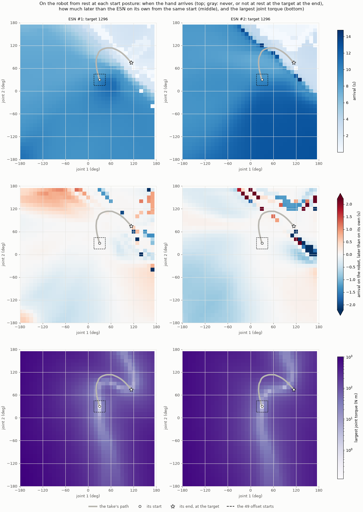

**Figure 1.** From rest at each of the 1,296 start postures, on the robot. Top: when the
hand arrives. Middle: how much later than the ESN on its own from the same start
(report 019's Figure 1). Bottom: the largest joint torque. The thick gray line is the
take's joint path; the dashed square holds the 49 offset starts.

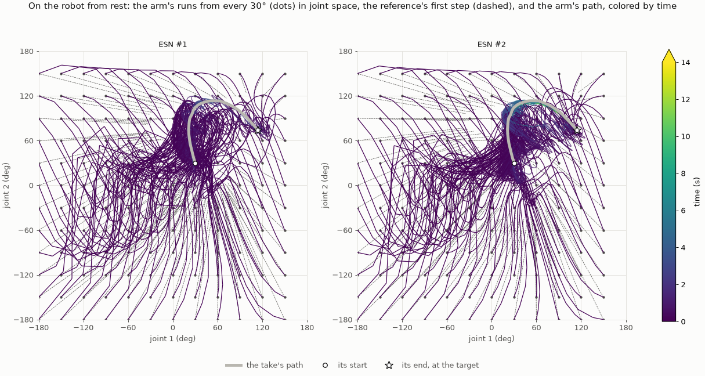

**Figure 2.** The arm's runs from every 30° in joint space: from the start posture (dot),
the reference's first step (dashed), and the arm's path, colored by time. Report 019's
Figure 2 shows the same starts on the ESN's own.

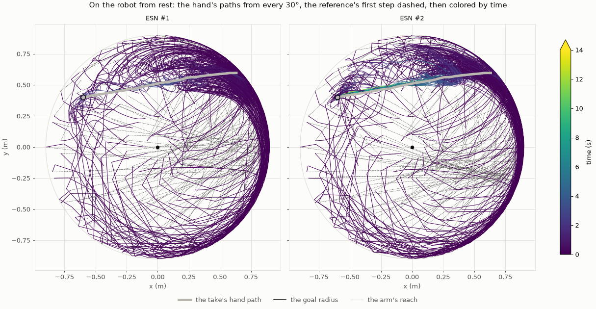

**Figure 3.** The hand's paths from every 30° on the robot, the reference's first step
dashed. Report 019's Figure 3 shows the same on the ESN's own.

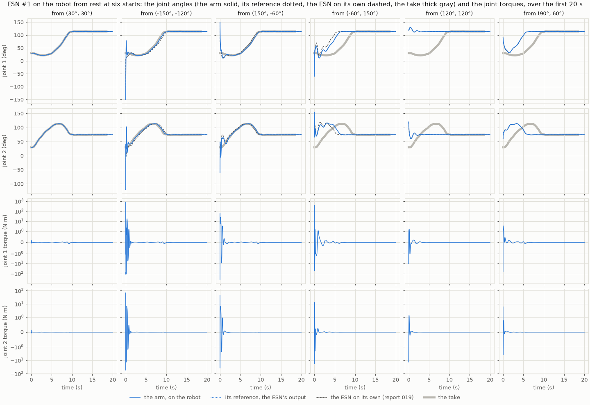

**Figure 4.** ESN #1 on the robot from six starts: the joint angles (the arm solid, its
reference dotted, the ESN on its own dashed, the take thick gray) and the joint torques,
on a scale linear within ±1 N m and logarithmic beyond.

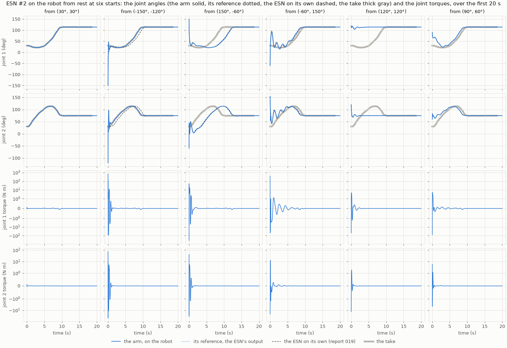

**Figure 5.** The same for ESN #2.

| From the 1,296 starts, median (range) | ESN #1, robot | ESN #1, on its own | ESN #2, robot | ESN #2, on its own |
| --- | --- | --- | --- | --- |
| End at rest at the target | 1,296 | 1,296 | 1,296 | 1,296 |
| Arrival | 8.77 s (0.02 to 11.37 s) | 8.84 s (0.01 to 11.40 s) | 9.41 s (0.01 to 14.79 s) | 9.85 s (0.08 to 13.53 s) |
| Join the take's path | 1,296, at 1.32 s (up to 3.19 s) | 1,296, at 1.30 s (up to 2.69 s) | 1,296, at 2.23 s (up to 8.10 s) | 1,296, at 2.41 s (up to 9.02 s) |
| … at a progress along it of | 0.20 | 0.20 | 0.08 | 0.02 |
| The reference's first step | 84° (up to 248°) | the same | 79° (up to 228°) | the same |
| Largest joint torque | 257 N m (0.2 to 1,011 N m) | | 275 N m (0.1 to 847 N m) | |
| Largest joint speed | 3,135°/s (up to 22,985°/s) | | 2,994°/s (up to 19,091°/s) | |
| Robot's arrival, later than on its own | −0.01 s (10% to 90%: −0.37 to +0.32 s) | | −0.15 s (−0.75 to +0.08 s) | |
| … within 0.25 s: all starts, the 63 within 15° of the path | 70%, 95% | | 57%, 97% | |
| Rank correlation of the arrivals | +0.942 | | +0.969 | |

- **The target attracts the robot from every start, as it attracts the ESN on its own.**
  All 2 × 1,296 runs end at rest at the target, 2.9 mm and 2.7 mm from it, as on its own.
  The arm touches a joint's stop in 14 and 12 runs, each for one sample.
- **The runs from every 30° look like the ESN's own (Figures 2 and 3, against report
  019's Figures 2 and 3).**
  - The runs come to the take's path within a second or two, mostly near its start, and
    follow it to the target.
  - ESN #2's runs join later and nearer the start than ESN #1's.
  - The difference is the first second. On its own, the ESN's first output is a jump
    (dashed). On the robot, the reference makes the same jump, but the arm swings after
    it: the hand sweeps much of the arm's reach before it reaches the path.
- **Near the path, the robot is the ESN on its own. Far from it, the arm's swing shifts
  the arrival by tenths of a second (Figure 1, middle).**
  - From the 63 starts within 15° of the path, 95% and 97% arrive within 0.25 s of the
    ESN's own.
  - From far starts, the arm's swing shifts the arrival: from 80% of all the starts, the
    robot arrives within −0.37 to +0.32 s of the ESN's own (ESN #1), and −0.75 to +0.08 s
    (ESN #2). Where neighboring starts end differently, at the edge between joining the
    path near its start and near its end, the difference reaches seconds.
  - Over all the starts, the rank correlation is 0.94 and 0.97.
- **The first step is a kick (Figure 1, bottom, and Figures 4 and 5).** The reference's
  first segment runs 79° to 84° in 10 ms in the median. Given that velocity, joint PD
  answers with a torque of 257 and 275 N m in the median, and up to 1,011 N m. The arm then
  rings for a second before following the reference. From the take's start, the first
  step is 0.2° and the torque 0.1 to 0.2 N m (Figures 4 and 5, first column).

### 3.2 ESN #1 and ESN #2 with the arm

| Fixed point | On its own: unstable modes, growth | With the arm: unstable modes, growth | Residual of the map |
| --- | --- | --- | --- |
| ESN #1, the target (113.96°, 74.59°) | 0, −0.674 /s | 0, −0.674 /s | 1 × 10⁻¹⁶ |
| ESN #2, beside the path (39.85°, 97.12°) | 2, +0.227 /s | 2, +0.230 /s | 4 × 10⁻¹⁵ |
| ESN #2, the target (113.95°, 74.57°) | 0, −0.678 /s | 0, −0.675 /s | 1 × 10⁻¹⁶ |
| ESN #2, (73.66°, 79.61°) | 1, +0.911 /s | 1, +0.902 /s | 1 × 10⁻¹⁴ |

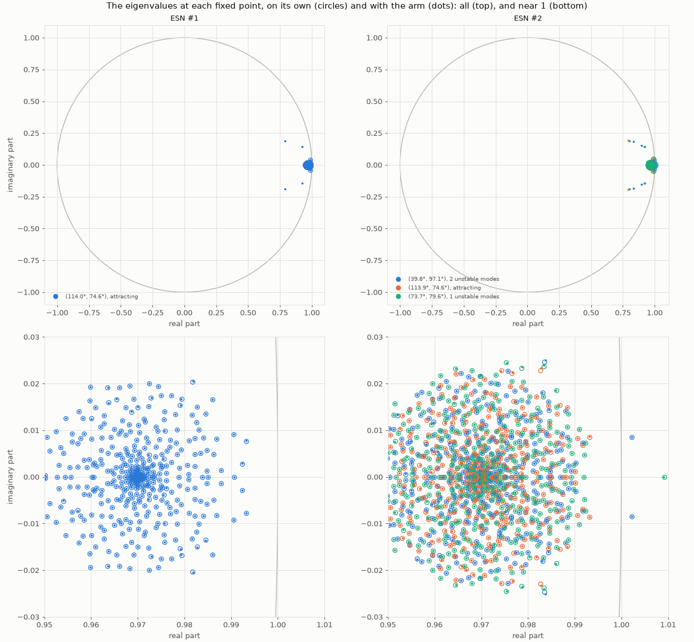

**Figure 6.** The eigenvalues at each fixed point, on its own (circles) and with the arm
(dots). Top: all of them; the arm's own four lie apart, near 0.92 ± 0.14i and
0.8 ± 0.19i. Bottom: near 1.

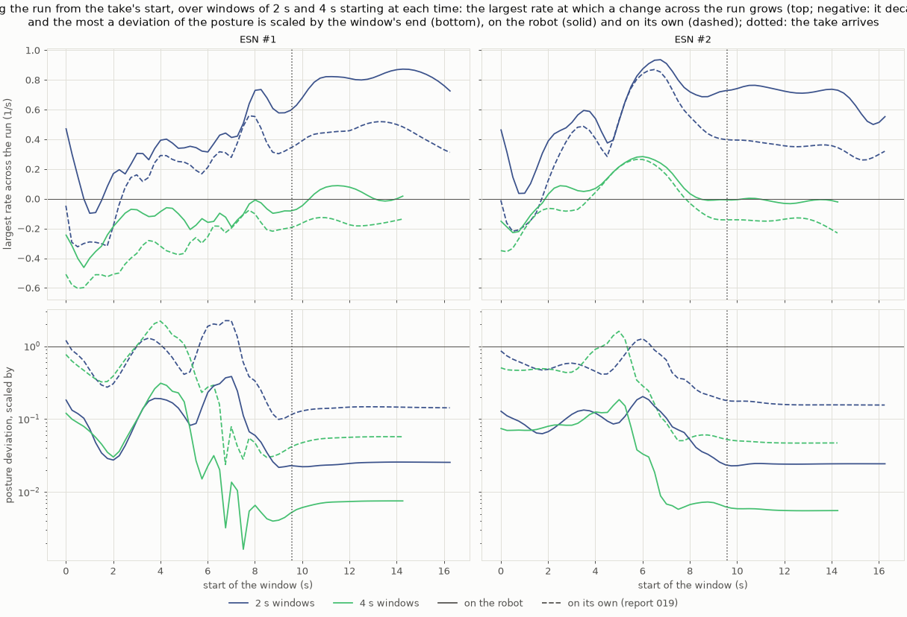

**Figure 7.** Along the run from the take's start, over windows of 2 s and 4 s: the
largest rate across the run (top) and the most a posture's deviation is scaled (bottom),
on the robot (solid) and on its own (dashed, report 019's Figure 10).

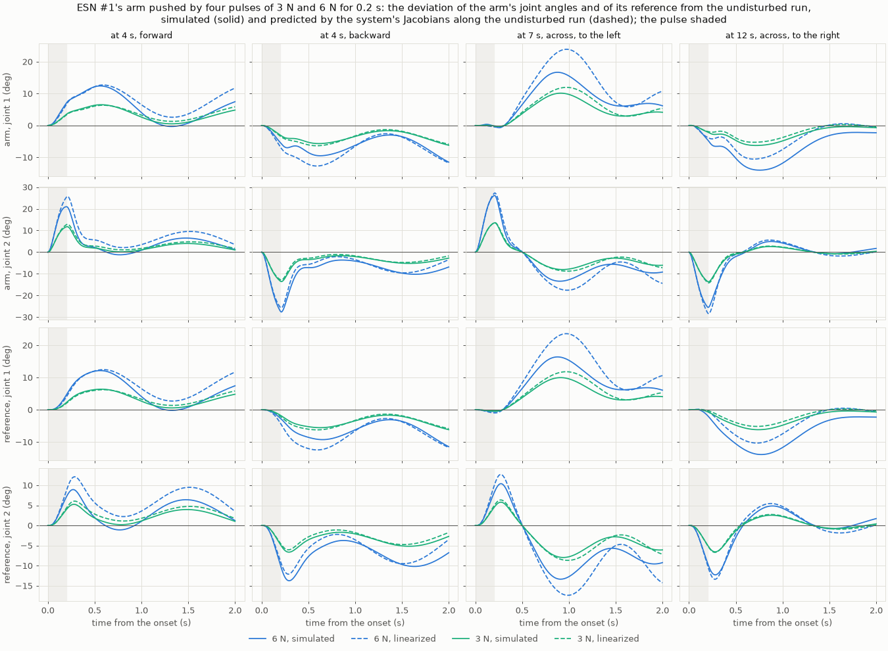

**Figure 8.** ESN #1's arm pushed by four of report 019's pulses, at 3 N and 6 N: the
deviation of the arm's joint angles and of its reference from the undisturbed run,
simulated (solid) and predicted by the system's Jacobians along the undisturbed run
(dashed).

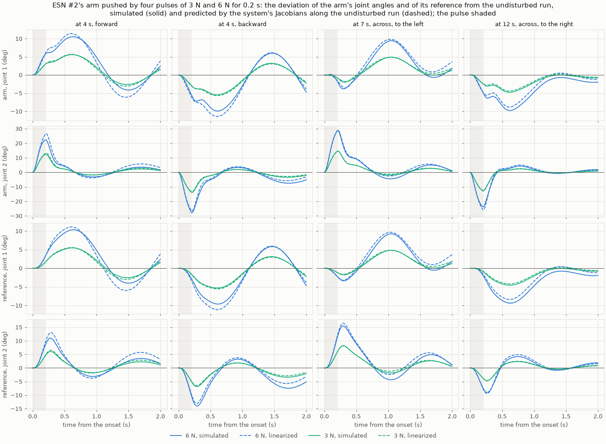

**Figure 9.** The same for ESN #2.

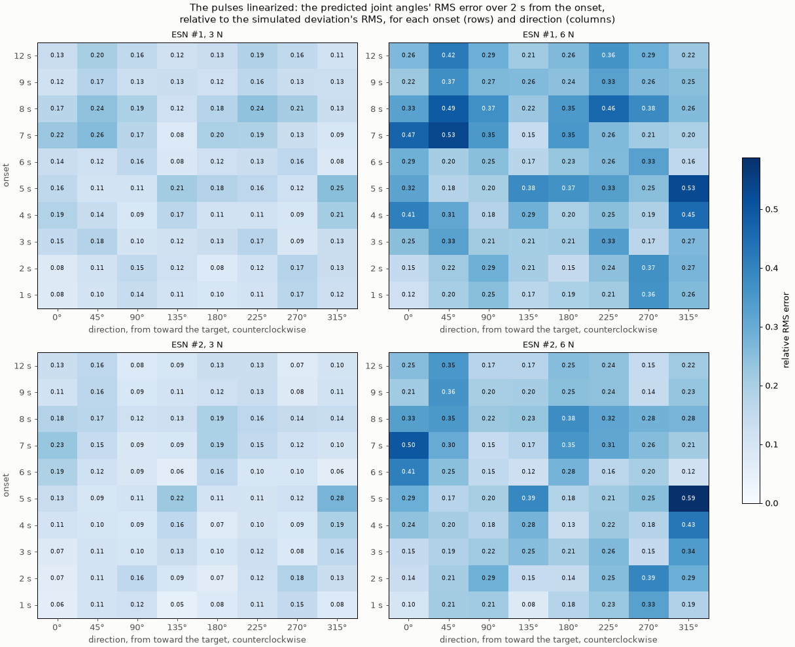

**Figure 10.** Every pulse's error of the predicted joint angles over the 2 s from its
onset, relative to the simulated deviation.

| The pulses linearized: relative error, median (10% to 90%) | ESN #1, 3 N | ESN #1, 6 N | ESN #2, 3 N | ESN #2, 6 N |
| --- | --- | --- | --- | --- |
| The arm's joint angles | 0.13 (0.09 to 0.20) | 0.26 (0.18 to 0.39) | 0.11 (0.07 to 0.18) | 0.22 (0.15 to 0.36) |
| The reference | 0.16 (0.10 to 0.23) | 0.30 (0.19 to 0.47) | 0.12 (0.09 to 0.20) | 0.26 (0.17 to 0.41) |
| The simulated deviation's RMS | 3.8° | 7.6° | 3.5° | 7.0° |

- **The fixed points are the system's, with the same stability (claim 1).**
  - The map leaves each one, the arm at rest at its posture, within 10⁻¹⁴.
  - The arm changes the slowest growth rates by 1.3% or less, and their periods by 0.7%
    or less.
  - The arm's own four modes decay at 7 to 21 /s, as joint PD at 20 rad/s and ζ = 0.4
    would: in a few tenths of a second, against the ESN's slowest mode's 1.5 s.
- **Along the run, the system's largest rate across it is higher than the ESN's own
  (claim 2 fails as stated).**
  - With the arm, the median over 2 s windows is +0.59 and +0.71 /s, against +0.33 and
    +0.37 /s on its own.
  - Over 4 s windows it is −0.08 and −0.00 /s, against −0.21 and −0.11 /s: higher by 0.12
    and 0.11 /s, beyond the claim's 0.1.
  - Section 3.5 shows that over windows this long, the rate depends on the weighing of
    the arm's values by more than that.
  - A posture's deviation shrinks far more with the arm, to 0.01 of itself over 4 s
    against 0.06 to 0.08. But this is not comparable: with the arm the deviation is the
    arm's, which joint PD pulls back within a tenth of a second.
- **The pulses are not small for the system.** At 3 N, the prediction is off by a median
  11% and 13%; at 6 N, by 22% and 26%. That is twice the error for twice the force: the
  error is the system's nonlinearity, not the map's, which predicts a 0.3 N pulse to 0.9%
  (the experiment's README).
  - The prediction holds the response's shape, its peaks and its turns (Figures 8 and 9),
    but overshoots the larger pulses. It is worst for the pulses forward at 7 s and 8 s,
    and at 5 s at 315°, up to 0.59 at 6 N (Figure 10).

### 3.3 Every fixed point of the screens with the arm

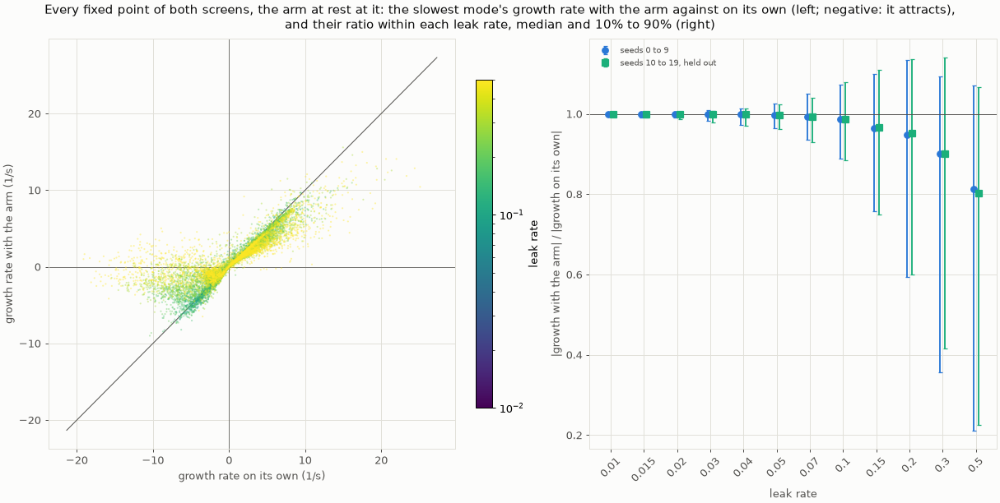

**Figure 11.** Every fixed point of both screens within the arm's stops. Left: the slowest
mode's growth rate with the arm against on its own, colored by the leak rate. Right:
their ratio within each leak rate.

| Leak rate | Growth with the arm / on its own, median (10% to 90%), seeds 0 to 9 | Attracting to unstable, seeds 0 to 9, held out | Unstable to attracting |
| --- | --- | --- | --- |
| 0.01 to 0.02 | 1.000 (0.99 to 1.01) | 0, 0 | 0, 0 |
| 0.03 to 0.05 | 0.997 to 0.999 (0.96 to 1.03) | 3, 2 | 0, 0 |
| 0.07 | 0.994 (0.94 to 1.05) | 5, 4 | 1, 0 |
| 0.1 | 0.986 (0.89 to 1.07) | 7, 9 | 0, 0 |
| 0.15 | 0.965 (0.76 to 1.10) | 15, 23 | 1, 0 |
| 0.2 | 0.948 (0.59 to 1.14) | 18, 29 | 2, 1 |
| 0.3 | 0.902 (0.36 to 1.09) | 53, 87 | 0, 4 |
| 0.5 | 0.814 (0.21 to 1.07) | 151, 134 | 5, 6 |

- **Up to a leak rate of 0.05, the arm is invisible to the fixed points.** The growth
  rates move by 4% or less at the 10th and 90th percentiles. Of 11,798 fixed points, 5
  change stability.
- **From 0.1 up, the arm slows them, and turns some attracting ones unstable.**
  - At 0.5 the median growth rate is 0.81 and 0.80 of the ESN's own. A tenth of the
    fixed points keep 0.23 of it or less: the reservoir there moves faster than the arm
    can follow.
  - 151 and 134 of the attracting fixed points at 0.5, 18% and 16%, become unstable with
    the arm. The arm's lag, against an ESN that turns in a few steps, makes the loop
    overshoot.
  - The reverse, an unstable fixed point that the arm makes attract, happens at 6 or
    fewer at each leak rate.
- **Where the arm turns the target unstable, the ESN fails on the robot.** Of the fixed
  points at the target that attract on their own, 9 and 8 become unstable with the arm,
  at leak rates 0.07 to 0.5. None of those 17 ESNs passes the search's rule. (Counted
  after the claims.)
- **1,486 fixed points lie beyond the arm's stops,** where the ESN on its own can rest:
  818 and 668, 4% of all. The arm cannot rest there, so they are none of the system's.

### 3.4 Released and flagged

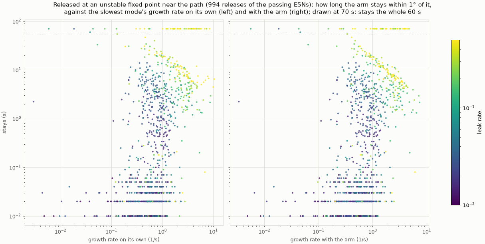

**Figure 12.** Report 019's 994 releases: how long the arm stays within 1° of the fixed
point, against the slowest mode's growth rate on its own (left) and with the arm (right).
Drawn at 70 s: stays the whole 60 s.

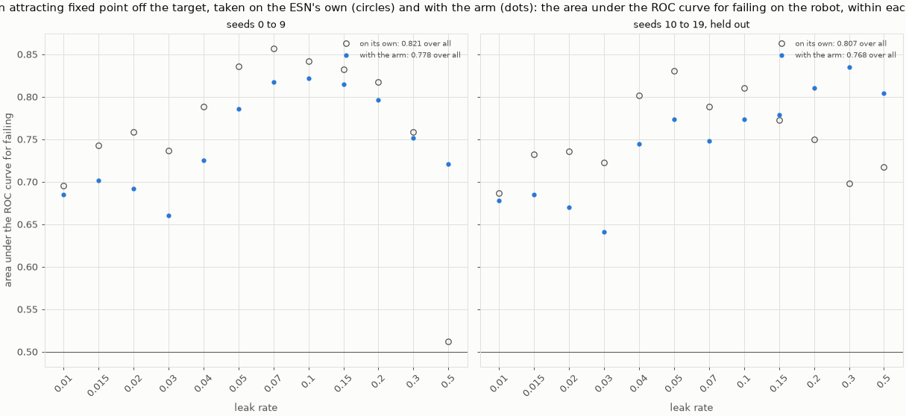

**Figure 13.** Rule (a), an attracting fixed point off the target, taken on the ESN's own
(circles) and with the arm (dots): the area under the ROC curve for failing on the
robot, within each leak rate.

| Rule (a): area under the ROC curve for failing (ESNs flagged, failing among them) | Seeds 0 to 9 | Seeds 10 to 19, held out |
| --- | --- | --- |
| On its own (report 019) | 0.821 (3,263, 96%) | 0.807 (3,283, 94%) |
| With the arm | 0.778 (2,730, 96%) | 0.768 (2,765, 95%) |
| On its own, the fixed points within the stops only (after the claims) | 0.783 (2,871, 96%) | 0.770 (2,932, 94%) |
| On its own, the fixed points beyond the stops only (after the claims) | 0.579 (734, 97%) | 0.570 (623, 97%) |

- **No released fixed point attracts with the arm.** All 993 found are unstable with it,
  as on its own; the arm does not hold the robot at any of them.
- **Claims 1 and 2 hold as stated, but what they rank is mostly exact rest.**
  - At leak rates 0.15 to 0.5, the stay's rank correlation with the growth rate is
    −0.13 with the arm and −0.05 on its own: more negative with the arm (claim 1).
  - Over all the releases, the growth rate tells the 47 releases where the arm stays the
    whole 60 s from the others with an area of 0.27 with the arm and 0.25 on its own:
    larger with the arm (claim 2).
  - Both areas are below 0.5: the arm stays put where the fixed point grows faster, a
    median 2.0 /s against 0.7 /s elsewhere. Section 3.5 shows why: most of those stays are
    exact rests at fast leak rates.
  - Up to a leak rate of 0.1, the stay measures something else. The 4 s hold leaves the
    reservoir off the fixed point there, so the arm leaves within 0.1 s at 58% of the
    releases, a median 0.05 s after the release.
- **Rule (a) with the arm predicts failing less well (claim 3 fails).**
  - With the arm, the area is 0.778 and 0.768, against 0.821 and 0.807 on its own.
  - Nearly all of the difference is the fixed points beyond the arm's stops. Taken on its
    own over the fixed points within the stops only, rule (a) gives 0.783 and 0.770:
    the arm changes that by 0.005 and 0.002.
  - The ESNs with an attracting fixed point beyond the stops fail at 97%, though the arm
    can never rest there. What rule (a) catches is an ESN that, on its own, has learned
    somewhere else to rest, not only a place where the robot can stall.

### 3.5 Added after the claims

**The releases, nudged (step 4).**

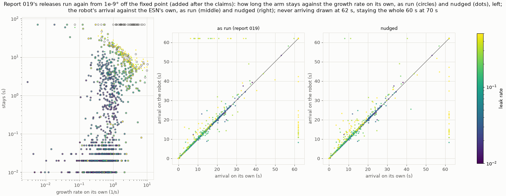

**Figure 14.** Report 019's releases run again from 10⁻⁹° off the fixed point. Left: how
long the arm stays against the growth rate on its own, as run (circles) and nudged
(dots). Middle and right: the robot's arrival against the ESN's own, as run and nudged;
never arriving drawn at 62 s.

| Released at 994 unstable fixed points | Leak rates 0.01 to 0.1, as run | … nudged | Leak rates 0.15 to 0.5, as run | … nudged |
| --- | --- | --- | --- | --- |
| The arm stays the whole 60 s | 2 | 2 | 45 | 4 |
| Both the robot and the ESN on its own arrive | 725 | 725 | 164 | 199 |
| Only the robot, only the ESN on its own | 1, 0 | 1, 0 | 21, 19 | 23, 3 |
| Neither | 24 | 24 | 40 | 19 |
| Where both arrive: the robot later, median (90th percentile) | +0.05 s (+0.20 s) | the same | +0.42 s (+4.19 s) | +0.50 s (+5.06 s) |
| … within 0.25 s; rank correlation | 90%; +0.996 | the same | 30%; +0.947 | 26%; +0.910 |

- **The arm stayed put at 45 fast releases because nothing perturbed it.**
  - At a fast leak rate, the 4 s hold settles the reservoir on the fixed point to the
    last bit. A deterministic simulation then adds nothing that could grow, however fast
    the fixed point grows.
  - Of the 47 releases where the arm stayed, 41 leave once nudged by 10⁻⁹°, after 4 to
    59 s (median 10.5 s). How soon has a rank correlation of −0.95 with the growth rate
    on its own (Figure 14, left).
  - The 6 that still stay grow slowly, at 0.006 to 0.53 /s.
- **Up to a leak rate of 0.1, the nudge changes nothing.** There, 4 s of holding does not
  settle the reservoir to the last bit.
- **From 0.15 up, report 019's finding stands, smaller.**
  - Nudged, only one of the two arrives at 26 releases, down from 40, and now mostly the
    robot (23).
  - Where both arrive, the robot is a median 0.50 s later, and 5.1 s at the 90th
    percentile.
  - The arm's lag, which Section 3.3 sees in the eigenvalues, slows the robot's departure
    from the fixed point and its reach after it.
- **Nudged, the stay at fast leak rates ranks with the growth rate:** −0.34 with the arm,
  −0.26 on its own. Claim 1's direction holds once the exact rests are gone.

**The rates, weighed otherwise (step 5).** Step 2's largest rate across the robot's run,
median over the windows, with the arm's joint angles and velocities weighed more:

| Weighed more: joint angles, velocities | ESN #1, 2 s | ESN #1, 4 s | ESN #2, 2 s | ESN #2, 4 s |
| --- | ---: | ---: | ---: | ---: |
| 1, 1 (step 2) | +0.59 /s | −0.08 /s | +0.71 /s | −0.00 /s |
| 10, 1 | +0.76 /s | −0.02 /s | +0.83 /s | +0.07 /s |
| 1, 10 | +0.34 /s | −0.21 /s | +0.37 /s | −0.10 /s |
| 10, 10 | +0.45 /s | −0.16 /s | +0.49 /s | −0.03 /s |
| 0.1, 0.1 | +1.65 /s | +0.46 /s | +1.72 /s | +0.54 /s |
| 100, 100 | +1.24 /s | +0.19 /s | +1.34 /s | +0.38 /s |
| On its own (report 019) | +0.33 /s | −0.21 /s | +0.37 /s | −0.11 /s |

- **Over windows of 2 s and 4 s, the rate depends on the weighing by more than step 2's
  claim allows.**
  - Over 4 s windows, ESN #1's median runs from −0.21 to +0.46 /s across the weighings,
    and ESN #2's from −0.10 to +0.54 /s.
  - With the velocities weighed 10 times more, both match their own run's to 0.02 /s.
- **So the claim could not be decided with this measure.** Over windows this short,
  changes of the arm and of the reservoir trade size before they decay. The eigenvalues
  at the fixed points, which no weighing changes, show the arm changing almost nothing
  at these ESNs (Section 3.2).

## 4. The claims

| Step | Claim | Result |
| --- | --- | --- |
| 1 | 1. From each of the 1,296 starts, the arm ends at rest at the target | **Holds:** 1,296 of 1,296 for each ESN |
| 1 | 2. Every run joins the take's path for good | **Holds:** 1,296 of 1,296 for each ESN |
| 1 | 3. Where both arrive, the robot's arrival has a rank correlation of at least 0.9 with the ESN's own | **Holds:** +0.942 (ESN #1) and +0.969 (ESN #2) |
| 2 | 1. Each fixed point is the system's, with as many unstable modes | **Holds:** residuals 10⁻¹⁴ or less; the same unstable modes at all 4 |
| 2 | 2. Over 2 s and 4 s windows, the median largest rate across the robot's run is within 0.1 /s of the ESN's own | **Fails:** higher by 0.26 and 0.34 /s (2 s), 0.12 and 0.11 /s (4 s); after the claims, the measure moves by more with the weighing of the arm's values |
| 3 | 1. At leak rates 0.15 to 0.5, the stay ranks more negatively with the growth rate with the arm than on its own | **Holds, as stated:** −0.13 against −0.05; the stays are mostly exact rests, and nudged it holds too (−0.34 against −0.26) |
| 3 | 2. The growth rate with the arm tells the releases where the arm stays the whole 60 s apart better | **Holds, as stated:** 0.27 against 0.25; both below 0.5, the stays being exact rests at fast leak rates |
| 3 | 3. Rule (a) with the arm predicts failing at least as well as on its own | **Fails:** 0.778 against 0.821, and 0.768 against 0.807 held out; the fixed points beyond the arm's stops make the difference |

## 5. Observations

- **Reading the ESN and the robot as one system costs little, and settles what "on the
  robot" means for the ESN's dynamics.**
  - The system's fixed points are the ESN's own, so every screen of reports 016 and 019
    lists them, but for those beyond the arm's stops.
  - Its eigenvalues there tell what the arm changes. At the chosen ESNs' leak rate,
    nothing. At fast leak rates, the arm slows the system and can turn attracting points
    unstable.
- **At the leak rate the search chose, the ESN on its own is a faithful model of the
  robot.** The fixed points, the runs from rest near the path, and the releases all
  agree. That may be part of why the search's choice works on the robot, though the
  choice was made from robot runs, not from this.
- **Fast ESNs are coupled to the arm.** From a leak rate of 0.1, the arm's lag enters the
  loop:
  - it slows the fixed points;
  - it turns a sixth of the attracting ones unstable at 0.5, and some targets with them;
  - it delays the robot by half a second after a release.
  An analysis of a fast ESN on its own misses this; one with the arm, at little extra
  cost, sees it.
- **The first step is the robot's real problem from far starts.** On its own the jump is
  harmless; on the robot, joint PD given the reference's velocity answers it with up to
  1,011 N m. The study's runs start from the take's start or within 15° of it in each
  joint. There the first step is 9° or less and the kick 40 N m or less (the grid's 9
  starts within the offset starts' square). A robot started anywhere would need the first
  reference ramped, or the ESN warmed up from the arm's posture into the take's.
- **A simulation that rests exactly on an unstable fixed point says nothing about it.**
  Of report 019's 45 stay-put releases at fast leak rates, 41 were exact rests, an
  artifact of holding a fast ESN long enough to settle to the last bit. Releases need a nudge far below any physical
  disturbance, as here, or noise.
- **Rule (a) is about the ESN, not only about where the robot can stall.** The ESNs it
  flags by a fixed point beyond the arm's stops fail as often (97%) as those it flags by
  one within (96%), though the arm cannot rest there. Presumably, from an offset start
  or after a push, such an ESN steers toward a rest the arm cannot reach; this report
  did not check how they fail.
- **Linearizing the system explains the response's shape, not its size.** The pulses of
  the study are large enough for the system's nonlinearity to matter: at 3 N, a tenth of
  the response.
- **Report 019's text is changed by this report** in one place: its 45 releases where the
  arm stayed the whole 60 s at fast leak rates are mostly exact rests, not the robot
  holding still.

## 6. Next steps

1. **Nudge the releases by default** in `release_robot.py` and the screen's release
   (report 016's rule (c)), so that no run rests on a fixed point by accident.
2. **Score rule (a) on the fixed points within the arm's stops and beyond them
   separately** in the screen, now that both are seen to predict failing.
3. **Ramp the first reference step,** or warm the ESN up from the arm's posture, and run
   step 1 again: from far starts, the robot's kick is the only thing that differs.
4. **Screen with the arm** for ESNs at leak rates of 0.1 and more: the system's eigenvalues
   at the target catch the ESNs whose target the arm turns unstable, none of which passed.
