# 021 The search on a four-link arm: the rule's ESNs barely follow, and a rule that asks them to

**Summary.** Reports 017 to 020 ran one protocol on a two-link arm. This report runs
report 017's search on skelarm's four-link arm, which is redundant and has tight joint
limits, under the protocol of the
[experiment's README](../../experiments/manual_demonstration_four_dof_consistent_search/README.md):
the same 504 settings with ten seeds each, the same scenarios, and the same rule written
as code.

The findings:

- **The arm needs two changes before the search can run.**
  - The two-link study's PD gains, each joint's own inertia, are unstable here with the
    torque held for 10 ms: they act on one mode of the error 43.2 times as strongly as
    intended, against a bound of 12.2. The gains here are the whole mass matrix at the take's
    final posture.
  - The stops lock a joint pressed into them, because the two-link study's projected
    stops feed this arm energy that the motors never gave it.
- **The rule chooses nothing over the grid.** 83 of the 5,040 ESNs pass, against 1,049 on
  the two-link arm. No setting passes with more than five seeds of ten. The offset starts
  fail the most ESNs, then the pushes, and 93.7% of the failing runs start from an offset.
- **The passing ESNs gather at the grid's lowest input scaling, so the grid was extended
  below it, after seeing the results.** At input scalings 0.02 and 0.05, 206 of the
  6,720 ESNs pass and one setting of 672 qualifies. The rule's two picks, called here the
  **earlier ESN #1** (leak rate 0.01, spectral radius 1.5, input scaling 0.02, seed 7)
  and the **earlier ESN #2** (0.02, 1.5, 0.02, seed 8, through the nine-seed fallback),
  complete every scenario but barely follow the arm: by 0.22 and 0.45 overall, and by
  0.06 and 0.14 under the block, against 0.79 and 0.89 for the two-link ESN #1.
- **A second rule, decided after seeing those results, asks the reference to approach
  the arm.** It fails an ESN whose reference, at the block's release, is farther from the
  arm's joint angles than half the replay's. It excuses leaving the goal from the offset
  starts, as the first rule did under the pushes, lets a setting qualify with 8 of 10
  seeds, and ranks by that distance. Over the same runs, 390 ESNs pass and 8 settings
  qualify. **ESN #1** is leak rate 0.015, spectral radius 1.2, input scaling 0.05, seed 0.
  **ESN #2** is leak rate 0.02, spectral radius 1.35, input scaling 0.05, seed 7.
- **Their references approach the arm in three of the four joints.**
  - At the block's release the reference is 6.3° and 5.8° from the arm, against 15.7° and
    13.3° for the earlier pair and 20.2° for the replay.
  - The following by joint is 0.54, 0.32, −0.03, and 0.65 for ESN #1, and 0.57, 0.43,
    0.03, and 0.60 for ESN #2. Joint 3's reference keeps to the taught motion.
  - The peak torque under the block is 39% and 35% of the replay's, against 88% and 81%
    for the earlier pair, and 17% and 7% for the two-link ESNs.
- **The gain has costs.**
  - **Under the pushes,** the peak torque is 67% and 69% above the replay's, the arm is
    carried two to three times farther off the path, and it settles at 23.5 and 21.3 s
    against 15.5 s.
  - **From the offset starts,** the median peak torque falls to 59% and 67% of the
    replay's. But the references go up to 41.8° past the joint limits, the arm presses
    against its stops for up to 8.8 s, and the accumulated torque reaches 400 and
    797 N m s against the replay's 18. ESN #1 leaves the goal during the hold from 3 of
    the 35 offset starts and still ends in it.
- **The two settings do not hold on held-out seeds.** On seeds 10 to 19 of the 8
  settings, 53 of the 80 ESNs pass and 2 settings qualify, neither of them ESN #1's or
  ESN #2's, which pass 6 and 5 of 10. The following itself holds, with median gaps of
  0.29 and 0.27.

## 1. Question

1. **The procedure:** can report 017's protocol run on this arm, and what has to change?
2. **The search:** over the same grid of 504 settings, ten seeds each, which ESNs pass,
   how do the others fail, and what does the rule choose?
3. **The choice's following:** do the ESNs the rule chooses still follow the arm, as the
   two-link ones do?
4. **A rule for following:** if they do not, can a rule that asks for it choose ESNs whose
   references approach the arm, and do those ESNs still complete the task, also on seeds
   not used to choose them?
5. **The chosen ESNs:** how do they compare on the robot with the replay and the progress
   replay, with the search's tracker? How hard do the motors work?

This is the first of the four parts of the
[experiment's plan](../../experiments/manual_demonstration_four_dof_consistent_search/README.md):
reports 017 to 020 on this arm. Parts 2 to 4, the trackers, the ESNs as dynamical
systems, and the ESN and the robot as one system, have not been run.

## 2. Setup

### The protocol

As the [experiment's README](../../experiments/manual_demonstration_four_dof_consistent_search/README.md)
fixed it before any run, with the two changes marked below made after results were seen.

**The robot, the task, and the take.** The arm of
[`reach_manual_four_dof.toml`](../../experiments/demonstrations/reach_manual_four_dof.toml):
- four links of 0.1, 0.25, 0.25, and 0.15 m on a 0.05 m base, 3 kg in all, in a
  horizontal plane, simulated every 2 ms;
- joint limits of −20 to 30°, 0 to 120°, 0 to 150°, and −20 to 90°;
- the start posture (−20, 10, 60, 50)°, joint 1 at its lower limit, the hand 0.54 m
  from the target at (0, 0.4) m, with a goal radius of 20 mm.

The ESNs are trained on one take taught by hand, untrimmed and filtered at 2 Hz:
`demo_00_filtered` of `results/demonstrations/20261103-134628-reach_manual_four_dof`
([the copy here](data)). It lasts 21.43 s, its hand arrives within the goal at 9.51 s,
and its joints span −20 to 11°, 10 to 40°, 60 to 81°, and 50 to 58°.

**The ESNs.** Trained by teacher forcing on the take, without noise, and driven on the
robot by the arm's measured joint angles every 10 ms, each joint normalized by the
take's range of that joint. Fixed:

| Parameter | Value |
| --- | --- |
| Neurons | 400, tanh |
| Sparsity (nonzero reservoir connections) | 0.05 |
| Bias | one per neuron, drawn uniformly from [−1, 1] by the seed and not scaled |
| Ridge | 10⁻² |
| Warm-up (the start posture held before the ESN moves, in training and on the robot) | 1 s |
| Sampling period | 10 ms |
| Teacher noise | none |

Swept, every combination:

| Parameter | Values |
| --- | --- |
| Leak rate | 0.01, 0.015, 0.02, 0.03, 0.04, 0.05, 0.07, 0.1, 0.15, 0.2, 0.3, 0.5 |
| Spectral radius | 0.7, 0.9, 0.99, 1.2, 1.35, 1.5, 1.75 |
| Input scaling, the grid (504 settings) | 0.1, 0.2, 0.5, 1, 1.5, 2 |
| Input scaling, the extension (168 settings, added after the grid's results) | 0.02, 0.05 |
| Seed (the random reservoir, its input weights, and its biases) | 0 to 9; 10 to 19 only for the 8 settings of Section 3.5 |

**The search's tracker.** Joint PD at ω = 20 rad/s and a damping ratio of 0.4, given the
reference's velocity, its torque computed every 10 ms and held between. **Its gains are
the whole mass matrix M at the take's final posture,** Kp = ω²M and Kd = 2ζωM, where the
two-link study scaled each joint by its own inertia M_ii.

On this arm M_ii is unstable with the torque held. Joints 1 and 2 are nearly redundant,
so with the other joints free they feel 17.5 and 24.3 times less inertia than M_ii. The
gains then act on the error's four modes 0.41, 0.86, 2.72, and 43.2 times as strongly as
intended. Report 013's bound for the held torque is 2 / (2ζωT + ω²T²/10) = 12.2 at
T = 10 ms, so the fourth mode grows and even the replay of the take is thrown 100° off.
With the whole matrix every mode has ω and ζ at the final posture, and the replay
follows the take within a degree.

**The stops.** The joints' hard stops lock a joint pressed into them: the stop holds
the joint by a reaction that does no work, and the other joints move as if it were
welded. The two-link study's projected stops zero the stopped joint's velocity but let
the other joints accelerate as if it were free. With joint 1's reference held 5° below
its stop through a reach, the projected stop gives the arm 2.7 J that the motors never
supplied, and the locked one gives none.

**The scenarios.** Runs of 23.9 s after the 1 s warm-up. The times follow the take as the
two-link study's followed its own, by a rule fixed before the take was recorded:

| Scenario | What happens |
| --- | --- |
| undisturbed | from the take's start |
| block | the tip held by a spring of 20,000 N/m and a damper of 100 N s/m from 4.0 to 5.0 s, when the take's hand is 32% of the way to the target |
| pushes | 3 N at 2.6 s (18% of the way), 5 N at 6.7 s (62% of the way), and 4 N at 14.9 s (5.4 s after the take arrives), each 0.5 s at the tip, at 10°, 80°, and −80° from the direction toward the target |
| offsets | undisturbed from the 36 starts offset by −15, 0, or +15° in each joint, those beyond the joint limits left out |

Each ESN runs 39 times.

**The measures,** as report 017 defined them: whether the hand arrives within the goal
radius, holds there for 2 s, and ends there; the path RMSE from the taught hand path; and
after each disturbance, the following gain, the ringing, the farthest from the taught
path, and the return within 5 mm of the path. How hard the motors work over the task:
the accumulated torque ∫ Σ|τ| dt, the squared torque ∫ Σ τ² dt, and the positive work
∫ Σ max(τ q̇, 0) dt.

New here:
- **The block gap:** the distance in joint space between the reference and the arm at the
  block's release, as a fraction of the replay's at the same moment (20.18° on this arm).
  1 means the reference is as far from the arm as the replay's; 0 means it is on the arm.
- **The joint following:** report 017's following gain, computed in joint space, one
  joint at a time, from the disturbance's onset to 0.5 s past its end, the taught motion
  being the replay's reference. "All joints" pools the four. On a redundant arm the hand
  can stay in place while the joints move, so it can differ from the following at the
  hand. It comes from the runs' logs and is not part of any rule.

**The first rule,** report 017's, coded in [`select_esns.py`](../../experiments/select_esns.py):

1. **An ESN passes** if, undisturbed, under the block, and from all 36 starts, its hand
   arrives, holds for the whole hold window, and ends within the goal; and if, under the
   pushes, it arrives and ends within the goal.
2. **A setting qualifies** if all ten of its seeds pass. Its measures are the medians over
   its seeds.
3. **The guard:** a setting whose median ringing exceeds the replay's with the same
   tracker (5.53 mm) is not chosen.
4. **The ranking:** the qualifying settings within the guard, by their median following,
   the largest first.
5. **The typical seed** of a setting is the one nearest its medians of the undisturbed
   path RMSE, the following, and the ringing.
6. **The two picks** are the typical seeds of the top two settings; if fewer than two
   qualify, the rest come from settings with at least 9 passing seeds, ranked alike.

**The second rule** ([`select_following.toml`](../../experiments/manual_demonstration_four_dof_consistent_search/select_following.toml))
changes the first in three ways, **decided after seeing its results, and so outside the
protocol:**

1. From the offset starts, leaving the goal during the hold is excused, as under the
   pushes. The hand must still arrive and end in the goal.
2. An ESN fails if its block gap is above 0.5.
3. A setting qualifies if at least 8 of its 10 seeds pass, and the settings are ranked by
   their median block gap, the smallest first.

**The comparison arms** on the robot:
- the replay of the take by time;
- the progress replay (report 014's): the take replayed by time, but never more than 2.5°
  along its joint path past the arm's progress.

### What changed from report 017's search

| | Report 017 | Here |
| --- | --- | --- |
| Arm | two links, whose joints stop only at ±180° | four links, redundant, tight joint limits, joint 1 starting at its limit |
| The tracker's gains | each joint's own inertia | the whole mass matrix at the take's final posture |
| Stops | projected | locked |
| Offset starts | 49, every 5° in two joints | 36, −15, 0, and 15° in four joints, within the limits |
| Grid | 504 settings | 504 settings, and 168 more at input scalings 0.02 and 0.05 |
| The rule | the first rule | the first rule, and then the second |
| Held-out seeds | 10 to 19 for the whole grid | 10 to 19 for the 8 settings that qualify under the second rule |
| Size, ridge, and bias | checked | deferred |

### Reproducing the results

The runs read the take under the storage root ([the copy here](data)). The robot runs
read their ESNs by their run names; their `esn.toml` and `esn.rclib` are copied into their
runs' directories here. A run is found by its name anywhere under `results/`; place or
link the copies there to rerun. All configurations are in
[`manual_demonstration_four_dof_consistent_search`](../../experiments/manual_demonstration_four_dof_consistent_search/README.md),
written below as `$D`.

| Runs | Command | Commit |
| --- | --- | --- |
| `guard_esn_lr0.03_sr1.2_is1.5_seed8` | `uv run python experiments/autonomous_esn.py $D/<name>.toml` | `bc489eb` |
| `guard_{block,pushes}_robot` (2) | `uv run python experiments/robot_esn.py $D/<name>.toml` | `478a39d` |
| `sweep_lr<leak rate>_<scenario>` (48) | `uv run python experiments/sweep_robot_esn.py $D/<name>.toml --workers 30` | `189fb31` |
| `select` | `uv run python experiments/select_esns.py $D/<name>.toml` | `20317eb` |
| `extend_lr<leak rate>_<scenario>` (48) | as the sweeps | `ec122b9` |
| `select_extended` | as `select` | `c879658` |
| `esn1_lr0.01_sr1.5_is0.02_seed7`, `esn2_lr0.02_sr1.5_is0.02_seed8` | as the guard's ESN | `7791580` |
| `<scenario>_robot_esn1_lr0.01_sr1.5_is0.02_seed7`, `<scenario>_robot_esn2_lr0.02_sr1.5_is0.02_seed8` (8) | as the guard's | `b3128a9` |
| `select_following` | as `select` | `6e4fc9d` |
| `following_esn1_lr0.015_sr1.2_is0.05_seed0`, `following_esn2_lr0.02_sr1.35_is0.05_seed7` | as the guard's ESN | `aee0f0a` |
| `<scenario>_robot_following_esn1_lr0.015_sr1.2_is0.05_seed0`, `<scenario>_robot_following_esn2_lr0.02_sr1.35_is0.05_seed7` (8) | as the guard's | `a243a28` |
| `heldout_lr<leak rate>_sr<spectral radius>_is<input scaling>_<scenario>` (32) | as the sweeps | `a243a28` |
| `select_following_seeds10to19` | as `select` | `9f4c68d` |
| [`summary`](results/summary) | `uv run python reports/021-search-on-a-four-link-arm/make_figures.py --logs` | |

**Running time,** on 30 worker processes of one thread each (an i9-14900KF): 31.3 h for
the grid's 48 sweeps, 12.6 h for the extension's 48, 28 min for the 8 robot runs of step
5, and 57 min for its 32 held-out sweeps.

**Checks.**
- The code that generalized the programs to four joints gives the two-link runs bit for
  bit (`6278507`).
- With its options unset, the changed `select_esns.py` gives report 017's rule run and
  `select_extended` byte for byte.
- The new ESNs' robot runs repeat the same ESNs' runs in the extension's sweeps within a
  relative 2 × 10⁻¹⁰, in all four scenarios and from all 36 starts.

**What is kept here.** Every run record (`run.toml`) shows no uncommitted changes.
Each run directory here holds:
- **every run:** its configuration and run record;
- **a sweep:** its `seeds.csv`; its `runs.csv` and its figures stay under the storage root;
- **a run of the rule:** `esns.csv` (each ESN's outcome, how it fails, and its measures),
  `settings.csv`, and `chosen.csv`;
- **a robot run:** its `metrics.csv`; the offset runs also their map of the 36 starts
  (`grid.png`) and their hand paths (`paths.png`);
- **the ESNs' training runs:** their trained ESN.

[`make_figures.py`](make_figures.py) draws the figures and prints the tables of Section 3
from these copies. With `--logs`, it also reads the robot runs' logs and the sweeps'
`runs.csv` under the storage root, which are not kept in Git. Videos of every run below
are made by [`make_media.py`](../../presentations/four-dof-arm/make_media.py) at `4becc2b`
into `presentations/four-dof-arm/` under the storage root.

## 3. Results

### 3.1 The grid

The grid's 504 settings, under the first rule:

| Leak rate | ESNs passing, of 420 | ESNs failing undisturbed / block / pushes / offsets | The best setting's passing seeds |
| ---: | ---: | --- | ---: |
| 0.01 | 13 | 7 / 60 / 247 / 394 | 4 |
| 0.015 | 15 | 9 / 126 / 277 / 398 | 5 |
| 0.02 | 12 | 33 / 189 / 303 / 397 | 2 |
| 0.03 | 8 | 64 / 244 / 344 / 403 | 3 |
| 0.04 | 4 | 92 / 263 / 364 / 407 | 1 |
| 0.05 | 3 | 152 / 277 / 372 / 414 | 1 |
| 0.07 | 1 | 200 / 268 / 391 / 411 | 1 |
| 0.1 | 6 | 211 / 258 / 375 / 404 | 2 |
| 0.15 | 7 | 200 / 221 / 367 / 410 | 2 |
| 0.2 | 7 | 194 / 215 / 367 / 409 | 2 |
| 0.3 | 3 | 201 / 208 / 343 / 415 | 1 |
| 0.5 | 4 | 263 / 271 / 343 / 413 | 2 |

An ESN can fail in several scenarios.

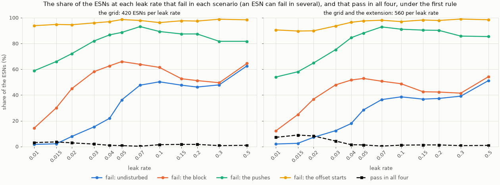

- **The rule chooses nothing.** 83 of the 5,040 ESNs pass, against 1,049 on the two-link
  arm. No setting has more than five of its ten seeds pass, so neither the rule nor its
  nine-seed fallback picks an ESN.
- **Scenario by scenario, most ESNs fail:**

  | ESNs failing | This arm | Two-link arm |
  | --- | ---: | ---: |
  | undisturbed | 1,626 | 1,126 |
  | under the block | 2,600 | 1,558 |
  | under the pushes | 4,093 | 3,057 |
  | from the offset starts | 4,875 | 3,581 |

- **The undisturbed failures grow with the leak rate, and the block's up to 0.05; the
  pushes and the offset starts fail most ESNs at every leak rate.**

### 3.2 The offset starts

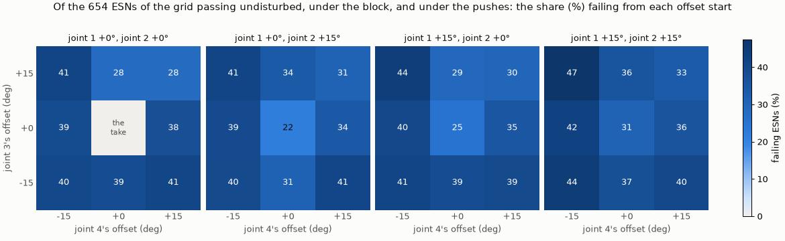

- **123,782 of the 132,101 failing runs start from an offset** (93.7%, against 94.5% on
  the two-link arm). 64.9% of those never arrive, 19.3% end away from the goal, and 15.6%
  leave the goal during the hold (7.2% on the two-link arm).
- **The offset starts reject 571 of the 654 ESNs that pass the other three scenarios.** An
  ESN failing only from them fails from a median of 14 of the 36.
- **The failures are spread over all the starts:** each of the 35 fails 22% to 47% of
  these ESNs, with a median of 39%. Joint 4 at −15° fails a few more (a mean of 42%,
  against 32% at 0° and 36% at +15°). On the two-link arm, one joint's offset decided.

### 3.3 The extension and the first rule's choice

The passing ESNs do not spread over the grid: 46 of the 83 have input scaling 0.1, the
grid's lowest. So **the grid was extended, after seeing these results,** to input
scalings 0.02 and 0.05, with the same leak rates, spectral radii, seeds, and scenarios.
The first rule was then applied to both grids together.

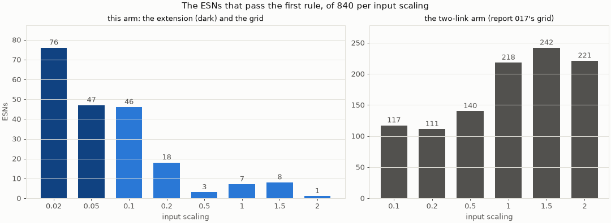

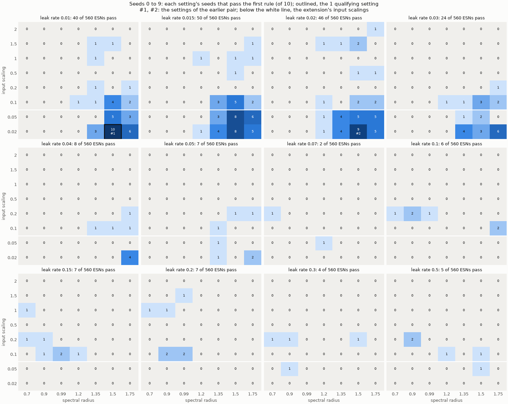

| Leak rate | ESNs passing, of 560 | ESNs failing undisturbed / block / pushes / offsets | The best setting's passing seeds |
| ---: | ---: | --- | ---: |
| 0.01 | 40 | 11 / 68 / 302 / 507 | 10 |
| 0.015 | 50 | 14 / 139 / 325 / 502 | 8 |
| 0.02 | 46 | 40 / 206 / 363 / 503 | 9 |
| 0.03 | 24 | 69 / 268 / 421 / 524 | 6 |
| 0.04 | 8 | 100 / 289 / 473 / 540 | 4 |
| 0.05 | 7 | 159 / 296 / 493 / 546 | 2 |
| 0.07 | 2 | 204 / 284 / 520 / 549 | 1 |
| 0.1 | 6 | 216 / 273 / 510 / 543 | 2 |
| 0.15 | 7 | 206 / 238 / 506 / 550 | 2 |
| 0.2 | 7 | 209 / 237 / 505 / 548 | 2 |
| 0.3 | 4 | 219 / 232 / 480 / 554 | 1 |
| 0.5 | 5 | 287 / 304 / 478 / 551 | 2 |

The settings with six or more passing seeds, the closest the rule comes (medians over
the setting's seeds):

| Leak rate | Spectral radius | Input scaling | Passing seeds | Following | Ringing | Return | Path RMSE | The rule's pick |
| ---: | ---: | ---: | ---: | ---: | ---: | ---: | ---: | --- |
| 0.01 | 1.5 | 0.02 | 10 | 0.23 | 5.12 mm | 3.41 s | 1.07 mm | earlier ESN #1, seed 7 |
| 0.02 | 1.5 | 0.02 | 9 | 0.46 | 4.87 mm | 4.23 s | 0.91 mm | earlier ESN #2, seed 8 |
| 0.015 | 1.5 | 0.05 | 8 | 0.50 | 4.37 mm | 4.89 s | 0.90 mm | |
| 0.015 | 1.5 | 0.02 | 8 | 0.38 | 4.92 mm | 3.36 s | 0.99 mm | |
| 0.015 | 1.75 | 0.05 | 6 | 0.51 | 5.16 mm | 5.23 s | 0.83 mm | |
| 0.03 | 1.75 | 0.02 | 6 | 0.40 | 5.03 mm | 4.27 s | 0.64 mm | |
| 0.01 | 1.75 | 0.02 | 6 | 0.16 | 5.25 mm | 7.44 s | 1.07 mm | |

- **206 of the 6,720 ESNs pass, and one setting of 672 qualifies.** Its typical seed is
  the earlier ESN #1. The earlier ESN #2 comes through the fallback, the only setting
  with 9 of 10 seeds. Both are within the guard.
- **The passing ESNs keep growing toward the new edge:** 76 at input scaling 0.02, 47 at
  0.05, 46 at 0.1, 18 at 0.2, and 1 to 8 at each larger one. On the two-link arm the count
  grows the other way. They also lean to spectral radii 1.5 and 1.75 (75 and 61).

### 3.4 What the first choice costs: the following

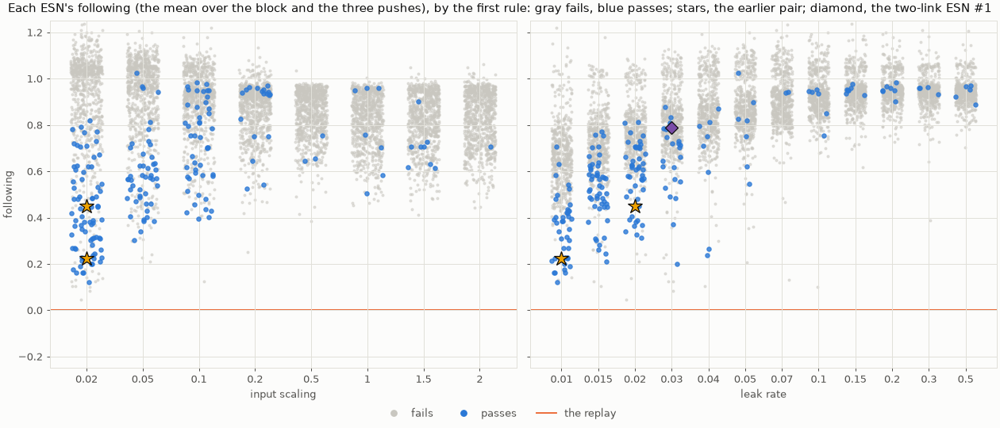

| Arm | Block | Push at 2.6 s | Push at 6.7 s | Push at 14.9 s | Mean | Reference's lead at the block's end |
| --- | ---: | ---: | ---: | ---: | ---: | ---: |
| Earlier ESN #1 | 0.06 | 0.25 | 0.34 | 0.24 | 0.22 | 8.2% |
| Earlier ESN #2 | 0.14 | 0.49 | 0.59 | 0.58 | 0.45 | 7.5% |
| Replay | 0.00 | 0.00 | 0.00 | 0.00 | 0.00 | 9.4% |
| Progress replay | 0.52 | 0.00 | 0.07 | 0.00 | 0.15 | 4.2% |
| Two-link ESN #1 (report 017) | 0.89 | 0.80 | 0.63 | 0.83 | 0.79 | 2.5% |

- **The earlier pair follows little.** Under the block it follows less than the progress
  replay, which only keeps within 2.5° of the arm along the path, and its reference runs
  on almost as the replay's does.
- **Following more and completing the task pull against each other on this arm.** The
  median following of the passing ESNs rises with the input scaling, 0.39 at 0.02, 0.57
  at 0.05, 0.73 at 0.1, and 0.94 at 0.2. The ESNs that fail follow by a median of 0.89,
  against 0.58 for those that pass.

### 3.5 A second rule, and the held-out seeds

**Why.** Every ESN of both grids ran under the disturbances, but the first rule asks only
that the hand reach the goal; the following only ranks the settings that qualify, of
which there is one.

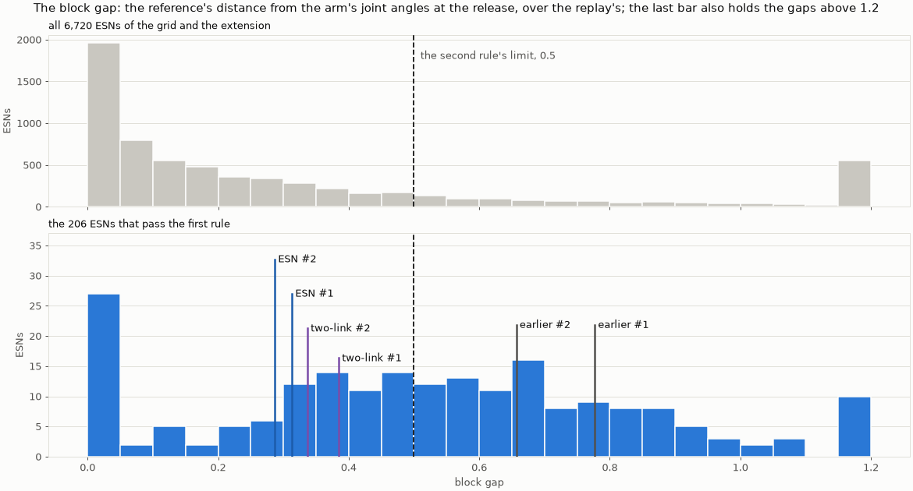

- **The earlier pair's block gaps are 0.78 and 0.66,** the two-link ESNs' 0.38 and 0.34.
  The median is 0.16 over all the ESNs and 0.52 over the 206 that pass the first rule.
- **The offset starts remove the ESNs that follow.** Of the 1,032 ESNs passing the other
  three scenarios, 708 have a gap of 0.5 or less, and only 98 of those (14%) pass from all
  36 starts, against 108 of the other 324 (33%).
- **Over half of their failing offset runs leave the goal after arriving early.** Of
  those small-gap ESNs' 8,269 failing offset runs, 4,571 (55%) leave the goal during the
  hold. They arrive at a median of 5.75 s, against 9.58 s for the runs that pass.

The second rule (Section 2) follows from these. **Its result, over the same 6,720 ESNs:
390 pass and 8 of the 672 settings qualify, all within the guard.**

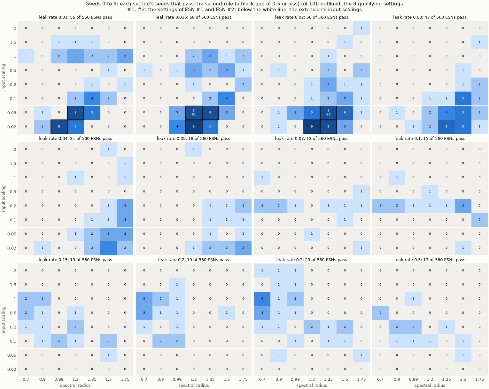

| Rank | Leak rate | Spectral radius | Input scaling | Seeds passing, 0 to 9 | Seeds passing, 10 to 19 | Median gap, 0 to 9 | Median gap, 10 to 19 | Median following, 0 to 9 | Median following, 10 to 19 | Ringing | Path RMSE | Typical seed |
| ---: | ---: | ---: | ---: | ---: | ---: | ---: | ---: | ---: | ---: | ---: | ---: | ---: |
| **1** | 0.015 | 1.2 | 0.05 | 8 | 6 | 0.28 | 0.29 | 0.69 | 0.70 | 4.43 mm | 1.22 mm | **0** |
| **2** | 0.02 | 1.35 | 0.05 | 8 | 5 | 0.32 | 0.27 | 0.71 | 0.71 | 4.02 mm | 1.11 mm | **7** |
| 3 | 0.02 | 1.2 | 0.02 | 9 | 7 | 0.36 | 0.33 | 0.79 | 0.80 | 5.08 mm | 1.13 mm | 2 |
| 4 | 0.015 | 1.35 | 0.05 | 8 | 5 | 0.38 | 0.38 | 0.60 | 0.59 | 4.21 mm | 1.13 mm | 7 |
| 5 | 0.01 | 1.2 | 0.05 | 8 | 7 | 0.40 | 0.37 | 0.55 | 0.56 | 4.68 mm | 1.00 mm | 6 |
| 6 | 0.015 | 1.2 | 0.02 | 9 | 8 | 0.41 | 0.41 | 0.72 | 0.71 | 5.15 mm | 1.07 mm | 1 |
| 7 | 0.01 | 0.99 | 0.02 | 8 | 8 | 0.44 | 0.43 | 0.64 | 0.65 | 4.93 mm | 1.51 mm | 8 |
| 8 | 0.02 | 1.35 | 0.02 | 8 | 7 | 0.45 | 0.47 | 0.66 | 0.59 | 4.84 mm | 1.13 mm | 2 |

The first two ranks give **ESN #1** and **ESN #2**, the typical seeds of their settings.
The study's author adopted them in place of the earlier pair after seeing the results
below.

**The held-out seeds.** Because the rule was changed after the results, the 8 settings
ran again with seeds 10 to 19, 80 ESNs and 3,120 runs, by the same programs. The same
rule over those runs alone chooses nothing here; it shows whether the settings hold.

- **53 of the 80 ESNs pass, and 2 of the 8 settings qualify:** leak rate 0.015, spectral
  radius 1.2, input scaling 0.02; and 0.01, 0.99, 0.02; each with 8 of 10 seeds.
- **ESN #1's setting has 6 of 10 and ESN #2's has 5 of 10.** At input scaling 0.05 the
  four settings pass with 7, 6, 5, and 5 seeds. At 0.02 they pass with 8, 8, 7, and 7.
- **What holds is the following, not the passing.** In every setting the median gap is
  within 0.05 of its value on seeds 0 to 9, and the median following within 0.08.
- **Of the 27 failing ESNs,** 13 end away from the goal after the pushes, 12 fail from the
  offset starts, and 5 have a gap above the limit; 3 fail on both the pushes and the
  offset starts. Of the 143 offset runs that never arrive, 96 start with joint 3 at −15°.

### 3.6 The new ESNs beside the earlier ones

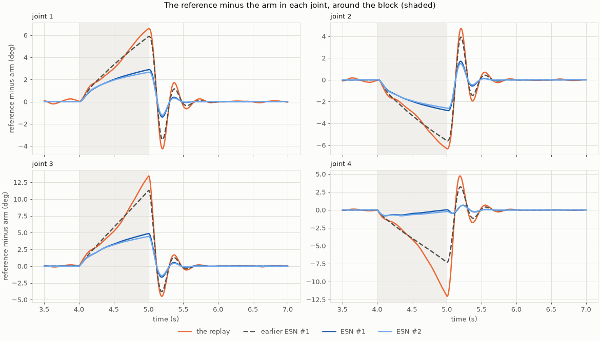

| | Earlier ESN #1 | Earlier ESN #2 | **ESN #1** | **ESN #2** | Two-link ESN #1 | Two-link ESN #2 |
| --- | ---: | ---: | ---: | ---: | ---: | ---: |
| Block: gap at the release, over the replay's | 0.78 | 0.66 | **0.31** | **0.29** | 0.38 | 0.34 |
| Block: reference to arm at the release (°; the replay: 20.2, on the two-link arm 15.4) | 15.7 | 13.3 | **6.3** | **5.8** | 5.9 | 5.2 |
| Block: joint following, per joint | 0.09, −0.03, −0.05, 0.06 | 0.19, −0.09, −0.11, 0.19 | **0.54, 0.32, −0.03, 0.65** | **0.57, 0.43, 0.03, 0.60** | 1.03, 0.55 | 0.96, 0.60 |
| Block: joint following, all joints | 0.01 | 0.02 | **0.32** | **0.36** | 0.84 | 0.79 |
| Block: peak torque, % of the replay's | 88 | 81 | **39** | **35** | 17 | 7 |
| Block: squared torque in the 1 s after the release, % of the replay's | 68 | 53 | **12** | **9** | 3 | 1 |
| Pushes: joint following, all joints, pushes 1 to 3 | 0.16, 0.15, 0.12 | 0.36, 0.39, 0.34 | **0.43, 0.56, 0.48** | **0.52, 0.61, 0.62** | 0.70, 0.61, 0.76 | 0.67, 0.62, 0.65 |
| Pushes: peak torque, % of the replay's | 105 | 120 | **167** | **169** | 89 | 77 |
| Offset starts: median peak torque, % of the replay's | 82 | 70 | **59** | **67** | 49 | 54 |
| Offset starts: largest reference to arm in the first second, median, % of the replay's | 95 | 103 | **90** | **80** | 54 | 61 |
| Offset starts: runs that stay in the goal for the hold, of those with an offset | 35 of 35 | 35 of 35 | **32 of 35** | **35 of 35** | 48 of 48 | 48 of 48 |

- **At the release the new references are 2.9, 2.8, 4.9, and 0.0° (ESN #1) and 2.7, 2.6,
  4.4, and 0.2° (ESN #2) from the arm** in joints 1 to 4, against the replay's 6.6, 6.3,
  13.4, and 12.0°. They are about half as far in joints 1 and 2, about a third in joint 3,
  and near zero in joint 4.
- **Joint 3's gap shrinks although its reference keeps to the taught motion,** because
  the arm's joint 3 moves less: it is at 71.1° at the release, against the replay's 62.6°.
- **The joint following is still below the two-link arm's,** 0.32 and 0.36 over all
  joints against 0.84 and 0.79.

### 3.7 The chosen ESNs on the robot

The ESNs, as trained here:

| | ESN #1 ([`esn.toml`](results/20261109-203149-following_esn1_lr0.015_sr1.2_is0.05_seed0/esn.toml)) | ESN #2 ([`esn.toml`](results/20261109-203201-following_esn2_lr0.02_sr1.35_is0.05_seed7/esn.toml)) |
| --- | --- | --- |
| Leak rate | 0.015 | 0.02 |
| Spectral radius | 1.2 | 1.35 |
| Input scaling | 0.05 | 0.05 |
| Seed | 0 | 7 |
| Fixed | 400 tanh neurons, sparsity 0.05, a bias drawn from [−1, 1] and not scaled, ridge 10⁻², a 1 s warm-up, a 10 ms period | the same |
| Training | teacher forcing on the take (`demo_00_filtered`, untrimmed), without noise | the same |

Each runs against the replay and the progress replay with the search's tracker, in every
scenario. Every run of every arm arrives and ends within the goal, from all 36 starts
too. Under the pushes both ESNs leave the goal during the hold, as the first rule
excuses. ESN #1 also leaves it from three offset starts, as only the second rule excuses:
(+0, +15, +15, +15)°, (+15, +15, +15, −15)°, and (+15, +15, +15, +15)°.

**From the take's start** (arrival; the path RMSE from the taught hand path; when the
hand settles in the goal for good):

| Arm | Undisturbed | Under the block | Under the pushes |
| --- | --- | --- | --- |
| ESN #1 | 9.65 s, 1.22 mm, 9.65 s | 9.77 s, 4.42 mm, 9.77 s | 10.32 s, 61.62 mm, 23.52 s |
| ESN #2 | 9.60 s, 1.11 mm, 9.60 s | 9.66 s, 5.67 mm, 9.66 s | 9.41 s, 59.68 mm, 21.28 s |
| Replay | 9.51 s, 0.20 mm, 9.51 s | 9.51 s, 0.78 mm, 9.51 s | 9.51 s, 19.60 mm, 15.47 s |
| Progress replay | 9.51 s, 0.20 mm, 9.51 s | 9.97 s, 0.28 mm, 9.97 s | 9.80 s, 19.46 mm, 15.47 s |

**Under the block:**

| Arm | Following | Reference's lead | Reference to arm at the release | Ringing | Farthest from the path | Back within 5 mm | Peak torque | Peak force at the tip | Squared torque, 4.0 to 5.5 s |
| --- | ---: | ---: | ---: | ---: | ---: | ---: | ---: | ---: | ---: |
| ESN #1 | 0.63 | 4.5% | 6.3° | 2.93 mm | 12.8 mm | 1.34 s | 3.12 N m | 6.9 N | 10.9 N² m² s |
| ESN #2 | 0.67 | 3.9% | 5.8° | 2.54 mm | 14.7 mm | 3.14 s | 2.82 N m | 6.2 N | 9.5 N² m² s |
| Replay | 0.00 | 9.4% | 20.2° | 6.84 mm | 2.6 mm | 0.00 s | 8.04 N m | 17.9 N | 50.1 N² m² s |
| Progress replay | 0.52 | 4.2% | 8.9° | 3.09 mm | 1.3 mm | 0.00 s | 3.78 N m | 11.2 N | 19.4 N² m² s |

**After each push,** at 2.6, 6.7, and 14.9 s (– if not back before the next push):

| Arm | Following | Ringing (mm) | Farthest from the path (mm) | Back within 5 mm (s) |
| --- | --- | --- | --- | --- |
| ESN #1 | 0.64 / 0.76 / 0.67 | 2.93 / 5.65 / 6.62 | 65.8 / 189.1 / 132.4 | – / – / 6.26 |
| ESN #2 | 0.68 / 0.74 / 0.78 | 2.58 / 4.91 / 5.69 | 75.9 / 190.5 / 159.7 | 3.49 / 6.10 / 8.06 |
| Replay | 0.00 / 0.00 / 0.00 | 3.26 / 6.37 / 5.66 | 28.4 / 76.2 / 63.5 | 0.20 / 0.24 / 0.22 |
| Progress replay | 0.00 / 0.07 / 0.00 | 3.26 / 6.43 / 5.61 | 28.4 / 76.2 / 63.4 | 0.20 / 0.24 / 0.22 |

**From the offset starts** (medians over the 35 offset starts; the first two columns
count all 36):

| Arm | Arrive and end in the goal | Also hold | Arrival, median / latest | Path RMSE | The hand's first step | Peak torque, median / largest | Accumulated torque, largest |
| --- | ---: | ---: | --- | ---: | ---: | --- | ---: |
| ESN #1 | 36 | 33 | 10.27 / 15.27 s | 58.0 mm | 6.6 mm | 64.1 / 171.7 N m | 399.8 N m s |
| ESN #2 | 36 | 36 | 9.60 / 14.59 s | 34.4 mm | 7.7 mm | 72.8 / 198.6 N m | 797.0 N m s |
| Replay | 36 | 36 | 9.51 / 9.51 s | 17.6 mm | 11.1 mm | 109.5 / 221.3 N m | 18.2 N m s |
| Progress replay | 36 | 36 | 9.51 / 9.51 s | 17.6 mm | 11.1 mm | 109.5 / 221.3 N m | 18.2 N m s |

From the runs' logs, from the 36 starts:

| Arm | Reference more than 5° / 10° past a limit, of 36 | Furthest past a limit | Joints 2 to 4 at a stop over 0.1 s, of 36 | Longest there | Hand's detour, median / largest | Detour over 50 mm, of 35 |
| --- | ---: | ---: | ---: | ---: | --- | ---: |
| ESN #1 | 23 / 16 | 41.3° | 16 | 4.50 s | 99.1 / 205.1 mm | 27 |
| ESN #2 | 9 / 3 | 41.8° | 7 | 8.78 s | 62.0 / 289.4 mm | 20 |
| Replay | 0 / 0 | 0.0° | 0 | 0.02 s | 4.1 / 216.1 mm | 10 |

A detour is how much farther from the taught hand path the hand goes than where it
starts. The replay's reference never leaves the limits; its detours come from the jump in
its reference at the start.

**How hard the motors work over the task:** the accumulated torque (N m s), the squared
torque (N² m² s), the positive work (J), and the peak torque (N m); from the offset
starts, the medians over the 35:

| Arm | Undisturbed | Under the block | Under the pushes | From the offset starts |
| --- | --- | --- | --- | --- |
| ESN #1 | 0.27, 0.02, 0.00, 1.02 | 6.02, 10.88, 0.20, 3.12 | 12.27, 13.37, 1.66, 3.51 | 10.24, 456.17, 4.57, 64.06 |
| ESN #2 | 0.28, 0.01, 0.00, 0.50 | 5.69, 9.48, 0.16, 2.82 | 11.02, 11.61, 1.50, 3.55 | 5.25, 111.87, 3.90, 72.79 |
| Replay | 2.18, 0.23, 0.06, 0.53 | 13.75, 50.29, 1.55, 8.04 | 7.32, 5.20, 0.47, 2.10 | 9.47, 233.36, 5.66, 109.46 |
| Progress replay | 2.18, 0.23, 0.06, 0.53 | 9.76, 19.58, 0.40, 3.78 | 7.62, 5.45, 0.51, 2.10 | 9.47, 233.36, 5.66, 109.46 |

Each ESN's joint angles and torques over time, against both replays:

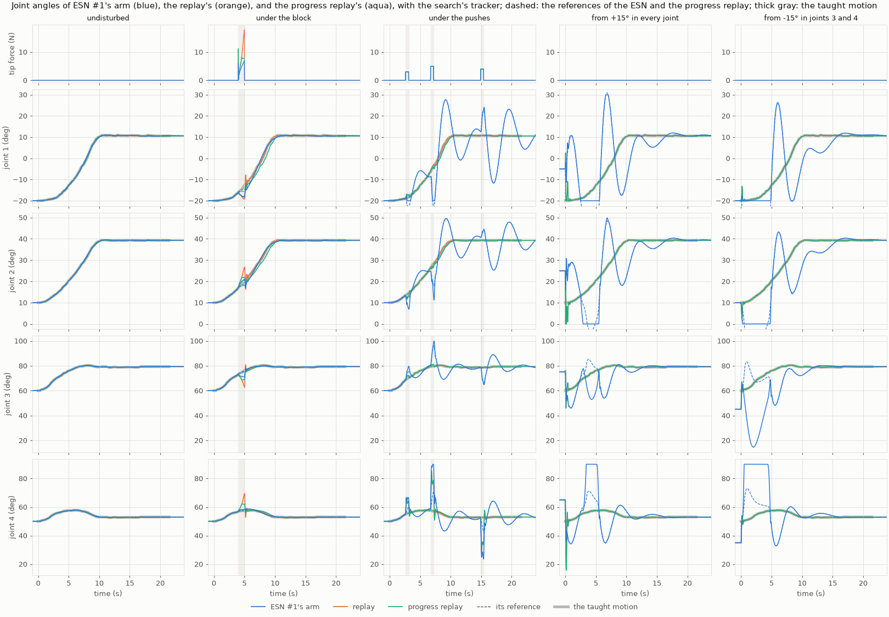

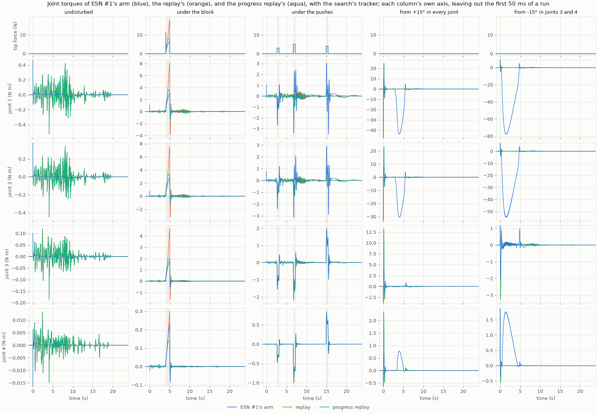

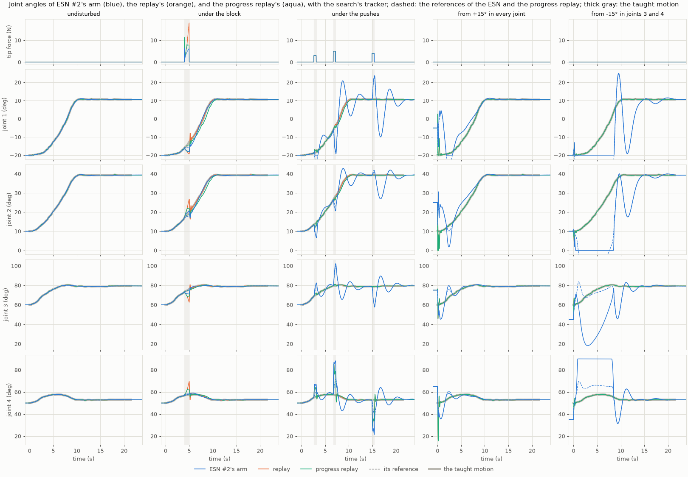

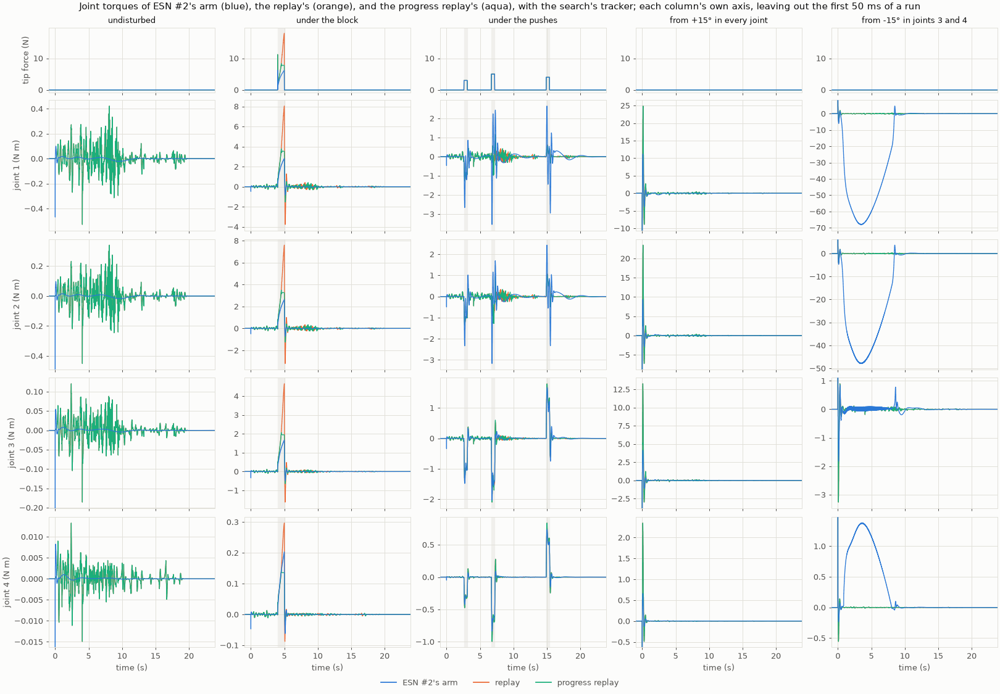

The hand's paths from all 36 starts are in each offset run:
[ESN #1](results/20261109-203446-offsets_robot_following_esn1_lr0.015_sr1.2_is0.05_seed0/paths.png),
[ESN #2](results/20261109-204719-offsets_robot_following_esn2_lr0.02_sr1.35_is0.05_seed7/paths.png).

- **Undisturbed, both ESNs keep to the taught path,** within 2.3 mm, and arrive within
  0.14 s of the take. Their accumulated torque is an eighth of the replays' (0.27 and
  0.28 against 2.18 N m s), with 3 and 4 speed peaks against the replays' 41. ESN #1's
  largest torque, 1.02 N m, is at joint 1 at the very start.
- **Under the block, the references slow down and stay near the arm.**
  - Joints 1 and 2's references stall near the arm. Joint 3's keeps rising with the take
    while the arm falls behind. Joint 4's arm and reference stay together near the take:
    it reaches 58.2° and 58.3° for the ESNs, against 69.5° for the replay and 62.3° for
    the progress replay.
  - The peak torque is 3.12 and 2.82 N m, against the replay's 8.04 and the progress
    replay's 3.78.
  - After the release the hand is carried 12.8 and 14.7 mm off the taught path, and it
    comes back in 1.34 and 3.14 s. The replays' hands stay within 5 mm.
- **Under the pushes, the ESNs give way, and the arm swings.**
  - They follow by 0.64 to 0.78, where both replays keep to the take (0.07 at most).
  - A push carries their arms two to three times farther, 189 and 191 mm against 76 mm
    after the second.
  - After the second push joint 1 rises 16.9° and 10.2° above its plateau, against the
    replay's 0.2°, and ESN #1's hand goes 164 mm past the target along x, ESN #2's 56 mm.
    After the third, joint 1 swings 22.5° and 20.7° below its plateau, with periods of
    about 5 s (ESN #1) and 4 s (ESN #2), and the hand reaches 209 and 187 mm from the
    target, against 53 mm.
  - The peak torque is 3.51 and 3.55 N m against the replay's 2.10, during a push or
    within 1 s after it. Why it grows was not examined.
  - The ringing, which measures motion above 1.5 Hz, sees none of this: 2.6 to 6.6 mm
    against the replay's 3.3 to 6.4 mm.
- **From the offset starts, the median first step and peak torque fall, and the worst
  starts become much worse.**
  - The first step is 6.6 and 7.7 mm against 11.1 mm, and the median peak torque 64.1 and
    72.8 N m against 109.5 N m.
  - From (0, 0, −15, −15)°, the farthest start, ESN #1's reference for joint 1 runs to
    −61.3°, 41.3° past the limit. Joints 1, 2, and 4 stay at their stops for 5.0, 4.5, and
    3.9 s. ESN #2's runs to −56.0°, and those joints stay there for 8.3, 8.0, and 7.2 s.
    The accumulated torque is 400 and 674 N m s against the replay's 5.6, and they arrive
    at 15.27 and 14.18 s against 9.51 s.
  - From (+15, +15, +15, +15)°, the nearest, ESN #1's joints 1, 2, and 4 stay at their
    stops for 3.4, 2.5, and 1.7 s and it arrives at 11.99 s. ESN #2 arrives at 9.57 s.

## 4. Observations

- **The procedure carries over, with two changes.** The whole-matrix gains and the locked
  stops are needed on this arm; with them, the same programs, scenarios, and rule run
  unchanged.
- **The findings do not carry over simply.** Far fewer ESNs complete the task, the
  offset failures spread over all the starts rather than depending on one joint, and the
  passing ESNs gather at the smallest input scaling rather than at larger ones.
- **The first rule asks for completing the task first, and on this arm that selects ESNs
  that read the arm little.** Asking for the following directly finds ESNs that respond in
  three joints, with a block gap below the two-link ESNs'.
- **That response is not free, and it is not uniform.**
  - Joint 3's reference does not follow under the block, and the joint following over all
    joints is less than half the two-link arm's.
  - The torque under the block falls, but the pushes bring higher peaks and longer swings,
    and the worst offset starts press the arm against its stops for seconds.
- **The second rule was fitted to the data it was chosen on.** The limit of 0.5 and the 8
  of 10 seeds were set with those results in view, as the extension was. On held-out
  seeds the following holds and the passing does not. ESN #1 and ESN #2 themselves pass in
  every scenario, but a claim about their settings in general would not be supported.
- **A hypothesis for why small input scalings pass.** The ESN's input is normalized by the
  take's range, and the take's joint 4 moves only ±3.87° around 53.87°. A 15° offset of
  joint 4 is 3.87 half ranges, and under the pushes joint 4 reaches 8.9 to 9.3 half
  ranges in the ESN's input. A small input scaling would shield the reservoir from that.
  This study does not test it.

## 5. Next steps

1. **Joint 3 and the pushes.** Why joint 3's reference does not follow, and why the peak
   torque under the pushes is above the replay's.
2. **The offset starts' stops.** Whether a rule, or a training method, can keep the
   following under the block and avoid pressing the stops from the offset starts.
3. **The remaining checks of the search.** The whole grid's held-out seeds (their
   configurations exist as `sweep_lr*_seeds10to19`), a finer grid around the second rule's
   settings, and the size, the ridge, and the bias scale at ESN #1's setting.
4. **Parts 2 to 4 of the plan,** with ESN #1 and ESN #2: the trackers, the ESNs as
   dynamical systems, and the ESN and the robot as one system.
