# 022 Smaller disturbances on the four-link arm: the pushes' effects scale with the force, and the large offset excursions go

**Summary.** Report 021 chose two ESNs on skelarm's four-link arm, ESN #1 and ESN #2, by a
rule that asks the reference to approach the arm. Its pushes are 3 to 5 N, and its offset
starts are 15° away in each joint. Step 6 of the
[experiment's plan](../../experiments/manual_demonstration_four_dof_consistent_search/README.md)
runs the same two ESNs again, without training:
- under the same pushes at half and at a quarter of their force;
- from starts offset by 5° and by 2.5°, a third and a sixth of report 021's.

The block and the undisturbed runs are report 021's, not run again.

The findings:

- **Under the pushes, the hand's displacement scales with the force for every arm.**
  - At half the force it is 51% to 58% of the full force's, and at a quarter 25% to 32%,
    push by push. The ESNs' is 1.8 to 2.9 times the replay's at every size.
  - The joints' motions keep their shape and their timing. After the second push, joint
    1 of ESN #1 turns at 9.07 and 11.62 s at every size, and ESN #2's at about 8.5 and
    10.4 s.
- **The following barely depends on the size.**
  - The hand's following gain stays between 0.64 and 0.78. Joint 4 follows by 0.28 to 0.42
    at every size.
  - The one clear change is joint 1 under the first push: from 1.85 and 1.97 at the full
    force to 0.98 and 1.03 at a quarter. It comes from the stop. At the full force joint 1
    is held at its lower stop for 0.49 and 0.54 s, while its reference runs on to −23.7°
    and −24.2°.
- **Both ESNs still leave the goal after arriving, at every size.** They arrive while the
  arm still swings from the second push. They are in the goal for good from 20.5 and
  17.6 s at a quarter of the force, against 23.5 and 21.3 s at the full force. The
  replay's is from 9.5 s at a quarter and 15.5 s at the full force. Every run ends in the
  goal.
- **The ESNs' torque.** Their accumulated torque falls from 167% and 150% of the replay's
  at the full force to 103% and 95% at a quarter. Their peak torque rises from 167% and
  169% of the replay's to 195% and 182%.
- **From the offset starts, the large excursions of ±15° are all but gone at ±5° and gone
  at ±2.5°.** Over the 35 starts the three sizes share:
  - every run arrives and never leaves the goal, by 9.85 s at the latest;
  - joints 2 to 4 are at a stop for over 0.1 s in one ESN run at ±5° and in none at
    ±2.5°, against 16 runs of ESN #1 and 7 of ESN #2 at ±15°;
  - the ESNs' accumulated torque is 29% to 40% of the replay's, by the medians, and their
    peak torque 50% to 68%.
- **One start keeps an excursion: ESN #1 from (0, −5, −5, −5)°.** This start is new at
  these sizes, and the farthest from the target of all 54 at ±5°.
  - Its reference goes 32.3° past a joint limit, and joints 1, 2, and 4 sit at their stops
    for 5.0, 3.5, and 2.6 s.
  - It arrives at 14.56 s, and its accumulated torque is 227 N m s. ESN #2 from the same
    start arrives at 9.66 s with 2.0 N m s.
- **Joint 1 starts on its stop, and the gains carry its error to the other joints.** When
  the reference takes joint 1 below its stop, the arm cannot follow. The tracker's gains
  are the whole mass matrix, so joint 1's held error also pushes on joint 2, which then
  moves far more than its own offset.

## 1. Question

1. **The pushes:** under pushes of half and a quarter of report 021's force, does the
   response of the two ESNs scale with the force, and does their following change?
2. **The offset starts:** from starts 5° and 2.5° away, do the references still run past
   the joint limits, and do the arms still press against their stops?
3. **The motors:** how much torque do the ESNs use at these sizes, against the replay?

## 2. Setup

### The ESNs, the arm, and the tracker

Report 021's ESN #1 and ESN #2, as trained there, run on the same arm with the same
tracker, as in
[report 021, Section 2](../021-search-on-a-four-link-arm/README.md#2-setup):

| | ESN #1 ([`esn.toml`](../021-search-on-a-four-link-arm/results/20261109-203149-following_esn1_lr0.015_sr1.2_is0.05_seed0/esn.toml)) | ESN #2 ([`esn.toml`](../021-search-on-a-four-link-arm/results/20261109-203201-following_esn2_lr0.02_sr1.35_is0.05_seed7/esn.toml)) |
| --- | --- | --- |
| Leak rate | 0.015 | 0.02 |
| Spectral radius | 1.2 | 1.35 |
| Input scaling | 0.05 | 0.05 |
| Seed | 0 | 7 |
| Fixed | 400 tanh neurons, sparsity 0.05, a bias per neuron drawn uniformly from [−1, 1] by the seed and not scaled, ridge 10⁻², a 1 s warm-up, a 10 ms period | the same |
| Training | teacher forcing on the take (`demo_00_filtered` of `results/demonstrations/20261103-134628-reach_manual_four_dof`, untrimmed and filtered at 2 Hz), without noise | the same |
| Input | the arm's joint angles every 10 ms, each joint normalized by the take's range of it | the same |

- **The arm:** four links in a horizontal plane, with joint limits of −20 to 30°, 0 to
  120°, 0 to 150°, and −20 to 90°, and stops that lock a joint pressed into them. It starts
  at (−20, 10, 60, 50)°, joint 1 at its lower limit, with the hand 543 mm from the target.
  The goal is a radius of 20 mm around the target.
- **The tracker:** joint PD at ω = 20 rad/s and a damping ratio of 0.4, given the
  reference's velocity. Its gains are the whole mass matrix M at the take's final
  posture, Kp = ω²M and Kd = 2ζωM. Its torque is computed every 10 ms and held between.
- **The runs:** 23.9 s after the 1 s warm-up. Three arms run in each: the ESN, the replay
  of the take by time, and report 014's progress replay.
- **The replays:** in every run here the progress replay is the replay, sample for
  sample (their joint angles, references, and torques are equal in all 220 pairs of
  runs), so only the replay is given. They differ only under report 021's full pushes.

### The disturbances

| | Report 021 (step 5) | Here (step 6) |
| --- | --- | --- |
| Pushes | 3 N at 2.6 s, 5 N at 6.7 s, and 4 N at 14.9 s, each 0.5 s at the tip, at 10°, 80°, and −80° from the direction toward the target | the same at half (1.5, 2.5, and 2 N) and at a quarter (0.75, 1.25, and 1 N) of the force |
| Offset starts | every combination of −15, 0, and 15° in each joint, within the limits: 36 starts | every combination of −s, 0, and s, for s of 5° and of 2.5°: 54 starts each |
| The block, undisturbed | the tip held from 4.0 to 5.0 s; no disturbance | not run again |

**Why 54 starts.** Joint 2 starts at 10° and its lower limit is 0°, so report 021's set
has no start with joint 2 lowered. At 5° and 2.5° it may start lower, which adds 18
starts. The sizes are compared over the 35 offset starts the three sets share (the 36
directions less the take's own start), and the 18 with joint 2 lower are reported apart.

**How far the starts move the hand** from the taught start (median and largest, over the
offset starts): 139.9 and 324.3 mm at ±15°, 42.6 and 119.5 mm at ±5°, and 21.5 and
60.9 mm at ±2.5°.

### The measures

As in [report 021](../021-search-on-a-four-link-arm/README.md), and:

- **The hand's largest displacement under a push:** the largest distance by which the
  hand's displacement from the taught hand at the same time changes from the push's onset,
  up to 0.5 s after the push ends (the following gain's window).
- **Following:** the hand's following gain from the runs' metrics, and report 021's
  following in joint space, each joint's against the replay's reference. Both are
  Σ⟨reference's displacement, arm's displacement⟩ / Σ|arm's displacement|² over the push's
  window. 1 means the reference moves as far as the arm, and 0 that it keeps to the taught
  motion.
- **Arrive and never leave the goal:** the hand comes within 20 mm of the target, stays
  there for the 2 s after, and ends there. **In the goal for good from:** when the hand
  enters the goal for the last time.
- **Accumulated torque:** ∫ Σ|τ_i| dt over the task. **Peak torque:** the largest |τ_i| at
  any joint.
- **From the offset starts:**
  - the furthest the reference goes past any joint's limit;
  - how long each joint sits at a stop (joints 2 to 4 are counted, since joint 1 starts
    on its own);
  - the largest distance between the reference and the arm in the first second (the norm
    over the four joints, in degrees);
  - the offset retained (the run's mean distance from the taught joint path over the
    start's own: 0 returns onto the taught motion, 1 keeps the offset).

### Reproducing the results

The configurations are in
[`manual_demonstration_four_dof_consistent_search`](../../experiments/manual_demonstration_four_dof_consistent_search/README.md),
written below as `$D`. The runs read the ESNs by their run names under the storage root.

| Runs | Command | Commit |
| --- | --- | --- |
| `pushes_{half,quarter}_robot_following_esn1_lr0.015_sr1.2_is0.05_seed0`, `pushes_{half,quarter}_robot_following_esn2_lr0.02_sr1.35_is0.05_seed7` (4) | `uv run python experiments/robot_esn.py $D/<name>.toml` | `6527208` |
| `offsets_{5,2.5}deg_robot_following_esn1_lr0.015_sr1.2_is0.05_seed0`, `offsets_{5,2.5}deg_robot_following_esn2_lr0.02_sr1.35_is0.05_seed7` (4) | the same | `6527208` |
| [`summary`](results/summary) | `uv run python reports/022-smaller-disturbances-on-a-four-link-arm/make_figures.py` | |

- **Running time:** 1 h 13 min in sequence, about 20 s for each pushes run and 17 min for
  each offsets run of 54 starts.
- **Checks:**
  - All 8 run records name `6527208` and no uncommitted changes.
  - The progress replay equals the replay in every run, as above.
  - The full-force and ±15° columns are report 021's runs, read from its copies.
- **What is kept here:** each run's configuration, run record, and `metrics.csv`, and for
  the offset runs also their map of the 54 starts (`grid.png`) and their hand paths
  (`paths.png`).

[`make_figures.py`](make_figures.py) prints the tables of Section 3 and draws its figures.
It reads these copies, report 021's copies of step 5's runs, and the runs' logs under the
storage root, which are not kept in Git. It loads report 021's script as a module for
reading the runs and for its measures.

Videos of these runs are made into `presentations/four-dof-arm_smaller-disturbances/`
under the storage root, by
[`make_media_smaller.py`](../../presentations/four-dof-arm/make_media_smaller.py) at
`2f9d89a`. Plots of ESN #2 against the replay alone go into
`presentations/four-dof-arm_esn2-and-replay/`, by
[`make_media_esn2.py`](../../presentations/four-dof-arm/make_media_esn2.py) at `49c8c4e`.

## 3. Results

### 3.1 Under the pushes: the response scales with the force

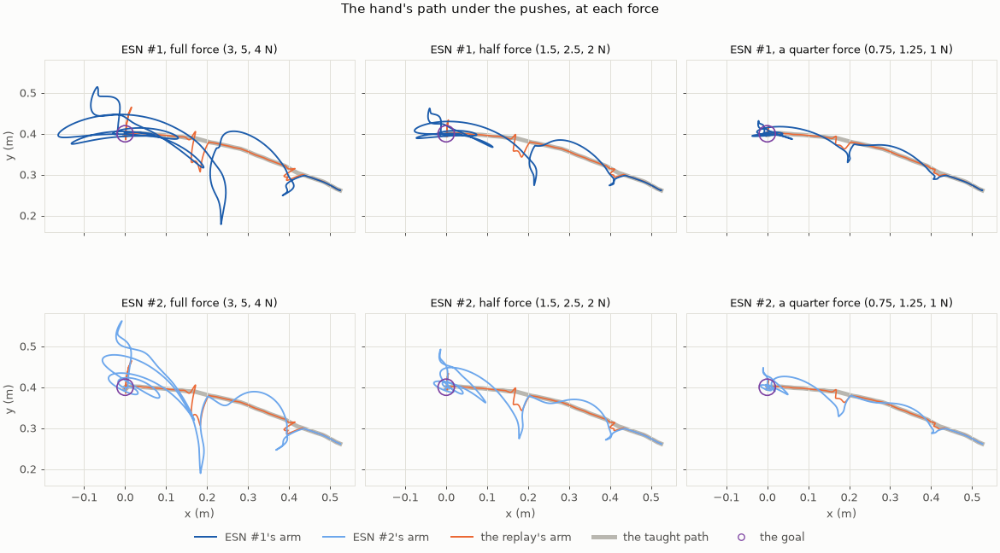

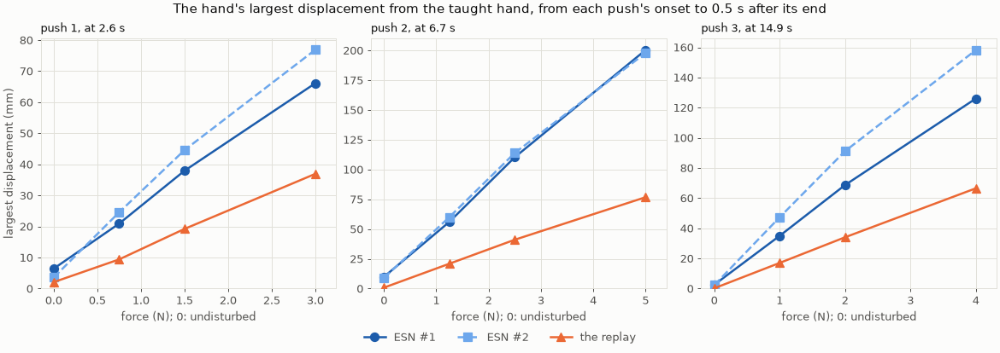

Each cell is at the full, half, and quarter force:

| | ESN #1 | ESN #2 | Replay |
| --- | --- | --- | --- |
| Hand's largest displacement, push 1 (mm) | 66 / 38 / 21 | 77 / 45 / 25 | 37 / 19 / 9 |
| Hand's largest displacement, push 2 (mm) | 200 / 110 / 56 | 198 / 114 / 60 | 77 / 41 / 21 |
| Hand's largest displacement, push 3 (mm) | 126 / 69 / 35 | 158 / 91 / 47 | 67 / 34 / 17 |
| Path RMSE (mm) | 61.6 / 29.5 / 13.2 | 59.7 / 31.2 / 15.4 | 19.6 / 8.6 / 4.0 |
| Hand path length (mm) | 2925 / 1774 / 1110 | 2369 / 1498 / 975 | 1018 / 793 / 678 |
| Peak torque (N m) | 3.51 / 1.88 / 1.02 | 3.55 / 1.83 / 0.96 | 2.10 / 1.03 / 0.53 |
| Accumulated torque (N m s) | 12.3 / 6.6 / 3.5 | 11.0 / 6.0 / 3.2 | 7.3 / 4.7 / 3.4 |
| Arrival (s) | 10.32 / 10.21 / 8.76 | 9.41 / 9.22 / 9.01 | 9.51 / 9.51 / 9.51 |
| Leaves the goal within 2 s of arriving | yes / yes / yes | yes / yes / yes | no / no / no |
| Farthest from the target between arrival and push 3 (mm) | 130 / 74 / 38 | 87 / 43 / 21 | stays in the goal |
| In the goal for good from (s) | 23.5 / 23.2 / 20.5 | 21.3 / 20.8 / 17.6 | 15.5 / 15.4 / 9.5 |
| Ends in the goal (mm from the target) | 2.2 / 1.8 / 1.9 | 7.4 / 5.6 / 4.2 | 3.3 / 3.3 / 3.3 |

- **The displacement is near proportional to the force for every arm.** Against the full
  force, push by push, it is 54% to 57% at half and 28% to 32% at a quarter for ESN #1,
  58% and 30% to 32% for ESN #2, and 51% to 53% and 25% to 27% for the replay. The ESNs'
  stays 1.79 to 2.87 times the replay's at every size. In the same windows the undisturbed
  hand moves up to 9.9 mm for ESN #1, 9.0 mm for ESN #2, and 2.1 mm for the replay, which
  is where the lines meet zero force.
- **Torque.** The replay's peak torque falls in proportion to the force. The ESNs' falls
  less: from 167% and 169% of the replay's at the full force to 183% and 178% at half and
  195% and 182% at a quarter. Every arm's peak comes after the first 10 ms, so it is not
  the jump at the reference's handover in the first control period. Their accumulated
  torque falls more than the replay's, from 167% and 150% of it to 141% and 129%, and to
  103% and 95%. The replay's includes a part that does not shrink: the torque it uses to
  track the taught motion itself, 2.18 N m s undisturbed against the ESNs' 0.27 and 0.28
  ([report 021](../021-search-on-a-four-link-arm/README.md#37-the-chosen-esns-on-the-robot)).
- **The goal.**
  - Both ESNs arrive while the arm still swings from the second push, and their hands come
    out of the goal again within the 2 s after arriving.
  - At a quarter of the force, ESN #1's hand is out from 9.15 to 9.86 s and from 10.83 to
    12.67 s, and ESN #2's from 10.00 to 10.48 s.
  - After the third push both are out again for some seconds, ESN #2's until 17.60 s at a
    quarter, ESN #1's until 20.53 s.
  - The replay's hand is out only during the third push, from 14.95 to 15.46 s at the
    full force and from 14.98 to 15.43 s at half. At a quarter it never leaves.

### 3.2 The following under the pushes

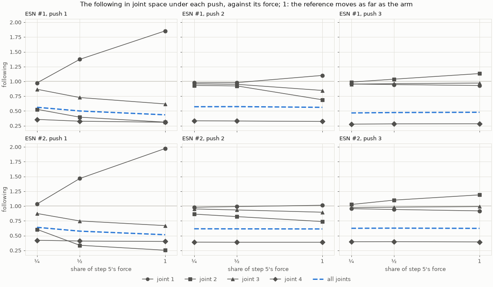

Each cell is at the full, half, and quarter force:

| | Hand | Joint 1 | Joint 2 | Joint 3 | Joint 4 | All joints |
| --- | --- | --- | --- | --- | --- | --- |
| ESN #1, push 1 | 0.64 / 0.67 / 0.68 | 1.85 / 1.37 / 0.98 | 0.31 / 0.40 / 0.53 | 0.62 / 0.73 / 0.87 | 0.31 / 0.33 / 0.36 | 0.43 / 0.50 / 0.56 |
| ESN #1, push 2 | 0.76 / 0.76 / 0.76 | 1.10 / 0.98 / 0.98 | 0.69 / 0.92 / 0.93 | 0.85 / 0.95 / 0.96 | 0.32 / 0.33 / 0.33 | 0.56 / 0.57 / 0.57 |
| ESN #1, push 3 | 0.67 / 0.67 / 0.66 | 0.93 / 0.95 / 0.96 | 1.13 / 1.04 / 0.99 | 0.97 / 0.96 / 0.95 | 0.28 / 0.28 / 0.28 | 0.48 / 0.47 / 0.47 |
| ESN #2, push 1 | 0.68 / 0.72 / 0.74 | 1.97 / 1.47 / 1.03 | 0.25 / 0.34 / 0.61 | 0.67 / 0.75 / 0.87 | 0.40 / 0.41 / 0.42 | 0.52 / 0.58 / 0.64 |
| ESN #2, push 2 | 0.74 / 0.75 / 0.75 | 1.01 / 0.99 / 0.98 | 0.74 / 0.82 / 0.86 | 0.90 / 0.93 / 0.95 | 0.39 / 0.39 / 0.39 | 0.61 / 0.61 / 0.62 |
| ESN #2, push 3 | 0.78 / 0.77 / 0.77 | 0.92 / 0.94 / 0.96 | 1.19 / 1.10 / 1.03 | 0.99 / 0.98 / 0.97 | 0.39 / 0.40 / 0.40 | 0.62 / 0.63 / 0.62 |

The replay's hand following is 0.00 at every push and size.

- **Most gains change little with the size.** At a quarter of the force, joints 1 to 3
  follow by 0.86 to 1.03, but for joint 2 under the first push (0.53 and 0.61). Joint 4
  follows by 0.28 to 0.42 at every size.
- **Joint 1 under the first push** falls from 1.85 and 1.97 to 0.98 and 1.03. During this
  push joint 1 is near its lower stop. Within the second from the push's onset, it is held
  at the stop for 0.49 and 0.54 s at the full force, while its reference runs on to −23.7°
  and −24.2°, so the reference moves farther than the arm. At half it is there for 0.42
  and 0.46 s. At a quarter ESN #1's joint 1 does not reach the stop, and ESN #2's is there
  for 0.11 s.
- **Joints 2 and 3 under the first push follow more as the force shrinks:** joint 2 from
  0.31 and 0.25 to 0.53 and 0.61, and joint 3 from 0.62 and 0.67 to 0.87.
- **Against the undisturbed run.** Taking each signal less the same arm's undisturbed run,
  in place of the taught motion, changes the hand's gains by at most 0.04. It changes the
  joints' by at most 0.13, for ESN #1's joint 2 under the first push at a quarter. The
  reading does not change.

### 3.3 Under the pushes, over time

Each joint's angle less the taught motion, and each joint's torque, at each force and
undisturbed. Each panel has its own vertical axis, so the shapes can be compared across
the sizes.

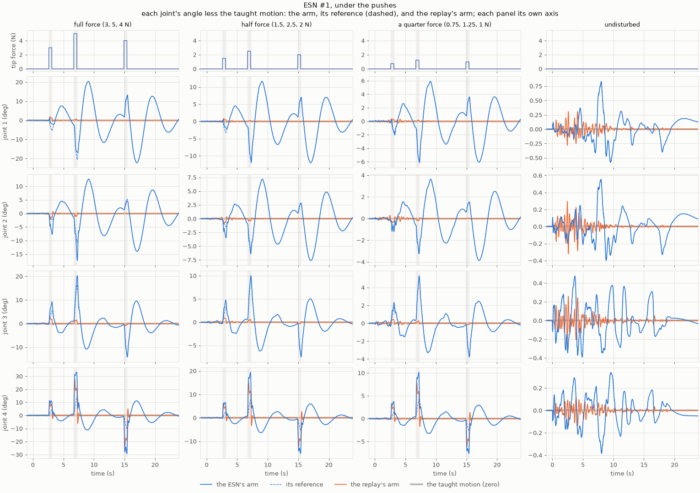

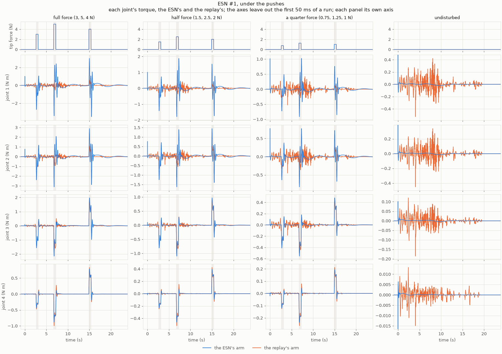

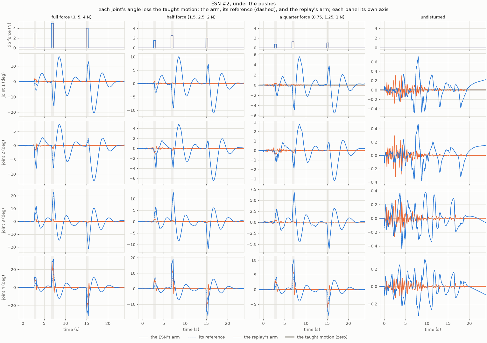

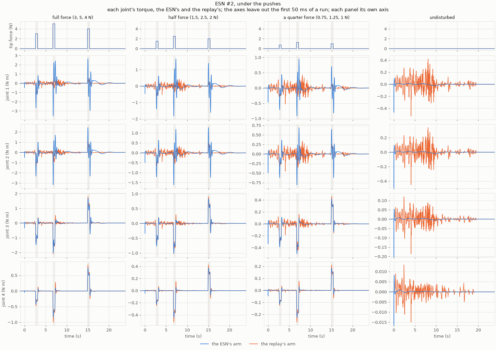

- **After each push the arm and its reference swing together around the taught motion,
  with the same shape at every size.** Joint 1's swing after the second push turns at the
  same times at every size:
  - ESN #1: at 9.07 s (+20.4°, +11.6°, and +5.9° at the full, half, and quarter force)
    and 11.62 s (−11.7°, −6.7°, and −3.4°), about 2.5 s apart;
  - ESN #2: at 8.54, 8.53, and 8.50 s and at 10.40, 10.38, and 10.36 s, about 1.9 s
    apart.
- The ESNs' swing is a slow one, a period of about 5 s for ESN #1 and 4 s for ESN #2.
  ESN #1's hand is not back within 5 mm of the taught path before the next push after the
  first two pushes, but for the first at a quarter (2.50 s). After the third it is back
  in 6.26 to 6.43 s. ESN #2's hand is back in 3.0 to 3.5 s after the first, 5.3 to 6.1 s
  after the second, and 5.6 to 8.1 s after the third.
- The replay's arm only rings, at the tracker's own 2.9 Hz, and is back within 5 mm of the
  taught path within 0.24 s of every push.
- **Joint 4** of the arm moves more than its reference during each push, at every size,
  which is why it follows by only 0.3 to 0.4.
- **Undisturbed,** the ESNs' joints stay within 0.83° and 0.71° of the taught motion,
  against the replay's 0.32°. Their torques
  after the first 10 ms stay within 0.13 and 0.10 N m. Their peaks, 1.02 and 0.50 N m,
  come in the first 10 ms, when the reference passes from the held start to the ESN's
  first output.

### 3.4 From the offset starts: the excursions go

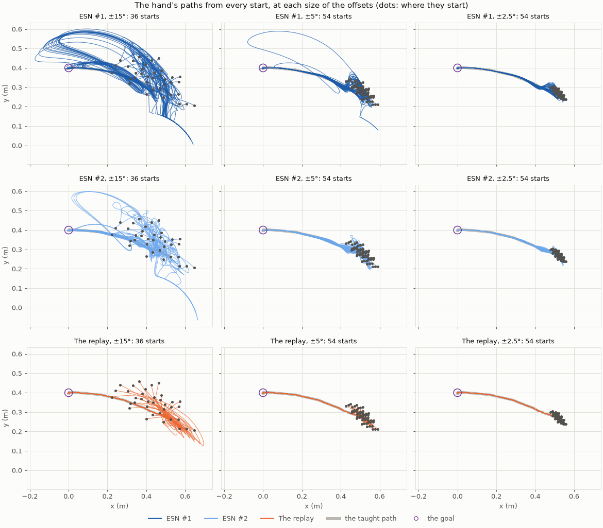

Over the 35 offset starts the three sizes share; each cell is at ±15°, ±5°, and ±2.5°:

| | ESN #1 | ESN #2 | Replay |
| --- | --- | --- | --- |
| Arrive and never leave the goal (of 35) | 32 / 35 / 35 | 35 / 35 / 35 | 35 / 35 / 35 |
| Latest arrival (s) | 15.27 / 9.85 / 9.73 | 14.59 / 9.66 / 9.63 | 9.51 / 9.51 / 9.51 |
| Path RMSE, median (mm) | 58.0 / 11.4 / 5.7 | 34.4 / 9.0 / 3.8 | 17.6 / 3.5 / 1.3 |
| Path RMSE, largest (mm) | 108.6 / 25.2 / 11.5 | 138.4 / 19.4 / 8.5 | 65.5 / 10.0 / 3.4 |
| Peak torque, median (N m) | 64.1 / 18.9 / 9.2 | 72.8 / 23.8 / 12.3 | 109.5 / 36.5 / 18.2 |
| Accumulated torque, median (N m s) | 10.2 / 1.8 / 0.9 | 5.3 / 1.6 / 0.9 | 9.5 / 4.4 / 3.2 |
| Accumulated torque, largest (N m s) | 399.8 / 3.7 / 1.9 | 797.0 / 4.2 / 2.2 | 18.2 / 7.4 / 4.7 |
| Starts with joints 2 to 4 at a stop over 0.1 s | 16 / 1 / 0 | 7 / 0 / 0 | 0 / 0 / 0 |
| Starts with the reference over 5° past a limit | 23 / 1 / 0 | 9 / 0 / 0 | 0 / 0 / 0 |
| Reference to arm in the first second, median (°) | 19.2 / 6.3 / 3.1 | 17.1 / 5.8 / 2.8 | 21.4 / 8.6 / 4.4 |
| Offset retained, median | 0.55 / 0.22 / 0.24 | 0.14 / 0.13 / 0.15 | 0.02 / 0.03 / 0.05 |

- **The excursions of ±15°, where the reference runs past the joint limits and the arm
  is held against its stops, are all but gone at ±5° and gone at ±2.5°.**
  - At ±5° the reference goes at most 5.8° (ESN #1) and 4.8° (ESN #2) past a limit,
    against 41.3° and 41.8° at ±15°, and at ±2.5° at most 2.6° and 2.4°.
  - The one start of the 35 at ±5° with a joint of 2 to 4 at a stop over 0.1 s is ESN
    #1's from (0, 0, −5, −5)°: joint 2 for 0.64 s.
- **The ESNs use less torque than the replay from these starts.** Their median
  accumulated torque is 40% and 37% of the replay's at ±5°, and 29% and 29% at ±2.5°.
  Their median peak torque is 52% and 65%, and 50% and 68%. At ±15° the accumulated
  torque was 108% and 55%. Most peaks come in the first instants, when the tracker first
  meets the offset, so they say little about the rest of the run.
- **The ESNs keep part of the offset; the replay returns onto the taught motion.** The
  median offset retained is about 0.2 for ESN #1 and 0.14 for ESN #2 at both smaller
  sizes, against the replay's 0.03 to 0.05.

### 3.5 From the offset starts, over time

Each joint's angle less the taught motion, and each joint's torque, from the start offset
by −s in joints 3 and 4, the farthest of the 35 from the target at ±15°, and from +s in
every joint, the nearest, at each size. The ±15° columns are report 021's runs.

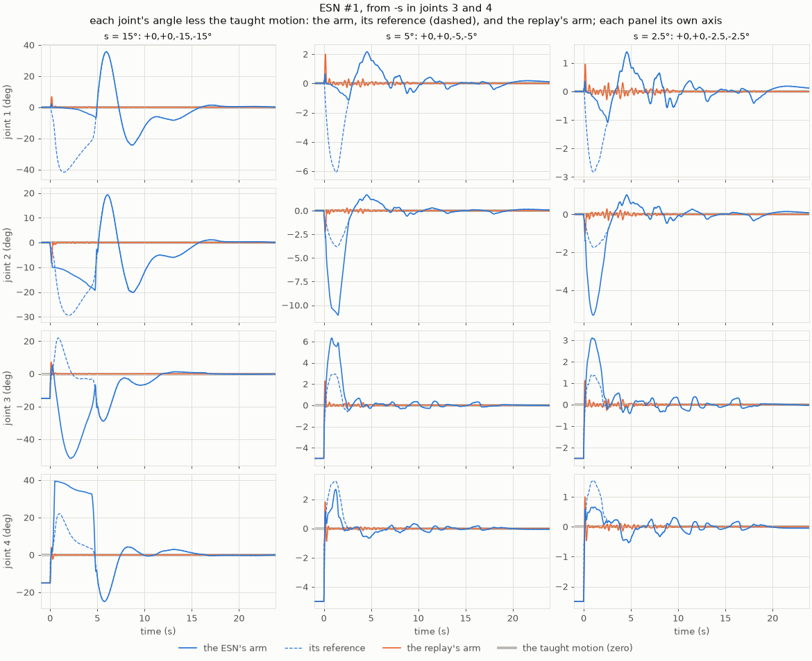

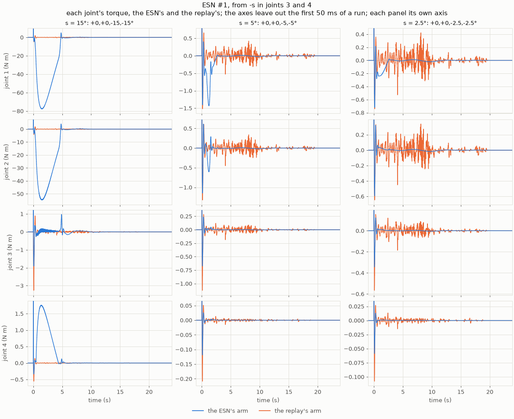

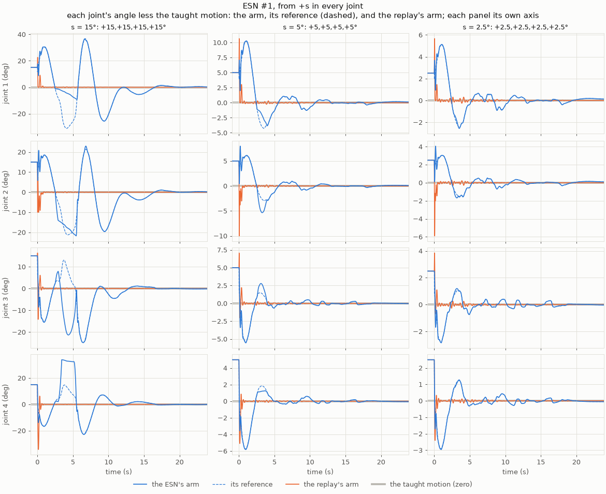

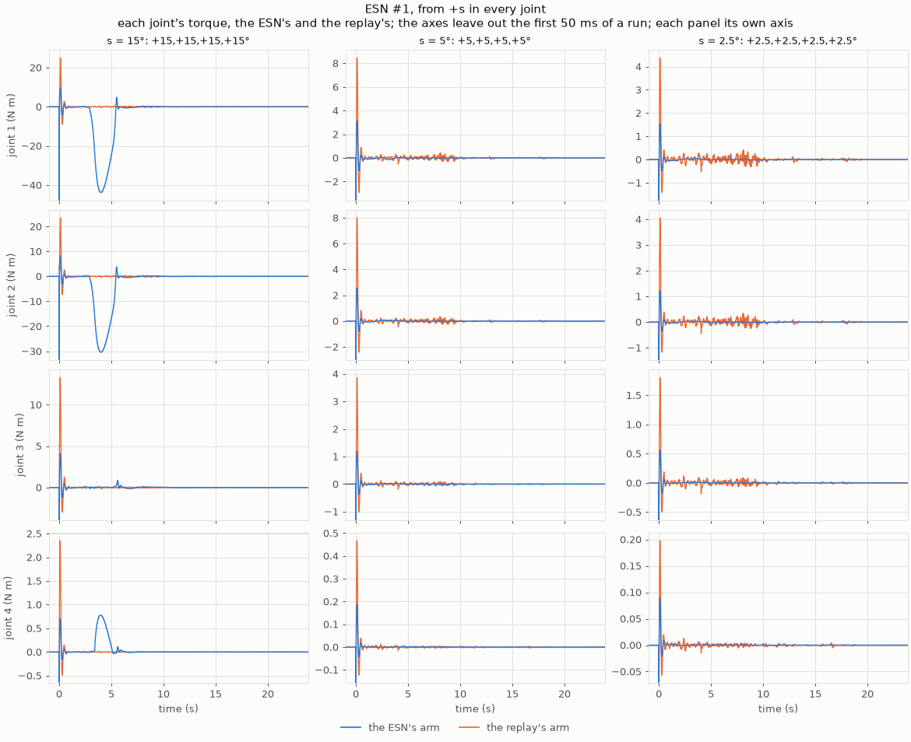

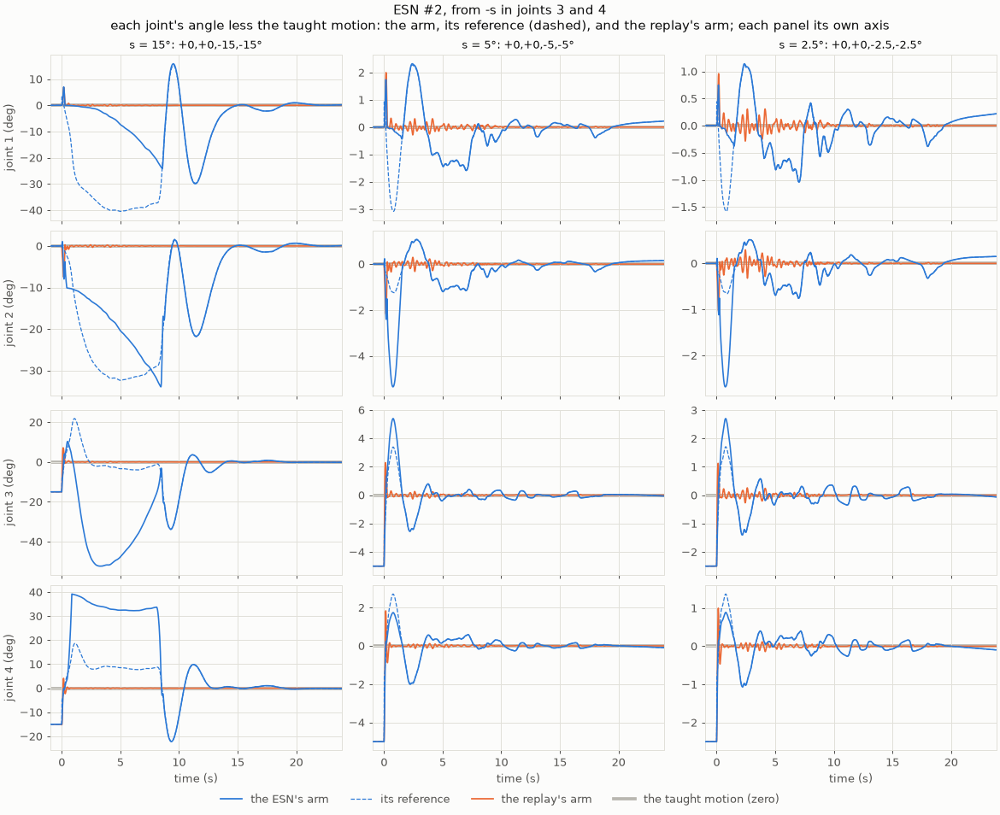

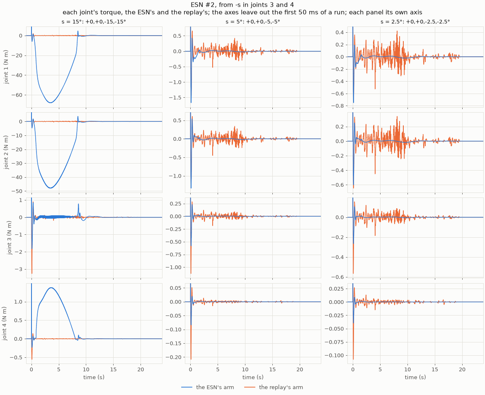

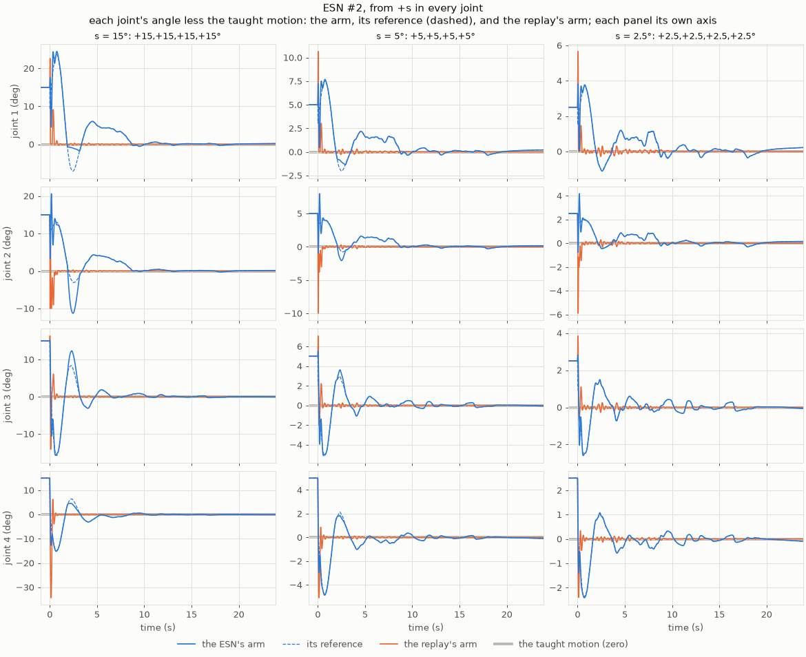

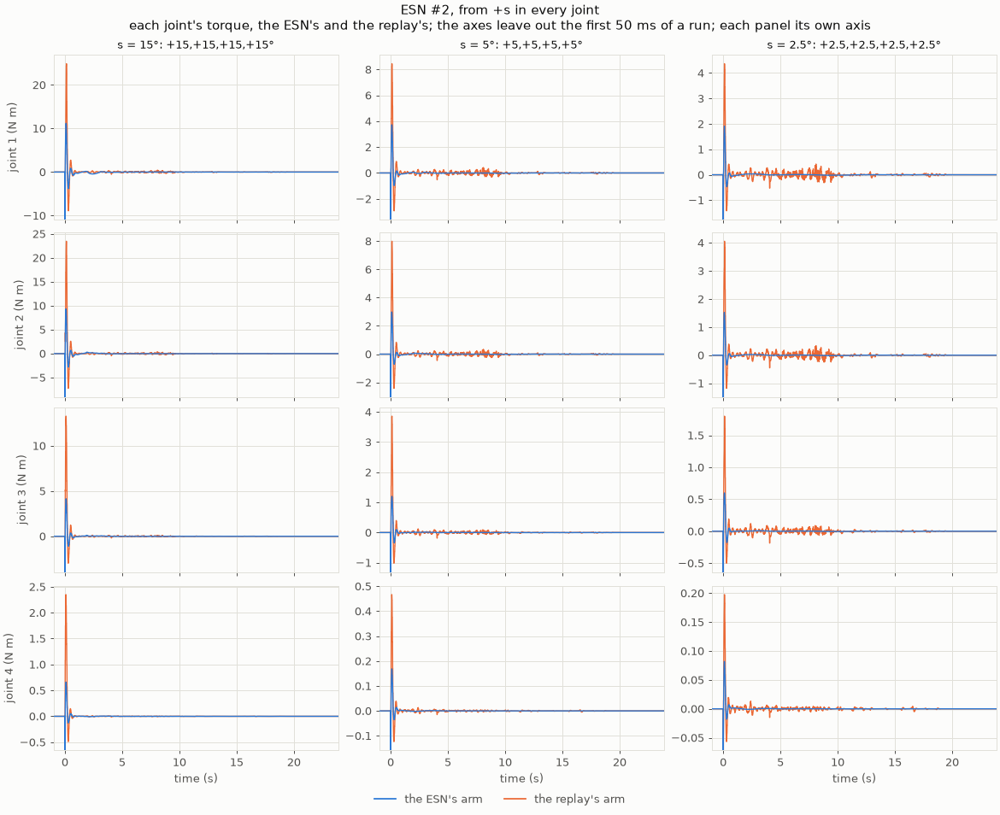

**Why joint 2 moves more than its own offset.** From (0, 0, −5, −5)°, ESN #1's joint 2
goes 11° below the taught motion, and 5° from (0, 0, −2.5, −2.5)°, though its own offset
is zero.

- **The cause is at joint 1.** Joint 1 starts on its stop at −20°, and from these
  starts its reference goes past the stop, by up to 5.8° at ±5° and 2.6° at ±2.5°. The
  arm cannot follow: joint 1 sits at its stop for 2.45 and 2.33 s and keeps an error.
- **The gains carry that error to joint 2.** They are the whole mass matrix, so joint 1's
  error also makes a torque at joint 2, and joint 2 moves until its own error balances it.
- **At 1 s in the ±5° run:**
  - the reference less the arm is (−5.50, 7.01, −3.01, 1.17)°, with the arm at
    (−20.0, 0.0, 67.5, 53.0)°: joints 1 and 2 are both at their stops;
  - joint 2's torque from each joint's error, Kp e, is −8.05 N m from joint 1, +9.11 from
    joint 2 itself, and −1.39 and +0.03 from joints 3 and 4, a sum of −0.31 N m;
  - the velocities add −0.05 N m, and the torque applied is −0.35 N m.
- The same mechanism, larger, holds the arm against its stops at ±15°.
- **From +s in every joint,** the reference moves with the arm in the first second and
  returns to the taught motion. At ±5° and ±2.5° the shapes are alike and the size is in
  proportion.

### 3.6 The starts with joint 2 lower

Over the 18 starts with joint 2 lower, which exist only at ±5° and ±2.5°; each cell is at
±5° and ±2.5°:

| | ESN #1 | ESN #2 | Replay |
| --- | --- | --- | --- |
| Arrive and never leave the goal (of 18) | 18 / 18 | 18 / 18 | 18 / 18 |
| Latest arrival (s) | 14.56 / 9.71 | 9.68 / 9.64 | 9.51 / 9.51 |
| Path RMSE, median (mm) | 12.9 / 6.0 | 9.5 / 4.3 | 2.7 / 1.1 |
| Path RMSE, largest (mm) | 96.5 / 9.2 | 18.0 / 8.3 | 12.3 / 4.6 |
| Peak torque, median (N m) | 19.2 / 6.9 | 20.8 / 10.7 | 18.5 / 9.2 |
| Accumulated torque, median (N m s) | 1.8 / 0.9 | 1.7 / 1.0 | 3.4 / 2.8 |
| Accumulated torque, largest (N m s) | 227.4 / 1.7 | 3.2 / 1.9 | 5.5 / 3.8 |
| Starts with joints 2 to 4 at a stop over 0.1 s | 2 / 0 | 1 / 0 | 0 / 0 |
| Starts with the reference over 5° past a limit | 3 / 0 | 2 / 0 | 0 / 0 |
| Reference to arm in the first second, median (°) | 8.4 / 4.1 | 7.7 / 3.8 | 7.8 / 3.9 |
| Offset retained, median | 0.19 / 0.20 | 0.13 / 0.14 | 0.02 / 0.04 |

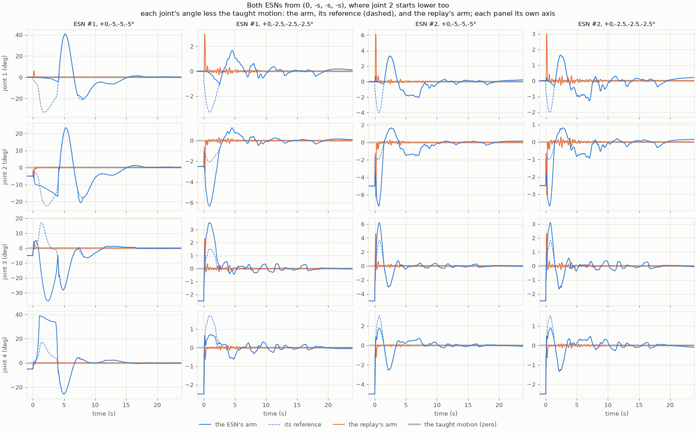

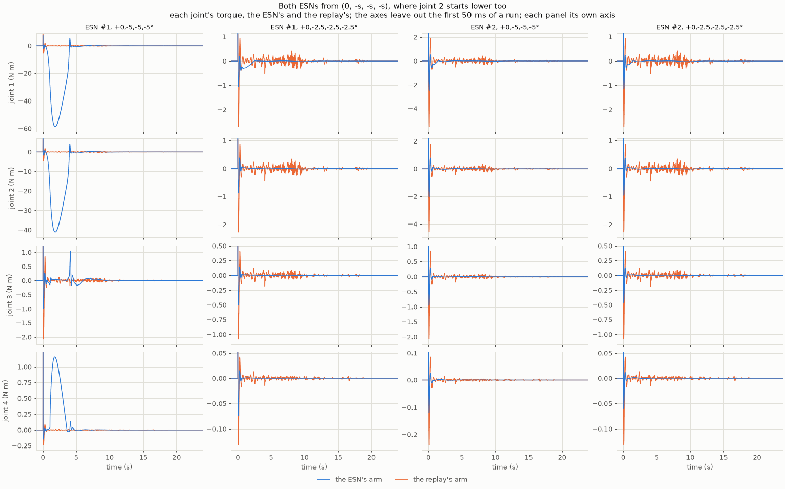

- **One run keeps an excursion: ESN #1 from (0, −5, −5, −5)°.**
  - This start's hand is 619 mm from the target, the farthest of all 54 at ±5°, against
    543 mm from the take's start.
  - The reference goes 32.3° past a joint limit, and joints 1, 2, and 4 are at their
    stops for 4.97, 3.54, and 2.56 s.
  - The arm arrives at 14.56 s with a path RMSE of 96.5 mm and an accumulated torque of
    227.4 N m s. It still arrives and stays in the goal.
- **From the same start, ESN #2 arrives at 9.66 s,** with a path RMSE of 17.0 mm, its
  reference 3.9° past a limit, and an accumulated torque of 2.0 N m s.
- **All the other runs from these 18 starts arrive by 9.78 s.**
  - At ±5°, ESN #1's joint 2 is at its stop for 0.95 s from (5, −5, −5, −5)°, and ESN
    #2's for 0.43 s from (0, −5, −5, 5)°.
  - The reference goes over 5° past a limit from 2 other starts of ESN #1 (6.1° and 6.4°)
    and from 2 of ESN #2 (6.9° and 5.0°).
  - At ±2.5° none of this happens: the references go at most 3.1° and 3.4° past a limit,
    and joints 2 to 4 never reach a stop.
- **Torque.** The ESNs' median peak torque over these 18 is 104% and 113% of the replay's
  at ±5°, and 75% and 115% at ±2.5°, against 50% to 68% over the 35, since the replay's
  own peak is lower from these starts. Their median accumulated torque is 52% and 49%,
  and 32% and 35%.

## 4. Observations

- **Under the pushes the two ESNs keep their character at every size.** Their responses
  scale with the force, their swings keep their times, and their references follow by
  about the same gains. A smaller push shrinks the deviation, not its ratio to the
  replay's.
- **The swing after a push is what takes the hand out of the goal, at every size.** It is
  slow, about 5 s and 4 s per period, and both the arm and its reference take part in it.
  Smaller pushes shorten the time out of the goal but do not remove it.
- **From starts nearer the taught posture, both ESNs behave well.** The excursions, the
  time at the stops, and the large accumulated torques of ±15° are nearly all gone at
  ±5° and gone at ±2.5°. There the ESNs use 29% to 40% of the replay's accumulated torque.
- **The remaining problem is the same one at every size.** When the reference takes a
  joint past its limit, the arm cannot follow. Through the whole mass matrix's gains, that
  error then moves the other joints. Joint 1 starts on its stop, so this is most likely
  where the ESN's reference takes joint 1 lower.
- **Limits.**
  - The two ESNs were chosen under report 021's large disturbances and were not chosen
    again here, so these results describe those two ESNs, not the best ESN for smaller
    disturbances.
  - Each number is one run per ESN, from one take and one tracker, in a simulation
    without noise, which repeats exactly.

## 5. Next steps

1. **The swing after a push.** Why the ESN and the arm swing together slowly after a
   push, and whether a rule or a training method can damp it without losing the
   following.
2. **The references past the joint limits.** Clipping the reference at the limits, or
   training with the limits in view, would keep the held error of joint 1 from moving the
   other joints.
3. **The remaining steps of report 021's plan**, with ESN #1 and ESN #2: the trackers,
   the ESNs as dynamical systems, and the ESN and the robot as one system.
