# 023 One target from many starts: nine takes start where the arm is and go directly, but a push sends the hand far away

**Summary.** Reports 017 to 020 taught one reach from one start posture. This is the first
stage of extending them to more tasks: one target, reached from many start postures, on
the two-link arm of those reports with no joint limits. Nine takes are taught by hand, one
from each of nine start postures whose hands are spread over the workspace. ESNs of 800
neurons are trained on all nine and generate the reference of the simulated robot from the
arm's measured joint angles, with report 017's tracker. Two ESNs are chosen by a search
that scores undisturbed runs only, ESN #1 and ESN #2, and seven claims fixed before the
runs are tested on them, against the replay of the take that starts nearest.

The findings:

- **Undisturbed, both ESNs arrive and hold from everywhere tried (claims 1 and 2 hold).**
  From the nine takes' starts and from 36 unseen starts, every run arrives within 20 mm of
  the target and stays, as the replay's does.
- **They start where the arm is and go directly (claims 3 and 4 hold).** Medians over the
  36 unseen starts, for ESN #1, ESN #2, and the replay of the nearest take:
  - the reference's fastest joint speed is 183 and 119 °/s, against 2,100 °/s;
  - the largest joint torque is 9.6 and 6.2 N m, against 99.4 N m;
  - the detour ratio is 1.08 and 1.09, against 1.59.
- **Under pushes both ESNs fail (claim 5 fails).** Under report 007's three pushes, the
  hand arrives and is within 20 mm at 24 s in 2 and 1 of nine runs, against 9 of 9 for the
  replay and the progress replay. At twice and at four times the forces it is 1 or 2 of
  nine.
  - **The reference goes with the pushed arm.** The following gain is 0.94 to 0.96 by the
    median, at every push. The first two pushes take the hand 0.20 to 0.40 m off the
    take's path, against 0.03 and 0.05 m for the replay.
  - **Most runs still arrive before the third push.** At report 007's forces, 7 and 5 of
    the nine hands are in the goal through the second before it.
  - **The third push, of 4 N for 0.5 s on the resting arm, sends the hand far away.** It
    goes 0.11 to 1.52 m from the target with ESN #1 and 0.12 to 1.04 m with ESN #2, against
    at most 0.13 m for the replay. The ESN then reaches again from there, and the run ends
    at 24 s before it is back.
  - **Given time, every hand comes back.** In runs of 48 s, added after seeing this, all
    18 ESN runs are in the goal for good by 32.6 s (ESN #1) and 27.6 s (ESN #2), 5 to 18 s
    after the push, and end 3 to 11 mm from the target. The replay is back by 16.2 s.
- **One take is enough to arrive (claims 6 and 7 fail as stated).** Both claims asked for
  more runs that hold with more takes. ESNs trained on one take, chosen by the same
  search, also hold from all 44 starts their take does not start from.
- **What more takes change is how the hand gets there.** At ESN #1's setting, from the
  unseen starts, with one, three, six, and nine takes:
  - the median detour ratio is 1.52, 1.17, 1.08, and 1.07;
  - the reference's fastest joint speed is 2,340, 317, 227, and 127 °/s;
  - the largest torque is 122.5, 15.7, 10.6, and 6.5 N m.

## 1. Question

1. **Many starts:** can one ESN, trained on nine takes of the same reach from nine start
   postures, take the arm to the target from the takes' starts and from start postures no
   take starts from?
2. **Starting where the arm is:** from a start no take starts from, does its reference
   begin at the arm and go directly, where a replay must jump to a take?
3. **Pushes:** does such an ESN, chosen without pushes, withstand them as report 017's
   did?
4. **The takes:** what do nine takes give that one does not, and how many are needed?

## 2. Setup

### The robot, the takes, and the start postures

- **The robot** is the arm of reports 005 to 020 (v2's links and its target, at
  (−0.6, 0.4) m) with no joint limits, simulated every 2 ms
  ([`reach_manual_v2_no_limits.toml`](../../experiments/demonstrations/reach_manual_v2_no_limits.toml)).
  With v2's limits of ±180°, joint 1's stop is a line across the workspace that the hand
  cannot cross. Without it the hand goes to the target either way around the base.
- **The nine takes** are recorded by hand with skelarm's recorder, one from each start
  posture, and filtered at 2 Hz ([`data/`](data)). They last 13.3 to 24.3 s, and their
  hands start 0.22 to 1.44 m from the target. Takes 03 and 04 end with joint 1 at −246°,
  the same posture as the others' 114° reached the other way around.
- **The takes' starts** put the hand on two rings around the base, six hands on the outer
  and three on the inner, each standing for the same area of the workspace, with joint 2
  positive.
- **The 36 untaught starts** are laid out the same way on three rings (18, 12, and 6
  hands). The scoring that chose the ESNs ran from them, so they are not held out.
- **The 36 unseen starts** are those rings turned 15° back. None is nearer than 0.09 m to
  a take's start, 0.07 m to an untaught start, or 0.12 m to the target. No search or
  scoring ran from them.

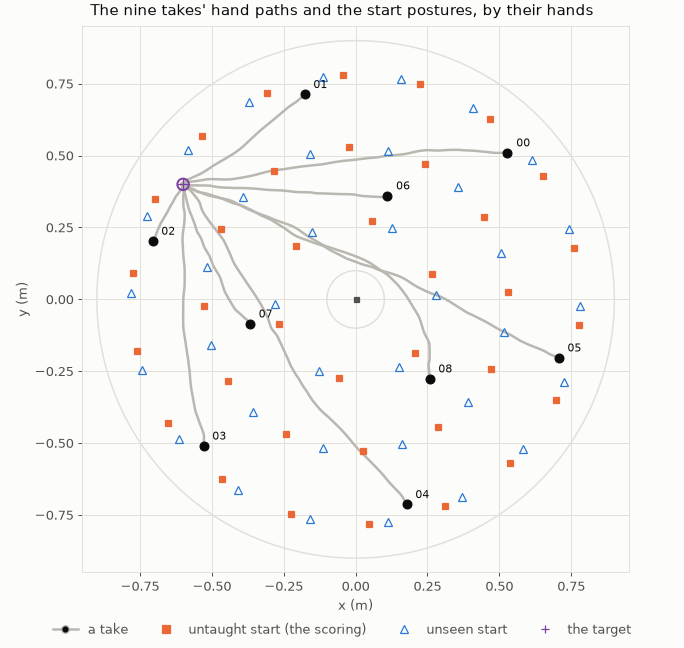

### The ESNs

| | ESN #1 ([`esn.toml`](results/20261118-003541-esn1_lr0.055_sr1.2_is1_ridge1_seed4/esn.toml)) | ESN #2 ([`esn.toml`](results/20261118-003612-esn2_lr0.1_sr1.05_is0.5_ridge10_seed3/esn.toml)) | One-take ESN #1 ([`esn.toml`](results/20261118-024013-one_take_esn1_lr0.017_sr1.05_is0.045_ridge0.1_seed5/esn.toml)) | One-take ESN #2 ([`esn.toml`](results/20261118-024015-one_take_esn2_lr0.055_sr0.75_is0.22_ridge1_seed3/esn.toml)) |
| --- | --- | --- | --- | --- |
| Leak rate | 0.055 | 0.1 | 0.017 | 0.055 |
| Spectral radius | 1.2 | 1.05 | 1.05 | 0.75 |
| Input scaling | 1 | 0.5 | 0.045 | 0.22 |
| Ridge | 1 | 10 | 0.1 | 1 |
| Seed | 4 | 3 | 5 | 3 |
| Training | teacher forcing on the nine takes (`demo_00_filtered` to `demo_08_filtered` of `results/demonstrations/20261117-164658-reach_manual_v2_no_limits`), without noise | the same | on take 00 alone (`demo_00_filtered`) | the same |

Fixed for all: 800 tanh neurons, sparsity 0.05, a bias per neuron drawn uniformly from
[−1, 1] by the seed and not scaled, a 1 s warm-up on the held start posture, a 10 ms
period. The input is the arm's two joint angles every 10 ms, each normalized by the
training takes' range of it. The ESNs get no task knowledge: no target and no context.

### The tracker and the runs

- **The tracker** is report 017's: joint PD at ω = 20 rad/s and a damping ratio of 0.4,
  given the reference's velocity, its torque computed every 10 ms and held between. Its
  gains are set where the take of reports 005 to 020 ends (kp = 74.96 and 8.96 N m/rad,
  kd = 3.00 and 0.358 N m s/rad), whatever takes an ESN is trained on.
- **A run** is 24 s after the 1 s warm-up.
- **The replay** plays by time the take whose start is nearest the run's start. Under the
  pushes a third arm runs, report 014's progress replay of that take (a lead of 2.5°, a
  window of 1 s).

### The search

The rule was fixed on 2026-11-17 before any run of the search, and is given in full in the
[experiment's README](../../experiments/manual_demonstration_v2_many_starts/README.md#the-search):

1. **The runs:** each ESN on the robot, undisturbed, from each of the nine takes' starts.
2. **A run holds** if the hand arrives within 20 mm of the target and stays within it for
   the 2 s after. Nothing later is required.
3. **A setting's score** is how many of its runs hold, the most first, then the median
   detour ratio of its runs that arrive, the smallest first.
4. **The coarse search:** 108 settings with one reservoir each (seed 0), over leak rates of
   0.01, 0.03, 0.1, and 0.3, spectral radii of 0.9, 1.2, and 1.5, input scalings of 0.1,
   0.5, and 2, and ridges of 10⁻⁴, 10⁻², and 1.
5. **The fine search:** 81 settings around the best coarse one, each parameter at the
   center's value and halfway to its coarse neighbor on each side, with five reservoirs
   each (seeds 1 to 5).
6. **The chosen ESNs** are the typical seeds of the two best fine settings. A setting's
   typical seed is, of its seeds with the most runs that hold, the one whose own median
   detour ratio is nearest the setting's.

**A step added afterwards (2026-11-17).** The two ESNs this rule chose differ from the 36
untaught starts, which the search did not see (Section 3.1). So the fine search's settings
that hold in every run were scored again, by the same score, over the takes' starts and
the 36 untaught ones. The typical seeds of the two best are ESN #1 and ESN #2. The step
was decided after seeing those results and before any run of it.

**What the search leaves out:** pushes, a block, offset starts, and held-out seeds. Report
017's search required every ESN to pass a block and pushes.

**The one-take baseline** goes through the same three steps, trained on take 00 alone and
run from its start (and from the 36 untaught starts in the last step). Take 00's hand
starts in the direction of the start of reports 005 to 020's take.

### The measures

- **A run holds:** as in the search.
- **The detour ratio:** the length of the hand's path until it arrives, over the straight
  distance from its start to the goal. It is 1 for a straight reach and never less.
- **The reference's fastest joint speed** over the run (°/s), and **the largest joint
  torque** (N m). A reference that starts away from the arm shows in both.
- **Under the pushes, a run succeeds** if the hand arrives and is within 20 mm of the
  target when the run ends. Leaving the goal during the hold is excused, as in report 017.
- **Off the path:** the hand's largest distance from the take's path from a push's onset.
  **The following gain:** how far the reference moves with the arm from a push's onset to
  0.5 s after its end, 0 for a reference that keeps to the take and 1 for one that moves
  as far as the arm.
- **In the goal for good from:** when the hand enters the goal for the last time.

### The claims

Fixed on 2026-11-18 before any of their runs. Each is to hold for ESN #1 and for ESN #2.

1. **The takes' starts.** Undisturbed, from each of the nine takes' starts, the hand
   arrives and holds, as the replay's does.
2. **The unseen starts.** From the 36 unseen starts, the hand arrives and holds from as
   many as the replay of the take that starts nearest.
3. **Starting where the arm is.** From the 36 unseen starts, the reference's fastest joint
   speed and the largest joint torque are smaller than the replay's, in their medians.
4. **Going directly.** From the 36 unseen starts, the median detour ratio is smaller than
   the replay's.
5. **Pushes.** Under report 007's three pushes at their forces, at twice, and at four
   times them, from each take's start, the hand arrives and ends within 20 mm of the
   target in at least as many of the nine runs as the replay's and as the progress
   replay's, at each size.
6. **Nine takes against one.** From the 44 starts take 00 does not start from (the other
   eight takes' and the 36 unseen), ESN #1 and ESN #2 each hold from more starts than
   one-take ESN #1 and than one-take ESN #2, with a smaller median detour ratio.
7. **More takes.** At ESN #1's setting and at ESN #2's, over five reservoirs (seeds 1 to
   5), the runs that hold from the 36 unseen starts are more with nine takes than with
   one, and do not decrease from one take to three, to six, to nine.

**The pushes** are report 007's: 3 N at 10° from the direction toward the target, 5 N at
80°, and 4 N at −80°, each for 0.5 s at the tip. The first two are placed along each take,
where its hand is 18% and 62% of the way to the target, as they come in the take of
reports 005 to 020. Over the nine takes that is at 1.5 to 3.7 s and at 2.8 to 7.5 s. The
third comes at 15 s, after every take has arrived.

**The take counts** are one, three, six, and nine, each set holding the one before: take
00; takes 00, 02, and 04, every other hand of the outer ring; the outer ring; and all
nine. The plan had sets of three and five, proposed for starts a step apart in joint
space.

### Reproducing the results

The configurations are in
[`manual_demonstration_v2_many_starts`](../../experiments/manual_demonstration_v2_many_starts/README.md),
written below as `$D`.

| Runs | Command | Commit |
| --- | --- | --- |
| `coarse_search`, `fine_search`, `untaught_search` | `uv run python experiments/sweep_robot_esn.py $D/<name>.toml --workers 30` | `7670970`, `086198d`, `e409c51` |
| `esn1_lr0.055_sr1.2_is1_ridge1_seed4`, `esn2_lr0.1_sr1.05_is0.5_ridge10_seed3`, and the first pair's `taught1_…`, `taught2_…` | `uv run python experiments/autonomous_esn.py $D/<name>.toml` | `bdf45b3` |
| `robot_esn1`, `robot_esn2`; `pushes{1,2,4}x_robot_esn{1,2}` (6) | `uv run python experiments/robot_esn.py $D/<name>.toml` | `7678763` |
| `takes1`, `takes3`, `takes6`, `takes9` | `sweep_robot_esn.py`, as above | `7678763` |
| `one_take_coarse_search`, `one_take_fine_search`, `one_take_untaught_search` | `sweep_robot_esn.py`, as above | `7678763`, `98c36c7`, `6a6b811` |
| `one_take_esn1_lr0.017_sr1.05_is0.045_ridge0.1_seed5`, `one_take_esn2_lr0.055_sr0.75_is0.22_ridge1_seed3` | `autonomous_esn.py`, as above | `683d989` |
| `robot_one_take_esn1`, `robot_one_take_esn2` | `robot_esn.py`, as above | `b35a9e4` |
| `pushes1x_long_robot_esn1`, `pushes1x_long_robot_esn2` | `robot_esn.py`, as above | `64d478b` |
| [`summary`](results/summary) | `uv run python reports/023-one-target-from-many-starts/make_figures.py` | |

- **Running time,** with 30 workers on 32 logical processors: the coarse search 7 min, the
  fine search 23 min, the scoring with the untaught starts 30 min, each take count 5 min,
  and the one-take search 2 min, 2 min, and 70 min. Each undisturbed robot run of 90 runs
  takes 8 min, each pushed run 2 min, and each of 48 s 4 min.
- **Checks:**
  - Every run record names its commit. Those of the coarse and the fine search report
    uncommitted changes: `hand_esn.toml`, edited by hand while tuning and committed
    afterwards (`a885d5d`). Neither search reads it. All others report none.
  - Before the rule was fixed, the 36 coarse settings with a ridge of 10⁻² were run once
    to measure the search's time. That run was not kept.
  - The replay beside ESN #1 equals the replay beside ESN #2 in every measure compared.
  - The first 24 s of each 48 s run equal the 24 s run's, joint angle for joint angle.
- **What is kept here:** the takes, and each run's configuration and run record with its
  `metrics.csv`, or its `scores.csv` and `seeds.csv`; the take counts' `runs.csv`; and the
  four ESNs' `esn.toml` and `esn.rclib`.

[`make_figures.py`](make_figures.py) prints the tables of Section 3 and draws its figures.
It reads these copies and the robot runs' logs under the storage root, which are not kept
in Git.

## 3. Results

### 3.1 The search

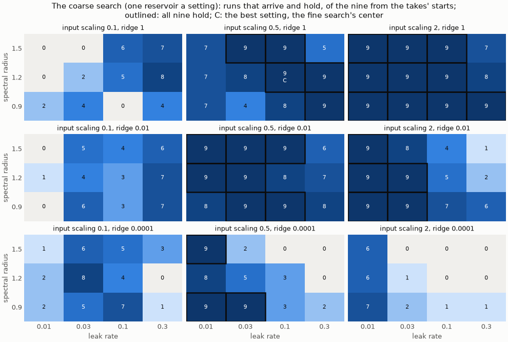

- **The coarse search:** 30 of the 108 settings hold from all nine starts. None has an
  input scaling of 0.1, and only 3 have a ridge of 10⁻⁴. The best is a leak rate of 0.1, a
  spectral radius of 1.2, an input scaling of 0.5, and a ridge of 1, with a median detour
  ratio of 1.0096.
- **The fine search,** over leak rates of 0.055, 0.1, and 0.17, spectral radii of 1.05,
  1.2, and 1.35, input scalings of 0.22, 0.5, and 1, and ridges of 0.1, 1, and 10: 20 of
  the 81 settings hold in all 45 runs of their five seeds.
- **The first pair,** the two the rule chose: leak rate 0.1, spectral radius 1.2, input
  scaling 1, ridge 1, seed 2 (median detour ratio 1.0068), and leak rate 0.055, spectral
  radius 1.2, input scaling 1, ridge 0.1, seed 4 (1.0082).
- **From the 36 untaught starts, on their own, the first pair differ.** The first arrives
  and stays from 27 and ends 1.61 m from the target from six. The second arrives and
  stays from 35, with a median detour ratio of 1.19. The takes' starts did not tell them
  apart, so the step of Section 2 was added.

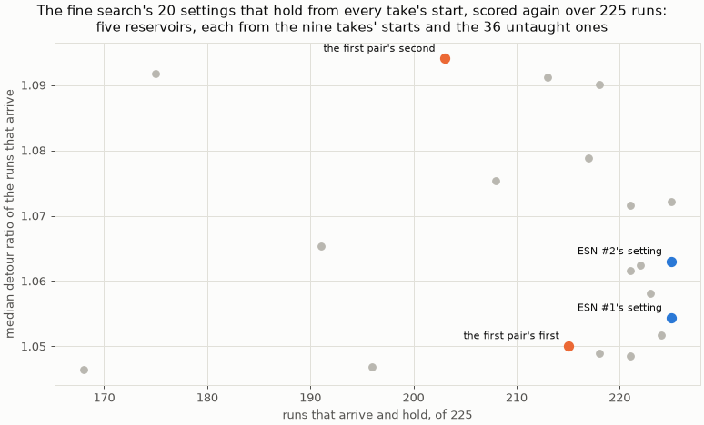

The 20 settings scored again over 225 runs each, the best six and the first pair's:

| Rank | Leak rate | Spectral radius | Input scaling | Ridge | Runs that hold, of 225 | Median detour ratio | Typical seed |
| --- | --- | --- | --- | --- | --- | --- | --- |
| 1 (ESN #1) | 0.055 | 1.2 | 1 | 1 | 225 | 1.054 | 4 |
| 2 (ESN #2) | 0.1 | 1.05 | 0.5 | 10 | 225 | 1.063 | 3 |
| 3 | 0.1 | 1.05 | 1 | 10 | 225 | 1.072 | 2 |
| 4 | 0.17 | 1.05 | 1 | 1 | 224 | 1.052 | 1 |
| 5 | 0.17 | 1.05 | 0.5 | 1 | 223 | 1.058 | 2 |
| 6 | 0.17 | 1.2 | 0.5 | 10 | 222 | 1.062 | 3 |
| 13 (the first pair's first) | 0.1 | 1.2 | 1 | 1 | 215 | 1.050 | |
| 16 (its second) | 0.055 | 1.2 | 1 | 0.1 | 203 | 1.094 | |

- No run from a take's start fails. The worst setting holds in 168 of 225.
- **The one-take search.** Its coarse step holds from take 00's start at 67 of 108
  settings, the best a leak rate of 0.03, a spectral radius of 0.9, an input scaling of
  0.1, and a ridge of 1. Its fine step holds in all five runs at 70 of 81. Scored again
  over 185 runs each, the best holds in all 185 with a median detour ratio of 3.08
  (one-take ESN #1's setting), and the next in 184 with 1.37 (one-take ESN #2's). The
  score counts the runs that hold first, so the setting with the larger detour ranks
  first.

### 3.2 From the takes' starts (claim 1 holds)

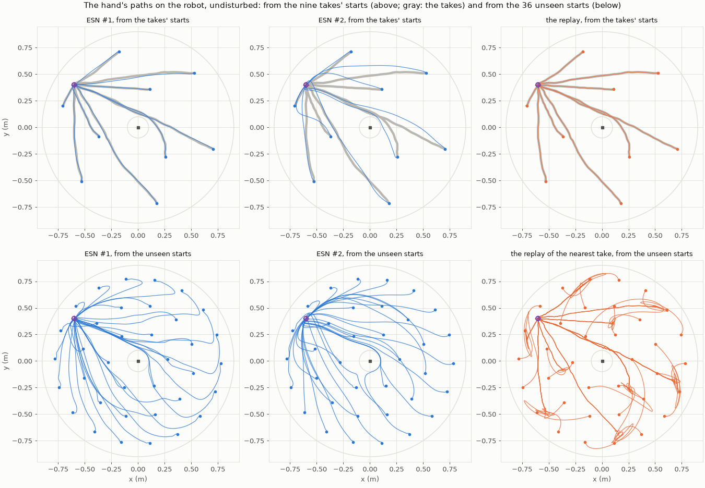

Over the nine takes' starts, medians (the largest in parentheses):

| | ESN #1 | ESN #2 | Replay |
| --- | --- | --- | --- |
| Runs that hold, of 9 | 9 | 9 | 9 |
| Path RMSE from the take (mm) | 4.1 | 33.2 | 0.6 |
| Arrival (s) | 7.77 (10.74) | 10.02 (12.69) | 7.82 (10.75) |
| Detour ratio | 1.009 (1.09) | 1.051 (1.28) | 1.013 (1.10) |
| Reference's fastest joint speed (°/s) | 28 (96) | 80 (157) | 32 (103) |
| Largest joint torque (N m) | 0.9 (5.0) | 4.2 (8.2) | 0.7 (1.4) |
| Farthest end from the target (mm) | 5.9 | 11.5 | 12.5 |

- **ESN #1 follows its takes,** within 4.1 mm by the median, and arrives when the replay
  does.
- **ESN #2 goes its own way to the target.** Its paths leave the takes' by 33.2 mm, and it
  arrives 2.2 s later by the median.

### 3.3 From the unseen starts (claims 2 to 4 hold)

Over the 36 unseen starts, medians (the largest in parentheses):

| | ESN #1 | ESN #2 | Replay of the nearest take |
| --- | --- | --- | --- |
| Runs that hold, of 36 | 36 | 36 | 36 |
| Detour ratio | 1.080 (2.56) | 1.090 (3.16) | 1.587 (11.33) |
| Reference's fastest joint speed (°/s) | 183 (397) | 119 (634) | 2,100 (7,101) |
| Largest joint torque (N m) | 9.6 (20.8) | 6.2 (33.2) | 99.4 (371.7) |
| Arrival (s) | 7.78 (16.45) | 9.37 (17.21) | 7.82 (10.75) |
| Farthest end from the target (mm) | 6.0 | 11.5 | 12.5 |

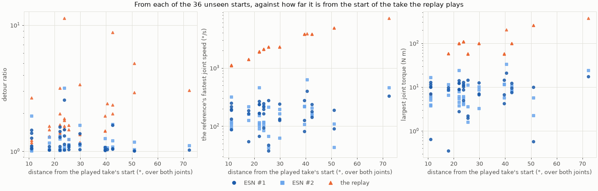

- **The replay jumps to its take.** Its reference begins at the take's start, so its
  speed and the torque grow with the distance to it: from 1,100 °/s for a start 11° away
  to 7,101 °/s for one 72° away. The arm goes to the take's path first and then along it.
- **The ESNs' references begin at the arm.** Their speeds and torques do not grow with
  that distance. From the unseen start drawn below, the reference is at most 2.0° (ESN #1)
  and 0.6° (ESN #2) from the arm in the first second, against 16.0° for the replay.
- **The paths are direct from most starts, not all.** The largest detour ratios are 2.56
  and 3.16, and the latest arrivals 16.45 and 17.21 s.

Each ESN's joint angles and torques over time, undisturbed (the first two columns) and
under the pushes (Section 3.4):

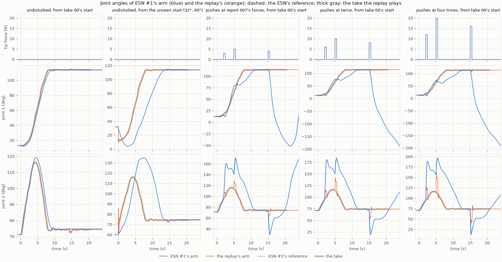

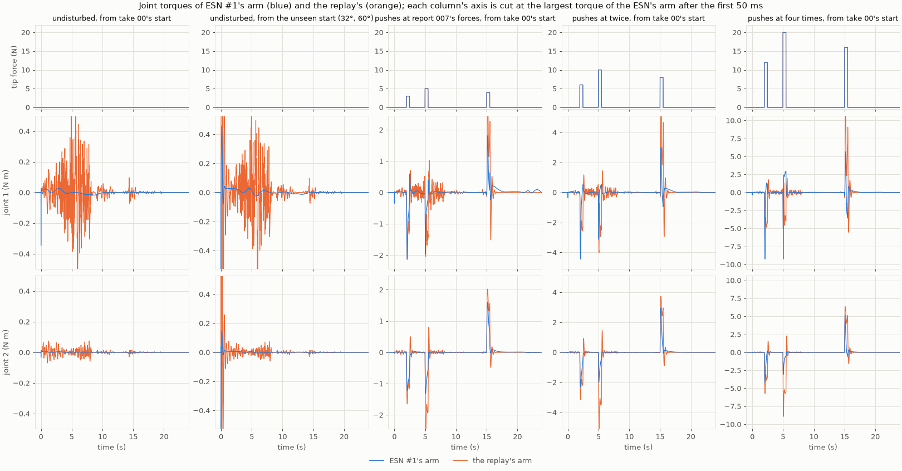

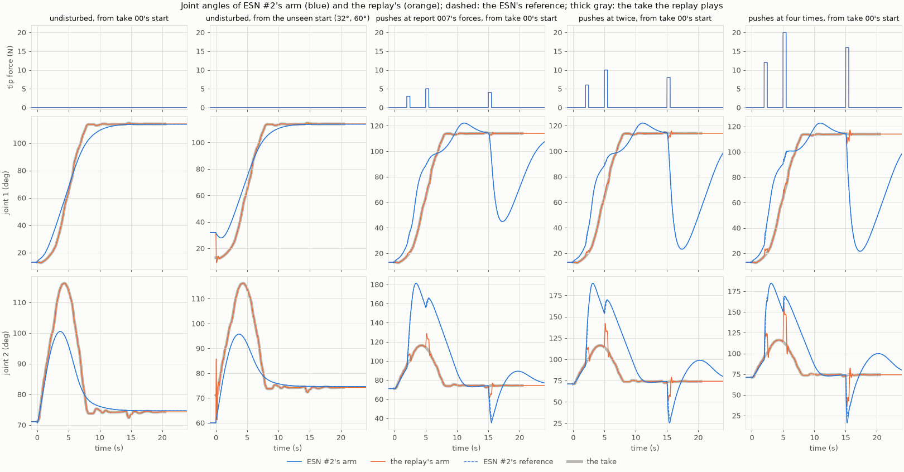

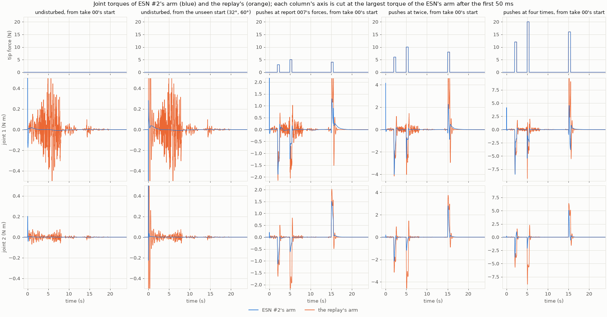

- **Undisturbed, the ESNs use little torque.** After the first 50 ms it stays within 0.03
  and 0.17 N m from take 00's start, against the replay's 0.66 N m, and within 0.46 and
  0.19 N m from the unseen start, against 10.13 N m.

### 3.4 Under the pushes (claim 5 fails)

Runs that arrive and are within 20 mm of the target at 24 s, of nine (the farthest end in
parentheses):

| Pushes | ESN #1 | ESN #2 | Replay | Progress replay |
| --- | --- | --- | --- | --- |
| at report 007's forces | 2 (0.94 m) | 1 (0.15 m) | 9 (12 mm) | 9 (12 mm) |
| at twice | 1 (0.74 m) | 2 (0.45 m) | 9 (12 mm) | 9 (12 mm) |
| at four times | 1 (0.70 m) | 1 (0.46 m) | 9 (12 mm) | 9 (12 mm) |

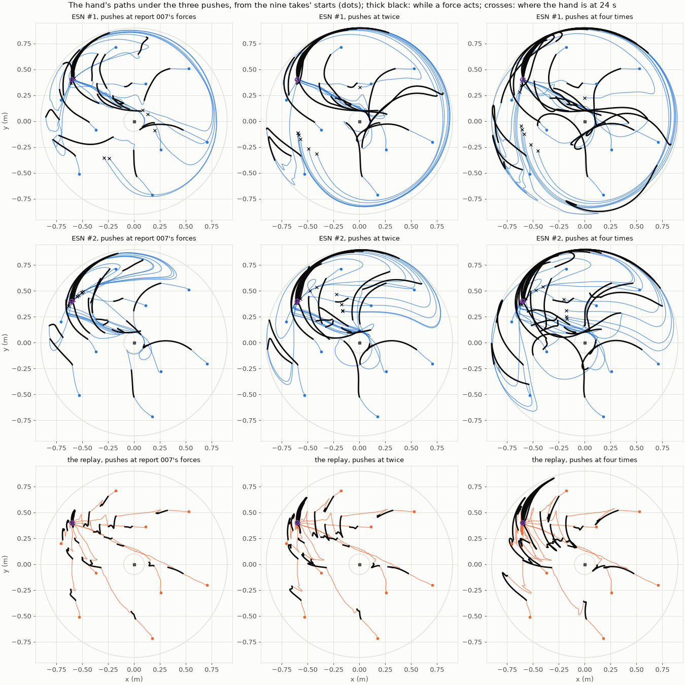

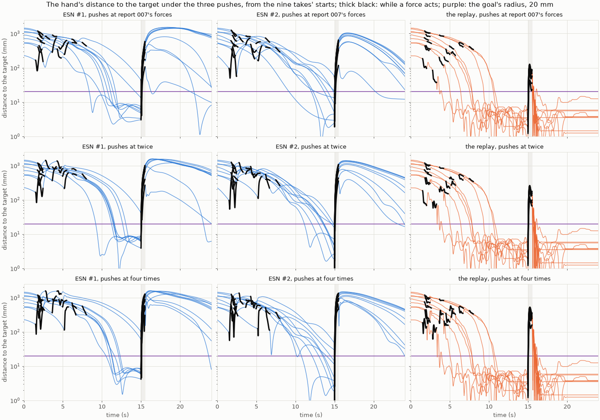

**Each push,** over the nine runs at report 007's forces, medians (the range in
parentheses):

| | ESN #1 | ESN #2 | Replay |
| --- | --- | --- | --- |
| Off the path, push 1 (m) | 0.20 (0.03 to 0.82) | 0.40 (0.06 to 0.78) | 0.03 (0.01 to 0.05) |
| Off the path, push 2 (m) | 0.35 (0.02 to 0.83) | 0.36 (0.08 to 0.79) | 0.05 (0.01 to 0.11) |
| Off the path, push 3 (m) | 0.63 (0.11 to 1.16) | 0.56 (0.12 to 0.95) | 0.10 (0.03 to 0.13) |
| Following gain, push 1 | 0.94 (0.85 to 0.96) | 0.95 (0.85 to 0.97) | 0.00 |
| Following gain, push 2 | 0.94 (0.92 to 0.95) | 0.95 (0.88 to 0.96) | 0.00 |
| Following gain, push 3 | 0.96 (0.73 to 0.97) | 0.96 (0.75 to 0.97) | 0.00 |
| Largest joint torque (N m) | 3.5 (5.0 at most) | 4.2 (8.2) | 3.8 (4.6) |

- **The reference goes with the pushed arm.** It moves 0.94 to 0.96 as far as the arm, by
  the median. The settings of report 017's two ESNs, which had to pass these pushes,
  followed by 0.76 and 0.78.
- **So the pushes meet little resistance.** The hand goes 6 to 14 times as far off the
  take's path as the replay's, by the medians, with about the same largest torque.
- **At twice and at four times the forces** the following stays at 0.88 to 0.96 by the
  median, and the hand goes up to 1.55 m off the path under the first two pushes.

**Before the third push,** most runs have arrived. Hands in the goal through the second
before it, of nine, at the three sizes:

| | ESN #1 | ESN #2 | Replay |
| --- | --- | --- | --- |
| In the goal from 14 to 15 s | 7, 8, 7 | 5, 6, 6 | 9, 9, 9 |

The pushed ESN runs arrive later than undisturbed: at 8.4 to 15.1 s (ESN #1) and at 9.2 to
14.9 s (ESN #2) at report 007's forces, against 3.7 to 10.8 s for the replay. Two runs of
ESN #2 do not arrive within the 24 s.

**The third push** acts on an arm at rest at the target in most runs. The hand's distance
to the target at report 007's forces, medians over the nine runs (the range in
parentheses):

| | ESN #1 | ESN #2 | Replay |
| --- | --- | --- | --- |
| When the push ends, at 15.5 s (m) | 0.46 (0.11 to 0.58) | 0.51 (0.12 to 0.64) | 0.07 (0.02 to 0.09) |
| Farthest after the push (m) | 1.41 (0.11 to 1.52) | 0.86 (0.12 to 1.04) | 0.10 (0.04 to 0.13) |
| When it is farthest (s) | 18.4 | 16.7 | 15.2 |
| At 24 s (m) | 0.74 (0.01 to 0.94) | 0.07 (0.01 to 0.15) | 0.004 (0.001 to 0.012) |
| Runs still moving at 24 s, faster than 1 °/s | 7 | 8 | 0 |

- **The hand keeps going after the push ends.** With ESN #1 it is 0.46 m away when the
  force stops and 1.41 m away 3 s later, across the workspace. Joint 1 turns from 114° to
  as far as −52°, and joint 2 folds to 170° (the third column of the figures of Section
  3.3). The reference stays within 11° of the arm throughout, so the tracker is following
  the ESN there, not fighting it.
- **Then the ESN reaches again.** The hand comes back toward the target, and the run ends
  at 24 s while 7 and 8 of the nine arms are still moving.
- **At twice and four times the forces** the hand is 0.84 and 0.88 m away when the push
  ends (ESN #1, medians) and 1.54 and 1.53 m at the farthest.
- **From take 03's start the hand barely moves:** 0.11 m with ESN #1 and 0.12 m with ESN
  #2. Each push's direction is set by the run's start, and there the arm rests at joint
  1 = −246°.

**Over 48 s,** at report 007's forces (runs added after seeing the outcome above; they
test no claim):

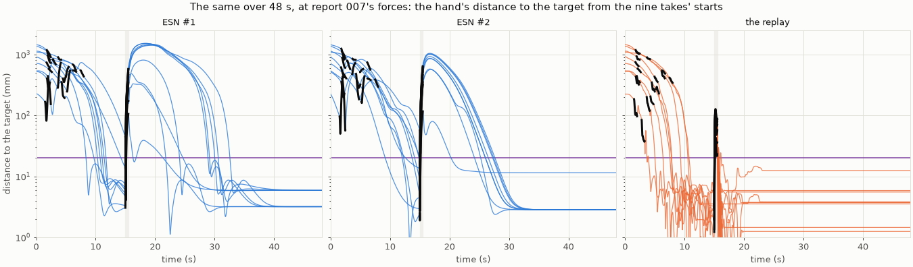

| | ESN #1 | ESN #2 | Replay |
| --- | --- | --- | --- |
| Runs that end within 20 mm, of 9 | 9 | 9 | 9 |
| In the goal for good from (s), earliest to latest | 21.3 to 32.6 | 20.3 to 27.6 | 15.5 to 16.2 |
| The same, median (s) | 28.9 | 26.0 | 15.8 |
| End from the target (mm) | 3 to 6 | 3 to 11 | 1 to 12 |

- **Every hand comes back and stays.** The return takes 6 to 18 s from the push's onset
  for ESN #1 and 5 to 13 s for ESN #2, against 0.5 to 1.2 s for the replay.
- **Two of ESN #1's arms come back the other way around.** From the starts of takes 05
  and 08, joint 1 goes from 113° on to −246°, a whole turn, and rests there.
- **So the claim's 24 s cut the returns short.** The failure is a hand sent far away and a
  return as slow as a new reach, not a hand that stays away.

### 3.5 Nine takes against one (claim 6 fails as stated)

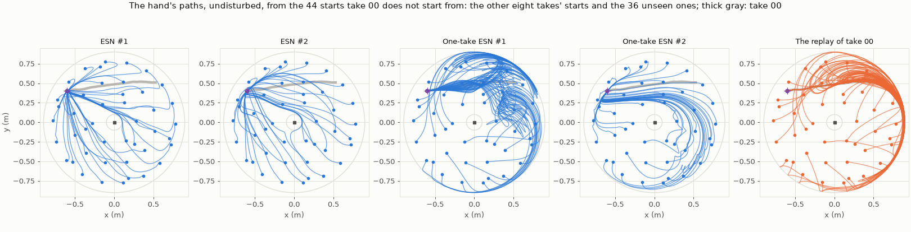

From the 44 starts take 00 does not start from, medians (the largest in parentheses):

| | ESN #1 | ESN #2 | One-take ESN #1 | One-take ESN #2 | Replay of take 00 |
| --- | --- | --- | --- | --- | --- |
| Runs that hold, of 44 | 44 | 44 | 44 | 44 | 44 |
| Detour ratio, the 44 | 1.05 (2.56) | 1.09 (3.16) | 3.19 (39.75) | 1.34 (4.25) | 4.76 (52.35) |
| Detour ratio, the other eight takes' starts | 1.01 | 1.05 | 4.03 | 1.42 | 5.50 |
| Detour ratio, the 36 unseen | 1.08 | 1.09 | 3.19 | 1.34 | 4.76 |
| Fastest reference speed (°/s), the other eight | 40 | 89 | 6,742 | 606 | 11,599 |
| Fastest reference speed (°/s), the 36 unseen | 183 | 119 | 5,466 | 629 | 9,000 |
| Largest torque (N m), the other eight | 1.0 | 4.6 | 353 | 28.6 | 607 |
| Largest torque (N m), the 36 unseen | 9.6 (20.8) | 6.2 (33.2) | 286 (597) | 26.9 (259) | 471 (1,000) |
| Arrival (s), the 44 | 7.76 (16.45) | 9.41 (17.21) | 8.07 (8.78) | 13.66 (17.39) | 7.84 |

- **The first half of the claim fails.** All four ESNs hold from all 44 starts, so the
  nine-take ESNs do not hold from more.
- **The second half holds.** The nine-take ESNs' median detour ratios, 1.05 and 1.09, are
  smaller than the one-take ESNs' 3.19 and 1.34.
- **One-take ESN #1 goes to its take.** Its hands sweep to take 00's path and follow it,
  at a little over half the replay's speed and torque, and arrive by 8.78 s.
- **One-take ESN #2 goes more directly but slowly.** Its torque is a tenth of one-take ESN
  #1's, and it arrives at 13.66 s by the median.
- **From take 00's own start,** the path RMSEs from the take are 13.7 and 82.0 mm for ESN
  #1 and ESN #2, and 3.8 and 5.4 mm for the one-take ESNs.

### 3.6 How many takes (claim 7 fails as stated)

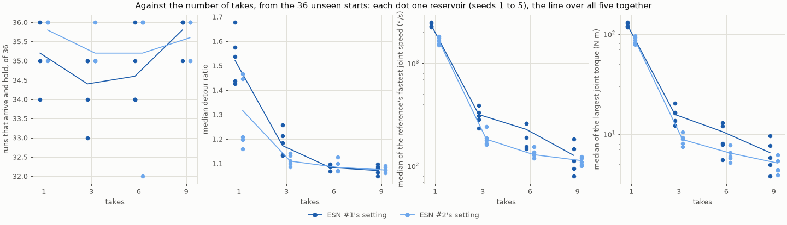

At ESN #1's setting and at ESN #2's, five reservoirs each, from the 36 unseen starts (180
runs a cell; the measures are medians over them):

| Takes | Runs that hold, of 180 | Detour ratio | Reference's fastest joint speed (°/s) | Largest torque (N m) |
| --- | --- | --- | --- | --- |
| one | 176, 179 | 1.52, 1.32 | 2,340, 1,645 | 122.5, 86.1 |
| three | 172, 176 | 1.17, 1.11 | 317, 182 | 15.7, 8.8 |
| six | 173, 176 | 1.08, 1.09 | 227, 129 | 10.6, 6.5 |
| nine | 179, 178 | 1.07, 1.07 | 127, 113 | 6.5, 5.2 |

- **The claim fails.** The runs that hold fall from one take to three at both settings,
  and at ESN #2's setting nine takes hold in one run fewer than one take.
- **The counts are near their ceiling at every number of takes:** 172 to 179 of 180. They
  do not separate the take counts.
- **The other three measures fall with every step.** From one take to three, the detour
  ratio in excess of 1 falls to a third, and the speed and the torque to a seventh to a
  tenth. From three to nine all three fall further, to about 0.4 of their values at ESN
  #1's setting and about 0.6 at ESN #2's.
- **From the starts of the takes an ESN is trained on,** every run holds but two of the
  30 with six takes at ESN #1's setting. From the starts of the takes it is not trained
  on, 39 and 40 of 40 hold with one take, 28 and 30 of 30 with three, and 13 and 15 of 15
  with six.

## 4. Observations

- **Many starts work, undisturbed.** One ESN of nine takes, given only the joint angles,
  takes the arm to the target from every start tried, taught or not, and stays.
- **Its gain over a replay is at the start.** From a start no take starts from, a replay
  must jump to a take. The ESN's reference begins at the arm, so the speed and the torque
  fall to about a tenth, and the hand goes almost straight.
- **Arriving does not need many takes; starting at the arm does.** One take already
  arrives from everywhere, by jumping to its take, as report 019 found for report 017's
  ESNs. Each added take cuts the jump and the detour. Claims 6 and 7 were stated on the
  runs that hold and fail for that reason. Stated on the jump and the detour, they would
  have held, but they were not.
- **The pushes are the failure that matters.** Both ESNs let a push carry the arm far from
  the target, most of all the push on the resting arm, and take as long as a new reach to
  come back. Under the claim's 24 s that is a failure in 7 or 8 of nine runs. Over 48 s
  every run returns.
- **Why they give way is not tested here.** Three things differ from report 017 and may
  each contribute:
  - **The search had no pushes.** It scored undisturbed runs only, and it chose settings
    whose references follow the arm by 0.94 to 0.96, where report 017's chosen settings
    follow by 0.76 and 0.78.
  - **The takes cover the workspace.** An ESN taught to go to the target from anywhere may
    treat a displaced arm as a new start. A pushed arm is also moving, which no start of a
    take or of the search is.
  - **The arm has no joint limits,** so a push can send joint 1 a long way, and twice it
    went around.
- **Limits.**
  - Each ESN's numbers are one run per start, with one tracker, in a simulation without
    noise, which repeats exactly. The two ESNs were not checked on held-out seeds.
  - The untaught starts chose the ESNs, so only the unseen starts are held out. They lie
    on the same rings, 15° away.
  - The first two pushes come at different times in different takes, and the third at
    15 s, when two runs of ESN #2 have not yet arrived.
  - The 48 s runs were added after seeing the outcome, at report 007's forces only.

## 5. Next steps

1. **The pushes.** Decide whether to search again with the pushes in the score, as report
   017's search had. Scoring the fine search's 20 full-scoring settings again under the
   pushes would show first whether any setting of this grid withstands them.
2. **What the following costs.** Whether an ESN that follows less, as report 017's, still
   starts where the arm is from the unseen starts, or whether the two pull against each
   other.
3. **The take counts' claims,** restated on the jump and the detour before any further
   runs, if they are to be claimed.
4. **Stage 2 of the plan:** several targets, told apart by a one-hot context.
