# 024 Many starts with the pushes in the score: slower reservoirs come back from report 007's pushes in time, and start less gently

**Summary.** [Report 023](../023-one-target-from-many-starts/README.md) taught one target
from nine start postures and chose two ESNs by undisturbed runs alone. Both arrive from
everywhere and go directly, but under report 007's pushes they end within 20 mm of the
target in 2 and 1 of nine runs. This report searches again with the pushed runs in the
score: a setting is scored by how many of its runs pass, undisturbed and under report
007's pushes, and then by how directly the hand goes. Everything else is report 023's:
the arm without joint limits, the nine takes, ESNs of 800 neurons, report 017's tracker,
and the seven claims, tested again on the two ESNs this search chooses, ESN #1 and ESN #2.

The findings:

- **The search finds ESNs that pass report 007's pushes.** Both end within 20 mm of the
  target in 9 of nine runs, as the replay and the progress replay do.
- **The leak rate decides it.** In the coarse search, 94, 81, 27, and 11 of 243 pushed
  runs pass at leak rates of 0.01, 0.03, 0.1, and 0.3. The following gain rises with it,
  from 0.70 to 0.96. The chosen ESNs have leak rates of 0.03 and 0.017, against report
  023's 0.055 and 0.1.
- **They pass by coming back in time, not by keeping to the take.** Their references
  still follow the pushed arm, by 0.90 to 0.91 (ESN #1) and 0.71 to 0.79 (ESN #2). The
  third push sends the hand 0.51 and 0.20 m from the target by the median, against 0.10 m
  for the replay. The hand is in the goal for good at 23.2 and 20.4 s by the median,
  against 15.8 s. ESN #1's latest run is back 0.4 s before the run ends.
- **Claim 5 still fails as stated, at the larger pushes.** At twice the forces ESN #1
  passes 4 of nine and ESN #2 all nine. At four times they pass 3 and 5. Most failing
  hands are 22 to 54 mm from the target at 24 s, on their way back.
- **Undisturbed, claims 1, 3, and 4 hold, and claim 2 fails for ESN #2.** Both arrive and
  hold from the nine takes' starts. From the 36 unseen starts ESN #1 holds from all 36.
  ESN #2 holds from 35: from one start its reference jumps, and the arm is thrown through
  the goal 0.07 s into the run.
- **The price is a less gentle start.** Medians over the 36 unseen starts, for ESN #1,
  ESN #2, and the replay, with report 023's ESNs in parentheses:
  - the reference's fastest joint speed is 289 and 998 °/s, against 2,100 °/s (183 and
    119 °/s);
  - the largest joint torque is 15.1 and 52.2 N m, against 99.4 N m (9.6 and 6.2 N m);
  - the detour ratio is 1.10 and 1.32, against 1.59 (1.08 and 1.09).
- **ESN #2's jump comes with its input scaling of 4, not with its leak rate.** Among the
  20 settings scored last, the reference's speed from the untaught starts doubles with
  the input scaling, at either leak rate. The settings with the largest input scaling hold
  from the most untaught starts, and the score counts those first.
- **Claims 6 and 7 fail as stated again.** One-take ESNs chosen by the same rule hold from
  all 44 starts their take does not start from. With three takes, fewer runs hold from the
  unseen starts than with one, at both settings.

## 1. Question

1. **The search:** does a search that also scores the pushed runs find ESNs of nine takes
   that pass report 007's pushes?
2. **The price:** what does that cost undisturbed, in arriving from the unseen starts, in
   starting where the arm is, and in going directly?
3. **The claims:** which of report 023's seven claims hold for the ESNs it chooses?

## 2. Setup

### What is as in report 023

- **The robot** is the arm of reports 005 to 020 with no joint limits, simulated every
  2 ms, and its target is at (−0.6, 0.4) m.
- **The nine takes** are report 023's, recorded by hand and filtered at 2 Hz
  ([its `data/`](../023-one-target-from-many-starts/data)).
- **The start postures:** the nine takes', the 36 untaught ones the scoring runs from, and
  the 36 unseen ones, which no search or scoring runs from
  ([report 023's figure](../023-one-target-from-many-starts/results/summary/starts.png)).
- **The tracker** is report 017's: joint PD at ω = 20 rad/s and a damping ratio of 0.4,
  given the reference's velocity, its torque computed every 10 ms and held between. Its
  gains are set where the take of reports 005 to 020 ends (kp = 74.96 and 8.96 N m/rad,
  kd = 3.00 and 0.358 N m s/rad), whatever takes an ESN is trained on.
- **A run** is 24 s after the 1 s warm-up.
- **The replay** plays by time the take whose start is nearest the run's start. Under the
  pushes a third arm runs, report 014's progress replay of that take (a lead of 2.5°, a
  window of 1 s).
- **The pushes** are report 007's: 3 N at 10° from the direction toward the target, 5 N at
  80°, and 4 N at −80°, each for 0.5 s at the tip. The first two are placed along each
  take, where its hand is 18% and 62% of the way to the target (at 1.5 to 3.7 s and at 2.8
  to 7.5 s over the nine takes). The third comes at 15 s, after every take has arrived.

### The ESNs

| | ESN #1 ([`esn.toml`](results/20261118-125612-esn1_lr0.03_sr0.9_is2_ridge1_seed5/esn.toml)) | ESN #2 ([`esn.toml`](results/20261118-125613-esn2_lr0.017_sr1.05_is4_ridge10_seed5/esn.toml)) | One-take ESN #1 ([`esn.toml`](results/20261118-125615-one_take_esn1_lr0.017_sr1.05_is0.045_ridge0.1_seed5/esn.toml)) | One-take ESN #2 ([`esn.toml`](results/20261118-125616-one_take_esn2_lr0.017_sr1.05_is0.1_ridge0.1_seed1/esn.toml)) |
| --- | --- | --- | --- | --- |
| Leak rate | 0.03 | 0.017 | 0.017 | 0.017 |
| Spectral radius | 0.9 | 1.05 | 1.05 | 1.05 |
| Input scaling | 2 | 4 | 0.045 | 0.1 |
| Ridge | 1 | 10 | 0.1 | 0.1 |
| Seed | 5 | 5 | 5 | 1 |
| Training | teacher forcing on the nine takes (`demo_00_filtered` to `demo_08_filtered` of `results/demonstrations/20261117-164658-reach_manual_v2_no_limits`), without noise | the same | on take 00 alone (`demo_00_filtered`) | the same |

Fixed for all: 800 tanh neurons, sparsity 0.05, a bias per neuron drawn uniformly from
[−1, 1] by the seed and not scaled, a 1 s warm-up on the held start posture, a 10 ms
period. The input is the arm's two joint angles every 10 ms, each normalized by the
training takes' range of it. The ESNs get no task knowledge: no target and no context.

- **Report 023's ESN #1 and ESN #2** have leak rates of 0.055 and 0.1, spectral radii of
  1.2 and 1.05, input scalings of 1 and 0.5, ridges of 1 and 10, and seeds 4 and 3. They
  are called report 023's here, and nothing was run with them for this report.
- **One-take ESN #1** is report 023's one-take ESN #1: the search chose the same setting
  and seed. It was trained and run again here.

### The search

The rule was fixed on 2026-11-18 before any run of it, and is given in full in the
[experiment's README](../../experiments/manual_demonstration_v2_many_starts_push_search/README.md#the-search).
It is report 023's with the pushed runs added at every step:

1. **The runs:** each ESN on the robot from each of the nine takes' starts, twice:
   undisturbed, and under the three pushes at report 007's forces.
2. **An undisturbed run passes** if it holds: the hand arrives within 20 mm of the target
   and stays within it for the 2 s after.
3. **A pushed run passes** if the hand arrives and is within 20 mm of the target when the
   run ends. Leaving the goal during the hold is excused, as in report 017.
4. **A setting's score** is how many of its runs pass, the most first, then the median
   detour ratio of its undisturbed runs that arrive, the smallest first.
5. **The coarse search:** report 023's 108 settings with one reservoir each (seed 0), over
   leak rates of 0.01, 0.03, 0.1, and 0.3, spectral radii of 0.9, 1.2, and 1.5, input
   scalings of 0.1, 0.5, and 2, and ridges of 10⁻⁴, 10⁻², and 1. Its undisturbed runs are
   report 023's coarse search, not run again.
6. **The fine search:** 81 settings around the best coarse one, each parameter at the
   center's value and halfway to its coarse neighbor on each side, with five reservoirs
   each (seeds 1 to 5). Where the center is at an edge of the coarse grid, the value beyond
   the edge is as far from the center as the one on the other side.
7. **Scoring again with the untaught starts:** the fine search's 20 best settings, each
   over the undisturbed runs of its five reservoirs from the nine takes' starts and the 36
   untaught ones, and over their 45 pushed runs of the fine search: 270 runs.
8. **The chosen ESNs** are the typical seeds of the two best settings of step 7. A
   setting's typical seed is, of its seeds with the most passing runs, the one whose own
   median detour ratio is nearest the setting's.

- **What differs from report 023's search:** the pushed runs in the score; and step 7 is
  part of the rule from the start, over the 20 best settings, where report 023 added it
  afterwards over the settings that held in every run.
- **What the search leaves out:** pushes larger than report 007's, pushes from the
  untaught starts, a block, and held-out seeds.
- **The one-take baseline** goes through the same steps, trained on take 00 alone and run
  from its start, undisturbed and pushed (and from the 36 untaught starts in step 7).
- **What was known when the rule was fixed:** report 023's coarse search, undisturbed;
  report 023's ESNs under the pushes; and report 017's result that the following rises
  with the leak rate. Two of the coarse settings were also run once under the pushes, into
  a scratch directory, to check the configuration.

[`score_sweeps.py`](../../experiments/score_sweeps.py) scores a step from its undisturbed
sweep and its pushed sweep.

### The measures

- **A run holds,** and **a pushed run passes:** as in the search.
- **The detour ratio:** the length of the hand's path until it arrives, over the straight
  distance from its start to the goal. It is 1 for a straight reach and never less.
- **The reference's fastest joint speed** over the run (°/s), and **the largest joint
  torque** (N m). A reference that starts away from the arm shows in both.
- **Off the path:** the hand's largest distance from the take's path from a push's onset.
  **The following gain:** how far the reference moves with the arm from a push's onset to
  0.5 s after its end, 0 for a reference that keeps to the take and 1 for one that moves
  as far as the arm. A setting's following gain is the median over its pushed runs of the
  mean over the three pushes.
- **In the goal for good from:** when the hand enters the goal for the last time.

### The claims

They are report 023's, word for word, fixed for this search on 2026-11-18 before any of
its runs. Each is to hold for ESN #1 and for ESN #2.

1. **The takes' starts.** Undisturbed, from each of the nine takes' starts, the hand
   arrives and holds, as the replay's does.
2. **The unseen starts.** From the 36 unseen starts, the hand arrives and holds from as
   many as the replay of the take that starts nearest.
3. **Starting where the arm is.** From the 36 unseen starts, the reference's fastest joint
   speed and the largest joint torque are smaller than the replay's, in their medians.
4. **Going directly.** From the 36 unseen starts, the median detour ratio is smaller than
   the replay's.
5. **Pushes.** Under report 007's three pushes at their forces, at twice, and at four
   times them, from each take's start, the hand arrives and ends within 20 mm of the
   target in at least as many of the nine runs as the replay's and as the progress
   replay's, at each size.
6. **Nine takes against one.** From the 44 starts take 00 does not start from (the other
   eight takes' and the 36 unseen), ESN #1 and ESN #2 each hold from more starts than
   one-take ESN #1 and than one-take ESN #2, with a smaller median detour ratio.
7. **More takes.** At ESN #1's setting and at ESN #2's, over five reservoirs (seeds 1 to
   5), the runs that hold from the 36 unseen starts are more with nine takes than with
   one, and do not decrease from one take to three, to six, to nine.

- **Claims 6 and 7** failed as stated in report 023, because an ESN of one take already
  arrives from everywhere. They are kept as stated.
- **Claim 5's sizes:** the search scores the pushes at report 007's forces only. Twice
  and four times are sizes no ESN was chosen by.
- **The take counts** are one, three, six, and nine, each set holding the one before: take
  00; takes 00, 02, and 04; the outer ring; and all nine.
- **Reported without a claim,** as fixed with the claims: the pushes at report 007's
  forces run for 48 s; the measures set beside report 023's ESNs'; and how passing the
  pushes and the following gain depend on the four parameters.

### Reproducing the results

The configurations are in
[`manual_demonstration_v2_many_starts_push_search`](../../experiments/manual_demonstration_v2_many_starts_push_search/README.md),
written below as `$D`.

| Runs | Command | Commit |
| --- | --- | --- |
| `coarse_pushes`, `one_take_coarse_pushes` | `uv run python experiments/sweep_robot_esn.py $D/<name>.toml --workers 30` | `a6654ad` |
| `fine_search`, `fine_pushes`, `one_take_fine_pushes` | `sweep_robot_esn.py`, as above | `44fb1f4` |
| `untaught_search`, `one_take_untaught_search` | `sweep_robot_esn.py`, as above | `1fc94c1` |
| `coarse_score`, `fine_score`, `untaught_score`, and the one-take ones (`one_take_…`) | `uv run python experiments/score_sweeps.py $D/<name>.toml` | `6f7c9c7`, `1072f90`, `b01bfac` |
| `esn1_lr0.03_sr0.9_is2_ridge1_seed5`, `esn2_lr0.017_sr1.05_is4_ridge10_seed5`, `one_take_esn1_lr0.017_sr1.05_is0.045_ridge0.1_seed5`, `one_take_esn2_lr0.017_sr1.05_is0.1_ridge0.1_seed1` | `uv run python experiments/autonomous_esn.py $D/<name>.toml` | `1e175ef` |
| `robot_esn1`, `robot_esn2`; `pushes{1,2,4}x_robot_esn{1,2}` (6); `pushes1x_long_robot_esn{1,2}`; `robot_one_take_esn{1,2}` | `uv run python experiments/robot_esn.py $D/<name>.toml` | `dafd9e3` |
| `takes1`, `takes3`, `takes6`, `takes9` | `sweep_robot_esn.py`, as above | `dafd9e3` |
| [`summary`](results/summary) | `uv run python reports/024-many-starts-with-pushes-in-the-score/make_figures.py` | |

- **Running time,** with 30 workers on 32 logical processors: the coarse search's pushed
  runs 8 min, the fine search 23 min undisturbed and 27 min pushed, the undisturbed runs
  from the untaught starts 29 min, and each take count 5 min. The one-take search takes
  1 min, 3 min, and 21 min. Each undisturbed robot run of 90 runs takes 8 min, each pushed
  run 2 min, and each of 48 s 4 min.
- **Checks:**
  - Every run record names its commit. Those of `one_take_coarse_pushes` and of every run
    from `one_take_untaught_search` on report uncommitted changes. These were new files
    not yet committed: the coarse score's configuration during the first, and this
    report's `make_figures.py` during the others. No run reads them.
  - The replay beside ESN #1 equals the replay beside ESN #2 in every measure compared.
  - The first 24 s of each 48 s run equal the 24 s run's, joint angle for joint angle.
- **What is kept here:** each run's configuration and run record with its `metrics.csv`,
  or its `scores.csv`; the `runs.csv` of the pushed sweeps, of the undisturbed runs from
  the untaught starts, and of the take counts; and the four ESNs' `esn.toml` and
  `esn.rclib`. The takes and report 023's ESNs' runs are read from report 023.

[`make_figures.py`](make_figures.py) prints the tables of Section 3 and draws its figures.
It reads these copies, report 023's, and the robot runs' logs under the storage root,
which are not kept in Git.

## 3. Results

### 3.1 The search

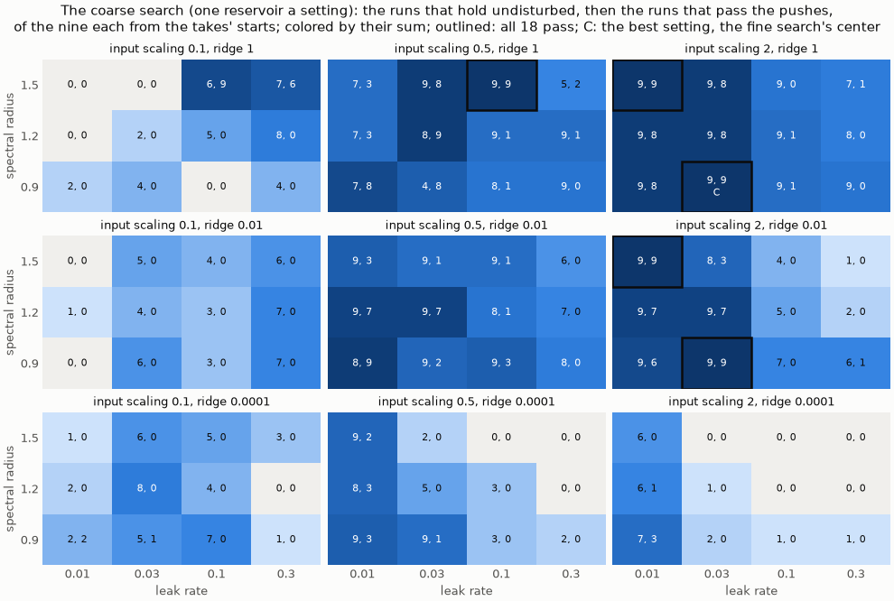

- **The coarse search:** of the 108 settings, 30 hold undisturbed from all nine starts,
  8 pass the pushes from all nine, and 5 do both. The best of the five is a leak rate of
  0.03, a spectral radius of 0.9, an input scaling of 2, and a ridge of 1, with a median
  detour ratio of 1.0135. Report 023's center (leak rate 0.1, spectral radius 1.2, input
  scaling 0.5, ridge 1) holds from all nine and passes the pushes from one.
- **The fine search,** over leak rates of 0.017, 0.03, and 0.055, spectral radii of 0.75,
  0.9, and 1.05, input scalings of 1, 2, and 4, and ridges of 0.1, 1, and 10: of the 81
  settings, 36 hold in all 45 undisturbed runs, 15 pass all 45 pushed runs, and 6 do both.

By the leak rate, over all settings of a step:

| Step | Leak rate | Pushed runs that pass | Undisturbed runs that hold | Following gain |
| --- | --- | --- | --- | --- |
| coarse | 0.01 | 94 of 243 | 154 of 243 | 0.70 |
| coarse | 0.03 | 81 of 243 | 160 of 243 | 0.87 |
| coarse | 0.1 | 27 of 243 | 139 of 243 | 0.94 |
| coarse | 0.3 | 11 of 243 | 123 of 243 | 0.96 |
| fine | 0.017 | 1,147 of 1,215 | 1,175 of 1,215 | 0.76 |
| fine | 0.03 | 889 of 1,215 | 1,154 of 1,215 | 0.89 |
| fine | 0.055 | 391 of 1,215 | 1,142 of 1,215 | 0.94 |

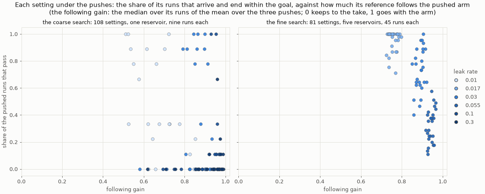

- **The leak rate decides how many pushed runs pass.** Fewer pass at every step up in the
  leak rate, and the following gain rises with it, as in report 017.
- **The other parameters matter less under the pushes.** In the fine search, the pushed
  runs that pass are 782 to 839 of 1,215 over the spectral radii, 773 to 846 over the
  input scalings, and 777 to 864 over the ridges. In the coarse search an input scaling of
  0.1 passes 18 of 324 and a ridge of 10⁻⁴ passes 16 of 324, where fewer runs hold
  undisturbed too (128 and 118 of 324).
- **A following gain near 0.9 can still pass.** The 15 fine settings that pass all 45
  pushed runs follow by 0.73 to 0.90, and the 8 coarse ones that pass all nine by 0.51 to
  0.95.

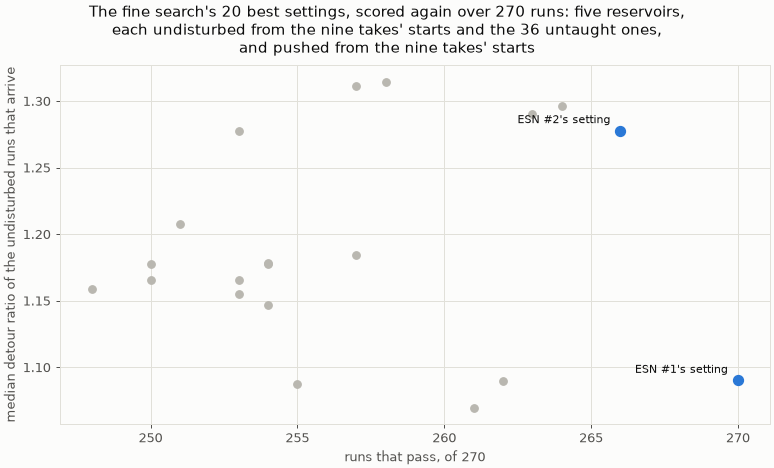

The 20 settings scored again over 270 runs each, the best six:

| Rank | Leak rate | Spectral radius | Input scaling | Ridge | Runs that pass, of 270 | Undisturbed runs that hold, of 225 | Pushed runs that pass, of 45 | Median detour ratio | Typical seed |
| --- | --- | --- | --- | --- | --- | --- | --- | --- | --- |
| 1 (ESN #1) | 0.03 | 0.9 | 2 | 1 | 270 | 225 | 45 | 1.090 | 5 |
| 2 (ESN #2) | 0.017 | 1.05 | 4 | 10 | 266 | 221 | 45 | 1.278 | 5 |
| 3 | 0.017 | 0.9 | 4 | 10 | 264 | 219 | 45 | 1.297 | 1 |
| 4 | 0.017 | 0.75 | 4 | 10 | 263 | 218 | 45 | 1.291 | 3 |
| 5 | 0.03 | 1.05 | 2 | 1 | 262 | 219 | 43 | 1.090 | 4 |
| 6 | 0.03 | 0.75 | 1 | 1 | 261 | 219 | 42 | 1.070 | 1 |

- **One setting passes all 270 runs,** the fine search's center. The worst of the 20
  passes 248.
- **16 of the 20 have a leak rate of 0.017, and 4 of 0.03.** None has 0.055.
- **The one-take search.** Of its 108 coarse settings, 67 hold undisturbed from take 00's
  start, 45 pass the pushes, and 44 do both. The best is report 023's one-take center, so
  the fine search's undisturbed runs are report 023's. Of its 81 fine settings, 70 hold in
  all five undisturbed runs, 36 pass all five pushed runs, and 32 do both. All 20 scored
  again pass their five pushed runs. The best holds in all 185 undisturbed runs with a
  median detour ratio of 3.08 (one-take ESN #1's setting), and the next in 183 with 2.57
  (one-take ESN #2's).

### 3.2 From the takes' starts (claim 1 holds)

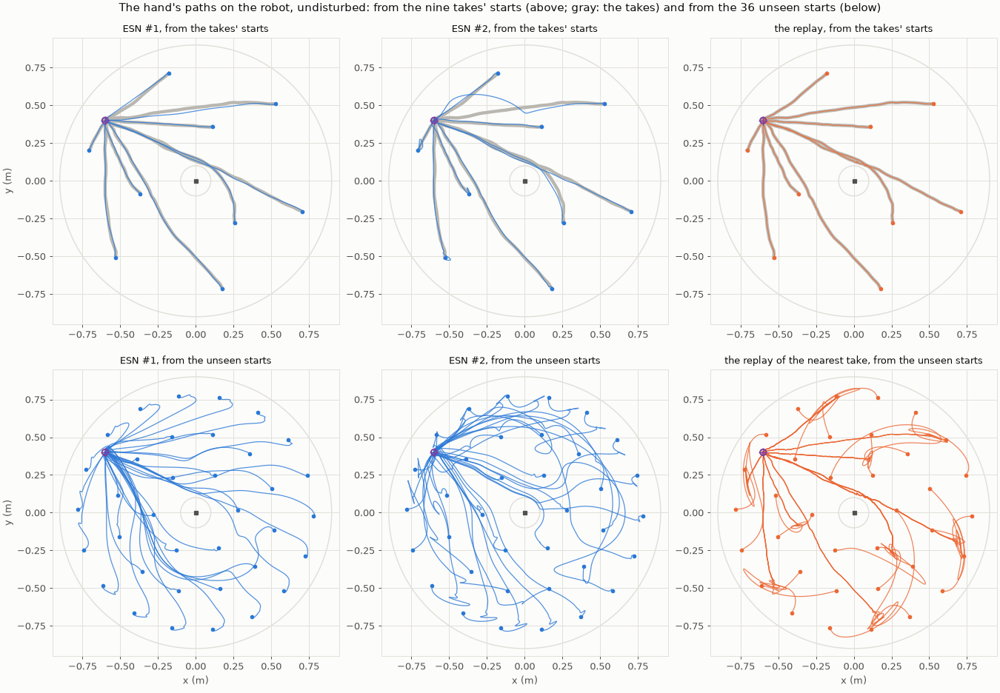

Over the nine takes' starts, medians (the largest in parentheses):

| | ESN #1 | ESN #2 | Replay |
| --- | --- | --- | --- |
| Runs that hold, of 9 | 9 | 9 | 9 |
| Path RMSE from the take (mm) | 4.2 | 7.9 | 0.6 |
| Arrival (s) | 7.79 (10.95) | 7.89 (11.11) | 7.82 (10.75) |
| Detour ratio | 1.013 (1.10) | 1.088 (1.77) | 1.013 (1.10) |
| Reference's fastest joint speed (°/s) | 49 (92) | 94 (583) | 32 (103) |
| Largest joint torque (N m) | 1.5 (4.8) | 4.9 (30.5) | 0.7 (1.4) |
| Farthest end from the target (mm) | 5.8 | 6.5 | 12.5 |

- **Both follow their takes and arrive when the replay does.**
- **ESN #2's reference jumps from two of the takes' own starts.** From takes 02's and
  07's starts its fastest joint speed is 583 and 580 °/s and the torque 30.5 and 30.4 N m,
  against at most 103 °/s and 1.4 N m for the replay.

### 3.3 From the unseen starts (claims 3 and 4 hold; claim 2 fails for ESN #2)

Over the 36 unseen starts, medians (the largest in parentheses):

| | ESN #1 | ESN #2 | Replay of the nearest take |
| --- | --- | --- | --- |
| Runs that hold, of 36 | 36 | 35 | 36 |
| Detour ratio | 1.096 (4.09) | 1.323 (7.40) | 1.587 (11.33) |
| Reference's fastest joint speed (°/s) | 289 (1,075) | 998 (2,698) | 2,100 (7,101) |
| Largest joint torque (N m) | 15.1 (56.3) | 52.2 (141.2) | 99.4 (371.7) |
| Arrival (s) | 7.50 (15.12) | 7.21 (15.36) | 7.82 (10.75) |
| Farthest end from the target (mm) | 5.9 | 7.4 | 12.5 |

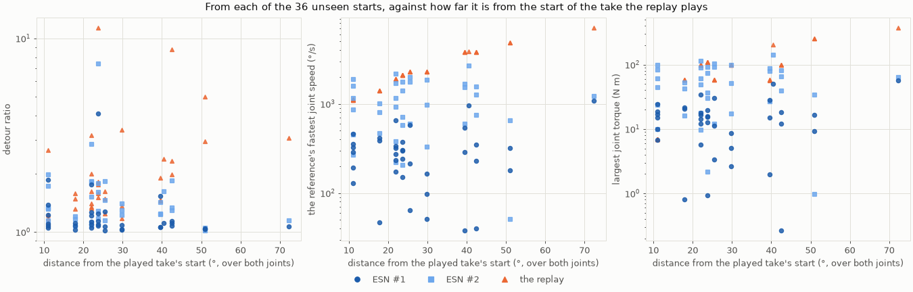

- **Claim 2 fails for ESN #2, by one run that is thrown through the goal.** From the
  unseen start (132°, 60°), 0.17 m from the target, its reference jumps 19° in the first
  10 ms. The hand crosses the goal at 0.07 s, is 0.14 m away at 0.16 s, and is in the goal
  for good from 2.79 s. It ends 3 mm from the target. By the rule it arrived at 0.07 s and
  did not stay.
- **Both start more gently than the replay, in the medians (claim 3 holds).** ESN #1's
  speed and torque are a seventh of the replay's. ESN #2's are half.
- **ESN #2's reference does not begin at the arm.** From the unseen start drawn below, it
  is up to 9.7° from the arm in the first second, against 2.1° for ESN #1 and 16.0° for
  the replay.
- **From the unseen starts nearest a take's start, both ESNs kick harder than the
  replay.** From the six that are 11° from it, the replay's largest torque is 7 N m.
  ESN #1's is 7 to 24 N m, and ESN #2's 10 to 100 N m.
- **Both go more directly than the replay, in the medians (claim 4 holds).** The largest
  detour ratios are 4.09 and 7.40, both from the unseen start (112°, 60°).

Each ESN's joint angles and torques over time, undisturbed (the first two columns) and
under the pushes (Section 3.4):

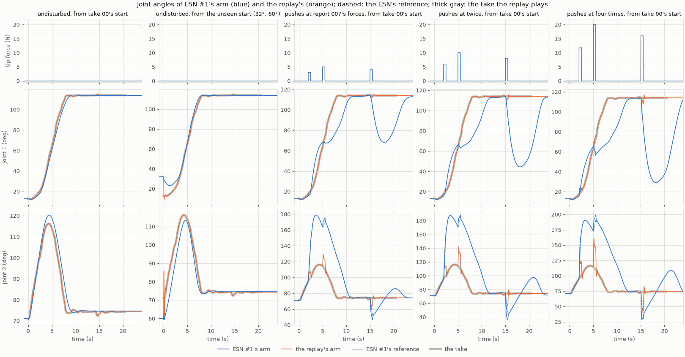

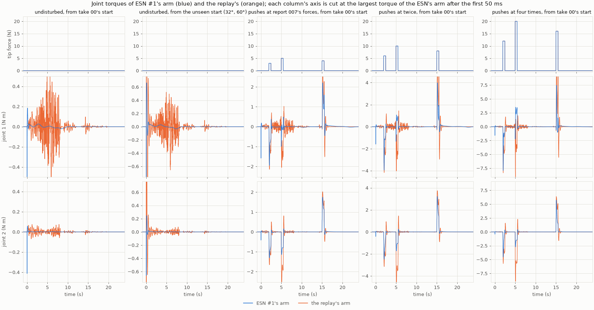

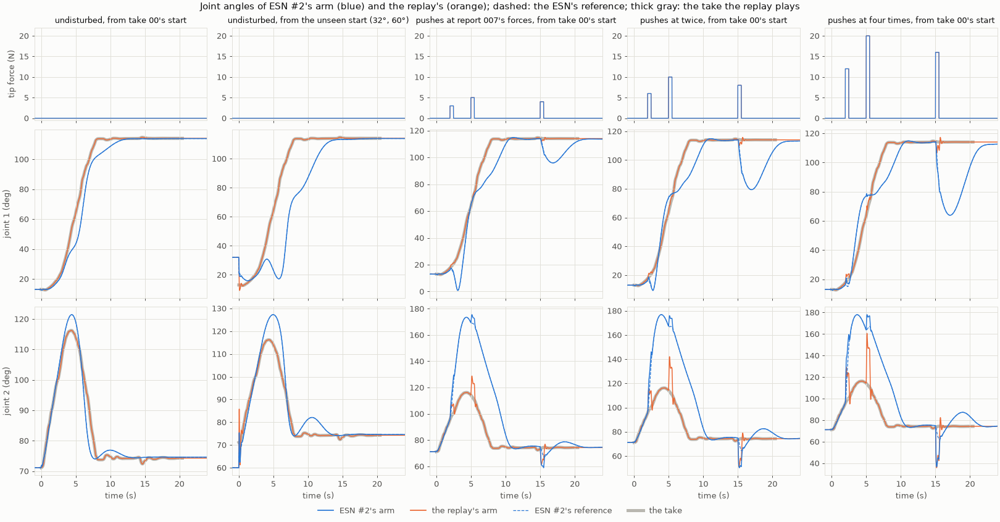

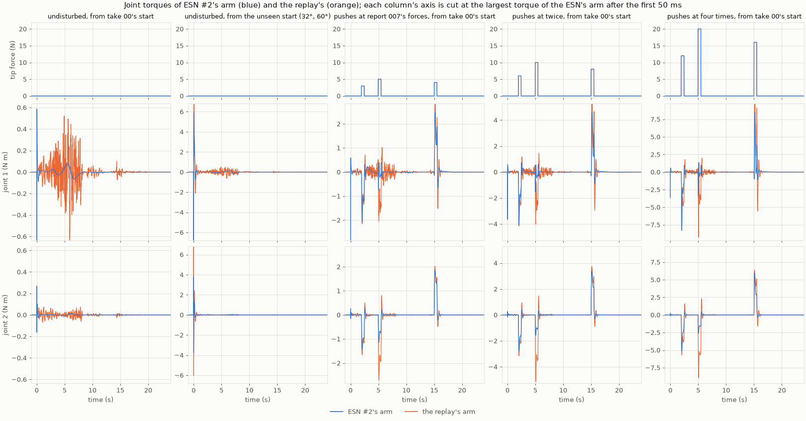

### 3.4 Under the pushes (claim 5 holds at report 007's forces and fails at the larger ones)

Runs that arrive and end within 20 mm of the target, of nine:

| Pushes | ESN #1 | ESN #2 | Replay | Progress replay |
| --- | --- | --- | --- | --- |
| at report 007's forces | 9 | 9 | 9 | 9 |
| at twice | 4 | 9 | 9 | 9 |
| at four times | 3 | 5 | 9 | 9 |

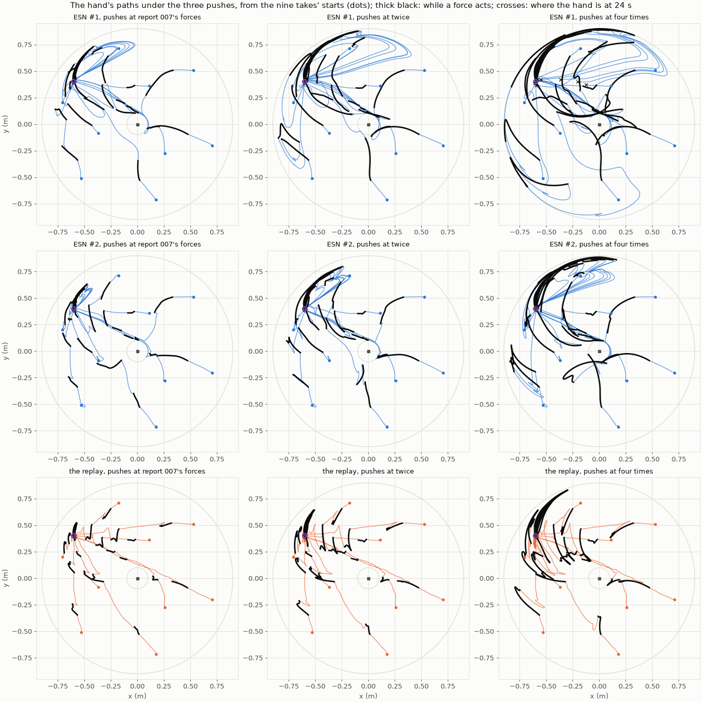

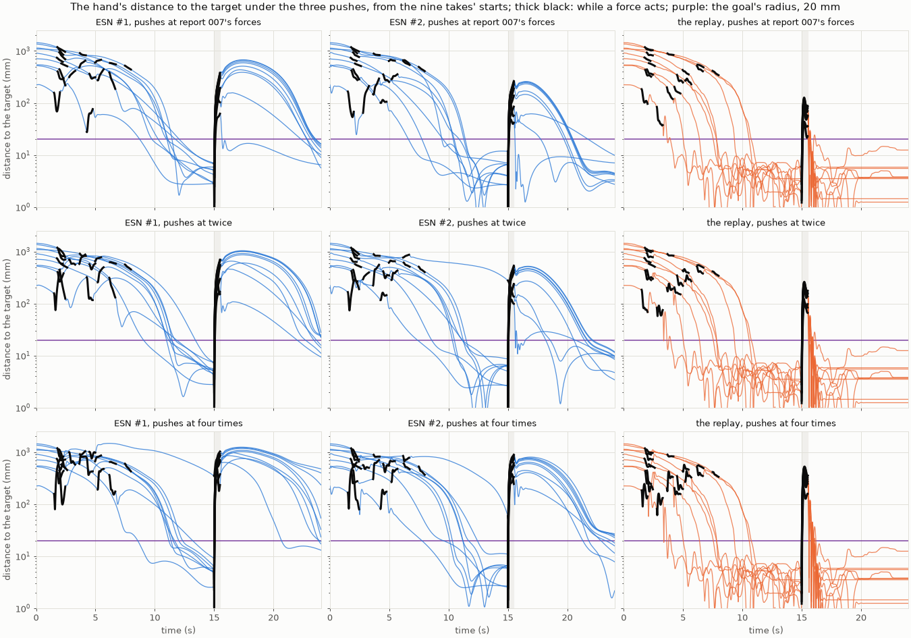

- **At report 007's forces both ESNs pass all nine,** where report 023's passed 2 and 1.
  This is the size the search scored.
- **At twice, ESN #2 passes all nine and ESN #1 four.** ESN #1's five failing hands are
  22 to 28 mm from the target at 24 s.
- **At four times, ESN #2's four failing hands are 23 to 27 mm away** (one of them never
  entered the goal). Three of ESN #1's six are 23 to 54 mm away, and three are 0.24 to
  0.48 m away.

Each push at report 007's forces, medians over the nine runs:

| | ESN #1 | ESN #2 | Replay |
| --- | --- | --- | --- |
| Following gain, pushes 1, 2, 3 | 0.91, 0.91, 0.90 | 0.74, 0.71, 0.79 | 0, 0, 0 |
| Farthest off the take's path (m), pushes 1, 2, 3 | 0.19, 0.18, 0.40 | 0.07, 0.13, 0.19 | 0.03, 0.05, 0.10 |

The third push, of 4 N for 0.5 s on the arm at rest at the target, at report 007's
forces (medians, the range in parentheses):

| | ESN #1 | ESN #2 | Replay |
| --- | --- | --- | --- |
| Hands in the goal through the second before it, of 9 | 9 | 9 | 9 |
| Distance to the target when it ends (m) | 0.30 (0.06 to 0.38) | 0.19 (0.04 to 0.26) | 0.07 (0.02 to 0.09) |
| Farthest from the target after it (m) | 0.51 (0.06 to 0.68) | 0.20 (0.05 to 0.27) | 0.10 (0.04 to 0.13) |
| When it is farthest (s) | 17.4 | 15.5 | 15.2 |
| In the goal for good from (s) | 23.2 (15.7 to 23.6) | 20.4 (15.6 to 21.8) | 15.8 (15.5 to 16.2) |
| Distance to the target at 24 s (mm) | 12 (6 to 17) | 4 (3 to 10) | 4 (1 to 12) |

- **The references still go with the pushed arm.** ESN #1 follows by 0.90 to 0.91, little
  less than report 023's ESNs (0.94 to 0.96). ESN #2 follows by 0.71 to 0.79, as the
  settings of report 017's ESNs did (0.76 and 0.78).
- **ESN #1's hand keeps going after the third push ends.** It is 0.30 m away when the
  force stops and 0.51 m away 1.9 s later, by the median. ESN #2's hand is farthest when
  the force stops.
- **ESN #1 comes back just in time.** Eight of its nine hands are in the goal for good
  between 22.3 and 23.6 s, with the run ending at 24 s. ESN #2's are back by 21.8 s.
- **Larger pushes send the hands farther, and they are back later.** After the third push
  at twice the forces ESN #1's hand goes 0.86 m from the target by the median and ESN #2's
  0.43 m. At four times they go 1.03 and 0.64 m.

**Over 48 s, at report 007's forces** (reported without a claim):

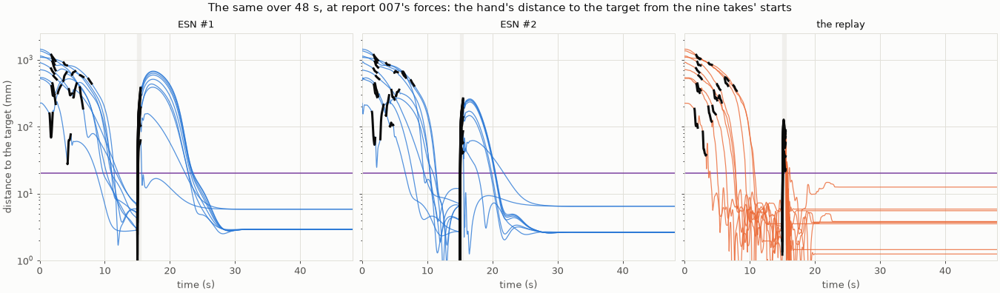

- Every hand stays in the goal after its return: the times above do not change, and the
  runs end 3 to 6 mm from the target.

### 3.5 Nine takes against one (claim 6 fails as stated)

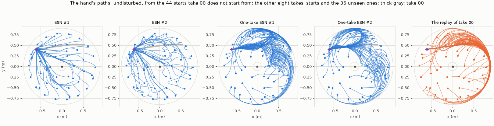

From the 44 starts take 00 does not start from, medians (the largest in parentheses):

| | ESN #1 | ESN #2 | One-take ESN #1 | One-take ESN #2 | Replay of take 00 |
| --- | --- | --- | --- | --- | --- |
| Runs that hold, of 44 | 44 | 43 | 44 | 44 | 44 |
| Detour ratio, the 44 | 1.08 (4.09) | 1.29 (7.40) | 3.19 (39.75) | 2.67 (27.68) | 4.76 (52.35) |
| Detour ratio, the other eight takes' starts | 1.01 | 1.07 | 4.03 | 3.13 | 5.50 |
| Detour ratio, the 36 unseen | 1.10 | 1.32 | 3.19 | 2.67 | 4.76 |
| Fastest reference speed (°/s), the other eight | 49 | 118 | 6,742 | 4,947 | 11,599 |
| Fastest reference speed (°/s), the 36 unseen | 289 | 998 | 5,466 | 3,817 | 9,000 |
| Largest torque (N m), the other eight | 1.5 | 6.2 | 353 | 259 | 607 |
| Largest torque (N m), the 36 unseen | 15.1 (56.3) | 52.2 (141.2) | 286 (597) | 200 (443) | 471 (1,000) |
| Arrival (s), the 44 | 7.62 | 7.66 | 8.07 | 8.27 | 7.84 |

- **The one-take ESNs hold from all 44,** so ESN #1 does not hold from more, and ESN #2
  holds from one fewer (the run of Section 3.3).
- **The other half of the claim holds.** The nine-take ESNs' detour ratios are less than
  half the one-take ESNs'.
- **Both one-take ESNs jump toward their take's start,** at about half the replay's speed
  and torque, and then go as the take does. In report 023 the second one-take ESN jumped
  much less (629 °/s) and arrived late (13.7 s). This search's rule chose two settings at
  a leak rate of 0.017.

### 3.6 How many takes (claim 7 fails as stated)

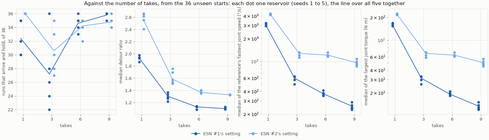

Runs that hold from the 36 unseen starts, of 180 (five seeds):

| Takes | ESN #1's setting | ESN #2's setting |
| --- | --- | --- |
| one | 162 | 180 |
| three | 136 | 153 |
| six | 173 | 171 |
| nine | 179 | 174 |

Medians over the 180 runs from the unseen starts, at ESN #1's setting and at ESN #2's:

| Takes | Detour ratio | Reference's fastest joint speed (°/s) | Largest torque (N m) |
| --- | --- | --- | --- |
| one | 1.93, 2.55 | 3,028, 4,180 | 158.4, 218.8 |
| three | 1.31, 1.59 | 599, 1,278 | 31.4, 66.9 |
| six | 1.13, 1.37 | 372, 1,210 | 19.2, 63.3 |
| nine | 1.10, 1.33 | 255, 961 | 13.4, 50.3 |

- **With three takes, fewer runs hold than with one, at both settings:** 136 against 162,
  and 153 against 180. At ESN #2's setting nine takes hold from fewer than one.
- **How the hand gets there improves with every step,** as in report 023: the detour
  ratio, the reference's speed, and the torque fall from one take to nine. At ESN #2's
  setting the speed and the torque fall little from three takes on.
- From the starts of the takes an ESN is trained on, every run holds.

### 3.7 Against report 023's ESNs

Reported without a claim. Report 023's numbers are from its copies of its runs.

| | ESN #1 | ESN #2 | Report 023's ESN #1 | Report 023's ESN #2 |
| --- | --- | --- | --- | --- |
| Leak rate | 0.03 | 0.017 | 0.055 | 0.1 |
| Input scaling | 2 | 4 | 1 | 0.5 |
| Runs that hold from the 36 unseen starts | 36 | 35 | 36 | 36 |
| Detour ratio, unseen (median) | 1.096 | 1.323 | 1.080 | 1.090 |
| Reference's fastest joint speed, unseen (°/s) | 289 | 998 | 183 | 119 |
| Largest torque, unseen (N m) | 15.1 | 52.2 | 9.6 | 6.2 |
| Arrival, unseen (s) | 7.50 | 7.21 | 7.78 | 9.37 |
| Pushed runs that pass, at 1, 2, 4 times the forces | 9, 4, 3 | 9, 9, 5 | 2, 1, 1 | 1, 2, 1 |
| Following gain, pushes 1, 2, 3 | 0.91, 0.91, 0.90 | 0.74, 0.71, 0.79 | 0.94, 0.94, 0.96 | 0.95, 0.95, 0.96 |
| Off the path after the third push (m, median) | 0.40 | 0.19 | 0.63 | 0.56 |
| In the goal for good, over 48 s (s, median) | 23.2 | 20.4 | 28.9 | 26.0 |

- **ESN #1 costs little undisturbed:** its detour ratio is 0.016 larger than report 023's
  ESN #1's, and its speed and torque 1.6 times.
- **ESN #2 costs more:** its detour ratio is 1.32 against 1.09, and its speed and torque
  are eight times those of report 023's ESN #2.

The 20 settings scored again, by their leak rate and input scaling: the following gain in
the fine search, and medians over the runs from the 36 untaught starts (the range over the
settings):

| Leak rate | Input scaling | Settings | Following gain | Reference's fastest joint speed (°/s) | Largest torque (N m) | Detour ratio | Runs that hold from the untaught starts, of 180 |
| --- | --- | --- | --- | --- | --- | --- | --- |
| 0.017 | 1 | 4 | 0.74 to 0.79 | 219 to 271 | 10.5 to 13.5 | 1.19 to 1.24 | 160 to 166 |
| 0.017 | 2 | 6 | 0.75 to 0.80 | 417 to 528 | 21.7 to 27.6 | 1.19 to 1.25 | 162 to 167 |
| 0.017 | 4 | 6 | 0.73 to 0.78 | 936 to 1,007 | 48.3 to 52.7 | 1.35 to 1.42 | 167 to 176 |
| 0.03 | 1 | 2 | 0.89 to 0.91 | 101 to 150 | 4.9 to 7.7 | 1.09 to 1.10 | 168 to 175 |
| 0.03 | 2 | 2 | 0.90 to 0.91 | 257 to 292 | 13.5 to 15.3 | 1.11 to 1.12 | 174 to 180 |

- **The reference's speed at the start goes with the input scaling.** It about doubles
  with each doubling, at either leak rate, and the torque with it.
- **The following gain goes with the leak rate,** and hardly with the input scaling.
- **A slow reservoir with an input scaling of 1 follows little and starts gently:** 0.74
  to 0.79, at 219 to 271 °/s. But it holds from fewer untaught starts (160 to 166 of 180),
  so the score ranks those settings 13th to 20th.

## 4. Observations

- **The pushes in the score change which ESN is chosen, and the change is the leak
  rate.** Report 023's search took the most direct of the settings that hold, at leak
  rates of 0.055 and 0.1, where 32% and 11% of the pushed runs pass in the searches here.
  With the pushed runs counted, the search moves to 0.03 and 0.017.
- **Passing is not withstanding.** The score asks only where the hand is at 24 s, 9 s
  after the last push. ESN #1 meets it while following the arm by 0.9 and being sent
  0.51 m away: it comes back faster than report 023's ESNs (23.2 s against 28.9 s), and
  just before the run ends. A score that should reward keeping to the path would have to
  measure it.
- **The same holds at the larger pushes.** Most failing runs at twice and four times the
  forces are hands 22 to 54 mm from the target and still coming back. The count of claim 5
  turns on a few millimeters and a second or two.
- **Two things are traded, by two parameters.** A slower reservoir follows a pushed arm
  less and goes less directly from an unseen start (detour ratios of 1.19 to 1.42 at 0.017
  against 1.09 to 1.12 at 0.03). A larger input scaling holds from more untaught starts
  and jumps more at the start. The score counts runs first, so it took the largest input
  scaling for ESN #2, and with it a reference that begins up to 19° from the arm.
- **The takes' starts did not show ESN #2's jumps either,** except from two of them. The
  measures of claim 3, the reference's speed and the torque, are not in the score.
- **One take is still enough to arrive, and three can be worse than one.** Why three
  takes hold from fewer unseen starts than one is not examined here. The take counts are
  not searched: each uses the setting chosen for nine takes.
- **Limits.**
  - One robot, one target, one tracker, and simulated runs.
  - At report 007's forces, claim 5's pushed runs repeat runs the search scored: the same
    ESNs, pushes, and starts. Only twice and four times the forces are sizes the search
    did not see, and nothing tests other directions, times, or starts.
  - Each chosen ESN is one reservoir. The scores are over five seeds a setting; no
    held-out seeds were run.
  - The untaught starts are in the score, so only the unseen starts are held out.
  - The fine grid extends beyond the coarse one in three parameters, and the chosen
    settings sit at its edges: ESN #2 at the smallest leak rate and the largest spectral
    radius, input scaling, and ridge.

## 5. Next steps

1. **Decide what a pushed run should be scored by.** Ending within 20 mm at 24 s is met by
   a hand that is sent 0.5 m away and returns. Candidates are the farthest distance from
   the take's path after a push, or the following gain, as in report 017.
2. **Put the start in the score, or bound the input scaling.** By the reference's fastest
   joint speed from the untaught starts, ESN #2's setting comes after every slow reservoir
   with an input scaling of 1 or 2.
3. **Look at the settings between the two chosen ones:** a leak rate of 0.017 to 0.03
   with an input scaling of 1 to 2, which the last scoring covers with few settings.
4. **Stage 2,** several targets by a one-hot context, with whichever ESN setting is taken
   from this stage.
