# 025 Three targets by context: one ESN reaches the target its context names and changes target during a run, but one of the two misses from four unseen starts

**Summary.** Report 023 taught one target from many start postures. This is the second
stage of extending reports 017 to 020 to more tasks: three targets, A, B, and C, on the
same two-link arm with no joint limits. The target is named by a context added to the
ESN's input, one value per target, and not by its coordinates. The maintainer taught 27
takes by hand, nine to each target, choosing each take's start and target in the
recorder. ESNs of 800 neurons are trained on all 27 and generate the reference of the
simulated robot from the arm's measured joint angles and the context, with report 017's
tracker. Two ESNs are chosen by report 023's search with each context, ESN #1 and ESN #2,
and five claims fixed before the runs are tested on them, against the replay of the take
to the same target that starts nearest.

The findings:

- **One ESN reaches three targets by its context (claim 1 holds).** From the 27 takes'
  starts, with the context of each take's target, both ESNs arrive within 20 mm of that
  target and stay, as the replay does.
- **From unseen starts, ESN #1 arrives everywhere and ESN #2 does not (claim 2 fails).**
  From 36 unseen starts with each context, ESN #1 holds in 36, 36, and 36 runs at A, B,
  and C, and ESN #2 in 35, 36, and 33, against the replay's 36, 36, and 35. Three of
  ESN #2's four failing runs have the context C and end 122 mm from A.
- **By their medians the ESNs start where the arm is and go directly (claim 3 holds).**
  Medians over the 36 unseen starts at A, for ESN #1, ESN #2, and the replay:
  - the reference's fastest joint speed is 104 and 95 °/s, against 2,903 °/s;
  - the largest joint torque is 5.5 and 5.0 N m, against 140.9 N m;
  - the detour ratio is 1.15 and 1.11, against 2.16.

  B and C are alike.
- **From the unseen starts far from every take's start, the ESNs' references jump too.**
  From 8 to 11 of the 36 unseen starts, at each target and for each ESN, the reference's
  fastest joint speed is above 500 °/s and the largest torque above 20 N m. All of these
  starts are more than 45° from the start of the nearest take. Report 023's ESNs did not
  do this from the same 36 starts; its takes started all over the workspace.
- **Changing the context changes the target, at rest and on the way (claims 4 and 5
  hold).** With the context changed at 16 s, when the hand rests at its first target,
  and at 4 s, when it is on its way, the hand arrives and holds at the new target in
  all 54 runs of each ESN at each time. At rest it arrives 5.7 to 9.8 s after the change
  with ESN #1 and 4.2 to 12.9 s with ESN #2.
- **The search finds fewer settings than for one target.** Of the fine search's 81
  settings, one holds in all 135 runs from the takes' starts, where stage 1 had 20. That
  setting is ESN #1's.
- **Pushed by hand on its way, the hand mostly goes on to the target the context names
  (a demonstration, without a claim).** The maintainer ran each ESN once in the robot
  app for 60 s, changing the target and pushing the hand, nine pushes in all, each while
  the hand was on its way. After eight of them the hand is nearer the named target when
  the next push or change comes than at the release, and it arrives in the two stretches
  that last about 7 s. After one push ESN #2's hand comes within 176 mm of A and is
  339 mm from it, moving away, when the target changes 2.5 s later (Section 3.6).

## 1. Question

1. **Several targets:** can one ESN, trained on takes to three targets, take the arm to
   the target its context names, from the takes' starts and from start postures no take
   starts from?
2. **Starting where the arm is:** from a start no take starts from, does its reference
   begin at the arm and go directly, as report 023's did with one target?
3. **Changing the target:** when the context changes during a run, at rest at a target
   or on the way to one, does the hand go to the new target?

## 2. Setup

### The robot, the targets, the takes, and the start postures

- **The robot** is stage 1's: the arm of reports 005 to 020 with no joint limits,
  simulated every 2 ms
  ([`reach_manual_v2_targets.toml`](../../experiments/demonstrations/reach_manual_v2_targets.toml)).
- **The targets** are A at (−0.6, 0.4) m, stage 1's, B at (0, 0.7) m, and C at
  (0.45, 0.2) m, each with a goal radius of 20 mm. A and B, and B and C, are 0.67 m
  apart; A and C 1.07 m.
- **The 27 takes** are recorded by hand in skelarm's recorder, nine to each target, and
  filtered at 2 Hz ([`data/`](data)). Neither their number nor their starts were fixed in
  advance: before each take, in the recorder's preparation phase, the maintainer posed
  the arm and chose the target, and the take records that choice. They last 13.7 to
  21.8 s, their hands start 0.16 to 1.24 m from their target, and they arrive 3.2 to
  10.9 s in (median 7.1 s).
- **The starts are shared between the targets.** The takes to different targets start
  from about the same seven places, and the last two takes to each target start at the
  other two targets, so that all six reaches from one target to another are taught. The
  start posture does not tell which target a take reaches to. No take starts with the
  hand below y = −0.2 m.
- **Every take rests at one posture a target:** (114°, 75°) at A, (56°, 79°) at B, and
  (−24°, 115°) at C.
- **Joint 2 a whole turn up.** Takes 004 to 027 were recorded with joint 2 once around
  (396° to 521°), which the arm without limits allows and which looks the same. Before
  any run, the maintainer decided that the import moves each take by whole turns to
  start within −180° to 180° in every joint. The hand paths are unchanged.
- **The 36 untaught starts** are stage 1's: hands on three rings around the base (18,
  12, and 6), joint 2 positive. The scoring that chose the ESNs ran from them with each
  context, so they are not held out. None is nearer than 0.085 m to a target.
- **The 36 unseen starts** are stage 1's too, those rings turned 15° back. No search or
  scoring of this stage ran from them. None is nearer than 0.067 m to a target.

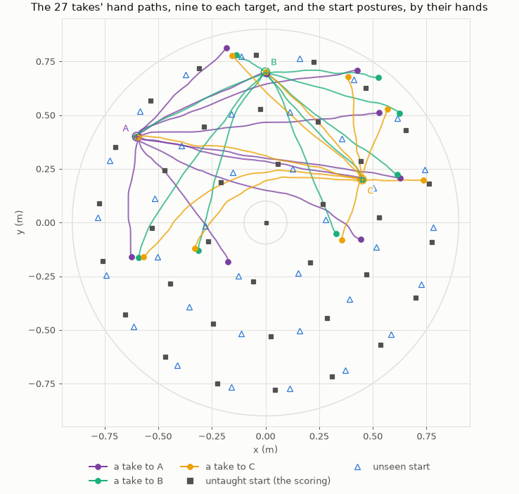

### The ESNs

| | ESN #1 ([`esn.toml`](results/20261119-000048-esn1_lr0.17_sr1.05_is1_ridge10_seed1/esn.toml)) | ESN #2 ([`esn.toml`](results/20261119-000238-esn2_lr0.17_sr1.2_is1_ridge10_seed5/esn.toml)) | Report 023's ESN #1 | Report 023's ESN #2 |
| --- | --- | --- | --- | --- |
| Leak rate | 0.17 | 0.17 | 0.055 | 0.1 |
| Spectral radius | 1.05 | 1.2 | 1.2 | 1.05 |
| Input scaling | 1 | 1 | 1 | 0.5 |
| Ridge | 10 | 10 | 1 | 10 |
| Seed | 1 | 5 | 4 | 3 |
| Training | teacher forcing on the 27 takes, each with its target's context (`demo_00_filtered` to `demo_08_filtered` of `results/demonstrations/20261118-175915-reach_manual_v2_targets_a`, `…-175916-…_b`, and `…-175917-…_c`), without noise | the same | stage 1's nine takes | the same |

The four parameters above were swept. Fixed for both: 800 tanh neurons, sparsity 0.05, a
bias per neuron drawn uniformly from [−1, 1] by the seed and not scaled, a 1 s warm-up on
the held start posture, a 10 ms period. The input is the arm's two joint angles every
10 ms, each normalized by the training takes' range of it, and then the context.

**The context** is one value per target after the two joint angles: 1 for the target to
reach and 0 for the other two (A = (1, 0, 0), B = (0, 1, 0), C = (0, 0, 1)). The joint
angles enter the reservoir through input weights multiplied by the input scaling. The
context is fed in divided by the input scaling, so that its weights have the scale 1
whatever the input scaling is. This scale was not swept. Nothing else tells the ESN which
target to reach, and its output is the next joint angles alone.

### The tracker and the runs

- **The tracker** is report 017's, as in stage 1: joint PD at ω = 20 rad/s and a damping
  ratio of 0.4, given the reference's velocity, its torque computed every 10 ms and held
  between. Its gains are set where the take of reports 005 to 020 ends (kp = 74.96 and
  8.96 N m/rad, kd = 3.00 and 0.36 N m s/rad).
- **A run** is 24 s after the 1 s warm-up, undisturbed. The runs with a change of context
  go on for 24 s after the change: 40 s with the change at 16 s, and 28 s with it at 4 s.
- **The replay** of a run plays by time the take, among those to the target the run's
  context names, that starts nearest the run's start. In a run whose context changes it
  keeps to its take.

### The search

The rule was fixed on 2026-11-18 before any take was recorded, and is given in full in the
[experiment's README](../../experiments/manual_demonstration_v2_targets/README.md#the-search).
It is report 023's, with each run given a context:

1. **The runs:** each ESN on the robot, undisturbed, from each of the 27 takes' starts
   with the context of that take's target.
2. **A run holds** if the hand arrives within 20 mm of the target its context names and
   stays within it for the 2 s after. Nothing later is required.
3. **A setting's score** is how many of its runs hold, over the three targets together,
   the most first, then the median detour ratio of its runs that arrive, the smallest
   first.
4. **The coarse search:** stage 1's 108 settings with one reservoir each (seed 0), over
   leak rates of 0.01, 0.03, 0.1, and 0.3, spectral radii of 0.9, 1.2, and 1.5, input
   scalings of 0.1, 0.5, and 2, and ridges of 10⁻⁴, 10⁻², and 1.
5. **The fine search:** 81 settings around the best coarse one, with five reservoirs each
   (seeds 1 to 5).
6. **Scoring again with untaught starts:** the fine settings whose every run holds, at
   most the 20 best (the 20 best if none does), run again from the takes' starts and from
   the 36 untaught starts with each of the three contexts: 135 runs a reservoir.
7. **ESN #1 and ESN #2** are the typical seeds of the two best settings of step 6. A
   setting's typical seed is, of its seeds with the most runs that hold, the one whose
   own median detour ratio is nearest the setting's.

**A reading of step 6, made during the search.** One fine setting held in every run. The
rule names the settings that hold in every run and the case of none, and one setting
cannot give two ESNs. The 20 best settings were scored again, as when none holds. The
session made this reading before step 6's run, and the maintainer confirmed it while the
run was going, before its outcome was read.

**What the search leaves out:** pushes, changes of the context, and held-out seeds.

### The measures

- **A run holds:** as in the search, at the target its context names.
- **The detour ratio:** the length of the hand's path until it arrives, over the straight
  distance from its start to the target. It is 1 for a straight reach and never less.
- **The reference's fastest joint speed** over the run (°/s), and **the largest joint
  torque** (N m). A reference that starts away from the arm shows in both.
- **After a change of context,** a run holds if the hand arrives within 20 mm of the new
  target and stays within it for the 2 s after. The arrival is timed from the change.

### The claims

The claims were first fixed on 2026-11-18 with eight, before any take was recorded. On the
same day, after the takes were recorded and before any run, the maintainer revised them
to these five. Each is to hold for ESN #1 and for ESN #2.

1. **The takes' starts.** Undisturbed, from each take's start with the context of its
   target, the hand arrives and holds at that target, as the replay's does.
2. **The unseen starts.** From the 36 unseen starts with each of the three contexts, the
   hand arrives and holds at the target the context names from as many starts as the
   replay's, for each target.
3. **Starting where the arm is, and going directly.** From the 36 unseen starts, for each
   target, the reference's fastest joint speed, the largest joint torque, and the detour
   ratio are smaller than the replay's, in their medians over the starts.
4. **Changing the context at rest.** From each take's start with the context of its
   target, the context changes at 16 s to each of the other two targets, and the run goes
   on for 24 s more. In every such run the hand arrives and holds at the new target.
5. **Changing the context on the way.** As claim 4, with the change at 4 s, while the hand
   is on its way. In every such run the hand arrives and holds at the new target.

**The revision** dropped two claims and made one a demonstration:

- **Dropped: each take's start with the other two contexts.** The unseen starts with each
  context cover it.
- **Dropped: three targets against one-target ESNs.** An ESN of one target cannot reach
  the other two, so the comparison shows nothing about the context. The one-target ESNs
  and an ESN with no context were not trained.
- **Made a demonstration: pushes.** Comparing arms under one schedule of forces is not
  what this stage is to show. Instead the maintainer runs ESN #1 in the robot app, pushes
  the arm by hand, and changes the target as he likes. The report was to show that one
  run. Two were recorded, one with each ESN (Section 3.6). Nothing is counted against a
  claim and nothing is compared.

### Reproducing the results

The configurations are in
[`manual_demonstration_v2_targets`](../../experiments/manual_demonstration_v2_targets/README.md),
written below as `$D`.

| Runs | Command | Commit |
| --- | --- | --- |
| the takes' import (three runs, one a target) | `uv run python experiments/import_demonstrations.py experiments/demonstrations/reach_manual_v2_targets.toml` | `eb07dc9` |
| `coarse_search`, `fine_search`, `untaught_search` | `uv run python experiments/sweep_robot_esn.py $D/<name>.toml --workers 15` | `6e46307`, `16ac6c4`, `62502d0` |
| `esn1_lr0.17_sr1.05_is1_ridge10_seed1`, `esn2_lr0.17_sr1.2_is1_ridge10_seed5` | `uv run python experiments/autonomous_esn.py $D/<name>.toml` | `4c2f76e` |
| `robot_esn1`, `robot_esn2` (claims 1 to 3) | `uv run python experiments/robot_esn.py $D/<name>.toml` | `e0e7f91` |
| `switch_to_{a,b,c}_robot_esn{1,2}` (claim 4, six runs) | `robot_esn.py`, as above | `e0e7f91` |
| `switch_early_to_{a,b,c}_robot_esn{1,2}` (claim 5, six runs) | `robot_esn.py`, as above | `e0e7f91` |
| the two demonstrations, by hand (Section 3.6) | `tools/robot_app.py`, with the command of Section 3.6 | `16afa6f` |
| [`summary`](results/summary) | `uv run python reports/025-three-targets-by-context/make_figures.py` | |

- **Running time,** with 15 workers on 32 logical processors, beside another session's
  sweeps: the coarse search 26 min, the fine search 2 h, the scoring with the untaught
  starts 2 h 40 min. Each undisturbed robot run of 270 runs takes 22 min, each run with a
  change at 16 s 7 min, and each with a change at 4 s 6 min.
- **Checks:**
  - Every run record names its commit and reports no uncommitted changes.
  - The copies kept here equal the storage root's files, and the 27 takes are those the
    import read.
  - The replay beside ESN #1 equals the replay beside ESN #2.
  - Before the change, every run whose context changes equals the undisturbed run from
    the same start, joint angle for joint angle. The runs whose context is already the
    new one equal the undisturbed run over its 24 s.
  - In the logs, the context is the first target's before the change's time and the new
    one's from it.
  - A first import of the takes without the move by whole turns is in the storage root
    and is not used.
  - Each demonstration's log names its ESN's run and the search's tracker, and up to its
    first change of context it equals the undisturbed run from the same start: the same
    arrival, and joint angles within 0.01°.
- **What is kept here:** the takes and their three imported runs, and each run's
  configuration and run record with its `metrics.csv`, or its `scores.csv` and
  `seeds.csv`; the two ESNs' `esn.toml` and `esn.rclib`; and the two demonstrations'
  logs as the robot app saved them, under [`data/recorded_forces`](data/recorded_forces).

[`make_figures.py`](make_figures.py) prints the tables of Section 3 and draws its figures.
It reads these copies, and the sweeps' `runs.csv` and the robot runs' logs under the
storage root, which are not kept in Git.

## 3. Results

### 3.1 The search

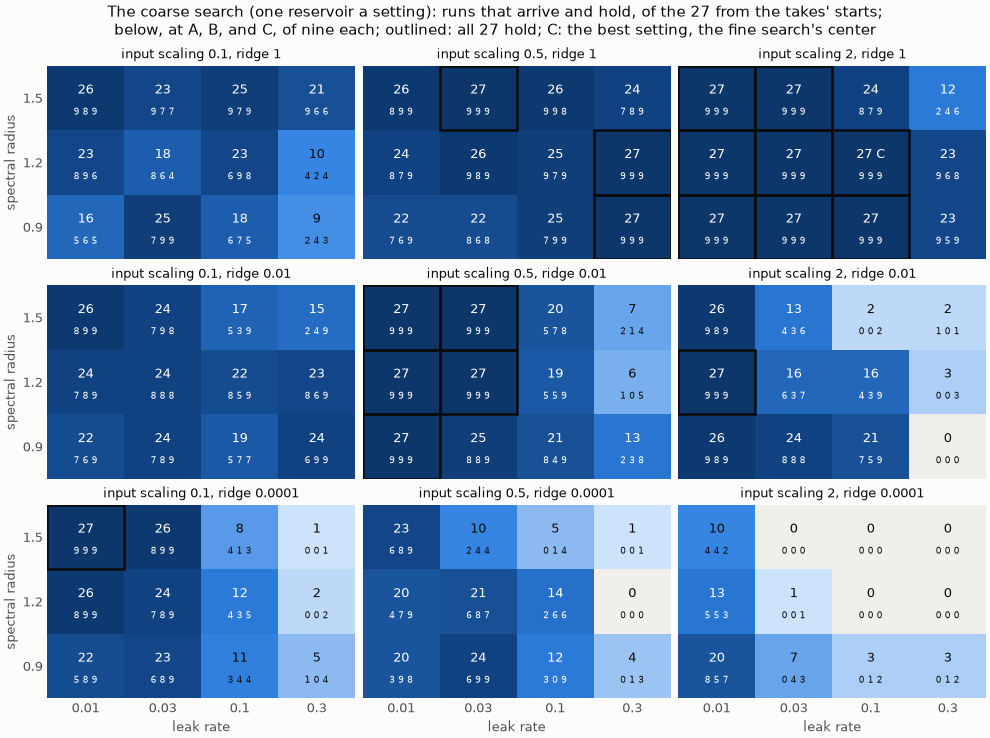

- **The coarse search:** 18 of the 108 settings hold in all 27 runs. One of them has an
  input scaling of 0.1 and one a ridge of 10⁻⁴. The best is a leak rate of 0.1, a
  spectral radius of 1.2, an input scaling of 2, and a ridge of 1, with a median detour
  ratio of 1.0105. Stage 1's best coarse setting differed in the input scaling only
  (0.5), and 30 of its settings held in every run.
- **The fine search,** over leak rates of 0.055, 0.1, and 0.17, spectral radii of 1.05,
  1.2, and 1.35, input scalings of 1, 2, and 4, and ridges of 0.1, 1, and 10: one of the
  81 settings holds in all 135 runs of its five seeds, against 20 in stage 1. Ten hold in
  130 or more. The center holds in 119 and is 24th.
- **C is the easy target.** In the fine search, 39 settings hold in all 45 runs at C, 5
  at B, and 2 at A.
- **From the takes' starts, the failing runs reach their target and do not stay the
  2 s.** In the 20 best fine settings 128 of 2,700 runs fail. In 122 the hand comes
  within 20 mm and is outside again within the 2 s after, and 120 of these end within
  11 mm of the target. Five never arrive, all at A.

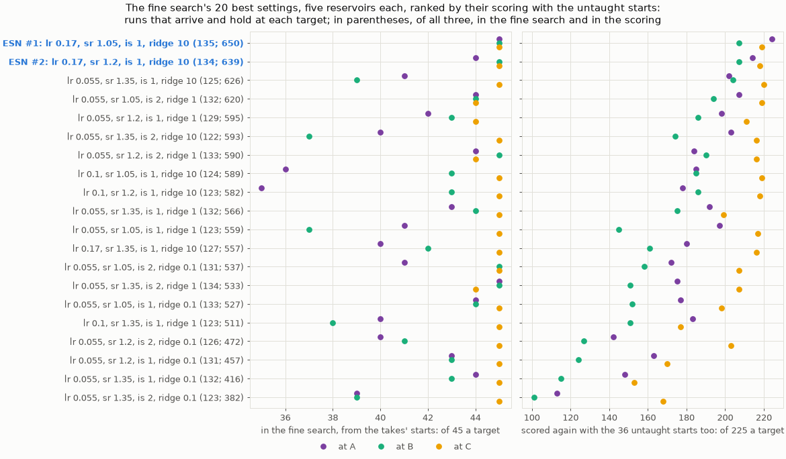

The 20 best fine settings scored again over 675 runs each, the best six and the last:

| Rank | Leak rate | Spectral radius | Input scaling | Ridge | Runs that hold, of 675 | At A, B, C, of 225 | Median detour ratio | Typical seed | In the fine search, of 135 (rank) |
| --- | --- | --- | --- | --- | --- | --- | --- | --- | --- |
| 1 (ESN #1) | 0.17 | 1.05 | 1 | 10 | 650 | 224, 207, 219 | 1.045 | 1 | 135 (1) |
| 2 (ESN #2) | 0.17 | 1.2 | 1 | 10 | 639 | 214, 207, 218 | 1.053 | 5 | 134 (3) |
| 3 | 0.055 | 1.35 | 1 | 10 | 626 | 202, 204, 220 | 1.077 | 5 | 125 (14) |
| 4 | 0.055 | 1.05 | 2 | 1 | 620 | 207, 194, 219 | 1.069 | 5 | 132 (7) |
| 5 | 0.055 | 1.2 | 1 | 1 | 595 | 198, 186, 211 | 1.070 | 2 | 129 (11) |
| 6 | 0.055 | 1.35 | 2 | 10 | 593 | 203, 174, 216 | 1.094 | 1 | 122 (20) |
| 20 | 0.055 | 1.35 | 2 | 0.1 | 382 | 113, 101, 168 | 1.438 | 5 | 123 (18) |

- **No setting holds in all 675 runs.** ESN #1's setting holds in all 135 runs from the
  takes' starts again, and in 515 of 540 from the untaught starts.
- **The untaught starts order the settings otherwise than the takes' starts.** The second
  of the fine search (134 of 135) is 14th here, with 533 of 675.
- **From the untaught starts the failing runs mostly never arrive.** Over the 20
  settings, 2,371 of the 10,800 runs from untaught starts fail, and in 1,542 of them the
  hand never comes within 20 mm of its target. Of ESN #1's setting's 25 failing runs, 23
  never arrive.
- **One reservoir fails at one target.** Seed 2 of ESN #1's setting, and of ESN #2's,
  holds from 21 of the 36 untaught starts at B and from all 36 at A and at C. The other
  seeds of ESN #1's setting miss at most three starts a target.
- **The chosen reservoirs:** ESN #1 (seed 1) holds in all 135 of its runs. ESN #2
  (seed 5) holds in 131: all 27 from the takes' starts, and 35, 36, and 33 of the 36
  untaught starts at A, B, and C.

### 3.2 From the takes' starts (claim 1 holds)

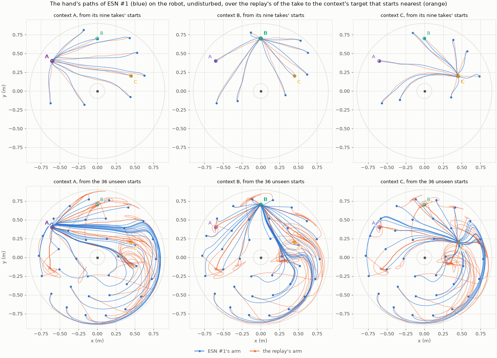

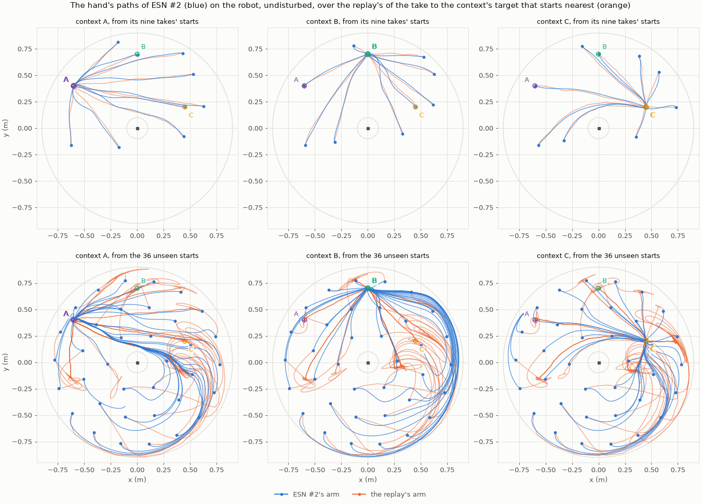

Over the nine takes' starts of each target, medians (the largest in parentheses):

| | Target | ESN #1 | ESN #2 | Replay |
| --- | --- | --- | --- | --- |
| Runs that hold, of 9 | A, B, C | 9, 9, 9 | 9, 9, 9 | 9, 9, 9 |
| Arrival (s) | A | 10.01 | 8.88 | 7.53 |
| | B | 7.78 | 7.32 | 7.08 |
| | C | 7.36 | 7.77 | 6.49 |
| Detour ratio | A | 1.017 | 1.014 | 1.012 |
| | B | 1.007 | 1.012 | 1.011 |
| | C | 1.043 | 1.014 | 1.013 |
| Reference's fastest joint speed (°/s) | A | 37 (54) | 31 (57) | 35 (64) |
| | B | 27 (87) | 33 (74) | 22 (37) |
| | C | 28 (73) | 31 (78) | 28 (67) |
| Largest joint torque (N m) | A | 0.85 (2.81) | 0.36 (2.47) | 0.47 (1.04) |
| | B | 1.15 (4.55) | 1.69 (3.87) | 0.29 (0.50) |
| | C | 1.30 (3.81) | 1.25 (4.06) | 0.34 (1.00) |

- **Every run arrives and holds at the target its context names.** From the starts that
  takes to all three targets share, the context alone decides where the hand goes.
- **The ESNs arrive later than the replay,** by 0.2 to 2.5 s in the median.
- **Their largest torque is above the replay's** at B and C, and at A for ESN #1. It
  comes in the first 50 ms: from take demo_00's start at B, ESN #1's torque is 2.70 N m
  in the first 50 ms and at most 0.06 N m after, against the replay's 0.01 and 0.50 N m.

### 3.3 From the unseen starts (claim 2 fails for ESN #2; claim 3 holds)

Runs that hold, of 36 unseen starts with each context:

| Context | ESN #1 | ESN #2 | Replay of the nearest take to that target |
| --- | --- | --- | --- |
| A | 36 | 35 | 36 |
| B | 36 | 36 | 36 |
| C | 36 | 33 | 35 |

- **Claim 2 holds for ESN #1 and fails for ESN #2,** which holds from fewer starts than
  the replay at A and at C. A claim is to hold for both, so claim 2 fails.
- **ESN #2's four failing runs never arrive.**
  - With the context C, from three neighbouring starts on the outer ring, (132°, 60°),
    (152°, 60°), and (172°, 60°), the hand ends at (−0.71, 0.45) m: 122 mm from A, and
    1,187 mm from C. These starts have the hand at the far left of the workspace.
  - With the context A, from (152°, 109°), the hand ends at (−0.11, −0.42) m, 0.83 m or
    more from every target.
- **The replay's one failing run,** with the context C from (−168°, 60°), comes within
  20 mm, leaves within the 2 s, and ends 3 mm from C.

Medians over the 36 unseen starts (the largest in parentheses):

| | Target | ESN #1 | ESN #2 | Replay |
| --- | --- | --- | --- | --- |
| Detour ratio | A | 1.152 | 1.109 | 2.161 |
| | B | 1.041 | 1.097 | 1.980 |
| | C | 1.083 | 1.071 | 1.988 |
| Reference's fastest joint speed (°/s) | A | 104 (2,829) | 95 (2,920) | 2,903 (11,847) |
| | B | 87 (2,289) | 120 (3,073) | 3,323 (11,598) |
| | C | 81 (2,530) | 84 (3,122) | 3,420 (11,283) |
| Largest joint torque (N m) | A | 5.46 (148.1) | 4.98 (152.8) | 140.9 (620.0) |
| | B | 4.57 (119.8) | 6.30 (160.8) | 129.4 (607.0) |
| | C | 4.24 (132.4) | 4.00 (163.4) | 104.7 (590.5) |
| Arrival (s) | A | 10.09 | 9.37 | 9.09 |
| | B | 8.96 | 8.90 | 7.35 |
| | C | 6.48 | 7.21 | 4.29 |

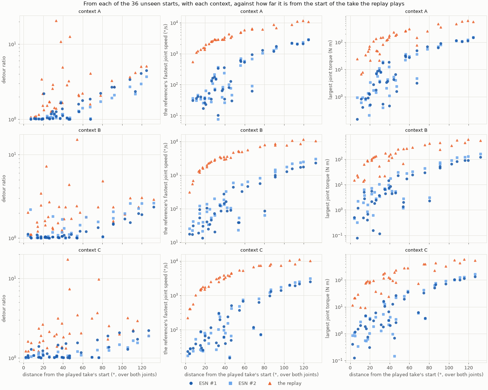

- **Claim 3 holds:** all three medians are smaller than the replay's, at each target and
  for each ESN. Start by start, the speed and the torque are smaller than the replay's
  from all 36 starts, everywhere. The detour ratio is smaller from 30 to 36 of the starts
  from which both arrive.
- **The replay jumps to its take.** Its reference begins at the take's start, and from
  33 to 36 of the 36 starts its speed is above 500 °/s.
- **The ESNs' references begin at the arm from the starts near a take's start, and jump
  from those far from every take's.** The starts within 45° of the start of the take the
  replay plays, over both joints, are 21 or 22 of the 36; the others are farther.

  | Medians | ESN #1, at A, B, C | ESN #2 | Replay |
  | --- | --- | --- | --- |
  | Speed within 45° (°/s) | 47, 46, 41 | 43, 81, 57 | 2,577, 2,284, 1,805 |
  | Speed farther (°/s) | 1,058, 561, 821 | 878, 827, 1,017 | 6,364, 7,857, 7,416 |
  | Torque within 45° (N m) | 2.3, 2.4, 2.1 | 1.9, 4.2, 1.6 | 64, 90, 81 |
  | Torque farther (N m) | 55, 29, 43 | 46, 43, 53 | 285, 345, 359 |

  The speed is above 500 °/s and the torque above 20 N m from 11, 8, and 10 of the 36
  starts at A, B, and C for ESN #1, and from 10, 11, and 9 for ESN #2. Every run above
  either of the two starts farther than 45°. From the takes' starts no run of either ESN
  is above them.
- **Report 023's ESNs did not jump from these 36 starts:** their largest speeds were 397
  and 634 °/s, and their largest torques 20.8 and 33.2 N m. Stage 1's nine takes started
  on rings all around the base. No take of this stage starts with the hand below
  y = −0.2 m, and 11 of the 14 or 15 far starts have the hand there (the paths' lower
  rows above).

Each ESN's joint angles and torques over time, undisturbed, from take demo_00's start
and from one unseen start with each context. The unseen start shown is the one from
which the replay's largest torque is the median of the 36. For the context C it is
(132°, 60°), one of ESN #2's three failing runs: its joint 1 stays near 130°.

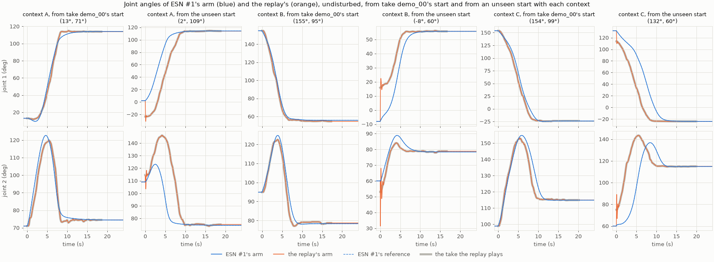


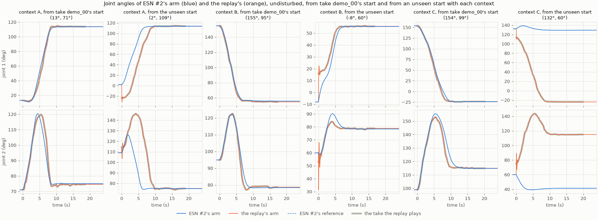

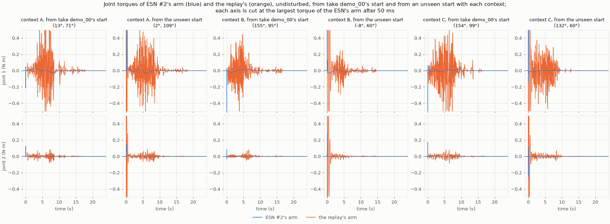

- **From the starts shown, the ESNs' references begin at the arm:** at most 0.8° from it
  in the first second, against 15.3° to 22.0° for the replay from the unseen starts.
- **After the first 50 ms the ESNs use little torque:** at most 0.13 N m in the runs
  shown, against the replay's 0.50 to 0.95 N m from the takes' starts and 10.1 to
  18.3 N m from the unseen ones.

### 3.4 The context changed at rest (claim 4 holds)

From each take's start with the context of its target, the context changes at 16 s to
each of the other two targets. Every hand has arrived at its first target by then, 3 to
5 mm from it.

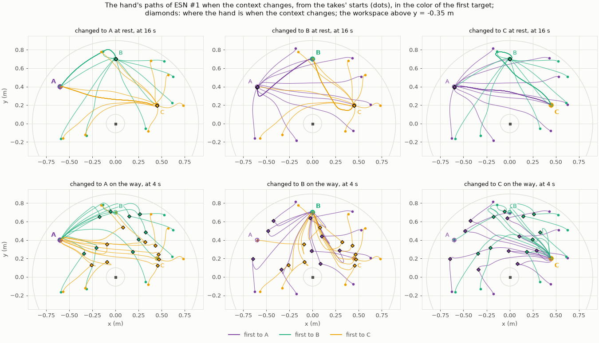

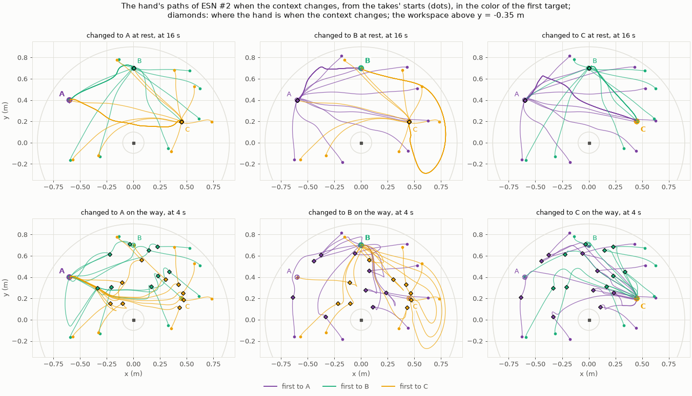

Over the nine runs of each change: the runs that hold at the new target, the arrival
from the change, and the reference's fastest joint speed and the largest joint torque
after the change (medians).

| Change | ESN #1: hold, of 9 | Arrival (s) | Speed (°/s) | Torque (N m) | ESN #2: hold, of 9 | Arrival (s) | Speed (°/s) | Torque (N m) |
| --- | --- | --- | --- | --- | --- | --- | --- | --- |
| A → B | 9 | 5.72 | 31 | 0.7 | 9 | 8.98 | 124 | 6.5 |
| A → C | 9 | 8.54 | 102 | 5.3 | 9 | 10.67 | 215 | 11.3 |
| B → A | 9 | 9.14 | 90 | 1.6 | 9 | 4.19 | 105 | 5.5 |
| B → C | 9 | 9.75 | 75 | 3.9 | 9 | 7.90 | 72 | 2.7 |
| C → A | 9 | 8.18 | 110 | 5.8 | 9 | 8.00 | 69 | 3.6 |
| C → B | 9 | 6.55 | 62 | 2.2 | 9 | 12.90 | 70 | 2.5 |

- **All 54 runs of each ESN arrive and hold at the new target,** and end at most 3.5 mm
  (ESN #1) and 4.5 mm (ESN #2) from it.
- **The nine runs of a change are alike after it.** They rest at the same posture when
  the context changes, whatever their start, and their arrivals from the change differ by
  0.06 s or less.
- **The reference moves faster after the change than in the first reach.** In the first
  reach its fastest joint speed is 27 to 37 °/s by the median. After the change it is 31
  to 110 °/s with ESN #1 and 69 to 215 °/s with ESN #2, and the largest torque up to
  5.8 and 11.3 N m.
- **The six changes take different times,** and the two ESNs do not agree on which are
  slow: B → A takes 9.1 s with ESN #1 and 4.2 s with ESN #2, and C → B 6.6 and 12.9 s.
  The takes from one target to another arrive in 5.8 to 9.4 s.

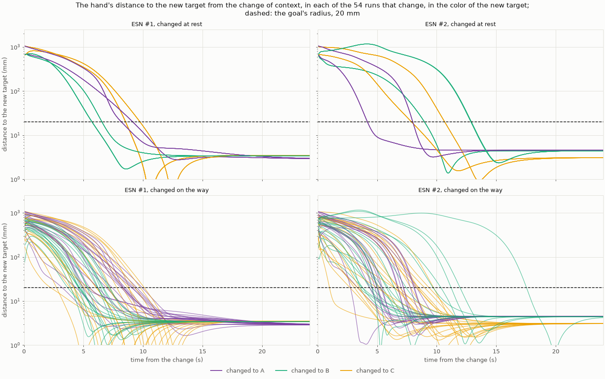

Each ESN's joint angles and torques over time when the context changes, one run of each
change, from the first target's take demo_00's start. The upper rows are the changes at
rest, the lower those on the way (Section 3.5).

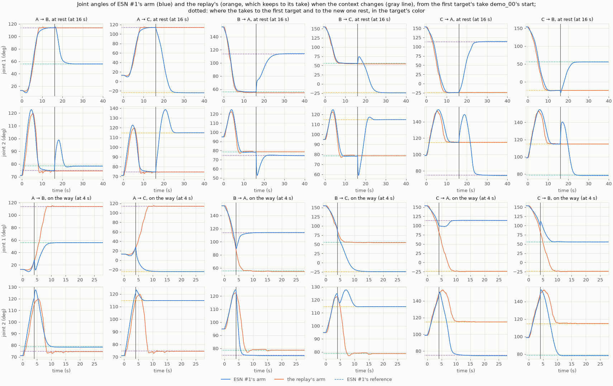

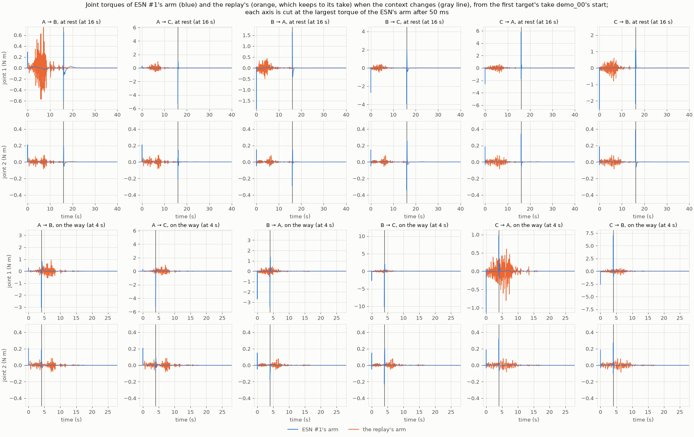

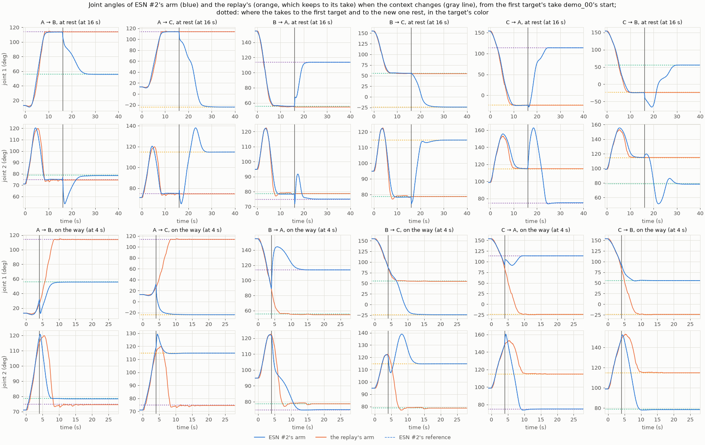

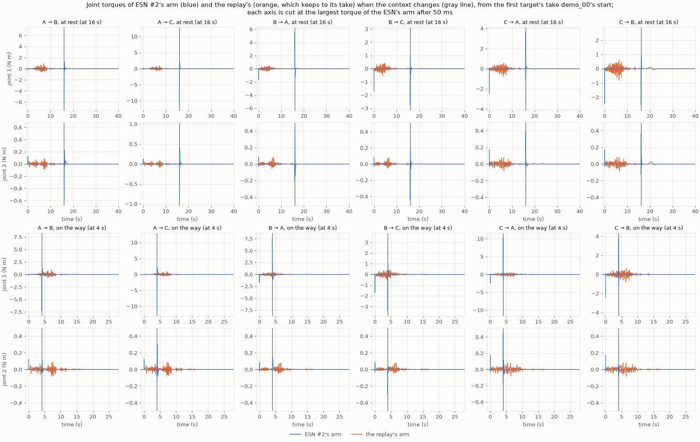

### 3.5 The context changed on the way (claim 5 holds)

As Section 3.4, with the change at 4 s. No ESN run has reached its first target by then:
the hands are 220 to 600 mm from it by the median, and 468 to 922 mm from the new one.

| Change | ESN #1: hold, of 9 | Arrival, median (range) (s) | Speed (°/s) | Torque (N m) | ESN #2: hold, of 9 | Arrival, median (range) (s) | Speed (°/s) | Torque (N m) |
| --- | --- | --- | --- | --- | --- | --- | --- | --- |
| A → B | 9 | 4.68 (3.69 to 7.12) | 59 | 2.3 | 9 | 5.47 (3.78 to 10.36) | 116 | 6.6 |
| A → C | 9 | 6.09 (2.27 to 8.83) | 85 | 5.0 | 9 | 6.43 (3.10 to 9.75) | 197 | 10.7 |
| B → A | 9 | 9.06 (3.23 to 9.95) | 85 | 1.6 | 9 | 5.33 (2.76 to 8.33) | 116 | 6.0 |
| B → C | 9 | 7.05 (2.75 to 10.12) | 118 | 7.0 | 9 | 6.71 (1.00 to 8.52) | 85 | 3.6 |
| C → A | 9 | 7.42 (4.96 to 8.37) | 95 | 5.7 | 9 | 6.73 (4.82 to 8.14) | 74 | 4.6 |
| C → B | 9 | 5.40 (3.95 to 7.22) | 62 | 2.4 | 9 | 6.45 (3.61 to 17.56) | 64 | 2.5 |

- **All 54 runs of each ESN arrive and hold at the new target,** and end at most 3.5 mm
  (ESN #1) and 4.5 mm (ESN #2) from it.
- **The hand turns toward the new target from where it is** (the lower rows of the paths
  above). It does not go to the first target first.
- **One run takes long:** with ESN #2, from C to B, one hand arrives 17.56 s after the
  change, having moved away from B first (the distances above). The others arrive within
  12.0 s.
- **The speeds and torques after the change are of the size of those at rest,** up to
  218 °/s and 10.7 N m in a single run with ESN #1, and 212 °/s and 11.5 N m with ESN #2.

### 3.6 Pushes by hand while the target changes (a demonstration, without a claim)

This section was added on 2026-11-19, after the report's first version, when the runs
were recorded.

The maintainer ran each ESN once in the robot app with the search's tracker, pushed the
arm by dragging its tip, changed the target with the app's keys 1 to 3, and saved the run
as a log (`Ctrl+S`):

```bash
uv run python tools/robot_app.py experiments/demonstrations/reach_manual_v2_targets.toml \
    --law pd --omega 20 --damping 0.4 --control-period 0.01 \
    --gains-from reports/005-tuned-on-the-robot/data/20261008-170034-reach_manual_v2/demo_00_filtered.sklog.npz \
    --model <storage root>/results/manual_demonstration_v2_targets/20261119-000048-esn1_lr0.17_sr1.05_is1_ridge10_seed1/esn.toml
```

and the same with ESN #2's `esn.toml`.

- **Both runs start at (13°, 71°),** where take 001 starts, with the context A. ESN #1's
  lasts 60.2 s and ESN #2's 60.9 s.
- **The changes and the pushes are the maintainer's choices in each run.** They differ
  between the two runs, so the two ESNs are not compared here.
- **ESN #1's run** has six changes of context and five pushes, **ESN #2's** five changes
  and four pushes.
- **A push** is a stretch where the force at the tip is not zero. The app records the
  force and the context at every step of 2 ms.

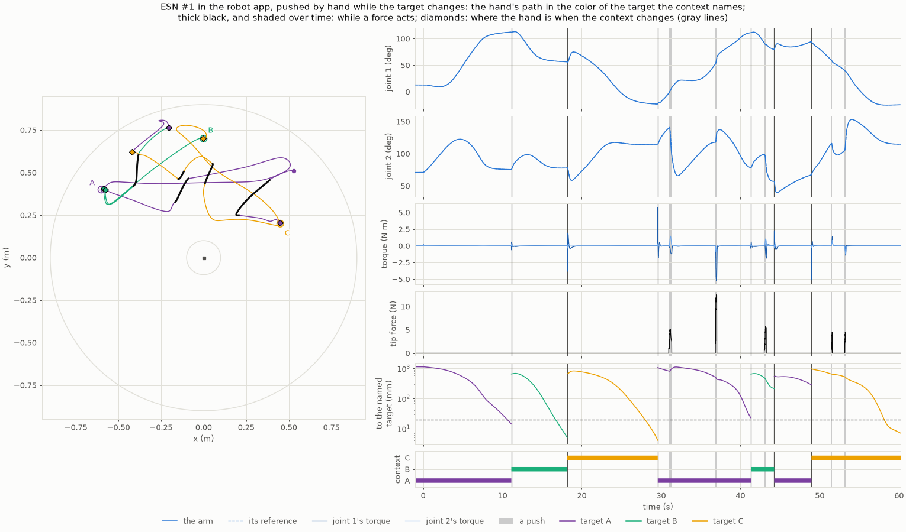

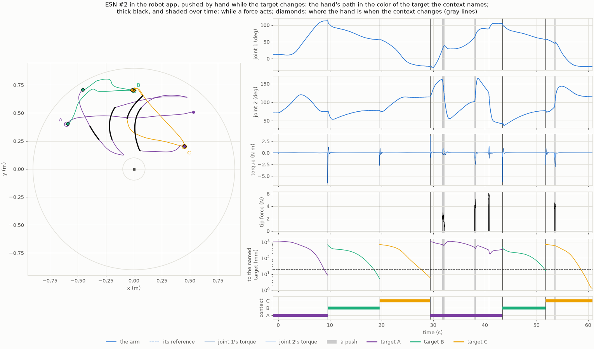

The pushes: how long each lasts, its largest force, how far it moves the hand from the
onset to the release, and the hand's distance to the named target at the onset, at the
release, and at its farthest from the onset until the next push or change.

| ESN | Push | Onset (s) | Lasts (s) | Largest force (N) | Moves the hand (mm) | Context | To the target at the onset (mm) | At the release (mm) | Farthest (mm) |
| --- | --- | --- | --- | --- | --- | --- | --- | --- | --- |
| #1 | 1 | 30.96 | 0.38 | 5.2 | 276 | A | 820 | 990 | 1,119 |
| #1 | 2 | 36.84 | 0.18 | 12.6 | 160 | A | 515 | 438 | 515 |
| #1 | 3 | 43.00 | 0.26 | 5.7 | 188 | B | 498 | 394 | 498 |
| #1 | 4 | 51.44 | 0.14 | 4.5 | 54 | C | 653 | 644 | 653 |
| #1 | 5 | 53.14 | 0.14 | 4.5 | 127 | C | 529 | 500 | 529 |
| #2 | 1 | 31.74 | 0.50 | 2.9 | 384 | A | 696 | 682 | 1,102 |
| #2 | 2 | 38.02 | 0.24 | 5.2 | 284 | A | 457 | 426 | 577 |
| #2 | 3 | 40.74 | 0.12 | 6.1 | 141 | A | 316 | 209 | 339 |
| #2 | 4 | 53.48 | 0.26 | 4.6 | 242 | C | 587 | 569 | 587 |

The stretches between events. An event is the start, a change of context, or a push's
release; a stretch runs from it to the next push's onset, the next change, or the run's
end. For each: the hand's distance to the named target at its start, the nearest in the
stretch, when the hand first comes within the goal of 20 mm, the distance at its end,
and the hand's speed over its last 0.1 s.

ESN #1:

| From (s) | To (s) | Begun by | Context | At the start (mm) | Nearest (mm) | Within the goal | At the end (mm) | Speed at the end (mm/s) |
| --- | --- | --- | --- | --- | --- | --- | --- | --- |
| 0.00 | 11.12 | the start | A | 1,134 | 14 | after 10.61 s | 14 | 10 |
| 11.12 | 18.16 | the change to B | B | 657 | 5 | after 5.57 s | 5 | 6 |
| 18.16 | 29.58 | the change to C | C | 678 | 4 | after 9.81 s | 4 | 6 |
| 29.58 | 30.96 | the change to A | A | 1,067 | 821 | no | 821 | 143 |
| 31.34 | 36.84 | push 1's release | A | 990 | 515 | no | 515 | 173 |
| 37.02 | 41.32 | push 2's release | A | 438 | 23 | no | 23 | 24 |
| 41.32 | 43.00 | the change to B | B | 651 | 498 | no | 498 | 215 |
| 43.26 | 44.26 | push 3's release | B | 394 | 215 | no | 215 | 46 |
| 44.26 | 48.96 | the change to A | A | 537 | 286 | no | 286 | 97 |
| 48.96 | 51.44 | the change to C | C | 969 | 654 | no | 654 | 141 |
| 51.58 | 53.14 | push 4's release | C | 644 | 529 | no | 529 | 114 |
| 53.28 | 60.22 | push 5's release | C | 500 | 7 | after 4.85 s | 7 | 2 |

ESN #2:

| From (s) | To (s) | Begun by | Context | At the start (mm) | Nearest (mm) | Within the goal | At the end (mm) | Speed at the end (mm/s) |
| --- | --- | --- | --- | --- | --- | --- | --- | --- |
| 0.00 | 9.58 | the start | A | 1,134 | 8 | after 8.88 s | 8 | 11 |
| 9.58 | 19.64 | the change to B | B | 662 | 5 | after 8.89 s | 5 | 8 |
| 19.64 | 29.42 | the change to C | C | 677 | 6 | after 7.97 s | 6 | 5 |
| 29.42 | 31.74 | the change to A | A | 1,070 | 696 | no | 696 | 113 |
| 32.24 | 38.02 | push 1's release | A | 682 | 457 | no | 457 | 179 |
| 38.26 | 40.74 | push 2's release | A | 426 | 316 | no | 316 | 128 |
| 40.86 | 43.38 | push 3's release | A | 209 | 176 | no | 339 | 50 |
| 43.38 | 51.78 | the change to B | B | 457 | 16 | after 8.19 s | 16 | 17 |
| 51.78 | 53.48 | the change to C | C | 687 | 588 | no | 588 | 88 |
| 53.74 | 60.86 | push 4's release | C | 569 | 1 | after 4.84 s | 1 | 2 |

- **Until its first change, each run is the undisturbed run of Section 3.2 from take
  001's start.** The hand arrives at A after 10.61 s with ESN #1 and 8.88 s with ESN #2
  in both, and the joint angles agree within 0.01°.
- **Unpushed, the hand goes to each target named in turn.** In the first 29 s of each
  run the context goes from A to B to C, each change made with the hand 5 to 14 mm from
  the target it leaves. The hand arrives at B and at C within 0.15 s of Section 3.4's
  medians for those changes.
- **Every push came while the hand was on its way,** 316 to 820 mm from the named target.
  None came with the hand at rest at a target. The pushes last 0.12 to 0.50 s, reach 2.9
  to 12.6 N, and move the hand 54 to 384 mm.
- **After eight of the nine pushes, the hand is nearer the named target at the stretch's
  end than at the release.** In all eight the stretch's end is also where the hand is
  nearest in the stretch.
- **The hand arrives in the two stretches that last about 7 s:** 4.85 s after ESN #1's
  push 5 and 4.84 s after ESN #2's push 4, both at C. The other seven stretches after a
  push last 1.0 to 5.8 s and end before the hand arrives. After ESN #1's push 2 the hand
  is 23 mm from A, 3 mm outside the goal, when the context changes.
- **After three pushes the hand first goes away from the target:** to 1,119 and 1,102 mm
  from A after push 1 of each run, and to 577 mm after ESN #2's push 2. It then comes
  nearer than it was at the release.
- **After one push the hand is going away when the stretch ends.** ESN #2's push 3
  releases the hand 209 mm from A. It comes to 176 mm, then moves away, and is 339 mm
  from A and moving at 50 mm/s when the context changes 2.5 s after the release. The run
  does not show whether it would have arrived at A.
- **Changed on the way, the hand turns to the new target,** as in Section 3.5: ESN #1's
  changes at 44.26 and 48.96 s come with the hand 215 and 286 mm from the target it
  leaves, and ESN #2's at 43.38 s with it 339 mm away. ESN #2's hand then arrives at B
  after 8.19 s.

The reference's fastest joint speed and the largest joint torque, over each run and in
the 2 s after each change of context:

| | ESN #1: speed (°/s) | Torque (N m) | ESN #2: speed (°/s) | Torque (N m) |
| --- | --- | --- | --- | --- |
| over the run | 224 | 5.8 | 236 | 6.5 |
| after the first change, A → B | 31 | 0.6 | 124 | 6.5 |
| after the second, B → C | 75 | 3.8 | 71 | 2.7 |
| after the third, C → A | 224 | 5.8 | 69 | 3.6 |
| outside the 2 s after every change | 199 | 5.2 | 236 | 2.5 |

- **The reference does not jump under the pushes.** Its fastest joint speed is 224 °/s
  in ESN #1's run and 236 °/s in ESN #2's, and the largest torque 5.8 and 6.5 N m. These
  are of the size of Sections 3.4 and 3.5, and far below the 500 °/s and 20 N m of the
  jumps of Section 3.3.
- **After the unpushed changes the speeds are Section 3.4's:** 31 and 75 °/s for ESN #1's
  first two changes, against medians of 31 and 75 °/s there, and 124, 71, and 69 °/s for
  ESN #2's first three, against 124, 72, and 69 °/s. ESN #1's third change is followed by
  push 1 within the 2 s.
- **The reference follows the pushed arm.** The ESN reads the measured joint angles, so a
  push moves its reference with the arm: during the pushes a joint is at most 8.7°
  (ESN #1) and 7.9° (ESN #2) from its reference. Outside the pushes and the 0.5 s after
  each release it is at most 1.4° and 3.0° from it.

## 4. Observations

These are read from the runs above and were not tested by runs of their own.

- **A context of scale 1 was enough.** The context was fed in at the scale 1 whatever
  the input scaling, and was not swept. With it the search found an ESN that holds in
  every run it was scored on.
- **Three targets leave the search less room than one.** One fine setting holds in every
  run from the takes' starts, against 20 for one target, and none holds in every run
  with the untaught starts, against three.
- **The two kinds of start fail in two ways.** From the takes' starts a failing hand
  reaches its target and wavers at the goal's edge. From the untaught starts it mostly
  never arrives. The sweeps keep no logs, so where those hands end is known only by
  their distance to the target, and for ESN #2's four runs of Section 3.3.
- **A wrong target was seen once:** ESN #2's three runs with the context C end beside A,
  outside its goal. No run ended within the goal of a target its context does not name.
- **Where the takes do not start, the ESN's reference does not begin at the arm.** This
  is the difference from report 023, whose takes started all around the base. Whether
  takes from the lower part of the workspace remove the jumps was not tried.
- **At rest, the ESN has forgotten its start.** The nine runs of a change go the same
  way after it. On the way, the hand turns from where it is.
- **A change of context moves the reference faster than a first reach.** The takes from
  one target to another were taught at the takes' pace, but the change comes as a step in
  the input.
- **A pushed hand mostly goes on from where the push leaves it.** In the two
  demonstrations it does so after eight of nine pushes, as it turns from where it is when
  the context changes on the way. The pushes were not made under a schedule and none came
  at rest, so this is two runs, not a count. After the one push where the hand goes away,
  the run is too short to say what follows.

## 5. Next steps

These are proposals. None is started.

1. **Takes from the lower part of the workspace,** if the ESN is to start gently from
   there: a few more takes to each target, and the search again.
2. **Pushes under a fixed schedule,** which this stage left out, with these ESNs or with
   a search that scores them, as report 024 did for one target. They would also show what
   follows a push like ESN #2's third in Section 3.6, over a longer time and at rest.
3. **The context's scale,** which was not swept: whether a larger one gives more
   settings that hold, and fewer hands that end beside another target.
