# 026 A periodic motion from a script: the ESN keeps drawing the ellipse and rejoins it after pushes, but after a block its hand leaves the curve farther than the replay's

**Summary.** Reports 023 and 024 taught one reach from many starts. This is the first part
of the stage that adds a periodic motion: the hand of the two-link arm goes around an
ellipse without end. Here the motion is taught by one take made by a script, ten loops of
4 s from a start on the curve. ESNs of 800 neurons are trained on it and generate the
reference of the simulated robot from the arm's measured joint angles, with report 017's
tracker. Two ESNs are chosen by a search that scores undisturbed runs only, ESN #1 and
ESN #2, and five claims fixed before the runs are tested on them, against the replay of
the take. The same search and claims on a take recorded by hand are report 027's.

The findings:

- **The ESNs keep drawing the ellipse (claim 1 holds).** From eight starts on the curve,
  every run still cycles at the end of 120 s. The hand is 0.79 mm RMS from the ellipse,
  against 0.83 mm for the replay, and a loop takes 0.4% longer than the taught 4 s.
- **They join the curve from anywhere tried (claim 3 holds).** From 36 untaught starts
  spread over the workspace, every run cycles at the end of 60 s. The hand is on the
  curve for good after 0.8 s by the median and 2.0 s at the latest, against 0.3 s and
  0.4 s for the replay.
- **Their start is smaller than the replay's, but it is not gentle (claim 2 holds).**
  Medians for ESN #1, ESN #2, and the replay:
  - from the seven other starts on the curve, the reference's fastest joint speed is
    1,531 and 1,595 °/s, against 2,670 °/s, and the largest torque 11.1 and 11.2 N m,
    against 139.8 N m;
  - from the 36 untaught starts, the speed is 5,526 and 5,590 °/s, against 9,000 °/s,
    and the torque 270 and 272 N m, against 471 N m.

  The ESN's reference goes to the curve at once, as the replay's goes to the take's
  start. One take that stays on the curve teaches nothing about getting there.
- **After pushes the hand rejoins the curve and goes on from where it is (claim 4
  holds).** At report 007's forces, at twice, and at four times them, all eight runs of
  each ESN cycle at the end of 80 s, as the replay's do. A push sends the hand about as
  far off the curve as the replay's, and the hand is back within 20 mm at the most
  2.2 s after the push ends, against 0.4 s. The ESN's hand ends 0.4 s ahead to 0.7 s behind its undisturbed
  run.
- **After a block the hand leaves the curve farther than the replay's (claim 5 fails in
  one of its three parts).** With the tip held for 3 s:
  - all eight runs of each ESN cycle at the end of 60 s, as the replay's do;
  - in the 2 s after the release the largest torque is 9.8 and 9.3 N m by the median,
    against 19.7 N m for the replay;
  - but the hand goes 84 and 77 mm off the curve, against 60 mm. The ESN's is the
    smaller from only 2 of the 8 starts.

  While the tip is held, the ESN's reference neither waits at the arm nor goes on
  around: it drifts to a posture away from the arm and off the curve, and rests there.
  At the release the arm goes to it. The hand then goes on 2.7 s behind its undisturbed
  run, of the 3 s it was held.

## 1. Question

1. **A periodic motion:** can an ESN, trained on one take of a hand going around an
   ellipse, keep the simulated arm going around it without end?
2. **Joining the curve:** from a start no take starts from, on the curve or away from it,
   does the arm join the curve, and how does it start?
3. **Disturbances:** pushed off the curve or held in place, does the arm rejoin the curve,
   and does it go on from where it is or catch up with the time?

## 2. Setup

### The robot, the curve, the take, and the start postures

- **The robot** is report 023's: the arm of reports 005 to 020 with no joint limits,
  simulated every 2 ms
  ([`reach_manual_v2_no_limits.toml`](../../experiments/demonstrations/reach_manual_v2_no_limits.toml)).
- **The curve** is an ellipse centered at (−0.1, 0.55) m, with semi-axes of 0.20 m along x
  and 0.12 m along y, 1.02 m around. The hand goes around it counterclockwise. On it the
  hand is 0.44 to 0.68 m from the base, joint 1 goes from 34° to 79°, and joint 2 from
  82° to 123°.
- **The take** is made by a script
  ([`ellipse_scripted_v2_no_limits.toml`](../../experiments/demonstrations/ellipse_scripted_v2_no_limits.toml),
  [`data/`](data)): the joint angles that put the hand on the ellipse at an even rate
  of the curve's angle, 4 s a loop, for 40 s, sampled every 10 ms. It starts at the
  posture (35.8°, 104.1°), the hand on the curve's right end, and moves at its full pace
  from its first sample. It is not filtered.
- **The eight starts on the curve** put the hand at the curve's angles 0°, 45°, …, 315°,
  an eighth of a loop apart. Start 0 is the take's. The take passes through all eight.
- **The 36 untaught starts** are report 023's: hands on three rings around the base (18,
  12, and 6 hands), spread evenly over the workspace, with joint 2 positive. The last
  step of the search ran from them, so they are not held out. No other set of starts is
  used.

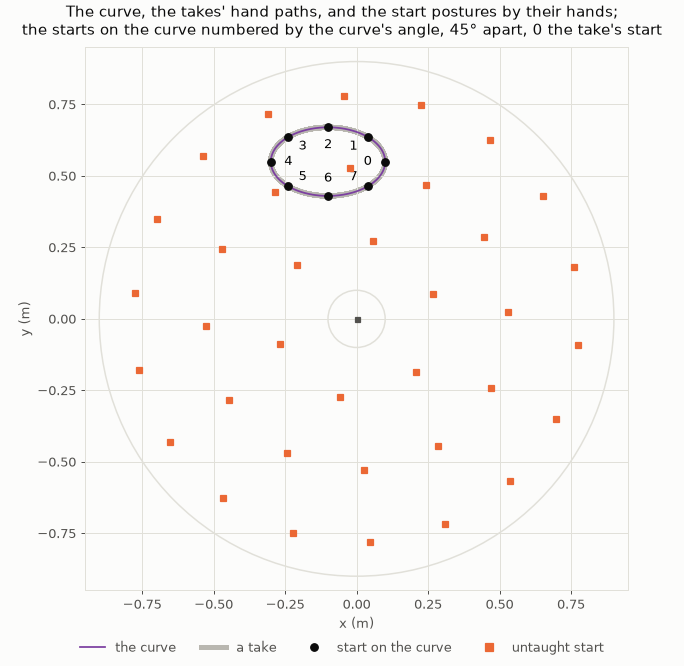

### The ESNs

| | ESN #1 ([`esn.toml`](results/20261118-225615-scripted_esn1_lr0.017_sr1.35_is4_ridge0.001_seed5/esn.toml)) | ESN #2 ([`esn.toml`](results/20261118-225749-scripted_esn2_lr0.017_sr1.5_is4_ridge0.001_seed5/esn.toml)) |
| --- | --- | --- |
| Leak rate | 0.017 | 0.017 |
| Spectral radius | 1.35 | 1.5 |
| Input scaling | 4 | 4 |
| Ridge | 10⁻³ | 10⁻³ |
| Seed | 5 | 5 |
| Training | teacher forcing on the scripted take (`demo_00` of `results/demonstrations/20261118-171132-ellipse_scripted_v2_no_limits`), without noise | the same |

The leak rate, the spectral radius, the input scaling, the ridge, and the seed are
swept by the search. Fixed for all: 800 tanh neurons, sparsity 0.05, a bias per neuron
drawn uniformly from [−1, 1] by the seed and not scaled, a 1 s warm-up on the held start
posture, a 10 ms period. The input is the arm's two joint angles every 10 ms, each
normalized by the take's range of it. The ESNs get no task knowledge: no curve, no
phase, and no context.

The two ESNs differ in the spectral radius alone and share the seed, so they are nearly
one ESN, and their results below are nearly the same.

### The tracker and the runs

- **The tracker** is report 017's: joint PD at ω = 20 rad/s and a damping ratio of 0.4,
  given the reference's velocity, its torque computed every 10 ms and held between. Its
  gains are set where the take of reports 005 to 020 ends, as in report 023.
- **The replay** plays the take by time and goes on without end: after the take's first
  two loops it goes back to the end of the first, where the scripted take closes on
  itself (a step of 2·10⁻¹⁴°). It begins at the take's start wherever the arm is. No
  progress replay is run in this stage.
- **A run** follows the 1 s warm-up: 40 s in the search, and 120 s, 60 s, or 80 s in the
  claims' runs.

### The measures

They are taken from the ellipse itself, not from the take.

- **Off the curve:** the hand's distance from the ellipse, wherever along it the hand is.
- **The curve RMS** of a run: the RMS of off the curve over its last five taught
  periods, 20 s.
- **A run cycles** if, over those five periods, the hand's angle about the curve's center
  grows by four to six turns, and the curve RMS is at most 20 mm, report 023's goal
  radius.
- **The period ratio:** the median time of the run's whole loops in those five periods,
  over the taught 4 s.
- **The joining time:** the earliest time from which the RMS of off the curve over every
  following taught period is at most 20 mm.
- **How a run starts:** the reference's fastest joint speed over the run (°/s), and the
  largest joint torque (N m), as in report 023.
- **After a push or the block:** how far off the curve the hand goes from its onset, when
  it is back within 20 mm, and the largest torque and the largest off the curve in the
  2 s after its end.
- **The delay** a disturbance leaves: how far behind its own undisturbed run of 120 s,
  from the same start, the hand is when the disturbed run ends, in seconds. It is read
  from the hand's angle about the curve's center and taken within a loop, between −1 s
  and 3 s. This reading was defined after the runs: a hand pushed around the far side of
  the center gains or loses a whole turn of that angle, which is not a delay.

### The search

The rule was fixed on 2026-11-18 before any run, and is given in full in the
[experiment's README](../../experiments/manual_demonstration_v2_periodic/README.md#the-search-3a).
It is report 023's one-take search with the cycle in place of the arrival:

1. **The runs:** each ESN on the robot, undisturbed, for 40 s from each of the eight
   starts on the curve.
2. **A setting's score** is how many of its runs cycle, the most first, then the median
   curve RMS of its runs that cycle, the smallest first.
3. **The coarse search:** 108 settings with one reservoir each (seed 0), over leak rates
   of 0.01, 0.03, 0.1, and 0.3, spectral radii of 0.9, 1.2, and 1.5, input scalings of
   0.1, 0.5, and 2, and ridges of 10⁻⁴, 10⁻², and 1.
4. **The fine search:** 81 settings around the best coarse one, each parameter at the
   center's value and halfway to its coarse neighbor on each side, with five reservoirs
   each (seeds 1 to 5).
5. **Scoring again with the untaught starts:** the 20 best fine settings, each with its
   five reservoirs, from the eight starts on the curve and the 36 untaught ones, 220
   runs a setting.
6. **The chosen ESNs** are the typical seeds of the two best settings of step 5. A
   setting's typical seed is, of its seeds with the most runs that cycle, the one whose
   own median curve RMS is nearest the setting's.

**What the search leaves out:** pushes, the block, and held-out seeds.

### The claims

Fixed on 2026-11-18, before any search or claim was run, with the maintainer's changes
of that day
([what was changed](../../experiments/manual_demonstration_v2_periodic/README.md#what-the-maintainer-changed)).
Each is to hold for ESN #1 and for ESN #2. No size is fixed in advance: every claim is a
count or a direction against the replay.

1. **On the curve.** Undisturbed, from each of the eight starts on the curve, the hand
   still cycles at the end of 120 s, 30 taught loops, as the replay's does.
2. **Starting where the arm is.** From the seven starts on the curve other than the
   take's, and from the 36 untaught starts, the reference's fastest joint speed and the
   largest joint torque are smaller than the replay's, in their medians over each group
   of starts.
3. **Joining the curve.** From the 36 untaught starts, in runs of 60 s, the hand cycles at
   the end from as many starts as the replay's.
4. **Pushes.** Under three pushes at report 007's forces, at twice, and at four times
   them, from each of the eight starts on the curve, in runs of 80 s, the hand cycles at
   the end in at least as many of the eight runs as the replay's, at each size.
5. **A block.** With the tip held for 3 s, from each of the eight starts on the curve, in
   runs of 60 s: the hand cycles at the end in at least as many of the eight runs as the
   replay's; and in the 2 s after the release, the largest joint torque and the largest
   off the curve are smaller than the replay's, in their medians over the eight runs.

**The pushes** are report 007's three, of 0.5 s at the tip: 3 N at 10°, 5 N at 80°, and
4 N at −80°, at 8.0 s, 20.5 s, and 33.0 s. The angles are turned counterclockwise from
the direction from the run's start hand toward the curve's center. The pushes are 12.5 s
apart, three loops and an eighth, so the replay is pushed at three places an eighth of a
loop apart, and over the eight starts the directions turn once around the curve.

**The block** is report 017's stiff spring-damper (20,000 N/m, 100 N s/m). It holds the
tip from 10 s to 13 s, three quarters of a loop, where it was at 10 s.

### Reproducing the results

The configurations are in
[`manual_demonstration_v2_periodic`](../../experiments/manual_demonstration_v2_periodic/README.md),
written below as `$D`.

| Runs | Command | Commit |
| --- | --- | --- |
| the take | `uv run python experiments/make_periodic_take.py experiments/demonstrations/ellipse_scripted_v2_no_limits.toml`, then `experiments/import_demonstrations.py` with the same file | |
| `scripted_coarse_search`, `scripted_fine_search`, `scripted_untaught_search` | `uv run python experiments/sweep_robot_esn.py $D/<name>.toml --workers 15` | `c8ac702`, `be7980a`, `f0da264` |
| `scripted_esn1_lr0.017_sr1.35_is4_ridge0.001_seed5`, `scripted_esn2_lr0.017_sr1.5_is4_ridge0.001_seed5` | `uv run python experiments/autonomous_esn.py $D/<name>.toml` | `66bc163` |
| `scripted_robot_esn{1,2}`, `scripted_untaught_robot_esn{1,2}`, `scripted_pushes{1,2,4}x_robot_esn{1,2}`, `scripted_block_robot_esn{1,2}` (12) | `uv run python experiments/robot_esn.py $D/<name>.toml` | `210ffce` |
| [`summary`](results/summary) | `uv run python reports/026-a-periodic-motion-from-a-script/make_figures.py` | |

- **Running time,** with 15 workers on 32 logical processors: the coarse search 19 min
  while another sweep shared the machine, the fine search 68 min, and the scoring with
  the untaught starts 106 min. Training an ESN and running it on its own takes under
  2 min.
  The robot runs were run two at a time: the 120 s runs 10 min, the runs from the 36
  untaught starts 21 to 26 min, each pushed run 5 to 7 min, and each run with the block
  3 to 4 min.
- **Checks:**
  - Every run record names its commit, and none reports uncommitted changes.
  - Before the search, the runners were tried in a scratch directory with ESNs of 200
    neurons and seed 99 at settings off the search's grid. Those runs were not kept.
  - The replay beside ESN #1 equals the replay beside ESN #2 in every scenario.
  - The replay's eight runs with the block are one run from 10 s on: a replay by time
    is at the same place at 10 s from every start.
- **What is kept here:** the take and its import; each search's configuration and run
  record with its `scores.csv`, `sweep.csv`, and `seeds.csv`; the two ESNs' `esn.toml`
  and `esn.rclib` with their `metrics.csv`; and each robot run's configuration and run
  record with its `metrics.csv`.

[`make_figures.py`](make_figures.py) prints the tables of Section 3 and draws its
figures. It reads these copies, and from the storage root the robot runs' logs and the
searches' `runs.csv`, which are not kept in Git.

## 3. Results

### 3.1 The search

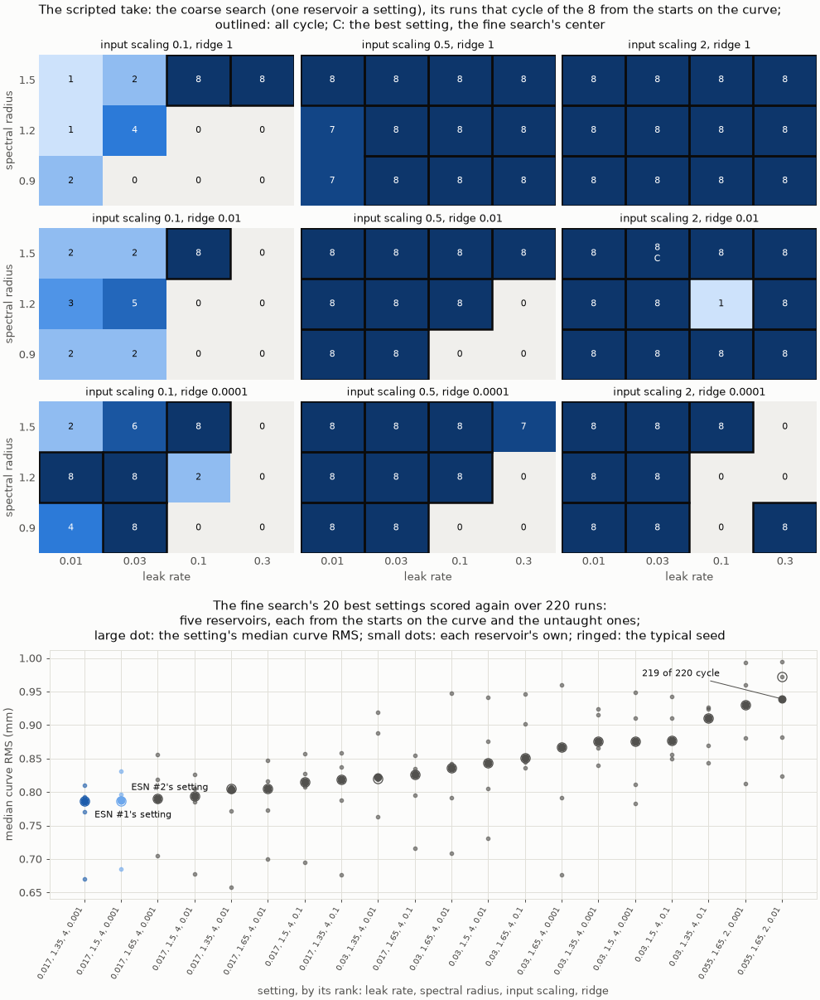

- **The coarse search:** 65 of the 108 settings cycle from all eight starts, and 24 from
  none. Of its 864 runs, 582 cycle. Of the 282 that do not, the hand of 231 keeps the
  pace but is more than 20 mm RMS from the ellipse, that of 24 goes around too fast,
  that of 10 too slowly, and that of 17 makes less than half a turn. An input scaling
  of 0.1 does worst: 96 of its 288 runs cycle, against 237 at 0.5 and 249 at 2. The best
  setting is a leak rate of 0.03, a spectral radius of 1.5, an input scaling of 2, and a
  ridge of 10⁻², with a median curve RMS of 0.80 mm.
- **The fine search,** over leak rates of 0.017, 0.03, and 0.055, spectral radii of
  1.35, 1.5, and 1.65, input scalings of 1, 2, and 4, and ridges of 10⁻³, 10⁻², and
  10⁻¹: 69 of the 81 settings cycle in all 40 runs of their five seeds. Of the 12 others,
  11 have a leak rate of 0.055, all nine with an input scaling of 4 among them.
- **The 20 best** have a median curve RMS of 0.79 to 0.94 mm: the nine settings with a
  leak rate of 0.017 and an input scaling of 4, the nine with 0.03 and 4, and two with
  0.055, a spectral radius of 1.65, and an input scaling of 2. The best lie on the fine
  grid's edge, at its smallest leak rate and its largest input scaling. The rule does
  not move the grid.
- **Scored again over 220 runs each,** all 20 cycle in every run but one: one run of the
  last setting from an untaught start, where the hand makes 0.02 of a turn. The order is
  the fine search's, and the first four settings lie within 0.01 mm of each other.

| Rank | Leak rate | Spectral radius | Input scaling | Ridge | Runs that cycle, of 220 | Median curve RMS (mm) | Typical seed |
| --- | --- | --- | --- | --- | --- | --- | --- |
| 1 (ESN #1) | 0.017 | 1.35 | 4 | 10⁻³ | 220 | 0.787 | 5 |
| 2 (ESN #2) | 0.017 | 1.5 | 4 | 10⁻³ | 220 | 0.788 | 5 |

- **From the untaught starts every setting starts with a jump.** Over the 20 settings,
  the median of the reference's fastest joint speed is 5,637 to 6,401 °/s and that of
  the largest torque 273 to 335 N m. The median joining time is 0.23 to 0.94 s, and a
  setting's slowest run joins after 1.2 to 9.1 s. The score does not see the start, so
  the search did not choose against it.

### 3.2 On the curve (claim 1 holds)

Undisturbed for 120 s, over the eight starts on the curve, medians (the range in
parentheses):

| | ESN #1 | ESN #2 | Replay |
| --- | --- | --- | --- |
| Runs that cycle at the end, of 8 | 8 | 8 | 8 |
| Curve RMS (mm) | 0.787 (0.783 to 0.788) | 0.786 (0.783 to 0.788) | 0.835 |
| Period ratio | 1.0045 | 1.0043 | 1.0000 |
| Largest off the curve over the last five periods (mm) | 1.66 | 1.64 | 1.48 |

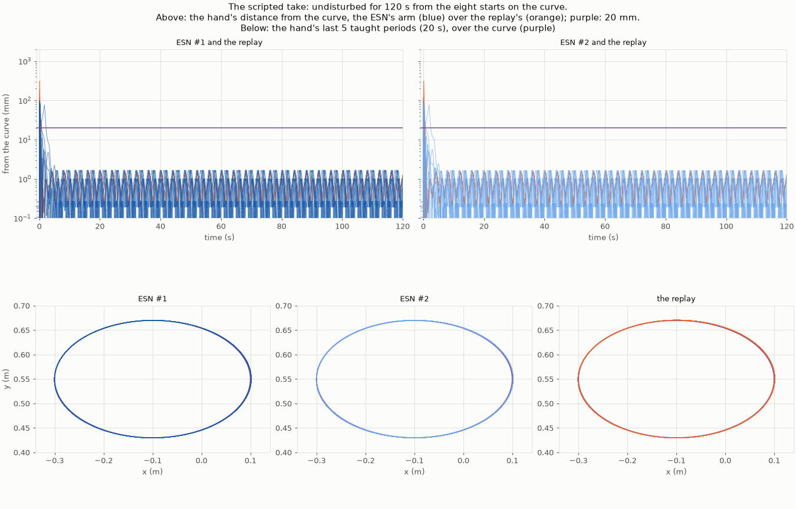

- **The ESNs draw the ellipse as closely as the replay.** The replay's 0.83 mm is the
  tracker's error on the take, which is itself on the curve. The ESNs' 0.79 mm is the
  same from every start and does not grow over the 120 s.
- **The ESN's loop is 0.4% longer than the taught one,** 4.018 s for ESN #1, the same
  from every start. Over 120 s the hand falls half a second behind the replay's. Nothing
  in the ESN's input holds it to the time.
- **From a start on the curve the ESN goes on from there.** From start 4, half a loop
  from the take's, the ESN's arm stays half a loop apart from the replay's for the whole
  run, where the replay's arm first jumps to the take's start.

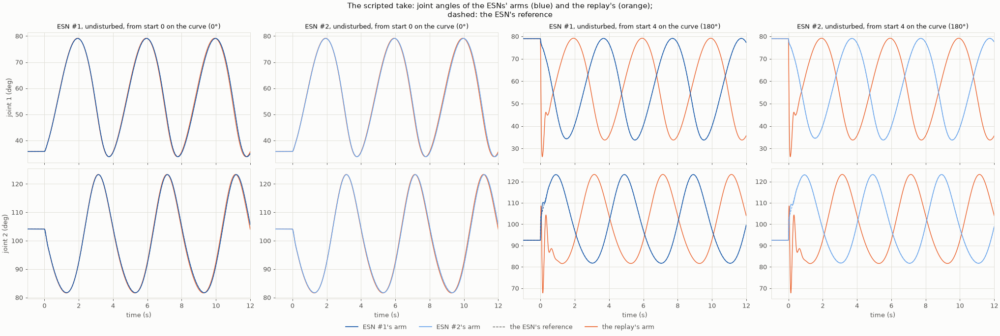

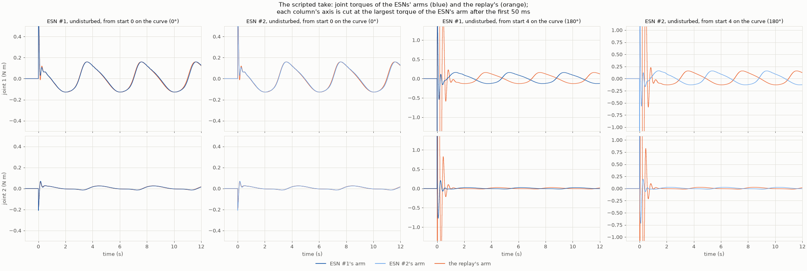

### 3.3 How a run starts (claim 2 holds)

Medians over each group of starts (the range in parentheses):

| | ESN #1 | ESN #2 | Replay |
| --- | --- | --- | --- |
| **The take's own start** | | | |
| Reference's fastest joint speed (°/s) | 42 | 42 | 43 |
| Largest joint torque (N m) | 0.9 | 0.9 | 0.8 |
| **The seven other starts on the curve** | | | |
| Reference's fastest joint speed (°/s) | 1,531 (538 to 2,264) | 1,595 (620 to 2,248) | 2,670 (1,300 to 4,310) |
| Largest joint torque (N m) | 11.1 (7.6 to 44.2) | 11.2 (5.6 to 42.7) | 139.8 (9.3 to 225.6) |
| Starts where the ESN's is the smaller: speed, torque | 5 of 7, 6 of 7 | 5 of 7, 6 of 7 | |
| **The 36 untaught starts** | | | |
| Reference's fastest joint speed (°/s) | 5,526 (803 to 18,473) | 5,590 (890 to 18,549) | 9,000 (1,110 to 20,890) |
| Largest joint torque (N m) | 270 (10 to 967) | 272 (8 to 971) | 471 (47 to 1,093) |
| Starts where the ESN's is the smaller: speed, torque | 32 of 36, 33 of 36 | 32 of 36, 33 of 36 | |

- **The claim holds in its direction:** both medians are smaller than the replay's in
  both groups, for both ESNs.
- **Neither arm starts gently away from the take's start.** From the untaught starts the
  ESN's reference moves at thousands of degrees a second and the torque reaches
  hundreds of newton meters, about 0.6 of the replay's. In report 023 the ESNs trained
  on nine takes from nine starts began at the arm (183 and 119 °/s, 9.6 and 6.2 N m from
  its unseen starts), and ESN #1's setting trained on one take did not (2,340 °/s,
  122.5 N m). Here too there is one take, and it never leaves the curve.
- **On the curve the ESN's start is much the smaller in torque,** 11 N m against 140 N m
  by the median. The replay's reference begins at the take's start, up to half a loop
  away. The ESN's reference does not begin at the arm either: its fastest joint speed
  is 538 °/s or more from each of the seven starts, against 42 °/s from the take's own.

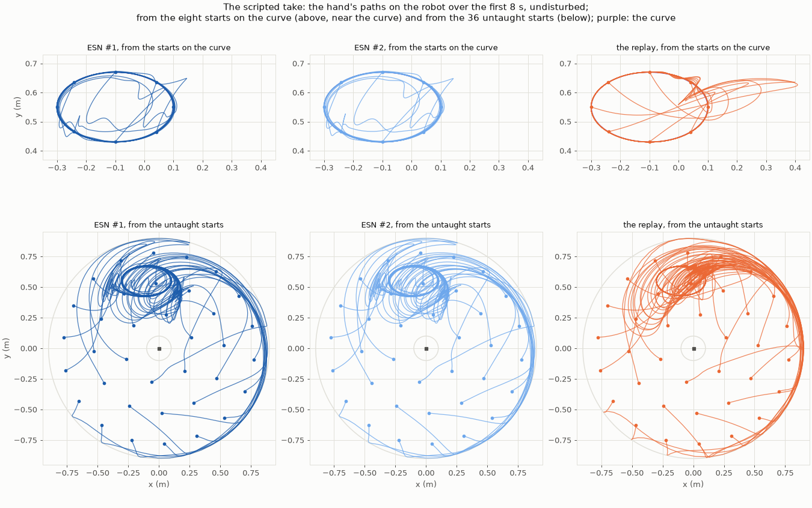

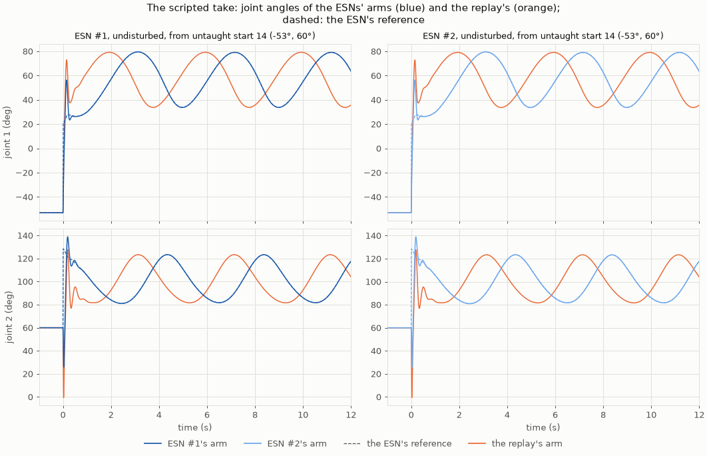

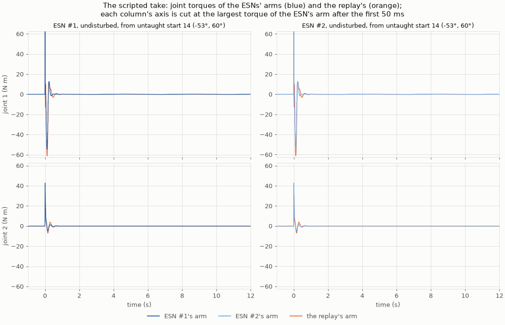

The torque axes are cut at the largest torque of the ESN's arm after the first 50 ms, as
in report 023, so the first peak leaves the axis. From the untaught start drawn, the
replay's largest torque is 465 N m.

### 3.4 Joining the curve (claim 3 holds)

Undisturbed for 60 s, over the 36 untaught starts, medians (the range in parentheses):

| | ESN #1 | ESN #2 | Replay |
| --- | --- | --- | --- |
| Runs that cycle at the end, of 36 | 36 | 36 | 36 |
| Joining time (s) | 0.79 (0.00 to 1.92) | 0.82 (0.00 to 1.98) | 0.26 (0.00 to 0.42) |
| Curve RMS (mm) | 0.786 | 0.786 | 0.835 |
| Period ratio | 1.0045 | 1.0043 | 1.0000 |

- **Every run joins the curve and stays on it.** Once on it, the hand is as close to the
  ellipse and goes at the same pace as from a start on the curve.
- **The ESN joins later than the replay,** within 2 s against 0.4 s (the first row of
  the figure below). The replay's reference is on the curve from its first sample.

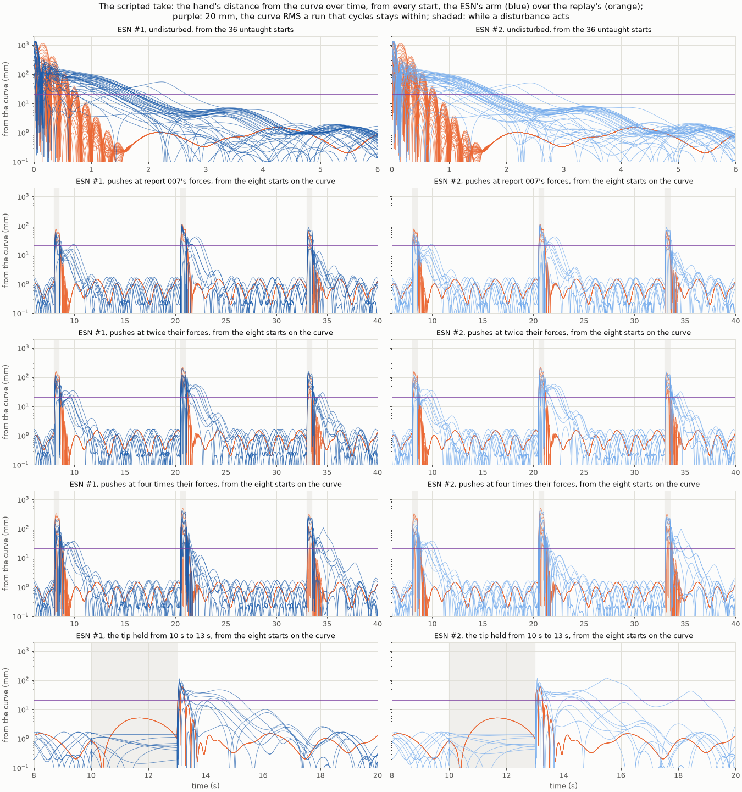

### 3.5 Under the pushes (claim 4 holds)

Over the eight starts on the curve, in runs of 80 s:

| Forces | ESN #1 | ESN #2 | Replay |
| --- | --- | --- | --- |
| **Runs that cycle at the end, of 8** | | | |
| Report 007's | 8 | 8 | 8 |
| Twice | 8 | 8 | 8 |
| Four times | 8 | 8 | 8 |
| **The delay at the end (s), median (range)** | | | |
| Report 007's | +0.14 (−0.10 to +0.35) | +0.20 (−0.12 to +0.41) | 0.00 |
| Twice | +0.33 (−0.10 to +0.67) | +0.31 (−0.07 to +0.54) | 0.00 |
| Four times | +0.17 (−0.40 to +0.61) | +0.15 (−0.23 to +0.52) | 0.00 |

Each push, medians over the eight starts: how far off the curve it sends the hand (mm),
and how long after its end the hand is back within 20 mm for good until the next push
(s; the largest in parentheses):

| Forces, push | ESN #1 off | ESN #1 back | ESN #2 off | ESN #2 back | Replay off | Replay back |
| --- | --- | --- | --- | --- | --- | --- |
| Report 007's, 1 | 41 | 0.05 (1.68) | 40 | 0.05 (1.70) | 49 | 0.07 (0.09) |
| Report 007's, 2 | 91 | 0.71 (1.79) | 94 | 0.71 (1.81) | 85 | 0.08 (0.10) |
| Report 007's, 3 | 40 | 0.06 (0.24) | 56 | 0.08 (0.24) | 49 | 0.03 (0.07) |
| Twice, 1 | 68 | 0.73 (1.93) | 68 | 0.25 (1.95) | 93 | 0.22 (0.25) |
| Twice, 2 | 114 | 1.22 (2.14) | 114 | 1.56 (2.15) | 114 | 0.23 (0.26) |
| Twice, 3 | 108 | 0.35 (1.36) | 107 | 0.56 (1.38) | 84 | 0.05 (0.09) |
| Four times, 1 | 115 | 1.33 (2.04) | 108 | 1.11 (2.05) | 116 | 0.26 (0.40) |
| Four times, 2 | 173 | 0.46 (0.72) | 174 | 0.46 (0.73) | 154 | 0.27 (0.43) |
| Four times, 3 | 230 | 1.06 (2.23) | 229 | 1.15 (2.15) | 116 | 0.21 (0.26) |

- **Every pushed run cycles at the end,** at every size, with the undisturbed curve RMS
  of 0.79 mm. The hand comes back from as far as the pushes of up to 20 N send it, up
  to 0.43 m off the curve.
- **A push sends the ESN's hand about as far as the replay's,** but for the third at
  four times the forces: 230 mm against 116 mm.
- **The ESN's hand is back later:** within 2.2 s of a push's end at the most, against
  0.4 s for the replay.
- **The hand goes on from where it rejoins.** At the end of the run it is 0.4 s ahead to
  0.7 s behind its undisturbed run, by a median of 0.1 to 0.3 s behind. The replay
  returns to its time and has no delay. In the last pair of figures below, at four
  times the forces, the ESN's arm is out of step with the replay's after the second
  push.
- **The pushes do not send the hand away as in report 023,** where the third push on the
  resting arm sent its ESNs' hands up to 1.5 m from the target and they took 5 to 18 s
  to come back.

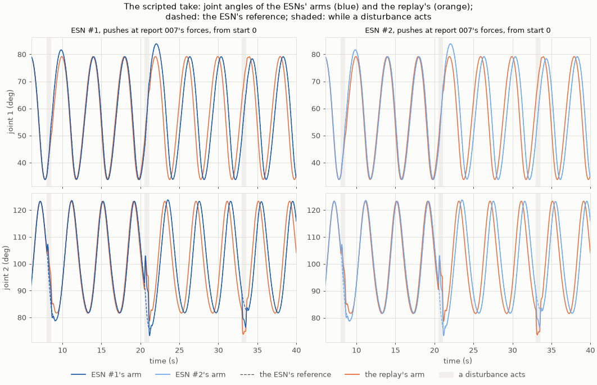

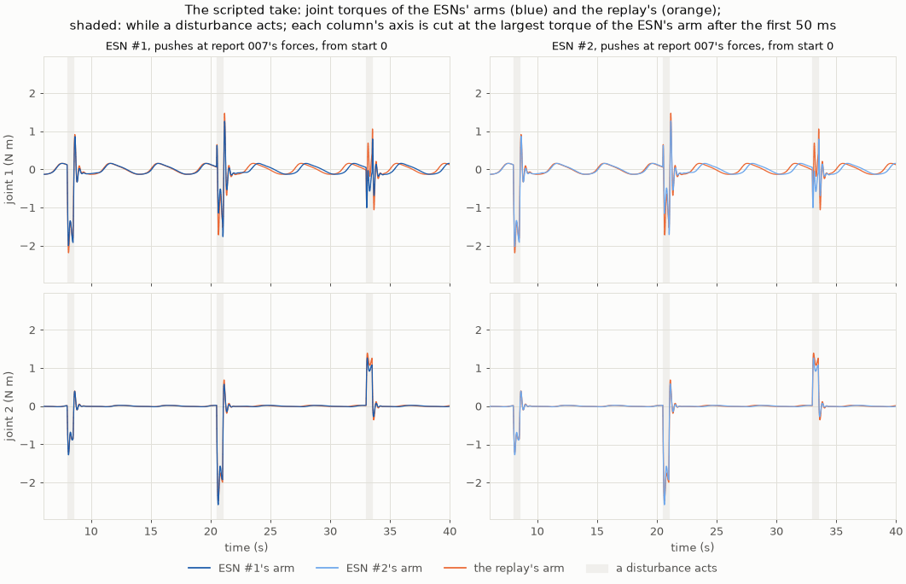

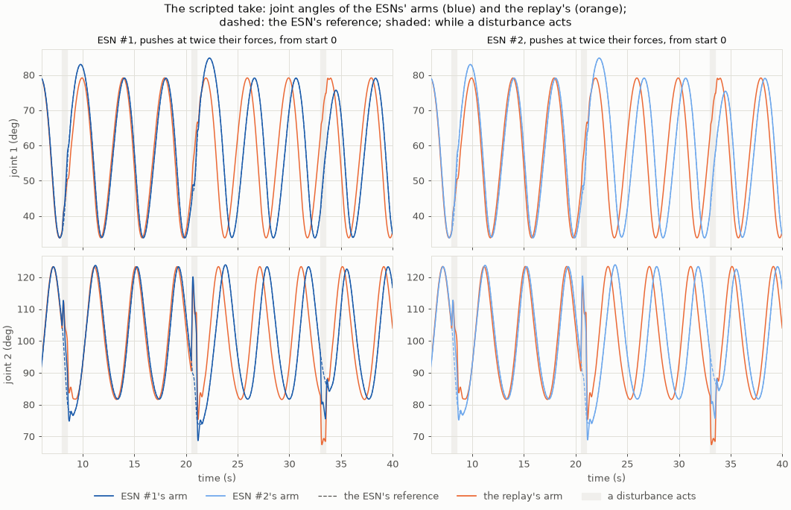

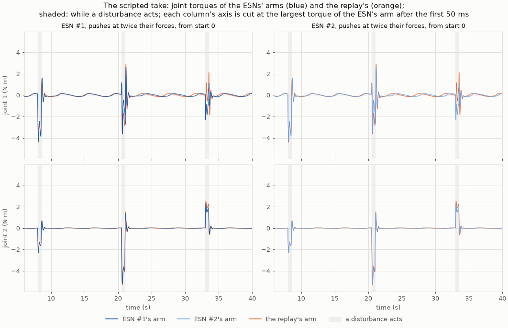

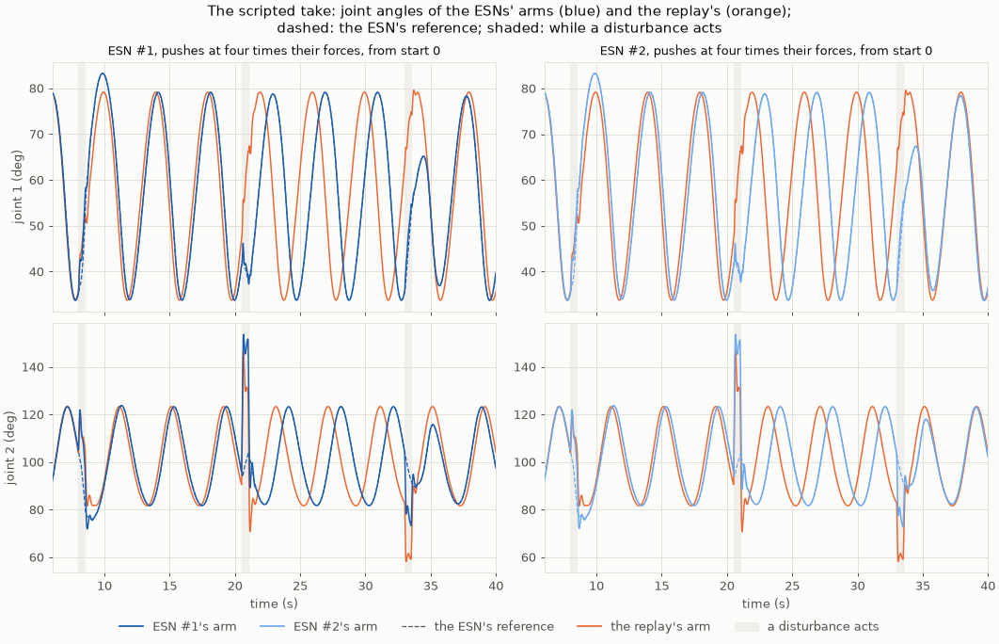

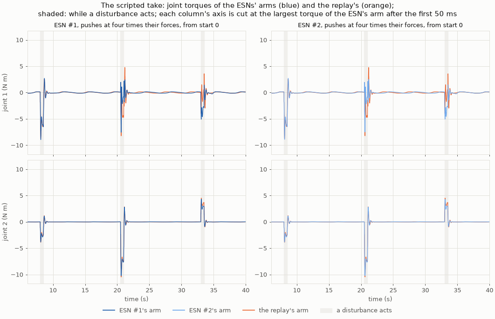

### 3.6 With the block (claim 5 fails in one part)

The tip held from 10 s to 13 s, over the eight starts on the curve, in runs of 60 s,
medians (the range in parentheses). The replay's eight runs are one run from 10 s on.

| | ESN #1 | ESN #2 | Replay |
| --- | --- | --- | --- |
| Runs that cycle at the end, of 8 | 8 | 8 | 8 |
| Largest torque in the 2 s after the release (N m) | 9.8 (3.1 to 19.8) | 9.3 (2.1 to 18.8) | 19.7 |
| Largest off the curve in those 2 s (mm) | 84.2 (10.7 to 113.2) | 76.6 (17.3 to 112.9) | 60.4 |
| Starts where the ESN's is the smaller: torque, off the curve | 7 of 8, 2 of 8 | 8 of 8, 2 of 8 | |
| Back within 20 mm after the release (s) | 0.98 (0.00 to 2.25) | 1.65 (0.00 to 5.88) | 0.27 |
| The delay at the end (s) | +2.71 (+0.56 to +2.87) | +2.67 (+0.52 to +2.86) | 0.00 |

- **The count and the torque hold.** Every run cycles at the end, and the torque after
  the release is half the replay's by the median.
- **The distance from the curve fails.** The ESN's hand goes 84 and 77 mm off the curve
  by the median, against the replay's 60 mm, and is the smaller from only 2 of the 8
  starts.
- **Held, the ESN's reference drifts to a rest away from the arm.** It moves on from
  where the tip is held, slows, and rests, off the curve (the table and the figure
  below). It does not wait at the arm, and it does not go on around the curve, as the
  replay's does. At the release the arm goes to where the reference rests and past it:
  from 6 and 7 of the 8 starts the hand goes farther off the curve than the reference
  rested. Then both rejoin the curve.
- **The replay's hand leaves the curve too,** by 60 mm: its reference went on around
  the curve for 3 s and is 233 mm from the held hand at the release, so the arm cuts
  across to it.
- **The ESN's hand goes on from where it was held.** It ends 2.7 s behind its
  undisturbed run by the median, of the 3 s of the block. The smallest delay over the
  eight starts is 0.56 and 0.52 s.

Where the reference is at the last sample before the release, medians over the eight
starts (the range in parentheses):

| | ESN #1 | ESN #2 | Replay |
| --- | --- | --- | --- |
| The reference's hand from the arm's hand (mm) | 127 (55 to 169) | 117 (50 to 167) | 233 |
| The reference's hand off the curve (mm) | 56.2 (2.6 to 92.1) | 48.3 (4.1 to 95.1) | 0.0 |
| The reference's fastest joint speed over the last 0.5 s (°/s) | 0.9 (0.1 to 2.4) | 1.3 (0.2 to 2.6) | 30.6 |

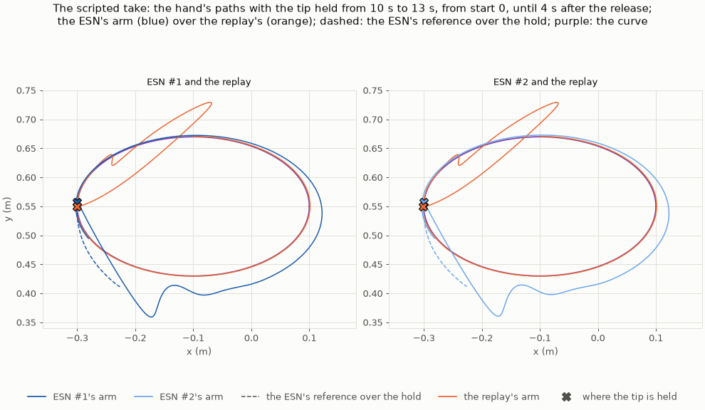

From start 0 the tip is held at the curve's left end. The ESN's reference goes on
downward, outside the curve, and rests there. Released, the arm goes there and beyond,
comes back below the curve, and joins it past its right end. The replay's arm cuts
across the curve to its reference, which went on for three quarters of a loop.

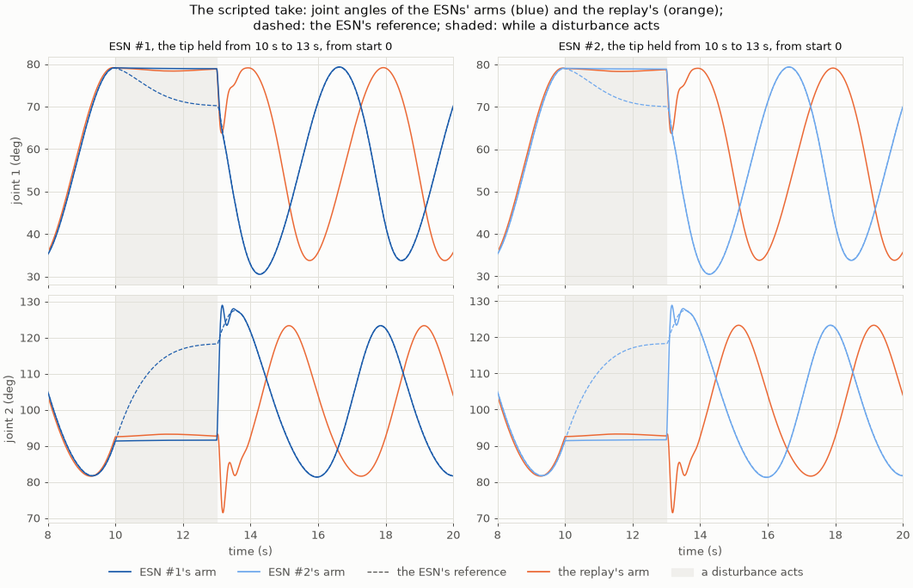

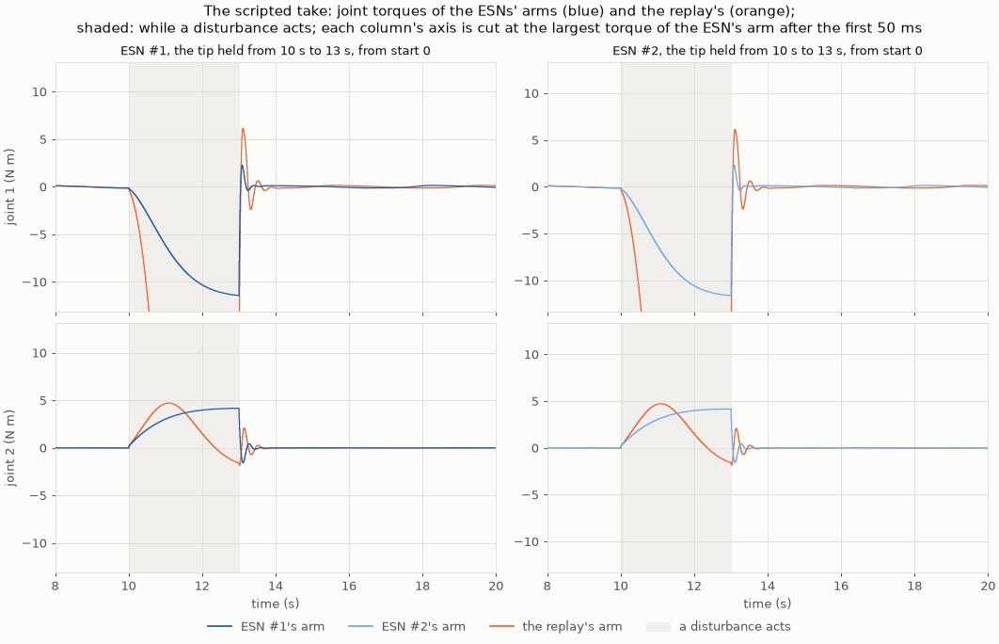

The torque axes are cut as in Section 3.3.

## 4. Observations

- **One loop is enough to keep the hand going around.** The take holds ten identical
  loops, so the ESNs have seen one loop of the ellipse and nothing off it. On the robot
  they draw it within 0.8 mm for 120 s, join it from anywhere in the workspace within
  2 s, and rejoin it after pushes of up to 20 N. In every run tried, the ellipse acts
  as an attracting cycle of the ESN with the robot.
- **The ESN keeps the place, not the time.** Its loop is 0.4% longer than the taught
  one, a push leaves it up to 0.7 s off its undisturbed run, and the block leaves it
  2.7 s behind. The replay keeps the time and gives up the place: after the block its
  reference is 233 mm ahead of the hand.
- **The search's best settings drive the reservoir hard from the input.** Both ESNs have
  the largest input scaling of the fine search, 4, and its smallest leak rate, 0.017,
  on the grid's edge. Report 023's ESNs had input scalings of 1 and 0.5 and a ridge of 1
  and 10, against 10⁻³ here. The scripted take has no noise to fit, and the score
  counts the distance from the ellipse in tenths of a millimeter.
- **The start is where this stage's ESNs fall short of report 023's.** Away from the
  take's start the reference goes to the curve at once, at about 0.6 of the replay's
  speed and torque. The search did not score the start, and its 20 best settings all
  start so.
- **Held in place, the reference does not wait.** The ESN is fed a constant posture for
  3 s, and its reference settles at another posture, off the curve. The claim about the
  distance from the curve after the release fails for that reason. The claim's torque
  part holds, and the reference's rest is nearer the held hand than the replay's
  reference is, from every start (at most 169 mm against 233 mm).

## 5. Next steps

These are proposals; none is started.

1. **The take by hand** (report 027): the same search and claims on the take recorded by
   hand, whose loops differ from one another and from the ellipse.
2. **The start, if it matters:** takes that join the curve from elsewhere, as report
   023's nine takes taught the reach from nine starts, or a score that counts the start.
3. **The reach and the periodic motion in one ESN** (stage 3b), by a context input,
   whose rule and claims the maintainer confirms first.
