# 027 A periodic motion taught by hand: the ESN draws a smoother ellipse than its take and waits while it is held, but a push sends its hand far off the curve

**Summary.** Report 026 taught the two-link arm to go around an ellipse from a take made by
a script. This report does the same from one take recorded by hand: ten loops of about
5 s, 10 mm RMS from the ellipse, no two alike. The search and the five claims are report
026's, fixed before any run. ESNs of 800 neurons are trained on the take and generate the
reference of the simulated robot from the arm's measured joint angles, with report 017's
tracker. Two ESNs are chosen by the search, ESN #1 and ESN #2, and tested against the
replay of the take.

All five claims hold. The findings:

- **The ESNs draw the ellipse closer than the take they learned (claim 1 holds).** From
  eight starts on the curve, every run still cycles at the end of 120 s. The hand is 5.1
  and 5.7 mm RMS from the ellipse, against 11.0 mm for the replay. The ESNs repeat one
  smooth loop, which keeps the take's lasting error, 13 to 20 mm inside the ellipse at
  its left end, and none of its loop-to-loop wobble.
- **They join the curve from anywhere tried (claim 3 holds),** from all 36 untaught
  starts, after 1.5 and 1.6 s by the median and 5.1 and 3.6 s at the latest, against
  0.2 s and 0.4 s for the replay.
- **Their start is much smaller than the replay's (claim 2 holds),** from every start
  but one. Medians for ESN #1, ESN #2, and the replay:
  - from the seven other starts on the curve, the reference's fastest joint speed is 225
    and 204 °/s, against 2,680 °/s, and the largest torque 5.3 and 5.1 N m, against
    140.3 N m;
  - from the 36 untaught starts, the speed is 2,040 and 1,905 °/s, against 9,000 °/s,
    and the torque 107 and 100 N m, against 471 N m.

  On the curve the start is gentle, the reference a seventh as fast as report 026's
  ESNs'. Away from it the reference still moves at about 2,000 °/s.
- **After pushes the hand comes back, from far and slowly (claim 4 holds).** At report
  007's forces, at twice, and at four times them, all eight runs of each ESN cycle at
  the end of 80 s. But a push sends the ESN's hand 149 to 220 mm off the curve by the
  median at report 007's forces, against 28 to 61 mm for the replay, and up to 0.73 m
  at four times them. It is back within 20 mm at the most 5.4 and 6.0 s after a push
  ends, where report 026's ESNs took 2.2 s.
- **Held in place, the reference waits (claim 5 holds in all three parts).** With the
  tip held for 3 s, all eight runs of each ESN cycle at the end. In the 2 s after the
  release the largest torque is 1.6 and 1.3 N m by the median, against 48.8 N m for the
  replay, and the hand goes 24 and 15 mm off the curve, against 107 mm. The ESN's
  reference stays 14 and 15 mm from the held hand and does not move, and the hand ends
  3.2 s behind its undisturbed run: the hold. For the scripted take this claim failed in
  one part, because the reference drifted away.
- **The search chose very different settings than for the scripted take:** a ridge of
  10 against 10⁻³, an input scaling of 0.5 against 4, and a leak rate of 0.055 against
  0.017. Only 16 of the 108 coarse settings cycle from all eight starts, against 65, and
  the untaught starts changed the order of the 20 best, which they had left as it was.

## 1. Question

Report 026's three, for a take recorded by hand:

1. **A periodic motion:** can an ESN, trained on one take of a hand going around an
   ellipse, keep the simulated arm going around it without end, when the take's loops
   differ from one another and from the ellipse?
2. **Joining the curve:** from a start no take starts from, on the curve or away from it,
   does the arm join the curve, and how does it start?
3. **Disturbances:** pushed off the curve or held in place, does the arm rejoin the curve,
   and does it go on from where it is or catch up with the time?

And one more: what differs from the scripted take's ESNs of report 026?

## 2. Setup

The robot, the curve, the start postures, the tracker, the measures, the search's rule,
and the claims are
[report 026's](../026-a-periodic-motion-from-a-script/README.md#2-setup). They are given
here in short, with what the take by hand changes.

### The robot, the curve, the take, and the start postures

- **The robot** is report 023's: the arm of reports 005 to 020 with no joint limits,
  simulated every 2 ms
  ([`reach_manual_v2_no_limits.toml`](../../experiments/demonstrations/reach_manual_v2_no_limits.toml)).
- **The curve** is the ellipse centered at (−0.1, 0.55) m, with semi-axes of 0.20 m
  along x and 0.12 m along y, gone around counterclockwise.
- **The take** is recorded by hand with skelarm's recorder, which draws the ellipse as a
  guide
  ([`ellipse_manual_v2_no_limits.toml`](../../experiments/demonstrations/ellipse_manual_v2_no_limits.toml),
  [`data/`](data)). It starts at rest at the posture (35.8°, 104.1°), the hand on the
  curve's right end, and is saved while the hand still goes around.
  - It holds ten whole loops in 52.9 s, sampled at 100 Hz.
  - The **taught period** is 5.12 s, the median time of the loops after the first, which
    take 4.3 to 5.4 s. The recording aimed at 4 s.
  - The ESNs are trained on the take filtered at 2 Hz, as in report 023. That copy is
    10.3 mm RMS from the ellipse and 21.9 mm at most; the take as recorded 9.3 mm and
    23.5 mm.
  - The hand passes inside the ellipse at its left end on every loop, by 13 to 20 mm.
- **The eight starts on the curve** put the hand at the curve's angles 0°, 45°, …, 315°.
  Start 0 is the take's.
- **The 36 untaught starts** are report 023's, spread evenly over the workspace. The
  last step of the search ran from them, so they are not held out.

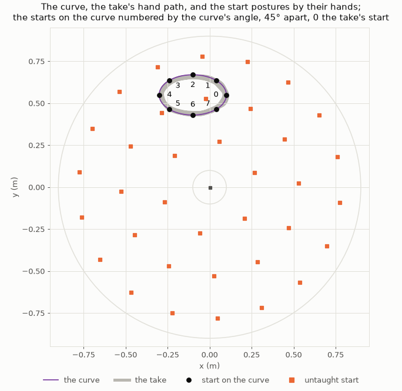

### The ESNs

| | ESN #1 ([`esn.toml`](results/20261119-124535-esn1_lr0.055_sr1.05_is0.5_ridge10_seed1/esn.toml)) | ESN #2 ([`esn.toml`](results/20261119-124537-esn2_lr0.055_sr0.9_is0.5_ridge10_seed5/esn.toml)) | Report 026's ESN #1, for comparison |
| --- | --- | --- | --- |
| Leak rate | 0.055 | 0.055 | 0.017 |
| Spectral radius | 1.05 | 0.9 | 1.35 |
| Input scaling | 0.5 | 0.5 | 4 |
| Ridge | 10 | 10 | 10⁻³ |
| Seed | 1 | 5 | 5 |
| Training | teacher forcing on the take by hand filtered at 2 Hz (`demo_00_filtered` of `results/demonstrations/20261119-093746-ellipse_manual_v2_no_limits`), without noise | the same | on the scripted take |

The leak rate, the spectral radius, the input scaling, the ridge, and the seed are
swept by the search. Fixed for all: 800 tanh neurons, sparsity 0.05, a bias per neuron
drawn uniformly from [−1, 1] by the seed and not scaled, a 1 s warm-up on the held start
posture, a 10 ms period. The input is the arm's two joint angles every 10 ms, each
normalized by the take's range of it. The ESNs get no curve, no phase, and no context.

### The tracker, the replay, and the runs

- **The tracker** is report 017's: joint PD at ω = 20 rad/s and a damping ratio of 0.4,
  given the reference's velocity, its torque computed every 10 ms and held between,
  with the gains of reports 023 and 026.
- **The replay** plays the filtered take by time and goes on without end. It plays the
  take from its first sample to 36.92 s, the end of its seventh loop, and then goes back
  to 6.50 s, the end of its first: of the later loops' ends, that is where the posture
  is nearest, a step of 0.04°. It thus repeats six loops of the take, 30.4 s, of which
  three go beyond 20 mm from the ellipse. It begins at the take's start wherever the arm
  is.
- **A run** follows the 1 s warm-up: 40 s in the search, and 120 s, 60 s, or 80 s in the
  claims' runs.

### The measures

Report 026's, taken from the ellipse itself: off the curve, the curve RMS over the last
five taught periods (here 25.6 s), whether a run cycles (four to six turns in those
periods and a curve RMS of at most 20 mm), the period ratio, the joining time, how a run
starts, and after a push or the block how far the hand goes, when it is back within
20 mm, and the largest torque and off the curve in the 2 s after its end. Two of them
read differently for this take:

- **The replay's return time measures the take, not the push.** The take itself goes
  beyond 20 mm, so the replay is "back within 20 mm for good" only after its last such
  loop before the next push. Its undisturbed runs, measured as if pushed, give the same
  times as its pushed runs (Section 3.5). The ESNs' undisturbed hands never go beyond
  20 mm after their first loop, so their return times do measure the push.
- **The delay** is how far behind its own undisturbed run the hand is when the disturbed
  run ends, taken within a loop of the taught period, here between −1.28 s and +3.84 s.
  After the block the ESNs' values lie close together and can be read. After the pushes
  they spread over most of a loop, and a window of one loop cannot tell ahead from
  behind (Section 3.5).

### The search and the claims

[Report 026's rule](../026-a-periodic-motion-from-a-script/README.md#the-search), fixed
on 2026-11-18 before any run: a coarse search of 108 settings with one reservoir each
from the eight starts on the curve, a fine search of 81 settings around the best with
five reservoirs each, the 20 best scored again from the eight starts and the 36
untaught ones, and the typical seeds of the two best as ESN #1 and ESN #2. A setting's
score is how many of its runs cycle, then the median curve RMS of those that do.

[Report 026's five claims](../026-a-periodic-motion-from-a-script/README.md#the-claims),
fixed the same day, each to hold for ESN #1 and for ESN #2:

1. **On the curve:** from each of the eight starts on the curve, the hand still cycles
   at the end of 120 s, as the replay's does. For this take that is about 23 taught
   loops, where the claim's text says 30.
2. **Starting where the arm is:** from the seven other starts on the curve and from the
   36 untaught starts, the reference's fastest joint speed and the largest joint torque
   are smaller than the replay's, in their medians over each group.
3. **Joining the curve:** from the 36 untaught starts, in runs of 60 s, the hand cycles
   at the end from as many starts as the replay's.
4. **Pushes:** under report 007's three pushes at their forces, at twice, and at four
   times them, in runs of 80 s from the eight starts on the curve, the hand cycles at
   the end in at least as many runs as the replay's, at each size.
5. **A block:** with the tip held from 10 s to 13 s, in runs of 60 s from the eight
   starts on the curve, the hand cycles at the end in at least as many runs as the
   replay's; and in the 2 s after the release, the largest joint torque and the largest
   off the curve are smaller than the replay's, in their medians.

The pushes come at 8.0 s, 20.5 s, and 33.0 s, 12.5 s apart, which is 2.44 loops of this
take; the block's 3 s are 0.59 of a loop.

### Reproducing the results

The configurations are in
[`manual_demonstration_v2_periodic`](../../experiments/manual_demonstration_v2_periodic/README.md),
written below as `$D`.

| Runs | Command | Commit |
| --- | --- | --- |
| the take's import | `uv run python experiments/import_demonstrations.py experiments/demonstrations/ellipse_manual_v2_no_limits.toml` | `75ad88b` |
| `coarse_search`, `fine_search`, `untaught_search` | `uv run python experiments/sweep_robot_esn.py $D/<name>.toml --workers 15` | `1d43dc0`, `6ef8003`, `e7ce22b` |
| `esn1_lr0.055_sr1.05_is0.5_ridge10_seed1`, `esn2_lr0.055_sr0.9_is0.5_ridge10_seed5` | `uv run python experiments/autonomous_esn.py $D/<name>.toml` | `cc25825` |
| `robot_esn{1,2}`, `untaught_robot_esn{1,2}`, `pushes{1,2,4}x_robot_esn{1,2}`, `block_robot_esn{1,2}` (12) | `uv run python experiments/robot_esn.py $D/<name>.toml` | `30dd596` |
| [`summary`](results/summary) | `uv run python reports/027-a-periodic-motion-by-hand/make_figures.py` | |

- **Running time,** with 15 workers on 32 logical processors: the coarse search 20 min,
  the fine search 50 min, and the scoring with the untaught starts 92 min. Training an
  ESN and running it on its own takes under 2 min. The twelve robot runs were run side
  by side and took 4 to 18 min each.
- **Checks:**
  - Every run record names its commit, and none reports uncommitted changes.
  - The replay beside ESN #1 equals the replay beside ESN #2 in every scenario.
  - The replay's eight runs with the block are one run from 10 s on.
- **The takes before this one** were not used. The import refused them for a jump of the
  filtered copy that the hand never made: the recorder now and then writes two samples
  a fraction of a millisecond apart, which the filter took as evenly spaced. The import
  now leaves such a sample out of the filtered copy (`75ad88b`). The recorder's tip
  trail also slowed the sampling of those takes, so this one is recorded without it. It
  has no such sample.
- **What is kept here:** the take and its import; each search's configuration and run
  record with its `scores.csv`, `sweep.csv`, and `seeds.csv`; the two ESNs' `esn.toml`
  and `esn.rclib` with their `metrics.csv`; and each robot run's configuration and run
  record with its `metrics.csv`.

[`make_figures.py`](make_figures.py) prints the tables of Section 3 and draws its
figures. It reads these copies, and from the storage root the robot runs' logs and the
searches' `runs.csv`, which are not kept in Git.

## 3. Results

### 3.1 The search

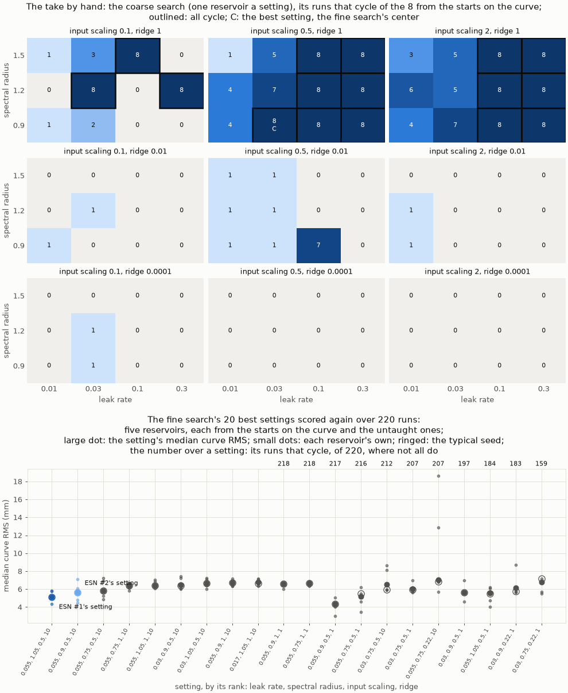

- **The coarse search:** 16 of the 108 settings cycle from all eight starts, and 64 from
  none; the scripted take's had 65 and 24. All 16 have the ridge of 1, the grid's
  largest. Of the 288 runs at each ridge, 186 cycle at 1, 17 at 10⁻², and 2 at 10⁻⁴.
- **Why runs do not cycle:** of the 659 that do not, the hand of 432 makes less than
  half a turn forward in the last five taught periods, 98 of them going half a turn or
  more backwards; that of 72 goes around too slowly; that of 142 keeps the pace but is
  more than 20 mm RMS from the ellipse; and that of 13 goes around too fast. For the
  scripted take most such runs kept the pace and missed the curve; here most stop.
- **The center** is a leak rate of 0.03, a spectral radius of 0.9, an input scaling of
  0.5, and a ridge of 1, with a median curve RMS of 5.67 mm. Its spectral radius is the
  grid's smallest and its ridge the largest, so the fine search goes as far beyond them
  as toward the grid's inside.
- **The fine search,** over leak rates of 0.017, 0.03, and 0.055, spectral radii of
  0.75, 0.9, and 1.05, input scalings of 0.22, 0.5, and 1, and ridges of 10⁻¹, 1, and
  10: 31 of the 81 settings cycle in all 40 runs, 15 with the ridge of 1, 15 with 10,
  and one with 10⁻¹. The best is the center with a leak rate of 0.055, at 4.34 mm.
- **Scored again over 220 runs each,** nine of the 20 best cycle in every run, and all
  nine have the ridge of 10. The eleven others cycle in 159 to 218; nine of them have
  the ridge of 1. The fine search's best cycles in 217 and is twelfth. All 202 runs
  that do not cycle start from an untaught start: 173 hands make less than half a turn,
  and 29 keep the pace more than 20 mm RMS from the ellipse.

| Rank | Leak rate | Spectral radius | Input scaling | Ridge | Runs that cycle, of 220 | Median curve RMS (mm) | Typical seed | Rank in the fine search |
| --- | --- | --- | --- | --- | --- | --- | --- | --- |
| 1 (ESN #1) | 0.055 | 1.05 | 0.5 | 10 | 220 | 5.09 | 1 | 2 |
| 2 (ESN #2) | 0.055 | 0.9 | 0.5 | 10 | 220 | 5.66 | 5 | 7 |
| 3 | 0.055 | 0.75 | 0.5 | 10 | 220 | 5.82 | 5 | 8 |
| 12 | 0.055 | 0.9 | 0.5 | 1 | 217 | 4.34 | 1 | 1 |
| 20 | 0.03 | 0.75 | 0.22 | 1 | 159 | 6.77 | 4 | 20 |

- **The untaught starts decide between the settings.** For the scripted take they left
  the fine search's order as it was. Here the settings that draw the ellipse closest
  from the starts on the curve, with the ridge of 1, stop from some untaught starts,
  and the ridge of 10 ranks first.
- **From the untaught starts the two chosen settings start at a third of the scripted
  take's settings' speed and torque:** 1,895 and 1,866 °/s and 99 and 97 N m by the
  median over their five seeds, against 5,600 to 6,400 °/s and 273 to 335 N m there.
  Over the 20 settings the medians run from 1,063 to 3,681 °/s and from 37 to 189 N m.

### 3.2 On the curve (claim 1 holds)

Undisturbed for 120 s, over the eight starts on the curve, medians (the range in
parentheses):

| | ESN #1 | ESN #2 | Replay |
| --- | --- | --- | --- |
| Runs that cycle at the end, of 8 | 8 | 8 | 8 |
| Curve RMS (mm) | 5.11 (5.08 to 5.30) | 5.66 (5.64 to 5.79) | 11.03 |
| Period ratio | 0.9843 | 0.9853 | 0.9871 |
| Largest off the curve over the last five periods (mm) | 13.1 | 14.3 | 22.2 |
| Whole loops after the first that go beyond 20 mm, from each start | 0 of 22 | 0 of 22 | 7 to 11 of 22 or 23 |

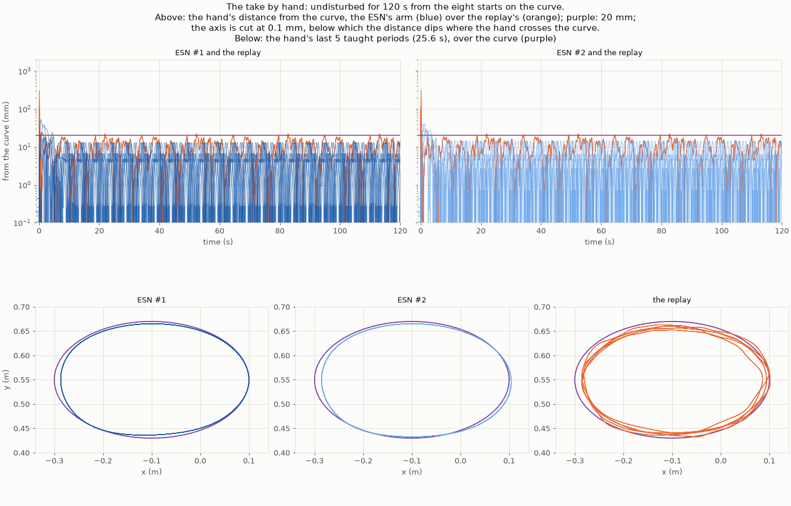

- **The ESNs draw the ellipse at half the take's distance from it.** The replay's
  11.0 mm is the take's own. The ESNs' 5.1 and 5.7 mm do not grow over the 120 s.
- **The ESN repeats one smooth loop.** The replay's last five periods show the take's
  loops, each different. The ESN's show one closed loop, the same every time around,
  which passes inside the ellipse at its left end as every loop of the take does. What
  the take's loops share is kept, and what differs between them is gone.
- **The ESN's loop is 1.6% and 1.5% shorter than the taught period,** 5.04 s. The six
  loops the replay repeats are 1.3% shorter than it too, so the ESNs go around at the
  pace of those loops.

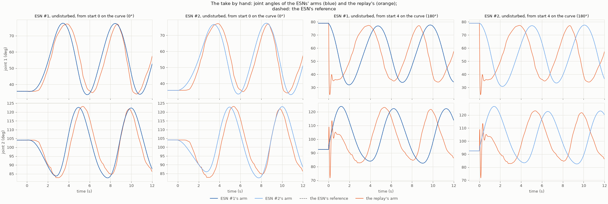

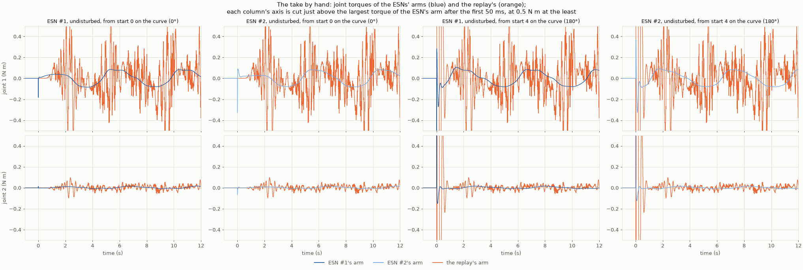

The torque axes are cut at the largest torque of the ESN's arm after the first 50 ms, and
at 0.5 N m at the least, as in report 023. The ESN's torque is small, so the replay's,
which follows the hand's unevenness, leaves the axis.

### 3.3 How a run starts (claim 2 holds)

Medians over each group of starts (the range in parentheses):

| | ESN #1 | ESN #2 | Replay |
| --- | --- | --- | --- |
| **The take's own start** | | | |
| Reference's fastest joint speed (°/s) | 32 | 33 | 46 |
| Largest joint torque (N m) | 0.2 | 0.3 | 0.7 |
| **The seven other starts on the curve** | | | |
| Reference's fastest joint speed (°/s) | 225 (96 to 366) | 204 (97 to 332) | 2,680 (1,330 to 4,320) |
| Largest joint torque (N m) | 5.3 (2.4 to 11.9) | 5.1 (2.1 to 11.2) | 140.3 (9.1 to 226.1) |
| Starts where the ESN's is the smaller: speed, torque | 7 of 7, 7 of 7 | 7 of 7, 7 of 7 | |
| **The 36 untaught starts** | | | |
| Reference's fastest joint speed (°/s) | 2,040 (105 to 11,950) | 1,905 (78 to 12,343) | 9,000 (1,120 to 20,880) |
| Largest joint torque (N m) | 107 (2 to 625) | 100 (3 to 646) | 471 (46 to 1,093) |
| Starts where the ESN's is the smaller: speed, torque | 36 of 36, 35 of 36 | 36 of 36, 36 of 36 | |

- **On the curve the ESN starts gently:** about 200 °/s and 5 N m, a twelfth of the
  replay's speed and a twenty-seventh of its torque. Report 026's ESNs started at about
  1,550 °/s and 11 N m from these starts.
- **Away from the curve the start is a fifth of the replay's, and still large:** about
  2,000 °/s and 100 N m by the median, and up to 12,300 °/s and 646 N m. Report 026's
  ESNs started at about 5,550 °/s and 270 N m. As there, one take that stays near the
  curve does not teach how to get to it.

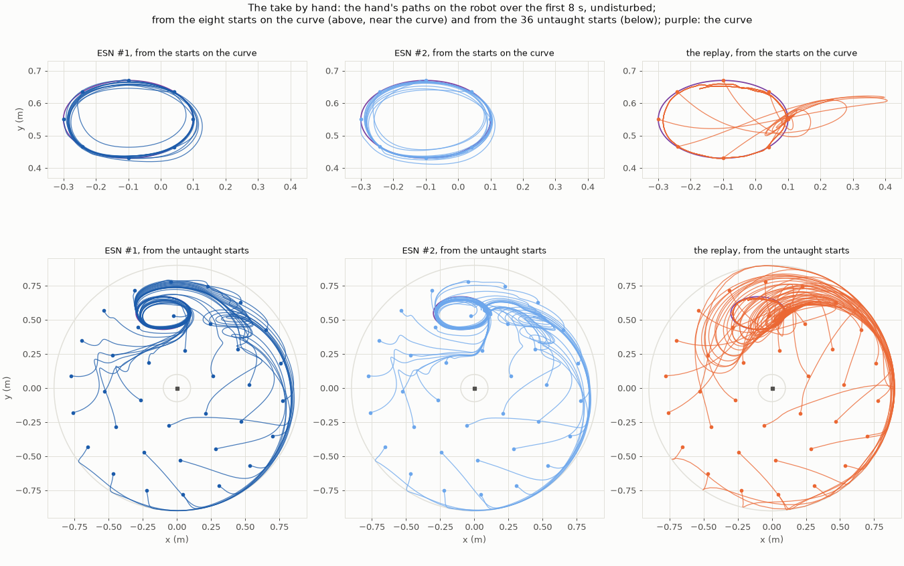

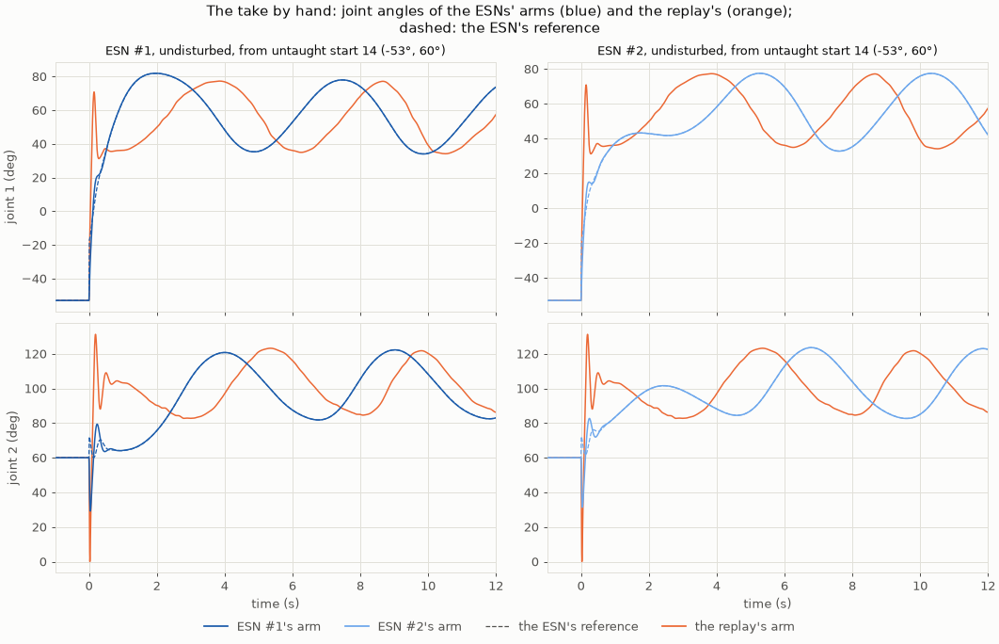

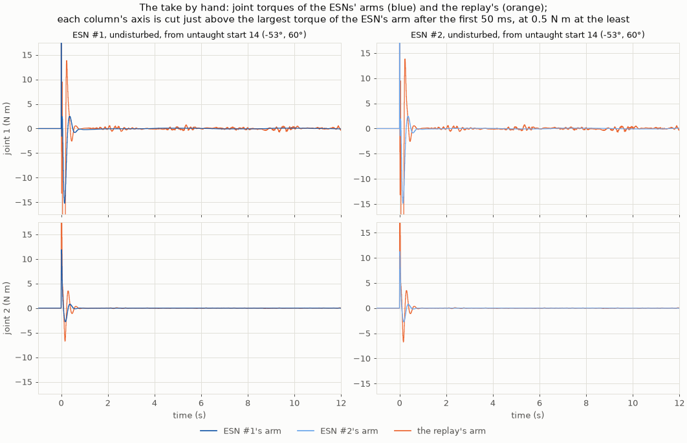

From the untaught start drawn, the replay's largest torque is 465 N m; the first peaks
leave the torque axes.

### 3.4 Joining the curve (claim 3 holds)

Undisturbed for 60 s, over the 36 untaught starts, medians (the range in parentheses):

| | ESN #1 | ESN #2 | Replay |
| --- | --- | --- | --- |
| Runs that cycle at the end, of 36 | 36 | 36 | 36 |
| Joining time (s) | 1.50 (0.17 to 5.10) | 1.57 (0.21 to 3.63) | 0.21 (0.00 to 0.39) |
| Curve RMS (mm) | 5.09 | 5.65 | 10.74 |
| Period ratio | 0.9843 | 0.9853 | 0.9893 |

- **Every run joins the curve and stays on it,** as close to the ellipse and at the same
  pace as from a start on the curve.
- **The ESNs join later than the scripted take's,** which took 0.8 s by the median and
  2.0 s at the latest. Many hands go around the edge of the workspace before they come
  to the curve (the paths above, and the first row below).
- **The replay's curve RMS depends on the run's length:** 11.0 mm at 120 s, 10.7 mm at
  60 s, and 10.4 mm at 80 s. The last five taught periods fall on different loops of the
  six it repeats.

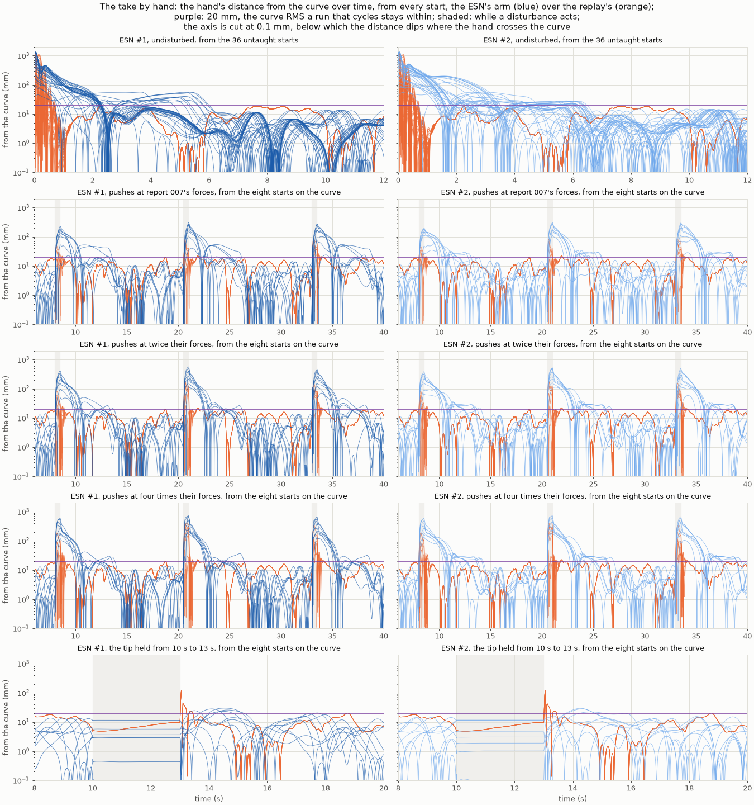

### 3.5 Under the pushes (claim 4 holds)

Over the eight starts on the curve, in runs of 80 s, every run of every arm cycles at
the end, at report 007's forces, at twice, and at four times them: 8 of 8 for ESN #1,
for ESN #2, and for the replay.

Each push, medians over the eight starts: how far off the curve it sends the hand (mm),
and for the ESNs how long after its end the hand is back within 20 mm for good until the
next push (s; the largest in parentheses):

| Forces, push | ESN #1 off | ESN #1 back | ESN #2 off | ESN #2 back | Replay off |
| --- | --- | --- | --- | --- | --- |
| Report 007's, 1 | 151 | 2.02 (5.07) | 149 | 3.34 (4.96) | 28 |
| Report 007's, 2 | 220 | 3.57 (5.17) | 178 | 3.66 (4.82) | 40 |
| Report 007's, 3 | 173 | 3.11 (5.42) | 201 | 4.25 (5.14) | 61 |
| Twice, 1 | 234 | 3.87 (5.24) | 237 | 4.42 (5.56) | 53 |
| Twice, 2 | 327 | 3.44 (5.21) | 319 | 4.57 (5.78) | 114 |
| Twice, 3 | 255 | 3.75 (4.94) | 274 | 4.64 (5.36) | 102 |
| Four times, 1 | 309 | 3.91 (5.35) | 315 | 4.62 (5.77) | 81 |
| Four times, 2 | 413 | 3.67 (5.41) | 395 | 4.70 (5.98) | 275 |
| Four times, 3 | 325 | 3.53 (5.21) | 357 | 4.76 (5.87) | 113 |

- **Every pushed run cycles at the end,** with the undisturbed curve RMS of 5.1 and
  5.7 mm.
- **A push sends the ESN's hand far off the curve:** about three to five times as far as
  the replay's at report 007's forces, and up to 722 and 726 mm at four times them. For the
  scripted take the ESNs' hands went about as far as the replay's.
- **The hand comes back slowly:** it is within 20 mm for good 2.0 to 4.8 s after a push
  ends by the median, and 5.4 and 6.0 s at the most, about a loop. Report 026's ESNs
  were back within 2.2 s.
- **The replay's return time is the take's.** The measure gives 10.29 s, 1.02 s, and
  46.13 s after the three pushes, the same at every size, and the same again for the
  replay's undisturbed runs measured as if they were pushed. So the table leaves it out.
  The smallest of the replay's distances, 20 to 22 mm, are the take's own as well.
- **The delay cannot be read after the pushes.** Taken within a loop, between −1.28 s
  and +3.84 s, it gives:

  | Forces | ESN #1, median (range) (s) | ESN #2, median (range) (s) |
  | --- | --- | --- |
  | Report 007's | +1.50 (−1.11 to +3.10) | +2.19 (+1.47 to +3.29) |
  | Twice | +1.54 (−0.80 to +3.59) | +2.38 (+1.53 to +3.72) |
  | Four times | +1.64 (−0.71 to +3.74) | +2.55 (+1.55 to +3.84) |

  The values spread over most of a loop and reach the window's top, where a hand a
  little farther behind would read as ahead. So the medians depend on where the window
  is put. What the runs show is
  that the pushes shift the ESN's hand along the curve by a large part of a loop, and
  that it goes on from there. The replay keeps its time.

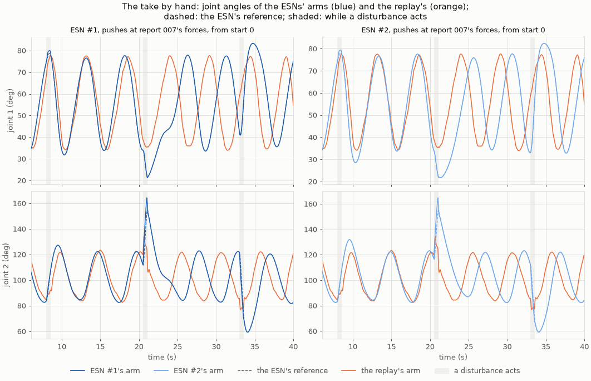

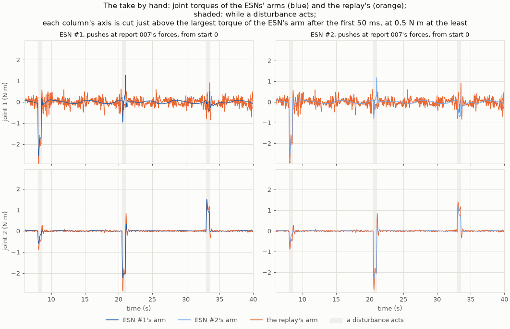

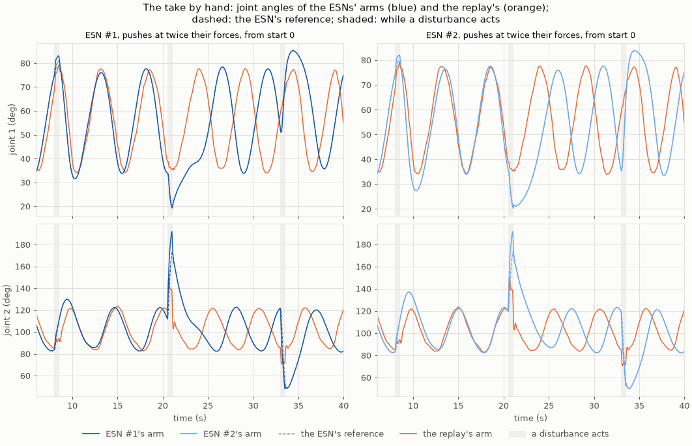

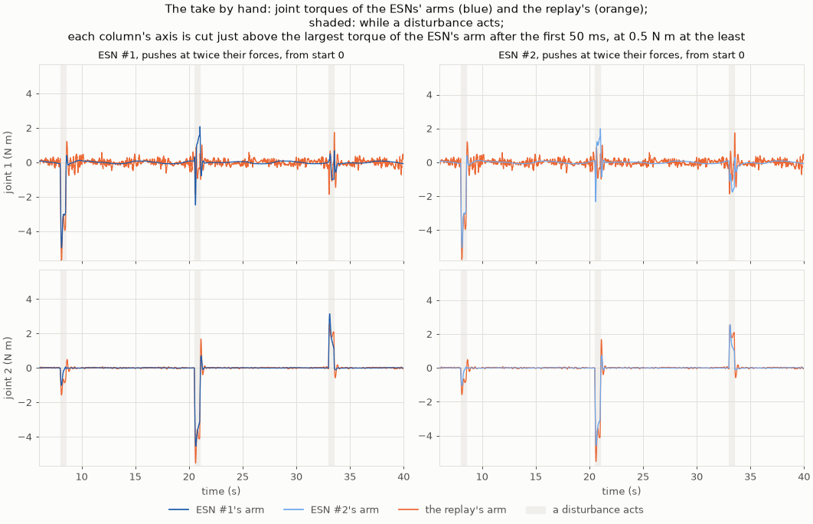

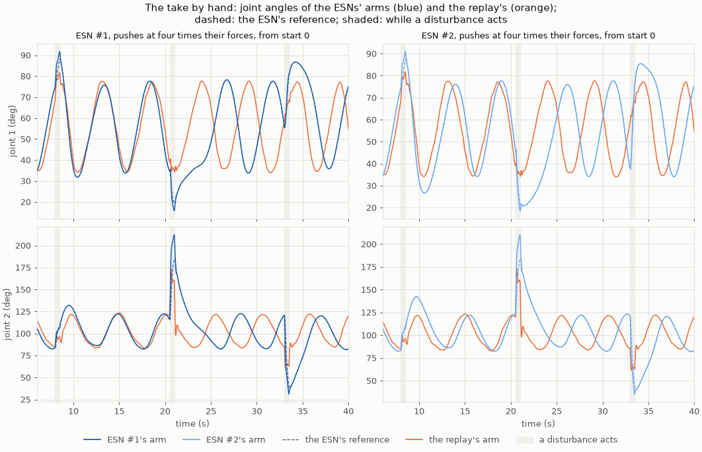

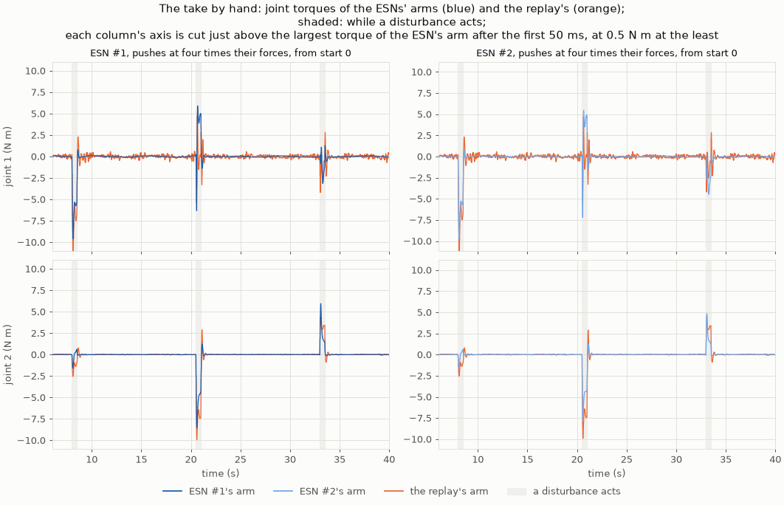

### 3.6 With the block (claim 5 holds)

The tip held from 10 s to 13 s, over the eight starts on the curve, in runs of 60 s,
medians (the range in parentheses). The replay's eight runs are one run from 10 s on.

| | ESN #1 | ESN #2 | Replay |
| --- | --- | --- | --- |
| Runs that cycle at the end, of 8 | 8 | 8 | 8 |
| Largest torque in the 2 s after the release (N m) | 1.6 (0.4 to 2.7) | 1.3 (0.3 to 2.4) | 48.8 |
| Largest off the curve in those 2 s (mm) | 23.9 (6.1 to 29.8) | 15.2 (8.8 to 29.4) | 106.9 |
| Starts where the ESN's is the smaller: torque, off the curve | 8 of 8, 8 of 8 | 8 of 8, 8 of 8 | |
| The delay at the end (s) | +3.18 (+3.06 to +3.53) | +3.16 (+3.04 to +3.70) | none |

Where the reference is at the last sample before the release, medians over the eight
starts (the range in parentheses):

| | ESN #1 | ESN #2 | Replay |
| --- | --- | --- | --- |
| The reference's hand from the arm's hand (mm) | 14 (9 to 19) | 15 (4 to 18) | 313 |
| The reference's hand off the curve (mm) | 3.6 (2.3 to 9.7) | 3.9 (2.0 to 12.6) | 7.7 |
| The reference's fastest joint speed over the last 0.5 s (°/s) | 0.0 | 0.0 | 15.1 |

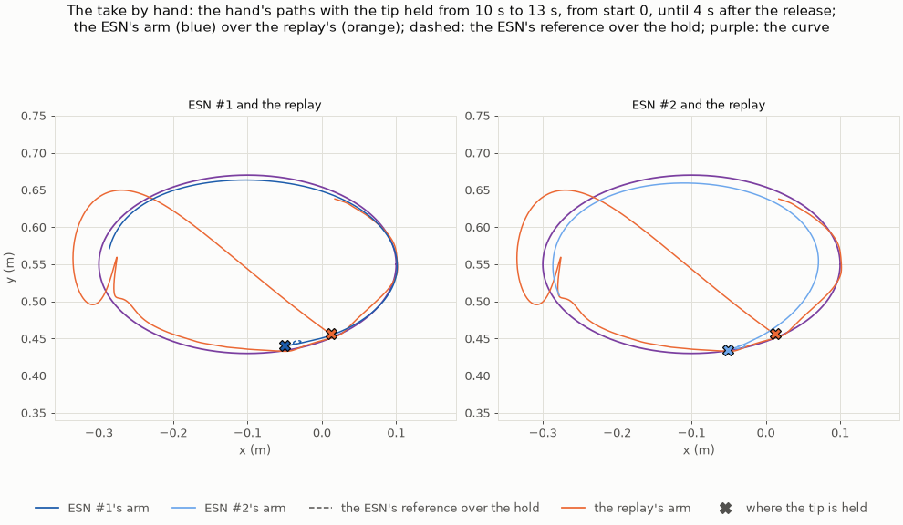

- **All three parts of the claim hold,** from every start.
- **Held, the ESN's reference waits at the arm.** It moves 15 mm from where the tip is
  held and stops there, near the curve. In the figure it is the short dashed stub at the
  cross. Released, the arm goes on along the curve from where it was held, with a
  torque of 1.6 and 1.3 N m.
- **The replay's reference goes on for the 3 s** and is 313 mm ahead of the held hand at
  the release. The arm cuts across to it with 48.8 N m and goes 107 mm off the curve.
- **The ESN's hand ends 3.2 s behind its undisturbed run,** from every start (3.0 to
  3.7 s): the 3 s of the hold and a little more.
- **The replay's delay reads −0.07 s and is none.** Its hand cuts inside the curve after
  the release and loses a turn of its angle about the center, which the reading takes
  off as one taught period, while the replay's own loop is 0.987 of it.
- **For the scripted take this claim failed in one part.** Its ESNs' reference drifted
  117 to 127 mm from the held hand and 48 to 56 mm off the curve, and the released hand
  went 84 and 77 mm off, against the replay's 60 mm.

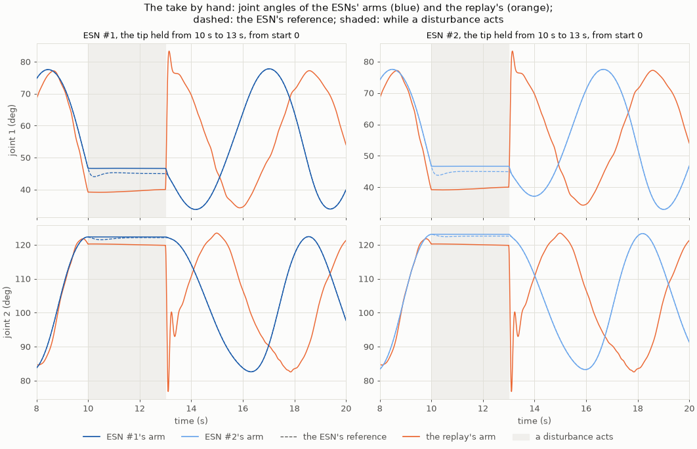

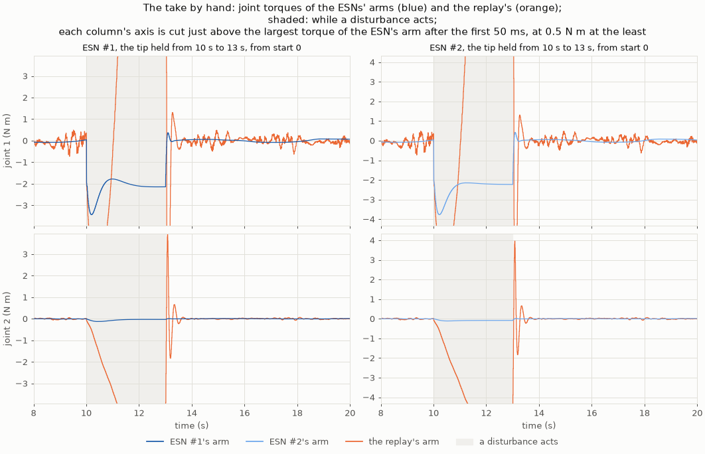

The torque axes are cut as in Section 3.2; the replay's torque while the tip is held
leaves the axis.

## 4. Observations

- **A take by hand is enough, and the ESN improves on it.** One take of ten uneven loops,
  10 mm from the ellipse, gives ESNs that keep the arm going around for 120 s within
  5 to 6 mm, join the curve from anywhere in the workspace, and come back after every
  push and after the block. They draw one smooth loop where the take has ten different
  ones. The error all the take's loops share, at the ellipse's left end, stays.
- **The take by hand asks for a strong ridge.** Nearly all runs that cycle in the coarse
  search have the ridge of 1, and the chosen ESNs have 10, where the scripted take's
  have 10⁻³. Most of the coarse search's runs that do not cycle stop. The hand's
  unevenness is in the training signal here, and the scripted take had none.
- **The untaught starts mattered to the choice.** They changed the order of the 20 best
  and moved the fine search's best to twelfth. For the scripted take they changed
  nothing. Scoring from the starts on the curve alone would have chosen ESNs that stop
  from some starts off it.
- **Against report 026's ESNs, these give way more.** Set beside each other:

  | | Report 026, scripted take | This report, take by hand |
  | --- | --- | --- |
  | Start from the other starts on the curve (°/s, N m) | about 1,550, 11 | about 215, 5 |
  | Start from the untaught starts (°/s, N m) | about 5,550, 270 | about 1,970, 104 |
  | Joining time, median and latest (s) | 0.8, 2.0 | 1.5, 5.1 |
  | A push at report 007's forces sends the hand (mm) | 40 to 94, as the replay's | 149 to 220, three to five times the replay's |
  | Back within 20 mm after a push, at the latest (s) | 2.2 | 6.0 |
  | Held for 3 s, the reference | drifts 117 to 127 mm away and rests | waits 14 to 15 mm away |
  | Largest torque after the release (N m) | 9.8 and 9.3 | 1.6 and 1.3 |
  | Off the curve after the release (mm) | 84 and 77 | 24 and 15 |

  The take by hand's ESNs start more gently, wait when held, and release with little
  torque; they are also pushed farther and come back more slowly. The two reports differ
  in the take and in the settings the search chose for it, a ridge of 10 and an input
  scaling of 0.5 here against 10⁻³ and 4 there. These runs do not separate the two
  causes.
- **The ESN keeps the place, not the time,** as in report 026: the block leaves it the
  whole hold behind, and the pushes shift it along the curve.
- **Two of the measures need care with a take that is itself off the curve.** The
  replay's return time reads the take, and the delay within one loop cannot be read
  when a push shifts the hand by a large part of a loop.

## 5. Next steps

These are proposals; none is started.

1. **The reach and the periodic motion in one ESN** (stage 3b), by a context input,
   whose rule and claims the maintainer confirms first.
2. **The take or the setting:** the scripted take's settings on the take by hand and the
   reverse, to tell which of the two makes an ESN wait when held and give way when
   pushed.
3. **A delay that follows the hand's phase through a disturbance,** in place of the
   reading within one loop, for runs where a push shifts the hand by much of a loop.
4. **The start away from the curve,** as in report 026: takes that join the curve from
   elsewhere, or a score that counts the start.
