# 028 A reach and a periodic motion in one ESN: a change of context changes the task in every run, but ten of the 90 reaches do not hold at the target, and few reservoirs do both tasks

**Summary.** Report 023 taught the two-link arm to reach one target from many starts, and
report 027 to go around an ellipse. This report trains one ESN on both: the nine takes of
the reach and the one take of the ellipse, with a context added to the ESN's input that
names the task, as report 025's context names a target. ESNs of 800 neurons generate the
reference of the simulated robot from the arm's measured joint angles and the context,
with report 017's tracker. The search, with both tasks in its score, and claims 6 to 9
were fixed before any run. Two ESNs are chosen, two-task ESN #1 and ESN #2, and tested
with one context for a whole run and with the context changed during a run.

Claims 7, 8, and 9 hold. Claim 6 fails, by its reach. The findings:

- **Changing the context changes the task, in every run (claims 7, 8, and 9 hold).**
  - From the ellipse to the reach at 16 s: the hand arrives at the target and holds in
    all eight runs of each ESN, 14.2 and 9.4 s after the change by the median.
  - From the reach to the ellipse at 20 s: the hand cycles at the end in all nine runs,
    and joins the curve 7.9 and 9.4 s after the change by the median.
  - Back and forth, three changes in 100 s: all eight runs cycle before the last change
    and arrive and hold after it.
- **With one context for the whole run, the ellipse is done from every start and the
  reach is not (claim 6 fails).**
  - The ellipse: both ESNs cycle from all 44 starts, 4.1 and 6.5 mm RMS from the ellipse,
    where report 027's ESNs, which do the ellipse alone, are at 5.1 and 5.7 mm and the
    replay at 10.7 mm.
  - The reach: the hand holds from 43 and 37 of the 45 starts, where report 023's ESNs
    and the replay hold from all 45. In each of the ten reaches that do not hold, the
    hand enters the 20 mm around the target, leaves it within the 2 s, goes out to 21
    to 50 mm from the target, and comes back to stay. All 90 reaches end within 13 mm
    of the target.
- **After a change the hand takes a long way, and ESN #1 starts it abruptly.** After the
  change to the reach, the hand's path to the target is 7.7 and 3.2 times the straight
  distance by the median. In the 2 s after it, ESN #1's reference moves a joint at up to
  488 °/s by the median and the torque reaches 25.5 N m, against 104 °/s and 5.9 N m for
  ESN #2.
- **After a change from rest, where the run started no longer matters.** From the seven
  takes that rest with joint 1 at 114°, the runs after the change to the ellipse are
  one run to within 0.2° of the joints: ESN #1 joins the curve 7.92 s after the change
  in all seven. After claim 9's second change all eight runs of ESN #1 are alike to the
  hundredth of a second.
- **From the other rest posture, the arm turns back nearly a whole turn.** Two takes of
  the reach rest with joint 1 at −246°, a whole turn from the others' 114°. When the
  context changes there, joint 1 goes back up to where the ellipse was taught, 33° to
  78°, the hand sweeps around the rim of the workspace, and the hand cycles as from the
  other seven.
- **The search found no setting that is reliable at both tasks.** No coarse setting
  passes all 17 runs, no fine setting all 85, and none of the 100 ESNs scored again all
  89. Most reach runs hold and few ellipse runs cycle: in the fine search 3,205 of 3,645
  and 545 of 3,240. Most runs that cycle have the fine grid's largest ridge, and more
  have its largest spectral radius than either other. Reservoirs of one setting differ
  as much as settings do: of ESN #1's setting, seed 4 cycles from all 36 untaught starts
  and seed 3 from one.

## 1. Question

1. **Two tasks in one ESN:** can one ESN, trained on the takes of a reach and on the
   take of a periodic motion, do each when its context names it, as well as the ESNs
   that do one task?
2. **Changing the task:** when the context changes during a run, does the hand leave the
   ellipse for the target, and the target for the ellipse, and how does it get there?
3. **The search:** does report 023's search, with both tasks in its score, find ESNs
   that are reliable at both?

## 2. Setup

The robot, the takes, the tracker, and each task's measures are those of
[report 023](../023-one-target-from-many-starts/README.md#2-setup) (the reach) and
[report 027](../027-a-periodic-motion-by-hand/README.md#2-setup) (the ellipse), and the
context is fed as in [report 025](../025-three-targets-by-context/README.md#the-esns).
They are given here in short, with what two tasks change.

### The robot, the tasks, the takes, and the start postures

- **The robot** is report 023's: the arm of reports 005 to 020 with no joint limits,
  simulated every 2 ms
  ([`reach_manual_v2_no_limits.toml`](../../experiments/demonstrations/reach_manual_v2_no_limits.toml)).
- **The two tasks and their takes.** No take is new.

  | Task | Context | Takes |
  | --- | --- | --- |
  | the reach to (−0.6, 0.4) m, within 20 mm | `reach` | report 023's nine takes by hand, one from each of nine start postures ([its `data/`](../023-one-target-from-many-starts/data)) |
  | the periodic motion around the ellipse centered at (−0.1, 0.55) m, with semi-axes of 0.20 m and 0.12 m, counterclockwise | `ellipse` | report 027's one take by hand, ten loops ([its `data/`](../027-a-periodic-motion-by-hand/data)); its taught period is 5.12 s |

  All ten are filtered at 2 Hz. The nearest the ellipse comes to the target is 0.33 m.
- **Two rest postures.** Seven takes of the reach rest at the target with joint 1 at
  113° or 114°. Takes 03 and 04 go around the base the other way and rest at −246° and
  −247°: the same posture of the arm, a whole turn of joint 1 below. The ellipse is
  taught with joint 1 between 33° and 78°.
- **The start postures:**

  | Starts | What they are | Used with |
  | --- | --- | --- |
  | the nine reach takes' | where each take of the reach starts | `reach` |
  | eight on the curve | the hand on the ellipse at its angles 0°, 45°, …, 315°; start 0 is the ellipse take's | `ellipse` |
  | 36 untaught | report 023's, hands spread evenly over the workspace. The search's last step ran from them with each context, so they are not held out | both |
  | 36 unseen | report 023's, the untaught rings turned 15° back. No search ran from them | `reach`, in claim 6 |

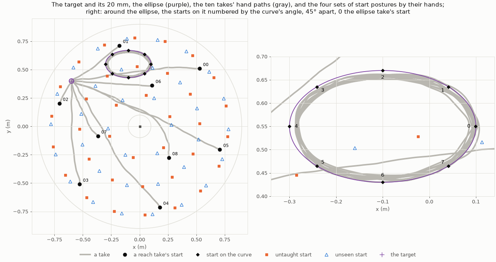

### The ESNs

| | Two-task ESN #1 ([`esn.toml`](results/20261119-222323-esn1_lr0.17_sr1.65_is0.22_ridge10_seed4/esn.toml)) | Two-task ESN #2 ([`esn.toml`](results/20261119-222327-esn2_lr0.055_sr1.5_is0.5_ridge10_seed4/esn.toml)) | Report 023's ESN #1, the reach alone | Report 027's ESN #1, the ellipse alone |
| --- | --- | --- | --- | --- |
| Leak rate | 0.17 | 0.055 | 0.055 | 0.055 |
| Spectral radius | 1.65 | 1.5 | 1.2 | 1.05 |
| Input scaling | 0.22 | 0.5 | 1 | 0.5 |
| Ridge | 10 | 10 | 1 | 10 |
| Seed | 4 | 4 | 4 | 1 |
| Training | teacher forcing, without noise, on the nine takes of the reach with the context `reach` (`demo_00_filtered` to `demo_08_filtered` of `results/demonstrations/20261117-164658-reach_manual_v2_no_limits`) and on the take of the ellipse with the context `ellipse` (`demo_00_filtered` of `results/demonstrations/20261119-093746-ellipse_manual_v2_no_limits`) | the same | on the nine takes of the reach | on the take of the ellipse |

Report 023's ESN #2 has a leak rate of 0.1, a spectral radius of 1.05, an input scaling
of 0.5, a ridge of 10, and seed 3; report 027's ESN #2 is its ESN #1 with a spectral
radius of 0.9 and seed 5.

The leak rate, the spectral radius, the input scaling, the ridge, and the seed are
swept by the search. Fixed for all: 800 tanh neurons, sparsity 0.05, a bias per neuron
drawn uniformly from [−1, 1] by the seed and not scaled, a 1 s warm-up on the held start
posture with the run's first context, a 10 ms period. The input is the arm's two joint
angles every 10 ms, each normalized by the range the ten takes cover, and then the
context.

**The context** is one value per task after the two joint angles: 1 for the task being
done and 0 for the other. It is fed in divided by the input scaling, so that its
weights have the scale 1 whatever the input scaling is, as in report 025
(`context_scaling = 1.0`, `context_times_input_scaling = false`). This was not searched.
The ESNs get no target, no curve, and no phase.

### The tracker, the replays, and the runs

- **The tracker** is report 017's: joint PD at ω = 20 rad/s and a damping ratio of 0.4,
  given the reference's velocity, its torque computed every 10 ms and held between,
  with the gains of reports 023 to 027.
- **The replays** are those of the two reports. With the context `reach`, the replay
  plays by time the take that starts nearest the run's start. With the context
  `ellipse`, it plays the take of the ellipse and goes on without end through the
  take's taught loop, from the take's start wherever the arm is. A replay keeps to its
  take: when the ESN's context changes, the replay does not change task. So the claims
  about a change of context count the ESN's runs alone, and the replay is drawn beside
  them only to show what the take does.
- **A run** follows the 1 s warm-up, undisturbed. With the context `reach` it lasts
  24 s; with `ellipse` 40 s in the search and 60 s in claim 6. The runs with a change of
  context last 40 s, 60 s, and 100 s. There are no pushes and no block in this report.

### The measures

A run is given a context from its warm-up on, and its measures are its task's:

- **With `reach`,** report 023's: a run **holds** if the hand arrives within 20 mm of
  the target and stays within it for the 2 s after. A run that arrives in the last 2 s,
  so that the 2 s cannot be seen, does not hold. The **detour ratio** is the length of
  the hand's path until it arrives over the straight distance from its start.
- **With `ellipse`,** report 027's, taken from the ellipse itself: a run **cycles** if,
  over its last five taught periods (25.6 s), the hand's angle about the curve's center
  grows by four to six turns and the curve RMS is at most 20 mm. The **joining time** is
  the earliest time from which the RMS of the hand's distance from the ellipse over
  every following taught period is at most 20 mm.
- **A run passes** if it holds, with `reach`, or cycles, with `ellipse`.
- **How a run starts:** the reference's fastest joint speed and the largest joint
  torque.

**When the context changes during a run,** the part after the change is measured as a
run of the new task that begins at the change: after a change to `reach`, whether the
hand arrives and holds, and the time from the change to its arrival; after a change to
`ellipse`, whether the hand cycles at the end of the run, and the joining time counted
from the change. Reported with them, without a claim: the reference's fastest joint
speed and the largest joint torque in the 2 s after each change.

### The search

The search chooses two ESNs by how reliably they do both tasks, and then by how well. It
is [report 027's](../027-a-periodic-motion-by-hand/README.md#the-search-and-the-claims)
with both tasks in the score, fixed before any run:

1. **The runs.** Each ESN runs on the robot with the context `reach` from each of the
   nine reach takes' starts for 24 s, and with the context `ellipse` from each of the
   eight starts on the curve for 40 s: 17 runs.
2. **A setting's score** is how many of its runs pass, the most first. Settings with as
   many are ranked twice among themselves: by the median detour ratio of their reach
   runs that arrive, and by the median curve RMS of their ellipse runs that cycle. The
   worse of a setting's two ranks decides, then the better, so that neither task's
   measure is weighed against the other's in its own unit.
3. **The coarse search:** report 023's 108 settings with one reservoir each (seed 0):
   leak rates 0.01, 0.03, 0.1, 0.3; spectral radii 0.9, 1.2, 1.5; input scalings 0.1,
   0.5, 2; ridges 10⁻⁴, 10⁻², 1.
4. **The fine search:** 81 settings around the coarse search's best, with five
   reservoirs each (seeds 1 to 5), each parameter taking the center's value and the one
   halfway to its coarse neighbor on each side. A setting's runs are the 85 of its five
   seeds.
5. **Scoring again with the untaught starts:** the 20 best fine settings, with their
   five reservoirs again, run from the starts of step 1 and from the 36 untaught ones
   with each context: 89 runs an ESN, 445 a setting.
6. **The chosen ESNs** are the typical seeds of the two best settings of step 5: of a
   setting's seeds with the most runs that pass, the one whose median curve RMS is
   nearest the setting's.

The search has no change of context, no pushes, no block, and no held-out seeds.

### The claims

Fixed before any run of this report, as claims 6 to 9 after report 026's and 027's five
([the experiment's README](../../experiments/manual_demonstration_v2_reach_and_ellipse/README.md#the-claims)).
Each is to hold for two-task ESN #1 and for ESN #2:

6. **Each task by its context.** With the context `reach`, from the nine reach takes'
   starts and the 36 unseen starts, the hand arrives and holds from as many starts as
   it did for report 023's ESN #1 and ESN #2, which is all 45. With the context
   `ellipse`, from the eight starts on the curve and the 36 untaught starts, in runs of
   60 s, the hand cycles at the end from at least as many starts as for the fewer of
   report 027's ESN #1 and ESN #2, which is all 44.
7. **From the periodic motion to the reach.** The run starts with the context `ellipse`
   from each of the eight starts on the curve, and the context changes to `reach` at
   16 s. The hand arrives at the target and holds, in all eight runs of 40 s.
8. **From the reach to the periodic motion.** The run starts with the context `reach`
   from each of the nine reach takes' starts, and the context changes to `ellipse` at
   20 s. The hand cycles at the end of the run, in all nine runs of 60 s.
9. **Back and forth.** From each of the eight starts on the curve, the context goes from
   `ellipse` to `reach` at 16 s, back to `ellipse` at 36 s, and to `reach` again at
   76 s. The hand cycles over the five taught periods before the last change, and
   arrives and holds after it, in all eight runs of 100 s.

The claims were proposed on 2026-11-18. What was settled after that and before the runs
is written with its date in the experiment's README:

- the reach has report 023's one target, not report 025's three; the ellipse is taught
  by the take by hand alone; and there are no pushes and no block;
- claim 9's second stretch on the ellipse lasts 40 s, not 30 s, because the take by
  hand's five taught periods are 25.6 s;
- the context is fed as in report 025, and the search's last tie is broken by the
  better of the two ranks;
- which columns of a run's table count each claim, after a rehearsal of the
  configurations with another ESN in a scratch directory.

### Reproducing the results

The configurations are in
[`manual_demonstration_v2_reach_and_ellipse`](../../experiments/manual_demonstration_v2_reach_and_ellipse/README.md),
written below as `$D`.

| Runs | Command | Commit |
| --- | --- | --- |
| `coarse_search`, `fine_search`, `untaught_search` | `uv run python experiments/sweep_robot_esn.py $D/<name>.toml --workers 30` | `7e08011`, `d0a9a02`, `ce5f9b5` |
| `esn1_lr0.17_sr1.65_is0.22_ridge10_seed4`, `esn2_lr0.055_sr1.5_is0.5_ridge10_seed4` | `uv run python experiments/autonomous_esn.py $D/<name>.toml` | `54487dc` |
| `robot_esn{1,2}` (claim 6), `to_reach_robot_esn{1,2}` (claim 7), `to_ellipse_robot_esn{1,2}` (claim 8), `back_and_forth_robot_esn{1,2}` (claim 9) | `uv run python experiments/robot_esn.py $D/<name>.toml` | `de4d5ad` |
| [`summary`](results/summary) | `uv run python reports/028-a-reach-and-a-periodic-motion-in-one-esn/make_figures.py` | |

- **Running time,** with 30 workers on 32 logical processors: the coarse search 22 min,
  the fine search 61 min, and the scoring with the untaught starts 84 min. Training an
  ESN and running it on its own takes about 2.5 min. The eight robot runs were run side by
  side and took 27 min in all.
- **What the code gained for two tasks** (`8fc2e37`): a sweep and a run take each task's
  duration and starts of its own (`[evaluation.tasks.<context>]`), a run can start from
  one task's starts alone (`start_tasks`), the sweep scores by the worse of two ranks
  (`[ranking] by = "worse_rank"`), and a change of context to or from a periodic task is
  measured (`[[switch]]`).
- **Checks:**
  - Every run record names its commit, and none reports uncommitted changes.
  - The replay beside ESN #1 equals the replay beside ESN #2 in every scenario, and
    with the context `reach` it equals report 023's.
  - Before its first change of context, every run equals the run without a change from
    the same start, joint angle for joint angle; and claim 9's runs equal claim 7's up
    to 36 s.
  - In all 228 logs of the ESNs, the context is the first task's until each change and
    the new task's from it.
  - The peaks after each change, taken again from the logs, equal the tables'.
- **A sweep repeated on this machine** gives the same counts and the same order but not
  the same digits in every run, and one robot run repeated is identical. Both were
  found on 2026-11-19, when report 027's coarse search and one of its robot runs were
  repeated to check the merge of stages 2 and 3; the repeats are not kept.
- **What is kept here:** each search's configuration and run record with its
  `scores.csv`, `sweep.csv`, and, but for the coarse search, which has one seed,
  `seeds.csv`; the two ESNs' `esn.toml` and `esn.rclib`
  with their `metrics.csv`; and each robot run's configuration and run record with its
  `metrics.csv`. The takes are kept in reports 023 and 027.

[`make_figures.py`](make_figures.py) prints the tables of Section 3 and draws its
figures. It reads these copies, the copies in reports 023 and 027 for their ESNs, and
from the storage root the takes, the robot runs' logs, and the searches' `runs.csv`,
which are not kept in Git.

## 3. Results

### 3.1 The search

**The coarse search.** None of the 108 settings passes all 17 runs. The best:

| Leak rate | Spectral radius | Input scaling | Ridge | Runs that pass, of 17 | Reaches that hold, of 9 | Ellipse runs that cycle, of 8 | Median detour ratio | Median curve RMS (mm) |
| --- | --- | --- | --- | --- | --- | --- | --- | --- |
| 0.1 | 1.5 | 0.5 | 1 | 15 | 8 | 7 | 1.040 | 8.55 |
| 0.03 | 1.5 | 2 | 1 | 13 | 9 | 4 | 1.012 | 7.58 |
| 0.03 | 1.5 | 0.5 | 1 | 13 | 8 | 5 | 1.019 | 11.89 |

All others pass 10 or fewer. The best one's spectral radius and ridge are the coarse
grid's largest, so the fine search goes as far above them as below: leak rates 0.055,
0.1, 0.17; spectral radii 1.35, 1.5, 1.65; input scalings 0.22, 0.5, 1; ridges 0.1, 1,
10.

**The fine search.** None of the 81 settings passes all 85 runs. The best:

| Leak rate | Spectral radius | Input scaling | Ridge | Runs that pass, of 85 | Reaches that hold, of 45 | Ellipse runs that cycle, of 40 | Median detour ratio | Median curve RMS (mm) |
| --- | --- | --- | --- | --- | --- | --- | --- | --- |
| 0.055 | 1.65 | 0.5 | 10 | 69 | 33 | 36 | 1.048 | 8.65 |
| 0.17 | 1.65 | 0.22 | 10 | 69 | 35 | 34 | 1.165 | 13.14 |
| 0.055 | 1.5 | 0.5 | 10 | 68 | 41 | 27 | 1.044 | 7.91 |
| 0.1 | 1.5 | 1 | 10 | 63 | 41 | 22 | 1.024 | 11.21 |
| 0.055 | 1.35 | 1 | 10 | 59 | 43 | 16 | 1.015 | 6.46 |

The 20th passes 51. Four settings pass 51, and the ranks leave the fourth out.

**The scoring with the untaught starts.** No setting passes all 445 runs, and none of
the 100 ESNs all of its 89. The best:

| Leak rate | Spectral radius | Input scaling | Ridge | Runs that pass, of 445 | Reaches that hold, of 225 | Ellipse runs that cycle, of 220 | Median detour ratio | Median curve RMS (mm) | Typical seed | Its runs that pass, of 89 |
| --- | --- | --- | --- | --- | --- | --- | --- | --- | --- | --- |
| 0.17 | 1.65 | 0.22 | 10 | 343 | 167 | 176 | 1.221 | 12.93 | 4 | 86 |
| 0.055 | 1.5 | 0.5 | 10 | 312 | 197 | 115 | 1.131 | 8.36 | 4 | 81 |
| 0.1 | 1.65 | 0.22 | 10 | 311 | 135 | 176 | 1.227 | 10.20 | 5 | |
| 0.055 | 1.65 | 0.5 | 10 | 301 | 157 | 144 | 1.183 | 8.95 | 5 | |
| 0.055 | 1.5 | 1 | 10 | 291 | 208 | 83 | 1.115 | 13.36 | 3 | |

The first two rows are the settings of two-task ESN #1 and ESN #2. No two of the first ten settings pass
as many runs, so the ranks by the detour ratio and the curve RMS decided nothing among
them. The fine search's best setting is fourth here.

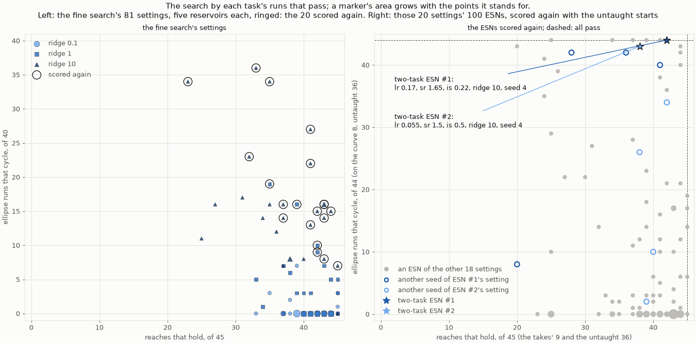

- **The reach is the easier task, at every step.** Runs that pass, over all the runs of
  each step:

  | Step | Reach runs that hold | Ellipse runs that cycle |
  | --- | --- | --- |
  | the coarse search | 552 of 972 | 44 of 864 |
  | the fine search | 3,205 of 3,645 | 545 of 3,240 |
  | the scoring | 3,791 of 4,500 | 1,381 of 4,400 |

  For the ellipse alone, report 027's coarse search had 205 of 864 runs that cycle.
- **The ellipse asks for the grid's edge.** Of the fine search's 545 ellipse runs that
  cycle, 427 have the ridge of 10, 102 the ridge of 1, and 16 the ridge of 0.1; and 264
  have the spectral radius of 1.65, 175 that of 1.5, and 106 that of 1.35. Of its 20
  best settings 16 have the ridge of 10 and nine the spectral radius of 1.65. The reach
  goes the other way with the spectral radius: 1,011 runs hold at 1.65, 1,088 at 1.5,
  and 1,106 at 1.35. It does not depend on the ridge below 10. The rule has no step beyond the fine grid.
- **How the ellipse runs fail.** Of the fine search's 2,695 ellipse runs that do not
  cycle, the hand of 1,317 stays within half a turn over the last five taught periods,
  that of 1,076 keeps the pace but is more than 20 mm RMS from the ellipse, that of 241
  goes around too slowly, that of 45 backwards, and that of 16 too fast. Of its 440
  reach runs that do not hold, 393 arrive and leave within the 2 s, 42 never arrive,
  and 5 arrive too late.
- **Few reservoirs do both.** Of the fine search's 405 ESNs, 181 hold all nine reaches
  and 29 cycle from all eight starts; 12 do both, 11 of them with the ridge of 10. Of
  the 100 ESNs scored again, five hold all 45 reaches and seven cycle from all 44
  starts, and none does both. In the right panel above, about half the ESNs lie along
  the bottom: 34 cycle from no start, and 49 from five or fewer of the 44.
- **The seeds of one setting differ as much as the settings.** The five seeds of the two
  best settings in the scoring:

  | Setting | Seed | Runs that pass, of 89 | Reach: takes' 9, untaught 36 | Ellipse: on the curve 8, untaught 36 |
  | --- | --- | --- | --- | --- |
  | ESN #1's | 1 | 78 | 8, 28 | 7, 35 |
  | | 2 | 70 | 6, 22 | 6, 36 |
  | | 3 | 28 | 5, 15 | 7, 1 |
  | | **4** | **86** | 8, 34 | 8, 36 |
  | | 5 | 81 | 8, 33 | 6, 34 |
  | ESN #2's | 1 | 50 | 8, 32 | 5, 5 |
  | | 2 | 41 | 8, 31 | 2, 0 |
  | | 3 | 64 | 9, 29 | 6, 20 |
  | | **4** | **81** | 8, 30 | 8, 35 |
  | | 5 | 76 | 8, 34 | 6, 28 |

- **The ESN with the fewest failing runs is not chosen.** Leak rate 0.055, spectral
  radius 1.5, input scaling 1, ridge 10, seed 3 fails two of its 89 runs, one of each
  task. Its setting is fifth, and the rule chooses by the setting.
- **The chosen ESNs' failing runs in the scoring** are ten reaches and one ellipse run.
  In nine of the reaches the hand arrives, leaves the 20 mm within the 2 s, and ends
  within 5 mm of the target; in one it arrives at 22.7 s, too late. The ellipse run,
  ESN #2's from an untaught start, keeps the pace 45 mm RMS from the ellipse.

### 3.2 Each task by its context (claim 6 fails)

**The reach.** With the context `reach` for 24 s, from the nine takes' starts and the 36
unseen ones. Medians, with the smallest and the largest in parentheses:

| | Hold, of the takes' 9 | Hold, of the unseen 36 | End within 20 mm, of 45 | Arrival time (s) | Detour ratio | Reference's fastest joint speed (°/s) | Largest torque (N m) |
| --- | --- | --- | --- | --- | --- | --- | --- |
| Two-task ESN #1 | 8 | 35 | 45 | 8.40 (1.11 to 18.08) | 1.206 (1.036 to 6.200) | 416 (47 to 831) | 21.8 (2.5 to 43.5) |
| Two-task ESN #2 | 8 | 29 | 45 | 8.63 (3.86 to 17.32) | 1.122 (1.007 to 2.532) | 155 (12 to 454) | 8.1 (0.5 to 23.8) |
| The replay | 9 | 36 | 45 | 7.82 (3.82 to 10.75) | 1.457 (1.009 to 11.331) | 1,904 (11 to 7,101) | 57.6 (0.2 to 371.7) |
| Report 023's ESN #1 | 9 | 36 | 45 | 7.77 (3.24 to 16.45) | 1.050 (1.003 to 2.562) | 165 (17 to 397) | 8.6 (0.3 to 20.8) |
| Report 023's ESN #2 | 9 | 36 | 45 | 9.44 (2.37 to 17.21) | 1.083 (1.008 to 3.161) | 116 (43 to 634) | 6.1 (0.4 to 33.2) |

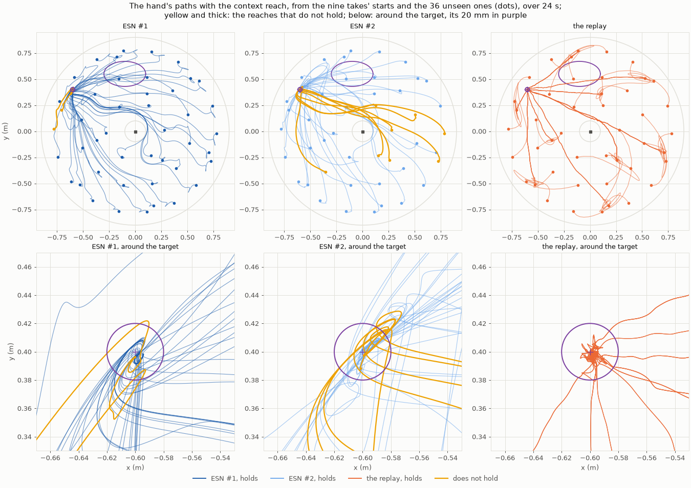

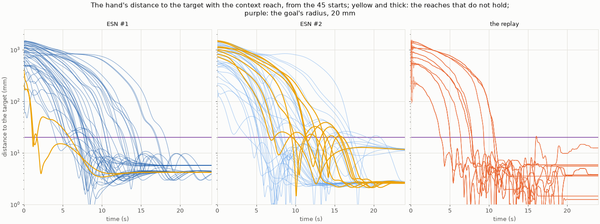

- **Claim 6 fails by the reach.** Two-task ESN #1 holds from 43 of the 45 starts and
  ESN #2 from 37, where report 023's ESNs and the replay hold from all 45.
- **Every reach ends at the target.** All 45 hands of each ESN end within 20 mm: within
  5.7 mm for ESN #1 and 12.2 mm for ESN #2, as report 023's ESNs do within 6.0 and
  11.5 mm.
- **The ten reaches that do not hold leave the target once.** In each, the hand enters
  the 20 mm, goes out again, and comes back to stay:

  | | Start | Posture | Enters (s) | Leaves (s) | Farthest out (mm) | Back to stay (s) | At the end (mm) |
  | --- | --- | --- | --- | --- | --- | --- | --- |
  | ESN #1 | take 02's | (133°, 71°) | 1.24 | 1.68 | 49.9 | 5.86 | 4.2 |
  | ESN #1 | unseen 7 | (152°, 60°) | 1.11 | 1.36 | 23.4 | 1.69 | 4.2 |
  | ESN #2 | take 08's | (−99°, 132°) | 11.32 | 11.91 | 39.0 | 15.69 | 2.6 |
  | ESN #2 | unseen 15 | (−48°, 60°) | 11.41 | 13.27 | 31.9 | 15.82 | 2.6 |
  | ESN #2 | unseen 16 | (−28°, 60°) | 13.63 | 15.24 | 21.3 | 16.04 | 2.7 |
  | ESN #2 | unseen 24 | (−178°, 109°) | 6.68 | 7.32 | 25.5 | 9.60 | 11.6 |
  | ESN #2 | unseen 29 | (−28°, 109°) | 12.68 | 14.21 | 21.5 | 15.04 | 2.6 |
  | ESN #2 | unseen 30 | (10°, 146°) | 7.28 | 9.23 | 25.1 | 11.18 | 2.6 |
  | ESN #2 | unseen 34 | (−110°, 146°) | 9.53 | 11.19 | 32.4 | 13.96 | 2.6 |
  | ESN #2 | unseen 35 | (−50°, 146°) | 9.87 | 11.41 | 23.0 | 12.62 | 2.6 |

  - ESN #1's two pass through the 20 mm in the first 1.7 s, on a path that then swings
    out and settles.
  - ESN #2's eight come in slowly, cross the 20 mm, go out again 0.6 to 2.0 s after
    entering, and are back 2.4 to 4.4 s after entering. In the figure of the
    distances they are the yellow lines that rise above 20 mm once between 7 s and
    16 s.
  - Many of ESN #2's reaches that hold make the same swing. Of its 37, 14 rise by
    10 mm or more after entering: 11 stay under 20 mm, and three, from unseen starts
    11, 12, and 26, go out to 22 to 26 mm after their 2 s, which the rule counts as
    holding. So 13 of the 90 reaches leave the 20 mm at some time after entering it.
- **The two-task ESNs go less directly than report 023's.** The median detour ratio is
  1.206 and 1.122, against 1.050 and 1.083. Each ESN's largest ratio, 6.2 and 2.5, is
  from the unseen start nearest the target, 0.12 m from it: from close by, the hand
  does not go straight in.
- **ESN #1 starts faster.** Its reference's fastest joint speed is 416 °/s by the
  median, against 155 °/s for ESN #2 and 165 and 116 °/s for report 023's ESNs. All
  stay far under the replay's 1,904 °/s, which jumps to its take's start.

**The ellipse.** With the context `ellipse` for 60 s, from the eight starts on the curve
and the 36 untaught ones. Report 027's runs from the starts on the curve last 120 s; the
cycle's measures are over each run's last five taught periods.

| | Starts | Cycle | Curve RMS (mm) | Period ratio | Joining time (s) | Reference's fastest joint speed (°/s) | Largest torque (N m) |
| --- | --- | --- | --- | --- | --- | --- | --- |
| Two-task ESN #1 | on the curve, 8 | 8 | 4.06 (4.04 to 4.07) | 0.994 | 2.29 (0.00 to 13.15) | 413 (121 to 726) | 21.6 (4.5 to 38.0) |
| | untaught, 36 | 36 | 4.05 (4.05 to 4.09) | 0.994 | 2.45 (0.34 to 6.90) | 1,976 (56 to 8,802) | 103.4 (2.5 to 460.7) |
| Two-task ESN #2 | on the curve, 8 | 8 | 6.47 (6.40 to 6.70) | 0.985 | 4.12 (0.00 to 7.90) | 300 (31 to 562) | 7.5 (1.5 to 29.4) |
| | untaught, 36 | 36 | 6.45 (6.36 to 12.79) | 0.985 | 8.18 (0.16 to 34.55) | 903 (70 to 2,938) | 34.9 (2.5 to 153.8) |
| The replay | on the curve, 8 | 8 | 10.74 | 0.989 | 0.06 (0.00 to 0.18) | 2,260 (46 to 4,320) | 115.9 (0.7 to 226.1) |
| | untaught, 36 | 36 | 10.74 | 0.989 | 0.21 (0.00 to 0.39) | 9,000 (1,120 to 20,880) | 471.0 (46.1 to 1,092.8) |
| Report 027's ESN #1 | on the curve, 8 | 8 | 5.11 (5.08 to 5.30) | 0.984 | 0.00 (0.00 to 1.09) | 186 (32 to 366) | 5.2 (0.2 to 11.9) |
| | untaught, 36 | 36 | 5.09 (5.08 to 5.23) | 0.984 | 1.50 (0.17 to 5.10) | 2,040 (105 to 11,950) | 106.8 (2.3 to 625.4) |
| Report 027's ESN #2 | on the curve, 8 | 8 | 5.66 (5.64 to 5.79) | 0.985 | 0.00 (0.00 to 1.11) | 172 (33 to 332) | 4.3 (0.3 to 11.2) |
| | untaught, 36 | 36 | 5.65 (5.63 to 5.86) | 0.985 | 1.57 (0.21 to 3.63) | 1,905 (78 to 12,343) | 99.7 (2.9 to 646.0) |

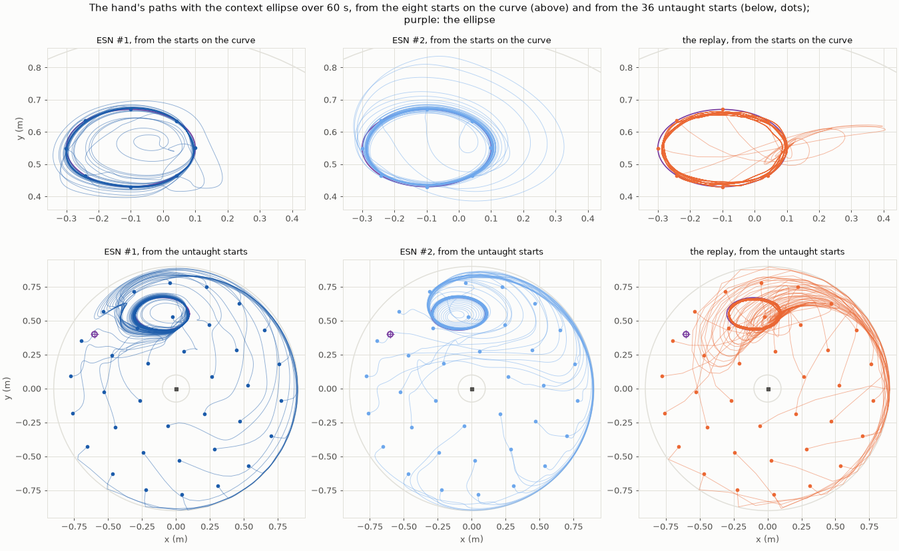

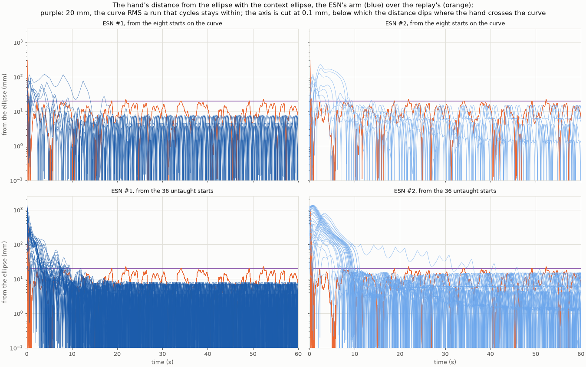

- **This part of claim 6 holds:** both ESNs cycle at the end from all 44 starts, as
  report 027's ESNs do.
- **The loop they settle on is about as close to the ellipse as the one-task ESNs'.**
  ESN #1 is 4.1 mm RMS from it, closer than either, and ESN #2 6.5 mm, a little
  farther, against 5.1 and 5.7 mm for report 027's ESNs and 10.7 mm for the replay. ESN #1's period is 0.994 of the taught one, the nearest of
  the five.
- **They take longer to join the curve, also from a start on it.** Report 027's ESNs
  keep within 20 mm RMS over every taught period from most starts on the curve: a
  median joining time of 0.00 s, though the hand goes beyond 20 mm for a while from
  four and five of the eight. The two-task ESNs go beyond 20 mm from all eight, ESN #2
  as far out as y = 0.84 m, and join after 2.3 and 4.1 s by the median and 13.2 and
  7.9 s at the latest. From the untaught starts ESN #1 joins after 2.5 s by the median and
  ESN #2 after 8.2 s, one of its runs only at 34.6 s, against 1.5 and 1.6 s.
- **From a start on the curve they start faster than the one-task ESNs:** 413 and
  300 °/s by the median against 186 and 172 °/s. From the untaught starts ESN #1 is as
  fast as report 027's ESNs, 1,976 °/s against 2,040 and 1,905 °/s, and ESN #2 half as
  fast, 903 °/s.
- **From many untaught starts the hand comes along the rim of the workspace,** the arm
  nearly stretched: from 17 of the 36 for ESN #1, 28 for ESN #2, and 23 for the
  replay.

Joint angles and torques over time. With the context `reach`: from take 00's start; from
the one take's start each ESN does not hold from, take 02's for ESN #1 and take 08's for
ESN #2; and from unseen start 1, report 023's choice.

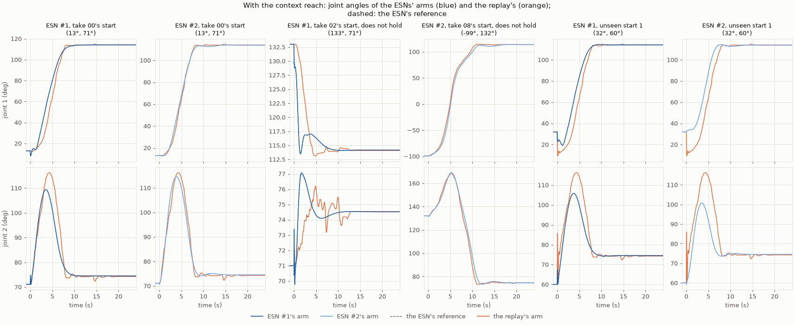

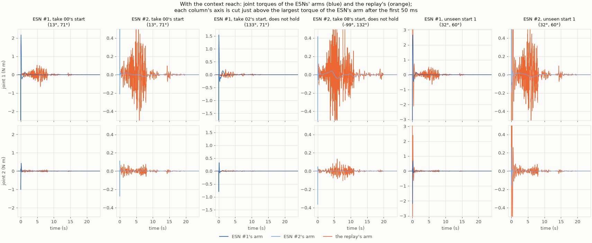

With the context `ellipse`, the first 20 s: from start 0 on the curve and from untaught
start 14, report 027's choice.

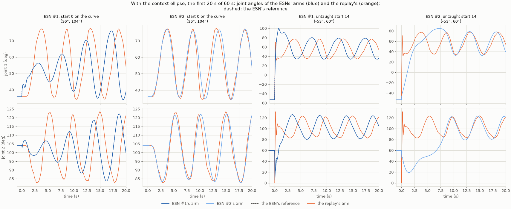

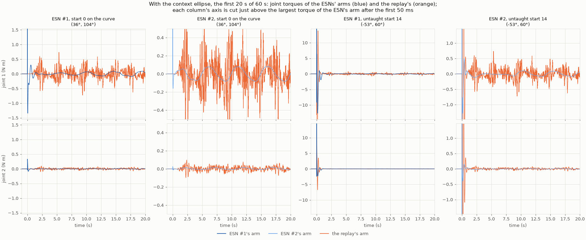

### 3.3 From the ellipse to the reach (claim 7 holds)

The run starts with the context `ellipse` from each of the eight starts on the curve,
and the context changes to `reach` at 16 s. The detour ratio is taken from where the
hand is at the change.

| | Arrive and hold, of 8 | Arrival after the change (s) | Detour ratio | Reference's fastest joint speed in the 2 s after (°/s) | Largest torque in the 2 s after (N m) |
| --- | --- | --- | --- | --- | --- |
| Two-task ESN #1 | 8 | 14.18 (11.38 to 15.94) | 7.70 (3.43 to 11.00) | 488 (418 to 499) | 25.5 (20.8 to 27.5) |
| Two-task ESN #2 | 8 | 9.38 (8.18 to 14.42) | 3.15 (2.71 to 5.18) | 104 (96 to 113) | 5.9 (4.6 to 6.5) |

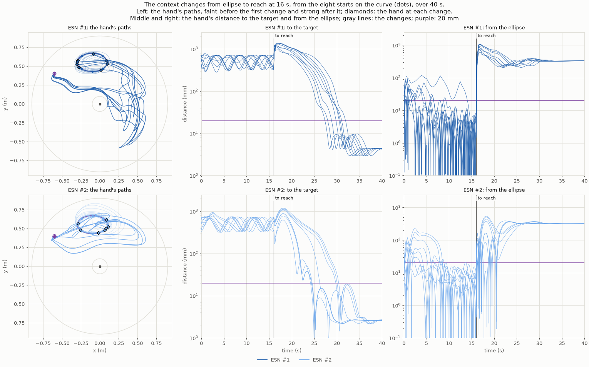

- **Claim 7 holds:** in all eight runs of each ESN the hand leaves the ellipse, arrives
  at the target, and holds. It ends 4.2 to 4.5 mm from the target for ESN #1 and 2.6 to
  2.7 mm for ESN #2.
- **The change meets the hand at different places.** At 16 s the eight hands are
  spread around the ellipse, 0.33 to 0.72 m from the target.
- **The hand does not go straight to the target.** For ESN #1 it first goes away, to
  1.0 to 1.4 m from the target on the right side of the workspace within 1.3 s, and
  then comes to the target: a path 3.4 to 11.0 times the straight distance. In all
  eight runs joint 1 falls to between −70° and −105° within a second of the change and
  then rises to 114°. ESN #2's hand swings out less and later, to 0.6 to 1.2 m from the
  target about 2 s after the change, 2.7 to 5.2 times the straight distance, with
  joint 1 dipping to −14° at the lowest.
- **ESN #1's reference jumps at the change; ESN #2's steps far less.** The reference's
  fastest joint speed in the 2 s after is 418 to 499 °/s for ESN #1 and 96 to 113 °/s
  for ESN #2, where on the ellipse before the change it is 27 to 35 °/s for both. The
  largest torque is 25.5 N m by the median against 5.9 N m.
- **Arriving takes longer than a reach from rest.** ESN #1 arrives 14.2 s after the
  change by the median and ESN #2 9.4 s, where their reaches of Section 3.2 take 8.4
  and 8.6 s.

Joint angles and torques from starts 0 and 4, half a loop apart. The replay keeps to
the ellipse.

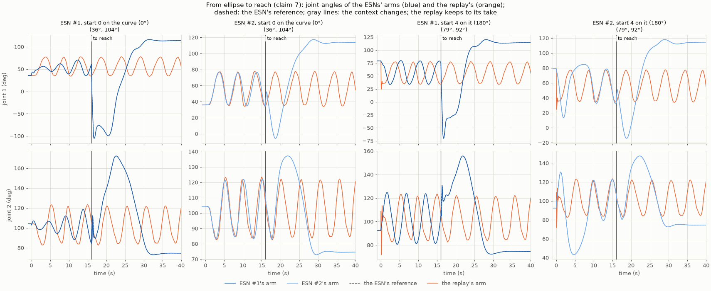

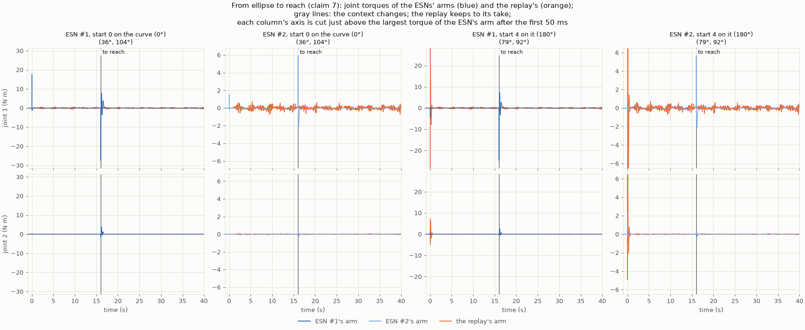

### 3.4 From the reach to the ellipse (claim 8 holds)

The run starts with the context `reach` from each of the nine reach takes' starts, and
the context changes to `ellipse` at 20 s. By then every hand has been within 20 mm of
the target for 4.3 s or more, the two of Section 3.2 that left it once too.

| | Takes | Cycle at the end | Curve RMS (mm) | Joining after the change (s) | Reference's fastest joint speed in the 2 s after (°/s) | Largest torque in the 2 s after (N m) | The arm's fastest joint speed (°/s) |
| --- | --- | --- | --- | --- | --- | --- | --- |
| Two-task ESN #1 | the seven that rest at 114° | 7 of 7 | 4.28 | 7.92 | 405 | 13.3 | 448 |
| | 03 and 04, at −246° | 2 of 2 | 4.21 | 7.56 | 726 | 33.6 | 805 |
| Two-task ESN #2 | the seven that rest at 114° | 7 of 7 | 6.10 | 9.42 | 87 | 2.2 | 88 |
| | 03 and 04, at −246° | 2 of 2 | 6.43 | 9.88 | 154 | 1.7 | 157 |

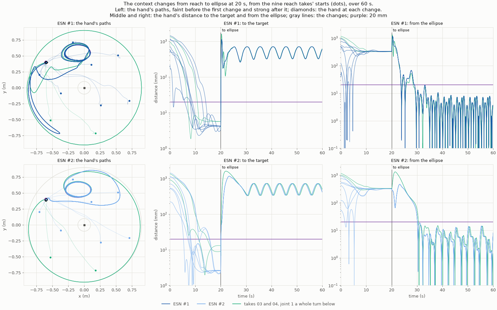

- **Claim 8 holds:** in all nine runs of each ESN the hand leaves the target, joins the
  ellipse, and cycles at the end, 4.2 to 4.3 mm RMS from it for ESN #1 and 6.1 to
  6.4 mm for ESN #2, as close as with the context `ellipse` from the start.
- **From one rest posture, one run.** The seven takes that rest at 114° give the same
  run after the change: the same joining time, 7.92 s for ESN #1 and 9.42 s for ESN #2,
  and the same peaks to within 1 °/s. Their joint angles differ by 0.21° at the most
  for ESN #1 and 0.06° for ESN #2, and the most at the change itself, by as much as
  the rests differ. So do takes 03 and 04 between themselves, within 0.01° and 0.30°.
  At rest at the target the ESN has forgotten where it started.
- **The two rest postures.** From takes 03 and 04, joint 1 is at −246° when the context
  changes. It goes back up nearly a whole turn to where the ellipse was taught, 33° to
  78°, and the hand cycles as from the other seven. On the way the hand sweeps around
  the rim of the workspace (the green paths). ESN #1 swings joint 1 up in about a
  second, at up to 805 °/s, overshoots to 162°, and is within the ellipse's range from
  2.6 s after the change; ESN #2 is there after 4.3 s, at up to 157 °/s.
- **ESN #1 jumps here too.** From the seven takes that rest at 114°, its reference moves
  joint 1 from 114° to 212° in 0.4 s, and the arm follows at up to 448 °/s, to 220°,
  before it turns to the ellipse. ESN #2's joint 1 dips to −8° over
  2.6 s and rises to the ellipse, at no more than 88 °/s.
- **Joining takes longer than from an untaught start.** 7.9 and 9.4 s after the change,
  against the 2.5 and 8.2 s by the median of Section 3.2's untaught starts.

Joint angles and torques from take 00's start and take 03's. The replay keeps to its
take and rests at the target.

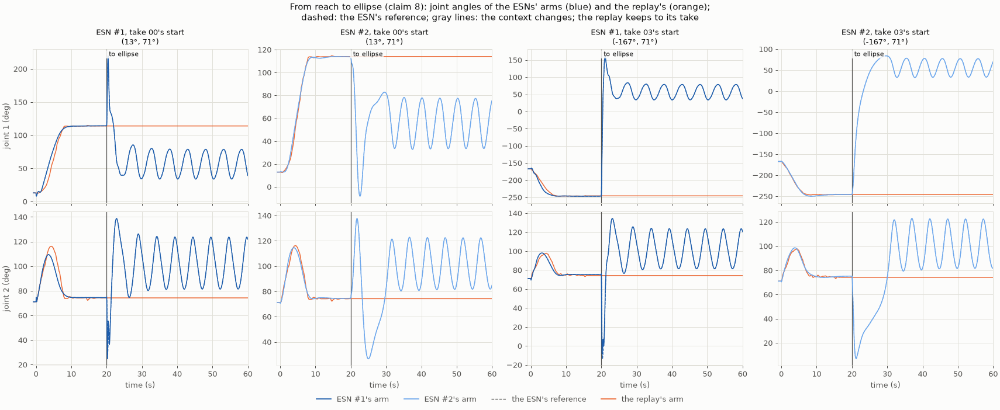

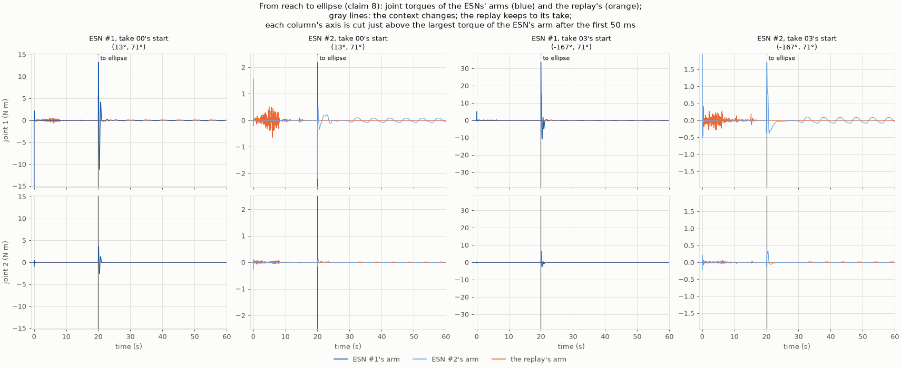

### 3.5 Back and forth (claim 9 holds)

From each of the eight starts on the curve, the context goes from `ellipse` to `reach`
at 16 s, back to `ellipse` at 36 s, and to `reach` again at 76 s.

| | Arrival after the first change (s) | Joining after the second (s) | Cycle before the third, of 8 | Curve RMS before the third (mm) | Arrive and hold after the third, of 8 | Arrival after the third (s) |
| --- | --- | --- | --- | --- | --- | --- |
| Two-task ESN #1 | 14.18 (11.38 to 15.94) | 7.92 | 8 | 4.28 | 8 | 11.99 |
| Two-task ESN #2 | 9.38 (8.18 to 14.42) | 9.42 (9.42 to 9.43) | 8 | 6.10 | 8 | 7.65 (7.64 to 7.68) |

The reference's fastest joint speed and the largest torque in the 2 s after each
change, by the median:

| | After the first change, to `reach` | After the second, to `ellipse` | After the third, to `reach` |
| --- | --- | --- | --- |
| Two-task ESN #1 | 488 °/s, 25.5 N m | 406 °/s, 13.3 N m | 416 °/s, 20.7 N m |
| Two-task ESN #2 | 104 °/s, 5.9 N m | 87 °/s, 2.2 N m | 101 °/s, 4.7 N m |

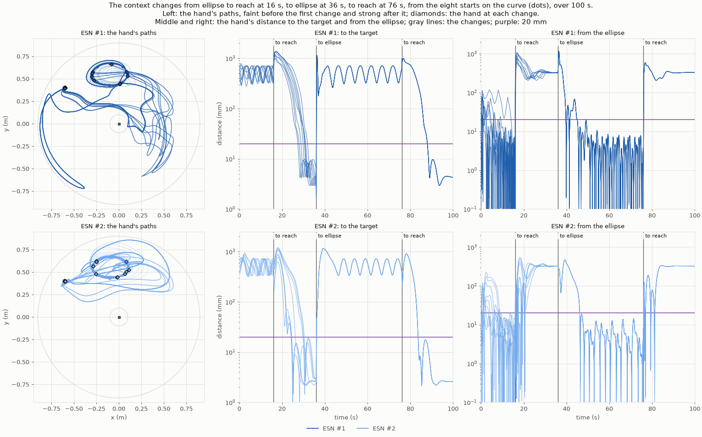

- **Claim 9 holds:** in all eight runs of each ESN the hand cycles over the five taught
  periods before the last change, 50.4 s to 76 s, and arrives at the target and holds
  after it.
- **Each change does what it did alone.** Up to 36 s the runs are claim 7's, joint angle
  for joint angle. After the second change they are claim 8's from a take that rests at
  114°: the same joining times, 7.92 and 9.42 s, and the same peaks to within 1 °/s.
- **After the second change the eight runs are one,** to within 0.8° of the joints
  against claim 8's run from take 00. For ESN #1 every later time is the same in all
  eight; for ESN #2 the times differ by 0.04 s at the most.
- **The last change always meets the hand at the same place on the ellipse,** so the
  third arrival hardly varies: 11.99 s for ESN #1, within the spread of the first, and
  7.64 to 7.68 s for ESN #2, sooner than any of the first.

Joint angles and torques from start 0, over the whole 100 s.

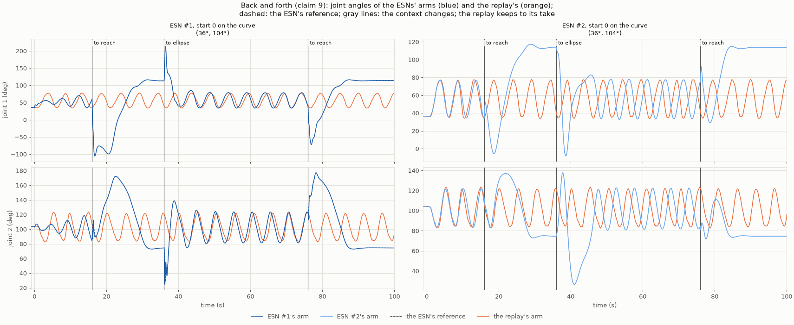

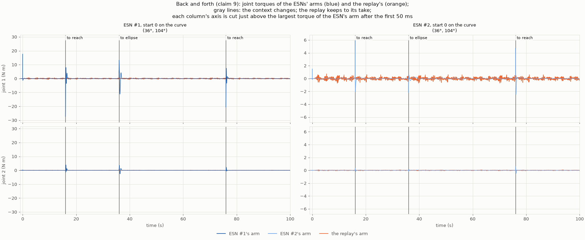

## 4. Observations

- **The context does what it is for.** In all 50 runs with a change, the hand leaves
  the task it was doing and does the other, at whatever point of the ellipse or
  whichever rest posture the change meets it. Neither transition was taught: no take
  goes from the ellipse to the target or back.
- **The way between the tasks is the ESN's own, and it is not a short one.** The hand
  goes away from the target before it comes to it, and ESN #1 moves joint 1 by 106° or
  more within a second of every change. Nothing in the search scored this: it had no change
  of context. In the torque after a change the two ESNs differ four to six times by
  the median, and twenty times from the rest posture at −246°, with the same claims
  holding for both.
- **The reach's failures are a matter of settling, not of arriving.** The ten reaches
  that do not hold end at the target; they cross the 20 mm once more before they
  settle. The two-task ESNs have a larger spectral radius than report 023's, 1.65 and
  1.5 against 1.2 and 1.05, which the ellipse asked for, and their reach is less direct
  and less settled. Whether the spectral radius is the cause was not tested: the ESNs
  differ in their other parameters and in their training too.
- **One ESN for both tasks is harder to find than one for each.** The settings that
  cycle and the settings that reach best pull apart in the spectral radius and the
  ridge, and most of the best ones lie on the edge of the fine grid. Of the 100 ESNs
  scored again, none passes every run of both tasks, and 88 fail runs of each. The rule chose by the setting; the single ESN with the fewest
  failing runs belongs to the fifth.
- **The ESN forgets its start at rest, and not on the ellipse.** After a reach has settled,
  the run that follows depends only on the rest posture. On the ellipse, where the
  change meets the hand still matters: the first arrival varies from 11.4 to 15.9 s for
  ESN #1.
- **A whole turn of a joint is a real difference to the ESN.** The posture at −246° is
  the same as at 114° for the arm, but the ESN is fed joint angles, and it unwinds the
  turn to reach the ellipse it was taught, ESN #1 at 805 °/s. On a robot with joint
  limits or cables this is the motion to look at first.
- **One measure cannot be read:** whether the hand cycles before the change at 16 s.
  16 s is shorter than the five taught periods a cycling run is measured over, so the
  count is 0 for every run and says nothing. It is left out above.

## 5. Next steps

Proposals. None is started.

1. **Search past the edge.** Most of the best settings have the fine grid's largest
   ridge, and ESN #1's its largest spectral radius too. A grid that goes on to a ridge of 100 and a spectral radius of 1.8,
   or more seeds per setting, may find settings whose seeds agree.
2. **Choose by the ESN, with held-out starts.** With seeds this far apart, the typical
   seed of the best setting is not the most reliable ESN. A rule that scores each ESN,
   and tests the chosen ones from starts the search did not use, would fit this
   problem better; it changes the rule, so it is the maintainer's to decide.
3. **Score or teach the change.** The way after a change of context is unscored and
   untaught. Either put runs with a change into the search's score, or record takes
   that go from the ellipse to the target and from the target to the ellipse.
4. **Disturbances with two tasks.** This report has no pushes and no block. Report 027's
   ESNs wait while held and come back after a push; whether the two-task ESNs do, and
   what a push near a change of context does, is not known.
